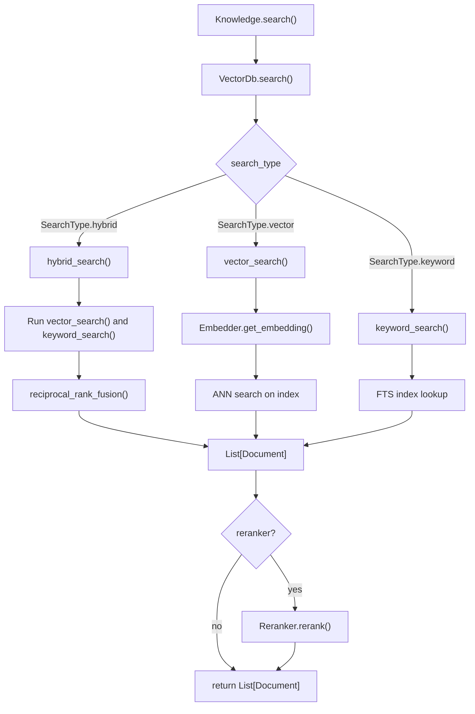
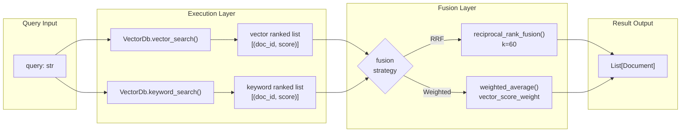
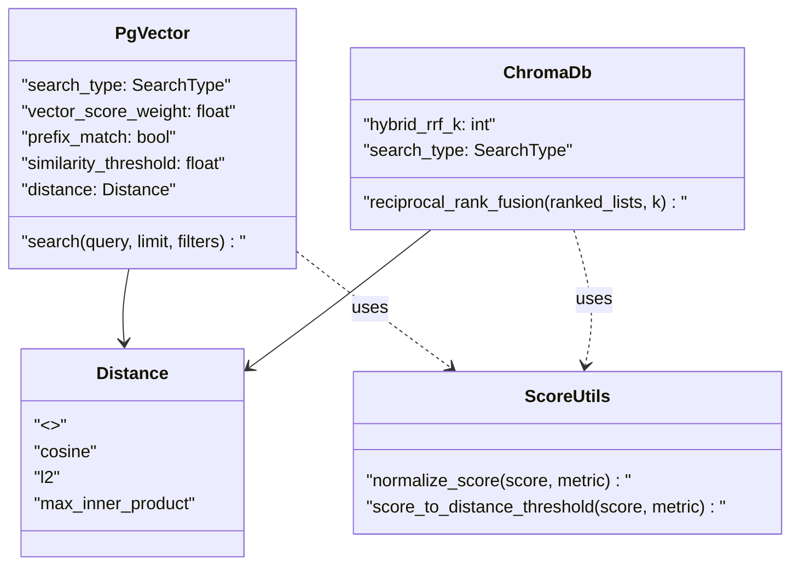

<!-- source: DeepWiki mcp.deepwiki.com · repo agno-agi/agno · page 5.3 Search Types and Strategies · fetched 2026-11-09 -->

# Search Types and Strategies

<details>
<summary>Relevant source files</summary>

The following files were used as context for generating this wiki page:

- [cookbook/07_knowledge/02_building_blocks/12_hyde_query_transformer.py](cookbook/07_knowledge/02_building_blocks/12_hyde_query_transformer.py)
- [cookbook/07_knowledge/02_building_blocks/13_hyde_with_hybrid_search.py](cookbook/07_knowledge/02_building_blocks/13_hyde_with_hybrid_search.py)
- [cookbook/07_knowledge/04_advanced/06_prefix_search.py](cookbook/07_knowledge/04_advanced/06_prefix_search.py)
- [cookbook/07_knowledge/04_advanced/README.md](cookbook/07_knowledge/04_advanced/README.md)
- [cookbook/91_tools/other/human_in_the_loop.py](cookbook/91_tools/other/human_in_the_loop.py)
- [libs/agno/agno/agent/_default_tools.py](libs/agno/agno/agent/_default_tools.py)
- [libs/agno/agno/agent/_messages.py](libs/agno/agno/agent/_messages.py)
- [libs/agno/agno/agent/_tools.py](libs/agno/agno/agent/_tools.py)
- [libs/agno/agno/knowledge/query_transformer/__init__.py](libs/agno/agno/knowledge/query_transformer/__init__.py)
- [libs/agno/agno/knowledge/query_transformer/base.py](libs/agno/agno/knowledge/query_transformer/base.py)
- [libs/agno/agno/knowledge/query_transformer/hyde.py](libs/agno/agno/knowledge/query_transformer/hyde.py)
- [libs/agno/agno/team/_default_tools.py](libs/agno/agno/team/_default_tools.py)
- [libs/agno/agno/team/_init.py](libs/agno/agno/team/_init.py)
- [libs/agno/agno/team/_messages.py](libs/agno/agno/team/_messages.py)
- [libs/agno/agno/team/_session.py](libs/agno/agno/team/_session.py)
- [libs/agno/agno/team/_task_tools.py](libs/agno/agno/team/_task_tools.py)
- [libs/agno/agno/team/_tools.py](libs/agno/agno/team/_tools.py)
- [libs/agno/agno/utils/knowledge.py](libs/agno/agno/utils/knowledge.py)
- [libs/agno/agno/vectordb/score.py](libs/agno/agno/vectordb/score.py)
- [libs/agno/tests/integration/teams/human_in_the_loop/test_team_tool_hitl.py](libs/agno/tests/integration/teams/human_in_the_loop/test_team_tool_hitl.py)
- [libs/agno/tests/unit/agent/test_team_tool_propagation.py](libs/agno/tests/unit/agent/test_team_tool_propagation.py)
- [libs/agno/tests/unit/knowledge/test_knowledge_isolation.py](libs/agno/tests/unit/knowledge/test_knowledge_isolation.py)
- [libs/agno/tests/unit/knowledge/test_knowledge_metadata_propagation.py](libs/agno/tests/unit/knowledge/test_knowledge_metadata_propagation.py)
- [libs/agno/tests/unit/team/test_get_tool_names.py](libs/agno/tests/unit/team/test_get_tool_names.py)
- [libs/agno/tests/unit/team/test_parser_model_tool_strictness.py](libs/agno/tests/unit/team/test_parser_model_tool_strictness.py)
- [libs/agno/tests/unit/vectordb/test_pgvector.py](libs/agno/tests/unit/vectordb/test_pgvector.py)
- [libs/agno/tests/unit/vectordb/test_score.py](libs/agno/tests/unit/vectordb/test_score.py)

</details>


This page covers the search modes, ranking algorithms, score normalization utilities, and query transformation strategies available across vector database implementations and knowledge systems in Agno. It explains the `SearchType` enum, implementation strategies, Reciprocal Rank Fusion (RRF), reranking systems, distance metrics, and Hypothetical Document Embeddings (HyDE).

For documentation of the `VectorDb` interface, see [Vector Database Integrations](#5.2). For agent invocation via the `Knowledge` class, see [Knowledge Base and Agentic RAG](#5.1).

---

## 1. The `SearchType` Enum

All vector database implementations share a common `SearchType` enum defined in `agno.vectordb.search`:

| Value | Description |
|---|---|
| `SearchType.vector` | Pure embedding-based similarity search (default) |
| `SearchType.keyword` | Full-text / lexical search |
| `SearchType.hybrid` | Combines vector and keyword results using a fusion strategy |

Each `VectorDb` subclass accepts `search_type` as a constructor parameter and routes the `search()` call accordingly [libs/agno/agno/vectordb/pgvector/pgvector.py:73-121](), [libs/agno/agno/vectordb/lancedb/lance_db.py:46-65](), [libs/agno/agno/vectordb/chroma/chromadb.py:92-107]().

Sources: [libs/agno/agno/vectordb/search.py:1-7](), [libs/agno/agno/vectordb/pgvector/pgvector.py:73-121](), [libs/agno/agno/vectordb/lancedb/lance_db.py:46-65](), [libs/agno/agno/vectordb/chroma/chromadb.py:92-107]()

---

## 2. Search Dispatch Flow

The following diagram maps the `search()` call path from caller to database-specific implementations, bridging natural language concepts to code entities like `VectorDb.search()`, `vector_search()`, `keyword_search()`, and `Reranker.rerank()`.

**Diagram: Search Dispatch by `SearchType` and Code Entities**



Sources: [libs/agno/agno/vectordb/pgvector/pgvector.py:532-588](), [libs/agno/agno/vectordb/lancedb/lance_db.py:438-485](), [libs/agno/agno/vectordb/chroma/chromadb.py:516-568]()

---

## 3. Query Transformers (HyDE)

Agno provides a query transformation subsystem under `agno.knowledge.query_transformer` to pre-process or expand user queries before they are sent to the vector database or knowledge base search pipeline [libs/agno/agno/knowledge/query_transformer/base.py](), [libs/agno/agno/knowledge/query_transformer/hyde.py]().

### Hypothetical Document Embeddings (HyDE)
The `HyDE` query transformer (`agno.knowledge.query_transformer.hyde.HyDE`) bridges the semantic gap between short user queries and long, information-rich document chunks. 

**How it works:**
1. The agent or user submits a natural language query string.
2. The `HyDE` transformer prompts an LLM to generate a **hypothetical document** that answers the query.
3. The generated hypothetical document is embedded instead of the raw query.
4. The resulting embedding vector is used for the vector database nearest neighbor search, yielding higher semantic alignment with stored corpus chunks.

```python
from agno.knowledge.query_transformer.hyde import HyDE

# Initialize HyDE query transformer with a model
hyde_transformer = HyDE(model=openai_model)
```

Sources: [libs/agno/agno/knowledge/query_transformer/base.py:1-28](), [libs/agno/agno/knowledge/query_transformer/hyde.py:1-60]()

---

## 4. Vector Search

Vector search embeds the query string (or transformed query via HyDE) and performs approximate nearest neighbor (ANN) lookup against stored embedding vectors.

**How it works:**
1. Call `Embedder.get_embedding(query)` to produce a float vector [libs/agno/agno/vectordb/pgvector/pgvector.py:481-481](), [libs/agno/agno/vectordb/lancedb/lance_db.py:383-383]().
2. Submit the vector to the database's native ANN search API.
3. Return results ranked by distance (closest first).

| Database | Index Type | Distance Default |
|---|---|---|
| `PgVector` | HNSW or IVFFlat | `Distance.cosine` [libs/agno/agno/vectordb/pgvector/pgvector.py:85-85]() |
| `LanceDb` | IVF | `Distance.cosine` [libs/agno/agno/vectordb/lancedb/lance_db.py:60-60]() |
| `ChromaDb` | HNSW | `Distance.cosine` [libs/agno/agno/vectordb/chroma/chromadb.py:99-99]() |
| `Milvus` | Auto-Index | `Distance.cosine` [libs/agno/agno/vectordb/milvus/milvus.py:41-41]() |

Sources: [libs/agno/agno/vectordb/pgvector/pgvector.py:85-85](), [libs/agno/agno/vectordb/lancedb/lance_db.py:60-60](), [libs/agno/agno/vectordb/chroma/chromadb.py:99-99](), [libs/agno/agno/vectordb/milvus/milvus.py:41-41]()

---

## 5. Keyword Search

Keyword search performs lexical matching against document content. Implementation details vary by backend.

### PgVector Prefix Search
`PgVector` supports prefix matching, enabling search-as-you-type functionality.
- **Prefix Match Flag:** Controlled via `prefix_match` in the constructor [libs/agno/agno/vectordb/pgvector/pgvector.py:86-86]().
- **Implementation:** Uses PostgreSQL full-text search capabilities with configurable `content_language` [libs/agno/agno/vectordb/pgvector/pgvector.py:88-88]().

### Sparse Vector Generation
Implementations like `Milvus` and `Qdrant` generate sparse vectors for keyword search.
- **Milvus:** Uses a TF-IDF-like scoring method `_get_sparse_vector()` to map word IDs to scores [libs/agno/agno/vectordb/milvus/milvus.py:134-163]().
- **Qdrant:** Integrates `fastembed.SparseTextEmbedding` (specifically `Qdrant/bm25`) for lexical search [libs/agno/agno/vectordb/qdrant/qdrant.py:22-25](), [libs/agno/agno/vectordb/qdrant/qdrant.py:151-153]().

Sources: [libs/agno/agno/vectordb/pgvector/pgvector.py:86-88](), [libs/agno/agno/vectordb/milvus/milvus.py:134-163](), [libs/agno/agno/vectordb/qdrant/qdrant.py:22-25](), [libs/agno/agno/vectordb/qdrant/qdrant.py:151-153]()

---

## 6. Hybrid Search and Reciprocal Rank Fusion (RRF)

Hybrid search combines results from both vector and keyword search, then fuses them into a single ranking.

**Diagram: Hybrid Search and RRF Code Entities**



### Fusion Methods
- **Weighted Average:** Used by `PgVector`, applying `vector_score_weight` (default 0.5) to balance vector vs keyword scores [libs/agno/agno/vectordb/pgvector/pgvector.py:87-87](). `MongoDb` similarly uses `hybrid_vector_weight` and `hybrid_keyword_weight` [libs/agno/agno/vectordb/mongodb/mongodb.py:109-110]().
- **Reciprocal Rank Fusion (RRF):** A rank-aggregation algorithm that combines lists by summing the reciprocals of ranks. 
    - **Formula:** `RRF(d) = sum(1 / (k + rank_i(d)))` where `k` is a constant (default 60) [libs/agno/agno/vectordb/chroma/chromadb.py:38-62]().
    - **Implementation:** Found in `ChromaDb` [libs/agno/agno/vectordb/chroma/chromadb.py:103-103](), `MongoDb` [libs/agno/agno/vectordb/mongodb/mongodb.py:111-111](), and `Qdrant` via `models.Fusion.RRF` [libs/agno/agno/vectordb/qdrant/qdrant.py:57-57]().

Sources: [libs/agno/agno/vectordb/pgvector/pgvector.py:87-87](), [libs/agno/agno/vectordb/chroma/chromadb.py:38-62](), [libs/agno/agno/vectordb/mongodb/mongodb.py:109-110](), [libs/agno/agno/vectordb/qdrant/qdrant.py:57-57]()

---

## 7. Rerankers (MMR, Recency, Model-Based)

Agno provides a modular reranking subsystem under `agno.knowledge.reranker` (`Reranker` base class in `libs/agno/agno/knowledge/reranker/base.py`) to re-order retrieved documents before they are returned to the agent knowledge context.

- **MMR (Maximal Marginal Relevance):** Promotes result diversity by penalizing items redundant with already selected documents (`libs/agno/agno/knowledge/reranker/mmr.py`).
- **Recency Reranker:** Boosts documents based on recency metadata stored in chunks (`libs/agno/agno/knowledge/reranker/recency.py`, `STORE_RECENCY_METADATA_KEY` in `libs/agno/agno/knowledge/utils.py`).
- **Model-Based Rerankers:** Uses cross-encoder or LLM-based scoring models to perform precise semantic re-scoring.

Sources: [libs/agno/agno/knowledge/reranker/base.py:1-50](), [libs/agno/agno/knowledge/reranker/mmr.py:1-50](), [libs/agno/agno/knowledge/reranker/recency.py:1-50](), [libs/agno/agno/knowledge/utils.py:1-36]()

---

## 8. Distance Metrics and Score Normalization

The `Distance` enum determines how vector similarity is computed. Agno provides utilities in `agno.vectordb.score` to normalize these to a `[0.0, 1.0]` similarity range [libs/agno/agno/vectordb/score.py:1-61]().

| Metric | Normalized Similarity Formula |
|---|---|
| `Distance.cosine` | `1.0 - distance` (clamped to 0-1) [libs/agno/agno/vectordb/score.py:11-20]() |
| `Distance.l2` | `1.0 / (1.0 + distance)` [libs/agno/agno/vectordb/score.py:23-32]() |
| `Distance.max_inner_product` | `(inner_product + 1.0) / 2.0` [libs/agno/agno/vectordb/score.py:35-44]() |

### Threshold Filtering
The `score_to_distance_threshold()` function converts a desired similarity score (e.g., 0.8) back into a raw distance threshold used for database-level filtering [libs/agno/agno/vectordb/score.py:89-106](). This is used during initialization in classes like `PgVector` to filter results via `similarity_threshold` [libs/agno/agno/vectordb/pgvector/pgvector.py:93-93]().

Sources: [libs/agno/agno/vectordb/score.py:1-106](), [libs/agno/agno/vectordb/pgvector/pgvector.py:93-93]()

---

## 9. Database Implementation Summary

**Diagram: Search Strategy Code Entities and Classes**



Sources: [libs/agno/agno/vectordb/pgvector/pgvector.py:73-162](), [libs/agno/agno/vectordb/chroma/chromadb.py:38-163](), [libs/agno/agno/vectordb/score.py:1-106]()

---

