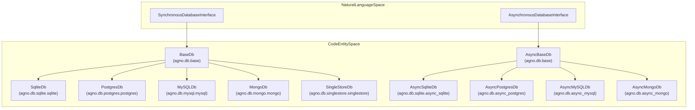
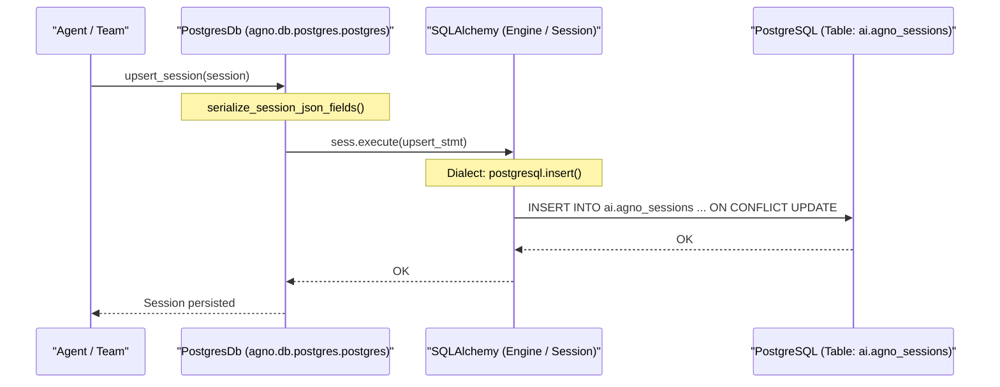
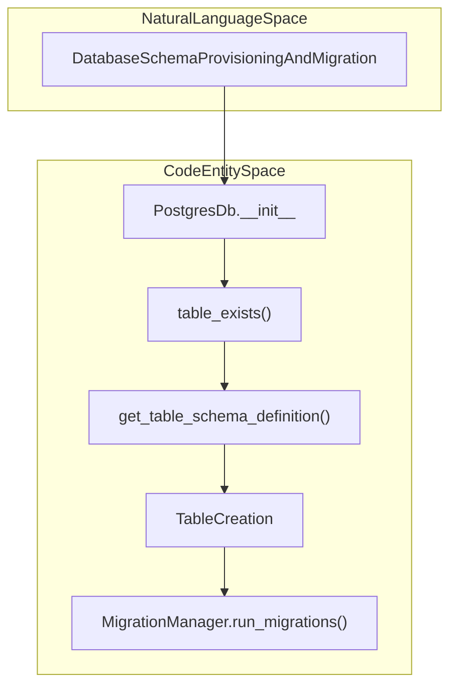

<!-- source: DeepWiki mcp.deepwiki.com · repo agno-agi/agno · page 5.4 Database Backends · fetched 2026-11-09 -->

# Database Backends

<details>
<summary>Relevant source files</summary>

The following files were used as context for generating this wiki page:

- [libs/agno/agno/db/base.py](libs/agno/agno/db/base.py)
- [libs/agno/agno/db/dynamo/dynamo.py](libs/agno/agno/db/dynamo/dynamo.py)
- [libs/agno/agno/db/dynamo/utils.py](libs/agno/agno/db/dynamo/utils.py)
- [libs/agno/agno/db/firestore/firestore.py](libs/agno/agno/db/firestore/firestore.py)
- [libs/agno/agno/db/firestore/utils.py](libs/agno/agno/db/firestore/utils.py)
- [libs/agno/agno/db/gcs_json/gcs_json_db.py](libs/agno/agno/db/gcs_json/gcs_json_db.py)
- [libs/agno/agno/db/gcs_json/utils.py](libs/agno/agno/db/gcs_json/utils.py)
- [libs/agno/agno/db/in_memory/in_memory_db.py](libs/agno/agno/db/in_memory/in_memory_db.py)
- [libs/agno/agno/db/in_memory/utils.py](libs/agno/agno/db/in_memory/utils.py)
- [libs/agno/agno/db/json/json_db.py](libs/agno/agno/db/json/json_db.py)
- [libs/agno/agno/db/json/utils.py](libs/agno/agno/db/json/utils.py)
- [libs/agno/agno/db/mongo/async_mongo.py](libs/agno/agno/db/mongo/async_mongo.py)
- [libs/agno/agno/db/mongo/mongo.py](libs/agno/agno/db/mongo/mongo.py)
- [libs/agno/agno/db/mongo/utils.py](libs/agno/agno/db/mongo/utils.py)
- [libs/agno/agno/db/mysql/async_mysql.py](libs/agno/agno/db/mysql/async_mysql.py)
- [libs/agno/agno/db/mysql/mysql.py](libs/agno/agno/db/mysql/mysql.py)
- [libs/agno/agno/db/mysql/utils.py](libs/agno/agno/db/mysql/utils.py)
- [libs/agno/agno/db/postgres/async_postgres.py](libs/agno/agno/db/postgres/async_postgres.py)
- [libs/agno/agno/db/postgres/postgres.py](libs/agno/agno/db/postgres/postgres.py)
- [libs/agno/agno/db/postgres/utils.py](libs/agno/agno/db/postgres/utils.py)
- [libs/agno/agno/db/redis/redis.py](libs/agno/agno/db/redis/redis.py)
- [libs/agno/agno/db/redis/utils.py](libs/agno/agno/db/redis/utils.py)
- [libs/agno/agno/db/singlestore/singlestore.py](libs/agno/agno/db/singlestore/singlestore.py)
- [libs/agno/agno/db/singlestore/utils.py](libs/agno/agno/db/singlestore/utils.py)
- [libs/agno/agno/db/sqlite/async_sqlite.py](libs/agno/agno/db/sqlite/async_sqlite.py)
- [libs/agno/agno/db/sqlite/sqlite.py](libs/agno/agno/db/sqlite/sqlite.py)
- [libs/agno/agno/db/sqlite/utils.py](libs/agno/agno/db/sqlite/utils.py)
- [libs/agno/agno/db/surrealdb/surrealdb.py](libs/agno/agno/db/surrealdb/surrealdb.py)
- [libs/agno/agno/os/routers/company/schema.py](libs/agno/agno/os/routers/company/schema.py)
- [libs/agno/tests/unit/db/test_dynamo_bool_serialization.py](libs/agno/tests/unit/db/test_dynamo_bool_serialization.py)

</details>


This document covers the database backend abstraction layer and the 9+ supported database implementations in Agno. Database backends provide persistent storage for sessions, memories, metrics, evaluation runs, knowledge content, traces, spans, and governance records.

---

## BaseDb and AsyncBaseDb Interfaces

All database backends inherit from `BaseDb` (synchronous) or `AsyncBaseDb` (asynchronous), which define a unified interface for CRUD operations across different storage technologies. This abstraction decouples agents, teams, workflows, and control plane services from concrete database implementations.

**Key Responsibilities:**
- **Session Management**: CRUD operations for `AgentSession`, `TeamSession`, and `WorkflowSession` [libs/agno/agno/db/base.py:19-20]().
- **Memory Storage**: Persistence for user memories (`UserMemory`) [libs/agno/agno/db/base.py:12-12]().
- **Observability**: Storage for metrics, evaluation runs, traces, and spans [libs/agno/agno/db/base.py:10-13]().
- **Knowledge Management**: Persistence for `KnowledgeRow` content and metadata [libs/agno/agno/db/base.py:14-14]().
- **Governance**: Management of human-in-the-loop approvals, cron schedules, service accounts, and component configurations.

**Class Hierarchy Diagram (Natural Language to Code Entity Space)**


Sources: [libs/agno/agno/db/base.py:1-25](), [libs/agno/agno/db/sqlite/sqlite.py:100-105](), [libs/agno/agno/db/postgres/postgres.py:135-140](), [libs/agno/agno/db/mongo/mongo.py:60-65](), [libs/agno/agno/db/mongo/async_mongo.py:150-155]()

---

## Supported Database Backends (9+ Types)

Agno provides native adapters for relational SQL databases, NoSQL document stores, key-value stores, cloud databases, and ephemeral in-memory storage.

### 1. Relational Databases (SQLAlchemy)
Relational backends leverage SQLAlchemy to provide robust connection pooling, schema migrations, and dialect-specific optimizations.

| Backend | Sync Class | Async Class | Key Features |
|---------|------------|-------------|--------------|
| **PostgreSQL** | `PostgresDb` [libs/agno/agno/db/postgres/postgres.py:135-135]() | `AsyncPostgresDb` [libs/agno/agno/db/postgres/async_postgres.py:107-107]() | Schemas, JSONB support, `pool_pre_ping=True`, `pool_recycle=3600` [libs/agno/agno/db/postgres/async_postgres.py:150-155](). |
| **SQLite** | `SqliteDb` [libs/agno/agno/db/sqlite/sqlite.py:101-101]() | `AsyncSqliteDb` [libs/agno/agno/db/sqlite/async_sqlite.py:75-75]() | Zero-config file-based storage. Async powered by `aiosqlite`. |
| **MySQL** | `MySQLDb` [libs/agno/agno/db/mysql/mysql.py:60-60]() | `AsyncMySQLDb` [libs/agno/agno/db/mysql/async_mysql.py:60-60]() | Standard relational storage via `mysql` and `asyncmy` dialects [libs/agno/agno/db/mysql/async_mysql.py:85-90](). |
| **SingleStore** | `SingleStoreDb` [libs/agno/agno/db/singlestore/singlestore.py:59-59]() | N/A | High-performance distributed SQL and vector analytical workloads [libs/agno/agno/db/singlestore/singlestore.py:75-80](). |

### 2. NoSQL and Document Databases
For flexible schemaless data models and extreme horizontal scaling:

- **MongoDB**: Implemented via `MongoDb` [libs/agno/agno/db/mongo/mongo.py:60-60]() (using `pymongo`) and `AsyncMongoDb` [libs/agno/agno/db/mongo/async_mongo.py:150-150]() (supporting both `motor` and `pymongo` async drivers) [libs/agno/agno/db/mongo/async_mongo.py:77-83](). Automatically manages collection indexes [libs/agno/agno/db/mongo/utils.py:1-25]().
- **DynamoDB**: Implemented via `DynamoDb` using `boto3`. Includes chunked batch writing logic.
- **Firestore**: Implemented via `FirestoreDb` using Google Cloud Firestore, mapping Agno tables to Firestore collections.

### 3. Key-Value and File-Based Stores
- **Redis**: Implemented via `RedisDb` [libs/agno/agno/db/redis/redis.py:54-54]() using `redis-py` [libs/agno/agno/db/redis/redis.py:48-52](). Supports standalone and clustered configurations with a configurable `db_prefix` (default `agno`) and optional TTL expiration [libs/agno/agno/db/redis/redis.py:60-65]().
- **JSON / GCS**: File-based and cloud storage backends (`JsonDb` [libs/agno/agno/db/json/json_db.py:46-46]() and `GcsJsonDb`) that serialize framework data directly to local JSON files or Google Cloud Storage buckets [libs/agno/agno/db/json/json_db.py:60-65]().
- **In-Memory**: Implemented via `InMemoryDb`. Maintains data in local dictionaries for rapid prototyping, unit testing, and ephemeral execution.

Sources: [libs/agno/agno/db/postgres/postgres.py:135-145](), [libs/agno/agno/db/sqlite/sqlite.py:101-110](), [libs/agno/agno/db/mongo/mongo.py:60-70](), [libs/agno/agno/db/redis/redis.py:54-65](), [libs/agno/agno/db/json/json_db.py:46-60]()

---

## Data Flow: Session Persistence

The following sequence diagram illustrates how session state flows from agent execution down to the relational database backend (`PostgresDb`).


Sources: [libs/agno/agno/db/postgres/postgres.py:135-185]()

---

## Table Management and Schema Creation

Agno backends automatically manage their own schemas and table lifecycles upon initialization when `create_schema=True` (the default for relational and NoSQL adapters).

1. **Table Existence Verification**: Calls `table_exists(table_name)` to inspect storage availability [libs/agno/agno/db/postgres/postgres.py:155-165]().
2. **Schema Definition Retrieval**: Fetches column and type definitions via `get_table_schema_definition(table_type)` [libs/agno/agno/db/postgres/schemas.py:1-20]().
3. **DDL Execution**: Automatically creates missing tables, collections, or buckets.
4. **Index Provisioning**: Creates secondary indexes on frequently queried columns (e.g., `user_id`, `session_id`, `created_at`).
5. **Schema Versioning & Migrations**: Relational adapters stamp and track versions using a `versions` table managed by `MigrationManager` [libs/agno/agno/db/migrations/manager.py:1-40]().

**Table Management Architecture (Natural Language to Code Entity Space)**


Sources: [libs/agno/agno/db/postgres/postgres.py:135-175](), [libs/agno/agno/db/migrations/manager.py:1-40]()

---

## Connection Lifecycle and Pooling

Properly disposing of database connections and connection pools is critical for preventing connection leaks in production services and serverless runtimes.

### Synchronous Cleanup (`close()`)
Synchronous adapters dispose of SQLAlchemy engines or terminate database client connections:
```python
def close(self) -> None:
    if self.db_engine is not None:
        self.db_engine.dispose()
```
Sources: [libs/agno/agno/db/mysql/mysql.py:147-155](), [libs/agno/agno/db/mongo/mongo.py:140-149]()

### Asynchronous Cleanup (`close()`)
Asynchronous adapters provide coroutine-based `close()` methods to cleanly release async connection pools (e.g., `AsyncEngine.dispose()`) [libs/agno/agno/db/mysql/async_mysql.py:152-160]().

Sources: [libs/agno/agno/db/postgres/async_postgres.py:100-125](), [libs/agno/agno/db/mysql/async_mysql.py:152-160]()

---

