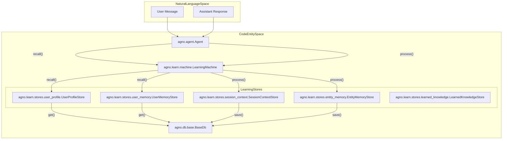
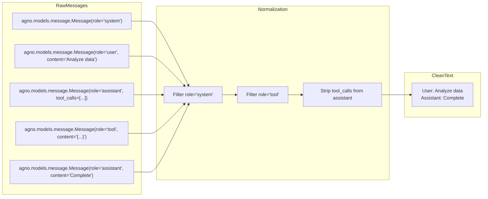

<!-- source: DeepWiki mcp.deepwiki.com · repo agno-agi/agno · page 6.1 LearningMachine Architecture · fetched 2026-11-09 -->

# LearningMachine Architecture

Relevant source files

The following files were used as context for generating this wiki page:

- [cookbook/08_learning/01_basics/6_extraction_limits.py](cookbook/08_learning/01_basics/6_extraction_limits.py)
- [cookbook/08_learning/07_patterns/research_assistant.py](cookbook/08_learning/07_patterns/research_assistant.py)
- [libs/agno/agno/agent/_init.py](libs/agno/agno/agent/_init.py)
- [libs/agno/agno/agent/_managers.py](libs/agno/agno/agent/_managers.py)
- [libs/agno/agno/learn/__init__.py](libs/agno/agno/learn/__init__.py)
- [libs/agno/agno/learn/config.py](libs/agno/agno/learn/config.py)
- [libs/agno/agno/learn/machine.py](libs/agno/agno/learn/machine.py)
- [libs/agno/agno/learn/schemas.py](libs/agno/agno/learn/schemas.py)
- [libs/agno/agno/learn/stores/__init__.py](libs/agno/agno/learn/stores/__init__.py)
- [libs/agno/agno/learn/stores/entity_memory.py](libs/agno/agno/learn/stores/entity_memory.py)
- [libs/agno/agno/learn/stores/learned_knowledge.py](libs/agno/agno/learn/stores/learned_knowledge.py)
- [libs/agno/agno/learn/stores/session_context.py](libs/agno/agno/learn/stores/session_context.py)
- [libs/agno/agno/learn/stores/user_memory.py](libs/agno/agno/learn/stores/user_memory.py)
- [libs/agno/agno/learn/stores/user_profile.py](libs/agno/agno/learn/stores/user_profile.py)
- [libs/agno/tests/unit/agent/test_memory_extra_messages.py](libs/agno/tests/unit/agent/test_memory_extra_messages.py)
- [libs/agno/tests/unit/learn/test_extraction_prompt_framing.py](libs/agno/tests/unit/learn/test_extraction_prompt_framing.py)
- [libs/agno/tests/unit/learn/test_session_context_store.py](libs/agno/tests/unit/learn/test_session_context_store.py)
- [libs/agno/tests/unit/test_learning_machine.py](libs/agno/tests/unit/test_learning_machine.py)
- [libs/agno/tests/unit/test_learning_message_filtering.py](libs/agno/tests/unit/test_learning_message_filtering.py)

The purpose and scope of this document is to provide a complete technical overview of the `LearningMachine` class (`libs/agno/agno/learn/machine.py`), the `learning=True` agent shortcut initialization (`libs/agno/agno/agent/_init.py`), store coordination, `LearningMode` settings (`libs/agno/agno/learn/config.py`), the `Curator` (`libs/agno/agno/learn/machine.py`), and how learning subsystems integrate directly with the Agno `Agent`.

---

## 1. Overview

The `LearningMachine` is a unified learning system within the Agno framework designed to enable agents to learn from every interaction. It orchestrates a suite of coordinated learning stores that manage user profiles, long-term memories, session-specific context, entity relationships, and global insights [libs/agno/agno/learn/machine.py:6-12]().

### Core Components and Stores

| Component | Class / Entity | Purpose |
|:---|:---|:---|
| **Coordinator** | `LearningMachine` | Manages the lifecycle and execution of all enabled learning stores [libs/agno/agno/learn/machine.py:82-107]() |
| **User Profile** | `UserProfileStore` | Manages structured data about the user (e.g., name, preferred name, custom fields) [libs/agno/agno/learn/stores/user_profile.py:62-77]() |
| **User Memory** | `UserMemoryStore` | Manages unstructured, long-term observations about the user [libs/agno/agno/learn/stores/user_memory.py:57-67]() |
| **Session Context** | `SessionContextStore` | Tracks the immediate goal, plan, and progress of the current session [libs/agno/agno/learn/stores/session_context.py:58-77]() |
| **Entity Memory** | `EntityMemoryStore` | Stores facts, events, and relationships regarding external entities (non-users) [libs/agno/agno/learn/stores/entity_memory.py:4-9]() |
| **Learned Knowledge** | `LearnedKnowledgeStore` | Extracts and searches for reusable, high-level insights across users using vector search [libs/agno/agno/learn/stores/learned_knowledge.py:51-69]() |
| **Curator** | `Curator` | Internal component responsible for maintaining and cleaning memories [libs/agno/agno/learn/machine.py:29]() |

**Sources:**
- [libs/agno/agno/learn/machine.py:6-12]()
- [libs/agno/agno/learn/machine.py:29]()
- [libs/agno/agno/learn/machine.py:82-107]()
- [libs/agno/agno/learn/stores/user_profile.py:62-77]()
- [libs/agno/agno/learn/stores/user_memory.py:57-67]()
- [libs/agno/agno/learn/stores/session_context.py:58-77]()
- [libs/agno/agno/learn/stores/entity_memory.py:4-9]()
- [libs/agno/agno/learn/stores/learned_knowledge.py:51-69]()

---

## 2. Agent Integration and Shortcut Initialization

The `LearningMachine` integrates tightly with the `Agent` initialization lifecycle through `set_learning_machine` [libs/agno/agno/agent/_init.py:122-131]() in `agno.agent._init`. 

### Initialization Modes via `learning` Parameter

When configuring an `Agent`, the `learning` attribute accepts several input types:
1. **`learning=False` or `learning=None`**: Learning is entirely disabled (`agent._learning = None`) [libs/agno/agno/agent/_init.py:136-139]()
2. **`learning=True`**: Automatically instantiates a default `LearningMachine` equipped with `UserProfileStore` and `UserMemoryStore` tied to the agent's database and model [libs/agno/agno/agent/_init.py:147-151]().
3. **`learning=LearningMachine(...)`**: Injects dependencies (`db`, `model`, and optional `knowledge`) into the user-provided `LearningMachine` instance [libs/agno/agno/agent/_init.py:154-165]().

**Sources:**
- [libs/agno/agno/agent/_init.py:122-171]()

---

## 3. Data Flow and Architecture

The `LearningMachine` acts as an intermediary between live conversation execution and persistent backend storage. 

### Diagram: Learning Extraction and Recall Pipeline

The following diagram bridges Natural Language Space to Code Entity Space, tracking how user inputs trigger memory recall and assistant responses trigger background extraction processes.

**Sources:**
- [libs/agno/agno/learn/machine.py:82-107]()
- [libs/agno/agno/learn/stores/session_context.py:108-163]()
- [libs/agno/agno/learn/stores/user_profile.py:108-159]()
- [libs/agno/agno/learn/stores/user_memory.py:98-149]()

---

## 4. Learning Modes

Information extraction and persistence are governed by the `LearningMode` enumeration [libs/agno/agno/learn/config.py:36-49]().

*   **`ALWAYS`**: Information is automatically extracted from conversations in the background after each turn [libs/agno/agno/learn/config.py:45-45]().
*   **`AGENTIC`**: The agent is provisioned with specific tools (e.g., `update_user_profile`, `update_user_memory`) to manage memories directly [libs/agno/agno/learn/config.py:46-46]().
*   **`PROPOSE`**: The agent suggests a memory or learning item for human confirmation (used in `LearnedKnowledgeStore`) [libs/agno/agno/learn/config.py:47-47]().
*   **`HITL`**: Reserved for future use; currently unsupported by stores [libs/agno/agno/learn/config.py:48-48]().

### Store-Specific Mode Support Matrix

| Store | `ALWAYS` | `AGENTIC` | `PROPOSE` / `HITL` |
|:---|:---:|:---:|:---:|
| `UserProfileStore` | Yes | Yes | No [libs/agno/agno/learn/stores/user_profile.py:89-92]() |
| `UserMemoryStore` | Yes | Yes | No [libs/agno/agno/learn/stores/user_memory.py:79-82]() |
| `SessionContextStore` | Yes | No | No [libs/agno/agno/learn/stores/session_context.py:25-26]() |
| `LearnedKnowledgeStore` | Yes | Yes | Yes (via PROPOSE) [libs/agno/agno/learn/stores/learned_knowledge.py:21-25]() |
| `EntityMemoryStore` | No | Yes | No [libs/agno/agno/learn/stores/entity_memory.py:28-32]() |

**Sources:**
- [libs/agno/agno/learn/config.py:36-49]()
- [libs/agno/agno/learn/stores/user_profile.py:89-92]()
- [libs/agno/agno/learn/stores/user_memory.py:79-82]()
- [libs/agno/agno/learn/stores/session_context.py:25-26]()
- [libs/agno/agno/learn/stores/learned_knowledge.py:21-25]()
- [libs/agno/agno/learn/stores/entity_memory.py:28-32]()

---

## 5. The Learning Stores

### User Profile and Memory Stores
*   **`UserProfileStore`**: Manages long-term structured profile attributes (`name`, `preferred_name`, and custom schema fields) [libs/agno/agno/learn/stores/user_profile.py:6-10](). Controlled via `UserProfileConfig` [libs/agno/agno/learn/config.py:57-112]().
*   **`UserMemoryStore`**: Handles unstructured observations about users that do not map to strict profile schemas [libs/agno/agno/learn/stores/user_memory.py:6-8](). Configured via `UserMemoryConfig` [libs/agno/agno/learn/config.py:118-181]().

**Sources:**
- [libs/agno/agno/learn/config.py:57-181]()
- [libs/agno/agno/learn/stores/user_profile.py:6-10]()
- [libs/agno/agno/learn/stores/user_memory.py:6-8]()

### Session Context Store
The `SessionContextStore` maintains session continuity by tracking the summary, goals, and plans for the active `session_id` [libs/agno/agno/learn/stores/session_context.py:6-7](). Unlike historical windows that may truncate, extraction updates the existing context snapshot directly [libs/agno/agno/learn/stores/session_context.py:19-22]().

**Sources:**
- [libs/agno/agno/learn/stores/session_context.py:6-22]()

### Entity Memory Store
The `EntityMemoryStore` manages non-user entities (e.g., companies, projects, systems) via derived slug identifiers (`_slugify`) [libs/agno/agno/learn/stores/entity_memory.py:4-18]() and exposes four agent-driven tools:
*   `remember_about`: Upsert an entity with facts, events, and notes [libs/agno/agno/learn/stores/entity_memory.py:15-15]()
*   `link_entities`: Establish relationships between entities [libs/agno/agno/learn/stores/entity_memory.py:16-16]()
*   `search_entities`: Query entity records or list recent items [libs/agno/agno/learn/stores/entity_memory.py:17-17]()
*   `forget`: Retire facts or archive entities [libs/agno/agno/learn/stores/entity_memory.py:18-18]()

**Sources:**
- [libs/agno/agno/learn/stores/entity_memory.py:4-18]()

### Learned Knowledge Store
The `LearnedKnowledgeStore` leverages underlying knowledge bases and vector embeddings for semantic discovery of reusable insights [libs/agno/agno/learn/stores/learned_knowledge.py:51-54](). It supports namespace scoping:
*   `global`: Shared across all users [libs/agno/agno/learn/stores/learned_knowledge.py:18-18]()
*   `user`: Private per user (`user_id` scoped) [libs/agno/agno/learn/stores/learned_knowledge.py:17-17]()
*   Custom strings (e.g., `engineering`) [libs/agno/agno/learn/stores/learned_knowledge.py:19-19]()

**Sources:**
- [libs/agno/agno/learn/stores/learned_knowledge.py:17-19]()
- [libs/agno/agno/learn/stores/learned_knowledge.py:51-54]()

---

## 6. Extraction Limits and Message Normalization

### Extraction Limits
To prevent runaway LLM recursion and tool-calling loops, each store respects `max_updates_per_run` (defaulting to `10` globally on `LearningMachine`) [libs/agno/agno/learn/machine.py:125]().

### Message Normalization
To ensure extraction models inspect clean conversation semantics rather than raw scaffolding, learning stores utilize `get_conversation_text` from `agno.utils.message` [libs/agno/agno/learn/stores/user_memory.py:43-43](), [libs/agno/agno/learn/stores/learned_knowledge.py:44-44]().

### Diagram: Learning Message Normalization

**Sources:**
- [libs/agno/agno/learn/machine.py:125]()
- [libs/agno/agno/learn/stores/user_memory.py:43-43]()
- [libs/agno/agno/learn/stores/learned_knowledge.py:44-44]()
- [libs/agno/agno/learn/stores/session_context.py:44-44]()
- [libs/agno/agno/learn/stores/user_profile.py:48-48]()

---

