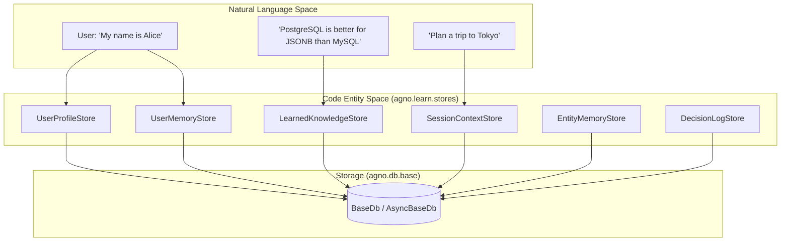
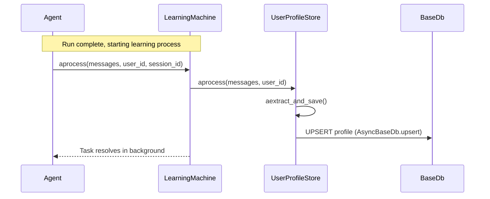

<!-- source: DeepWiki mcp.deepwiki.com · repo agno-agi/agno · page 6.2 Learning Stores · fetched 2026-11-09 -->

# Learning Stores

Relevant source files

The following files were used as context for generating this wiki page:

- [cookbook/08_learning/01_basics/6_extraction_limits.py](cookbook/08_learning/01_basics/6_extraction_limits.py)
- [cookbook/08_learning/07_patterns/research_assistant.py](cookbook/08_learning/07_patterns/research_assistant.py)
- [cookbook/data_labeling/image_search/.gitignore](cookbook/data_labeling/image_search/.gitignore)
- [cookbook/data_labeling/image_search/README.md](cookbook/data_labeling/image_search/README.md)
- [cookbook/data_labeling/image_search/TEST_LOG.md](cookbook/data_labeling/image_search/TEST_LOG.md)
- [cookbook/data_labeling/image_search/db.py](cookbook/data_labeling/image_search/db.py)
- [cookbook/data_labeling/image_search/generate_requirements.sh](cookbook/data_labeling/image_search/generate_requirements.sh)
- [cookbook/data_labeling/image_search/public/index.html](cookbook/data_labeling/image_search/public/index.html)
- [cookbook/data_labeling/image_search/requirements.in](cookbook/data_labeling/image_search/requirements.in)
- [cookbook/data_labeling/image_search/requirements.txt](cookbook/data_labeling/image_search/requirements.txt)
- [cookbook/data_labeling/image_search/run.py](cookbook/data_labeling/image_search/run.py)
- [cookbook/data_labeling/image_search/schemas.py](cookbook/data_labeling/image_search/schemas.py)
- [cookbook/data_labeling/image_search/settings.py](cookbook/data_labeling/image_search/settings.py)
- [cookbook/data_labeling/image_search/workflows/ingest.py](cookbook/data_labeling/image_search/workflows/ingest.py)
- [libs/agno/agno/agent/_init.py](libs/agno/agno/agent/_init.py)
- [libs/agno/agno/agent/_managers.py](libs/agno/agno/agent/_managers.py)
- [libs/agno/agno/learn/__init__.py](libs/agno/agno/learn/__init__.py)
- [libs/agno/agno/learn/config.py](libs/agno/agno/learn/config.py)
- [libs/agno/agno/learn/machine.py](libs/agno/agno/learn/machine.py)
- [libs/agno/agno/learn/schemas.py](libs/agno/agno/learn/schemas.py)
- [libs/agno/agno/learn/stores/__init__.py](libs/agno/agno/learn/stores/__init__.py)
- [libs/agno/agno/learn/stores/decision_log.py](libs/agno/agno/learn/stores/decision_log.py)
- [libs/agno/agno/learn/stores/entity_memory.py](libs/agno/agno/learn/stores/entity_memory.py)
- [libs/agno/agno/learn/stores/learned_knowledge.py](libs/agno/agno/learn/stores/learned_knowledge.py)
- [libs/agno/agno/learn/stores/session_context.py](libs/agno/agno/learn/stores/session_context.py)
- [libs/agno/agno/learn/stores/user_memory.py](libs/agno/agno/learn/stores/user_memory.py)
- [libs/agno/agno/learn/stores/user_profile.py](libs/agno/agno/learn/stores/user_profile.py)
- [libs/agno/tests/unit/agent/test_memory_extra_messages.py](libs/agno/tests/unit/agent/test_memory_extra_messages.py)
- [libs/agno/tests/unit/learn/test_extraction_prompt_framing.py](libs/agno/tests/unit/learn/test_extraction_prompt_framing.py)
- [libs/agno/tests/unit/learn/test_session_context_store.py](libs/agno/tests/unit/learn/test_session_context_store.py)
- [libs/agno/tests/unit/models/test_claude_request_params.py](libs/agno/tests/unit/models/test_claude_request_params.py)
- [libs/agno/tests/unit/test_learning_machine.py](libs/agno/tests/unit/test_learning_machine.py)
- [libs/agno/tests/unit/test_learning_message_filtering.py](libs/agno/tests/unit/test_learning_message_filtering.py)

Learning Stores are specialized storage backends within the **LearningMachine** that manage distinct categories of agent intelligence. Each store is responsible for a specific type of data—ranging from structured user profiles to unstructured episodic memories, transient session states, and reusable semantic insights.

## Architecture and Data Flow

The learning system operates by extracting information from conversation `Message` objects and persisting them into a database via the `LearningStore` protocol [libs/agno/agno/learn/stores/protocol.py:12-65](). These stores are coordinated by the `LearningMachine` [libs/agno/agno/learn/machine.py:82-107]() and integrated into the `Agent` execution lifecycle [libs/agno/agno/learn/machine.py:440-475]().

### Code-to-System Mapping
The following diagram maps high-level learning concepts to their specific implementation classes and data structures within the Agno codebase.

Title: "Learning Machine Entity Mapping"

Sources: [libs/agno/agno/learn/stores/user_profile.py:62-77](), [libs/agno/agno/learn/stores/learned_knowledge.py:51-69](), [libs/agno/agno/learn/stores/session_context.py:58-77](), [libs/agno/agno/learn/stores/decision_log.py:48-57](), [libs/agno/agno/learn/stores/entity_memory.py:35-44]()

---

## 1. UserProfile (Structured)
The `UserProfileStore` manages long-term, structured data about a user. It is designed for concrete facts that fit a defined schema.

- **Implementation**: `UserProfileStore` class in [libs/agno/agno/learn/stores/user_profile.py:62]().
- **Key Behavior**: It uses an `update_profile` tool to allow agents to modify fields like `name` or `preferred_name` during a run [libs/agno/agno/learn/stores/user_profile.py:207-212]().
- **Data Scoping**: Profiles are retrieved by `user_id` only. All agents sharing the same database see the same profile for a given user [libs/agno/agno/learn/stores/user_profile.py:65-67]().
- **Supported Modes**: Supports `ALWAYS` (automatic extraction) and `AGENTIC` (agent calls tool) [libs/agno/agno/learn/stores/user_profile.py:26-28]().

Sources: [libs/agno/agno/learn/stores/user_profile.py:1-28](), [libs/agno/agno/learn/stores/user_profile.py:62-80](), [libs/agno/agno/learn/config.py:57-88]()

## 2. UserMemory (Unstructured)
The `UserMemoryStore` handles "observations"—unstructured snippets of information that do not fit into fixed schema fields but are relevant for long-term personalization.

- **Implementation**: `UserMemoryStore` class in [libs/agno/agno/learn/stores/user_memory.py:57]().
- **Key Behavior**: Supports `ALWAYS` mode for background extraction from conversations and `AGENTIC` mode where the agent calls the `update_user_memory` tool directly [libs/agno/agno/learn/stores/user_memory.py:22-24]().
- **Context Injection**: The `build_context` method formats memories into a `<user_memory>` block in the system prompt to enable natural, personalized responses [libs/agno/agno/learn/stores/user_memory.py:187-212]().

Sources: [libs/agno/agno/learn/stores/user_memory.py:1-24](), [libs/agno/agno/learn/stores/user_memory.py:57-75](), [libs/agno/agno/learn/stores/user_memory.py:187-212]()

## 3. SessionContext (Stateful)
`SessionContextStore` maintains the current state of a specific conversation: what has happened, the current goal, and the plan.

- **Implementation**: `SessionContextStore` class in [libs/agno/agno/learn/stores/session_context.py:58]().
- **Continuity**: Extraction builds on the previous context rather than starting fresh. This ensures continuity even when message history is truncated by the model's context window [libs/agno/agno/learn/stores/session_context.py:19-22](), [libs/agno/agno/learn/stores/session_context.py:70-72]().
- **Scope**: Context is retrieved by `session_id` only [libs/agno/agno/learn/stores/session_context.py:16](), [libs/agno/agno/learn/stores/session_context.py:61]().
- **Modes**: Only supports `LearningMode.ALWAYS`. It does not support `AGENTIC` or `HITL` modes [libs/agno/agno/learn/stores/session_context.py:25-26](), [libs/agno/agno/learn/stores/session_context.py:89-93]().

Sources: [libs/agno/agno/learn/stores/session_context.py:1-26](), [libs/agno/agno/learn/stores/session_context.py:58-77](), [libs/agno/agno/learn/stores/session_context.py:89-93]()

## 4. EntityMemory (Facts & Relationships)
The `EntityMemoryStore` tracks knowledge about external entities (companies, projects, people) other than the primary user.

- **Implementation**: `EntityMemoryStore` class in [libs/agno/agno/learn/stores/entity_memory.py:35]().
- **Memory Types**:
    - **remember_about**: Upsert an entity with facts, events, and optional notes [libs/agno/agno/learn/stores/entity_memory.py:15]().
    - **link_entities**: Record a relationship between two entities [libs/agno/agno/learn/stores/entity_memory.py:16]().
    - **search_entities**: Search stored entities or list by recency [libs/agno/agno/learn/stores/entity_memory.py:17]().
    - **forget**: Retire a fact or archive an entity [libs/agno/agno/learn/stores/entity_memory.py:18]().
- **Scoping**: Identified by `entity_id` (slugified from name via `_slugify`) + `entity_type`, with namespace support for sharing control (`global`, `user`, or custom) [libs/agno/agno/learn/stores/entity_memory.py:21-27](), [libs/agno/agno/learn/stores/entity_memory.py:73-98]().

Sources: [libs/agno/agno/learn/stores/entity_memory.py:1-32](), [libs/agno/agno/learn/stores/entity_memory.py:35-55](), [libs/agno/agno/learn/stores/entity_memory.py:73-98]()

## 5. LearnedKnowledge (Semantic Insights)
The `LearnedKnowledgeStore` stores reusable insights that apply across different users and agents, utilizing vector embeddings for semantic search.

- **Implementation**: `LearnedKnowledgeStore` class in [libs/agno/agno/learn/stores/learned_knowledge.py:51]().
- **Tools Provided**:
    1. `search_learnings`: Find relevant insights via semantic search [libs/agno/agno/learn/stores/learned_knowledge.py:63]().
    2. `save_learning`: Persist new insights discovered during execution [libs/agno/agno/learn/stores/learned_knowledge.py:64]().
- **Recall Mechanism**: Uses `recall` or `arecall` to perform semantic search against the knowledge base based on the query or current message [libs/agno/agno/learn/stores/learned_knowledge.py:98-135]().

Sources: [libs/agno/agno/learn/stores/learned_knowledge.py:1-25](), [libs/agno/agno/learn/stores/learned_knowledge.py:51-69](), [libs/agno/agno/learn/stores/learned_knowledge.py:98-135]()

## 6. DecisionLog
The `DecisionLogStore` records decisions made by agents with reasoning, context, and outcomes. This is critical for auditing and debugging agent behavior.

- **Implementation**: `DecisionLogStore` class in [libs/agno/agno/learn/stores/decision_log.py:48]().
- **Key Features**: Records the choice made, reasoning, and context [libs/agno/agno/learn/stores/decision_log.py:51-53]().
- **Modes**: 
    - `AGENTIC`: The agent explicitly logs decisions via tools [libs/agno/agno/learn/stores/decision_log.py:20-21](), [libs/agno/agno/learn/stores/decision_log.py:70-72]().
- **Context Injection**: Formats the most recent decisions into a `<decision_log>` block for the system prompt [libs/agno/agno/learn/stores/decision_log.py:168-191]().

Sources: [libs/agno/agno/learn/stores/decision_log.py:1-21](), [libs/agno/agno/learn/stores/decision_log.py:48-61](), [libs/agno/agno/learn/stores/decision_log.py:168-191]()

---

## Learning Store Comparison

| Store Type | Scope | Data Structure | Primary Use Case | Supported Modes |
|:---|:---|:---|:---|:---|
| **UserProfile** | User | Structured (Pydantic) | Name, preferences | ALWAYS, AGENTIC |
| **UserMemory** | User | Unstructured List | "User likes coffee" | ALWAYS, AGENTIC |
| **SessionContext**| Session | Summary/Plan | Current goal, progress | ALWAYS |
| **EntityMemory** | Entity | Fact/Event/Graph | Client tech stack | AGENTIC |
| **LearnedKnowledge**| Global/Namespace| Semantic Vector | Coding insights | ALWAYS, AGENTIC, PROPOSE |
| **DecisionLog** | Agent/Session | Reasoning/Outcome | Auditing tool choices | AGENTIC |

Sources: [libs/agno/agno/learn/config.py:36-49](), [libs/agno/agno/learn/stores/user_profile.py:25-28](), [libs/agno/agno/learn/stores/user_memory.py:21-24](), [libs/agno/agno/learn/stores/session_context.py:24-26](), [libs/agno/agno/learn/stores/entity_memory.py:28-32](), [libs/agno/agno/learn/stores/learned_knowledge.py:21-25](), [libs/agno/agno/learn/stores/decision_log.py:19-21]()

## Execution and Background Processing

Learning extraction is coordinated by the `LearningMachine`. The `process` method handles the logic for extracting and saving data from message history [libs/agno/agno/learn/machine.py:440-475]().

Title: "Learning Extraction Lifecycle"

Sources: [libs/agno/agno/learn/machine.py:440-475](), [libs/agno/agno/learn/stores/user_profile.py:164-188](), [libs/agno/agno/learn/stores/protocol.py:25-33]()

---

