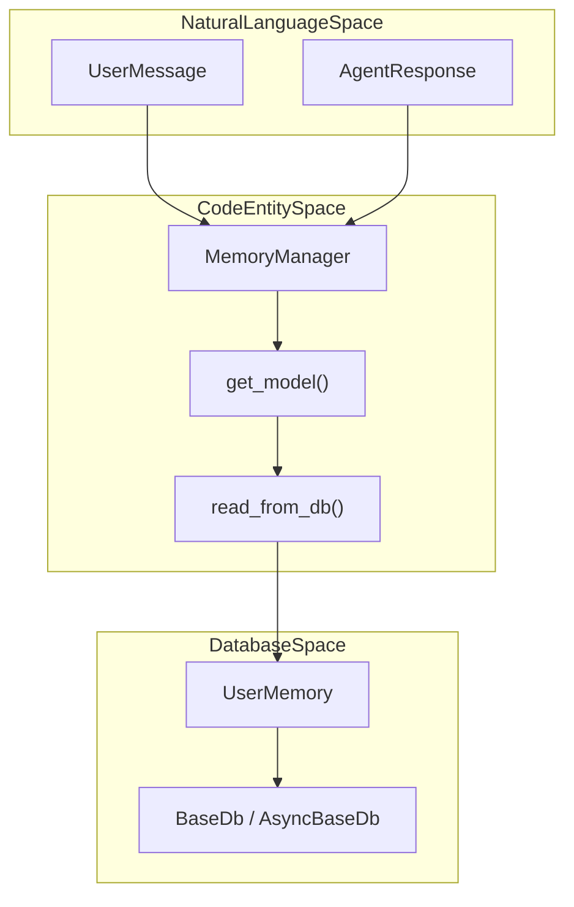
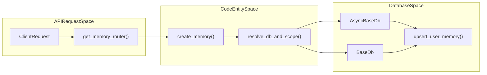

<!-- source: DeepWiki mcp.deepwiki.com · repo agno-agi/agno · page 6.3 Memory Manager and Persistence · fetched 2026-11-09 -->

# Memory Manager and Persistence

Relevant source files

The following files were used as context for generating this wiki page:

- [libs/agno/agno/memory/manager.py](libs/agno/agno/memory/manager.py)
- [libs/agno/agno/os/routers/agents/schema.py](libs/agno/agno/os/routers/agents/schema.py)
- [libs/agno/agno/os/routers/memory/memory.py](libs/agno/agno/os/routers/memory/memory.py)
- [libs/agno/agno/os/routers/memory/schemas.py](libs/agno/agno/os/routers/memory/schemas.py)
- [libs/agno/agno/os/routers/teams/schema.py](libs/agno/agno/os/routers/teams/schema.py)
- [libs/agno/agno/os/routers/workflows/schema.py](libs/agno/agno/os/routers/workflows/schema.py)
- [libs/agno/tests/integration/knowledge/test_pptx_knowledge.py](libs/agno/tests/integration/knowledge/test_pptx_knowledge.py)
- [libs/agno/tests/integration/workflows/test_workflow_metrics.py](libs/agno/tests/integration/workflows/test_workflow_metrics.py)
- [libs/agno/tests/unit/memory/test_memory_manager_async.py](libs/agno/tests/unit/memory/test_memory_manager_async.py)
- [libs/agno/tests/unit/memory/test_search_user_memories_defaults.py](libs/agno/tests/unit/memory/test_search_user_memories_defaults.py)
- [libs/agno/tests/unit/os/test_knowledge_filters_serialization.py](libs/agno/tests/unit/os/test_knowledge_filters_serialization.py)
- [libs/agno/tests/unit/os/test_schemas.py](libs/agno/tests/unit/os/test_schemas.py)

## Purpose and Scope
This page details the implementation of the `MemoryManager` subsystem in Agno (`libs/agno/agno/memory/manager.py`) [libs/agno/agno/memory/manager.py:46-73](), its extraction strategies, deduplication logic, database-backed persistence models (`BaseDb`, `AsyncBaseDb`), session summarization, and its integration into the AgentOS memory REST API router (`libs/agno/agno/os/routers/memory/memory.py`) [libs/agno/agno/os/routers/memory/memory.py:40-55]().

Sources: [libs/agno/agno/memory/manager.py:46-73](), [libs/agno/agno/os/routers/memory/memory.py:40-55]()

---

## MemoryManager Overview

The `MemoryManager` class coordinates the lifecycle of persistent "User Memories." Unlike session history, which tracks immediate turn-by-turn conversation flow, the `MemoryManager` identifies persistent facts, preferences, and entities across multiple sessions. Each instance is uniquely identified by an `id`, optional `name`, `owner_id`, and `owner_type` [libs/agno/agno/memory/manager.py:89-97]().

### Key Responsibilities
- **Extraction**: Processing chat history using configurable `memory_capture_instructions` to identify new information worth retaining [libs/agno/agno/memory/manager.py:54-55]().
- **Deduplication and Optimization**: Managing existing entries via flags like `delete_memories`, `update_memories`, `add_memories`, and `clear_memories` [libs/agno/agno/memory/manager.py:64-70]().
- **Persistence**: Interfacing with synchronous (`BaseDb`) and asynchronous (`AsyncBaseDb`) storage backends [libs/agno/agno/memory/manager.py:73-73]().
- **Recall**: Retrieving stored user memories via `get_user_memories()` to inject into the agent context [libs/agno/agno/memory/manager.py:174-182]().

### Data Flow: Natural Language to Persistence
The following diagram illustrates how natural language interactions are mapped across system spaces into code entities and persisted via database abstractions.

Title: "Memory Extraction and Storage Flow"

Sources: [libs/agno/agno/memory/manager.py:46-123](), [libs/agno/agno/os/routers/memory/memory.py:118-136]()

---

## UserMemory Schema and Representation

Memories are represented by the `UserMemory` database schema and surfaced via `UserMemorySchema` in the API layer [libs/agno/agno/os/routers/memory/schemas.py:15-51](). The parsing mechanism handles complex nested dictionary content or v1-migrated payloads by serializing them to JSON strings [libs/agno/agno/os/routers/memory/schemas.py:31-41]().

| Field | Type | Description |
| :--- | :--- | :--- |
| `memory` | `str` | The actual content/fact extracted [libs/agno/agno/os/routers/memory/schemas.py:17-17](). |
| `memory_id` | `str` | Unique identifier for the memory [libs/agno/agno/os/routers/memory/schemas.py:16-16](). |
| `user_id` | `str` | Scopes the memory to a specific user [libs/agno/agno/os/routers/memory/schemas.py:22-22](). |
| `topics` | `List[str]` | Semantic tags for categorization [libs/agno/agno/os/routers/memory/schemas.py:18-18](). |
| `agent_id` | `str` | Optional agent identifier associated with the memory [libs/agno/agno/os/routers/memory/schemas.py:20-20](). |
| `team_id` | `str` | Optional team identifier associated with the memory [libs/agno/agno/os/routers/memory/schemas.py:21-21](). |
| `updated_at` | `datetime` | Timestamp of the last modification [libs/agno/agno/os/routers/memory/schemas.py:24-24](). |

Sources: [libs/agno/agno/os/routers/memory/schemas.py:15-51]()

---

## Memory Extraction, Deduplication, and Optimization

Memory management relies on LLM-driven analysis governed by `system_message`, `memory_capture_instructions`, and `additional_instructions` [libs/agno/agno/memory/manager.py:52-57](). 

### Optimization and Deduplication Mechanics
- **Update Handling**: Controlled by `update_memories`, enabling the system to modify outdated facts rather than duplicating them [libs/agno/agno/memory/manager.py:67-68]().
- **Semantic Search Response**: Utilizes `MemorySearchResponse` to identify semantically overlapping memory IDs prior to insertion or updates [libs/agno/agno/memory/manager.py:36-42]().
- **API Optimization**: The `/memories/optimize` route accepts `OptimizeMemoriesRequest` to calculate token reduction metrics and preview optimized memory stores before saving changes [libs/agno/agno/os/routers/memory/schemas.py:80-103]().

Sources: [libs/agno/agno/memory/manager.py:36-68](), [libs/agno/agno/os/routers/memory/schemas.py:80-103]()

---

## Database-Backed Persistence

Agno supports database backends through `BaseDb` and `AsyncBaseDb` interface definitions.

### Persistence Operations
- `read_from_db(user_id)` / `aread_from_db(user_id)`: Fetches user memories synchronously or asynchronously [libs/agno/agno/memory/manager.py:125-161]().
- `upsert_user_memory()`: Commits new or updated `UserMemory` records to the backing database [libs/agno/agno/os/routers/memory/memory.py:118-136]().
- `delete_memory()`: Permanently removes specific memory records via the API router [libs/agno/agno/os/routers/memory/memory.py:155-162]().

Title: "Database Persistence and API Routing Flow"

Sources: [libs/agno/agno/memory/manager.py:125-161](), [libs/agno/agno/os/routers/memory/memory.py:40-136]()

---

## Recall and Context Injection

When an agent initiates a run, the memory subsystem injects relevant historical insights into its execution context:
1. **Retrieval**: `read_from_db` queries the storage layer using the scoped `user_id` [libs/agno/agno/memory/manager.py:125-138]().
2. **Context Formatting**: Retrieved memories are formatted using `system_message` parameters and prepended to prompt sequences [libs/agno/agno/memory/manager.py:52-57]().

Sources: [libs/agno/agno/memory/manager.py:52-57](), [libs/agno/agno/memory/manager.py:125-138]()

---

## Session Summarization

In addition to discrete memories, Agno utilizes summarization helpers to compress entire conversation histories into concise overviews.
- **Extraction**: Processes message runs to generate summaries and topics.
- **Structured Validation**: Employs structured schemas to enforce JSON schema compliance on model outputs.

Sources: [libs/agno/agno/memory/manager.py:46-123]()

---

## AgentOS Memory API Endpoints

AgentOS exposes the persistence layer through the memory router (`libs/agno/agno/os/routers/memory/memory.py`) [libs/agno/agno/os/routers/memory/memory.py:40-55]():
- **POST `/memories`**: Instantiates new user memories validated via `UserMemoryCreateSchema` [libs/agno/agno/os/routers/memory/memory.py:59-95](), [libs/agno/agno/os/routers/memory/schemas.py:54-60]().
- **DELETE `/memories/{memory_id}`**: Deletes a memory record by ID [libs/agno/agno/os/routers/memory/memory.py:143-154]().
- **POST `/memories/optimize`**: Triggers batch optimization using `OptimizeMemoriesRequest` [libs/agno/agno/os/routers/memory/schemas.py:80-92]().

Sources: [libs/agno/agno/os/routers/memory/memory.py:40-160](), [libs/agno/agno/os/routers/memory/schemas.py:54-92]()

---

