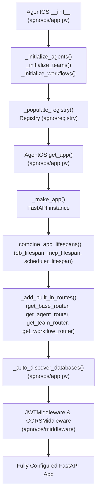
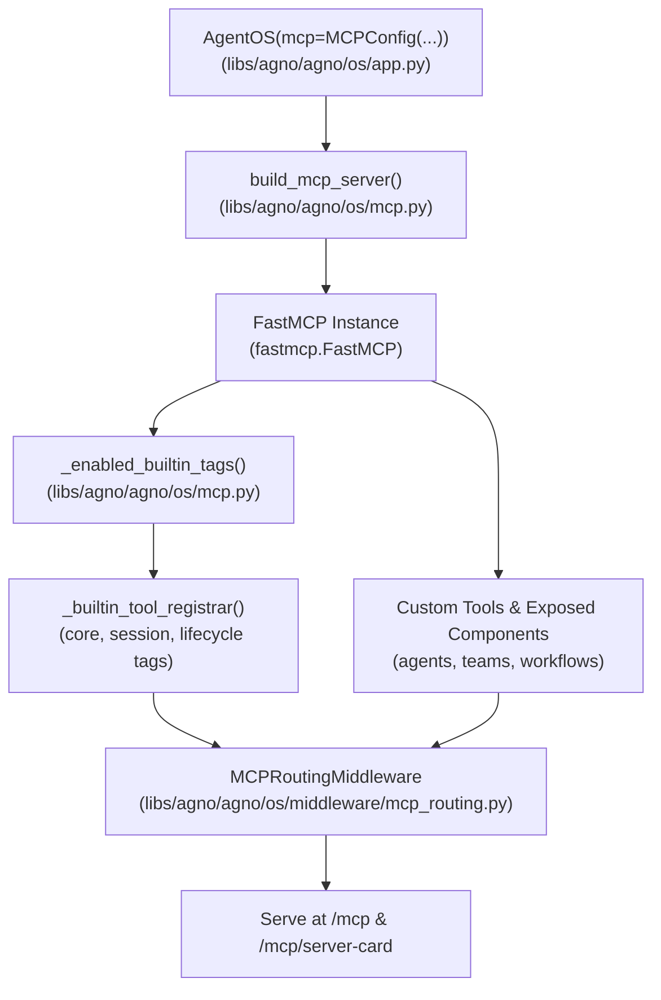

<!-- source: DeepWiki mcp.deepwiki.com · repo agno-agi/agno · page 7 AgentOS Runtime · fetched 2026-11-09 -->

# AgentOS Runtime

Relevant source files

The following files were used as context for generating this wiki page:

- [cookbook/05_agent_os/14_mcp/README.md](cookbook/05_agent_os/14_mcp/README.md)
- [cookbook/05_agent_os/14_mcp/TEST_LOG.md](cookbook/05_agent_os/14_mcp/TEST_LOG.md)
- [cookbook/05_agent_os/14_mcp/inspect_tools.py](cookbook/05_agent_os/14_mcp/inspect_tools.py)
- [libs/agno/agno/os/app.py](libs/agno/agno/os/app.py)
- [libs/agno/agno/os/config.py](libs/agno/agno/os/config.py)
- [libs/agno/agno/os/mcp.py](libs/agno/agno/os/mcp.py)
- [libs/agno/agno/os/middleware/mcp_routing.py](libs/agno/agno/os/middleware/mcp_routing.py)
- [libs/agno/agno/os/public/_policy.py](libs/agno/agno/os/public/_policy.py)
- [libs/agno/agno/os/router.py](libs/agno/agno/os/router.py)
- [libs/agno/agno/os/schema.py](libs/agno/agno/os/schema.py)
- [libs/agno/tests/unit/os/test_info_endpoint.py](libs/agno/tests/unit/os/test_info_endpoint.py)
- [libs/agno/tests/unit/os/test_mcp_routing.py](libs/agno/tests/unit/os/test_mcp_routing.py)
- [libs/agno/tests/unit/os/test_mcp_server.py](libs/agno/tests/unit/os/test_mcp_server.py)

This page introduces the AgentOS runtime layer, which encapsulates agents, teams, and workflows inside a production-ready FastAPI application (`libs/agno/agno/os/app.py:1-100` []). AgentOS handles application assembly, lifespan management, database auto-discovery, request authentication, route resolution, and optional integrations like the Model Context Protocol (MCP) server, job queues, and scheduling systems.

As a parent page, this document provides a high-level architectural overview. Detailed technical specifications, parameter references, and code patterns are documented in the respective child pages.

---

## Overview and Core Concepts

`AgentOS` is defined in `libs/agno/agno/os/app.py:1-100` [] and coordinates stateful execution across distributed components without retaining local memory in process state. All sessions, runs, memories, and knowledge embeddings are offloaded to durable storage backends (`libs/agno/agno/db/base.py` []). 

### Diagram: AgentOS Architectural Pipeline
Title: "AgentOS Initialization and Application Assembly Pipeline"

Sources: `libs/agno/agno/os/app.py:1-100` [], `libs/agno/agno/registry.py:1-50` [AgentOS Architecture and Initialization](#7.1).

---

## Sub-Topics and Child Pages

### 7.1 AgentOS Architecture and Initialization
Document the `AgentOS` constructor, component registration, lifespans, database auto-discovery, YAML configuration, and `get_app()`.
For details, see [AgentOS Architecture and Initialization](#7.1).
Sources: `libs/agno/agno/os/app.py:1-178` []

### 7.2 REST API Endpoints
List all routes (`/agents`, `/teams`, `/workflows`, `/sessions`, `/memories`, `/knowledge`, `/evals`, `/traces`, `/approvals`, `/schedules`, `/metrics`, `/components`) and their schemas (`ErrorResponse`, `HealthResponse`, etc.).
For details, see [REST API Endpoints](#7.2).
Sources: `libs/agno/agno/os/router.py:70-177` [], `libs/agno/agno/os/schema.py:38-167` []

### 7.3 WebSocket and Streaming
Explain WebSocket routes for workflows, streaming response handling, Server-Sent Events (SSE) format, resume/replay, and real-time event delivery.
For details, see [WebSocket and Streaming](#7.3).
Sources: `libs/agno/agno/os/router.py:1-50` []

### 7.4 Database Auto-discovery and Configuration
Cover `_auto_discover_databases`, validation, two-phase initialization, `AgentOSConfig` YAML, and migrations endpoints.
For details, see [Database Auto-discovery and Configuration](#7.4).
Sources: `libs/agno/agno/os/app.py:1-100` [], `libs/agno/agno/os/config.py:1-100` []

### 7.5 Authentication and Security
Document authentication modes (JWT, security keys, service account tokens), Role-Based Access Control (RBAC) scopes, `JWTMiddleware`, CORS policies, and public-page policies.
For details, see [Authentication and Security](#7.5).
Sources: `libs/agno/agno/os/middleware/jwt.py:1-50` [], `libs/agno/agno/os/public/_policy.py:1-64` []

### 7.6 Registry System
Explain the component registry, lookup by ID, registry population, versioning, and route resolution.
For details, see [Registry System](#7.6).
Sources: `libs/agno/agno/registry.py:1-50` []

### 7.7 Custom FastAPI Integration
Show `base_app`, route conflict resolution (`find_conflicting_routes`), middleware merging, and lifespan combination.
For details, see [Custom FastAPI Integration](#7.7).
Sources: `libs/agno/agno/os/utils.py:1-93` []

### 7.8 Scheduling System
Document the scheduler parameter, poll interval, cron scheduling, `ScheduleManager`, schedules REST API, and `internal_service_token`.
For details, see [Scheduling System](#7.8).
Sources: `libs/agno/agno/os/app.py:1-100` []

### 7.9 MCP Server Integration
Explain `MCPConfig`, `FastMCP` instance, built-in tools, tool scoping by tags (`MCP_BUILTIN_TAGS`), stateless mode, routing middleware (`MCPRoutingMiddleware`), and the server card.
For details, see [MCP Server Integration](#7.9).

### Diagram: MCP Server Routing and Tool Registration
Title: "MCP Server Integration and Routing Architecture"

Sources: `libs/agno/agno/os/config.py:44-129` [], `libs/agno/agno/os/mcp.py:1-150` [], `libs/agno/agno/os/middleware/mcp_routing.py:38-123` []

### 7.10 AgentOS Interfaces
Document built-in interfaces: Slack, WhatsApp, Telegram, Discord, AG-UI (CopilotKit), and the Agent-to-Agent (A2A) protocol.
For details, see [AgentOS Interfaces](#7.10).
Sources: `libs/agno/agno/os/interfaces/base.py:1-50` []

### 7.11 AgentOS Client and Remote Agents
Document the Python client (`agno.client.os`), `RemoteAgent`, `RemoteTeam`, `RemoteWorkflow`, and the A2A client.
For details, see [AgentOS Client and Remote Agents](#7.11).
Sources: `libs/agno/agno/agent/remote.py:1-50` [], `libs/agno/agno/team/remote.py:1-50` []

### 7.12 Control Plane UI
Describe AgentOS UI at `os.agno.com`, connecting OS instances, monitoring, sessions, evals, and the tracing dashboard.
For details, see [Control Plane UI](#7.12).
Sources: `libs/agno/agno/os/app.py:1-100` []

### 7.13 Factories
Document `AgentFactory`, `TeamFactory`, `WorkflowFactory`, `RequestContext`, `input_schema` validation, and per-request isolation.
For details, see [Factories](#7.13).
Sources: `libs/agno/agno/agent/factory.py:1-50` [], `libs/agno/agno/team/factory.py:1-50` [], `libs/agno/agno/workflow/factory.py:1-50` []

### 7.14 Studio and Component Composition
Explain `StudioTools`, `StudioRunnerTools`, the AgentOS Manager, component lifecycle, and the `/components` REST API.
For details, see [Studio and Component Composition](#7.14).
Sources: `libs/agno/agno/os/routers/components.py:1-50` []

### 7.15 Durable Job Queue and Background Runs
Document `QueueConfig`/`QueueWorker`, `QueuedJob` lifecycle, Postgres/Redis stores, claim-heartbeat-sweep, run resume, and tail streaming.
For details, see [Durable Job Queue and Background Runs](#7.15).
Sources: `libs/agno/agno/job_queue/__init__.py:1-50` [], `libs/agno/agno/os/job_queue.py:1-50` []

---
Sources: `libs/agno/agno/os/app.py:1-100` [], `libs/agno/agno/os/config.py:44-129` [], `libs/agno/agno/os/mcp.py:1-150` [], `libs/agno/agno/os/router.py:70-177` [], `libs/agno/agno/os/schema.py:38-167` [], `libs/agno/agno/os/middleware/mcp_routing.py:38-123` []

---

