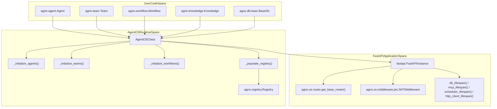
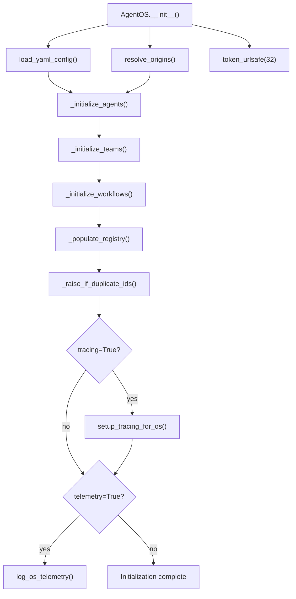
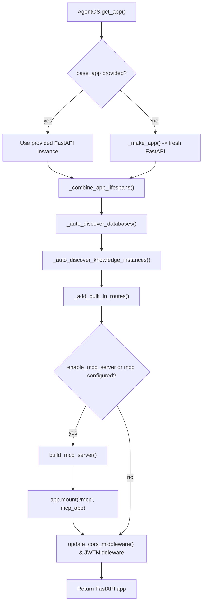

<!-- source: DeepWiki mcp.deepwiki.com · repo agno-agi/agno · page 7.1 AgentOS Architecture and Initialization · fetched 2026-11-09 -->

# AgentOS Architecture and Initialization

Relevant source files

The following files were used as context for generating this wiki page:

- [cookbook/05_agent_os/07_security/README.md](cookbook/05_agent_os/07_security/README.md)
- [cookbook/05_agent_os/07_security/TEST_LOG.md](cookbook/05_agent_os/07_security/TEST_LOG.md)
- [cookbook/05_agent_os/07_security/excluded_routes.py](cookbook/05_agent_os/07_security/excluded_routes.py)
- [cookbook/05_agent_os/14_mcp/README.md](cookbook/05_agent_os/14_mcp/README.md)
- [cookbook/05_agent_os/14_mcp/TEST_LOG.md](cookbook/05_agent_os/14_mcp/TEST_LOG.md)
- [cookbook/05_agent_os/14_mcp/inspect_tools.py](cookbook/05_agent_os/14_mcp/inspect_tools.py)
- [libs/agno/agno/os/app.py](libs/agno/agno/os/app.py)
- [libs/agno/agno/os/auth.py](libs/agno/agno/os/auth.py)
- [libs/agno/agno/os/config.py](libs/agno/agno/os/config.py)
- [libs/agno/agno/os/mcp.py](libs/agno/agno/os/mcp.py)
- [libs/agno/agno/os/middleware/mcp_routing.py](libs/agno/agno/os/middleware/mcp_routing.py)
- [libs/agno/agno/os/public/_policy.py](libs/agno/agno/os/public/_policy.py)
- [libs/agno/agno/os/router.py](libs/agno/agno/os/router.py)
- [libs/agno/agno/os/routers/health.py](libs/agno/agno/os/routers/health.py)
- [libs/agno/agno/os/schema.py](libs/agno/agno/os/schema.py)
- [libs/agno/agno/os/settings.py](libs/agno/agno/os/settings.py)
- [libs/agno/tests/integration/agent/test_async_tool_calling.py](libs/agno/tests/integration/agent/test_async_tool_calling.py)
- [libs/agno/tests/integration/agent/test_guardrails.py](libs/agno/tests/integration/agent/test_guardrails.py)
- [libs/agno/tests/integration/agent/test_hooks.py](libs/agno/tests/integration/agent/test_hooks.py)
- [libs/agno/tests/integration/os/test_built_in_endpoints.py](libs/agno/tests/integration/os/test_built_in_endpoints.py)
- [libs/agno/tests/integration/os/test_custom_fastapi_app.py](libs/agno/tests/integration/os/test_custom_fastapi_app.py)
- [libs/agno/tests/integration/os/test_exceptions.py](libs/agno/tests/integration/os/test_exceptions.py)
- [libs/agno/tests/integration/teams/test_hooks.py](libs/agno/tests/integration/teams/test_hooks.py)
- [libs/agno/tests/integration/vector_dbs/test_lancedb.py](libs/agno/tests/integration/vector_dbs/test_lancedb.py)
- [libs/agno/tests/unit/os/test_info_endpoint.py](libs/agno/tests/unit/os/test_info_endpoint.py)
- [libs/agno/tests/unit/os/test_mcp_routing.py](libs/agno/tests/unit/os/test_mcp_routing.py)
- [libs/agno/tests/unit/os/test_mcp_server.py](libs/agno/tests/unit/os/test_mcp_server.py)
- [libs/agno/tests/unit/vectordb/test_qdrantdb.py](libs/agno/tests/unit/vectordb/test_qdrantdb.py)
- [libs/agno/tests/unit/vectordb/test_weaviatedb.py](libs/agno/tests/unit/vectordb/test_weaviatedb.py)

This page documents the `AgentOS` class: its constructor parameters, internal initialization sequence, lifespan management, database auto-discovery, YAML configuration, and the `get_app()` method that produces the final `FastAPI` application. It covers the **Runtime Layer** of the Agno architecture.

For the REST endpoint surface exposed by this runtime, see [REST API Endpoints](). For authentication and RBAC details, see [Authentication and Security](). For database initialization specifics, see [Database Auto-discovery and Configuration]().

---

## Role in the System

`AgentOS` is the production server runtime. It wraps one or more `Agent`, `Team`, and `Workflow` instances and exposes them through a `FastAPI` application with structured HTTP and WebSocket routes, middleware, authentication, and lifecycle management.

### Architecture Mapping: Natural Language to Code Entities

Sources: [libs/agno/agno/os/app.py:255-400](), [libs/agno/agno/os/router.py:66-90]()

---

## Constructor Parameters

The `AgentOS.__init__` method handles the configuration of the runtime environment and component loading [libs/agno/agno/os/app.py:255-322]().

| Parameter | Type | Default | Purpose |
|---|---|---|---|
| `id` | `Optional[str]` | auto-generated | Unique identifier for this OS instance [libs/agno/agno/os/app.py:256]() |
| `name` | `Optional[str]` | `None` | Display name; used as FastAPI `title` [libs/agno/agno/os/app.py:257]() |
| `description` | `Optional[str]` | `None` | FastAPI app description [libs/agno/agno/os/app.py:258]() |
| `version` | `Optional[str]` | `None` | FastAPI app version [libs/agno/agno/os/app.py:259]() |
| `db` | `BaseDb \| AsyncBaseDb` | `None` | Default database; propagated to components without their own `db` [libs/agno/agno/os/app.py:260]() |
| `agents` | `List[Agent \| RemoteAgent]` | `None` | Agents to register [libs/agno/agno/os/app.py:261]() |
| `teams` | `List[Team \| RemoteTeam]` | `None` | Teams to register [libs/agno/agno/os/app.py:262]() |
| `workflows` | `List[Workflow \| RemoteWorkflow]` | `None` | Workflows to register [libs/agno/agno/os/app.py:263]() |
| `knowledge` | `List[Knowledge]` | `None` | Knowledge bases to expose [libs/agno/agno/os/app.py:264]() |
| `interfaces` | `List[BaseInterface]` | `[]` | Extra interface plugins (e.g. `A2A`) [libs/agno/agno/os/app.py:265]() |
| `authorization` | `bool` | `False` | Enable JWT-based RBAC [libs/agno/agno/os/app.py:267]() |
| `authorization_config` | `AuthorizationConfig` | `None` | JWT algorithm, keys, audience settings [libs/agno/agno/os/app.py:268]() |
| `cors_allowed_origins` | `List[str]` | `None` | Additional CORS origins [libs/agno/agno/os/app.py:269]() |
| `config` | `str \| AgentOSConfig` | `None` | YAML config path or config object [libs/agno/agno/os/app.py:270]() |
| `settings` | `AgnoAPISettings` | auto | API settings (security key, docs, CORS) [libs/agno/agno/os/app.py:271]() |
| `enable_mcp_server` | `bool` | `False` | Mount a FastMCP server at `/mcp` [libs/agno/agno/os/app.py:274]() |
| `mcp` | `Union[bool, MCPConfig]` | `None` | Scoping, custom tools, and gating for MCP [libs/agno/agno/os/app.py:275]() |
| `base_app` | `FastAPI` | `None` | Existing FastAPI app to attach routes to [libs/agno/agno/os/app.py:276]() |
| `tracing` | `bool` | `False` | Enable OpenTelemetry tracing [libs/agno/agno/os/app.py:278]() |
| `auto_provision_dbs` | `bool` | `True` | Auto-initialize databases on startup [libs/agno/agno/os/app.py:279]() |
| `scheduler` | `bool` | `False` | Enable cron scheduler [libs/agno/agno/os/app.py:284]() |

**Validation rule**: At least one of `agents`, `teams`, `workflows`, `knowledge`, or `db` must be provided, or `ValueError` is raised [libs/agno/agno/os/app.py:321-322]().

Sources: [libs/agno/agno/os/app.py:255-322]()

---

## Initialization Sequence and YAML Configuration

The `AgentOS` initialization handles configuration loading, component preparation, and registry population [libs/agno/agno/os/app.py:320-400](). When a YAML configuration path or `AgentOSConfig` object is provided via `config`, `load_yaml_config()` parses the file and populates missing runtime options [libs/agno/agno/os/app.py:270](), [libs/agno/agno/os/utils.py:89]().

### Initialization Flowchart

Sources: [libs/agno/agno/os/app.py:320-400](), [libs/agno/agno/os/utils.py:89-91]()

### Component Initialization and Registration

- **`_initialize_agents()`**: For each local agent, propagates the OS database if the agent lacks one, collects MCP tools, and ensures `store_events = True` [libs/agno/agno/os/app.py:615-645]().
- **`_initialize_teams()`**: Propagates databases and hooks, collects MCP tools recursively from team members, and initializes both team and members [libs/agno/agno/os/app.py:647-680]().
- **`_initialize_workflows()`**: Ensures workflows have IDs and propagates the OS database and background hook settings [libs/agno/agno/os/app.py:682-707]().
- **`_populate_registry()`**: Populates a `Registry` instance with all local agents, teams, and workflows, triggering discovery and deduplication of shared components [libs/agno/agno/os/app.py:709-732](), [libs/agno/registry.py]().

Sources: [libs/agno/agno/os/app.py:615-732](), [libs/agno/registry.py]()

---

## `get_app()` and App Assembly

The `get_app()` method is the entry point for generating the FastAPI application. It can create a fresh app or wrap an existing `base_app` [libs/agno/agno/os/app.py:774-985]().

### App Assembly Diagram

Sources: [libs/agno/agno/os/app.py:774-985](), [libs/agno/agno/os/mcp.py]()

### Lifespan Management

`AgentOS` uses a combined lifespan manager to handle multiple async context managers [libs/agno/agno/os/app.py:182-234]().

| Lifespan Function | File Location | Role |
|---|---|---|
| `db_lifespan` | [libs/agno/agno/os/app.py:182-200]() | Initializes sync/async DBs on startup; drains cancel-persist tasks and closes DBs on shutdown. |
| `mcp_lifespan` | [libs/agno/agno/os/app.py:129-138]() | Connects to all registered MCP tools at startup; closes connections at shutdown. |
| `scheduler_lifespan` | [libs/agno/agno/os/app.py:202-234]() | Starts the `SchedulePoller` and `ScheduleExecutor` if scheduling is enabled. |
| `http_client_lifespan` | [libs/agno/agno/os/app.py:141-148]() | Ensures global `httpx` clients are closed properly. |

Sources: [libs/agno/agno/os/app.py:99-234]()

---

## Database and Knowledge Auto-discovery

`AgentOS` automatically scans its registered agents, teams, and workflows to build a map of all underlying databases and knowledge bases [libs/agno/agno/os/app.py:1022-1077]().

- **`_auto_discover_databases()`**: Iterates through all components to collect `BaseDb` and `AsyncBaseDb` instances, registering them with validation against ID collisions [libs/agno/agno/os/app.py:1022-1052]().
- **`_auto_discover_knowledge_instances()`**: Scans for `Knowledge` objects within agents, teams, and the OS-level `knowledge` list [libs/agno/agno/os/app.py:1054-1077]().

Sources: [libs/agno/agno/os/app.py:1022-1077]()

---

