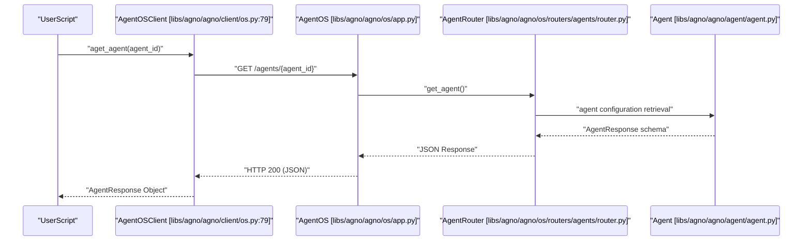
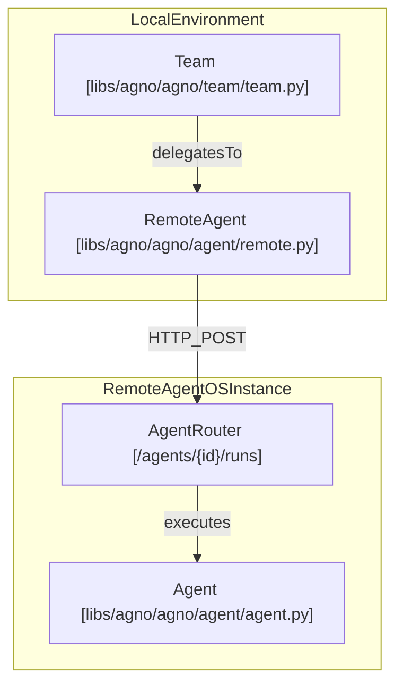

<!-- source: DeepWiki mcp.deepwiki.com · repo agno-agi/agno · page 7.11 AgentOS Client and Remote Agents · fetched 2026-11-09 -->

# AgentOS Client and Remote Agents

Relevant source files

The following files were used as context for generating this wiki page:

- [cookbook/05_agent_os/03_python_client/03_sessions_and_memory.py](cookbook/05_agent_os/03_python_client/03_sessions_and_memory.py)
- [cookbook/frameworks/README.md](cookbook/frameworks/README.md)
- [cookbook/frameworks/TEST_LOG.md](cookbook/frameworks/TEST_LOG.md)
- [cookbook/frameworks/TEST_PROMPT.md](cookbook/frameworks/TEST_PROMPT.md)
- [cookbook/frameworks/claude-agent-sdk/claude_native_sdk.py](cookbook/frameworks/claude-agent-sdk/claude_native_sdk.py)
- [libs/agno/agno/agent/remote.py](libs/agno/agno/agent/remote.py)
- [libs/agno/agno/client/os.py](libs/agno/agno/client/os.py)
- [libs/agno/agno/os/routers/job_queue/router.py](libs/agno/agno/os/routers/job_queue/router.py)
- [libs/agno/agno/os/routers/session/session.py](libs/agno/agno/os/routers/session/session.py)
- [libs/agno/agno/os/services/sessions.py](libs/agno/agno/os/services/sessions.py)
- [libs/agno/agno/remote/base.py](libs/agno/agno/remote/base.py)
- [libs/agno/agno/team/remote.py](libs/agno/agno/team/remote.py)
- [libs/agno/agno/workflow/remote.py](libs/agno/agno/workflow/remote.py)
- [libs/agno/tests/integration/os/test_sessions.py](libs/agno/tests/integration/os/test_sessions.py)
- [libs/agno/tests/system/tests/test_agents_routes.py](libs/agno/tests/system/tests/test_agents_routes.py)
- [libs/agno/tests/system/tests/test_teams_routes.py](libs/agno/tests/system/tests/test_teams_routes.py)
- [libs/agno/tests/system/tests/test_utils.py](libs/agno/tests/system/tests/test_utils.py)
- [libs/agno/tests/system/tests/test_workflows_routes.py](libs/agno/tests/system/tests/test_workflows_routes.py)
- [libs/agno/tests/unit/os/routers/test_session_sdk_metadata.py](libs/agno/tests/unit/os/routers/test_session_sdk_metadata.py)
- [libs/agno/tests/unit/os/routers/test_session_type_filter.py](libs/agno/tests/unit/os/routers/test_session_type_filter.py)
- [libs/agno/tests/unit/os/test_client.py](libs/agno/tests/unit/os/test_client.py)
- [libs/agno/tests/unit/os/test_queue_list_pagination.py](libs/agno/tests/unit/os/test_queue_list_pagination.py)
- [libs/agno/tests/unit/team/test_external_agent_members.py](libs/agno/tests/unit/team/test_external_agent_members.py)
- [libs/agno/tests/unit/team/test_remote_team.py](libs/agno/tests/unit/team/test_remote_team.py)

This page documents the Python client (`agno.client.os.AgentOSClient`), remote proxy classes (`RemoteAgent`, `RemoteTeam`, `RemoteWorkflow`), and the Agent-to-Agent (A2A) client integration. These components enable programmatic interaction with AgentOS instances, cross-OS communication, and multi-framework orchestration [libs/agno/agno/client/os.py:79-100](), [libs/agno/agno/agent/remote.py:21-63](), [libs/agno/agno/team/remote.py:20-51]().

---

## AgentOS Client (`AgentOSClient`)

The `AgentOSClient` class serves as the primary synchronous and asynchronous interface for programmatically interacting with an AgentOS REST API. It abstracts underlying HTTP requests into structured Python methods for agents, teams, workflows, sessions, and knowledge bases [libs/agno/agno/client/os.py:79-100]().

### Key Capabilities
- **HTTP Execution**: Implements robust synchronous (`_request`) and asynchronous (`_arequest`) request handlers with automatic connection error handling and timeout wrapping via `RemoteServerUnavailableError` [libs/agno/agno/client/os.py:101-201]().
- **Component Management**: Exposes methods to retrieve configurations, list runs, manage memory, and execute agents, teams, and workflows remotely [libs/agno/agno/client/os.py:79-100](), [libs/agno/tests/unit/os/test_client.py:129-197]().
- **Error Propagation**: Translates HTTP status codes and validation failures into standard Agno exceptions [libs/agno/agno/client/os.py:123-160]().

### Data Flow: Client to AgentOS
The following diagram illustrates how a request from `AgentOSClient` is processed by the AgentOS runtime, mapping natural language API intentions to concrete code entities.

**Diagram: Client-Server Interaction Flow**

Sources: [libs/agno/agno/client/os.py:79-201](), [libs/agno/tests/unit/os/test_client.py:129-197]()

---

## Remote Agents, Teams, and Workflows

Remote components (`RemoteAgent`, `RemoteTeam`, `RemoteWorkflow`) act as proxies implementing standard framework interfaces while delegating actual execution to a remote AgentOS instance over HTTP [libs/agno/agno/agent/remote.py:21-63](), [libs/agno/agno/team/remote.py:20-51]().

### Implementation Details
- **`RemoteAgent`**: Implements remote agent execution and configuration caching with a configurable `config_ttl` [libs/agno/agno/agent/remote.py:21-63](). It retrieves agent configurations via `get_agent_config` [libs/agno/agno/agent/remote.py:70-91]().
- **`RemoteTeam`**: Encapsulates a team running on a remote OS, supporting TTL-cached team configurations via `get_team_config` and `_team_config` [libs/agno/agno/team/remote.py:20-118]().
- **Protocol Agnosticism**: Supports both Agno's native `agentos` protocol and cross-framework communication via the `a2a` protocol [libs/agno/agno/agent/remote.py:44-62](), [libs/agno/agno/team/remote.py:32-48]().

### Use Case: Cross-OS Orchestration
A local coordination structure can contain remote proxies, dispatching execution steps across network boundaries.

**Diagram: Remote Component Resolution**

Sources: [libs/agno/agno/agent/remote.py:21-125](), [libs/agno/agno/team/remote.py:20-118]()

---

## Agent-to-Agent (A2A) Client and Interface

The A2A subsystem standardizes agent communication across heterogeneous frameworks [libs/agno/agno/agent/remote.py:44-62]().

### A2A Protocol Implementation
- **Protocol Modes**: Initialized by setting `protocol="a2a"` with `a2a_protocol` configured to either `"json-rpc"` or `"rest"` [libs/agno/agno/agent/remote.py:44-45](), [libs/agno/agno/team/remote.py:32-33]().
- **Metadata Forwarding**: Ensures that session and run metadata (such as company or tenant identifiers) are correctly transmitted through A2A message payloads without truncation [libs/agno/tests/unit/team/test_remote_team.py:19-72]().

Sources: [libs/agno/agno/agent/remote.py:44-62](), [libs/agno/tests/unit/team/test_remote_team.py:19-72]()

---

## Authentication, Security, and Remote Database Access

Remote interactions leverage multiple security patterns and database proxy abstractions:
1. **Security Headers**: API tokens and Bearer headers are injected via `AgentOSClient` request parameters [libs/agno/agno/client/os.py:101-137]().
2. **Remote Database Binding**: The `RemoteDb` class maps remote database instances and table identifiers from a central `ConfigResponse` schema, allowing transparent read/write access to remote session, memory, and metrics tables [libs/agno/agno/remote/base.py:53-130]().

| Feature | Local Component | Remote Component | Client Method |
| :--- | :--- | :--- | :--- |
| **Execution** | `agent.run()` | `remote_agent.run()` | `client.run_agent()` |
| **Streaming** | `agent.arun(stream=True)` | `remote_agent.arun(stream=True)` | `client.run_agent(stream=True)` |
| **Config Retrieval** | `agent` attributes | `remote_agent.get_agent_config()` | `client.aget_agent()` |
| **Session Operations** | `db.get_session()` | `remote_agent.db.get_session()` | `client.get_session()` |

Sources: [libs/agno/agno/client/os.py:79-195](), [libs/agno/agno/agent/remote.py:21-125](), [libs/agno/agno/remote/base.py:53-130]()

---

