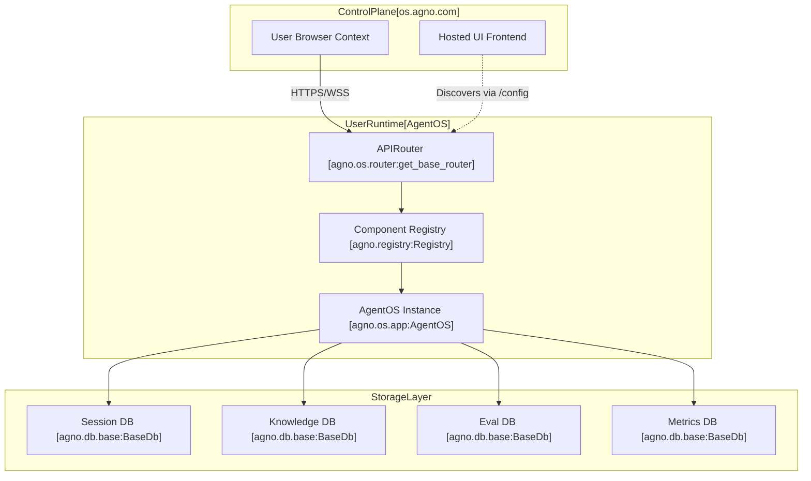
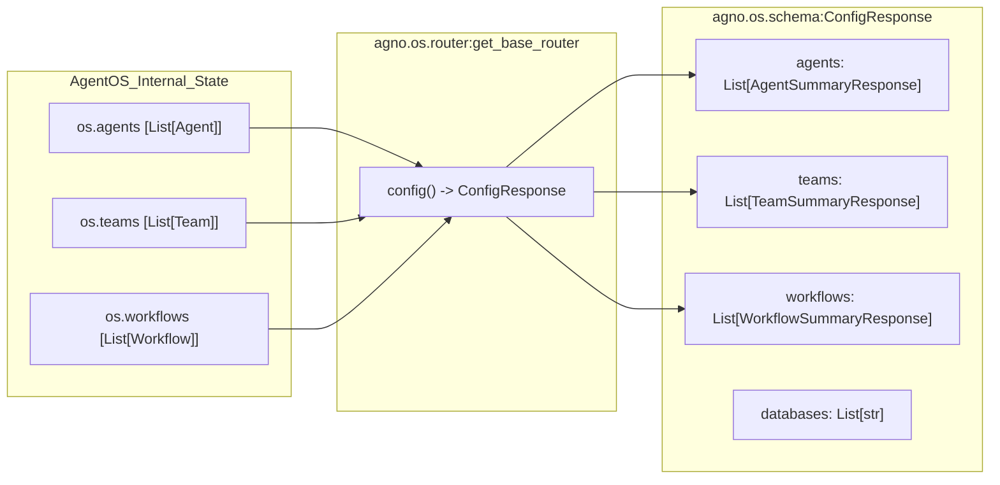
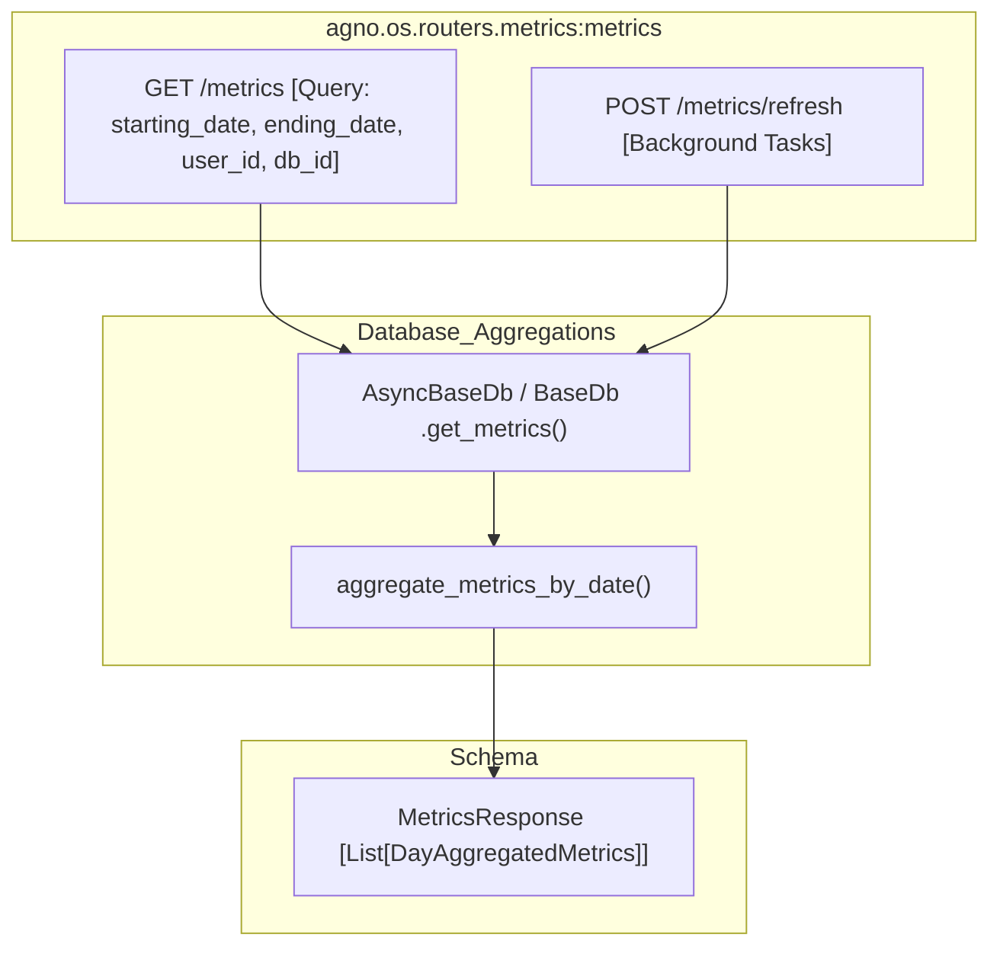

<!-- source: DeepWiki mcp.deepwiki.com · repo agno-agi/agno · page 7.12 Control Plane UI · fetched 2026-11-09 -->

# Control Plane UI

Relevant source files

The following files were used as context for generating this wiki page:

- [.cursorrules](.cursorrules)
- [.github/pull_request_template.md](.github/pull_request_template.md)
- [.github/workflows/claude.yml](.github/workflows/claude.yml)
- [.github/workflows/pr-triage.yml](.github/workflows/pr-triage.yml)
- [.gitignore](.gitignore)
- [AGENTS.md](AGENTS.md)
- [CLAUDE.md](CLAUDE.md)
- [CONTRIBUTING.md](CONTRIBUTING.md)
- [README.md](README.md)
- [cookbook/07_knowledge/02_building_blocks/README.md](cookbook/07_knowledge/02_building_blocks/README.md)
- [cookbook/07_knowledge/05_integrations/README.md](cookbook/07_knowledge/05_integrations/README.md)
- [cookbook/07_knowledge/05_integrations/vector_dbs/05_scylladb.py](cookbook/07_knowledge/05_integrations/vector_dbs/05_scylladb.py)
- [cookbook/README.md](cookbook/README.md)
- [libs/agno/agno/tools/reasoning.py](libs/agno/agno/tools/reasoning.py)
- [libs/agno_infra/agno/cli/infra_cli.py](libs/agno_infra/agno/cli/infra_cli.py)
- [libs/agno_infra/agno/infra/enums.py](libs/agno_infra/agno/infra/enums.py)
- [libs/agno_infra/agno/infra/operator.py](libs/agno_infra/agno/infra/operator.py)
- [scripts/demo_setup.sh](scripts/demo_setup.sh)
- [scripts/dev_setup.sh](scripts/dev_setup.sh)

## Purpose and Scope

The Control Plane UI is a hosted web application at [os.agno.com](https://os.agno.com) that serves as the management layer for AgentOS [README.md:15-30](). It provides a centralized interface for testing agents, monitoring multi-agent teams, orchestrating workflows, managing persistent session data, and evaluating system performance. The UI connects directly to AgentOS instances (local or remote) to provide real-time visibility into execution, traces, and metrics [README.md:23]().

This page describes the technical implementation of the UI's integration with the AgentOS runtime, including data flows for event streaming, session management, trace analysis, metrics aggregation, and the component configuration discovery mechanism.

Sources: [README.md:15-30]()

## Architecture Overview

The Control Plane UI follows a decentralized architecture where the hosted frontend at `os.agno.com` acts as a thin client, communicating directly with user-owned `AgentOS` instances via REST and WebSocket endpoints [libs/agno/agno/os/router.py:66-90]().

### Deployment and Data Flow

The UI operates on a "user-owned storage" model [README.md:23](). While the interface is hosted by Agno, all operational data—such as sessions, traces, memory, metrics, and evaluations—resides entirely within the user's infrastructure in the databases registered with `AgentOS` [libs/agno/agno/os/app.py:22-46]().

Title: "ControlPlaneAndStorageDataFlow"

Sources: [README.md:23](), [libs/agno/agno/os/app.py:22-46](), [libs/agno/agno/os/router.py:66-90](), [libs/agno/agno/os/schema.py:13-23]()

### Component Discovery via /config

When the UI connects to an AgentOS instance, it executes a handshake via the `/config` endpoint. This endpoint returns a `ConfigResponse` mapping the internal Python state of the `AgentOS` instance to a serializable schema containing registered agents, teams, workflows, and database bindings [libs/agno/agno/os/router.py:93-183]().

Title: "ComponentDiscoveryDataFlow"

Sources: [libs/agno/agno/os/router.py:93-183](), [libs/agno/agno/os/schema.py:13-23](), [libs/agno/agno/os/app.py:26-47]()

## Connecting OS Instances

### Local vs. Remote Connections

The Control Plane UI supports two connection modes:
1. **Local**: Connects to `http://127.0.0.1:8000` (default), commonly used during local development and testing [README.md:38-40]().
2. **Remote**: Connects to deployed AgentOS containers or serverless endpoints via a public HTTPS/WSS URL, leveraging `AgentOSClient` (`agno.client.os.AgentOSClient`) for programmatic interactions [README.md:54-56]().

### Security and Authentication

Connections are authenticated via the `agno.os.auth` subsystem. The UI transmits credentials (such as Security Keys or JWT tokens) in the `Authorization` header, which are validated by `get_authentication_dependency` across protected routes [libs/agno/agno/os/router.py:82-90](), [libs/agno/agno/os/routers/metrics/metrics.py:39]().

| Security Mechanism | Code Implementation | Description |
| :--- | :--- | :--- |
| **JWT Validator** | `JWTValidator` | Secures production multi-tenant environments with RBAC. [libs/agno/agno/os/router.py:22]() |
| **CORS Policy** | `update_cors_middleware` | Automatically configures CORS to permit requests from `os.agno.com`. [libs/agno/agno/os/utils.py:84]() |
| **RBAC Scopes** | `AgentOSScope` | Defines explicit permission scopes for agents, teams, and workflows. [libs/agno/agno/os/router.py:50]() |

Sources: [libs/agno/agno/os/router.py:22-82](), [libs/agno/agno/os/utils.py:84](), [libs/agno/agno/os/schema.py:129-150](), [libs/agno/agno/os/routers/metrics/metrics.py:39]()

## Monitoring and Observability

### Real-Time Run Tracking and Events

The UI provides a live chat and execution tracking dashboard. This depends on event-driven streaming where run endpoints receive `stream_events=True`, causing the backend to yield `RunOutputEvent`, `TeamRunOutputEvent`, and `WorkflowRunOutputEvent` instances [README.md:68]().

**Key Event Data Structures:**
- `RunOutputEvent`: Encapsulates agent-level step events (e.g., `RunStarted`, `ToolCallStarted`, `ModelRequestCompleted`) [README.md:68]().
- `TeamRunOutputEvent`: Encapsulates member coordination and team execution events [README.md:62]().
- `WorkflowRunOutputEvent`: Encapsulates workflow step orchestration and transition events [README.md:63]().

### Metrics Dashboard and Analytics

The UI renders aggregated usage statistics and performance charts by querying the `/metrics` endpoint provided by `agno.os.routers.metrics.metrics.get_metrics_router` [libs/agno/agno/os/routers/metrics/metrics.py:34-49]().

Title: "MetricsAggregationFlow"

The metrics response returns `DayAggregatedMetrics` objects containing run counts, token usage statistics (`token_metrics`), model distributions (`model_metrics`), and unique user counts [libs/agno/agno/os/routers/metrics/metrics.py:69-95]().

Sources: [README.md:62-68](), [libs/agno/agno/os/routers/metrics/metrics.py:34-148]()

## Evaluation and Human-in-the-Loop (HITL)

The Control Plane UI acts as the central interface for reviewing paused workflows, resolving human approvals, and evaluating system runs.

### Human Approval Flows
When an agent execution or tool call requires human confirmation, the run pauses, generating a pending approval record. The UI exposes these through the `/approvals` routes [README.md:67]():
- **Listing Approvals**: `GET /approvals` retrieves pending intervention requests.
- **Resolving Approvals**: `POST /approvals/{approval_id}/resolve` submits user decisions (approval or rejection) to resume execution.

### Run Evaluation Dashboard
The UI includes an evaluation dashboard backed by `agno.os.routers.evals` to inspect scoring across accuracy, performance, reliability, and agent-as-judge suites [README.md:45]().

Sources: [README.md:45](), [README.md:67]()

## Technical Implementation Details

### API Endpoint Mapping

The UI interacts with the primary routers registered in the AgentOS application:

| Feature | Router Module / Function | Source |
| :--- | :--- | :--- |
| **Config Handshake** | `get_base_router` | [libs/agno/agno/os/router.py:66-90]() |
| **Agent Runs** | `get_agent_router` | [libs/agno/agno/os/app.py:52]() |
| **Team Runs** | `get_team_router` | [libs/agno/agno/os/app.py:69]() |
| **Workflow Runs** | `get_workflow_router` | [libs/agno/agno/os/app.py:71]() |
| **Trace Visibility** | `get_traces_router` | [libs/agno/agno/os/app.py:70]() |
| **Metrics & Analytics** | `get_metrics_router` | [libs/agno/agno/os/routers/metrics/metrics.py:34-49]() |
| **Approvals/HITL** | `get_approval_router` | [libs/agno/agno/os/app.py:53]() |
| **Knowledge Mgmt** | `get_knowledge_router` | [libs/agno/agno/os/app.py:60]() |
| **Registry System** | `get_registry_router` | [libs/agno/agno/os/app.py:65]() |

### Health Tracking and Instantiation
The UI monitors instance availability via health check endpoints. This verifies server liveness and checks the `instantiated_at` timestamp, allowing the frontend to identify server restarts and discard stale session states [libs/agno/agno/os/schema.py:153-161]().

Sources: [libs/agno/agno/os/app.py:52-71](), [libs/agno/agno/os/schema.py:153-161](), [libs/agno/agno/os/router.py:66-90](), [libs/agno/agno/os/routers/metrics/metrics.py:34-49]()

---

