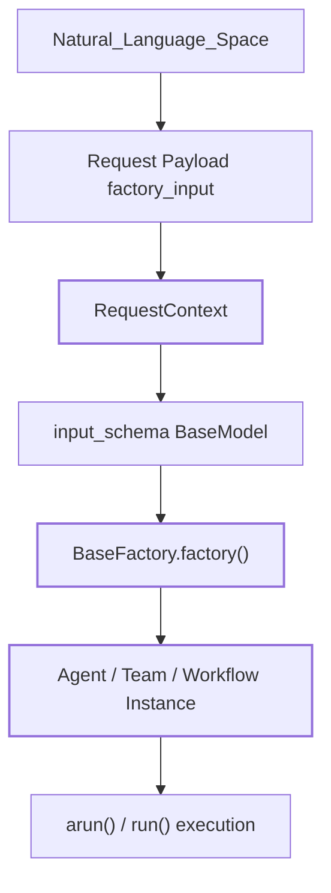
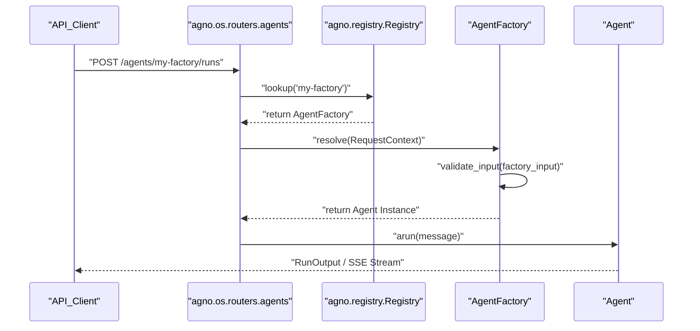

<!-- source: DeepWiki mcp.deepwiki.com · repo agno-agi/agno · page 7.13 Factories · fetched 2026-11-09 -->

# Factories

<details>
<summary>Relevant source files</summary>

The following files were used as context for generating this wiki page:

- [libs/agno/agno/agent/_utils.py](libs/agno/agno/agent/_utils.py)
- [libs/agno/agno/job_queue/config.py](libs/agno/agno/job_queue/config.py)
- [libs/agno/agno/os/job_queue.py](libs/agno/agno/os/job_queue.py)
- [libs/agno/agno/os/routers/agents/router.py](libs/agno/agno/os/routers/agents/router.py)
- [libs/agno/agno/os/routers/teams/router.py](libs/agno/agno/os/routers/teams/router.py)
- [libs/agno/agno/os/routers/workflows/router.py](libs/agno/agno/os/routers/workflows/router.py)
- [libs/agno/agno/os/utils.py](libs/agno/agno/os/utils.py)
- [libs/agno/agno/team/_utils.py](libs/agno/agno/team/_utils.py)
- [libs/agno/tests/integration/db/test_company_queue_projection.py](libs/agno/tests/integration/db/test_company_queue_projection.py)
- [libs/agno/tests/integration/os/test_agent_runs.py](libs/agno/tests/integration/os/test_agent_runs.py)
- [libs/agno/tests/integration/os/test_team_runs.py](libs/agno/tests/integration/os/test_team_runs.py)
- [libs/agno/tests/integration/os/test_workflow_runs.py](libs/agno/tests/integration/os/test_workflow_runs.py)
- [libs/agno/tests/unit/agent/test_callable_resources.py](libs/agno/tests/unit/agent/test_callable_resources.py)
- [libs/agno/tests/unit/os/test_per_request_isolation.py](libs/agno/tests/unit/os/test_per_request_isolation.py)
- [libs/agno/tests/unit/os/test_queue_db_components.py](libs/agno/tests/unit/os/test_queue_db_components.py)
- [libs/agno/tests/unit/os/test_queue_wake_on_enqueue.py](libs/agno/tests/unit/os/test_queue_wake_on_enqueue.py)
- [libs/agno/tests/unit/os/test_queue_worker.py](libs/agno/tests/unit/os/test_queue_worker.py)
- [libs/agno/tests/unit/os/test_ws_workflow_submission_parity.py](libs/agno/tests/unit/os/test_ws_workflow_submission_parity.py)
- [libs/agno/tests/unit/team/test_callable_resources.py](libs/agno/tests/unit/team/test_callable_resources.py)

</details>


Factories provide a mechanism for per-request component construction within the Agno framework. They allow the **AgentOS** runtime to dynamically instantiate agents, teams, or workflows based on incoming request parameters, enabling multi-tenant isolation, dynamic configuration, and just-in-time dependency injection.

## Overview and Core Factory Classes

In a production environment, static component definitions are often insufficient. A system may need to create an `Agent` with a specific `user_id`, a `Team` with members tailored to a specific task, or a `Workflow` that varies based on an `input_schema`.

Factories encapsulate this logic by providing a functional interface that the AgentOS registry can call whenever a new run is initiated. The framework provides three primary factory classes, all inheriting from base factory abstractions:
*   `AgentFactory`: For constructing `Agent` instances dynamically per request [libs/agno/agno/os/utils.py:11]().
*   `TeamFactory`: For constructing `Team` instances with dynamic member configurations [libs/agno/agno/os/utils.py:34]().
*   `WorkflowFactory`: For constructing `Workflow` instances parameterized by request inputs [libs/agno/agno/os/utils.py:37]().

**Factory Execution Diagram**

Sources: `libs/agno/agno/os/utils.py:11-37](), [libs/agno/tests/integration/os/test_workflow_runs.py:143-164]()`

## RequestContext and Input Validation

The `RequestContext` acts as the bridge between the external API and the internal factory logic. It carries the validated input and allows the factory to make decisions based on the caller's requirements, authentication context, and session data.

### input_schema Validation
Factories can be strictly typed using Pydantic models. When a factory is registered with an `input_schema`, AgentOS automatically validates the `factory_input` payload before the factory function is executed.

```python
# Example of a Factory Input Schema
class MyAgentInput(BaseModel):
    user_tier: str = "free"
    enable_web_search: bool = False

# Factory definition
agent_factory = AgentFactory(
    id="custom-agent",
    input_schema=MyAgentInput,
    factory=lambda ctx: Agent(
        tools=[WebSearch()] if ctx.input.enable_web_search else []
    )
)
```

### Factory Lifecycle Errors
The framework defines specific exceptions to handle factory execution and validation failures:
*   `FactoryValidationError`: Raised when `factory_input` fails to validate against the defined `input_schema` [libs/agno/agno/os/utils.py:19]().
*   `FactoryPermissionError`: Raised when factory logic restricts instantiation based on caller permissions [libs/agno/agno/os/utils.py:18]().
*   `FactoryContextRequired`: Raised if a factory function is evaluated without an active request context [libs/agno/agno/os/utils.py:16]().

Sources: `libs/agno/agno/os/utils.py:11-21](), [libs/agno/tests/integration/os/test_workflow_runs.py:34-37]()`

## Integration with AgentOS API Routes and Registry

Factories are registered directly in the AgentOS `Registry` and integrate seamlessly with REST execution routes, WebSocket streams, and MCP server endpoints.

**AgentOS Route Integration**

Sources: `libs/agno/agno/os/routers/agents/router.py:20-108](), [libs/agno/os/routers/teams/router.py:107-110]()`

## Technical Details and Per-Request Isolation

### Implementation in Factory Base Classes
Base factory classes manage the initialization lifecycle:
- **Initialization**: Requires a stable component `id` and persistence bindings.
- **Resolution**: The resolution method executes input validation, invokes the user-supplied `factory` callable, and ensures component type safety.
- **Post-Resolution Checks**: Enforces that the produced component's identifier aligns with the factory registration to maintain session consistency across runs.

### Per-Request Isolation
To prevent cross-request contamination in multi-tenant environments, AgentOS leverages deep-copy utilities (`deep_copy`) alongside factories to guarantee that mutable state (such as session states, temporary memory buffers, and run contexts) remains fully isolated between concurrent requests [libs/agno/agent/_utils.py:112-178]().

Sources: `libs/agno/tests/unit/os/test_per_request_isolation.py:53-120](), [libs/agno/agent/_utils.py:112-178]()`

---

