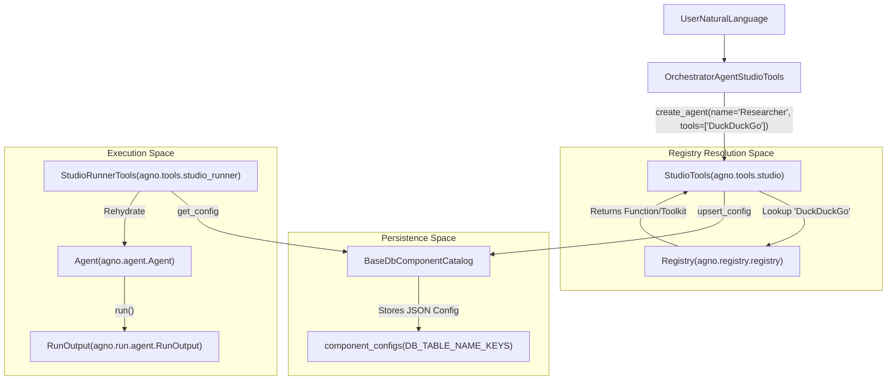
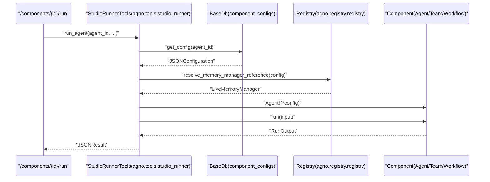
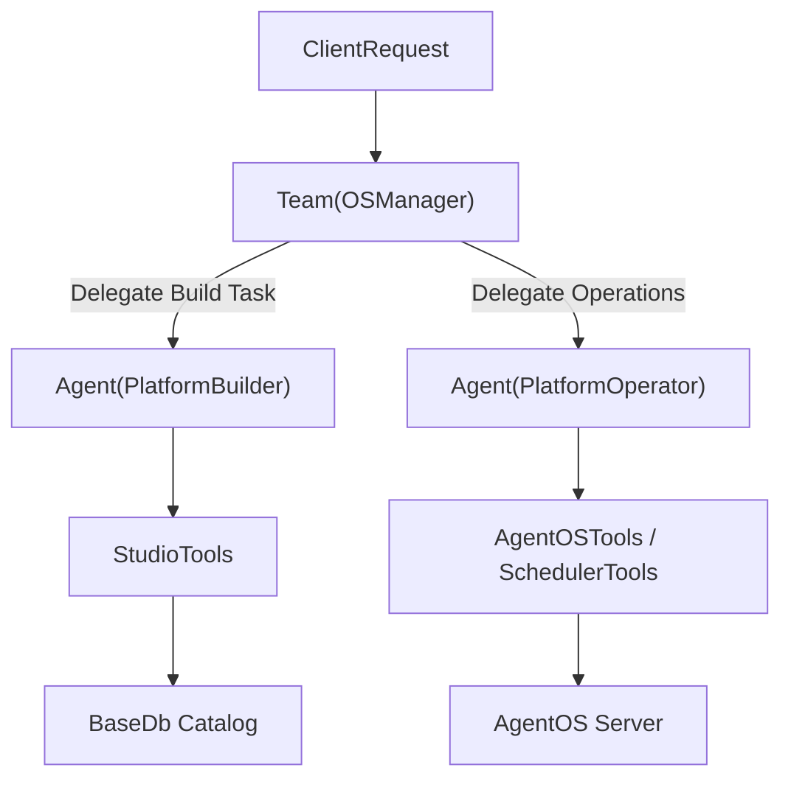

<!-- source: DeepWiki mcp.deepwiki.com · repo agno-agi/agno · page 7.14 Studio and Component Composition · fetched 2026-11-09 -->

# Studio and Component Composition

Relevant source files

The following files were used as context for generating this wiki page:

- [cookbook/05_agent_os/29_manager/README.md](cookbook/05_agent_os/29_manager/README.md)
- [cookbook/05_agent_os/29_manager/TEST_LOG.md](cookbook/05_agent_os/29_manager/TEST_LOG.md)
- [cookbook/05_agent_os/29_manager/manager_discovery.py](cookbook/05_agent_os/29_manager/manager_discovery.py)
- [cookbook/frameworks/sandbox/docker/sandbox_s3_checkpoints.py](cookbook/frameworks/sandbox/docker/sandbox_s3_checkpoints.py)
- [libs/agno/agno/agent/_storage.py](libs/agno/agno/agent/_storage.py)
- [libs/agno/agno/db/utils.py](libs/agno/agno/db/utils.py)
- [libs/agno/agno/offload/tools.py](libs/agno/agno/offload/tools.py)
- [libs/agno/agno/os/diagnostics.py](libs/agno/agno/os/diagnostics.py)
- [libs/agno/agno/os/manager/config.py](libs/agno/agno/os/manager/config.py)
- [libs/agno/agno/os/manager/manager.py](libs/agno/agno/os/manager/manager.py)
- [libs/agno/agno/os/manager/prompts.py](libs/agno/agno/os/manager/prompts.py)
- [libs/agno/agno/os/routers/components/components.py](libs/agno/agno/os/routers/components/components.py)
- [libs/agno/agno/registry/_reserved.py](libs/agno/agno/registry/_reserved.py)
- [libs/agno/agno/registry/registry.py](libs/agno/agno/registry/registry.py)
- [libs/agno/agno/team/_storage.py](libs/agno/agno/team/_storage.py)
- [libs/agno/agno/tools/scheduler.py](libs/agno/agno/tools/scheduler.py)
- [libs/agno/agno/tools/studio.py](libs/agno/agno/tools/studio.py)
- [libs/agno/agno/tools/studio_runner.py](libs/agno/agno/tools/studio_runner.py)
- [libs/agno/tests/unit/agent/test_agent_config.py](libs/agno/tests/unit/agent/test_agent_config.py)
- [libs/agno/tests/unit/db/test_datetime_serialization.py](libs/agno/tests/unit/db/test_datetime_serialization.py)
- [libs/agno/tests/unit/db/test_resolve_db_from_config.py](libs/agno/tests/unit/db/test_resolve_db_from_config.py)
- [libs/agno/tests/unit/db/test_sqlite_bulk_upsert_owner.py](libs/agno/tests/unit/db/test_sqlite_bulk_upsert_owner.py)
- [libs/agno/tests/unit/db/test_sqlite_session_storage_format.py](libs/agno/tests/unit/db/test_sqlite_session_storage_format.py)
- [libs/agno/tests/unit/os/routers/test_components_router.py](libs/agno/tests/unit/os/routers/test_components_router.py)
- [libs/agno/tests/unit/os/test_manager.py](libs/agno/tests/unit/os/test_manager.py)
- [libs/agno/tests/unit/os/test_registry_population.py](libs/agno/tests/unit/os/test_registry_population.py)
- [libs/agno/tests/unit/registry/test_registry.py](libs/agno/tests/unit/registry/test_registry.py)
- [libs/agno/tests/unit/team/test_team_config.py](libs/agno/tests/unit/team/test_team_config.py)
- [libs/agno/tests/unit/tools/test_scheduler.py](libs/agno/tests/unit/tools/test_scheduler.py)
- [libs/agno/tests/unit/tools/test_studio.py](libs/agno/tests/unit/tools/test_studio.py)
- [libs/agno/tests/unit/tools/test_studio_runner.py](libs/agno/tests/unit/tools/test_studio_runner.py)
- [libs/agno/tests/unit/workflow/test_workflow_custom_table_names.py](libs/agno/tests/unit/workflow/test_workflow_custom_table_names.py)

The Studio system provides a control plane for composing, versioning, and executing Agno components (Agents, Teams, and Workflows) described in natural language or configuration. It bridges the gap between code-defined components in the `Registry` and persisted components in the database catalog, enabling a complete lifecycle from draft to publication.

## Purpose and Scope

This page explains `StudioTools`, `StudioRunnerTools`, the `OSManager` (AgentOS Manager), component lifecycle, resource resolution via the `Registry`, and the `/components` REST API exposed by AgentOS.

Sources: `[libs/agno/agno/tools/studio.py:1-71](), [libs/agno/agno/os/manager/manager.py:27-43]()`

---

## 1. Overview and Purpose

Studio is implemented primarily through `StudioTools`, a toolkit that allows an orchestrator agent to manage the Agno component ecosystem `[libs/agno/agno/tools/studio.py:1-16]()`. It utilizes the `AgentOS` `Registry` to resolve live objects (tools, models, functions, knowledge, schemas) and a database implementing `BaseDb` to persist component configurations `[libs/agno/agno/tools/studio.py:1-8]()`.

### Key Capabilities
*   **Composition**: Building Agents, Teams, and Workflows by referencing tools, models, and other components by name `[libs/agno/agno/tools/studio.py:1-8]()`.
*   **Lifecycle Management**: Handling `DRAFT`, `PUBLISHED`, and `ARCHIVED` states through a versioned catalog `[libs/agno/agno/tools/studio.py:23-36]()`.
*   **Dispatch**: Executing components via `StudioRunnerTools`, which can be mounted standalone for production dispatch without mutation permissions `[libs/agno/agno/tools/studio_runner.py:1-10]()`.
*   **Validation**: Dry-running configurations against the live registry to ensure compatibility before publication `[libs/agno/agno/tools/studio_runner.py:78-81]()`.

Sources: `[libs/agno/agno/tools/studio.py:1-71](), [libs/agno/agno/tools/studio_runner.py:1-10]()`

---

## 2. Component Lifecycle and State

Components managed by Studio follow a strict lifecycle to ensure production stability while allowing iterative development. Version numbers are never reused `[libs/agno/agno/tools/studio.py:23-36]()`.

| State | Description | Persistence Behavior |
| :--- | :--- | :--- |
| **DRAFT** | The initial version of a component. Only visible to the owner. | Written as version 1 unless `publish=True` is passed to `create_*` `[libs/agno/agno/tools/studio.py:23-26]()`. |
| **VALIDATED** | A configuration checked against the live registry. | Verified by `validate_component` exactly as dispatch would dry-run it `[libs/agno/agno/tools/studio.py:37-38]()`. |
| **PUBLISHED** | The version made available to the platform. | Promoted via `publish_component`. Re-points the live version pointer `[libs/agno/agno/tools/studio.py:32-34]()`. |
| **ARCHIVED** | The component is retired. | ID is reserved and history kept, but dependents refuse to load it `[libs/agno/agno/tools/studio.py:34-35]()`. |

Sources: `[libs/agno/agno/tools/studio.py:23-43](), [libs/agno/agno/db/base.py:10-20]()`

---

## 3. Data Flow: Natural Language to Code Entity

The following diagram illustrates how natural language requests are transformed into executable code entities through the Studio system, mapping system concepts to specific code locations.

### Studio Composition Flow

Sources: `[libs/agno/agno/tools/studio.py:1-50](), [libs/agno/agno/registry/registry.py:90-141](), [libs/agno/agno/db/utils.py:21-50](), [libs/agno/agno/tools/studio_runner.py:84-90]()`

---

## 4. Registry and Resource Resolution

The `Registry` manages non-serializable objects like tools, models, and databases `[libs/agno/agno/registry/registry.py:90-105]()`. When Studio builds a component, it stores references that are resolved at runtime.

### The Rehydration Process
When a component is loaded from the database:
1.  **Config Retrieval**: `db.get_config` fetches the JSON representation `[libs/agno/agno/tools/studio_runner.py:76-80]()`.
2.  **Tool Resolution**: The registry maps function names to live `Function` or `Toolkit` objects `[libs/agno/agno/registry/registry.py:40-43]()`.
3.  **Model Resolution**: Reconstructs the provider instance (e.g., `OpenAIChat`) `[libs/agno/agno/models/utils.py:1-40]()`.
4.  **Memory Resolution**: `resolve_memory_manager_reference` links the component to its `MemoryManager` by matching `registry_id`, `id`, or `name` `[libs/agno/agno/agent/_storage.py:96-145]()`.

### Palette Policy
Studio enforces a "Palette Policy" to prevent circularity and ensure security `[libs/agno/agno/tools/studio.py:52-58]()`:
*   **DECLARED Tools**: Tools explicitly added to the `Registry` are buildable `[libs/agno/agno/registry/registry.py:45-56]()`.
*   **DISCOVERED Tools**: Tools found on existing components are resolvable for rehydration but not buildable by default unless explicitly allowed `[libs/agno/agno/registry/registry.py:45-56]()`.

Sources: `[libs/agno/agno/registry/registry.py:29-141](), [libs/agno/agno/agent/_storage.py:94-161](), [libs/agno/agno/tools/studio.py:52-58]()`

---

## 5. StudioRunnerTools and Component Execution

`StudioRunnerTools` handles read and execute operations. This separation allows platforms to mount a dispatch-only surface without granting mutation permissions `[libs/agno/agno/tools/studio_runner.py:1-10]()`.

### Component Execution Sequence

Sources: `[libs/agno/agno/tools/studio_runner.py:84-90](), [libs/agno/agno/team/_storage.py:91-124](), [libs/agno/agno/agent/_storage.py:94-105]()`

---

## 6. AgentOS Manager (`OSManager`) Architecture

The `OSManager` is a specialized platform team that serves as the administrative interface for AgentOS `[libs/agno/agno/os/manager/manager.py:27-35]()`. It coordinates specialized members to handle diagnostics, component discovery, and operational builds.

### Manager Specialists
*   **Platform Builder**: Uses `StudioTools` to create, version, validate, and publish components on demand `[libs/agno/agno/os/manager/manager.py:32-32](), [libs/agno/agno/os/manager/prompts.py:1-20]()`.
*   **Platform Operator**: Manages runtime execution, scheduling, and diagnostic inspection `[libs/agno/agno/os/manager/manager.py:33-33](), [libs/agno/agno/os/manager/prompts.py:1-20]()`.
*   **Company Manager** *(Optional)*: Integrates organizational tasks and routines when company context is enabled `[libs/agno/agno/os/manager/manager.py:34-34]()`.

Sources: `[libs/agno/agno/os/manager/manager.py:27-64](), [libs/agno/agno/os/manager/config.py:1-30](), [libs/agno/tests/unit/os/test_manager.py:40-108]()`

---

## 7. The `/components` REST API

AgentOS exposes Studio functionality via the `/components` router, providing programmatic access to the component catalog, versioning, and execution pipelines `[libs/agno/agno/os/routers/components/components.py:1-50]()`.

| Endpoint | Method | Description |
| :--- | :--- | :--- |
| `/components` | `GET` | Lists components using `db.list_components` with pagination `[libs/agno/agno/os/routers/components/components.py:1-50]()`. |
| `/components/{id}` | `GET` | Returns configuration and history via `db.get_component` `[libs/agno/agno/os/routers/components/components.py:51-100]()`. |
| `/components/{id}/configs` | `POST` | Appends a new version using `db.upsert_config` `[libs/agno/agno/os/routers/components/components.py:101-150]()`. |
| `/components/{id}/restore` | `POST` | Reverses an archive via `db.restore_component` `[libs/agno/agno/os/routers/components/components.py:151-174]()`. |

### Request Context and Ownership
Every Studio operation is scoped by `RunContext` `[libs/agno/agno/tools/studio.py:44-51]()`:
*   **Private Drafts**: Scoped by `user_id`. Draft checks verify whether the caller owns the uncommitted draft `[libs/agno/agno/tools/studio.py:44-51]()`.
*   **Conflict Resolution**: Conflict management redacts foreign component dependency errors to prevent unauthorized information leakage `[libs/agno/agno/tools/studio.py:44-51]()`.

Sources: `[libs/agno/agno/os/routers/components/components.py:1-174](), [libs/agno/agno/tools/studio.py:44-51]()`

---

