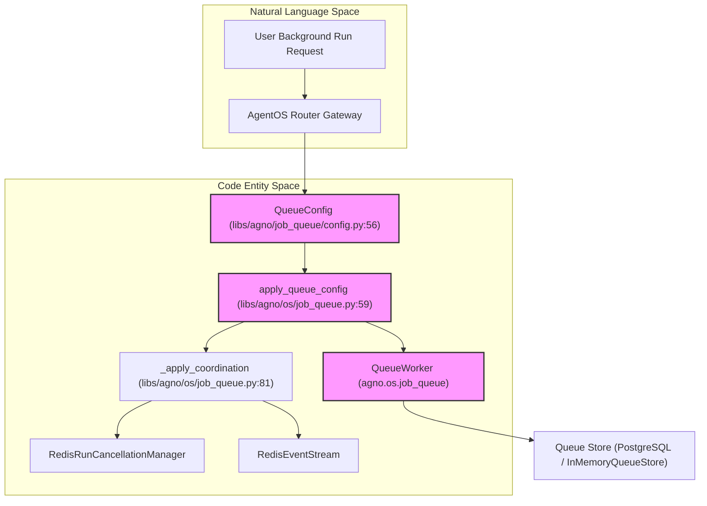
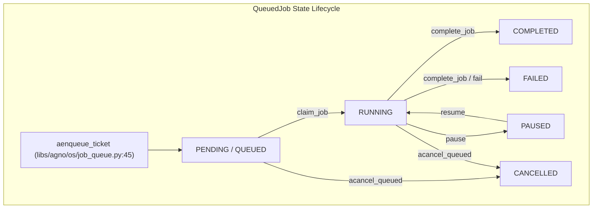
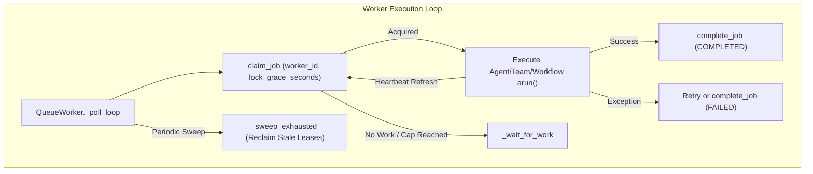

<!-- source: DeepWiki mcp.deepwiki.com · repo agno-agi/agno · page 7.15 Durable Job Queue and Background Runs · fetched 2026-11-09 -->

# Durable Job Queue and Background Runs

Relevant source files

The following files were used as context for generating this wiki page:

- [libs/agno/agno/job_queue/config.py](libs/agno/agno/job_queue/config.py)
- [libs/agno/agno/os/job_queue.py](libs/agno/agno/os/job_queue.py)
- [libs/agno/agno/os/routers/agents/router.py](libs/agno/agno/os/routers/agents/router.py)
- [libs/agno/agno/os/routers/teams/router.py](libs/agno/agno/os/routers/teams/router.py)
- [libs/agno/agno/os/routers/workflows/router.py](libs/agno/agno/os/routers/workflows/router.py)
- [libs/agno/agno/os/utils.py](libs/agno/agno/os/utils.py)
- [libs/agno/tests/integration/db/test_company_queue_projection.py](libs/agno/tests/integration/db/test_company_queue_projection.py)
- [libs/agno/tests/integration/os/test_agent_runs.py](libs/agno/tests/integration/os/test_agent_runs.py)
- [libs/agno/tests/integration/os/test_team_runs.py](libs/agno/tests/integration/os/test_team_runs.py)
- [libs/agno/tests/integration/os/test_workflow_runs.py](libs/agno/tests/integration/os/test_workflow_runs.py)
- [libs/agno/tests/unit/os/test_queue_db_components.py](libs/agno/tests/unit/os/test_queue_db_components.py)
- [libs/agno/tests/unit/os/test_queue_wake_on_enqueue.py](libs/agno/tests/unit/os/test_queue_wake_on_enqueue.py)
- [libs/agno/tests/unit/os/test_queue_worker.py](libs/agno/tests/unit/os/test_queue_worker.py)
- [libs/agno/tests/unit/os/test_ws_workflow_submission_parity.py](libs/agno/tests/unit/os/test_ws_workflow_submission_parity.py)

## Purpose and Scope
This document details the durable job queue and background execution subsystem in Agno (`libs/agno/agno/job_queue/` and `libs/agno/agno/os/job_queue.py`), which powers background agent, team, and workflow runs (`background=True`). It covers `QueueConfig` parameters, `QueueWorker` lifecycle management, `QueuedJob` persistence across Postgres and Redis, the claim-heartbeat-sweep concurrency protocol, and multi-replica run resume with tail streaming over WebSockets and Server-Sent Events (SSE).

---

## 1. Queue Configuration and Architecture
Background execution is governed by `QueueConfig` [libs/agno/job_queue/config.py:56-90] and initialized via `apply_queue_config()` [libs/agno/os/job_queue.py:59-79]. When `redis` coordination is provided, `_apply_coordination()` [libs/agno/os/job_queue.py:81-149] automatically binds cross-container transports: the `RedisRunCancellationManager` and `RedisEventStream`.

*Sources: [libs/agno/job_queue/config.py:56-90](), [libs/agno/os/job_queue.py:59-149]()*

`QueueConfig` fields include:
- `max_concurrency`: Limits concurrent background runs per event loop replica [libs/agno/job_queue/config.py:60-68].
- `durable`: Persists accepted runs as committed rows in the queue store (`QueuedJob`) [libs/agno/job_queue/config.py:99-100].
- `max_attempts`: Binds execution retry limits under failure modes or worker crashes [libs/agno/job_queue/config.py:106-115].
- `deployment_id`: Enforces claim affinity across heterogeneous worker fleets [libs/agno/job_queue/config.py:121-128].

---

## 2. QueuedJob Lifecycle and States
Accepted jobs are represented by `QueuedJob` [libs/agno/db/schemas/jobs.py:24] and transition through explicit lifecycle states: `pending` (or `queued`), `running`, `completed`, `failed`, `paused`, and `cancelled`.

*Sources: [libs/agno/os/job_queue.py:42-57](), [libs/agno/db/schemas/jobs.py:24](), [libs/tests/integration/db/test_company_queue_projection.py:94-108]()*

Ticket admission verifies component queueability via `component_is_queueable()` and `payload_is_queueable()` [libs/agno/os/job_queue.py:49-55], stamping version pins and scope contexts (`queue_scope()`) so that workers executing deferred runs reload the exact component version and user identity [libs/tests/unit/os/test_queue_db_components.py:114-152].

---

## 3. Storage Backends
Queue persistence is handled via pluggable queue stores:
- `InMemoryQueueStore`: Used for testing and zero-infrastructure local setups [libs/agno/job_queue/store.py] [libs/tests/unit/os/test_queue_db_components.py:20].
- Postgres / SQLAlchemy Backends: Store durable `jobs` tables (`QueuedJob`) alongside session and component state, isolating queue polling load from the system of record when configured with an independent `db` instance [libs/agno/job_queue/config.py:101-103].

---

## 4. Claim, Heartbeat, and Sweep Protocol
Workers poll the queue store, claim jobs via atomic compare-and-swap (CAS) operations, and maintain execution leases via periodic heartbeats.

*Sources: [libs/agno/os/job_queue.py](), [libs/tests/integration/db/test_company_queue_projection.py:29-51]()*

The background sweeper (`_sweep_exhausted`) scans for abandoned jobs whose `locked_at` timestamp exceeds `lock_grace_seconds`. Stale runs are reclaimed or transitioned to terminal states according to `max_attempts` boundaries [libs/tests/integration/db/test_company_queue_projection.py:70-76].

---

## 5. Run Resume and Tail Streaming
When clients subscribe to background runs (via WebSockets or SSE), `queued_run_tail_streamer()` and `_pump_event_stream_to_websocket()` bridge asynchronous worker outputs to the client connection [libs/agno/os/utils.py:97] [libs/agno/os/routers/workflows/router.py:136-187].

The system tracks event indices through `RedisEventStream` or `InMemoryEventStream`, allowing clients to disconnect and later resume stream consumption from `from_index` without losing generated output chunks [libs/agno/os/routers/workflows/router.py:160-184].

---

---

