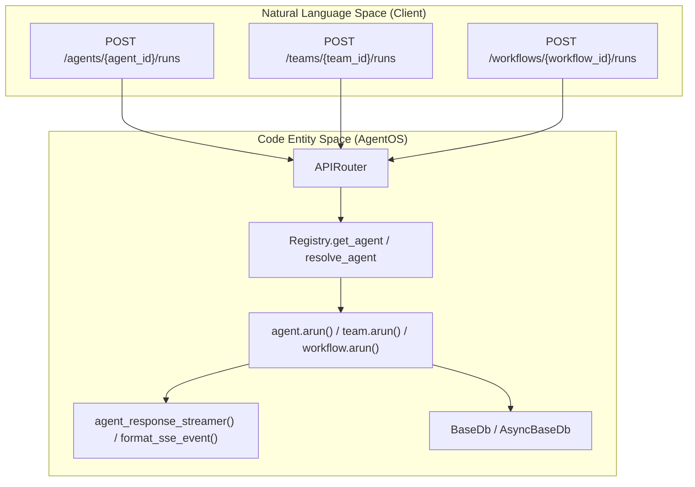
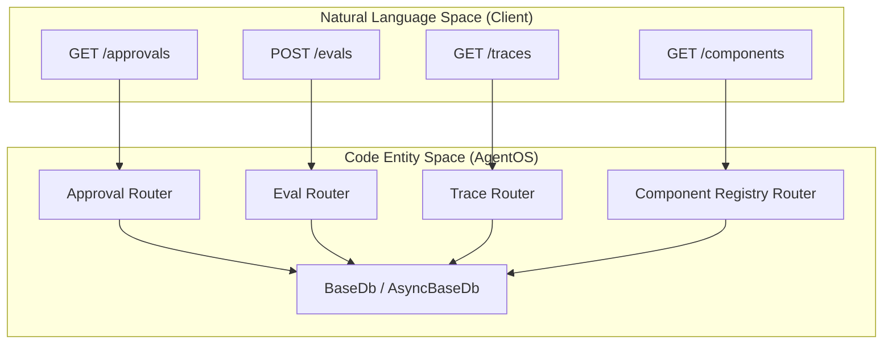

<!-- source: DeepWiki mcp.deepwiki.com · repo agno-agi/agno · page 7.2 REST API Endpoints · fetched 2026-11-09 -->

# REST API Endpoints

Relevant source files

The following files were used as context for generating this wiki page:

- [cookbook/05_agent_os/03_python_client/03_sessions_and_memory.py](cookbook/05_agent_os/03_python_client/03_sessions_and_memory.py)
- [cookbook/frameworks/README.md](cookbook/frameworks/README.md)
- [cookbook/frameworks/TEST_LOG.md](cookbook/frameworks/TEST_LOG.md)
- [cookbook/frameworks/TEST_PROMPT.md](cookbook/frameworks/TEST_PROMPT.md)
- [cookbook/frameworks/claude-agent-sdk/claude_native_sdk.py](cookbook/frameworks/claude-agent-sdk/claude_native_sdk.py)
- [libs/agno/agno/client/os.py](libs/agno/agno/client/os.py)
- [libs/agno/agno/job_queue/config.py](libs/agno/agno/job_queue/config.py)
- [libs/agno/agno/memory/manager.py](libs/agno/agno/memory/manager.py)
- [libs/agno/agno/os/job_queue.py](libs/agno/agno/os/job_queue.py)
- [libs/agno/agno/os/routers/agents/router.py](libs/agno/agno/os/routers/agents/router.py)
- [libs/agno/agno/os/routers/agents/schema.py](libs/agno/agno/os/routers/agents/schema.py)
- [libs/agno/agno/os/routers/job_queue/router.py](libs/agno/agno/os/routers/job_queue/router.py)
- [libs/agno/agno/os/routers/memory/memory.py](libs/agno/agno/os/routers/memory/memory.py)
- [libs/agno/agno/os/routers/memory/schemas.py](libs/agno/agno/os/routers/memory/schemas.py)
- [libs/agno/agno/os/routers/session/session.py](libs/agno/agno/os/routers/session/session.py)
- [libs/agno/agno/os/routers/teams/router.py](libs/agno/agno/os/routers/teams/router.py)
- [libs/agno/agno/os/routers/teams/schema.py](libs/agno/agno/os/routers/teams/schema.py)
- [libs/agno/agno/os/routers/workflows/router.py](libs/agno/agno/os/routers/workflows/router.py)
- [libs/agno/agno/os/routers/workflows/schema.py](libs/agno/agno/os/routers/workflows/schema.py)
- [libs/agno/agno/os/services/sessions.py](libs/agno/agno/os/services/sessions.py)
- [libs/agno/agno/os/utils.py](libs/agno/agno/os/utils.py)
- [libs/agno/agno/remote/base.py](libs/agno/agno/remote/base.py)
- [libs/agno/tests/integration/db/test_company_queue_projection.py](libs/agno/tests/integration/db/test_company_queue_projection.py)
- [libs/agno/tests/integration/knowledge/test_pptx_knowledge.py](libs/agno/tests/integration/knowledge/test_pptx_knowledge.py)
- [libs/agno/tests/integration/os/test_agent_runs.py](libs/agno/tests/integration/os/test_agent_runs.py)
- [libs/agno/tests/integration/os/test_sessions.py](libs/agno/tests/integration/os/test_sessions.py)
- [libs/agno/tests/integration/os/test_team_runs.py](libs/agno/tests/integration/os/test_team_runs.py)
- [libs/agno/tests/integration/os/test_workflow_runs.py](libs/agno/tests/integration/os/test_workflow_runs.py)
- [libs/agno/tests/integration/workflows/test_workflow_metrics.py](libs/agno/tests/integration/workflows/test_workflow_metrics.py)
- [libs/agno/tests/unit/memory/test_memory_manager_async.py](libs/agno/tests/unit/memory/test_memory_manager_async.py)
- [libs/agno/tests/unit/memory/test_search_user_memories_defaults.py](libs/agno/tests/unit/memory/test_search_user_memories_defaults.py)
- [libs/agno/tests/unit/os/routers/test_session_sdk_metadata.py](libs/agno/tests/unit/os/routers/test_session_sdk_metadata.py)
- [libs/agno/tests/unit/os/routers/test_session_type_filter.py](libs/agno/tests/unit/os/routers/test_session_type_filter.py)
- [libs/agno/tests/unit/os/test_client.py](libs/agno/tests/unit/os/test_client.py)
- [libs/agno/tests/unit/os/test_knowledge_filters_serialization.py](libs/agno/tests/unit/os/test_knowledge_filters_serialization.py)
- [libs/agno/tests/unit/os/test_queue_db_components.py](libs/agno/tests/unit/os/test_queue_db_components.py)
- [libs/agno/tests/unit/os/test_queue_list_pagination.py](libs/agno/tests/unit/os/test_queue_list_pagination.py)
- [libs/agno/tests/unit/os/test_queue_wake_on_enqueue.py](libs/agno/tests/unit/os/test_queue_wake_on_enqueue.py)
- [libs/agno/tests/unit/os/test_queue_worker.py](libs/agno/tests/unit/os/test_queue_worker.py)
- [libs/agno/tests/unit/os/test_schemas.py](libs/agno/tests/unit/os/test_schemas.py)
- [libs/agno/tests/unit/os/test_ws_workflow_submission_parity.py](libs/agno/tests/unit/os/test_ws_workflow_submission_parity.py)
- [libs/agno/tests/unit/team/test_external_agent_members.py](libs/agno/tests/unit/team/test_external_agent_members.py)

This page documents the REST API endpoints exposed by AgentOS for executing agents, teams, and workflows, and managing their associated persistence layers including sessions, memories, knowledge bases, evaluations, traces, approvals, schedules, metrics, and components. These endpoints form the core API surface used by external integrations, client SDKs, and the AgentOS Control Plane UI.

---

## 1. Core Execution Endpoints (`/agents`, `/teams`, `/workflows`)

AgentOS exposes execution endpoints for its three primary orchestration primitives: Agents, Teams, and Workflows. Each endpoint supports synchronous responses and Server-Sent Events (SSE) streaming.

### Endpoints and Implementation
- **POST `/agents/{agent_id}/runs`**: Execute an agent run, supporting multimodal inputs (images, audio, video, and files) and streaming generation [libs/agno/agno/os/routers/agents/router.py:111-123]().
- **POST `/teams/{team_id}/runs`**: Execute a team run across multiple member agents [libs/agno/agno/os/routers/teams/router.py:111-123]().
- **POST `/workflows/{workflow_id}/runs`**: Execute a multi-step workflow pipeline [libs/agno/agno/os/routers/workflows/router.py:172-179]().

### Request and Data Flow Architecture

**AgentOS Run Request Data Flow**

Sources: [libs/agno/agno/os/routers/agents/router.py:91-148](), [libs/agno/agno/os/routers/teams/router.py:87-154](), [libs/agno/agno/os/routers/workflows/router.py:86-179]()

---

## 2. Data and Persistence Management Endpoints (`/sessions`, `/memories`, `/knowledge`)

### Sessions (`/sessions`)
Sessions record conversation histories and run logs across agents, teams, and workflows.
- **GET `/sessions`**: Retrieve paginated list of sessions with optional filters (`type`, `component_id`, `user_id`, `session_name`) [libs/agno/agno/os/routers/session/session.py:101-154]().
- **POST `/sessions`**: Create a new session explicitly [libs/agno/agno/os/routers/session/session.py:184-210]().
- **GET `/sessions/{session_id}`**: Retrieve detailed session metadata and run history [libs/agno/agno/os/routers/session/session.py:237-280]().
- **GET `/sessions/{session_id}/runs`**: List all execution runs associated with a specific session [libs/agno/agno/os/routers/session/session.py:402-430]().

### Memory (`/memories`)
Manages long-term user memory and profile extraction.
- **POST `/memories`**: Create or upsert a user memory entry [libs/agno/agno/os/routers/memory/memory.py:59-89]().
- **GET `/memories`**: List memories stored for a given user scope [libs/agno/agno/os/routers/memory/memory.py:178-210]().
- **POST `/memories/optimize`**: Trigger the `MemoryManager` to deduplicate, summarize, and consolidate memory entries [libs/agno/agno/os/routers/memory/memory.py:328-360]().

### Knowledge (`/knowledge`)
Interfaces with vector databases and document processing pipelines for RAG.
- **GET `/knowledge`**: Inspect knowledge base configurations, chunking parameters, and vector store bindings.
- **POST `/knowledge/search`**: Perform similarity or hybrid vector searches across indexed document stores.

Sources: [libs/agno/agno/os/routers/session/session.py:51-154](), [libs/agno/agno/os/routers/memory/memory.py:59-360]()

---

## 3. Governance, System, and Observability Endpoints (`/evals`, `/traces`, `/approvals`, `/schedules`, `/metrics`, `/components`)

### Evaluations (`/evals`)
Executes and retrieves evaluation suites (`AccuracyEval`, `AgentAsJudgeEval`, `PerformanceEval`, `ReliabilityEval`).
- **POST `/evals`**: Run an evaluation suite against a specified agent or team.
- **GET `/evals`**: Retrieve historical evaluation metrics and score breakdowns from database storage.

### Traces (`/traces`)
Provides access to OpenTelemetry-compatible telemetry spans recorded during execution.
- **GET `/traces`**: Query and filter execution traces by run ID, component, status, and duration.
- **GET `/traces/{trace_id}`**: Inspect span hierarchy and detailed timing metrics for a single trace.

### Approvals (`/approvals`)
Manages Human-in-the-Loop (HITL) workflows where runs pause awaiting user intervention or tool execution permission.
- **GET `/approvals`**: List pending, approved, rejected, or expired approvals with filters [libs/agno/agno/os/routers/approvals/router.py:82-98]().
- **GET `/approvals/count`**: Return the total count of pending approvals for a user [libs/agno/agno/os/routers/approvals/router.py:130-139]().
- **GET `/approvals/{approval_id}`**: Retrieve details for a specific approval task [libs/agno/agno/os/routers/approvals/router.py:156-162]().
- **POST `/approvals/{approval_id}/resolve`**: Resolve an approval (approve or reject), resuming paused workflow or tool execution.

### Schedules (`/schedules`)
Manages cron-based or interval-based execution schedules handled by the internal `ScheduleManager`.
- **GET `/schedules`**: List active schedules registered in AgentOS.
- **POST `/schedules`**: Register or update a background schedule for agents or workflows.

### Metrics (`/metrics`)
Aggregates token consumption, cost metrics, and performance counters.
- **GET `/metrics`**: Retrieve system-wide token usage, latency distributions, and execution success rates.

### Components (`/components`)
Manages component registration, inspection, and dynamic discovery across the AgentOS registry.
- **GET `/components`**: List all registered components (agents, teams, workflows, factories) available in the AgentOS instance.
- **GET `/components/{component_id}`**: Retrieve detailed schema and configuration for a specific component.

### System Infrastructure and Governance Flow

**Governance and Observability Routing**

Sources: [libs/agno/agno/os/routers/approvals/router.py:82-162]()

---

## 4. Schemas and Data Transfer Objects Summary

| Category | Route Pattern | Response / Input Schema Reference |
| :--- | :--- | :--- |
| **Execution** | `/agents/{id}/runs` | `AgentResponse` [libs/agno/agno/os/routers/agents/schema.py:65]() |
| **Execution** | `/teams/{id}/runs` | `TeamResponse` [libs/agno/agno/os/routers/teams/schema.py:61]() |
| **Execution** | `/workflows/{id}/runs` | `WorkflowResponse` [libs/agno/agno/os/routers/workflows/schema.py:64]() |
| **Sessions** | `/sessions` | `SessionSchema` [libs/agno/agno/os/schema.py:29]() |
| **Memories** | `/memories` | `UserMemorySchema` [libs/agno/agno/os/routers/memory/schemas.py:15]() |
| **Evaluations** | `/evals` | `EvalSchema` [libs/agno/agno/os/routers/evals/schemas.py:12]() |
| **Approvals** | `/approvals` | `ApprovalResponse` [libs/agno/agno/os/routers/approvals/schema.py:13]() |
| **Knowledge** | `/knowledge` | `KnowledgeConfigResponse` [libs/agno/agno/os/routers/knowledge/schemas.py:22]() |
| **Metrics** | `/metrics` | `MetricsResponse` [libs/agno/agno/os/routers/metrics/schemas.py:41]() |
| **Traces** | `/traces` | `TraceSummary` [libs/agno/agno/os/routers/traces/schemas.py:49]() |
| **Health** | `/health` | `HealthResponse` [libs/agno/agno/os/schema.py:18]() |

Sources: [libs/agno/agno/os/routers/agents/schema.py:65-70](), [libs/agno/agno/os/routers/teams/schema.py:61-68](), [libs/agno/agno/os/routers/workflows/schema.py:64-72](), [libs/agno/agno/os/schema.py:18-38](), [libs/agno/agno/os/routers/approvals/schema.py:13-16]()

---

