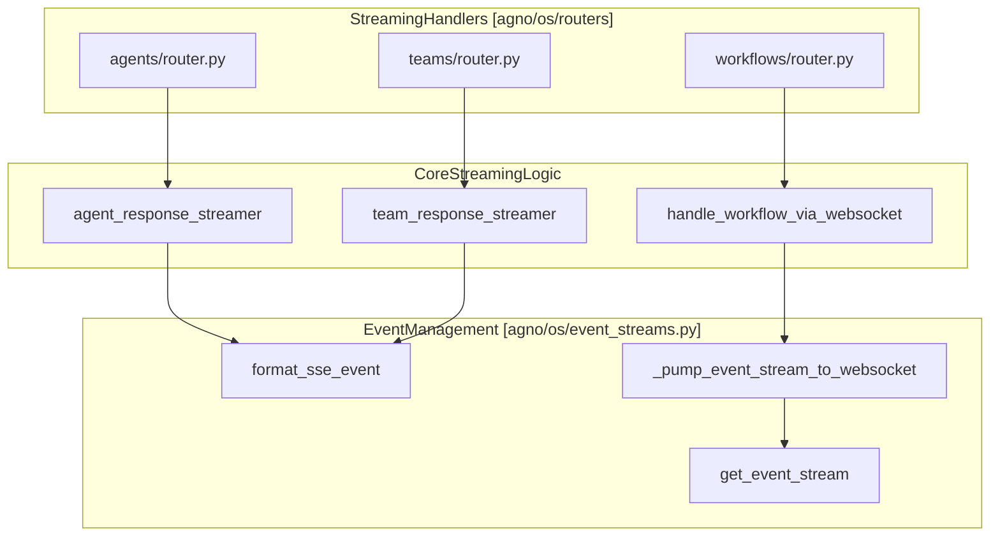
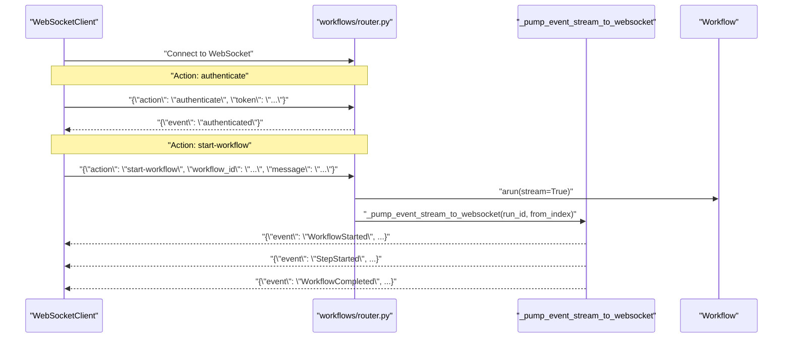

<!-- source: DeepWiki mcp.deepwiki.com · repo agno-agi/agno · page 7.3 WebSocket and Streaming · fetched 2026-11-09 -->

# WebSocket and Streaming

Relevant source files

The following files were used as context for generating this wiki page:

- [libs/agno/agno/job_queue/config.py](libs/agno/agno/job_queue/config.py)
- [libs/agno/agno/os/job_queue.py](libs/agno/agno/os/job_queue.py)
- [libs/agno/agno/os/routers/agents/router.py](libs/agno/agno/os/routers/agents/router.py)
- [libs/agno/agno/os/routers/teams/router.py](libs/agno/agno/os/routers/teams/router.py)
- [libs/agno/agno/os/routers/workflows/router.py](libs/agno/agno/os/routers/workflows/router.py)
- [libs/agno/agno/os/utils.py](libs/agno/agno/os/utils.py)
- [libs/agno/tests/integration/db/test_company_queue_projection.py](libs/agno/tests/integration/db/test_company_queue_projection.py)
- [libs/agno/tests/integration/os/test_agent_runs.py](libs/agno/tests/integration/os/test_agent_runs.py)
- [libs/agno/tests/integration/os/test_team_runs.py](libs/agno/tests/integration/os/test_team_runs.py)
- [libs/agno/tests/integration/os/test_workflow_runs.py](libs/agno/tests/integration/os/test_workflow_runs.py)
- [libs/agno/tests/unit/os/test_queue_db_components.py](libs/agno/tests/unit/os/test_queue_db_components.py)
- [libs/agno/tests/unit/os/test_queue_wake_on_enqueue.py](libs/agno/tests/unit/os/test_queue_wake_on_enqueue.py)
- [libs/agno/tests/unit/os/test_queue_worker.py](libs/agno/tests/unit/os/test_queue_worker.py)
- [libs/agno/tests/unit/os/test_ws_workflow_submission_parity.py](libs/agno/tests/unit/os/test_ws_workflow_submission_parity.py)

## Purpose and Scope

This document covers the WebSocket and streaming infrastructure in Agno AgentOS for real-time, bidirectional communication and event delivery. It details workflow WebSocket routing, the logic for streaming Agent and Team runs via Server-Sent Events (SSE), and internal mechanisms for resumable background execution, event buffering, and client reconnection.

For REST API documentation, see [REST API Endpoints](7.2). For details on event structures, see [Event Streaming System](2.6).

---

## 1. Streaming Architecture Overview

AgentOS provides two primary streaming mechanisms: HTTP-based Server-Sent Events (SSE) for Agents and Teams, and persistent WebSockets for Workflows. These mechanisms decouple long-running execution from individual HTTP connections through centralized event streams and background task decoupling.

### Code Entity Space to System Architecture

The following diagram associates the streaming system names with their corresponding code entities in `agno/os/routers`.

Sources: `[libs/agno/agno/os/routers/agents/router.py:124-193]`, `[libs/agno/agno/os/routers/teams/router.py:121-187]`, `[libs/agno/agno/os/routers/workflows/router.py:160-187]`

---

## 2. HTTP Streaming (SSE)

Agent and Team runs support streaming via the `stream=True` parameter. This is implemented using FastAPI's `StreamingResponse` and specialized asynchronous generator functions.

### SSE Format and Serialization

Agno follows the standard SSE wire format. The `format_sse_event` utility serializes `RunOutput` or `RunEvent` objects into a string format: `data: <json_payload>\n\n`. When streaming, `stream_events=True` ensures that intermediate progress events (such as tool calls and step completions) are emitted to the client.

Sources: `[libs/agno/agno/os/utils.py:1-158]`, `[libs/agno/agno/os/routers/agents/router.py:124-193]`, `[libs/agno/agno/os/routers/teams/router.py:121-187]`

### Resumable Background Streaming

When `background=True` and `stream=True` are passed to an Agent or Team run, execution is detached from the request lifecycle, permitting long-running tasks to survive client disconnects.

1. **Task Detachment**: The run starts in a background task via `agent_resumable_response_streamer` or `team_resumable_response_streamer` `[libs/agno/agno/os/routers/agents/router.py:195-207]`, `[libs/agno/agno/os/routers/teams/router.py:189-213]()`.
2. **Event Buffering**: Events are published to the event stream backend, allowing clients to reconnect and tail the output buffer `[libs/agno/agno/os/event_streams.py:1-150]()`.
3. **Resumption**: If a client disconnects, they can reconnect via resumption logic utilizing `queued_run_tail_streamer` to bridge the event gap `[libs/agno/agno/os/utils.py:1-3218]()`.

| Streamer Function | Component | Resumable? |
| :--- | :--- | :--- |
| `agent_response_streamer` | Agent | No (Inline) `[libs/agno/agno/os/routers/agents/router.py:124-193]()` |
| `agent_resumable_response_streamer` | Agent | Yes (Background) `[libs/agno/agno/os/routers/agents/router.py:195-207]()` |
| `team_response_streamer` | Team | No (Inline) `[libs/agno/agno/os/routers/teams/router.py:121-187]()` |
| `team_resumable_response_streamer` | Team | Yes (Background) `[libs/agno/agno/os/routers/teams/router.py:189-213]()` |

Sources: `[libs/agno/agno/os/routers/agents/router.py:124-207]`, `[libs/agno/agno/os/routers/teams/router.py:121-213]`

---

## 3. WebSocket Infrastructure and Workflow Routing

The WebSocket router handles persistent connections primarily for Workflows, enabling complex multi-step orchestration with real-time feedback and state synchronization.

### WebSocket Action Flow

Sources: `[libs/agno/agno/os/routers/workflows/router.py:117-187]`

### Workflow Reconnection and Tail Pumps

Workflows support robust reconnection via subscription actions in the WebSocket handler.
1. **Tail Pump**: The `_pump_event_stream_to_websocket` function forwards live events from the event stream to a subscribed socket `[libs/agno/agno/os/routers/workflows/router.py:160-187]()`.
2. **Pending Probes**: Sockets probe pending runs using `_PENDING_TAIL_PROBE_SECONDS` (set to `2.0` seconds) before entering the live tail to avoid holding connections open on un-started tasks `[libs/agno/agno/os/routers/workflows/router.py:126-179]()`.
3. **Replica Independence**: Because events originate from a centralized event stream via `get_event_stream()`, the socket can reside on a different replica than the one executing the workflow `[libs/agno/agno/os/routers/workflows/router.py:166-183]()`.

Sources: `[libs/agno/agno/os/routers/workflows/router.py:117-187]`

---

## 4. Event Types and Delivery

Events are delivered as structured JSON objects normalized via `_stream_payload_to_dict` `[libs/agno/agno/os/routers/workflows/router.py:136-158]()`.

### Event Classes
- **Agent Events**: `RunOutputEvent` and `RunErrorEvent` `[libs/agno/agno/os/routers/agents/router.py:109-110]()`.
- **Team Events**: `TeamRunOutput` and `TeamRunErrorEvent` `[libs/agno/agno/os/routers/teams/router.py:105-106]()`.
- **Workflow Events**: `WorkflowRunOutput` and `WorkflowErrorEvent` `[libs/agno/agno/os/routers/workflows/router.py:106-106]()`.

### Error Handling in Streams
If an execution encounters validation or runtime errors, specialized error events are yielded:
- **Agent/Team**: Yields `RunErrorEvent` or `TeamRunErrorEvent` containing exception metadata, `error_id`, and `error_type` `[libs/agno/agno/os/routers/agents/router.py:164-192]`, `[libs/agno/agno/os/routers/teams/router.py:165-186]()`.
- **Workflow**: Yields error frames through the event stream pump `[libs/agno/agno/os/routers/workflows/router.py:160-187]()`.

Sources: `[libs/agno/agno/os/routers/agents/router.py:164-192]`, `[libs/agno/agno/os/routers/teams/router.py:165-186]`, `[libs/agno/agno/os/routers/workflows/router.py:136-187]`

---

## 5. Connection Management and Recovery

AgentOS manages active connections, authentication states, and resource boundaries to prevent abuse and connection leaks.

- **Connection Tracking**: `_ws_tail_pumps` tracks active background tasks per socket using a `WeakKeyDictionary` to ensure tasks are cleaned up when the socket closes `[libs/agno/agno/os/routers/workflows/router.py:117-120]()`.
- **Concurrency Bounds**: `_MAX_ATTACHED_RUNS_PER_SOCKET` caps non-terminal runs attached to a single socket at `32` to guard against runaway queue submissions `[libs/agno/agno/os/routers/workflows/router.py:128-133]()`.
- **Queue Integration**: Durable background submissions ride the job queue (`QueueConfig`), allowing runs to persist across container restarts while streaming events via Redis or in-memory event streams `[libs/agno/agno/job_queue/config.py:1-204]`, `[libs/agno/agno/os/job_queue.py:1-149]()`.

Sources: `[libs/agno/agno/os/routers/workflows/router.py:117-133]`, `[libs/agno/agno/job_queue/config.py:1-204]`, `[libs/agno/agno/os/job_queue.py:1-149]`

---

