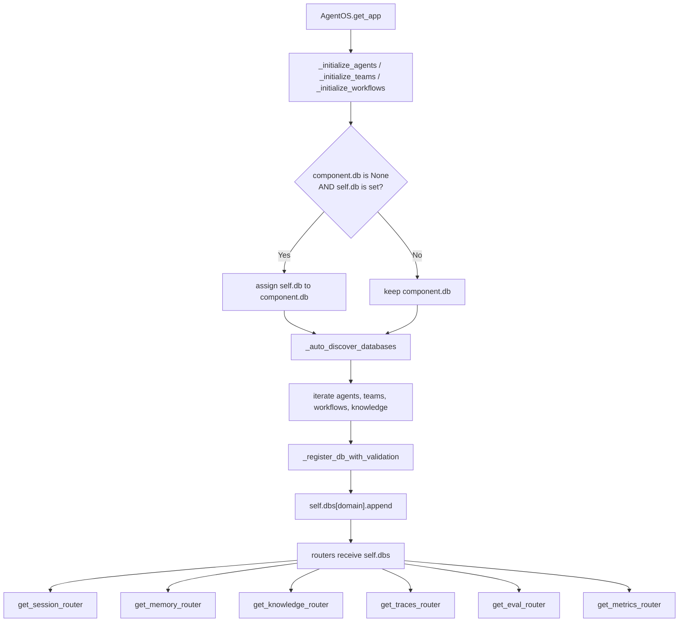
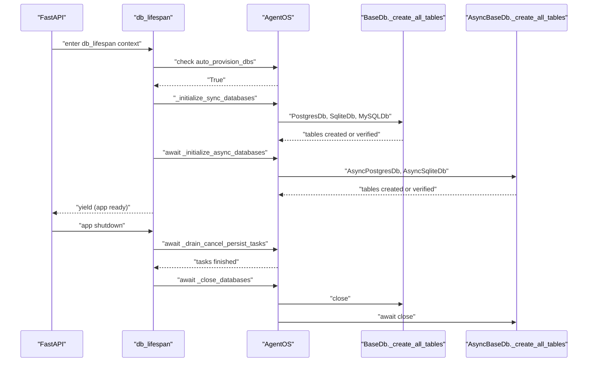

<!-- source: DeepWiki mcp.deepwiki.com · repo agno-agi/agno · page 7.4 Database Auto-discovery and Configuration · fetched 2026-11-09 -->

# Database Auto-discovery and Configuration

<details>
<summary>Relevant source files</summary>

The following files were used as context for generating this wiki page:

- [.github/workflows/test.yml](.github/workflows/test.yml)
- [.github/workflows/test_on_release.yml](.github/workflows/test_on_release.yml)
- [cookbook/05_agent_os/14_mcp/README.md](cookbook/05_agent_os/14_mcp/README.md)
- [cookbook/05_agent_os/14_mcp/TEST_LOG.md](cookbook/05_agent_os/14_mcp/TEST_LOG.md)
- [cookbook/05_agent_os/14_mcp/inspect_tools.py](cookbook/05_agent_os/14_mcp/inspect_tools.py)
- [libs/agno/agno/os/app.py](libs/agno/agno/os/app.py)
- [libs/agno/agno/os/config.py](libs/agno/agno/os/config.py)
- [libs/agno/agno/os/mcp.py](libs/agno/agno/os/mcp.py)
- [libs/agno/agno/os/middleware/mcp_routing.py](libs/agno/agno/os/middleware/mcp_routing.py)
- [libs/agno/agno/os/public/_policy.py](libs/agno/agno/os/public/_policy.py)
- [libs/agno/agno/os/router.py](libs/agno/agno/os/router.py)
- [libs/agno/agno/os/routers/database.py](libs/agno/agno/os/routers/database.py)
- [libs/agno/agno/os/schema.py](libs/agno/agno/os/schema.py)
- [libs/agno/agno/utils/streamlit.py](libs/agno/agno/utils/streamlit.py)
- [libs/agno/tests/integration/agent/test_input.py](libs/agno/tests/integration/agent/test_input.py)
- [libs/agno/tests/integration/agent/test_multimodal.py](libs/agno/tests/integration/agent/test_multimodal.py)
- [libs/agno/tests/integration/agent/test_output_model.py](libs/agno/tests/integration/agent/test_output_model.py)
- [libs/agno/tests/integration/agent/test_parser_model.py](libs/agno/tests/integration/agent/test_parser_model.py)
- [libs/agno/tests/integration/db/test_company_replica_offboarding.py](libs/agno/tests/integration/db/test_company_replica_offboarding.py)
- [libs/agno/tests/integration/models/anthropic/test_betas.py](libs/agno/tests/integration/models/anthropic/test_betas.py)
- [libs/agno/tests/integration/models/anthropic/test_multimodal.py](libs/agno/tests/integration/models/anthropic/test_multimodal.py)
- [libs/agno/tests/integration/models/anthropic/test_prompt_caching.py](libs/agno/tests/integration/models/anthropic/test_prompt_caching.py)
- [libs/agno/tests/integration/models/anthropic/test_thinking.py](libs/agno/tests/integration/models/anthropic/test_thinking.py)
- [libs/agno/tests/integration/models/openai/chat/test_multimodal.py](libs/agno/tests/integration/models/openai/chat/test_multimodal.py)
- [libs/agno/tests/integration/models/openai/responses/test_multimodal.py](libs/agno/tests/integration/models/openai/responses/test_multimodal.py)
- [libs/agno/tests/integration/os/test_db_migrations.py](libs/agno/tests/integration/os/test_db_migrations.py)
- [libs/agno/tests/integration/teams/test_team_with_output_model.py](libs/agno/tests/integration/teams/test_team_with_output_model.py)
- [libs/agno/tests/unit/compaction/test_compaction.py](libs/agno/tests/unit/compaction/test_compaction.py)
- [libs/agno/tests/unit/os/test_info_endpoint.py](libs/agno/tests/unit/os/test_info_endpoint.py)
- [libs/agno/tests/unit/os/test_mcp_routing.py](libs/agno/tests/unit/os/test_mcp_routing.py)
- [libs/agno/tests/unit/os/test_mcp_server.py](libs/agno/tests/unit/os/test_mcp_server.py)
- [scripts/run_model_tests.sh](scripts/run_model_tests.sh)

</details>


This page covers how `AgentOS` automatically discovers database instances attached to agents, teams, workflows, and knowledge bases, validates them, registers them into a unified `dbs` map, and manages their full lifecycle (table provisioning, connection pooling, and shutdown). It also details YAML-based configuration via `AgentOSConfig`, registry-aware database resolution, supported backends, feature gating, and database migration endpoints.

For context on the overall `AgentOS` architecture, see [libs/agno/agno/os/app.py:1-178](). For the database abstraction interfaces (`BaseDb`, `AsyncBaseDb`), see [libs/agno/agno/db/base.py:1-1480]().

---

## Overview

`AgentOS` operates with a two-level database model:

- **OS-level database** (`AgentOS.db`): A single `BaseDb` or `AsyncBaseDb` instance passed to the `AgentOS` constructor [libs/agno/agno/os/app.py:228-228](). This serves as the fallback for any component that does not declare its own database [libs/agno/agno/os/app.py:569-571](), and is required for OS-level features such as the scheduler, approval workflows, and the component registry [libs/agno/agno/os/app.py:159-163]().
- **Component-level databases**: Each `Agent`, `Team`, `Workflow`, or `Knowledge` instance may carry its own dedicated database. These are collected during auto-discovery [libs/agno/agno/os/app.py:809-814]().

When `get_app()` is invoked, `AgentOS` scans all registered components, collects every distinct database instance, and groups them into the `dbs` attribute — a dictionary keyed by domain (sessions, memory, evals, metrics, knowledge, traces) [libs/agno/agno/os/app.py:330-343](). This collection is then passed to API routers so that execution requests interact with the correct persistent storage [libs/agno/agno/os/app.py:817-823]().

Sources: [libs/agno/agno/os/app.py:228-343](), [libs/agno/agno/os/app.py:809-823]()

---

## Auto-discovery Flow

### Discovery Entry Point

Auto-discovery executes within `get_app()` after routers are configured, and also during `resync()` operations for live reloads [libs/agno/agno/os/app.py:410-430]():

```python
# Entry point in AgentOS.get_app()
self._auto_discover_databases()
self._auto_discover_knowledge_instances()
```

`_auto_discover_databases()` iterates over every `Agent`, `Team`, and `Workflow` registered in the OS, inspecting and registering each attached `db` attribute [libs/agno/agno/os/app.py:809-814](). The OS-level `self.db` is also registered as a fallback. Each distinct database is validated and assigned to its corresponding domain bucket in `self.dbs`.

Sources: [libs/agno/agno/os/app.py:410-430](), [libs/agno/agno/os/app.py:809-814]()

---

### Default DB Propagation

Prior to auto-discovery, initialization methods (`_initialize_agents()`, `_initialize_teams()`, and `_initialize_workflows()`) inspect component configurations [libs/agno/agno/os/app.py:569-571](). If the OS-level `db` is configured and a component lacks its own database, the OS-level database is automatically assigned:

```python
if self.db is not None and agent.db is None:
    agent.db = self.db
```

This design permits multiple distinct execution components to share a single physical database instance while maintaining logical table separation.

Sources: [libs/agno/agno/os/app.py:569-571](), [libs/agno/agno/os/app.py:601-603](), [libs/agno/agno/os/app.py:634-636]()

---

### Discovery and Registration Diagram

**Database Auto-discovery Data Flow**



Sources: [libs/agno/agno/os/app.py:410-430](), [libs/agno/agno/os/app.py:817-823]()

---

## Two-Phase Initialization (Table Provisioning)

Discovered databases must provision their required tables before handling read/write traffic. This initialization is managed by `db_lifespan`, an async context manager executed during FastAPI startup [libs/agno/agno/os/app.py:183-205]():

```python
@asynccontextmanager
async def db_lifespan(app: FastAPI, agent_os: "AgentOS"):
    """Initializes databases in the event loop and closes them on shutdown."""
    if agent_os.auto_provision_dbs:
        agent_os._initialize_sync_databases()
        await agent_os._initialize_async_databases()

    yield

    # Let in-flight cancel-persist tasks finish writing before the pool closes
    await _drain_cancel_persist_tasks()
    await agent_os._close_databases()
```

This lifespan is chained into the primary application lifespan inside `get_app()` [libs/agno/agno/os/app.py:404-408](). The helper `_drain_cancel_persist_tasks()` ensures background write tasks complete before database connections are closed [libs/agno/agno/os/app.py:137-166]().

Sources: [libs/agno/agno/os/app.py:137-205](), [libs/agno/agno/os/app.py:404-408]()

---

### Phase 1: Sync Databases

`_initialize_sync_databases()` iterates over discovered synchronous `BaseDb` instances and invokes `_create_all_tables()` on each [libs/agno/agno/os/app.py:765-771](). This runs synchronously prior to event loop yielding.

### Phase 2: Async Databases

`_initialize_async_databases()` iterates over asynchronous `AsyncBaseDb` instances and invokes `await _create_all_tables()` on each [libs/agno/agno/os/app.py:773-778]().

---

### Lifespan Sequence Diagram

**db_lifespan Initialization Sequence**



Sources: [libs/agno/agno/os/app.py:183-205](), [libs/agno/agno/os/app.py:765-778]()

---

## YAML-based AgentOSConfig and Validation

`AgentOS` supports declarative initialization through YAML configuration files parsed into Pydantic `AgentOSConfig` models [libs/agno/agno/os/config.py:1-129](). 

The `AgentOSConfig` model validates configuration hierarchies including `SessionConfig`, `KnowledgeConfig`, `MemoryConfig`, and `DatabaseConfig`. Each domain configuration specifies its target database ID and custom table overrides [libs/agno/agno/os/config.py:121-144](). During validation, the schema ensures that referenced database identifiers exist within the OS scope and that path strings adhere to absolute routing constraints.

Sources: [libs/agno/agno/os/config.py:1-144](), [libs/agno/agno/os/utils.py:81-81]()

---

## Migrations Endpoints

`AgentOS` provides dedicated database management routers via `get_database_router()` [libs/agno/agno/os/routers/database.py:1-1](). These endpoints enable administrative tooling and control plane UI clients to inspect schema versions, execute pending database migrations, and verify table provisioning status across connected database instances without restarting the server process.

Sources: [libs/agno/agno/os/app.py:61-61](), [libs/agno/agno/os/routers/database.py:1-1]()

---

## Registry-Aware Database Resolution

When components are rehydrated from a persisted state (such as the component registry), the framework uses `resolve_db_from_config` to restore connections [libs/agno/agno/db/utils.py:21-50]().

### Engine Sharing and Cloning
To prevent connection pool exhaustion, the framework shares underlying database engines. If a component configuration references a database ID present in the registry, and custom table name overrides are supplied, `_clone_db_with_table_overrides` constructs a new database handle sharing the parent engine while pointing to the overridden table names.

### Resolution Logic Flow
1. **Registry Lookup**: Verifies if the configuration's `db_id` exists in the `Registry`.
2. **Identity Match**: Returns the active Python instance directly if no table overrides are present.
3. **Cloning**: Creates a lightweight clone sharing the parent `db_engine` if overrides exist.
4. **Fallback**: Rebuilds the database instance from raw connection parameters (`db_url`, `db_file`) if registry resolution misses.

Sources: [libs/agno/agno/db/utils.py:21-50]()

---

## Supported Database Backends and Table Names

`AgentOS` interacts with backends through `BaseDb` and `AsyncBaseDb` interfaces [libs/agno/agno/os/app.py:22-22]().

| Class | Type | Description |
|---|---|---|
| `PostgresDb` | Sync | PostgreSQL via SQLAlchemy |
| `AsyncPostgresDb` | Async | PostgreSQL via SQLAlchemy AsyncIO |
| `SqliteDb` | Sync | SQLite via SQLAlchemy |
| `AsyncSqliteDb` | Async | SQLite via SQLAlchemy AsyncIO |
| `MySQLDb` | Sync | MySQL via SQLAlchemy |
| `AsyncMySQLDb` | Async | MySQL via SQLAlchemy AsyncIO |
| `MongoDb` | Sync | MongoDB via PyMongo |
| `SingleStoreDb` | Sync | SingleStore via SQLAlchemy |
| `RemoteDb` | Proxy | Remote database access via AgentOS RPC |

Default table name mappings:

| Attribute | Default Table Name | Purpose |
|---|---|---|
| `session_table` | `agno_sessions` | Agent, team, workflow session storage |
| `memory_table` | `agno_memories` | User memories |
| `metrics_table` | `agno_metrics` | Execution metrics |
| `eval_table` | `agno_eval_runs` | Evaluation run records |
| `knowledge_table` | `agno_knowledge` | Knowledge base content |
| `traces_table` | `agno_traces` | Trace records |
| `spans_table` | `agno_spans` | Span events (FK to traces) |
| `approvals_table` | `agno_approvals` | HITL approval records |
| `learnings_table` | `agno_learnings` | Learning machine observations |
| `schedules_table` | `agno_schedules` | Cron job schedules |

Sources: [libs/agno/agno/os/app.py:22-87](), [libs/agno/agno/db/utils.py:23-50]()

---

