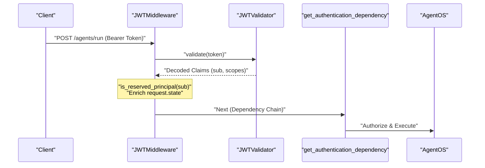
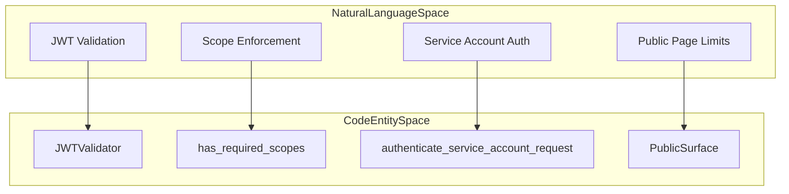
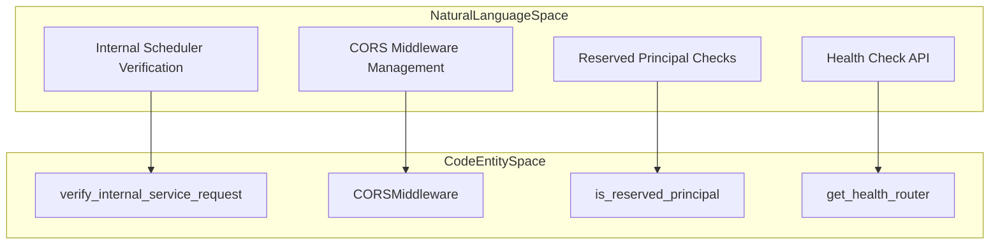

<!-- source: DeepWiki mcp.deepwiki.com · repo agno-agi/agno · page 7.5 Authentication and Security · fetched 2026-11-09 -->

# Authentication and Security

Relevant source files

The following files were used as context for generating this wiki page:

- [cookbook/05_agent_os/07_security/README.md](cookbook/05_agent_os/07_security/README.md)
- [cookbook/05_agent_os/07_security/TEST_LOG.md](cookbook/05_agent_os/07_security/TEST_LOG.md)
- [cookbook/05_agent_os/07_security/excluded_routes.py](cookbook/05_agent_os/07_security/excluded_routes.py)
- [cookbook/05_agent_os/27_public_pages/browser_origins.py](cookbook/05_agent_os/27_public_pages/browser_origins.py)
- [cookbook/05_agent_os/27_public_pages/public_pages.py](cookbook/05_agent_os/27_public_pages/public_pages.py)
- [libs/agno/agno/os/__init__.py](libs/agno/agno/os/__init__.py)
- [libs/agno/agno/os/auth.py](libs/agno/agno/os/auth.py)
- [libs/agno/agno/os/middleware/cors.py](libs/agno/agno/os/middleware/cors.py)
- [libs/agno/agno/os/middleware/jwt.py](libs/agno/agno/os/middleware/jwt.py)
- [libs/agno/agno/os/public/__init__.py](libs/agno/agno/os/public/__init__.py)
- [libs/agno/agno/os/public/_middleware.py](libs/agno/agno/os/public/_middleware.py)
- [libs/agno/agno/os/routers/health.py](libs/agno/agno/os/routers/health.py)
- [libs/agno/agno/os/settings.py](libs/agno/agno/os/settings.py)
- [libs/agno/agno/utils/bounded.py](libs/agno/agno/utils/bounded.py)
- [libs/agno/tests/integration/agent/test_async_tool_calling.py](libs/agno/tests/integration/agent/test_async_tool_calling.py)
- [libs/agno/tests/integration/agent/test_guardrails.py](libs/agno/tests/integration/agent/test_guardrails.py)
- [libs/agno/tests/integration/agent/test_hooks.py](libs/agno/tests/integration/agent/test_hooks.py)
- [libs/agno/tests/integration/os/test_built_in_endpoints.py](libs/agno/tests/integration/os/test_built_in_endpoints.py)
- [libs/agno/tests/integration/os/test_custom_fastapi_app.py](libs/agno/tests/integration/os/test_custom_fastapi_app.py)
- [libs/agno/tests/integration/os/test_exceptions.py](libs/agno/tests/integration/os/test_exceptions.py)
- [libs/agno/tests/integration/os/test_jwt_middleware.py](libs/agno/tests/integration/os/test_jwt_middleware.py)
- [libs/agno/tests/integration/os/test_public_authorization.py](libs/agno/tests/integration/os/test_public_authorization.py)
- [libs/agno/tests/integration/os/test_public_surface.py](libs/agno/tests/integration/os/test_public_surface.py)
- [libs/agno/tests/integration/teams/test_hooks.py](libs/agno/tests/integration/teams/test_hooks.py)
- [libs/agno/tests/integration/vector_dbs/test_lancedb.py](libs/agno/tests/integration/vector_dbs/test_lancedb.py)
- [libs/agno/tests/integration/workflows/test_steps.py](libs/agno/tests/integration/workflows/test_steps.py)
- [libs/agno/tests/unit/os/test_public_mcp_config.py](libs/agno/tests/unit/os/test_public_mcp_config.py)
- [libs/agno/tests/unit/vectordb/test_qdrantdb.py](libs/agno/tests/unit/vectordb/test_qdrantdb.py)
- [libs/agno/tests/unit/vectordb/test_weaviatedb.py](libs/agno/tests/unit/vectordb/test_weaviatedb.py)

This page documents the authentication, authorization, and security mechanisms in AgentOS, including security keys, service accounts, JWT-based RBAC, CORS configuration, public-page access policies and limits, and request state enrichment.

## Overview

AgentOS provides a multi-layered security architecture that integrates with FastAPI to protect endpoints and control access to agents, teams, and workflows. It supports multiple authentication modes alongside public-page exemptions, CORS origin filtering, and fine-grained resource scope checks.

Sources: [libs/agno/agno/os/middleware/jwt.py:1-35](), [libs/agno/agno/os/auth.py:1-40]()

---

## Authentication Modes

### Security Key Authentication

The baseline security mode uses a static shared secret configured via `OS_SECURITY_KEY` or passed through configuration settings `AgnoAPISettings`.

* **Data Flow:**
  1. Clients provide an `Authorization: Bearer <token>` HTTP header.
  2. The authentication check extracts the bearer token [libs/agno/agno/os/auth.py:28-31]().
  3. The token is validated against the configured security key using `hmac.compare_digest` to prevent timing attacks [libs/agno/agno/os/auth.py:53-55]().

Sources: [libs/agno/agno/os/auth.py:26-40](), [libs/agno/agno/os/auth.py:42-66]()

### Service Account Authentication

Service accounts allow programmatic access using API tokens prefixed with service account token prefixes (`agno_pat_` or configured prefixes).

* **Verification:** `_authenticate_service_account` validates tokens against registered service account providers [libs/agno/agno/os/auth.py:51-52]().
* **Principal Mapping:** Valid service requests are assigned a principal ID under the `sa:` namespace prefix [libs/agno/agno/os/middleware/jwt.py:32-33]().

Sources: [libs/agno/agno/os/auth.py:42-67](), [libs/agno/agno/os/service_accounts.py:1-35]()

### JWT Authorization with RBAC

JWT-based authorization handles production identities. It is managed by `JWTValidator` and enforced via `JWTMiddleware` [libs/agno/agno/os/middleware/jwt.py:122-177]().

* **`JWTValidator`**: Loads verification keys (static or JWKS) and validates signatures using algorithms like `RS256` or `HS256`.
* **`JWTMiddleware`**: Intercepts requests, parses tokens, prevents reserved principal spoofing, and enriches `request.state`.

Sources: [libs/agno/agno/os/middleware/jwt.py:1-64](), [libs/agno/agno/os/middleware/jwt.py:122-177]()

---

## RBAC Scopes and Resource Access

AgentOS implements hierarchical scoping for role-based access control using strings formatted as `resource:[id]:action`.

### Scope Syntax Table
| Scope String | Description |
| :--- | :--- |
| `agents:read` | Permission to read/list all agents. |
| `agents:my-agent:run` | Permission to execute a specific agent. |
| `teams:*:read` | Wildcard access to read all teams. |
| `agent-os:admin` | Administrative superuser access. |

Sources: [libs/agno/agno/os/scopes.py:24-31](), [libs/agno/agno/os/middleware/jwt.py:24-31]()

---

## JWTMiddleware and Request State Enrichment

When requests pass through `JWTMiddleware`, the FastAPI `request.state` object is hydrated with security attributes.

| `request.state` Attribute | Description | Source Claim |
| :--- | :--- | :--- |
| `authenticated` | Boolean verification status. | Signature check |
| `user_id` | Unique subject identifier. | `sub` |
| `session_id` | Current session ID. | `session_id` |
| `scopes` | Assigned RBAC scopes. | `scopes` |

Sources: [libs/agno/agno/os/middleware/jwt.py:41-49](), [libs/agno/tests/integration/os/test_jwt_middleware.py:102-117]()

---

## CORS and Origin Policies

AgentOS supports custom CORS configuration via `CORSMiddleware` integration, allowing explicit control over allowed origins, methods, and headers.

* **Origin Filtering:** Handled through Starlette's `CORSMiddleware` integrated during `AgentOS` app assembly [libs/agno/tests/integration/os/test_custom_fastapi_app.py:43-50]().
* **Browser Origin Enforcement:** `PublicSurface.enforce_browser_origins` rejects run and workflow-socket requests with an `Origin` outside AgentOS's exact/regex CORS policy [libs/agno/agno/os/public/__init__.py:47-51]().

Sources: [libs/agno/tests/integration/os/test_custom_fastapi_app.py:39-84](), [libs/agno/agno/os/public/__init__.py:47-52]()

---

## Public-Page Policies and Limits

AgentOS supports public-facing read-only pages and unauthenticated endpoints through `PublicSurface` configuration.

* **Components:** Explicitly selects agents, teams, or workflows for bounded public execution [libs/agno/agno/os/public/__init__.py:35-56]().
* **Limits:** Stream bounds, file upload limits (`FileUploadLimits`), and JSON response size limits prevent resource exhaustion on unauthenticated public routes [libs/agno/agno/os/public/__init__.py:21-68]().

Sources: [libs/agno/agno/os/public/__init__.py:1-126](), [libs/agno/tests/integration/os/test_public_authorization.py:100-120]()

---

## Internal Service Token and Scheduler Security

System processes like the background scheduler authenticate using internal service tokens.

* **Scheduler Identity:** Runs under the reserved `__scheduler__` identity (`INTERNAL_SCHEDULER_USER_ID`) [libs/agno/agno/os/auth.py:26-39]().
* **Scope Assignment:** Automatically receives `INTERNAL_SERVICE_SCOPES` [libs/agno/agno/os/auth.py:37-37]().
* **Impersonation Prevention:** `is_reserved_principal` blocks external tokens from using system namespaces like `sa:`, `__scheduler__`, or `__oauth__:` [libs/agno/agno/os/middleware/jwt.py:65-77]().

Sources: [libs/agno/agno/os/auth.py:26-40](), [libs/agno/agno/os/middleware/jwt.py:65-77]()

---

## Security Data Flow

Title: "Request Validation and State Enrichment Flow"

Sources: [libs/agno/agno/os/middleware/jwt.py:41-64](), [libs/agno/agno/os/auth.py:26-40]()

---

## Natural Language to Code Entity Space Mappings

Title: "Authentication and Security Code Entity Mapping One"

Sources: [libs/agno/agno/os/middleware/jwt.py:122-177](), [libs/agno/agno/os/scopes.py:30-31](), [libs/agno/agno/os/service_accounts.py:1-35](), [libs/agno/agno/os/public/__init__.py:35-68]()

Title: "Authentication and Security Code Entity Mapping Two"

Sources: [libs/agno/agno/os/auth.py:26-40](), [libs/agno/tests/integration/os/test_custom_fastapi_app.py:43-50](), [libs/agno/agno/os/middleware/jwt.py:65-77](), [libs/agno/agno/os/routers/health.py:8-31]()

---

