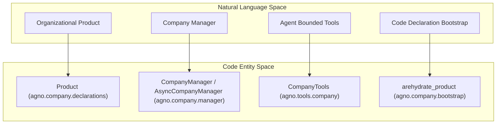
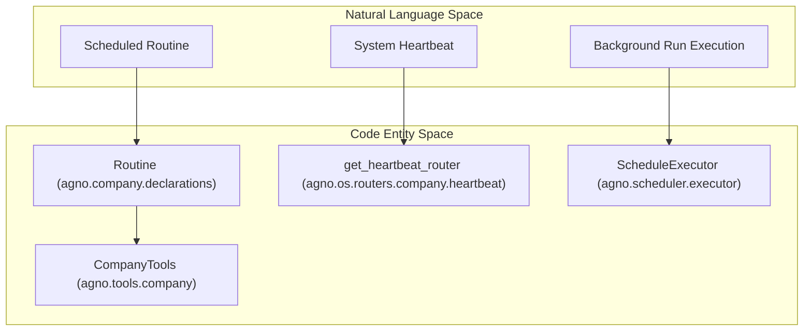

<!-- source: DeepWiki mcp.deepwiki.com · repo agno-agi/agno · page 8 Company OS · fetched 2026-11-09 -->

# Company OS

Relevant source files

The following files were used as context for generating this wiki page:

- [cookbook/05_agent_os/30_company/11_disabled_routine.py](cookbook/05_agent_os/30_company/11_disabled_routine.py)
- [cookbook/05_agent_os/30_company/README.md](cookbook/05_agent_os/30_company/README.md)
- [cookbook/05_agent_os/30_company/TEST_LOG.md](cookbook/05_agent_os/30_company/TEST_LOG.md)
- [libs/agno/agno/company/bootstrap.py](libs/agno/agno/company/bootstrap.py)
- [libs/agno/agno/company/manager.py](libs/agno/agno/company/manager.py)
- [libs/agno/agno/company/routines.py](libs/agno/agno/company/routines.py)
- [libs/agno/agno/os/routers/company/heartbeat.py](libs/agno/agno/os/routers/company/heartbeat.py)
- [libs/agno/agno/scheduler/executor.py](libs/agno/agno/scheduler/executor.py)
- [libs/agno/agno/tools/company.py](libs/agno/agno/tools/company.py)
- [libs/agno/tests/integration/db/test_company_chat_products.py](libs/agno/tests/integration/db/test_company_chat_products.py)
- [libs/agno/tests/integration/db/test_company_heartbeat_parity.py](libs/agno/tests/integration/db/test_company_heartbeat_parity.py)
- [libs/agno/tests/unit/os/routers/test_company_heartbeat.py](libs/agno/tests/unit/os/routers/test_company_heartbeat.py)
- [libs/agno/tests/unit/os/routers/test_company_manager_routines.py](libs/agno/tests/unit/os/routers/test_company_manager_routines.py)
- [libs/agno/tests/unit/os/test_company_playbook.py](libs/agno/tests/unit/os/test_company_playbook.py)
- [libs/agno/tests/unit/tools/test_company.py](libs/agno/tests/unit/tools/test_company.py)

The Company OS subsystem in Agno provides agents with organizational responsibilities, structured business objects, routines, products, projects, and tasks [cookbook/05_agent_os/30_company/README.md:1-3]. It models an organization within the agent runtime, allowing agents to ingest sources, propose tasks, run scheduled routines, and interact with structured storage securely.

For details on configuration and instantiation, see `AgentOS(company=CompanyConfig())` [cookbook/05_agent_os/30_company/README.md:17-19].

## Company Architecture and Code Mapping

The following diagram bridges natural language concepts of organizational management to their concrete implementations in the Agno codebase.

Diagram: "Company Entity to Code Class Mapping"

Sources: `libs/agno/agno/company/manager.py:44-80`, `libs/agno/agno/company/bootstrap.py:15-32`, `libs/agno/tools/company.py:154-179`

---

## 8.1. Company Model and Bootstrap

The company persistence and startup layer manages products, soft deletion, ownership scoping, and code-based declaration rehydration. The `CompanyManager` and `AsyncCompanyManager` classes handle synchronous and asynchronous database interactions for products, projects, sources, and tasks [libs/agno/agno/company/manager.py:44-53]. Declarative definitions can be rehydrated at startup using `arehydrate_product` without overriding human modifications [libs/agno/agno/company/bootstrap.py:15-24].

For complete technical specifications, see [Company Model and Bootstrap](#8.1).

Sources: `libs/agno/agno/company/manager.py:44-80`, `libs/agno/agno/company/bootstrap.py:15-32`

---

## 8.2. Routines, Heartbeat and Execution

Routines represent scheduled or on-demand automations assigned to agents, teams, or workflows within a product context. The `ScheduleExecutor` drives these routine executions, communicating with heartbeat REST endpoints to track run lifecycle, handle timeouts, and enforce guardrails via `_RoutineResultGuardrail` [libs/agno/company/routines.py:131-135, libs/agno/scheduler/executor.py:90-114]. Agents interact with company resources using `CompanyTools`, which enforces strict permission boundaries [libs/agno/tools/company.py:1-6, 154-179].

Diagram: "Company Execution and Routine Lifecycle"

Sources: `libs/agno/os/routers/company/heartbeat.py:67-83`, `libs/agno/scheduler/executor.py:90-114`, `libs/agno/tools/company.py:154-179`

For comprehensive details on routine lifecycles and execution mechanics, see [Routines, Heartbeat and Execution](#8.2).

Sources: `libs/agno/os/routers/company/heartbeat.py:67-83`, `libs/agno/scheduler/executor.py:90-114`, `libs/agno/company/routines.py:131-147`

---

## 8.3. Company REST API

Company OS exposes a dedicated REST API surface under the `/company/` prefix when enabled via `CompanyConfig` [cookbook/05_agent_os/30_company/README.md:17-19, libs/agno/os/routers/company/heartbeat.py:67-68]. These endpoints provide management capabilities for products, projects, tasks, routines, playbooks, runs, and heartbeat status checks [cookbook/05_agent_os/30_company/README.md:21-22]. All routes integrate with Agno's user-scoping and authentication middleware.

For details on API routes, request/response schemas, and parameter validation, see [Company REST API](#8.3).

Sources: `cookbook/05_agent_os/30_company/README.md:21-26`, `libs/agno/os/routers/company/heartbeat.py:67-83`

---

