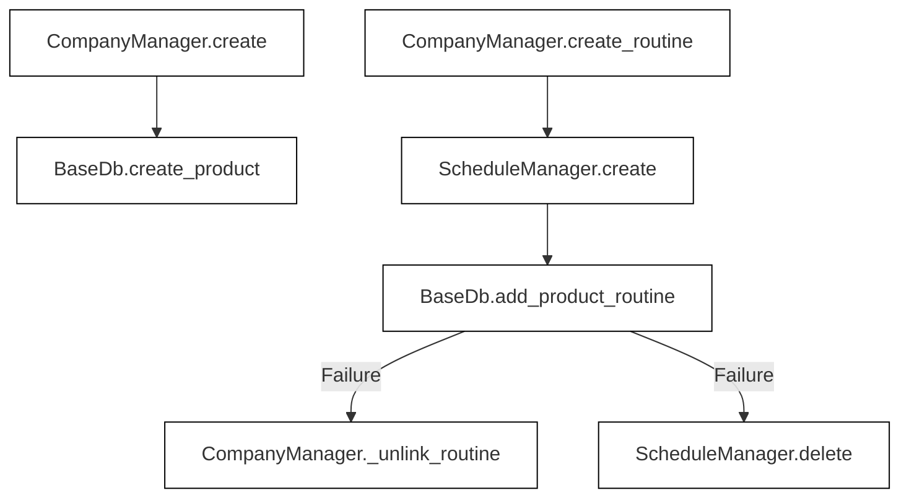
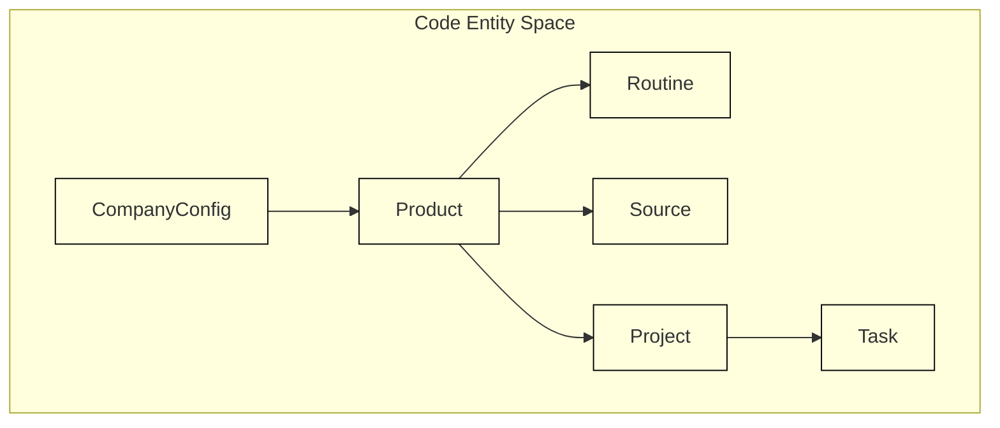
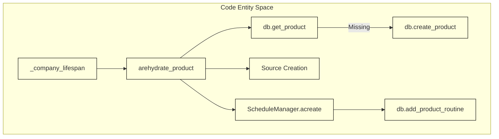
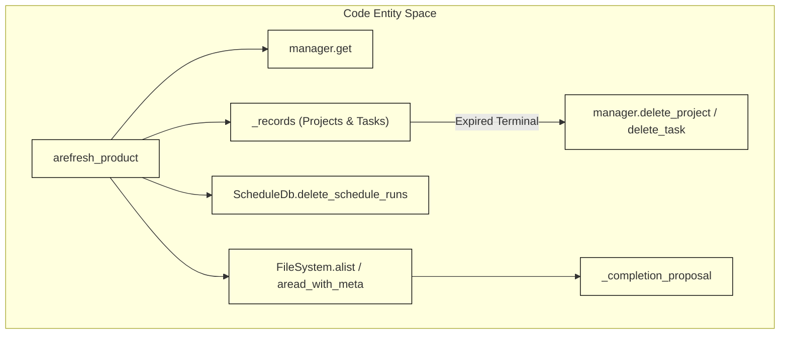

<!-- source: DeepWiki mcp.deepwiki.com · repo agno-agi/agno · page 8.1 Company Model and Bootstrap · fetched 2026-11-09 -->

# Company Model and Bootstrap

<details>
<summary>Relevant source files</summary>

The following files were used as context for generating this wiki page:

- [cookbook/05_agent_os/30_company/11_disabled_routine.py](cookbook/05_agent_os/30_company/11_disabled_routine.py)
- [cookbook/05_agent_os/30_company/README.md](cookbook/05_agent_os/30_company/README.md)
- [cookbook/05_agent_os/30_company/TEST_LOG.md](cookbook/05_agent_os/30_company/TEST_LOG.md)
- [libs/agno/agno/company/bootstrap.py](libs/agno/agno/company/bootstrap.py)
- [libs/agno/agno/company/manager.py](libs/agno/agno/company/manager.py)
- [libs/agno/agno/company/refresh.py](libs/agno/agno/company/refresh.py)
- [libs/agno/agno/company/routines.py](libs/agno/agno/company/routines.py)
- [libs/agno/agno/db/sql/company.py](libs/agno/agno/db/sql/company.py)
- [libs/agno/agno/os/routers/company/heartbeat.py](libs/agno/agno/os/routers/company/heartbeat.py)
- [libs/agno/agno/scheduler/executor.py](libs/agno/agno/scheduler/executor.py)
- [libs/agno/agno/tools/company.py](libs/agno/agno/tools/company.py)
- [libs/agno/tests/integration/db/test_company_archive_parity.py](libs/agno/tests/integration/db/test_company_archive_parity.py)
- [libs/agno/tests/integration/db/test_company_chat_products.py](libs/agno/tests/integration/db/test_company_chat_products.py)
- [libs/agno/tests/integration/db/test_company_heartbeat_parity.py](libs/agno/tests/integration/db/test_company_heartbeat_parity.py)
- [libs/agno/tests/integration/db/test_company_retention_parity.py](libs/agno/tests/integration/db/test_company_retention_parity.py)
- [libs/agno/tests/unit/os/routers/test_company_heartbeat.py](libs/agno/tests/unit/os/routers/test_company_heartbeat.py)
- [libs/agno/tests/unit/os/routers/test_company_manager_routines.py](libs/agno/tests/unit/os/routers/test_company_manager_routines.py)
- [libs/agno/tests/unit/os/test_company_playbook.py](libs/agno/tests/unit/os/test_company_playbook.py)
- [libs/agno/tests/unit/tools/test_company.py](libs/agno/tests/unit/tools/test_company.py)

</details>


## Purpose and Scope
This section details the Company OS modeling subsystem within Agno, which grants AI agents organizational responsibilities, structured products, routines, and persistence guarantees. It covers `CompanyManager` and `AsyncCompanyManager`, product/routine declarations (`Product`, `Routine`, `Source`), rehydration during framework bootstrap (`arehydrate_product`), retention/refresh pipelines (`arefresh_product`), and underlying SQL locking and soft-delete schemas (`libs/agno/agno/company/manager.py` [libs/agno/agno/company/manager.py:44-58](), `libs/agno/agno/company/bootstrap.py` [libs/agno/agno/company/bootstrap.py:15-23]()).

---

## 1. CompanyManager and AsyncCompanyManager

The `CompanyManager` class (synchronous) and its asynchronous counterpart `AsyncCompanyManager` manage organizational `Product` entities, routine schedules, sources, and hierarchical mutations against a `BaseDb` or `AsyncBaseDb` backend [cookbook/05_agent_os/30_company/README.md:27-29](), [libs/agno/agno/company/manager.py:44-58]().

### Core Responsibilities
- **Product Lifecycle**: Creating, retrieving, and updating products with scoping support (`user_id=None` for unscoped access, or string-based ownership filtering) [cookbook/05_agent_os/30_company/README.md:27-32](), [libs/agno/agno/company/manager.py:59-80]().
- **Routine Binding**: Linking routines to products through `create_routine()`, which coordinates with the `ScheduleManager` and rolls back failed operations if schedule activation or linking fails [libs/agno/agno/company/manager.py:82-136]().
- **Cascade Deletion / Discard**: `discard_product()` removes partially created declarations (sources and schedules) if a product declaration fails mid-setup [libs/agno/agno/company/manager.py:144-161]().


*Sources: [libs/agno/agno/company/manager.py:59-136]()*

---

## 2. Declarations, Config, and Sources

Company configurations and structures are defined via Pydantic models in `agno.company.declarations`:

- **`CompanyConfig`**: Configures the company extension inside `AgentOS`, accepting database references, automation retention windows, and model overrides [cookbook/05_agent_os/30_company/README.md:17-19](), [libs/agno/tests/unit/os/test_company_playbook.py:26-32]().
- **`Product`**: Represents a business unit or product line containing metadata, routines, projects, and sources [cookbook/05_agent_os/30_company/README.md:98](), [libs/agno/agno/company/bootstrap.py:15-30]().
- **`Routine`**: Defines an automated or on-demand routine linked to an executor (`agent`, `team`, or `workflow`), cron expression, timezone, and instructions [libs/agno/agno/os/routers/company/heartbeat.py:51-60](), [libs/agno/agno/company/bootstrap.py:98-117]().
- **`Source`**: Declares evidence sources (`git`, `markdown`, `website`) attached to a product [cookbook/05_agent_os/30_company/TEST_LOG.md:14](), [libs/agno/tests/unit/tools/test_company.py:47-57]().


*Sources: [cookbook/05_agent_os/30_company/README.md:98](), [libs/agno/agno/os/routers/company/heartbeat.py:51-60](), [libs/agno/tests/unit/os/test_company_playbook.py:26-32]*

---

## 3. Bootstrap and Rehydration Engine

During application startup, `arehydrate_product` (or its synchronous wrapper `rehydrate_product`) scans declared `Product` instances and synchronizes them with the database idempotently [libs/agno/agno/company/bootstrap.py:15-23](), [libs/agno/agno/company/bootstrap.py:136-150]().

### Rehydration Steps
1. **Product Synchronization**: Computes a stable UUID5 based on the product name if an ID is omitted, creating the product record if it does not exist [libs/agno/agno/company/bootstrap.py:27-31](). Unique constraint violations are caught and resolved by re-fetching [libs/agno/agno/company/bootstrap.py:48-51]().
2. **Source Attachment**: Registers declared sources, ensuring reference uniqueness and preventing cross-product collisions [libs/agno/agno/company/bootstrap.py:60-85]().
3. **Routine Synchronization**: Registers schedules via `ScheduleManager.acreate()` and links them via `add_product_routine()` without overwriting manual human edits or ownership states [libs/agno/agno/company/bootstrap.py:86-133]().
4. **Lifespan Integration**: `_company_lifespan()` executes rehydration for all declared products inside the `AgentOS` FastAPI lifecycle [libs/agno/agno/company/bootstrap.py:153-160]().


*Sources: [libs/agno/agno/company/bootstrap.py:15-160]()*

---

## 4. Refresh and Retention Pipeline

The refresh engine (`arefresh_product`) cleans up old terminal records, prunes stale automation run histories, and generates completion proposals [libs/agno/agno/company/refresh.py:54-143]().

### Mechanics
- **Archive Window Calculation**: Reads `archive_window_days` from product metadata to establish a timestamp cutoff [libs/agno/agno/company/refresh.py:60-61]().
- **Soft-Deletion of Terminal Work**: Archives projects and tasks that have remained in terminal states (`done`, `cancelled`) past the retention cutoff [libs/agno/agno/company/refresh.py:70-81]().
- **Automation History Pruning**: Deletes schedule runs older than `automation_history_retention_days` for company automation schedules [libs/agno/agno/company/refresh.py:83-90]().
- **Completion Proposals**: Scans active projects whose tasks are all terminal and writes structured proposal files (`project-completion/*.md`) to the product wiki filesystem [libs/agno/agno/company/refresh.py:111-130]().


*Sources: [libs/agno/agno/company/refresh.py:54-143]()*

---

## 5. Company SQL Schema, Locking, and Retention

Company SQL persistence (`libs/agno/agno/db/sql/company.py`) implements strict database-agnostic transactions, locking mechanisms, and referential safeguards [libs/agno/agno/db/sql/company.py:1-7]().

### Key SQL Utilities
- **`lock_product`**: Obtains a write lock on a product using a no-op `UPDATE` statement. Serializes hierarchy mutations across SQLite and PostgreSQL [libs/agno/agno/db/sql/company.py:32-42]().
- **`lock_child`**: Validates project membership, state constraints, and parent locks before executing record modifications or restorations [libs/agno/agno/db/sql/company.py:72-84]().
- **`task_restore_fields`**: Manages transition history event appending during archive and restore actions without altering standalone acceptance records [libs/agno/agno/db/sql/company.py:110-121]().
- **`_refuse_open_tasks`**: Prevents archiving or retiring parents while active non-terminal tasks (`ready`, `in_progress`, `in_review`) remain attached [libs/agno/agno/db/sql/company.py:147-163]().

```
+-----------------------------------------------------------------+
|                         Company Database                        |
|                                                                 |
|  +-------------------+     +------------------+                 |
|  |     products      |     |     sources      |                 |
|  |-------------------+     |------------------+                 |
|  | id (PK)           |     | id (PK)          |                 |
|  | name, purpose     |     | product_id (FK)  |                 |
|  | metadata, user_id |     | type, reference  |                 |
|  | deleted_at        |     | deleted_at       |                 |
|  +---------+---------+     +------------------+                 |
|            |                                                    |
|            | 1:N                                                |
|            v                                                    |
|  +-------------------+     +------------------+                 |
|  |     projects      |---->|      tasks       |                 |
|  |-------------------+     |------------------+                 |
|  | id (PK)           |     | id (PK)          |                 |
|  | product_id (FK)   |     | product_id (FK)  |                 |
|  | status, transitions|    | project_id (FK)  |                 |
|  | deleted_at        |     | status, metadata |                 |
|  +-------------------+     +------------------+                 |
+-----------------------------------------------------------------+
```
*Sources: [libs/agno/agno/db/sql/company.py:1-163]()*

---

