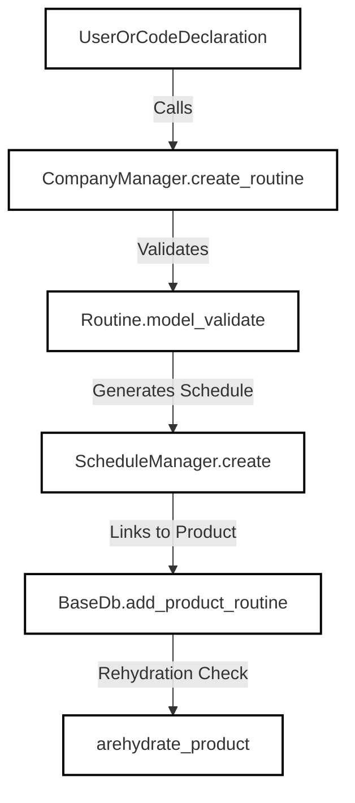

<!-- source: DeepWiki mcp.deepwiki.com · repo agno-agi/agno · page 8.2 Routines, Heartbeat and Execution · fetched 2026-11-09 -->

# Routines, Heartbeat and Execution

<details>
<summary>Relevant source files</summary>

The following files were used as context for generating this wiki page:

- [cookbook/05_agent_os/30_company/05_company_manager.py](cookbook/05_agent_os/30_company/05_company_manager.py)
- [cookbook/05_agent_os/30_company/06_execute_tasks.py](cookbook/05_agent_os/30_company/06_execute_tasks.py)
- [cookbook/05_agent_os/30_company/10_weekly_product_review.py](cookbook/05_agent_os/30_company/10_weekly_product_review.py)
- [cookbook/05_agent_os/30_company/11_disabled_routine.py](cookbook/05_agent_os/30_company/11_disabled_routine.py)
- [cookbook/05_agent_os/30_company/README.md](cookbook/05_agent_os/30_company/README.md)
- [cookbook/05_agent_os/30_company/TEST_LOG.md](cookbook/05_agent_os/30_company/TEST_LOG.md)
- [libs/agno/agno/company/bootstrap.py](libs/agno/agno/company/bootstrap.py)
- [libs/agno/agno/company/company_manager.py](libs/agno/agno/company/company_manager.py)
- [libs/agno/agno/company/config.py](libs/agno/agno/company/config.py)
- [libs/agno/agno/company/execution.py](libs/agno/agno/company/execution.py)
- [libs/agno/agno/company/manager.py](libs/agno/agno/company/manager.py)
- [libs/agno/agno/company/routines.py](libs/agno/agno/company/routines.py)
- [libs/agno/agno/company/sources.py](libs/agno/agno/company/sources.py)
- [libs/agno/agno/os/routers/company/heartbeat.py](libs/agno/agno/os/routers/company/heartbeat.py)
- [libs/agno/agno/os/routers/company/runs.py](libs/agno/agno/os/routers/company/runs.py)
- [libs/agno/agno/scheduler/executor.py](libs/agno/agno/scheduler/executor.py)
- [libs/agno/agno/tools/company.py](libs/agno/agno/tools/company.py)
- [libs/agno/tests/integration/db/test_company_chat_products.py](libs/agno/tests/integration/db/test_company_chat_products.py)
- [libs/agno/tests/integration/db/test_company_execution_parity.py](libs/agno/tests/integration/db/test_company_execution_parity.py)
- [libs/agno/tests/integration/db/test_company_heartbeat_parity.py](libs/agno/tests/integration/db/test_company_heartbeat_parity.py)
- [libs/agno/tests/unit/os/routers/test_company_execution.py](libs/agno/tests/unit/os/routers/test_company_execution.py)
- [libs/agno/tests/unit/os/routers/test_company_heartbeat.py](libs/agno/tests/unit/os/routers/test_company_heartbeat.py)
- [libs/agno/tests/unit/os/routers/test_company_manager_routines.py](libs/agno/tests/unit/os/routers/test_company_manager_routines.py)
- [libs/agno/tests/unit/os/test_company_playbook.py](libs/agno/tests/unit/os/test_company_playbook.py)
- [libs/agno/tests/unit/tools/test_company.py](libs/agno/tests/unit/tools/test_company.py)

</details>


The purpose of this document is to provide a technical specification for the Company OS routines subsystem, heartbeat management endpoints, background task execution, the scheduler executor integration, and the bounded `CompanyTools` used across agents and Model Context Protocol (MCP) servers.

---

## 1. Company Routines and Declarations

Company routines allow organizing and scheduling autonomous recurring or on-demand operations tied to specific products. Routines are defined via the `Routine` model and managed using `CompanyManager` or `AsyncCompanyManager` [libs/agno/agno/company/manager.py:44-136]().

### Routine Configuration and Rehydration
Routines wrap standard scheduler cron entries with company-specific metadata, linking them to products (`product_id`) and associating them with executors (agents, teams, or workflows) [libs/agno/agno/company/manager.py:82-109](). During system bootstrap or application startup, routines and products are rehydrated from code declarations using `arehydrate_product()` without overwriting manual human edits [libs/agno/agno/company/bootstrap.py:15-133]().


*Figure 1: Routine creation and rehydration data flow bridging declarations to database persistence.*

Sources: `libs/agno/agno/company/manager.py:82-136]`, `libs/agno/agno/company/bootstrap.py:15-133]`.

---

## 2. Heartbeat Endpoints and Schedule Management

Heartbeat and schedule wrappers are exposed through FastAPI routers under the `/company` prefix [libs/agno/agno/os/routers/company/heartbeat.py:67-83](). These endpoints manage routine states (pause, resume, archive, restore, and cancel) and inspect execution metrics.

### Key API Routes
- `POST /company/routines`: Creates a new routine linked to a product.
- `POST /company/routines/{id}/pause` / `resume`: Toggles schedule active states [libs/cookbook/05_agent_os/30_company/README.md:58]().
- `POST /company/routines/{id}/archive` / `restore`: Manages soft-deletion and linkage restoration [libs/agno/tests/unit/os/routers/test_company_heartbeat.py:61-86]().
- `GET /company/routines/{id}/runs`: Inspects historical execution runs and statuses.

```mermaid
graph TD
    A["FastAPIClient"] -->|POST /company/routines/{id}/pause| B["get_heartbeat_router"]
    B -->|Resolves Handler| C["ScheduleManager.disable"]
    C -->|Updates DB State| D["BaseDb.update_schedule"]
    D -->|Returns Status| E["RoutineResponse"]

    style A fill:none,stroke:#000,stroke-width:2px
    style B fill:none,stroke:#000,stroke-width:2px
    style C fill:none,stroke:#000,stroke-width:2px
    style D fill:none,stroke:#000,stroke-width:2px
    style E fill:none,stroke:#000,stroke-width:2px
```
*Figure 2: Routine pause request routing and execution path through the heartbeat router.*

Sources: `libs/agno/agno/os/routers/company/heartbeat.py:67-123]`, `libs/agno/tests/unit/os/routers/test_company_heartbeat.py:31-60]`.

---

## 3. Task Execution and Queue Integration

Tasks move through a defined lifecycle (`backlog`, `ready`, `in_progress`, `in_review`, `done`, and `cancelled`) [libs/cookbook/05_agent_os/30_company/README.md:108-117](). Starting a task run requires invoking the task runs endpoint, which interfaces with a durable queue worker [libs/agno/agno/os/routers/company/runs.py:136-173]().

### Execution Dispatch Flow
When `POST /company/tasks/{task_id}/runs` is invoked:
1. The router verifies permissions against the executor endpoint [libs/agno/agno/os/routers/company/runs.py:152-153]().
2. Sandbox checks are evaluated if the executor is isolated [libs/agno/agno/os/routers/company/runs.py:155-171]().
3. The job is dispatched to the durable queue backed by PostgreSQL or Redis via `QueueWorker` [libs/agno/tests/integration/db/test_company_execution_parity.py:73-89]().

```mermaid
graph TD
    A["ClientRequest"] -->|POST /company/tasks/{task_id}/runs| B["start_task"]
    B -->|Validates Executor| C["_executor"]
    C -->|Checks Sandbox| D["_sandbox_start_gate"]
    D -->|Enqueues Job| E["QueueWorker.store.claim_job"]
    E -->|Executes Run| F["QueueWorker._execute_claimed"]

    style A fill:none,stroke:#000,stroke-width:2px
    style B fill:none,stroke:#000,stroke-width:2px
    style C fill:none,stroke:#000,stroke-width:2px
    style D fill:none,stroke:#000,stroke-width:2px
    style E fill:none,stroke:#000,stroke-width:2px
    style F fill:none,stroke:#000,stroke-width:2px
```
*Figure 3: Task execution dispatch architecture connecting API routes to queue workers.*

Sources: `libs/agno/agno/os/routers/company/runs.py:111-173]`, `libs/agno/tests/integration/db/test_company_execution_parity.py:136-157]`.

---

## 4. Scheduler Executor Integration

Background routines and scheduled tasks are processed by the scheduler infrastructure. `ScheduleExecutor` handles timing logic, retries, timeouts, and tracking of execution states across polling intervals [libs/agno/agno/scheduler/executor.py](). Company-specific schedules utilize `CompanyScheduleExecutor` to bind routine results back to product context and enforce guardrails like `_RoutineResultGuardrail` [libs/agno/agno/company/routines.py:131-146]().

Sources: `libs/agno/agno/scheduler/executor.py]`, `libs/agno/agno/company/routines.py:10-147]`.

---

## 5. CompanyTools and Bounded Agent Execution

`CompanyTools` provides bounded tools for agents and direct MCP calls, granting read access and proposal-only writes while enforcing strict identity fences [libs/agno/agno/tools/company.py:1-24]().

### Security and Permission Boundaries
- **Identity Injection**: Caller identity and authorizations are injected automatically via run contexts (`_agno_run_context`) [libs/agno/agno/tools/company.py:48-55]().
- **Proposal Restriction**: Automated routines must propose tasks through intake tools rather than direct mutations [libs/agno/agno/tools/company.py:69-76]().
- **No Direct Acceptance**: Agents cannot accept or complete work through chat tools without explicit authorization checks [libs/agno/agno/tools/company.py:1-6]().

Sources: `libs/agno/agno/tools/company.py:1-179]`, `libs/agno/tests/unit/tools/test_company.py:98-140]`.

---

