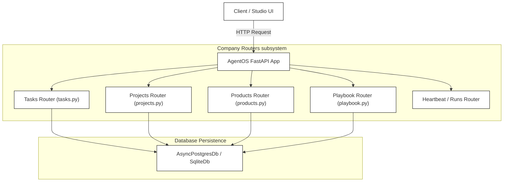
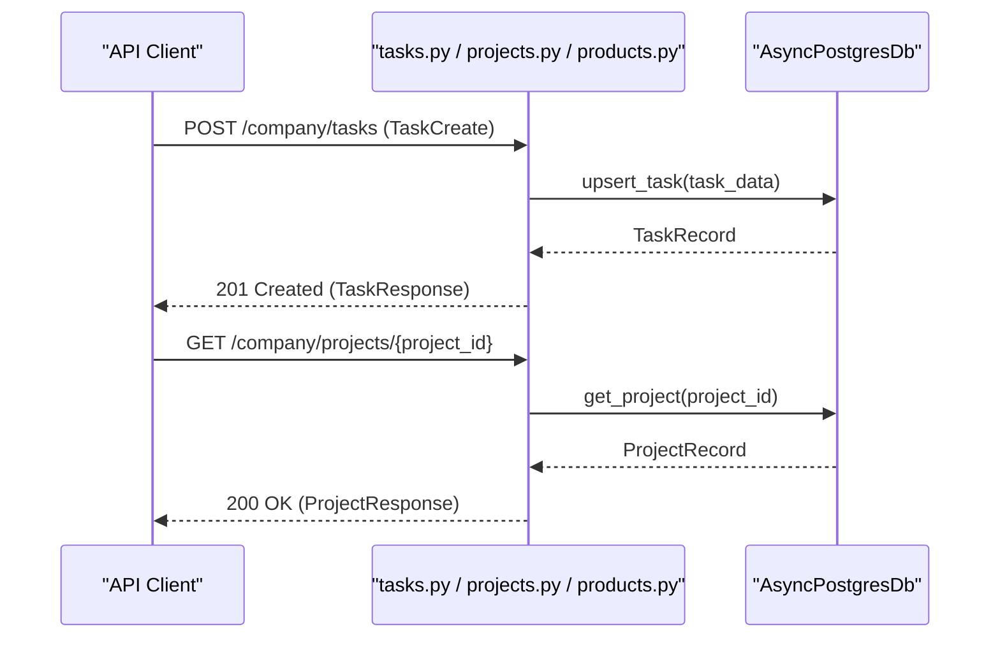
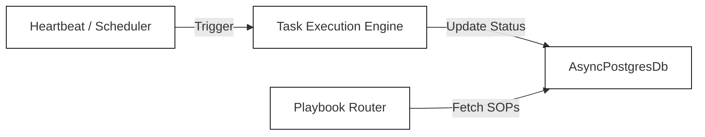

<!-- source: DeepWiki mcp.deepwiki.com · repo agno-agi/agno · page 8.3 Company REST API · fetched 2026-11-09 -->

# Company RESTAPI

Relevant source files

The following files were used as context for generating this wiki page:

- [libs/agno/agno/db/base.py](libs/agno/agno/db/base.py)
- [libs/agno/agno/db/dynamo/dynamo.py](libs/agno/agno/db/dynamo/dynamo.py)
- [libs/agno/agno/db/firestore/firestore.py](libs/agno/agno/db/firestore/firestore.py)
- [libs/agno/agno/db/gcs_json/gcs_json_db.py](libs/agno/agno/db/gcs_json/gcs_json_db.py)
- [libs/agno/agno/db/in_memory/in_memory_db.py](libs/agno/agno/db/in_memory/in_memory_db.py)
- [libs/agno/agno/db/json/json_db.py](libs/agno/agno/db/json/json_db.py)
- [libs/agno/agno/db/mongo/async_mongo.py](libs/agno/agno/db/mongo/async_mongo.py)
- [libs/agno/agno/db/mongo/mongo.py](libs/agno/agno/db/mongo/mongo.py)
- [libs/agno/agno/db/mysql/async_mysql.py](libs/agno/agno/db/mysql/async_mysql.py)
- [libs/agno/agno/db/mysql/mysql.py](libs/agno/agno/db/mysql/mysql.py)
- [libs/agno/agno/db/postgres/async_postgres.py](libs/agno/agno/db/postgres/async_postgres.py)
- [libs/agno/agno/db/postgres/postgres.py](libs/agno/agno/db/postgres/postgres.py)
- [libs/agno/agno/db/redis/redis.py](libs/agno/agno/db/redis/redis.py)
- [libs/agno/agno/db/singlestore/singlestore.py](libs/agno/agno/db/singlestore/singlestore.py)
- [libs/agno/agno/db/sqlite/async_sqlite.py](libs/agno/agno/db/sqlite/async_sqlite.py)
- [libs/agno/agno/db/sqlite/sqlite.py](libs/agno/agno/db/sqlite/sqlite.py)
- [libs/agno/agno/db/surrealdb/surrealdb.py](libs/agno/agno/db/surrealdb/surrealdb.py)
- [libs/agno/agno/os/routers/company/playbook.py](libs/agno/agno/os/routers/company/playbook.py)
- [libs/agno/agno/os/routers/company/products.py](libs/agno/agno/os/routers/company/products.py)
- [libs/agno/agno/os/routers/company/projects.py](libs/agno/agno/os/routers/company/projects.py)
- [libs/agno/agno/os/routers/company/schema.py](libs/agno/agno/os/routers/company/schema.py)
- [libs/agno/agno/os/routers/company/tasks.py](libs/agno/agno/os/routers/company/tasks.py)
- [libs/agno/agno/os/routers/schedules/router.py](libs/agno/agno/os/routers/schedules/router.py)
- [libs/agno/agno/os/routers/schedules/schema.py](libs/agno/agno/os/routers/schedules/schema.py)
- [libs/agno/tests/unit/os/routers/test_products_router.py](libs/agno/tests/unit/os/routers/test_products_router.py)

## Purpose and Scope
This section covers the Company REST API subsystem within AgentOS, which provides organizational routing and management capabilities for AI agent operations. Specifically, it details the routers and data schemas governing company-level entities: **tasks**, **projects**, **products**, **playbooks**, **runs**, and **heartbeats**. These endpoints enable multi-agent organizations to track deliverables, coordinate execution states, and interface with underlying database layers [libs/agno/agno/db/postgres/async_postgres.py:128-132]().

---

## 1. Company Router Architecture

The Company REST API is structured as a collection of modular FastAPI APIRouters under `libs/agno/agno/os/routers/company/`, mounted onto the main AgentOS application. These routers interact with database persistence adapters (such as `AsyncPostgresDb` and `SqliteDb`) via standardized table schemas for products, sources, projects, and tasks [libs/agno/agno/db/postgres/async_postgres.py:128-132]().

*Sources: [libs/agno/agno/db/postgres/async_postgres.py:128-132](), [libs/agno/agno/os/routers/company/tasks.py:1-1]()*, [libs/agno/agno/os/routers/company/projects.py:1-1](), [libs/agno/agno/os/routers/company/products.py:1-1](), [libs/agno/agno/os/routers/company/playbook.py:1-1]()

---

## 2. Products, Projects, and Tasks Endpoints

The company operational hierarchy is exposed through dedicated REST endpoints that manage CRUD lifecycles for organizational assets.

### Products Router (`products.py`)
* Manages company offerings, software products, or service lines.
* Backed by the products table configured in database adapters [libs/agno/agno/db/postgres/async_postgres.py:128-128]().
* Supports listing, creation, updating, and archival operations.

### Projects Router (`projects.py`)
* Coordinates collections of tasks aligned with specific product milestones or strategic goals.
* Backed by the projects table [libs/agno/agno/db/postgres/async_postgres.py:130-130]().

### Tasks Router (`tasks.py`)
* Tracks atomic units of work assigned to agents, teams, or human operators.
* Backed by the tasks table [libs/agno/agno/db/postgres/async_postgres.py:131-131]().

*Sources: [libs/agno/agno/db/postgres/async_postgres.py:128-132](), [libs/agno/agno/os/routers/company/tasks.py:1-1](), [libs/agno/agno/os/routers/company/projects.py:1-1](), [libs/agno/agno/os/routers/company/products.py:1-1]()

---

## 3. Playbook, Runs, and Heartbeat Endpoints

Organizational routines, operational workflows, and periodic execution triggers are handled via the playbook and heartbeat components.

* **Playbook Router (`playbook.py`)**: Exposes organizational guidelines, standard operating procedures (SOPs), and prompt contexts utilized by company agents during execution.
* **Runs & Heartbeat**: Coordinates background scheduling, health check sweeps, and lease management for active agent routines. Persistence for schedule runs and job execution leverages dedicated database tables [libs/agno/agno/db/postgres/async_postgres.py:132-133]().

*Sources: [libs/agno/agno/db/postgres/async_postgres.py:130-134](), [libs/agno/agno/os/routers/company/playbook.py:1-1]()

---

## 4. Schemas and Data Validation

Request payloads and response models for all company routes are defined in `schema.py`. These Pydantic models ensure rigorous type validation and serialization consistency across database boundaries.

| Schema Module | Core Models | Purpose |
| :--- | :--- | :--- |
| `libs/agno/agno/os/routers/company/schema.py` | `TaskCreate`, `TaskUpdate`, `TaskResponse` | Validation for task lifecycle operations |
| `libs/agno/agno/os/routers/company/schema.py` | `ProjectCreate`, `ProjectUpdate`, `ProjectResponse` | Validation for project organization |
| `libs/agno/agno/os/routers/company/schema.py` | `ProductCreate`, `ProductUpdate`, `ProductResponse` | Validation for product catalog management |
| `libs/agno/agno/os/routers/company/schema.py` | `PlaybookResponse` | Serialization of organizational guidelines |

*Sources: [libs/agno/agno/os/routers/company/schema.py:1-50](), [libs/agno/agno/db/postgres/async_postgres.py:128-134]()*

---

