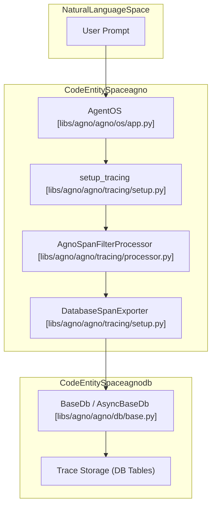
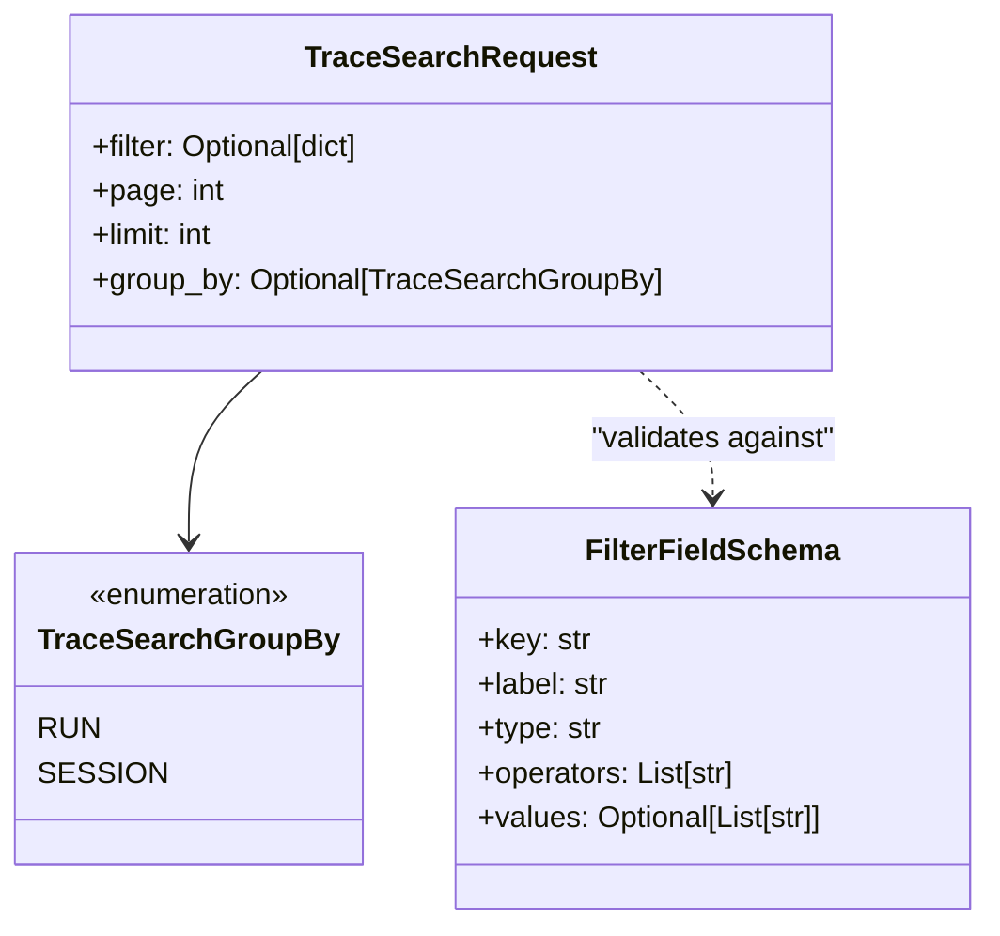

<!-- source: DeepWiki mcp.deepwiki.com · repo agno-agi/agno · page 9.2 Tracing and Spans · fetched 2026-11-09 -->

# Tracing and Spans

Relevant source files

The following files were used as context for generating this wiki page:

- [libs/agno/agno/tracing/processor.py](libs/agno/agno/tracing/processor.py)
- [libs/agno/agno/tracing/setup.py](libs/agno/agno/tracing/setup.py)
- [libs/agno/tests/unit/os/test_agentos_fastapi_telemetry.py](libs/agno/tests/unit/os/test_agentos_fastapi_telemetry.py)
- [libs/agno/tests/unit/tracing/test_processor.py](libs/agno/tests/unit/tracing/test_processor.py)
- [libs/agno/tests/unit/tracing/test_setup.py](libs/agno/tests/unit/tracing/test_setup.py)

Tracing in the Agno framework provides deep observability into the execution of Agents, Teams, and Workflows. By leveraging OpenTelemetry standards, OpenInference semantics, and integrated database storage, Agno allows developers to monitor model interactions, tool calls, and framework-level events in real-time or via historical analysis in the AgentOS UI.

---

## Tracing Architecture and Setup

The tracing system is built on a provider-agnostic architecture that supports both local database persistence and external OpenTelemetry collectors. Tracing can be configured globally using `setup_tracing()`, which initializes an OpenTelemetry `TracerProvider`, configures span attribute limits, attaches a database exporter, and instruments the framework with OpenInference.

### Key Components

| Component | Description |
| :--- | :--- |
| `setup_tracing` | Global configuration helper that initializes OpenTelemetry with a database exporter and filter processor `[libs/agno/agno/tracing/setup.py:40-46]()`. |
| `AgnoSpanFilterProcessor` | Custom OpenTelemetry `SpanProcessor` that filters out foreign spans (like default FastAPI request tracing) while correctly anchoring Agno run roots `[libs/agno/agno/tracing/processor.py:23-45]()`. |
| `DatabaseSpanExporter` | Exports OpenTelemetry spans directly into Agno database backends (`BaseDb`, `AsyncBaseDb`, `RemoteDb`) `[libs/agno/agno/tracing/setup.py:105-105]()`. |
| `TraceSummary` | Summary information for trace list views, including status, duration, and span counts `[libs/agno/agno/os/routers/traces/schemas.py:143-160]()`. |
| `TraceNode` | Recursive Pydantic model used to represent the trace hierarchy for frontend rendering `[libs/agno/agno/os/routers/traces/schemas.py:48-67]()`. |

### Data Flow Diagram: Tracing Lifecycle and Setup

This diagram illustrates how a user request flows through the `AgentOS` runtime and triggers the tracing and span filtering infrastructure before landing in the database.

**Tracing Data Flow**

Sources:
- `[libs/agno/agno/tracing/setup.py:40-46]()` (`setup_tracing` definition)
- `[libs/agno/agno/tracing/processor.py:23-45]()` (`AgnoSpanFilterProcessor` design)
- `[libs/agno/agno/tracing/setup.py:105-105]()` (`DatabaseSpanExporter` usage)

---

## OpenTelemetry Integration and Span Filtering

Agno integrates with OpenTelemetry and `openinference-instrumentation-agno` to capture detailed traces for agent runs, model calls, tool executions, team coordination, and workflow steps `[libs/agno/agno/tracing/setup.py:53-58]()`.

### Span Classification in `AgnoSpanFilterProcessor`
When global tracer providers are shared with other libraries (such as FastAPI request tracing), foreign spans can wrap Agno runs. `AgnoSpanFilterProcessor` classifies every started span into one of three positions `[libs/agno/agno/tracing/processor.py:31-36]()`:
- **`root`**: An Agno span whose parent is missing or outside Agno. It is forwarded without a parent, ensuring the trace is rooted at the Agno run rather than an HTTP middleware.
- **`inside`**: Any span whose parent is a root or inside span, including user spans created inside tools.
- **`outside`**: Everything else (e.g., framework HTTP request spans). These are dropped or filtered out to prevent pollution.

Sources:
- `[libs/agno/agno/tracing/setup.py:132-133]()` (`AgnoInstrumentor` instrumentation)
- `[libs/agno/agno/tracing/processor.py:23-45]()` (`AgnoSpanFilterProcessor` implementation)

---

## Database Storage and Spans

Agno stores traces directly in your configured database backend using `DatabaseSpanExporter` `[libs/agno/agno/tracing/setup.py:105-105]()`. 

### Trace Persistence and Scoping
- **Batch vs Simple Processing**: Developers can configure `batch_processing=True` to use `BatchSpanProcessor` with configurable queue sizes, batch sizes, and delay intervals, or `SimpleSpanProcessor` for immediate synchronous export `[libs/agno/agno/tracing/setup.py:41-46,109-122]()`.
- **User Scoping**: Trace retrieval is strictly scoped. Non-admin callers can only see traces where the `user_id` matches their authenticated session `[libs/agno/agno/os/routers/traces/traces.py:57-71]()`.
- **Trace Ownership**: The `_require_trace_owner` function ensures that a `404` error is raised if a scoped user attempts to access a `trace_id` they do not own `[libs/agno/agno/os/routers/traces/traces.py:69-70]()`.

Sources:
- `[libs/agno/agno/tracing/setup.py:40-123]()` (`setup_tracing` span processor configuration)
- `[libs/agno/agno/os/routers/traces/traces.py:57-71]()` (`_require_trace_owner` logic)

---

## Trace Filtering and Retrieval

Agno implements a robust filtering system using a query expression DSL, allowing complex queries against stored traces.

### Filter Operators and Schemas
- **Comparison & Logical Operators**: Supports comparison predicates (`EQ`, `NEQ`, `GT`, `GTE`, `LT`, `LTE`) and logical composition (`AND`, `OR`) `[libs/agno/tests/unit/test_trace_search_api.py:47-53]()`.
- **Field Schema**: The `TRACE_FILTER_SCHEMA` defines searchable fields such as `status`, `duration_ms`, `user_id`, and `start_time` `[libs/agno/tests/unit/test_trace_search_api.py:98-148]()`.
- **Trace Search and Grouping**: The search API supports grouping traces by `RUN` (individual execution traces) or `SESSION` (aggregated session statistics) `[libs/agno/agno/os/routers/traces/schemas.py:10-15]()`.

### Trace Search Entity Relationships

**Trace Search Entities**

Sources:
- `[libs/agno/agno/os/routers/traces/schemas.py:10-15]()` (`TraceSearchGroupBy` enum)
- `[libs/agno/tests/unit/test_trace_search_api.py:24-93]()` (`TraceSearchRequest` validation)
- `[libs/agno/tests/unit/test_trace_search_api.py:95-148]()` (`FilterFieldSchema` definition)

---

## Viewing Traces in AgentOS UI

The AgentOS UI reconstructs execution hierarchies by consuming the `/traces` REST endpoints provided by the `AgentOS` runtime.

### Retrieval Flow
1. **API Request**: The UI queries `/traces` endpoints with optional filters like `run_id`, `session_id`, or `status` `[libs/agno/agno/os/routers/traces/traces.py:153-156]()`.
2. **User Scoping**: For non-admin callers, the system automatically applies `user_id` constraints via `_apply_user_scope_to_filter` `[libs/agno/agno/os/routers/traces/traces.py:38-54]()`.
3. **Pagination**: Results are returned as a paginated response containing `TraceSummary` records `[libs/agno/agno/os/routers/traces/traces.py:92-152]()`.
4. **Hierarchical Rendering**: The frontend uses `TraceNode.from_span` to construct recursive tree views of execution spans, including inputs, outputs, tokens, and errors `[libs/agno/agno/os/routers/traces/schemas.py:69-141]()`.

Sources:
- `[libs/agno/agno/os/routers/traces/traces.py:92-156]()` (`get_traces` router endpoint)
- `[libs/agno/agno/os/routers/traces/schemas.py:48-67]()` (`TraceNode` schema)
- `[libs/agno/agno/os/routers/traces/schemas.py:143-160]()` (`TraceSummary` schema)

---

