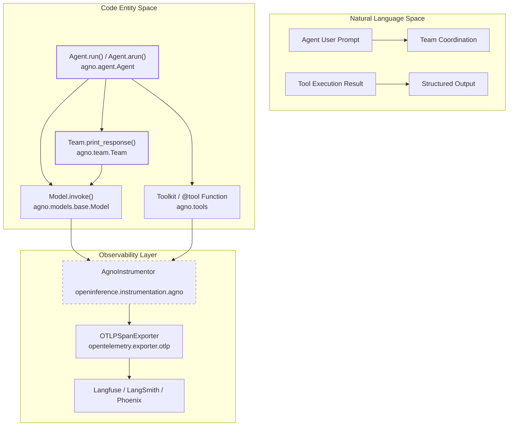
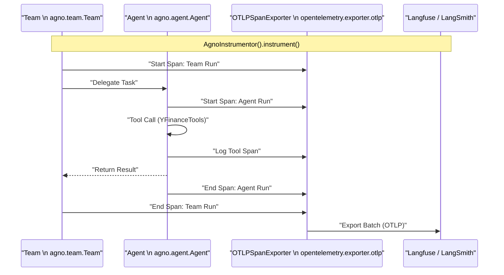
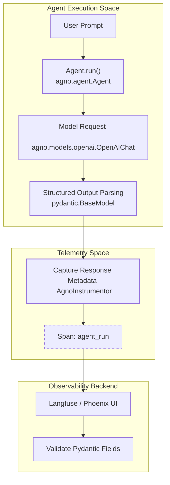

<!-- source: DeepWiki mcp.deepwiki.com · repo agno-agi/agno · page 9.3 Third-Party Observability Integrations · fetched 2026-11-09 -->

# Third-Party Observability Integrations

<details>
<summary>Relevant source files</summary>

The following files were used as context for generating this wiki page:

- [.github/ISSUE_TEMPLATE/bug-report.yml](.github/ISSUE_TEMPLATE/bug-report.yml)
- [.github/ISSUE_TEMPLATE/feature-request.yml](.github/ISSUE_TEMPLATE/feature-request.yml)
- [.github/workflows/pr-lint.yml](.github/workflows/pr-lint.yml)
- [cookbook/observability/arize_phoenix_via_openinference.py](cookbook/observability/arize_phoenix_via_openinference.py)
- [cookbook/observability/arize_phoenix_via_openinference_local.py](cookbook/observability/arize_phoenix_via_openinference_local.py)
- [cookbook/observability/langfuse_via_openinference.py](cookbook/observability/langfuse_via_openinference.py)
- [cookbook/observability/langfuse_via_openinference_response_model.py](cookbook/observability/langfuse_via_openinference_response_model.py)
- [cookbook/observability/langfuse_via_openlit.py](cookbook/observability/langfuse_via_openlit.py)
- [cookbook/observability/langsmith_via_openinference.py](cookbook/observability/langsmith_via_openinference.py)
- [cookbook/observability/langtrace_op.py](cookbook/observability/langtrace_op.py)
- [cookbook/observability/teams/langfuse_via_openinference_team.py](cookbook/observability/teams/langfuse_via_openinference_team.py)

</details>


This page details the third-party observability integrations supported by the Agno framework. Agno provides a robust instrumentation layer that enables developers to monitor, trace, debug, and evaluate agentic workflows using industry-standard platforms. These integrations leverage **OpenInference**, **OpenLIT**, and provider-specific SDKs like **Langtrace**, establishing a unified specification for capturing LLM application telemetry, tool calls, and structured model outputs.

## Architecture and Data Flow

Observability hooks are embedded within the Framework layer, specifically instrumenting the `Agent` [cookbook/observability/langfuse_via_openinference.py:12](), `Team` [cookbook/observability/teams/langfuse_via_openinference_team.py:15](), and `Workflow` classes. When execution is initiated, the system emits OpenTelemetry spans capturing inputs, model invocations, tool execution, and internal reasoning steps.

The following diagram bridges natural language execution concepts to the underlying code entities in the Agno codebase.

**System-to-Code Telemetry Flow**

Sources: [cookbook/observability/langfuse_via_openinference.py:15-40](), [cookbook/observability/teams/langfuse_via_openinference_team.py:13-92](), [cookbook/observability/langtrace_op.py:12-17]()

## Platform Integrations Overview

Agno supports major observability backends through OpenInference OTLP exporters, OpenLIT, or direct SDK initializations. Each integration requires specific environment configurations before instantiating agents or teams.

### 1. Langfuse and LangSmith
*   **Langfuse**: Integrates via `OTLPSpanExporter` [cookbook/observability/langfuse_via_openinference.py:16-37](). Authentication is handled by base64-encoding public and secret keys into a `Basic` authorization header [cookbook/observability/langfuse_via_openinference.py:23-34]().
*   **LangSmith**: Uses an OTLP endpoint configured with custom headers for `x-api-key` and `Langsmith-Project` [cookbook/observability/langsmith_via_openinference.py:21-30]().

### 2. Arize Phoenix
Arize Phoenix provides localized or hosted tracing visualization, ideal for debugging complex multi-step tool calls and RAG pipelines.
*   **Local Instance**: Configured by setting `PHOENIX_COLLECTOR_ENDPOINT` to `http://localhost:6006` and calling `phoenix.otel.register` with `auto_instrument=True` [cookbook/observability/arize_phoenix_via_openinference_local.py:18-24]().
*   **Cloud Instance**: Requires `PHOENIX_API_KEY` and the organizational collector endpoint [cookbook/observability/arize_phoenix_via_openinference.py:21-30]().

### 3. OpenLIT and Langtrace
*   **OpenLIT**: Acts as an instrumentation layer that routes traces to backends like Langfuse via `OTEL_EXPORTER_OTLP_ENDPOINT` [cookbook/observability/langfuse_via_openlit.py:22-32]() using `openlit.init(tracer=tracer)` [cookbook/observability/langfuse_via_openlit.py:50-50]().
*   **Langtrace**: Provides `langtrace-python-sdk`, which automatically instruments Agno agent interactions upon calling `langtrace.init()` [cookbook/observability/langtrace_op.py:12-17]().

### 4. MLflow and Weave
MLflow and Weave ingest Agno telemetry via standard OpenInference OTLP exporters, linking specific prompt configurations, parameters, and model versions directly to execution traces.

Sources: [cookbook/observability/langfuse_via_openinference.py:16-40](), [cookbook/observability/langsmith_via_openinference.py:21-30](), [cookbook/observability/arize_phoenix_via_openinference_local.py:18-24](), [cookbook/observability/langfuse_via_openlit.py:22-50](), [cookbook/observability/langtrace_op.py:12-17]()

## Implementation Detail: Team Tracing

Tracing multi-agent systems built with `Team` [cookbook/observability/teams/langfuse_via_openinference_team.py:15]() tracks coordination between the leader model and member agents (`Agent`) [cookbook/observability/teams/langfuse_via_openinference_team.py:48-67](). Using `AgnoInstrumentor`, parent and child spans are correlated within a unified trace [cookbook/observability/teams/langfuse_via_openinference_team.py:41-41]().

**Team Tracing Sequence**

Sources: [cookbook/observability/teams/langfuse_via_openinference_team.py:13-92]()

## OpenInference and OpenLIT Integration Patterns

The framework maps execution structures to OpenInference semantic conventions using instrumentation helpers.

| Integration Type | Implementation Pattern | Key Files |
| :--- | :--- | :--- |
| **OpenInference** | `AgnoInstrumentor().instrument()` | [cookbook/observability/langfuse_via_openinference.py:40-40]() |
| **OpenLIT** | `openlit.init(tracer=tracer)` | [cookbook/observability/langfuse_via_openlit.py:50-50]() |
| **Langtrace** | `langtrace.init()` | [cookbook/observability/langtrace_op.py:17-17]() |
| **OTLP Export** | `OTLPSpanExporter(endpoint=...)` | [cookbook/observability/langfuse_via_openinference.py:16-37]() |

Sources: [cookbook/observability/langfuse_via_openinference.py:16-40](), [cookbook/observability/langfuse_via_openlit.py:50-50](), [cookbook/observability/langtrace_op.py:17-17]()

## Configuring Telemetry with OpenInference

To enable third-party observability, initialize a `TracerProvider` and register the `AgnoInstrumentor` prior to instantiating agents [cookbook/observability/langfuse_via_openinference.py:37-40]().

```python
from openinference.instrumentation.agno import AgnoInstrumentor
from opentelemetry.sdk.trace import TracerProvider
from opentelemetry.sdk.trace.export import SimpleSpanProcessor
from opentelemetry.exporter.otlp.proto.http.trace_exporter import OTLPSpanExporter

# 1. Initialize the TracerProvider
tracer_provider = TracerProvider()

# 2. Add a Span Processor with an OTLP Exporter
tracer_provider.add_span_processor(
    SimpleSpanProcessor(OTLPSpanExporter())
)

# 3. Start instrumenting agno framework
AgnoInstrumentor().instrument(tracer_provider=tracer_provider)
```
Sources: [cookbook/observability/langfuse_via_openinference.py:37-40]()

### Tracing Structured Outputs

When an `Agent` is configured with an `output_schema` Pydantic `BaseModel` [cookbook/observability/langfuse_via_openinference_response_model.py:49-65](), OpenInference captures parsed structured responses as trace attributes.

**Structured Output Tracing Flow**

Sources: [cookbook/observability/langfuse_via_openinference_response_model.py:49-65](), [cookbook/observability/arize_phoenix_via_openinference.py:33-48]()

---

