# Page: Overview

# Overview

<details>
<summary>Relevant source files</summary>

The following files were used as context for generating this wiki page:

- [.cursorrules](.cursorrules)
- [.github/pull_request_template.md](.github/pull_request_template.md)
- [.github/workflows/claude.yml](.github/workflows/claude.yml)
- [.github/workflows/pr-triage.yml](.github/workflows/pr-triage.yml)
- [.gitignore](.gitignore)
- [AGENTS.md](AGENTS.md)
- [CLAUDE.md](CLAUDE.md)
- [CONTRIBUTING.md](CONTRIBUTING.md)
- [README.md](README.md)
- [cookbook/07_knowledge/02_building_blocks/README.md](cookbook/07_knowledge/02_building_blocks/README.md)
- [cookbook/07_knowledge/05_integrations/README.md](cookbook/07_knowledge/05_integrations/README.md)
- [cookbook/07_knowledge/05_integrations/vector_dbs/05_scylladb.py](cookbook/07_knowledge/05_integrations/vector_dbs/05_scylladb.py)
- [cookbook/README.md](cookbook/README.md)
- [libs/agno/agno/agent/agent.py](libs/agno/agno/agent/agent.py)
- [libs/agno/agno/models/base.py](libs/agno/agno/models/base.py)
- [libs/agno/agno/models/message.py](libs/agno/agno/models/message.py)
- [libs/agno/agno/models/response.py](libs/agno/agno/models/response.py)
- [libs/agno/agno/run/agent.py](libs/agno/agno/run/agent.py)
- [libs/agno/agno/run/base.py](libs/agno/agno/run/base.py)
- [libs/agno/agno/run/team.py](libs/agno/agno/run/team.py)
- [libs/agno/agno/team/team.py](libs/agno/agno/team/team.py)
- [libs/agno/agno/tools/function.py](libs/agno/agno/tools/function.py)
- [libs/agno/agno/tools/reasoning.py](libs/agno/agno/tools/reasoning.py)
- [libs/agno/agno/utils/events.py](libs/agno/agno/utils/events.py)
- [libs/agno/pyproject.toml](libs/agno/pyproject.toml)
- [libs/agno/tests/integration/agent/test_event_streaming.py](libs/agno/tests/integration/agent/test_event_streaming.py)
- [libs/agno/tests/integration/teams/test_event_streaming.py](libs/agno/tests/integration/teams/test_event_streaming.py)
- [libs/agno/tests/unit/agent/test_paused_user_input_persistence.py](libs/agno/tests/unit/agent/test_paused_user_input_persistence.py)
- [libs/agno/tests/unit/run/test_run_events.py](libs/agno/tests/unit/run/test_run_events.py)
- [libs/agno/tests/unit/run/test_run_input.py](libs/agno/tests/unit/run/test_run_input.py)
- [libs/agno/tests/unit/tools/test_functions.py](libs/agno/tests/unit/tools/test_functions.py)
- [libs/agno_infra/agno/cli/infra_cli.py](libs/agno_infra/agno/cli/infra_cli.py)
- [libs/agno_infra/agno/infra/enums.py](libs/agno_infra/agno/infra/enums.py)
- [libs/agno_infra/agno/infra/operator.py](libs/agno_infra/agno/infra/operator.py)
- [scripts/demo_setup.sh](scripts/demo_setup.sh)
- [scripts/dev_setup.sh](scripts/dev_setup.sh)

</details>


This document introduces the Agno framework, its three-layer architecture, and core design principles. It provides a high-level understanding of how Agno enables building, deploying, and managing AI agent systems at scale.

For hands-on examples, see [Quick Start Guide](#1.1). For detailed architectural patterns, see [Architecture Overview](#1.2). For definitions of core terms, see [Key Concepts and Terminology](#1.3).

Sources: [README.md:15-23](), [libs/agno/pyproject.toml:1-12]()

## What is Agno

Agno is a framework and runtime for agent platforms, allowing users to build, run, and manage agent systems [README.md:15-18](). It provides the building blocks to create AI agents, coordinate them into teams, and orchestrate them through multi-step workflows. It then serves those systems in production as stateless, session-scoped APIs with built-in monitoring and management capabilities [README.md:19-23]().

The framework addresses fundamental requirements for production agentic software:

1. **Framework Agnostic**: Build agents using the Agno SDK or integrate existing agents from other frameworks like the Claude Agent SDK, LangGraph, or DSPy via adapters [README.md:19](), [libs/agno/pyproject.toml:77](), [libs/agno/pyproject.toml:95-96]().
2. **Production Runtime**: Run agents as production services with tracing, scheduling, and RBAC via the `AgentOS` runtime [README.md:20](), [libs/agno/pyproject.toml:81]().
3. **Dynamic Governance**: Agno provides approval workflows and human-in-the-loop controls for sensitive tool executions using `ToolExecution` states and `requires_confirmation` flags [README.md:67](), [libs/agno/agno/models/base.py:44](), [libs/agno/agno/tools/function.py:34-45]().
4. **Integrated Learning**: Agents can persist user profiles, memories, and learned knowledge across sessions using the `LearningMachine` [README.md:64](), [libs/agno/agno/agent/agent.py:49](), [libs/agno/agno/agent/agent.py:131-137]().

Sources: [README.md:15-73](), [libs/agno/pyproject.toml:1-96](), [libs/agno/agno/agent/agent.py:43-137]()

## Three-Layer Architecture

Agno separates concerns into three distinct layers, each serving a specific role in the system lifecycle. For details, see [Architecture Overview](#1.2).

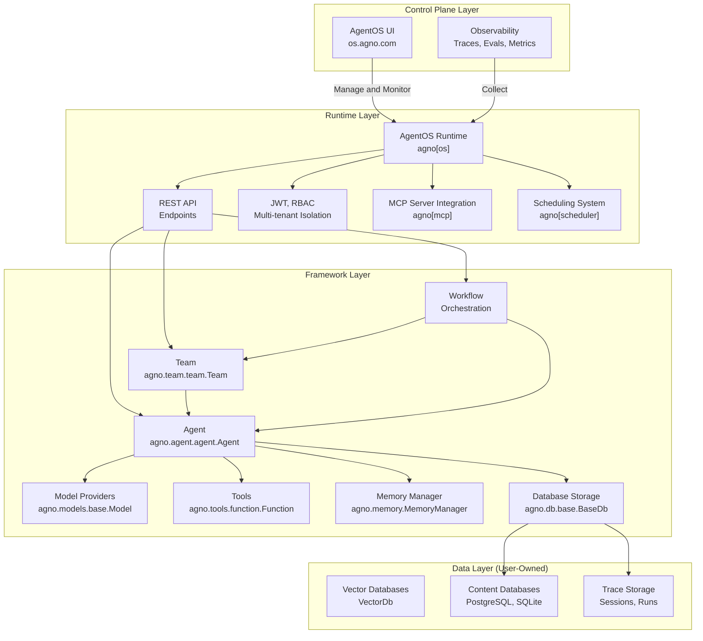
Title: Agno Three-Layer Architecture  
Sources: [README.md:17-30](), [libs/agno/pyproject.toml:80-85](), [libs/agno/agno/agent/agent.py:80-160]()

### Framework Layer

The framework layer provides building blocks for creating agentic systems. Core classes include `Agent` [libs/agno/agno/agent/agent.py:81](), `Team` [libs/agno/agno/team/team.py:83](), and `Function` [libs/agno/agno/tools/function.py:4](). These primitives share common infrastructure for model access via the `Model` base class [libs/agno/agno/models/base.py:134](), tool execution via `Function`, and persistence.

Sources: [libs/agno/agno/agent/agent.py:80-160](), [libs/agno/agno/team/team.py:83-125](), [libs/agno/agno/models/base.py:134-150]()

### Runtime Layer

The runtime layer (`AgentOS`) serves agents, teams, and workflows as production APIs [README.md:20](). It handles stateless execution, session persistence (`AgentSession`, `TeamSession`, `WorkflowSession`), JWT-based RBAC security, and built-in protocol interfaces [README.md:20](), [libs/agno/pyproject.toml:81](), [libs/agno/agno/agent/agent.py:71]().

Sources: [README.md:20-28](), [libs/agno/pyproject.toml:80-85](), [libs/agno/agno/agent/agent.py:71-72]()

### Control Plane Layer

The control plane ([os.agno.com](https://os.agno.com)) provides a web interface for testing, monitoring, and managing deployed systems [README.md:29](). It connects to running `AgentOS` instances to inspect traces, manage sessions, evaluate performance, and handle human approval requests [README.md:29](), [libs/agno/agno/models/base.py:44-57]().

Sources: [README.md:29-30](), [libs/agno/agno/models/base.py:44-57]()

## Core Orchestration Primitives

Agno provides core primitives to handle single-agent reasoning, multi-agent teams, and structured workflows. For full definitions, see [Key Concepts and Terminology](#1.3).

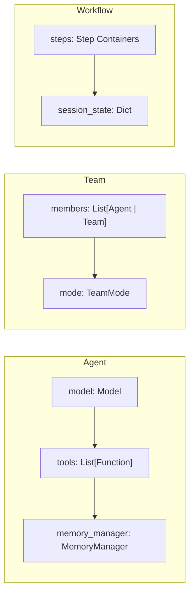
Title: Agno Orchestration Primitives  
Sources: [libs/agno/agno/agent/agent.py:80-142](), [libs/agno/agno/team/team.py:83-125]()

### Agent, Team, and Workflow

- **Agent**: Represents a single AI unit configured with a model, tools, prompt instructions, and memory management [libs/agno/agno/agent/agent.py:80-142]().
- **Team**: Coordinates multiple agents or sub-teams using specific team modes (e.g., autonomous task loops, leader routing) [libs/agno/agno/team/team.py:83-125]().
- **Workflow**: Orchestrates complex multi-step execution graphs with conditional branching, loops, and parallel steps.

Sources: [libs/agno/agno/agent/agent.py:80-142](), [libs/agno/agno/team/team.py:83-125]()

## Getting Started and Next Steps

To begin building with Agno:
- For minimal code examples, see the [Quick Start Guide](#1.1).
- For deep architectural insights, see [Architecture Overview](#1.2).
- For complete terminology definitions, see [Key Concepts and Terminology](#1.3).

Sources: [README.md:31-82]()

---

# Page: Quick Start Guide

# Quick Start Guide

<details>
<summary>Relevant source files</summary>

The following files were used as context for generating this wiki page:

- [cookbook/00_quickstart/README.md](cookbook/00_quickstart/README.md)
- [cookbook/00_quickstart/TEST_LOG.md](cookbook/00_quickstart/TEST_LOG.md)
- [cookbook/00_quickstart/agent_search_over_knowledge.py](cookbook/00_quickstart/agent_search_over_knowledge.py)
- [cookbook/00_quickstart/agent_with_guardrails.py](cookbook/00_quickstart/agent_with_guardrails.py)
- [cookbook/00_quickstart/agent_with_memory.py](cookbook/00_quickstart/agent_with_memory.py)
- [cookbook/00_quickstart/agent_with_state_management.py](cookbook/00_quickstart/agent_with_state_management.py)
- [cookbook/00_quickstart/agent_with_storage.py](cookbook/00_quickstart/agent_with_storage.py)
- [cookbook/00_quickstart/agent_with_structured_output.py](cookbook/00_quickstart/agent_with_structured_output.py)
- [cookbook/00_quickstart/agent_with_tools.py](cookbook/00_quickstart/agent_with_tools.py)
- [cookbook/00_quickstart/agent_with_typed_input_output.py](cookbook/00_quickstart/agent_with_typed_input_output.py)
- [cookbook/01_demo/README.md](cookbook/01_demo/README.md)
- [cookbook/01_demo/TEST_LOG.md](cookbook/01_demo/TEST_LOG.md)
- [cookbook/01_demo/agents/code_search.py](cookbook/01_demo/agents/code_search.py)
- [cookbook/01_demo/agents/git_wiki.py](cookbook/01_demo/agents/git_wiki.py)
- [cookbook/01_demo/agents/local_wiki.py](cookbook/01_demo/agents/local_wiki.py)
- [cookbook/01_demo/agents/notion_wiki.py](cookbook/01_demo/agents/notion_wiki.py)
- [cookbook/01_demo/config.yaml](cookbook/01_demo/config.yaml)
- [cookbook/01_demo/db.py](cookbook/01_demo/db.py)
- [cookbook/01_demo/evals/cases.py](cookbook/01_demo/evals/cases.py)
- [cookbook/01_demo/generate_requirements.sh](cookbook/01_demo/generate_requirements.sh)
- [cookbook/01_demo/requirements.in](cookbook/01_demo/requirements.in)
- [cookbook/01_demo/requirements.txt](cookbook/01_demo/requirements.txt)
- [cookbook/01_demo/run.py](cookbook/01_demo/run.py)
- [cookbook/03_teams/02_modes/broadcast/04_structured_debate.py](cookbook/03_teams/02_modes/broadcast/04_structured_debate.py)

</details>


This page provides the minimal code examples required to create a stateful, tool-using agent using `Agent`, run it locally or via the production-ready `AgentOS` runtime, and connect it to the Control Plane UI. 

For detailed system architecture, see **Architecture Overview (1.2)**. For terminology and core concepts, see **Key Concepts and Terminology (1.3)**. For comprehensive agent configuration options, see **Agent System (2.1)**.

Sources: `[cookbook/00_quickstart/README.md:1-40]()`, `[cookbook/01_demo/run.py:1-29]()`

---

## Installation

Install Agno with the AgentOS runtime and your preferred model provider dependencies:

```bash
pip install -U 'agno[os]'
```

The `os` extra bundle includes `fastapi`, `uvicorn`, `websockets`, `sqlalchemy`, `PyJWT`, and `opentelemetry-sdk` required for production deployment and API hosting.

Sources: `[cookbook/01_demo/requirements.txt:3-3]()`, `[cookbook/00_quickstart/README.md:20-25]()`

---

## Creating Your First Agent

The most common starting point is a tool-enabled agent that can act on live data. Create an agent instance utilizing `Agent`, `Gemini`, and `YFinanceTools` `[cookbook/00_quickstart/agent_with_tools.py:26-45]()`.

```python
from agno.agent import Agent
from agno.models.google import Gemini
from agno.tools.yfinance import YFinanceTools

# 1. Define the Agent
agent = Agent(
    name="Market Researcher",
    model=Gemini(id="gemini-3.6-flash"),
    instructions=[
        "Use Yahoo Finance for facts that can change.",
        "Lead with the answer, then show the evidence.",
        "Use a table when comparing companies.",
    ],
    tools=[YFinanceTools(enable_company_info=True, enable_stock_fundamentals=True)],
    markdown=True,
)

# 2. Run the Agent (Local CLI)
if __name__ == "__main__":
    agent.print_response("What is the current price of NVDA?", stream=True)
```

### Natural Language Space to Code Entity Space: Agent Construction

The diagram below maps natural language intent to the concrete Python code entities (`Agent`, `Gemini`, `YFinanceTools`) that implement them.

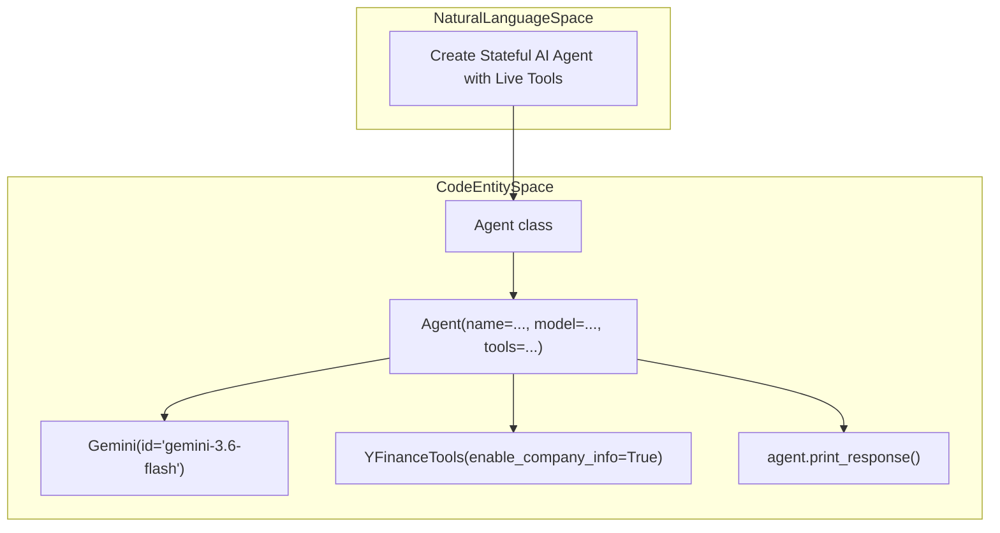
Sources: `[cookbook/00_quickstart/agent_with_tools.py:19-54]()`

### Component Breakdown

| Class/Parameter | Purpose |
|-----------------|---------|
| `Agent` | Core class for creating autonomous entities with models, tools, and memory `[cookbook/00_quickstart/agent_with_tools.py:26-45]()`. |
| `Gemini` | Implementation of the `Model` interface for Google's Gemini API `[cookbook/00_quickstart/agent_with_tools.py:28-28]()`. |
| `tools` | List of toolkits or functions (e.g., `YFinanceTools`) provided to the model `[cookbook/00_quickstart/agent_with_tools.py:36-42]()`. |
| `instructions` | Defines agent persona and behavior rules `[cookbook/00_quickstart/agent_with_tools.py:29-35]()`. |
| `print_response` | Helper to execute the agent and stream output to the console `[cookbook/00_quickstart/agent_with_tools.py:51-54]()`. |

Sources: `[cookbook/00_quickstart/agent_with_tools.py:19-54]()`, `[cookbook/00_quickstart/README.md:29-40]()`

---

## Serving with AgentOS

To move from a local script to a production service, use the `AgentOS` runtime. This provides a REST API, session persistence via `SqliteDb`, and UI connectivity.

```python
from agno.agent import Agent
from agno.models.google import Gemini
from agno.os import AgentOS
from agno.db.sqlite import SqliteDb

# Define the agent with Gemini model
agent = Agent(name="Market Researcher", model=Gemini(id="gemini-3.6-flash"))

# Create the AgentOS runtime, register the agent, and set up the SQLite database
agent_os = AgentOS(
    agents=[agent], 
    db=SqliteDb(db_file="tmp/quickstart/agent_os.db"),
    tracing=True
)

# Obtain the FastAPI ASGI application
app = agent_os.get_app()
```

Run the server with FastAPI CLI:

```bash
export GOOGLE_API_KEY=your-key
fastapi dev run.py --port 7777
```

Sources: `[cookbook/01_demo/run.py:60-75]()`, `[cookbook/00_quickstart/README.md:118-122]()`

---

## Natural Language Space to Code Entity Space: AgentOS Runtime

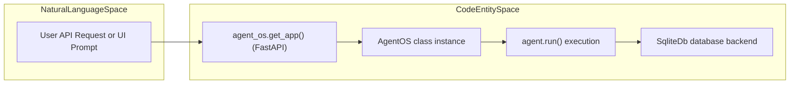
Sources: `[cookbook/01_demo/run.py:25-75]()`

---

## Execution Flow: From HTTP Request to Agent Response

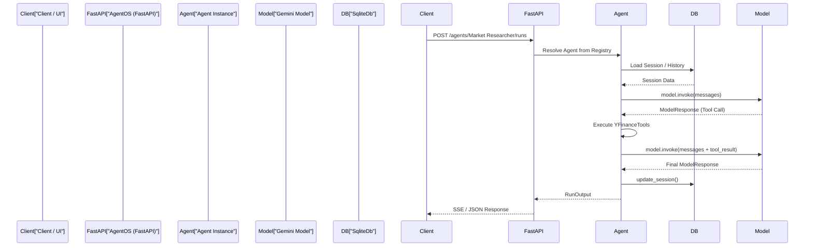
Sources: `[cookbook/01_demo/run.py:60-71]()`, `[cookbook/00_quickstart/README.md:118-127]()`

---

## Connecting to the AgentOS UI

The AgentOS Control Plane UI at [os.agno.com](https://os.agno.com) serves as the dashboard for managing instances, viewing run traces, and inspecting stored memories.

1. Open [os.agno.com](https://os.agno.com).
2. Click **"Add OS"** and choose **"Local"**.
3. Enter your running server endpoint (e.g., `http://localhost:7777`).
4. Select your agent and begin interacting.

Sources: `[cookbook/00_quickstart/README.md:124-127]()`, `[cookbook/01_demo/README.md:49-58]()`

---

## The Capability Ladder

Agno is organized as a progressive capability ladder:

| Feature | Cookbook Example | Description |
|---------|------------------|-------------|
| **Tools** | `agent_with_tools.py` | Enable live data interaction with toolkit integration `[cookbook/00_quickstart/agent_with_tools.py]()`. |
| **Structured Output** | `agent_with_structured_output.py` | Return validated typed objects for robust parsing `[cookbook/00_quickstart/agent_with_structured_output.py]()`. |
| **Storage** | `agent_with_storage.py` | Persist conversation history to SQLite `[cookbook/00_quickstart/agent_with_storage.py]()`. |
| **Memory** | `agent_with_memory.py` | Long-term user-specific memory `[cookbook/00_quickstart/agent_with_memory.py]()`. |
| **Knowledge** | `agent_search_over_knowledge.py` | Retrieval-augmented generation grounded in documents `[cookbook/00_quickstart/agent_search_over_knowledge.py]()`. |
| **Learning** | `agent_with_learning.py` | Cross-user shared learning stores `[cookbook/00_quickstart/agent_with_learning.py]()`. |
| **Human-in-the-Loop** | `human_in_the_loop.py` | Pausing runs for sensitive actions `[cookbook/00_quickstart/human_in_the_loop.py]()`. |
| **Teams** | `multi_agent_team.py` | Multi-agent coordination `[cookbook/00_quickstart/multi_agent_team.py]()`. |
| **Workflows** | `sequential_workflow.py` | Explicit multi-step orchestration `[cookbook/00_quickstart/sequential_workflow.py]()`. |

Sources: `[cookbook/00_quickstart/README.md:51-87]()`, `[cookbook/00_quickstart/TEST_LOG.md:21-160]()`

---

# Page: Architecture Overview

# Architecture Overview

<details>
<summary>Relevant source files</summary>

The following files were used as context for generating this wiki page:

- [cookbook/05_agent_os/14_mcp/README.md](cookbook/05_agent_os/14_mcp/README.md)
- [cookbook/05_agent_os/14_mcp/TEST_LOG.md](cookbook/05_agent_os/14_mcp/TEST_LOG.md)
- [cookbook/05_agent_os/14_mcp/inspect_tools.py](cookbook/05_agent_os/14_mcp/inspect_tools.py)
- [libs/agno/agno/agent/agent.py](libs/agno/agno/agent/agent.py)
- [libs/agno/agno/models/base.py](libs/agno/agno/models/base.py)
- [libs/agno/agno/models/message.py](libs/agno/agno/models/message.py)
- [libs/agno/agno/models/response.py](libs/agno/agno/models/response.py)
- [libs/agno/agno/os/app.py](libs/agno/agno/os/app.py)
- [libs/agno/agno/os/config.py](libs/agno/agno/os/config.py)
- [libs/agno/agno/os/mcp.py](libs/agno/agno/os/mcp.py)
- [libs/agno/agno/os/middleware/mcp_routing.py](libs/agno/agno/os/middleware/mcp_routing.py)
- [libs/agno/agno/os/public/_policy.py](libs/agno/agno/os/public/_policy.py)
- [libs/agno/agno/os/router.py](libs/agno/agno/os/router.py)
- [libs/agno/agno/os/schema.py](libs/agno/agno/os/schema.py)
- [libs/agno/agno/run/agent.py](libs/agno/agno/run/agent.py)
- [libs/agno/agno/run/base.py](libs/agno/agno/run/base.py)
- [libs/agno/agno/run/team.py](libs/agno/agno/run/team.py)
- [libs/agno/agno/team/team.py](libs/agno/agno/team/team.py)
- [libs/agno/agno/tools/function.py](libs/agno/agno/tools/function.py)
- [libs/agno/agno/utils/events.py](libs/agno/agno/utils/events.py)
- [libs/agno/pyproject.toml](libs/agno/pyproject.toml)
- [libs/agno/tests/integration/agent/test_event_streaming.py](libs/agno/tests/integration/agent/test_event_streaming.py)
- [libs/agno/tests/integration/teams/test_event_streaming.py](libs/agno/tests/integration/teams/test_event_streaming.py)
- [libs/agno/tests/unit/agent/test_paused_user_input_persistence.py](libs/agno/tests/unit/agent/test_paused_user_input_persistence.py)
- [libs/agno/tests/unit/os/test_info_endpoint.py](libs/agno/tests/unit/os/test_info_endpoint.py)
- [libs/agno/tests/unit/os/test_mcp_routing.py](libs/agno/tests/unit/os/test_mcp_routing.py)
- [libs/agno/tests/unit/os/test_mcp_server.py](libs/agno/tests/unit/os/test_mcp_server.py)
- [libs/agno/tests/unit/run/test_run_events.py](libs/agno/tests/unit/run/test_run_events.py)
- [libs/agno/tests/unit/run/test_run_input.py](libs/agno/tests/unit/run/test_run_input.py)
- [libs/agno/tests/unit/tools/test_functions.py](libs/agno/tests/unit/tools/test_functions.py)

</details>


This document details the three-layer architecture of Agno, explaining its stateless runtime design, session-scoped execution, and user-owned storage model.

---

## Three-Layer Architecture

Agno is organized into three distinct layers, providing a separation between core logic, production serving, and management.

**Layer 3: Control Plane (AgentOS UI)**  
The management and observability layer. It provides a web interface at `os.agno.com` for monitoring agents, teams, and workflows, viewing session history, and evaluating runs [README.md:21-25](). It connects to running `AgentOS` instances to provide a unified dashboard for tracing and observability [libs/agno/agno/os/app.py:70-71]().

**Layer 2: Runtime (AgentOS)**  
The production serving layer. Implemented as the `AgentOS` class, it wraps framework components in a production-ready FastAPI application [libs/agno/agno/os/app.py:9-20, 77](). It handles REST/WebSocket routing, authentication, database auto-discovery, and lifecycle management for connections like MCP servers [libs/agno/agno/os/app.py:50-71, 100-110]().

**Layer 1: Framework (SDK)**  
The development layer. It provides the core building blocks: `Agent`, `Team`, `Workflow`, `Model`, and `Tool` [README.md:17-23](). These components define the logic, tools, memory, and knowledge of the AI system [libs/agno/agno/agent/agent.py:74-85](), [libs/agno/agno/team/team.py:81-99](), [libs/agno/agno/os/app.py:91]().

### Component Hierarchy and Data Flow

Title: Component Hierarchy and Data Flow across Agno Layers

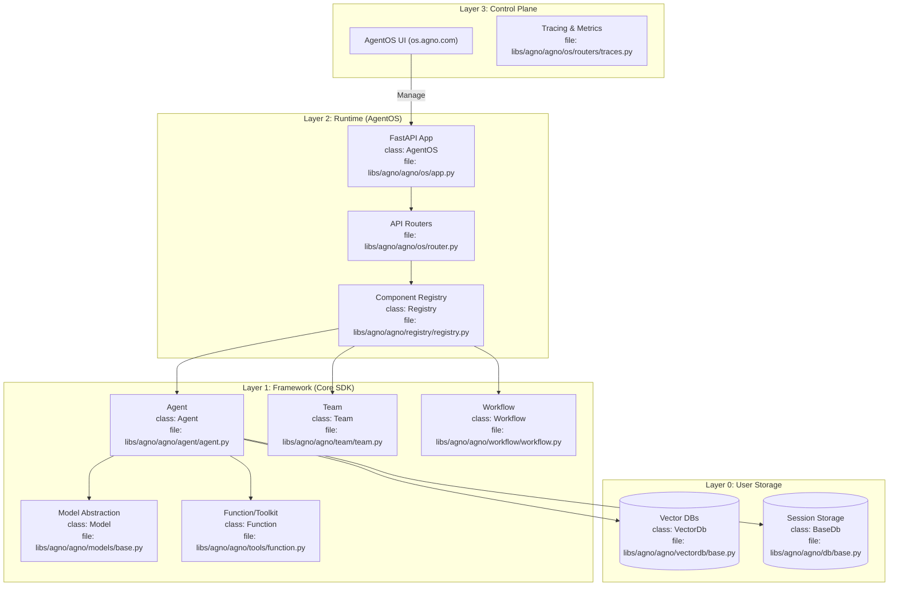

Sources: [README.md:17-25, 42-53](), [libs/agno/agno/os/app.py:19-20, 50-71](), [libs/agno/agno/os/schema.py:7-32](), [libs/agno/agno/agent/agent.py:74-85](), [libs/agno/agno/team/team.py:81-99]()

---

## Stateless Runtime Design

The `AgentOS` runtime is designed to be stateless and horizontally scalable [README.md:59](). It does not hold session data in memory between requests by default, allowing any instance in a cluster to handle any request for a given `session_id` [libs/agno/agno/os/app.py:137-167]().

This stateless design means:

- The runtime treats every incoming request independently.
- State is loaded from and persisted to user-owned databases.
- In-flight and background persistence tasks are flushed on shutdown to prevent data loss [libs/agno/agno/os/app.py:137-167]().

### Request Lifecycle and State Loading

When a request arrives at an `AgentOS` instance:

1. **Registry Resolution**: The runtime identifies the component (`Agent`, `Team`, or `Workflow`) from the `Registry` using its unique ID [libs/agno/agno/os/app.py:65, 86]().

2. **Lifecycle Management**: `AgentOS` manages the lifespan of databases and external connections (like MCP) via async context managers [libs/agno/agno/os/app.py:100-121]().

3. **State Hydration**: If a `session_id` is provided, the framework component loads its history and `session_state` from the user's database [libs/agno/agno/os/utils.py:148-156]().

4. **Execution**: The component processes the input. For `Agent`, this involves model invocation and tool calling [libs/agno/agno/agent/agent.py:77, 128]().

5. **Persistence**: After execution, updated messages, metrics, and state are persisted back to the session database [libs/agno/agno/os/app.py:137-167]().

Title: Stateless Horizontal Scaling with Shared Session DB

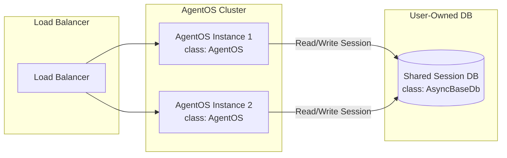

Sources: [README.md:45, 59](), [libs/agno/agno/os/app.py:100-121, 137-167](), [libs/agno/agno/os/utils.py:142-168](), [libs/agno/agno/agent/agent.py:136]()

---

## Session-Scoped Execution

Each interaction with an `Agent`, `Team`, or `Workflow` is scoped to a session. The session captures conversation state, enabling persistent memory and context continuity between runs.

### Session State and History

- **`session_id`**: A unique identifier (typically a UUID) that scopes conversation state and history [libs/agno/agno/agent/agent.py:93](), [libs/agno/agno/os/utils.py:90]().

- **`session_state`**: An arbitrary dictionary persisted in the user's database to carry transient or custom state across runs [libs/agno/agno/agent/agent.py:95](), [libs/agno/agno/os/utils.py:148-155]().

- **History Management**: The system tracks previous interactions to craft context for subsequent runs. The `num_history_runs` parameter controls how much history is included in the context [libs/agno/agno/agent/agent.py:150]().

### Run Output and Events

Each execution produces structured outputs and may stream intermediate events for observability and interactive control.

- **`RunOutput`**: Represents the final result of a run including responses, status, and metadata [libs/agno/agno/run/agent.py:60](), [libs/agno/agno/models/base.py:45]().

- **`RunEvent`**: Streams detailed events during execution, such as model requests, tool calls, and run lifecycle events [libs/agno/agno/run/agent.py:59]().

- **Streaming Support**: The runtime supports Server-Sent Events (SSE) and WebSockets to enable clients to observe progress in real time [libs/agno/agno/os/app.py:51]().

Sources: [libs/agno/agno/os/schema.py:26](), [libs/agno/agno/os/utils.py:142-168](), [libs/agno/agno/run/agent.py:59-60](), [libs/agno/agno/agent/agent.py:93-95, 150]()

---

## User-Owned Storage Model

Agno adopts a "bring your own database" philosophy: user data such as sessions, memories, knowledge, and traces are stored in user-controlled infrastructure. This ensures data privacy and operational control [README.md:23, 51]().

### Key Storage Interfaces

- **`BaseDb` / `AsyncBaseDb`**: Abstract classes defining the interface for session, run, memory, and trace persistence [libs/agno/agno/db/base.py:36](), [libs/agno/agno/agent/agent.py:136]().

- **`Knowledge`**: Encapsulates the knowledge base with RAG (retrieval-augmented generation) capabilities, vector database integration, and content management [libs/agno/agno/knowledge/knowledge.py:24]().

- **AgentOS Database Auto-Discovery**: `AgentOS` scans and validates databases configured on startup, linking them with agents and sessions to ensure data consistency [libs/agno/agno/os/app.py:26-47]().

### Storage Data Flow Example

Title: Storage Database Initialization and Binding

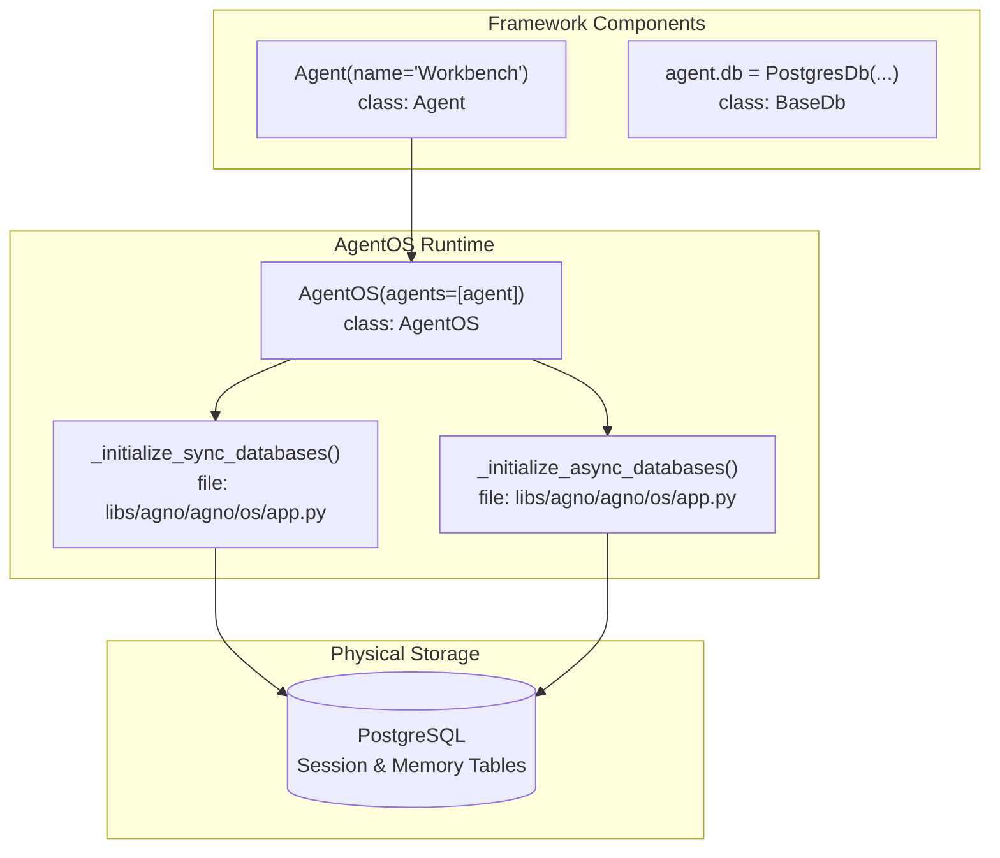

Sources: [README.md:23, 51](), [libs/agno/agno/db/base.py:36](), [libs/agno/agno/os/app.py:26-47, 137-167](), [libs/agno/agno/agent/agent.py:136]()

---

## Request Processing and Security

### Authentication and Authorization

The `AgentOS` runtime offers built-in robust security mechanisms:

- **JWT-based RBAC**: Access control is enforced using JWT tokens and security keys to provide multi-tenant isolation and permissions [README.md:23, 56](), [libs/agno/agno/os/app.py:28]().

- **Authorization Configuration**: The `AuthorizationConfig` enables configuring scopes and rules governing access to agents, sessions, and resources [libs/agno/agno/os/app.py:28]().

### Human-in-the-Loop (HITL) Support

Agno supports workflows and tools requiring manual user intervention:

- The `requires_confirmation` flag on tools enables runs to pause and wait for explicit user approval before continuing execution [libs/agno/agno/tools/function.py:33](), [libs/agno/agno/agent/agent.py:144]().

- A dedicated approvals router manages paused runs, confirmation workflows, and resumes after approval, all integrated into AgentOS REST endpoints [libs/agno/agno/os/app.py:53]().

Sources: [README.md:23, 56](), [libs/agno/agno/os/app.py:28, 53](), [libs/agno/agno/tools/function.py:33](), [libs/agno/agno/agent/agent.py:144]()

---

This architecture supports scalable, manageable, and secure deployment of AI agent platforms, enabling developers to build complex AI workflows with full control over data and execution.

---

# Page: Key Concepts and Terminology

# Key Concepts and Terminology

<details>
<summary>Relevant source files</summary>

The following files were used as context for generating this wiki page:

- [libs/agno/agno/agent/agent.py](libs/agno/agno/agent/agent.py)
- [libs/agno/agno/models/base.py](libs/agno/agno/models/base.py)
- [libs/agno/agno/models/message.py](libs/agno/agno/models/message.py)
- [libs/agno/agno/models/response.py](libs/agno/agno/models/response.py)
- [libs/agno/agno/run/agent.py](libs/agno/agno/run/agent.py)
- [libs/agno/agno/run/base.py](libs/agno/agno/run/base.py)
- [libs/agno/agno/run/team.py](libs/agno/agno/run/team.py)
- [libs/agno/agno/team/team.py](libs/agno/agno/team/team.py)
- [libs/agno/agno/tools/function.py](libs/agno/agno/tools/function.py)
- [libs/agno/agno/utils/events.py](libs/agno/agno/utils/events.py)
- [libs/agno/pyproject.toml](libs/agno/pyproject.toml)
- [libs/agno/tests/integration/agent/test_event_streaming.py](libs/agno/tests/integration/agent/test_event_streaming.py)
- [libs/agno/tests/integration/teams/test_event_streaming.py](libs/agno/tests/integration/teams/test_event_streaming.py)
- [libs/agno/tests/unit/agent/test_paused_user_input_persistence.py](libs/agno/tests/unit/agent/test_paused_user_input_persistence.py)
- [libs/agno/tests/unit/run/test_run_events.py](libs/agno/tests/unit/run/test_run_events.py)
- [libs/agno/tests/unit/run/test_run_input.py](libs/agno/tests/unit/run/test_run_input.py)
- [libs/agno/tests/unit/tools/test_functions.py](libs/agno/tests/unit/tools/test_functions.py)

</details>


## Purpose and Scope

This document defines the core abstractions and terminology used throughout the Agno framework. It serves as a comprehensive technical reference for understanding the fundamental building blocks that compose the system, from atomic execution units (`Agent`) to production deployment runtime (`AgentOS`).

For detailed implementation of specific components refer to their dedicated pages:  
- Agent system and lifecycle → [2.1 Agent System]()  
- Team orchestration → [2.2 Team Orchestration]()  
- Workflow engine → [2.3 Workflow System]()  
- Session persistence → [2.7 Session Management]()  
- Memory and learning → [2.8 Memory and Learning Systems]()  
- Knowledge management and RAG → [5.1 Knowledge Base and Agentic RAG]()  
- Tool definitions and execution → [4.1 Tool Architecture and Function Class]()  
- Production runtime → [7.1 AgentOS Architecture and Initialization]()

---

## Core Execution Units

Agno structures agentic software with three hierarchical execution units: **Agent**, **Team**, and **Workflow**, each building on top of the previous for increasing coordination complexity.

### Diagram: Core Execution Units and Code Mapping (Natural Language to Code Entity Space)

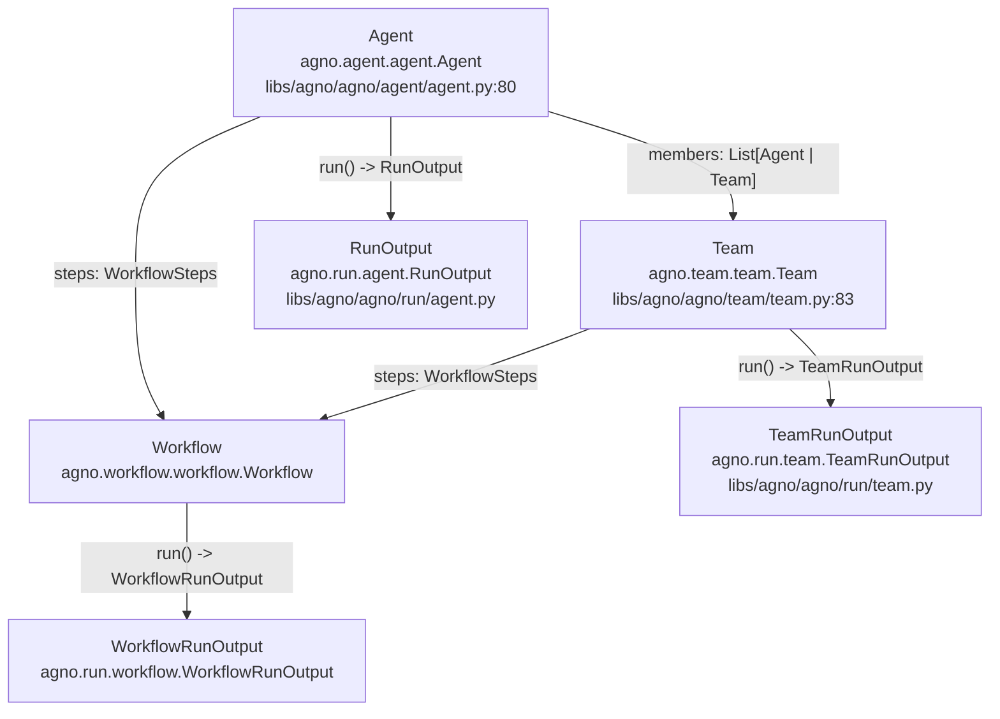

Sources: [libs/agno/agno/agent/agent.py:80](), [libs/agno/agno/team/team.py:83](), [libs/agno/agno/run/agent.py:1]()

---

### Agent

- **Class:** `agno.agent.agent.Agent`  
- **File:** [libs/agno/agno/agent/agent.py:80]()  

**Description:**  
The atomic execution unit in Agno. An `Agent` wraps a large language model (`Model`) instance, augmented by tools, memory, knowledge bases, guardrails, session management, and lifecycle hooks. It exposes synchronous and asynchronous run methods (`run()`, `arun()`) that accept raw user inputs, orchestrate multi-turn reasoning and tool execution loops, and return structured outputs.

**Key Attributes and Their Roles:**

| Attribute                     | Type                                   | Default   | Purpose                                                       |
|-------------------------------|--------------------------------------|-----------|---------------------------------------------------------------|
| `model`                       | `Optional[Model]`                     | `None`    | The primary LLM model the agent uses for inference.           |
| `name`                        | `Optional[str]`                      | `None`    | Human-readable name of the agent instance.                    |
| `id`                          | `Optional[str]`                      | `None`    | UUID for the agent (auto-generated if not set).               |
| `tools`                       | `Optional[List[Union[Toolkit, Callable, Dict, Function]]]` | `None` | Callable toolkits or functions integrated into this agent.    |
| `memory_manager`              | `Optional[MemoryManager]`             | `None`    | Component responsible for storing and retrieving memories.     |
| `knowledge`                  | `Optional[KnowledgeProtocol]`          | `None`    | Interface to knowledge base for retrieval-augmented generation (RAG). |
| `db`                         | `Optional[Union[BaseDb, AsyncBaseDb]]` | `None`   | Persistence backend for sessions, runs, memories, etc.         |
| `session_id`                 | `Optional[str]`                      | `None`    | Default session context for stateless run isolation.           |
| `session_state`              | `Optional[Dict[str, Any]]`            | `None`    | Mutable state dictionary associated with the session.          |
| `user_id`                    | `Optional[str]`                      | `None`    | User scoping identifier.                                        |
| `add_history_to_context`     | `bool`                              | `False`   | Whether to inject historical conversation content into context. |
| `num_history_runs`           | `Optional[int]`                     | `None`    | Number of past runs' contents to include in context.           |

Agents encapsulate prompt construction, tool calls, memory lookups, knowledge retrieval, run checkpointing, and result aggregation.

Sources: [libs/agno/agno/agent/agent.py:80-179]()

---

### Team

- **Class:** `agno.team.team.Team`  
- **File:** [libs/agno/agno/team/team.py:83]()  

**Description:**  
A `Team` is a multi-agent orchestration unit consisting of multiple member `Agent` or nested `Team` instances, coordinated by a leader model (`model`). Teams coordinate task delegation among members, combine their outputs according to different execution modes (`TeamMode`), and maintain session and context state. This enables complex distributed agent workflows mimicking organizational structures.

**Key Attributes:**

| Attribute                 | Type                                   | Default | Purpose                                                           |
|---------------------------|--------------------------------------|---------|-------------------------------------------------------------------|
| `members`                | `Union[List[Union[Agent, Team]], Callable]` | Required | Member agents or subteams forming this Team.                     |
| `model`                  | `Optional[Model]`                     | `None`    | The leader model to coordinate and delegate tasks.                |
| `mode`                   | `Optional[TeamMode]`                  | `None`    | Mode controlling delegation strategy and response synthesis.     |
| `delegate_to_all_members` | `bool`                              | `False`   | Whether to run all members concurrently without leader filtering. |
| `respond_directly`       | `bool`                              | `False`   | Return raw member outputs directly, skipping leader synthesis.    |
| `share_member_interactions` | `bool`                            | `False`   | Share member responses during task execution with other members.  |
| `add_team_history_to_members` | `bool`                         | `False`   | Include team history context when invoking member agents.         |

Teams run asynchronously or synchronously and return a consolidated result including member outputs and run events.

Sources: [libs/agno/agno/team/team.py:83-150]()

---

### Workflow

- **Class:** `agno.workflow.workflow.Workflow`  

**Description:**  
A `Workflow` orchestrates complex multi-step processes by chaining together sequences of steps. Steps can be `Agent` instances, `Team` instances, or custom Python callables/containers (`Step`, `Steps`, `Parallel`, `Loop`, `Condition`, `Router`). Workflows manage dependencies, branching, loops, human-in-the-loop patterns, and control flows using metadata and session context injection.

Sources: [libs/agno/agno/agent/agent.py:64]()

---

## Execution Results and Events

All execution units produce structured output classes capturing state, content, logs, metrics, and events.

### Diagram: Run Output and Event Hierarchy (Code Structure)

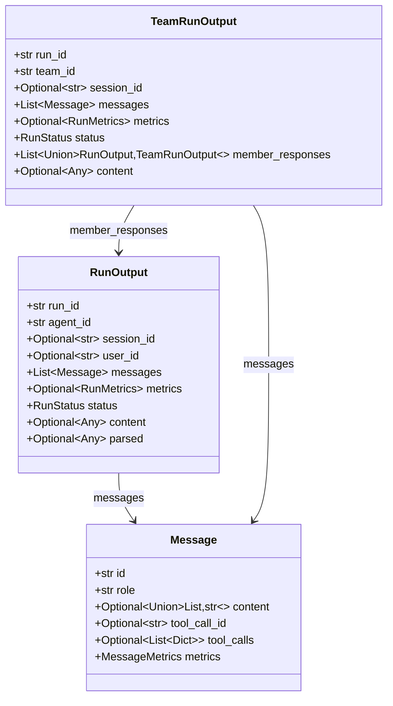

Sources: [libs/agno/agno/run/agent.py:40](), [libs/agno/agno/run/team.py:28](), [libs/agno/agno/models/message.py:56]()

---

### RunOutput

- **Class:** `agno.run.agent.RunOutput`  
- **File:** [libs/agno/agno/run/agent.py:1]()  

**Description:**  
The primary output container returned from an `Agent.run()` or `Agent.arun()` call. Contains conversation `messages`, execution `metrics`, run `status`, and optional structured content and parsed representations.

### TeamRunOutput

- **Class:** `agno.run.team.TeamRunOutput`  
- **File:** [libs/agno/agno/run/team.py:28]()  

**Description:**  
Output from a `Team.run()` invocation which aggregates member runs (`member_responses`) as well as team-level messages, status, and metrics.

### Message

- **Class:** `agno.models.message.Message`  
- **File:** [libs/agno/agno/models/message.py:56]()  

**Description:**  
Represents a single chat message or tool call result within run outputs. Supports multimodal content such as images (`Image`), audio (`Audio`), video (`Video`), and files (`File`), and includes cognitive fields like reasoning content and citations (`Citations`).

Sources: [libs/agno/agno/models/message.py:56-118]()

---

## Tools, Capabilities and Protocols

### Function & ToolExecution

- **Class:** `agno.tools.function.Function`  
- **File:** [libs/agno/agno/tools/function.py:1]()  
- **Class:** `agno.models.response.ToolExecution`  
- **File:** [libs/agno/agno/models/response.py:27]()  

**Description:**  
`Function` defines the schema and Python entrypoint for callable tools. `ToolExecution` captures the runtime execution state of a tool invocation, including arguments, results, errors, and Human-in-the-Loop (HITL) fields (`requires_confirmation`, `requires_user_input`, `approval_id`).

### Guardrails

- **Class:** `agno.guardrails.BaseGuardrail`  
- **File:** [libs/agno/agno/agent/agent.py:42]()  

**Description:**  
Provides mechanisms to enforce safety policies, constraints, and validation guardrails on inputs and outputs during agent execution.

### MCP (Model Context Protocol)

- **Module:** `agno.mcp`  
- **File:** [libs/agno/pyproject.toml:82]()  

**Description:**  
A standardized protocol that enables Agno agents to expose and utilize external tool sets via transports such as stdio, SSE, or HTTP streams, bridging external capabilities into agent conversations.

Sources: [libs/agno/agno/tools/function.py:1](), [libs/agno/agno/models/response.py:27](), [libs/agno/agno/agent/agent.py:42](), [libs/agno/pyproject.toml:82]()

---

## Production Runtime and Models

### AgentOS

**Description:**  
`AgentOS` is the production runtime and orchestration service for Agno agents, teams, and workflows. It exposes FastAPI-backed REST and WebSocket endpoints, handles authentication, database discovery, event streaming, scheduling, and registry lookups.

### Model (Base)

- **Class:** `agno.models.base.Model`  
- **File:** [libs/agno/agno/models/base.py:134]()  

**Description:**  
Abstract base class defining the provider-agnostic LLM interface for invocation, streaming, token counting, error retries, and structured outputs across 40+ providers.

Sources: [libs/agno/agno/models/base.py:134-184](), [libs/agno/pyproject.toml:81]()

---

## Learning, Memory, Knowledge and Context

### LearningMachine

- **Class:** `agno.learn.machine.LearningMachine`  
- **File:** [libs/agno/agno/agent/agent.py:49]()  

**Description:**  
Coordinates the learning subsystem by managing user profile stores, session contexts, entity memories, and decision logs, enabling agents to learn from every interaction and adapt over time.

### ContextProvider

- **Module:** `agno.context`  

**Description:**  
Provides a uniform API to plug external data sources (e.g., filesystems, Slack, Google Drive, wikis, database stores) into agents as natural-language accessible tools and context injections.

### Memory & Knowledge

- **Class:** `agno.memory.MemoryManager` / `UserMemory`  
- **File:** [libs/agno/agno/agent/agent.py:54](), [libs/agno/agno/db/base.py:39]()  
- **Class:** `agno.knowledge.protocol.KnowledgeProtocol`  
- **File:** [libs/agno/agno/agent/agent.py:43]()  

**Description:**  
`MemoryManager` handles retrieval and storage of past interactions and user memories. `Knowledge` defines the interface to external knowledge bases used for retrieval-augmented generation (RAG) and grounded responses.

Sources: [libs/agno/agno/agent/agent.py:39-54](), [libs/agno/agno/db/base.py:39]()

---

# Relationships and Data Flow Overview

### Diagram: System Component Integration and Code Space Mapping

```mermaid
graph LR
    subgraph NaturalLanguageSpace["Natural Language Space"]
        UserInput["User Input"]
        ModelResponse["Model Response"]
        ToolCall["Tool Calls / Functions"]
    end
    
    subgraph CodeEntitySpace["Agno Code Entity Space"]
        AgentInstance["Agent<br/>agno.agent.agent.Agent"]
        TeamInstance["Team<br/>agno.team.team.Team"]
        WorkflowInstance["Workflow<br/>agno.workflow.workflow.Workflow"]
        RunOutputInstance["RunOutput<br/>agno.run.agent.RunOutput"]
        SessionStore["Session Storage<br/>agno.db.base.BaseDb"]
        MemoryMgr["MemoryManager<br/>agno.memory.MemoryManager"]
        KnowledgeBase["Knowledge<br/>agno.knowledge.protocol.KnowledgeProtocol"]
        LearningSys["LearningMachine<br/>agno.learn.machine.LearningMachine"]
        ContextSys["ContextProvider<br/>agno.context"]
    end
    
    UserInput --> AgentInstance
    UserInput --> TeamInstance
    UserInput --> WorkflowInstance

    AgentInstance -->|run() / arun()| RunOutputInstance
    TeamInstance -->|run() / arun()| RunOutputInstance
    WorkflowInstance -->|run() / arun()| RunOutputInstance

    AgentInstance --> MemoryMgr
    TeamInstance --> MemoryMgr

    AgentInstance --> KnowledgeBase
    TeamInstance --> KnowledgeBase

    AgentInstance --> LearningSys
    TeamInstance --> LearningSys

    AgentInstance --> ContextSys
    TeamInstance --> ContextSys

    RunOutputInstance -->|persist| SessionStore
    SessionStore --> AgentInstance
    SessionStore --> TeamInstance
    
    ToolCall -->|tools invoke| AgentInstance
    ToolCall -->|tools invoke| TeamInstance

    AgentInstance --> ModelResponse
    TeamInstance --> ModelResponse
```

Sources: [libs/agno/agno/agent/agent.py:80-179](), [libs/agno/agno/team/team.py:83-177](), [libs/agno/agno/run/agent.py:40-142](), [libs/agno/agno/run/team.py:28-128]()

---

# Summary of Core Terms and Their Relationships

| Term             | Definition & Code Entity                                                                   | Relationship / Usage                                        |
|------------------|--------------------------------------------------------------------------------------------|------------------------------------------------------------|
| **Agent**        | Basic execution unit (`agno.agent.agent.Agent`) wrapping LLM, tools, memory, knowledge      | Executes requests, returns `RunOutput`                      |
| **Team**         | Multi-agent orchestration (`agno.team.team.Team`) coordinating member agents               | Runs member agents, returns `TeamRunOutput`                 |
| **Workflow**     | Multi-step process orchestration (`agno.workflow.workflow.Workflow`)                       | Controls execution graphs, steps, and HITL patterns         |
| **AgentOS**      | Production runtime & API server (`agno.os` / FastAPI)                                      | Hosts and scales agent deployments                          |
| **RunOutput**    | Agent execution result container (`agno.run.agent.RunOutput`)                              | Returned by `Agent.run()`                                   |
| **TeamRunOutput**| Team execution result container (`agno.run.team.TeamRunOutput`)                            | Returned by `Team.run()`                                    |
| **Session**      | Persistent context storage (`agno.session`) scoped by user/session ID                      | Persists state and history across runs                      |
| **Memory**       | Interaction storage (`agno.memory.MemoryManager`, `UserMemory`)                            | Retains user profile and past dialog context                |
| **Knowledge**    | Retrieval interface (`agno.knowledge.protocol.KnowledgeProtocol`)                          | Implements RAG and grounding                                |
| **Tools**        | Callable functions (`agno.tools.function.Function`) and toolkits                           | Extended capabilities producing `ToolExecution`             |
| **Guardrails**   | Safety policy enforcement (`agno.guardrails.BaseGuardrail`)                                | Validates inputs and outputs                                |
| **MCP**          | Model Context Protocol (`agno.mcp`) integration                                            | Out-of-process tool transport protocol                      |
| **LearningMachine**| Autonomous learning subsystem (`agno.learn.machine.LearningMachine`)                     | Coordinates feedback and profile adaptation                 |
| **ContextProvider**| External data source integration (`agno.context`)                                        | Dynamically injects live context and toolsets               |

Sources: [libs/agno/agno/agent/agent.py](), [libs/agno/agno/team/team.py](), [libs/agno/agno/run/agent.py]()

# End of Document

---

# Page: Core Framework

# Core Framework

<details>
<summary>Relevant source files</summary>

The following files were used as context for generating this wiki page:

- [libs/agno/agno/agent/agent.py](libs/agno/agno/agent/agent.py)
- [libs/agno/agno/models/base.py](libs/agno/agno/models/base.py)
- [libs/agno/agno/models/message.py](libs/agno/agno/models/message.py)
- [libs/agno/agno/models/response.py](libs/agno/agno/models/response.py)
- [libs/agno/agno/run/agent.py](libs/agno/agno/run/agent.py)
- [libs/agno/agno/run/base.py](libs/agno/agno/run/base.py)
- [libs/agno/agno/run/team.py](libs/agno/agno/run/team.py)
- [libs/agno/agno/team/team.py](libs/agno/agno/team/team.py)
- [libs/agno/agno/tools/function.py](libs/agno/agno/tools/function.py)
- [libs/agno/agno/utils/events.py](libs/agno/agno/utils/events.py)
- [libs/agno/pyproject.toml](libs/agno/pyproject.toml)
- [libs/agno/tests/integration/agent/test_event_streaming.py](libs/agno/tests/integration/agent/test_event_streaming.py)
- [libs/agno/tests/integration/teams/test_event_streaming.py](libs/agno/tests/integration/teams/test_event_streaming.py)
- [libs/agno/tests/unit/agent/test_paused_user_input_persistence.py](libs/agno/tests/unit/agent/test_paused_user_input_persistence.py)
- [libs/agno/tests/unit/run/test_run_events.py](libs/agno/tests/unit/run/test_run_events.py)
- [libs/agno/tests/unit/run/test_run_input.py](libs/agno/tests/unit/run/test_run_input.py)
- [libs/agno/tests/unit/tools/test_functions.py](libs/agno/tests/unit/tools/test_functions.py)

</details>


## Purpose and Scope

The Core Framework is the foundational layer of the Agno SDK designed to provide composable building blocks and execution models that facilitate the construction of sophisticated AI systems. It offers core abstractions—Agents, Teams, and Workflows—that combine language models, tools, memory, and knowledge within a shared infrastructure. This infrastructure manages session state, message flows, event streaming, and persistent execution context, enabling reliable and observable AI agent orchestration at scale.

This page introduces the Core Framework overview at a high level. Each major component and concept has a dedicated child page covering detailed design, configuration, and usage:

- [Agent System](#2.1)
- [Team Orchestration](#2.2)
- [Workflow System](#2.3)
- [Run Output and Events](#2.4)
- [Message and Media Handling](#2.5)
- [Event Streaming System](#2.6)
- [Session Management](#2.7)
- [Memory and Learning Systems](#2.8)
- [Result Offloading and FileSystem](#2.9)
- [Reasoning and Skills](#2.10)
- [Sandboxed Execution](#2.11)

For runtime concerns, model provider integration, tooling, and knowledge management, see their respective sections in the wider documentation.

---

## Execution Primitives Overview

The Core Framework’s execution model centers on three main composable primitives and their backing code entities:

Title: Core Framework Execution Architecture
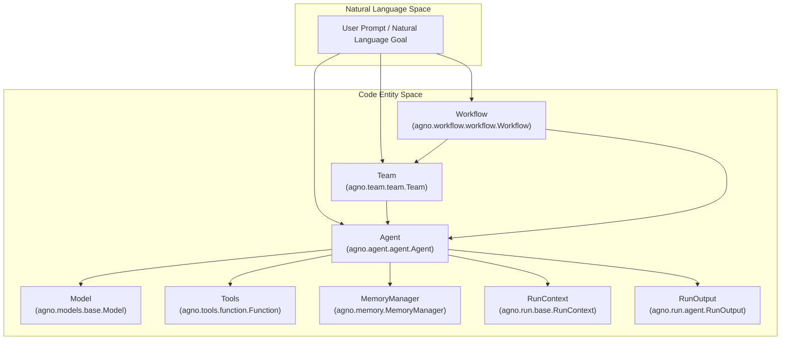

- **`Agent`**: Encapsulates a single AI agent instance with a model, tools, memory, and optional knowledge bases [libs/agno/agno/agent/agent.py:80-160]().
- **`Team`**: Orchestrates a collection of Agents or nested Teams, coordinating execution via configurable modes [libs/agno/agno/team/team.py:82-150]().
- **`Workflow`**: Manages multi-step orchestrations, combining Agents, Teams, and Callables in sequences, parallel tasks, conditionals, loops, or routers.

All primitives share a common core infrastructure centered around `RunContext` which manages run metadata, state, and cancellation [libs/agno/agno/run/base.py:17-50](). They use session-based persistence to maintain and mutate `session_state` for long-lived interactions.

Sources: [libs/agno/agno/agent/agent.py:80-160](), [libs/agno/agno/team/team.py:82-150](), [libs/agno/agno/run/base.py:17-50]()

---

## Agent System (#2.1)

The `Agent` class ([libs/agno/agno/agent/agent.py:80-160]()) is the atomic unit of execution in Agno, combining prompt instructions, tool definitions, retrieval knowledge, and memory management. It supports synchronous and asynchronous run methods (`run()`, `arun()`), streaming responses, output schemas via Pydantic, fallback models (`fallback_models`, `fallback_config`), and advanced checkpointing controls (`checkpoint="tool-batch"`).

For detailed parameters, run lifecycle stages, tool execution, session caching, and cancellation flows, see [Agent System](#2.1).

Sources: [libs/agno/agno/agent/agent.py:80-160](), [libs/agno/agno/models/base.py:133-184]()

---

## Team Orchestration (#2.2)

The `Team` class ([libs/agno/agno/team/team.py:82-150]()) coordinates groups of `Agent` or nested `Team` instances. It supports multiple coordination modes (`TeamMode`), dynamic task delegation, leader synthesis, member-level interaction sharing, and team-level output schemas.

For deeper coverage on coordination modes, member management, and shared context patterns, see [Team Orchestration](#2.2).

Sources: [libs/agno/agno/team/team.py:82-150]()

---

## Workflow System (#2.3)

The `Workflow` class enables structured multi-step business logic by orchestrating agents, teams, and arbitrary Python functions. It provides composition containers such as `Step`, `Steps`, `Parallel`, `Loop`, `Condition`, and `Router`.

It manages data passing via `RunContext`, session state propagation, and Human-in-the-Loop (HITL) workflows requiring confirmation (`requires_confirmation`) or user input (`requires_user_input`).

For details on step composition, execution semantics, and HITL patterns, see [Workflow System](#2.3).

Sources: [libs/agno/agno/run/workflow.py:1-50](), [libs/agno/agno/run/base.py:17-50]()

---

## Run Output and Events (#2.4)

Execution primitives produce structured output structures (`RunOutput`, `TeamRunOutput`, `WorkflowRunOutput`) that encapsulate final text, parsed Pydantic objects, token metrics, reasoning steps, and event streams. Intermediate events (`RunEvent`, `TeamRunEvent`) provide granular observability into tool calls, model requests, and reasoning loops.

For the full specification of output fields and event emission, see [Run Output and Events](#2.4).

Sources: [libs/agno/agno/run/agent.py:145-173](), [libs/agno/agno/run/team.py:131-150]()

---

## Message and Media Handling (#2.5)

The `Message` class ([libs/agno/agno/models/message.py:56-127]()) handles multimodal inputs and outputs across system, user, assistant, and tool roles. It natively manages attached media (`Image`, `Video`, `Audio`, `File`), citations, reasoning content, and provider-specific metadata.

For media format conversion and pipeline flow, see [Message and Media Handling](#2.5).

Sources: [libs/agno/agno/models/message.py:56-127]()

---

## Event Streaming System (#2.6)

Agno provides unified event streaming capabilities via `stream_events`, translating internal state transitions into Server-Sent Events (SSE). This supports real-time progress tracking, intermediate tool outputs, token streaming, and session resume/replay from persisted event logs.

For implementation details on SSE format and replay behavior, see [Event Streaming System](#2.6).

Sources: [libs/agno/agno/run/agent.py:145-173](), [libs/agno/agno/models/response.py:12-24]()

---

## Session Management (#2.7)

Sessions maintain state persistence across multiple interactions. `AgentSession`, `TeamSession`, and `WorkflowSession` encapsulate run histories, session metadata, and user-scoped data (`user_id`, `session_id`), backed by pluggable database backends via `BaseDb`.

For lifecycle management, summarization, and persistence details, see [Session Management](#2.7).

Sources: [libs/agno/agno/agent/agent.py:94-110](), [libs/agno/agno/db/base.py:35-36]()

---

## Memory and Learning Systems (#2.8)

Long-term memory management is handled through `UserMemory`, `MemoryManager`, and automated extraction/compaction strategies. These components extract key facts from interactions, persist them to storage, and recall relevant context into agent prompts dynamically.

For compaction strategies and storage persistence, see [Memory and Learning Systems](#2.8).

Sources: [libs/agno/agno/agent/agent.py:130-142]()

---

## Result Offloading and FileSystem (#2.9)

To handle large tool outputs and data persistence, Agno provides result offloading (`offload_tool_results`, `ResultStore`) and a database-backed agent `FileSystem` abstraction. These tools prevent context window saturation by offloading bulky tool payloads to durable stores.

For configuration and API specifications, see Result Offloading and FileSystem [#2.9].

Sources: [libs/agno/agno/agent/agent.py:147-152]()

---

## Reasoning and Skills (#2.10)

The framework supports advanced agent reasoning via `ReasoningTools`, provider-specific reasoning adapters under `agno/reasoning`, `ReasoningStep` tracking, and modular `Agent Skills` that extend agent capabilities dynamically at runtime.

For adapter configurations and reasoning manager mechanics, see [Reasoning and Skills](#2.10).

Sources: [libs/agno/agno/run/agent.py:13-13]()

---

## Sandboxed Execution (#2.11)

The `agno/sandbox` subsystem provides secure, isolated code execution environments featuring coordinators, execution harnesses, state checkpointing to Postgres/S3, and integration with Docker and AgentOS.

For sandbox architecture and cookbooks, see [Sandboxed Execution](#2.11).

Sources: [libs/agno/agno/agent/agent.py:60-62]()

---

# Page: Agent System

# Agent System

<details>
<summary>Relevant source files</summary>

The following files were used as context for generating this wiki page:

- [cookbook/02_agents/11_approvals/TEST_LOG.md](cookbook/02_agents/11_approvals/TEST_LOG.md)
- [cookbook/02_agents/11_approvals/approval_post_hook.py](cookbook/02_agents/11_approvals/approval_post_hook.py)
- [cookbook/07_knowledge/02_building_blocks/12_hyde_query_transformer.py](cookbook/07_knowledge/02_building_blocks/12_hyde_query_transformer.py)
- [cookbook/07_knowledge/02_building_blocks/13_hyde_with_hybrid_search.py](cookbook/07_knowledge/02_building_blocks/13_hyde_with_hybrid_search.py)
- [libs/agno/agno/agent/_default_tools.py](libs/agno/agno/agent/_default_tools.py)
- [libs/agno/agno/agent/_messages.py](libs/agno/agno/agent/_messages.py)
- [libs/agno/agno/agent/_run.py](libs/agno/agno/agent/_run.py)
- [libs/agno/agno/agent/_tools.py](libs/agno/agno/agent/_tools.py)
- [libs/agno/agno/agent/agent.py](libs/agno/agno/agent/agent.py)
- [libs/agno/agno/knowledge/query_transformer/__init__.py](libs/agno/agno/knowledge/query_transformer/__init__.py)
- [libs/agno/agno/knowledge/query_transformer/base.py](libs/agno/agno/knowledge/query_transformer/base.py)
- [libs/agno/agno/knowledge/query_transformer/hyde.py](libs/agno/agno/knowledge/query_transformer/hyde.py)
- [libs/agno/agno/models/base.py](libs/agno/agno/models/base.py)
- [libs/agno/agno/models/message.py](libs/agno/agno/models/message.py)
- [libs/agno/agno/models/response.py](libs/agno/agno/models/response.py)
- [libs/agno/agno/os/managers.py](libs/agno/agno/os/managers.py)
- [libs/agno/agno/run/agent.py](libs/agno/agno/run/agent.py)
- [libs/agno/agno/run/approval.py](libs/agno/agno/run/approval.py)
- [libs/agno/agno/run/base.py](libs/agno/agno/run/base.py)
- [libs/agno/agno/run/team.py](libs/agno/agno/run/team.py)
- [libs/agno/agno/team/_default_tools.py](libs/agno/agno/team/_default_tools.py)
- [libs/agno/agno/team/_init.py](libs/agno/agno/team/_init.py)
- [libs/agno/agno/team/_messages.py](libs/agno/agno/team/_messages.py)
- [libs/agno/agno/team/_run.py](libs/agno/agno/team/_run.py)
- [libs/agno/agno/team/_session.py](libs/agno/agno/team/_session.py)
- [libs/agno/agno/team/_task_tools.py](libs/agno/agno/team/_task_tools.py)
- [libs/agno/agno/team/_tools.py](libs/agno/agno/team/_tools.py)
- [libs/agno/agno/team/team.py](libs/agno/agno/team/team.py)
- [libs/agno/agno/tools/function.py](libs/agno/agno/tools/function.py)
- [libs/agno/agno/utils/events.py](libs/agno/agno/utils/events.py)
- [libs/agno/agno/utils/knowledge.py](libs/agno/agno/utils/knowledge.py)
- [libs/agno/pyproject.toml](libs/agno/pyproject.toml)
- [libs/agno/tests/integration/agent/human_in_the_loop/test_approval_multi_pause.py](libs/agno/tests/integration/agent/human_in_the_loop/test_approval_multi_pause.py)
- [libs/agno/tests/integration/agent/test_event_streaming.py](libs/agno/tests/integration/agent/test_event_streaming.py)
- [libs/agno/tests/integration/os/test_approval_multi_pause.py](libs/agno/tests/integration/os/test_approval_multi_pause.py)
- [libs/agno/tests/integration/teams/human_in_the_loop/test_team_approval_multi_pause.py](libs/agno/tests/integration/teams/human_in_the_loop/test_team_approval_multi_pause.py)
- [libs/agno/tests/integration/teams/test_event_streaming.py](libs/agno/tests/integration/teams/test_event_streaming.py)
- [libs/agno/tests/unit/agent/test_paused_user_input_persistence.py](libs/agno/tests/unit/agent/test_paused_user_input_persistence.py)
- [libs/agno/tests/unit/agent/test_run_regressions.py](libs/agno/tests/unit/agent/test_run_regressions.py)
- [libs/agno/tests/unit/agent/test_team_tool_propagation.py](libs/agno/tests/unit/agent/test_team_tool_propagation.py)
- [libs/agno/tests/unit/run/test_approval.py](libs/agno/tests/unit/run/test_approval.py)
- [libs/agno/tests/unit/run/test_approval_multi_pause.py](libs/agno/tests/unit/run/test_approval_multi_pause.py)
- [libs/agno/tests/unit/run/test_run_events.py](libs/agno/tests/unit/run/test_run_events.py)
- [libs/agno/tests/unit/run/test_run_input.py](libs/agno/tests/unit/run/test_run_input.py)
- [libs/agno/tests/unit/team/test_acontinue_run_background_stream.py](libs/agno/tests/unit/team/test_acontinue_run_background_stream.py)
- [libs/agno/tests/unit/team/test_get_tool_names.py](libs/agno/tests/unit/team/test_get_tool_names.py)
- [libs/agno/tests/unit/team/test_parser_model_tool_strictness.py](libs/agno/tests/unit/team/test_parser_model_tool_strictness.py)
- [libs/agno/tests/unit/tools/test_functions.py](libs/agno/tests/unit/tools/test_functions.py)

</details>


## Purpose and Scope

This page documents the `Agent` class (`[libs/agno/agno/agent/agent.py:80-430]()`), which serves as the primary execution primitive in Agno for autonomous, tool-using LLM agents. An `Agent` wraps a language model with tools, memory, knowledge bases, guardrails, and configurable execution settings to create a reusable, stateful AI component.

For multi-agent collaboration, see [Team Orchestration](#2.2). For deterministic step-based orchestration, see [Workflow System](#2.3). For message and media handling details, see [Message and Media Handling](#2.5).

**Sources:** [libs/agno/agno/agent/agent.py:80-430]()

---

## Agent Class Architecture

The `Agent` class is a dataclass defined at `[libs/agno/agno/agent/agent.py:80-430]()` containing numerous configuration attributes organized into functional groups.

### Agent Class Structure Diagram

```mermaid
graph TB
    Agent["Agent<br/>@dataclass(init=False)<br/>libs/agno/agno/agent/agent.py:80"]
    
    subgraph "Core Dependencies"
        model["model: Optional[Model]<br/>Line 84"]
        fallback_models["fallback_models: Optional[List[Union[Model, str]]]<br/>Line 86"]
        fallback_config["fallback_config: Optional[FallbackConfig]<br/>Line 88"]
        db["db: Optional[Union[BaseDb, AsyncBaseDb]]<br/>Line 145"]
        knowledge["knowledge: Optional[KnowledgeProtocol/Callable]"]
    end
    
    subgraph "Execution Components"
        tools["tools: Optional[List[Union[Toolkit, Callable, Function, Dict]]]"]
        pre_hooks["pre_hooks: Optional[List[Union[Callable, BaseGuardrail, BaseEval]]]"]
        post_hooks["post_hooks: Optional[List[Union[Callable, BaseGuardrail, BaseEval]]]"]
        memory_manager["memory_manager: Optional[MemoryManager]<br/>Line 132"]
        session_summary_manager["session_summary_manager: Optional[SessionSummaryManager]<br/>Line 120"]
        guardrails["guardrails: Optional[List[BaseGuardrail]]"]
        skills["skills: Optional[Skills]<br/>Line 73"]
    end
    
    subgraph "State Management"
        session_id["session_id: Optional[str]<br/>Line 100"]
        session_state["session_state: Optional[Dict]<br/>Line 102"]
        add_session_state_to_context["add_session_state_to_context: bool<br/>Line 104"]
        enable_agentic_state["enable_agentic_state: bool<br/>Line 106"]
        overwrite_db_session_state["overwrite_db_session_state: bool<br/>Line 108"]
        cache_session["cache_session: bool<br/>Line 110"]
    end
    
    subgraph "Memory and Learning"
        enable_agentic_memory["enable_agentic_memory: bool<br/>Line 137"]
        update_memory_on_run["update_memory_on_run: bool<br/>Line 139"]
        add_memories_to_context["add_memories_to_context: Optional[bool]<br/>Line 141"]
    end

    subgraph "Run History and Output"
        add_history_to_context["add_history_to_context: bool<br/>Line 163"]
        num_history_runs["num_history_runs: Optional[int]<br/>Line 165"]
        output_schema["output_schema: Optional[Type[BaseModel]]"]
        structured_outputs["structured_outputs: bool"]
        parse_response["parse_response: bool"]
        use_json_mode["use_json_mode: bool"]
    end
    
    subgraph "Execution Options"
        checkpoint["checkpoint: Optional[Literal['runs', 'tool-batch', 'tools']]<br/>Line 159"]
    end
    
    subgraph "Other"
        user_id["user_id: Optional[str]<br/>Line 96"]
        name["name: Optional[str]<br/>Line 90"]
        id_field["id: Optional[str]<br/>Line 92"]
    end
    
    Agent --> model
    Agent --> fallback_models
    Agent --> fallback_config
    Agent --> db
    Agent --> knowledge
    Agent --> tools
    Agent --> pre_hooks
    Agent --> post_hooks
    Agent --> memory_manager
    Agent --> session_summary_manager
    Agent --> guardrails
    Agent --> skills
    Agent --> session_id
    Agent --> session_state
    Agent --> add_session_state_to_context
    Agent --> enable_agentic_state
    Agent --> overwrite_db_session_state
    Agent --> cache_session
    Agent --> enable_agentic_memory
    Agent --> update_memory_on_run
    Agent --> add_memories_to_context
    Agent --> add_history_to_context
    Agent --> num_history_runs
    Agent --> output_schema
    Agent --> structured_outputs
    Agent --> parse_response
    Agent --> use_json_mode
    Agent --> checkpoint
    Agent --> user_id
    Agent --> name
    Agent --> id_field
```

**Sources:** [libs/agno/agno/agent/agent.py:80-171]()

---

## Initialization and Configuration

### Basic Initialization and Lazy Wiring

The `Agent` constructor stores configuration parameters without immediately performing heavy initialization or connecting to databases. Resource resolution and component wiring occur lazily when the agent initializes or executes its first run (`[libs/agno/agno/agent/agent.py:720-810]`).

```python
from agno.agent import Agent
from agno.models.openai import OpenAIChat

agent = Agent(
    model=OpenAIChat(id="gpt-4o"),
    name="My Agent",
    description="An agent that helps with tasks",
    instructions=["Be helpful", "Be concise"],
    fallback_models=[OpenAIChat(id="gpt-4o-mini")],
)
```

The initialization process (`[libs/agno/agno/agent/agent.py:720-810]`) performs:
- Default model resolution if none is provided.
- Unique `id` generation if omitted.
- Resolution of memory managers, session summary managers, and auxiliary models (`[libs/agno/agno/agent/_init.py]()`, `[libs/agno/agno/agent/_managers.py]()`).
- Tool binding, guardrail setup, and checkpoint configuration.

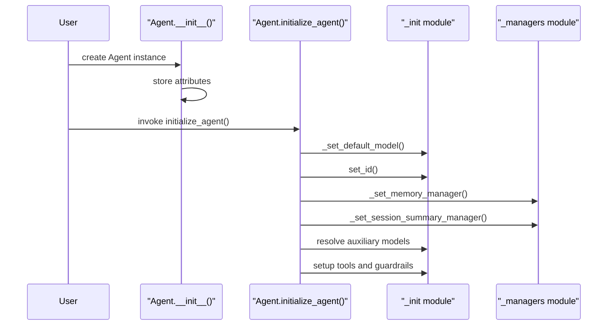

**Sources:** [libs/agno/agno/agent/agent.py:720-810](), [libs/agno/agno/agent/_init.py]()

### Model Configuration, Fallbacks, and Retry Logic

The agent model (`model`) defines the underlying LLM provider interface (`[libs/agno/agno/models/base.py:134]()`). `fallback_models` provides a prioritized sequence of fallback models (`[libs/agno/agno/agent/agent.py:86]()`) to invoke if the primary model fails.

Error-specific fallback routing can be configured using `fallback_config` (`[libs/agno/agno/agent/agent.py:88]()`). Additionally, the `Model` class implements retry loops and exponential backoff (`[libs/agno/agno/models/base.py:176-187]()`).

**Sources:** [libs/agno/agno/agent/agent.py:84-88](), [libs/agno/agno/models/base.py:134-187]()

---

## Execution Lifecycle

### Run Methods (`run` and `arun`)

The `Agent` class provides both synchronous (`run`) and asynchronous (`arun`) execution entrypoints (`[libs/agno/agno/agent/agent.py]()`). Both methods handle:
- Input message parsing and media attachment validation (`[libs/agno/agno/run/agent.py:40-142]()`).
- Session state loading and storage (`[libs/agno/agno/session/__init__.py]()`).
- Context assembly, including chat history, memories, and knowledge items (`[libs/agno/agno/agent/_messages.py]()`).
- Tool execution loops, reasoning steps, and streaming event emission (`[libs/agno/agno/agent/_run.py]()`).

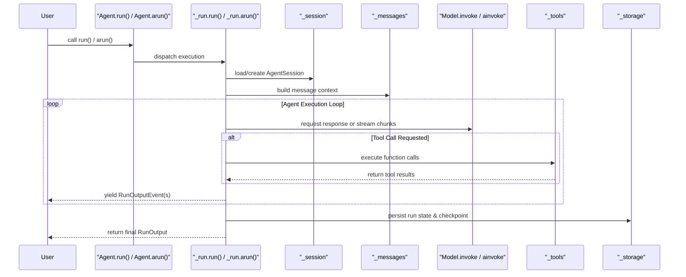

**Sources:** [libs/agno/agno/agent/agent.py](), [libs/agno/agno/agent/_run.py](), [libs/agno/agno/run/agent.py:40-142]()

---

## Tool Integration and HITL Controls

### Tool Registration and Resolution

Tools are registered via `tools` (`[libs/agno/agno/agent/agent.py]`) and can include decorated functions (`@tool`, `[libs/agno/agno/tools/decorator.py]()`), `Toolkit` instances, or raw `Function` objects (`[libs/agno/agno/tools/function.py:1-120]()`).

At runtime, `_tools.get_tools()` resolves and validates tool bindings, verifying that asynchronous tools are not invoked in synchronous execution modes (`[libs/agno/agno/agent/_tools.py]()`).

### Human-in-the-Loop (HITL)

Tool executions can be configured with user control flow fields (`[libs/agno/agno/models/response.py:27-71]()`):
- `requires_confirmation`: Pauses execution for user approval.
- `requires_user_input`: Prompts the user for structured inputs or feedback fields (`[libs/agno/agno/models/response.py:50-54]()`).
- `external_execution_required`: Offloads execution to an external worker or system.

When a tool pauses, the agent emits a `RunPaused` event (`[libs/agno/agno/run/agent.py:156]()`), allowing state to be persisted and resumed later upon receiving user input or confirmation.

**Sources:** [libs/agno/agno/tools/decorator.py](), [libs/agno/agno/tools/function.py:1-120](), [libs/agno/agno/models/response.py:27-71](), [libs/agno/agno/run/agent.py:144-173]()

---

## Memory, Checkpointing, and Offloading

### Memory Systems
- **Chat History:** Injected into context when `add_history_to_context` is enabled (`[libs/agno/agno/agent/agent.py:163]()`).
- **User Memories:** Managed via `MemoryManager` (`[libs/agno/agno/memory/__init__.py]()`).
- **Agentic Memory:** When `enable_agentic_memory` is True, the agent receives built-in memory management tools (`[libs/agno/agno/agent/agent.py:137]()`).

### Checkpointing
The `checkpoint` attribute (`[libs/agno/agno/agent/agent.py:159]()`) controls persistence frequency:
- `"runs"` (default): Writes state only at terminal run completion.
- `"tool-batch"`: Writes state after each model turn / tool-gather barrier, enabling fine-grained resumption and message boundaries (`[libs/agno/agno/models/message.py:121-125]()`).
- `"tools"`: Reserved for future releases.

### Result Offloading
Large tool results can be offloaded from active memory to durable backend storage using result stores, configured via `offload_tool_results` (`[libs/agno/agno/agent/_tools.py:50-70]()`).

**Sources:** [libs/agno/agno/agent/agent.py:137-163](), [libs/agno/agno/models/message.py:121-125](), [libs/agno/agno/agent/_tools.py:50-70]()

---

## Knowledge Integration (RAG)

Agents integrate with knowledge bases conforming to `KnowledgeProtocol` (`[libs/agno/agno/knowledge/protocol.py]()`) to support Retrieval-Augmented Generation (RAG). Retrieved chunks are dynamically injected into the context window, filtered using `knowledge_filters` or agent-controlled filters (`[libs/agno/agno/agent/agent.py]()`).

**Sources:** [libs/agno/agno/knowledge/protocol.py](), [libs/agno/agno/agent/agent.py]()

---

## Structured Outputs and Parsing

Structured responses are supported via `output_schema` (a Pydantic model) and `structured_outputs` flags (`[libs/agno/agno/agent/agent.py]()`). If the primary model requires assistance parsing or formatting outputs, a specialized `parser_model` can be configured (`[libs/agno/agno/agent/agent.py]()`).

**Sources:** [libs/agno/agno/agent/agent.py]()

---

## Event Streaming and Cancellation

### Event Streaming
Streaming execution yields events such as `RunStarted`, `RunContent`, `ToolCallStarted`, `RunPaused`, and `RunCompleted` (`[libs/agno/agno/run/agent.py:145-173]()`), facilitating real-time UI updates and telemetry tracking.

### Cancellation
Running agents can be interrupted using `cancel_run(run_id: str)` (`[libs/agno/agno/agent/agent.py]()`), which triggers cancellation tokens and cleans up active background tasks (`[libs/agno/agno/run/cancel.py]()`).

**Sources:** [libs/agno/agno/run/agent.py:145-173](), [libs/agno/agno/run/cancel.py]()

---

## Bridging Natural Language Concepts to Code Entities

```mermaid
flowchart TB
  subgraph "Natural Language Space"
    nl1["Agent Class"]
    nl2["Model Integration"]
    nl3["Tool Registry"]
    nl4["Memory Manager"]
    nl5["Knowledge Base"]
    nl6["Guardrails"]
    nl7["Run Output & Events"]
    nl8["Fallback Config"]
    nl9["Checkpointing"]
    nl10["Session Management"]
    nl11["Run Cancellation"]
  end

  subgraph "Code Entity Space"
    ce1["Agent (libs/agno/agno/agent/agent.py:80)"]
    ce2["Model (libs/agno/agno/models/base.py:134)"]
    ce3["_tools.get_tools (libs/agno/agno/agent/_tools.py)"]
    ce4["MemoryManager (libs/agno/agno/memory/__init__.py)"]
    ce5["KnowledgeProtocol (libs/agno/agno/knowledge/protocol.py)"]
    ce6["BaseGuardrail (libs/agno/agno/guardrails/base.py)"]
    ce7["RunOutput & RunEvent (libs/agno/agno/run/agent.py:67,145)"]
    ce8["FallbackConfig (libs/agno/agno/models/fallback.py)"]
    ce9["Agent.checkpoint (libs/agno/agno/agent/agent.py:159)"]
    ce10["AgentSession (libs/agno/agno/session/__init__.py)"]
    ce11["cancel_run (libs/agno/agno/run/cancel.py)"]
  end

  nl1 --> ce1
  nl2 --> ce2
  nl3 --> ce3
  nl4 --> ce4
  nl5 --> ce5
  nl6 --> ce6
  nl7 --> ce7
  nl8 --> ce8
  nl9 --> ce9
  nl10 --> ce10
  nl11 --> ce11
```

**Sources:** [libs/agno/agno/agent/agent.py:80](), [libs/agno/agno/models/base.py:134](), [libs/agno/agno/agent/_tools.py](), [libs/agno/agno/memory/__init__.py](), [libs/agno/agno/knowledge/protocol.py](), [libs/agno/agno/guardrails/base.py](), [libs/agno/agno/run/agent.py:67,145](), [libs/agno/agno/models/fallback.py](), [libs/agno/agno/run/cancel.py]()

---

# Page: Team Orchestration

# Team Orchestration

<details>
<summary>Relevant source files</summary>

The following files were used as context for generating this wiki page:

- [cookbook/02_agents/11_approvals/TEST_LOG.md](cookbook/02_agents/11_approvals/TEST_LOG.md)
- [cookbook/02_agents/11_approvals/approval_post_hook.py](cookbook/02_agents/11_approvals/approval_post_hook.py)
- [cookbook/91_tools/tavily_tools_advanced.py](cookbook/91_tools/tavily_tools_advanced.py)
- [libs/agno/agno/agent/_run.py](libs/agno/agno/agent/_run.py)
- [libs/agno/agno/agent/_utils.py](libs/agno/agno/agent/_utils.py)
- [libs/agno/agno/os/managers.py](libs/agno/agno/os/managers.py)
- [libs/agno/agno/run/approval.py](libs/agno/agno/run/approval.py)
- [libs/agno/agno/team/_run.py](libs/agno/agno/team/_run.py)
- [libs/agno/agno/team/_utils.py](libs/agno/agno/team/_utils.py)
- [libs/agno/agno/tools/tavily.py](libs/agno/agno/tools/tavily.py)
- [libs/agno/tests/integration/agent/human_in_the_loop/test_approval_multi_pause.py](libs/agno/tests/integration/agent/human_in_the_loop/test_approval_multi_pause.py)
- [libs/agno/tests/integration/os/test_approval_multi_pause.py](libs/agno/tests/integration/os/test_approval_multi_pause.py)
- [libs/agno/tests/integration/teams/human_in_the_loop/test_team_approval_multi_pause.py](libs/agno/tests/integration/teams/human_in_the_loop/test_team_approval_multi_pause.py)
- [libs/agno/tests/integration/teams/test_team_delegation.py](libs/agno/tests/integration/teams/test_team_delegation.py)
- [libs/agno/tests/unit/agent/test_callable_resources.py](libs/agno/tests/unit/agent/test_callable_resources.py)
- [libs/agno/tests/unit/agent/test_run_regressions.py](libs/agno/tests/unit/agent/test_run_regressions.py)
- [libs/agno/tests/unit/os/test_per_request_isolation.py](libs/agno/tests/unit/os/test_per_request_isolation.py)
- [libs/agno/tests/unit/run/test_approval.py](libs/agno/tests/unit/run/test_approval.py)
- [libs/agno/tests/unit/run/test_approval_multi_pause.py](libs/agno/tests/unit/run/test_approval_multi_pause.py)
- [libs/agno/tests/unit/team/test_acontinue_run_background_stream.py](libs/agno/tests/unit/team/test_acontinue_run_background_stream.py)
- [libs/agno/tests/unit/team/test_callable_resources.py](libs/agno/tests/unit/team/test_callable_resources.py)
- [libs/agno/tests/unit/team/test_delegate_closure_bug.py](libs/agno/tests/unit/team/test_delegate_closure_bug.py)
- [libs/agno/tests/unit/tools/test_tavily.py](libs/agno/tests/unit/tools/test_tavily.py)

</details>


## Purpose and Scope

This wiki page covers the technical implementation of team-based multi-agent coordination in Agno. It details the `Team` class (`agno.team.team.Team`), member management and lifecycle utilities (`agno.team._members`, `agno.team._utils`), execution dispatch and cancellation (`agno.team._run`), team-level output schemas (`agno.run.team`), and shared context/session management patterns.

Sources:
- [libs/agno/agno/team/team.py:1-200]()
- [libs/agno/agno/team/_run.py:1-186]()
- [libs/agno/agno/run/team.py:45-95]()

---

## Team Class Structure and Member Management

The `Team` class serves as the primary coordinator for multi-agent workflows. It maintains a collection of member agents or nested teams, a coordinator model, and persistent session state.

### Member List and Initialization

Members can be provided as a static list or a dynamic callable factory. During initialization, child members inherit the parent team's routing context.

```python
from agno.team import Team
from agno.agent import Agent
from agno.models.openai import OpenAIChat

team = Team(
    name="content_team",
    model=OpenAIChat(id="gpt-4o"),
    members=[
        Agent(name="researcher", model=OpenAIChat(id="gpt-4o")),
        Agent(name="writer", model=OpenAIChat(id="gpt-4o")),
    ],
)
```

Key configuration parameters accepted by the `Team` constructor include:

| Parameter | Type | Description |
| :--- | :--- | :--- |
| `members` | `Union[List[Union[Agent, Team]], Callable]` | Static list or factory returning team members |
| `model` | `Optional[Model]` | Team-level coordinator model |
| `mode` | `Optional[TeamMode]` | Coordination strategy (`route`, `tasks`, etc.) |
| `respond_directly` | `bool` | Whether to bypass aggregator and return direct member outputs |
| `delegate_to_all_members` | `bool` | Broadcast task to all members simultaneously |
| `determine_input_for_members` | `bool` | Whether the coordinator model customizes member inputs |
| `name` | `Optional[str]` | Human-readable team identifier |
| `id` | `Optional[str]` | Unique team UUID, autogenerated if omitted |

Sources:
- [libs/agno/agno/team/team.py:80-150]()
- [libs/agno/agno/team/_utils.py:112-161]()

### Deep Copy and Isolation

To support per-request isolation and concurrent runs (e.g., within AgentOS), teams support deep copying via `deep_copy` in `agno.team._utils`, which isolates mutable session state while sharing heavy resources like database connections and model pools.

Sources:
- [libs/agno/agno/team/_utils.py:112-182]()
- [libs/agno/tests/unit/os/test_per_request_isolation.py:120-167]()

---

## Coordination Modes

The `Team` class supports multiple execution coordination patterns:

1. **Route Mode (Default):** The coordinator model evaluates incoming queries and exposes members as internal callable tools. It routes tasks selectively to the appropriate member agent.
2. **Delegate to All Members:** With `delegate_to_all_members=True`, the team leader broadcasts the prompt to all configured members concurrently without routing filters.
3. **Tasks Mode:** The team manages iterative autonomous task loops up to `max_iterations` for complex agentic workflows.

Sources:
- [libs/agno/tests/integration/teams/test_team_delegation.py:14-153]()

---

## Diagram: Team Architecture to Code Entities

Diagrammatic mapping between high-level team orchestration concepts and the underlying Python classes and functions in Agno.

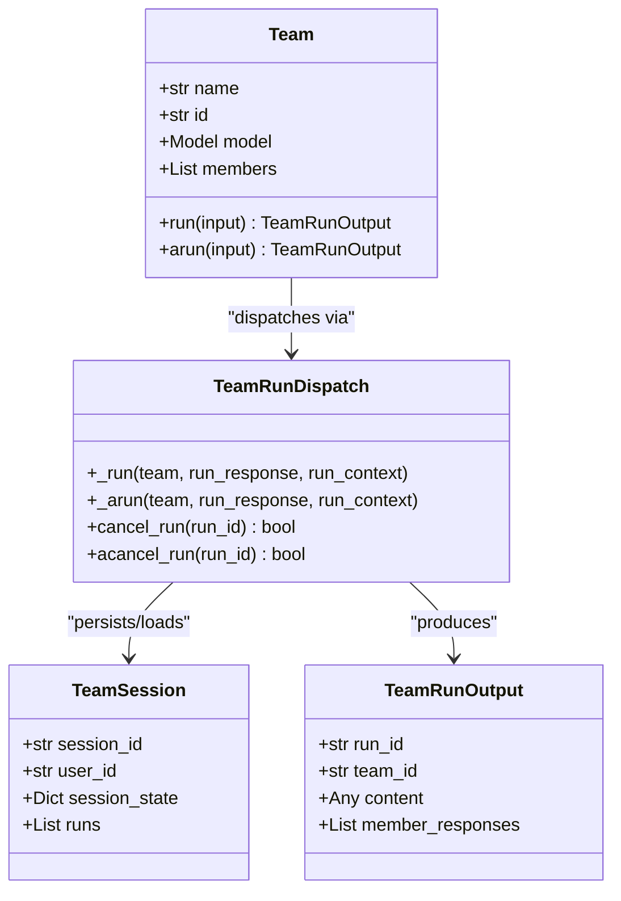

Sources:
- [libs/agno/agno/team/team.py:80-170]()
- [libs/agno/agno/team/_run.py:154-215]()
- [libs/agno/run/team.py:45-95]()

---

## Shared Context and Session State

Teams manage conversation history and shared variables across member agents.

### Session State and Serialization

The `session_state` dictionary persists across runs in the configured database backend. Context dictionaries are serialized using helper functions such as `_convert_dependencies_to_string` to ensure safe JSON formatting or fallback string representations.

```python
# Context dictionary conversion handling inside agno.team._utils
def _convert_dependencies_to_string(team: Team, context: Dict[str, Any]) -> str:
    ...
```

Sources:
- [libs/agno/agno/team/_utils.py:71-105]()

### History Sharing Controls

- `add_team_history_to_members`: Propagates past team runs into member prompt context.
- `share_member_interactions`: Exposes individual member inputs and outputs to all other peers within the current run execution turn.

Sources:
- [libs/agno/agno/team/team.py:100-140]()

---

## Team-Level Output Schema and Data Models

Run results are encapsulated by `TeamRunOutput`, which aggregates metrics, content, and individual member execution outputs.

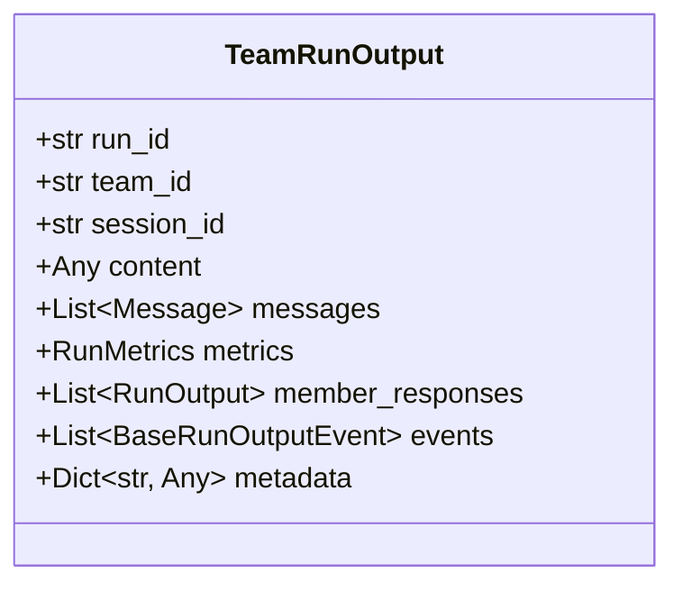

Sources:
- [libs/agno/run/team.py:45-95]()

---

## Team Run Lifecycle, Execution, and Cancellation

Team execution flows through dispatch handlers (`run_dispatch`, `_arun`, `_run`) located in `agno.team._run`. When a run is cancelled, cascading cancellation calls abort all active member execution threads.

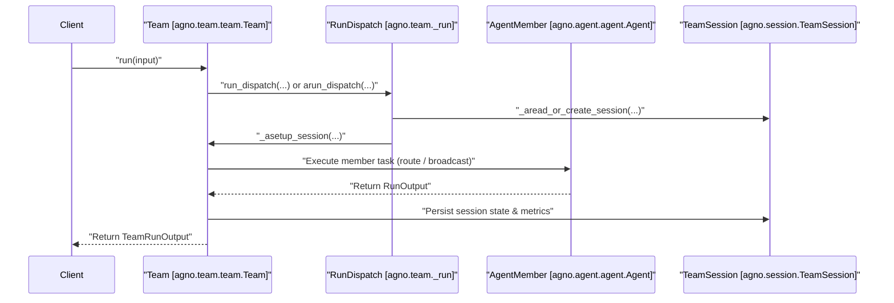

Sources:
- [libs/agno/agno/team/_run.py:154-222]()
- [libs/agno/tests/unit/team/test_acontinue_run_background_stream.py:58-88]()

---

# Summary

The `Team` class provides robust multi-agent coordination through flexible membership models, distinct coordination strategies (`route`, `delegate_to_all_members`, and autonomous task loops), and synchronized session state persistence.

Sources:
- [libs/agno/agno/team/team.py:80-180]()
- [libs/agno/agno/team/_run.py:1-222]()
- [libs/agno/run/team.py:45-95]()

---

# Page: Workflow System

# Workflow System

<details>
<summary>Relevant source files</summary>

The following files were used as context for generating this wiki page:

- [cookbook/04_workflows/03_loop_execution/loop_iterative_accumulation.py](cookbook/04_workflows/03_loop_execution/loop_iterative_accumulation.py)
- [cookbook/04_workflows/08_human_in_the_loop/condition/02_condition_on_error.py](cookbook/04_workflows/08_human_in_the_loop/condition/02_condition_on_error.py)
- [libs/agno/agno/run/workflow.py](libs/agno/agno/run/workflow.py)
- [libs/agno/agno/workflow/condition.py](libs/agno/agno/workflow/condition.py)
- [libs/agno/agno/workflow/loop.py](libs/agno/agno/workflow/loop.py)
- [libs/agno/agno/workflow/parallel.py](libs/agno/agno/workflow/parallel.py)
- [libs/agno/agno/workflow/router.py](libs/agno/agno/workflow/router.py)
- [libs/agno/agno/workflow/step.py](libs/agno/agno/workflow/step.py)
- [libs/agno/agno/workflow/steps.py](libs/agno/agno/workflow/steps.py)
- [libs/agno/agno/workflow/types.py](libs/agno/agno/workflow/types.py)
- [libs/agno/agno/workflow/workflow.py](libs/agno/agno/workflow/workflow.py)
- [libs/agno/tests/integration/workflows/test_condition_steps.py](libs/agno/tests/integration/workflows/test_condition_steps.py)
- [libs/agno/tests/integration/workflows/test_loop_steps.py](libs/agno/tests/integration/workflows/test_loop_steps.py)
- [libs/agno/tests/integration/workflows/test_parallel_steps.py](libs/agno/tests/integration/workflows/test_parallel_steps.py)
- [libs/agno/tests/integration/workflows/test_router_steps.py](libs/agno/tests/integration/workflows/test_router_steps.py)
- [libs/agno/tests/unit/workflow/test_media_aggregation.py](libs/agno/tests/unit/workflow/test_media_aggregation.py)
- [libs/agno/tests/unit/workflow/test_parallel_run_context_isolation.py](libs/agno/tests/unit/workflow/test_parallel_run_context_isolation.py)
- [libs/agno/tests/unit/workflow/test_previous_content_values.py](libs/agno/tests/unit/workflow/test_previous_content_values.py)
- [libs/agno/tests/unit/workflow/test_step_output_content_roundtrip.py](libs/agno/tests/unit/workflow/test_step_output_content_roundtrip.py)

</details>


## Purpose and Scope

The Workflow System orchestrates multi-step processes by composing various step types such as Agents, Teams, nested Workflows, and callables into flexible pipelines that support sequential, parallel, conditional, looped, and routed execution. It manages step dependencies, metadata, input/output data flow, human-in-the-loop (HITL) interactions, and persistent run/session state `[libs/agno/agno/workflow/workflow.py:39-148]()`.

This page presents an architectural overview, focusing on the `Workflow` class core concepts including step composition, dependencies, metadata handling, and run parameters that enable complex workflows. Detailed step semantics and execution mechanics are covered in child pages:

- See [Workflow Step Types](#2.3.1) for specific step containers and execution behaviors
- See [Step Execution and Context](#2.3.2) for run context, input/output chaining, dependency injection, and session state propagation
- See [Human-in-the-Loop (HITL) Workflows](#2.3.3) for manual intervention, route selection, and approval pattern details

Sources: [libs/agno/agno/workflow/workflow.py:39-148](), [libs/agno/agno/workflow/step.py:160-192]()

---

## Workflow Architecture and Step Composition

The `Workflow` class orchestrates execution over a set of composable steps `[libs/agno/agno/workflow/workflow.py:172-184]()`. Workflows can nest other workflows and containers to form complex graphs `[libs/agno/agno/workflow/workflow.py:211-218]()`. The core step types include:

- `Step`: basic unit wrapping an executor (Agent, Team, nested Workflow, or callable) `[libs/agno/agno/workflow/step.py:160-172]()`
- `Steps`: sequential pipeline of steps `[libs/agno/agno/workflow/steps.py:40-50]()`
- `Parallel`: concurrent execution of steps `[libs/agno/agno/workflow/parallel.py:47-61]()`
- `Condition`: branching logic (`if`/`else`) `[libs/agno/agno/workflow/condition.py:55-94]()`
- `Loop`: iterative step repetition with end condition `[libs/agno/agno/workflow/loop.py:43-83]()`
- `Router`: dynamic step selection or user-driven route selection `[libs/agno/agno/workflow/router.py:50-83]()`

These are composable and nestable containers forming the workflow DAG. Below is a mapping of natural language workflow concepts to code entities:

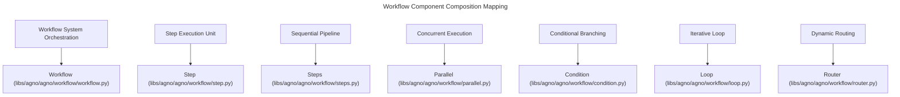

Workflow container classes and their composition define the structure for orchestrating multi-step executions by nesting and combining steps.

Sources: [libs/agno/agno/workflow/workflow.py:172-184](), [libs/agno/agno/workflow/step.py:160-192](), [libs/agno/agno/workflow/types.py:65-107]()

---

## Core Step Types Overview

The Workflow System defines various step types that provide primitives for task orchestration:

| Step Type | Source File | Description | Key Configuration Parameters |
|-----------|-------------|-------------|------------------------------|
| `Step` | `step.py` | Fundamental execution unit wrapping a single executor (Agent/Team/Callable/Workflow) with retry, failures, HITL options `[libs/agno/agno/workflow/step.py:160-172]()` | `agent`, `team`, `executor`, `workflow`, `max_retries`, `skip_on_failure` |
| `Steps` | `steps.py` | Sequential pipeline of steps executed one after another `[libs/agno/agno/workflow/steps.py:40-50]()` | `steps` (list), `requires_confirmation` |
| `Parallel` | `parallel.py` | Executes multiple steps concurrently with merged session state `[libs/agno/agno/workflow/parallel.py:47-61]()` | Variadic `steps`, supports context propagation |
| `Condition` | `condition.py` | Conditional branching step with if and optional else branches `[libs/agno/agno/workflow/condition.py:55-94]()` | `evaluator` (callable, bool, or CEL expression), `steps`, `else_steps` |
| `Loop` | `loop.py` | Executes steps repeatedly until end condition or max iterations reached `[libs/agno/agno/workflow/loop.py:43-83]()` | `steps`, `max_iterations`, `end_condition` (CEL or function), `forward_iteration_output` |
| `Router` | `router.py` | Dynamically selects which step(s) to execute based on input or user selection `[libs/agno/agno/workflow/router.py:50-83]()` | `choices` (steps), `selector` (function or CEL), HITL route selection options |

For detailed usage, configuration, and execution semantics of each step type, see [Workflow Step Types](#2.3.1).

Sources: [libs/agno/agno/workflow/step.py:160-172](), [libs/agno/agno/workflow/steps.py:40-50](), [libs/agno/agno/workflow/parallel.py:47-61](), [libs/agno/agno/workflow/condition.py:55-94](), [libs/agno/agno/workflow/loop.py:43-83](), [libs/agno/agno/workflow/router.py:50-83]()

---

## Step Execution, Context, and Data Flow

Data flows through workflows by passing `StepInput` objects into each step and collecting `StepOutput` results `[libs/agno/agno/workflow/types.py:141-143]()`. These encapsulate run context, dependency injection, and state propagation across step executions.

Below is a mapping of context and data flow concepts to code entities:

```mermaid
---
title: "Workflow Context and Data Flow Mapping"
---
graph TD
    RunContextConcept["Run Execution Context"] --> RunContextClass["RunContext (libs/agno/run/base.py)"]
    InputOutputConcept["Step Input and Output Chaining"] --> StepInputClass["StepInput (libs/agno/agno/workflow/types.py)"]
    InputOutputConcept --> StepOutputClass["StepOutput (libs/agno/agno/workflow/types.py)"]
    StateConcept["Session State Propagation"] --> WorkflowSessionClass["WorkflowSession (libs/agno/session/workflow.py)"]
    HitlConcept["Human-in-the-Loop Review"] --> HumanReviewClass["HumanReview (libs/agno/agno/workflow/types.py)"]
```

For complete details on run context, step input/output chaining, dependency injection, session state propagation, and CEL expressions, see [Step Execution and Context](#2.3.2).

Sources: [libs/agno/agno/workflow/types.py:141-143](), [libs/agno/session/workflow.py:112-112]()

---

## Human-in-the-Loop (HITL) Integration

Human-in-the-loop workflows are enabled by the `HumanReview` dataclass which configures pause conditions at multiple levels `[libs/agno/agno/workflow/types.py:64-79]`:

- Pre-execution confirmation (`requires_confirmation`) `[libs/agno/agno/workflow/types.py:82-83]()`
- User input collection (`requires_user_input` with schema) `[libs/agno/agno/workflow/types.py:86-88]()`
- Post-execution output review (`requires_output_review`) `[libs/agno/agno/workflow/types.py:94-96]()`
- Routing selection and per-iteration reviews in loops `[libs/agno/agno/workflow/types.py:90-99]()`

When a step or workflow hits a pause point, a `StepRequirement` object is emitted alongside events like `StepPausedEvent`, storing full context for resuming the run `[libs/agno/agno/run/workflow.py:54-54]()`. The system persists workflow sessions (`WorkflowSession`), allowing paused workflows to be resumed asynchronously `[libs/agno/session/workflow.py:112-112]()`.

For implementation details of HITL execution states, workflows, route selection, and approval patterns, see [Human-in-the-Loop (HITL) Workflows](#2.3.3).

Sources: [libs/agno/agno/workflow/types.py:64-107](), [libs/agno/agno/run/workflow.py:39-80](), [libs/agno/session/workflow.py:112-112]()

---

## Session Persistence and State Management

Workflows track execution state and results using persistent sessions:

- `WorkflowSession` stores active workflow state, run history, saved paused execution data, and accumulated workflow data `[libs/agno/session/workflow.py:112-112]()`.
- Each step has identifiers for traceability and for identifying pause/resume boundaries `[libs/agno/run/workflow.py:93-98]()`.
- Session state is stored in a database backend (`BaseDb`, `AsyncBaseDb`) and passed into executions for continuity `[libs/agno/db/base.py:41-41]()`.
- Child step executions within containers like `Parallel` receive isolated context copies and merge changes back upon completion `[libs/agno/workflow/parallel.py:25-25]()`.

Sources: [libs/agno/session/workflow.py:112-112](), [libs/agno/db/base.py:41-41](), [libs/agno/workflow/parallel.py:25-25]()

---

# Summary

The `Workflow` system in Agno serves as a powerful orchestration layer to build AI agent pipelines combining multi-step sequences, parallel branches, conditionals, loops, dynamic routing, and human-in-the-loop interventions `[libs/agno/agno/workflow/workflow.py:132-136]()`. Steps are composable containers that execute agents, teams, or arbitrary logic while managing input/output data flow, retries, error handling, and rich metadata `[libs/agno/agno/workflow/workflow.py:211-220]()`. Workflows manage execution context, session persistence, event streaming, and interactive pauses for user approvals or inputs `[libs/agno/run/workflow.py:39-84]()`.

For detailed usage, configuration, and execution semantics of each step type and context propagation, refer to the child pages:

- [Workflow Step Types](#2.3.1)  
- [Step Execution and Context](#2.3.2)  
- [Human-in-the-Loop (HITL) Workflows](#2.3.3)  

Sources: [libs/agno/agno/workflow/workflow.py:132-220](), [libs/agno/agno/run/workflow.py:39-84]()

---

# Page: Workflow Step Types

# Workflow Step Types

<details>
<summary>Relevant source files</summary>

The following files were used as context for generating this wiki page:

- [cookbook/04_workflows/03_loop_execution/loop_iterative_accumulation.py](cookbook/04_workflows/03_loop_execution/loop_iterative_accumulation.py)
- [cookbook/04_workflows/08_human_in_the_loop/condition/02_condition_on_error.py](cookbook/04_workflows/08_human_in_the_loop/condition/02_condition_on_error.py)
- [libs/agno/agno/run/workflow.py](libs/agno/agno/run/workflow.py)
- [libs/agno/agno/workflow/condition.py](libs/agno/agno/workflow/condition.py)
- [libs/agno/agno/workflow/loop.py](libs/agno/agno/workflow/loop.py)
- [libs/agno/agno/workflow/parallel.py](libs/agno/agno/workflow/parallel.py)
- [libs/agno/agno/workflow/router.py](libs/agno/agno/workflow/router.py)
- [libs/agno/agno/workflow/step.py](libs/agno/agno/workflow/step.py)
- [libs/agno/agno/workflow/steps.py](libs/agno/agno/workflow/steps.py)
- [libs/agno/agno/workflow/types.py](libs/agno/agno/workflow/types.py)
- [libs/agno/agno/workflow/workflow.py](libs/agno/agno/workflow/workflow.py)
- [libs/agno/tests/integration/workflows/test_condition_steps.py](libs/agno/tests/integration/workflows/test_condition_steps.py)
- [libs/agno/tests/integration/workflows/test_loop_steps.py](libs/agno/tests/integration/workflows/test_loop_steps.py)
- [libs/agno/tests/integration/workflows/test_parallel_steps.py](libs/agno/tests/integration/workflows/test_parallel_steps.py)
- [libs/agno/tests/integration/workflows/test_router_steps.py](libs/agno/tests/integration/workflows/test_router_steps.py)
- [libs/agno/tests/unit/workflow/test_media_aggregation.py](libs/agno/tests/unit/workflow/test_media_aggregation.py)
- [libs/agno/tests/unit/workflow/test_parallel_run_context_isolation.py](libs/agno/tests/unit/workflow/test_parallel_run_context_isolation.py)
- [libs/agno/tests/unit/workflow/test_previous_content_values.py](libs/agno/tests/unit/workflow/test_previous_content_values.py)
- [libs/agno/tests/unit/workflow/test_step_output_content_roundtrip.py](libs/agno/tests/unit/workflow/test_step_output_content_roundtrip.py)

</details>


This document details the workflow step types available in the Agno framework for composing multi-step orchestration pipelines. These types serve as building blocks for workflows, enabling sequential execution, parallel processing, conditional logic, iteration, and dynamic routing.

For information about workflow execution and context propagation, see **2.3.2 Step Execution and Context**. For Human-in-the-Loop (HITL) workflows, see **2.3.3 Human-in-the-Loop (HITL) Workflows**.

Sources: [libs/agno/agno/workflow/workflow.py:168-193]()

---

## Step Type Overview

The framework provides six step types organized into basic and container categories. Each type is mapped to a `StepType` enum and handled by specific classes within the `agno.workflow` module.

| Step Type | Category | Purpose | Execution Model |
|-----------|----------|---------|-----------------|
| `Step` | Basic | Single unit of work with agent, team, or function executor | Sequential |
| `Steps` | Container | Sequential pipeline of steps | Sequential |
| `Parallel` | Container | Concurrent execution of independent steps | Parallel (`ThreadPoolExecutor`) |
| `Loop` | Container | Iteration over steps with end condition | Sequential with repetition |
| `Condition` | Container | Conditional branching (if/else) | Conditional |
| `Router` | Container | Dynamic step selection | Conditional |

### Code Entity Mapping

The following diagram associates the logical step types with their corresponding implementation classes and enum identifiers.

**Diagram: Step Implementation Registry Mapping**
```mermaid
graph TB
    StepType["StepTypeEnum<br/>libs/agno/agno/workflow/types.py"]
    
    subgraph "Implementation Classes"
    StepClass["Step<br/>agno.workflow.step.Step"]
    StepsClass["Steps<br/>agno.workflow.steps.Steps"]
    ParallelClass["Parallel<br/>agno.workflow.parallel.Parallel"]
    LoopClass["Loop<br/>agno.workflow.loop.Loop"]
    ConditionClass["Condition<br/>agno.workflow.condition.Condition"]
    RouterClass["Router<br/>agno.workflow.router.Router"]
    end

    StepType -- "STEP" --> StepClass
    StepType -- "STEPS" --> StepsClass
    StepType -- "PARALLEL" --> ParallelClass
    StepType -- "LOOP" --> LoopClass
    StepType -- "CONDITION" --> ConditionClass
    StepType -- "ROUTER" --> RouterClass

    Mapping["STEP_TYPE_MAPPING<br/>libs/agno/agno/workflow/workflow.py"]
    Mapping -.-> StepType
```

Sources: [libs/agno/agno/workflow/workflow.py:186-193](), [libs/agno/agno/workflow/types.py:80-90]()

---

## Step (Basic Building Block)

The `Step` class is the atomic unit of work in an Agno workflow. It encapsulates an executor and manages its lifecycle, including retries and Human-in-the-Loop (HITL) requirements.

### Executor Types

A `Step` must have exactly one executor assigned during initialization:

| Executor | Field | Code Entity | Description |
|----------|-------|-------------|-------------|
| Agent | `agent` | `agno.agent.Agent` | Individual AI agent with tools and memory |
| Team | `team` | `agno.team.Team` | Orchestrated group of agents |
| Function | `executor` | `StepExecutor` | Callable Python function or coroutine |
| Workflow | `workflow` | `agno.workflow.Workflow` | Nested workflow support |

### Configuration Parameters

| Parameter | Type | Default | Description |
|-----------|------|---------|-------------|
| `max_retries` | `int` | 3 | Retries on execution failure |
| `skip_on_failure` | `bool` | False | Continue workflow if this step fails |
| `strict_input_validation` | `bool` | False | Raise error on missing required inputs |

### HITL Configuration

The `Step` class supports extensive HITL controls configured via a `HumanReview` object:
- `requires_confirmation`: Pauses for user approval before running.
- `requires_user_input`: Pauses to collect data defined in `user_input_schema`.
- `requires_output_review`: Pauses after execution for verification of `StepOutput`.
- `on_error`: Can be set to `OnError.pause` to allow manual recovery via HITL.

Sources: [libs/agno/agno/workflow/step.py:1-203](), [libs/agno/agno/workflow/types.py:64-107]()

---

## Steps (Sequential Container)

The `Steps` class manages a pipeline of `WorkflowSteps` executed in order.

### Execution Flow

When `Steps` are executed, the workflow iterates through the list. The output of each step is merged into the `StepInput` for the next step, enabling data flow through the pipeline. This is handled by helper methods that normalize various inputs (Agents, Teams, Callables) into `Step` objects.

**Diagram: Sequential Steps Pipeline Execution Flow**
```mermaid
graph TD
    S_Start["StartSequentialPipeline"] --> S_Prep["prepare_steps()"]
    S_Prep --> S_Loop["ForInnerStepInSteps"]
    S_Loop --> S_Run["step.execute(current_input)"]
    S_Run --> S_Update["UpdateCurrentInputWithStepOutput"]
    S_Update --> S_CheckStop{"step_output.stop?"}
    S_CheckStop -- "Yes" --> S_End["BreakAndReturnResults"]
    S_CheckStop -- "No" --> S_Loop
```

Sources: [libs/agno/agno/workflow/steps.py:40-178]()

---

## Parallel (Concurrent Execution Container)

The `Parallel` class enables concurrent execution of independent steps using a `ThreadPoolExecutor`.

### Concurrency and Context

To ensure thread safety and data integrity, `Parallel` performs the following operations:
1. **Context Propagation:** Uses `copy_context().run()` to ensure `ContextVar` values (like tracing or logging IDs) are available in worker threads.
2. **State Merging:** After all steps complete, it uses `merge_parallel_session_states` to reconcile updates to the `session_state` from different threads.

### HITL Guard

`Parallel` steps cannot contain steps that require HITL pauses (like `requires_confirmation` or `requires_user_input`) because execution is non-blocking across threads, making session suspension and resumption ambiguous.

Sources: [libs/agno/agno/workflow/parallel.py:47-96](), [libs/agno/agno/workflow/parallel.py:1-25]()

---

## Loop (Iteration Container)

The `Loop` class repeats a sequence of steps until an `end_condition` is met or `max_iterations` is reached.

### End Condition Evaluation

The `end_condition` can be a Python callable or a Common Expression Language (CEL) string.
- **forward_iteration_output:** If `True`, the output of iteration $N$ is passed as input to iteration $N+1$.
- **Iteration Review:** Loops support `requires_iteration_review` which pauses the workflow after each iteration for user feedback.

Sources: [libs/agno/agno/workflow/loop.py:43-106](), [libs/agno/agno/workflow/loop.py:165-180]()

---

## Condition (Conditional Branching)

The `Condition` class provides if/else logic based on an evaluator.

### Branching Logic
- **Evaluator:** A boolean, callable, or CEL expression that determines the path.
- **Branches:** Executes `steps` if true, and `else_steps` if false.
- **CEL Variables:** CEL expressions have access to `input`, `previous_step_content`, `previous_step_outputs`, `additional_data`, and `session_state`.

Sources: [libs/agno/agno/workflow/condition.py:55-146]()

---

## Router (Dynamic Selection)

The `Router` dynamically selects which step(s) from its `choices` to execute based on input or user interaction.

### Selection Mechanisms
1. **Programmatic:** A `selector` function returns the list of steps to run.
2. **CEL Expression:** A string expression that resolves to the name of one of the `choices`.
3. **Human-Driven:** If `requires_user_input` is True, the workflow pauses and presents the `choices` to the user for manual selection.
4. **Multiple Selections:** If `allow_multiple_selections` is True in `HumanReview`, the user can pick multiple routes to execute.

Sources: [libs/agno/agno/workflow/router.py:50-130]()

---

## Common Execution Events

All step types emit standardized events during execution to provide observability via `WorkflowRunEvent`.

| Event Type | Emitted By | Description |
|------------|------------|-------------|
| `StepStarted` | `Step` | Emitted when any step begins execution |
| `StepCompleted` | `Step` | Emitted when a step finishes successfully |
| `StepExecutorPaused` | `Step` | Emitted when an Agent/Team inside a step pauses for HITL |
| `LoopIterationStarted` | `Loop` | Emitted at the start of each loop iteration |
| `ParallelExecutionStarted` | `Parallel` | Emitted when a parallel block begins |
| `ConditionExecutionStarted`| `Condition` | Emitted when a condition evaluation begins |
| `RouterExecutionStarted` | `Router` | Emitted when routing logic starts |

Sources: [libs/agno/agno/run/workflow.py:39-83]()

---

# Page: Step Execution and Context

# Step Execution and Context

<details>
<summary>Relevant source files</summary>

The following files were used as context for generating this wiki page:

- [cookbook/04_workflows/03_loop_execution/loop_iterative_accumulation.py](cookbook/04_workflows/03_loop_execution/loop_iterative_accumulation.py)
- [cookbook/04_workflows/08_human_in_the_loop/condition/02_condition_on_error.py](cookbook/04_workflows/08_human_in_the_loop/condition/02_condition_on_error.py)
- [libs/agno/agno/run/workflow.py](libs/agno/agno/run/workflow.py)
- [libs/agno/agno/workflow/condition.py](libs/agno/agno/workflow/condition.py)
- [libs/agno/agno/workflow/loop.py](libs/agno/agno/workflow/loop.py)
- [libs/agno/agno/workflow/parallel.py](libs/agno/agno/workflow/parallel.py)
- [libs/agno/agno/workflow/router.py](libs/agno/agno/workflow/router.py)
- [libs/agno/agno/workflow/step.py](libs/agno/agno/workflow/step.py)
- [libs/agno/agno/workflow/steps.py](libs/agno/agno/workflow/steps.py)
- [libs/agno/agno/workflow/types.py](libs/agno/agno/workflow/types.py)
- [libs/agno/agno/workflow/workflow.py](libs/agno/agno/workflow/workflow.py)
- [libs/agno/tests/integration/workflows/test_condition_steps.py](libs/agno/tests/integration/workflows/test_condition_steps.py)
- [libs/agno/tests/integration/workflows/test_loop_steps.py](libs/agno/tests/integration/workflows/test_loop_steps.py)
- [libs/agno/tests/integration/workflows/test_parallel_steps.py](libs/agno/tests/integration/workflows/test_parallel_steps.py)
- [libs/agno/tests/integration/workflows/test_router_steps.py](libs/agno/tests/integration/workflows/test_router_steps.py)
- [libs/agno/tests/unit/workflow/test_media_aggregation.py](libs/agno/tests/unit/workflow/test_media_aggregation.py)
- [libs/agno/tests/unit/workflow/test_parallel_run_context_isolation.py](libs/agno/tests/unit/workflow/test_parallel_run_context_isolation.py)
- [libs/agno/tests/unit/workflow/test_previous_content_values.py](libs/agno/tests/unit/workflow/test_previous_content_values.py)
- [libs/agno/tests/unit/workflow/test_step_output_content_roundtrip.py](libs/agno/tests/unit/workflow/test_step_output_content_roundtrip.py)

</details>


## Purpose and Scope

This page explains how workflow steps execute and how execution context flows through steps in the Agno framework. It details the key role of the `RunContext` object [libs/agno/agno/run/base.py:36-36]() in carrying execution state such as session variables and output schemas. It covers step input/output chaining via `StepInput` and `StepOutput` [libs/agno/agno/workflow/types.py:85-86](), dependency injection, session state propagation across sequential and parallel steps, Common Expression Language (CEL) evaluation in conditional containers [libs/agno/agno/workflow/condition.py:65-72](), retry and error handling logic, and event enrichment for observability [libs/agno/agno/run/workflow.py:84-101](). For workflow step types and their configuration, see [Workflow Step Types](2.3.1). For Human-in-the-Loop workflow patterns, see [Human-in-the-Loop (HITL) Workflows](2.3.3).

Sources: [libs/agno/agno/run/base.py:36-36](), [libs/agno/agno/run/workflow.py:84-101](), [libs/agno/agno/workflow/condition.py:65-72](), [libs/agno/agno/workflow/types.py:85-86]()

---

## Execution Methods and Flow

All workflow step types (`Step`, `Steps`, `Parallel`, `Condition`, `Loop`, and `Router`) expose four primary execution methods accommodating different runtime semantics:

| Method           | Description                          | Return type                                       |
|------------------|------------------------------------|--------------------------------------------------|
| `execute()`      | Synchronous, non-streaming execution | `StepOutput`                                      |
| `execute_stream()` | Synchronous, streaming execution    | `Iterator[Union[WorkflowRunOutputEvent, StepOutput]]` |
| `aexecute()`     | Asynchronous, non-streaming execution | `Awaitable[StepOutput]`                           |
| `aexecute_stream()`| Asynchronous, streaming execution   | `AsyncIterator[Union[WorkflowRunOutputEvent, StepOutput]]` |

Each method accepts a consistent set of parameters representing the execution environment and workflow context, including `step_input`, `run_context`, `session_state`, and `workflow_run_response`.

Sources: [libs/agno/agno/workflow/step.py:160-172](), [libs/agno/agno/workflow/workflow.py:194-206]()

### Execution and Context Data Flow

The following diagram bridges the natural language concepts of workflow execution to code entities (`Step`, `StepInput`, `StepOutput`, `RunContext`, and `Parallel`), illustrating how inputs are prepared, execution is delegated, and outputs are processed:

```mermaid
graph TB
    subgraph "NaturalLanguageSpace"
        A["Workflow Input"] --> B["Context Preparation"]
        B --> C["Step Execution"]
        C --> D["Output Aggregation"]
    end

    subgraph "CodeEntitySpace"
        SI["StepInput<br/>(libs/agno/agno/workflow/types.py)"] --> RC["RunContext<br/>(libs/agno/agno/run/base.py)"]
        RC --> ST["Step.execute()<br/>(libs/agno/agno/workflow/step.py)"]
        ST --> SO["StepOutput<br/>(libs/agno/agno/workflow/types.py)"]
        ST --> PAR["Parallel.execute()<br/>(libs/agno/agno/workflow/parallel.py)"]
    end
```

Sources: [libs/agno/agno/run/base.py:36-36](), [libs/agno/agno/workflow/parallel.py:47-91](), [libs/agno/agno/workflow/step.py:160-172](), [libs/agno/agno/workflow/types.py:85-86]()

---

## RunContext and Dependency Injection

The `RunContext` class encapsulates the state and identifiers related to a particular run invocation and flows through the entire workflow execution pipeline. It carries session state, output schema expectations, user and workflow identifiers, and dependencies.

### RunContext Structure

- `session_state`: a dictionary storing mutable state shared across steps.
- `output_schema`: a Pydantic model or schema dict defining expected structured output.
- `dependencies`: injected runtime values, such as JWT claim metadata propagated via middleware.
- `run_id`, `session_id`, `user_id`, `workflow_id`, and `workflow_name`: identity scoping attributes.

Sources: [libs/agno/agno/run/base.py:36-36](), [libs/agno/agno/workflow/step.py:36-36]()

### Dependency Injection via Middleware

At the orchestration layer, runtime metadata such as user claims from an authentication token are extracted and injected as `dependencies` into the `RunContext`. This permits workflow steps and agent executors to access user-specific metadata during execution without explicit parameter plumbing.

Sources: [libs/agno/agno/os/middleware/jwt.py:95-124]()

Sources: [libs/agno/agno/os/middleware/jwt.py:95-124](), [libs/agno/agno/run/base.py:36-36](), [libs/agno/agno/workflow/step.py:36-36]()

---

## Step Input, Output, and Type Roundtrip

### StepInput and StepOutput Dataclasses

`StepInput` provides execution context to step executors, holding fields such as `input`, `previous_step_content`, `previous_step_outputs`, and multi-modal attachments (`images`, `videos`, `audio`, `files`). `StepOutput` encapsulates the result of a step, including `content`, `success`, `error`, `metrics`, and nested `steps` for composite containers.

Sources: [libs/agno/agno/workflow/types.py:85-89](), [libs/agno/agno/workflow/workflow.py:139-148]()

### JSON-Native Type Roundtripping

When step outputs are persisted to databases and reloaded (such as during HITL resume operations or multi-run workflows), `StepOutput.to_dict()` and `StepOutput.from_dict()` preserve JSON-native types (`bool`, `int`, `float`, `list`, `dict`, `str`, `NoneType`). This prevents falsey values (like `0` or `False`) from casting to string representations that evaluate incorrectly in subsequent logic checks.

Sources: [libs/agno/tests/unit/workflow/test_step_output_content_roundtrip.py:1-94]()

Sources: [libs/agno/agno/workflow/types.py:85-89](), [libs/agno/agno/workflow/workflow.py:139-148](), [libs/agno/tests/unit/workflow/test_step_output_content_roundtrip.py:1-94]()

---

## Session State Propagation

Session state is a mutable dictionary propagating through workflow execution, allowing steps to share control state and data.

### Sequential vs Parallel State Flow

In sequential step containers (`Steps`, `Condition`, `Router`), session state is merged after each step using dictionary merge utilities. In parallel containers (`Parallel`), execution copies the workflow session state into isolated instances to avoid concurrency conflicts, and then merges them back using conflict-aware merging logic (`merge_parallel_session_states`).

```mermaid
graph TB
    subgraph "CodeExecution"
        WS["WorkflowSession<br/>(libs/agno/agno/session/workflow.py)"] --> SState["session_state dict"]
        SState --> PExec["Parallel.execute()<br/>(libs/agno/agno/workflow/parallel.py)"]
        PExec --> Merge["merge_parallel_session_states()<br/>(libs/agno/agno/utils/merge_dict.py)"]
        Merge --> FinalWS["Updated WorkflowSession"]
    end
```

Sources: [libs/agno/agno/session/workflow.py:1-112](), [libs/agno/agno/utils/merge_dict.py:25-25](), [libs/agno/agno/workflow/parallel.py:47-91]()

---

## CEL Expressions in Workflow Containers

Containers such as `Condition`, `Router`, and `Loop` support Common Expression Language (CEL) strings for dynamic evaluations.

### Available CEL Context Variables

CEL expressions evaluate against a predefined execution context containing:
- `input`: The primary workflow input string.
- `previous_step_content`: Content from the immediately preceding step.
- `previous_step_outputs`: Map of step names to content strings from all prior steps.
- `additional_data`: Map of additional data passed to the workflow.
- `session_state`: Map of mutable session state values.
- `step_choices`: Available step names (for `Router`).
- `current_iteration`, `max_iterations`, `all_success` (for `Loop`).

Sources: [libs/agno/agno/workflow/cel.py:1-50](), [libs/agno/agno/workflow/condition.py:65-79](), [libs/agno/agno/workflow/router.py:62-70](), [libs/agno/agno/workflow/loop.py:51-57]()

Sources: [libs/agno/agno/workflow/cel.py:1-50](), [libs/agno/agno/workflow/condition.py:65-79](), [libs/agno/agno/workflow/loop.py:51-57](), [libs/agno/agno/workflow/router.py:62-70]()

---

## Retry Logic, Error Handling, and Event Enrichment

### Retry and Error Handling

Steps support automatic retry loops controlled by `max_retries`. If execution fails repeatedly, the `OnError` policy (`fail`, `skip`, or `pause`) determines whether the workflow fails, skips the step, or triggers a human-in-the-loop pause.

Sources: [libs/agno/agno/workflow/step.py:160-203](), [libs/agno/agno/workflow/types.py:50-62]()

### Event Enrichment

When event streaming is active, events emitted during step execution are enriched with metadata such as `workflow_id`, `workflow_name`, `run_id`, `session_id`, `step_id`, `step_name`, and `nested_depth` to support comprehensive trace observability.

Sources: [libs/agno/agno/run/workflow.py:84-101](), [libs/agno/agno/workflow/step.py:53-58]()

Sources: [libs/agno/agno/run/workflow.py:84-101](), [libs/agno/agno/workflow/step.py:53-58](), [libs/agno/agno/workflow/types.py:50-62]()

---

# Page: Human-in-the-Loop (HITL) Workflows

# Human-in-the-Loop (HITL) Workflows

<details>
<summary>Relevant source files</summary>

The following files were used as context for generating this wiki page:

- [cookbook/02_agents/11_approvals/TEST_LOG.md](cookbook/02_agents/11_approvals/TEST_LOG.md)
- [cookbook/02_agents/11_approvals/approval_post_hook.py](cookbook/02_agents/11_approvals/approval_post_hook.py)
- [cookbook/04_workflows/03_loop_execution/loop_iterative_accumulation.py](cookbook/04_workflows/03_loop_execution/loop_iterative_accumulation.py)
- [cookbook/04_workflows/08_human_in_the_loop/condition/02_condition_on_error.py](cookbook/04_workflows/08_human_in_the_loop/condition/02_condition_on_error.py)
- [libs/agno/agno/agent/_run.py](libs/agno/agno/agent/_run.py)
- [libs/agno/agno/os/managers.py](libs/agno/agno/os/managers.py)
- [libs/agno/agno/run/approval.py](libs/agno/agno/run/approval.py)
- [libs/agno/agno/run/workflow.py](libs/agno/agno/run/workflow.py)
- [libs/agno/agno/team/_run.py](libs/agno/agno/team/_run.py)
- [libs/agno/agno/workflow/condition.py](libs/agno/agno/workflow/condition.py)
- [libs/agno/agno/workflow/loop.py](libs/agno/agno/workflow/loop.py)
- [libs/agno/agno/workflow/parallel.py](libs/agno/agno/workflow/parallel.py)
- [libs/agno/agno/workflow/router.py](libs/agno/agno/workflow/router.py)
- [libs/agno/agno/workflow/step.py](libs/agno/agno/workflow/step.py)
- [libs/agno/agno/workflow/steps.py](libs/agno/agno/workflow/steps.py)
- [libs/agno/agno/workflow/types.py](libs/agno/agno/workflow/types.py)
- [libs/agno/agno/workflow/workflow.py](libs/agno/agno/workflow/workflow.py)
- [libs/agno/tests/integration/agent/human_in_the_loop/test_approval_multi_pause.py](libs/agno/tests/integration/agent/human_in_the_loop/test_approval_multi_pause.py)
- [libs/agno/tests/integration/os/test_approval_multi_pause.py](libs/agno/tests/integration/os/test_approval_multi_pause.py)
- [libs/agno/tests/integration/teams/human_in_the_loop/test_team_approval_multi_pause.py](libs/agno/tests/integration/teams/human_in_the_loop/test_team_approval_multi_pause.py)
- [libs/agno/tests/integration/workflows/test_condition_steps.py](libs/agno/tests/integration/workflows/test_condition_steps.py)
- [libs/agno/tests/integration/workflows/test_loop_steps.py](libs/agno/tests/integration/workflows/test_loop_steps.py)
- [libs/agno/tests/integration/workflows/test_parallel_steps.py](libs/agno/tests/integration/workflows/test_parallel_steps.py)
- [libs/agno/tests/integration/workflows/test_router_steps.py](libs/agno/tests/integration/workflows/test_router_steps.py)
- [libs/agno/tests/unit/agent/test_run_regressions.py](libs/agno/tests/unit/agent/test_run_regressions.py)
- [libs/agno/tests/unit/run/test_approval.py](libs/agno/tests/unit/run/test_approval.py)
- [libs/agno/tests/unit/run/test_approval_multi_pause.py](libs/agno/tests/unit/run/test_approval_multi_pause.py)
- [libs/agno/tests/unit/team/test_acontinue_run_background_stream.py](libs/agno/tests/unit/team/test_acontinue_run_background_stream.py)
- [libs/agno/tests/unit/workflow/test_media_aggregation.py](libs/agno/tests/unit/workflow/test_media_aggregation.py)
- [libs/agno/tests/unit/workflow/test_parallel_run_context_isolation.py](libs/agno/tests/unit/workflow/test_parallel_run_context_isolation.py)
- [libs/agno/tests/unit/workflow/test_previous_content_values.py](libs/agno/tests/unit/workflow/test_previous_content_values.py)
- [libs/agno/tests/unit/workflow/test_step_output_content_roundtrip.py](libs/agno/tests/unit/workflow/test_step_output_content_roundtrip.py)

</details>


This page covers Human-in-the-Loop (HITL) patterns for workflow orchestration, where workflow execution pauses to request user confirmation, input, or route selection before proceeding. HITL workflows enable approval gates, interactive branching, and error recovery workflows where human judgment is required at specific decision points.

**Scope:** This page focuses on workflow-level HITL mechanisms (step confirmation, user input, route selection). For tool-level HITL (pausing for tool execution approval), see `libs/agno/agno/run/approval.py` [libs/agno/agno/run/approval.py:1-48](). For general workflow architecture, see `libs/agno/agno/workflow/workflow.py` [libs/agno/agno/workflow/workflow.py:1-219]().

---

## HITL Workflow Architecture

The workflow execution engine evaluates HITL requirements before and after step execution. If a requirement is met (e.g., `requires_confirmation=True`), the engine generates a `StepRequirement`, persists the session state to the database, and emits a `StepPausedEvent`. The workflow then halts awaiting external user input or approval before continuing.

### Execution and Pause Flow

The following diagram illustrates the lifecycle of a workflow run encountering a HITL boundary.

**Workflow HITL Lifecycle**
```mermaid
graph TB
    subgraph "Workflow Execution Pipeline"
        Start["Workflow.run()"]
        PrepareStep["Prepare Step Input"]
        CheckHITL{"Step requires<br/>HITL?"}
        CreateReq["create_step_requirement()"]
        PauseWorkflow["Pause Workflow"]
        SaveSession["save_paused_session()"]
        EmitEvent["Emit StepPausedEvent"]
        WaitResolution["Wait for User Resolution"]

        Start --> PrepareStep
        PrepareStep --> CheckHITL
        CheckHITL -->|Yes| CreateReq
        CheckHITL -->|No| ExecuteStep
        CreateReq --> PauseWorkflow
        PauseWorkflow --> SaveSession
        SaveSession --> EmitEvent
        EmitEvent --> WaitResolution

        WaitResolution -->|Approved| ExecuteStep
        WaitResolution -->|Rejected| HandleReject

        ExecuteStep["Execute Step"]
        HandleReject["Handle on_reject"]

        HandleReject -->|skip| NextStep
        HandleReject -->|cancel| CancelWorkflow
        HandleReject -->|else_branch| ExecuteElse

        ExecuteStep --> NextStep
        ExecuteElse --> NextStep
        NextStep["Next Step"]
        CancelWorkflow["Workflow Cancelled"]
    end

    subgraph "HITL-Capable Step Types"
        StepHITL["Step<br/>requires_confirmation<br/>requires_user_input<br/>on_error=pause"]
        RouterHITL["Router<br/>requires_user_input<br/>requires_confirmation"]
        LoopHITL["Loop<br/>requires_confirmation"]
        ConditionHITL["Condition<br/>requires_confirmation"]
        StepsHITL["Steps<br/>requires_confirmation"]
    end

    subgraph "Resolution Data Structures"
        StepReq["StepRequirement<br/>step_id, step_name<br/>requires_confirmation<br/>requires_user_input<br/>user_input_schema<br/>available_choices"]
        ErrorReq["ErrorRequirement<br/>step_id, error_message<br/>error_type, retry_count"]
    end

    CheckHITL -.->|checks| StepHITL
    CheckHITL -.->|checks| RouterHITL
    CheckHITL -.->|checks| LoopHITL
    CheckHITL -.->|checks| ConditionHITL
    CheckHITL -.->|checks| StepsHITL

    CreateReq -.->|creates| StepReq
    CreateReq -.->|or| ErrorReq
```
Sources: `libs/agno/agno/workflow/workflow.py:95-109` [libs/agno/agno/workflow/workflow.py:95-109](), `libs/agno/agno/workflow/step.py:181-203` [libs/agno/agno/workflow/step.py:181-203](), `libs/agno/agno/workflow/types.py:65-79` [libs/agno/agno/workflow/types.py:65-79]()

---

## Step-Level HITL Configuration

The `Step` class supports primary HITL modes: **confirmation** (approve before execution), **user input** (collect data before execution), and **error handling** (pause on error for retry/skip decision). Additionally, it supports **output review** (pause after execution).

### Confirmation Mode

Confirmation mode pauses execution until a boolean approval is received, allowing users to approve or reject progressing.

**Step Confirmation Flow**
```mermaid
graph LR
    StepStart["Step Execution Begins"] --> CheckConfirm{"requires_confirmation<br/>== True?"}
    CheckConfirm -->|No| Execute["Execute Step"]
    CheckConfirm -->|Yes| Pause["Create StepRequirement"]
    Pause --> SaveDB["save_paused_session()"]
    SaveDB --> EmitEvent["Emit StepPausedEvent"]
    EmitEvent --> WaitUser["Wait for User"]

    WaitUser -->|Approved| Execute
    WaitUser -->|Rejected| CheckReject{"on_reject?"}

    CheckReject -->|skip| SkipStep["Skip Step<br/>Continue Workflow"]
    CheckReject -->|cancel| CancelWorkflow["Cancel Workflow"]
    CheckReject -->|retry| RetryStep["Retry Step"]

    Execute --> StepDone["Step Complete"]
    SkipStep --> StepDone
```
Sources: `libs/agno/agno/workflow/step.py:181-203` [libs/agno/agno/workflow/step.py:181-203](), `libs/agno/agno/workflow/types.py:20-34` [libs/agno/agno/workflow/types.py:20-34](), `libs/agno/agno/workflow/types.py:65-84` [libs/agno/agno/workflow/types.py:65-84]()

| Parameter               | Type       | Description                                                                                           |
|------------------------|------------|---------------------------------------------------------------------------------------------------|
| `requires_confirmation` | `bool`     | If set to `True`, the step pauses before execution for user approval. [libs/agno/agno/workflow/types.py:82-82]()           |
| `confirmation_message`  | `Optional[str]` | Custom confirmation message shown to the user. [libs/agno/agno/workflow/types.py:83-83]()                              |
| `on_reject`             | `OnReject` | Action upon rejection: `skip` (default), `cancel`, `else_branch` (for Condition), or `retry`. [libs/agno/agno/workflow/types.py:102-102]() |

Sources: `libs/agno/agno/workflow/step.py:181-203` [libs/agno/agno/workflow/step.py:181-203](), `libs/agno/agno/workflow/types.py:20-34` [libs/agno/agno/workflow/types.py:20-34](), `libs/agno/agno/workflow/types.py:65-84` [libs/agno/agno/workflow/types.py:65-84]()

### User Input Mode

Before executing a step, the workflow may pause to collect structured input from the user. The input is validated against a schema and merged into the step's execution context.

| Parameter               | Type                   | Description                                                                             |
|------------------------|------------------------|-----------------------------------------------------------------------------------------|
| `requires_user_input`   | `bool`                 | If `True`, workflow pauses to gather user input before proceeding. [libs/agno/agno/workflow/types.py:86-86]()       |
| `user_input_message`    | `Optional[str]`        | Prompt message displayed for user input collection. [libs/agno/agno/workflow/types.py:87-87]()                        |
| `user_input_schema`     | `Optional[List[Dict]]` | Defines fields for the user input form (field name, type, validations, etc.). [libs/agno/agno/workflow/types.py:88-88]() |

Sources: `libs/agno/agno/workflow/step.py:181-203` [libs/agno/agno/workflow/step.py:181-203](), `libs/agno/agno/workflow/types.py:85-88` [libs/agno/agno/workflow/types.py:85-88]()

### Output Review Mode

Post-execution output review allows human inspection and approval before continuing.

| Parameter             | Type              | Description                                                               |
|----------------------|-------------------|---------------------------------------------------------------------------|
| `requires_output_review` | `Union[bool, Any]` | If `True` or callable condition returns `True`, pause to review step output. [libs/agno/agno/workflow/types.py:94-94]() |
| `output_review_message`   | `Optional[str]`  | Message shown during output review. [libs/agno/agno/workflow/types.py:95-95]() |

Sources: `libs/agno/agno/workflow/step.py:181-203` [libs/agno/agno/workflow/step.py:181-203](), `libs/agno/agno/workflow/types.py:93-95` [libs/agno/agno/workflow/types.py:93-95]()

### Error Handling Mode

When `on_error=OnError.pause`, errors during step execution cause the workflow to pause for user decision (retry, skip, cancel).

| Parameter     | Type    | Description                                           |
|--------------|---------|-------------------------------------------------------|
| `on_error`   | `OnError` | Specifies behavior on execution error: `fail`, `skip`, or `pause` (HITL). [libs/agno/agno/workflow/types.py:50-62]() |

Sources: `libs/agno/agno/workflow/types.py:103-103` [libs/agno/agno/workflow/types.py:103-103]()

---

## Router HITL Modes

The `Router` container supports interactive route selection through HITL, allowing users to select one or more branches dynamically.

### Route Selection Mode

When `requires_user_input` is set on a `Router`, the workflow pauses before routing to allow users to select from available routes. This bypasses the programmatic selector.

**Router User Selection Flow**
```mermaid
graph TB
    RouterStart["Router Execution"] --> CheckMode{"requires_user_input?"}
    CheckMode -->|No| RunSelector["Run selector()"]
    CheckMode -->|Yes| CreateRouteReq["create_step_requirement(for_route_selection=True)"]

    CreateRouteReq --> PauseRouter["Pause Workflow"]
    PauseRouter --> EmitRouterPaused["Emit StepPausedEvent (Router)"]
    EmitRouterPaused --> WaitSelection["Wait for User Route Selection"]

    WaitSelection --> GetStepsByName["_get_steps_from_user_selection()"]
    GetStepsByName --> ExecuteSelected["Execute Selected Routes"]

    RunSelector --> ExecuteSelected
    ExecuteSelected --> RouterDone["Router Complete"]
```
Sources: `libs/agno/agno/workflow/router.py:50-128` [libs/agno/agno/workflow/router.py:50-128](), `libs/agno/agno/workflow/types.py:85-91` [libs/agno/agno/workflow/types.py:85-91]()

| Parameter               | Type       | Description                                                               |
|------------------------|------------|---------------------------------------------------------------------------|
| `requires_user_input`   | `bool`     | Enables user route selection instead of automatic selector. [libs/agno/agno/workflow/types.py:86-86]()           |
| `allow_multiple_selections` | `bool` | If True, allows selecting multiple routes in the user interface. [libs/agno/agno/workflow/types.py:91-91]() |

Sources: `libs/agno/agno/workflow/router.py:50-128` [libs/agno/agno/workflow/router.py:50-128](), `libs/agno/agno/workflow/types.py:85-91` [libs/agno/agno/workflow/types.py:85-91]()

---

## Container-Level HITL

### Loop Confirmation and Per-Iteration Review

The `Loop` container supports confirmation before the loop starts and optionally review after each iteration.

| Parameter                 | Type       | Description                                                       |
|--------------------------|------------|-------------------------------------------------------------------|
| `requires_confirmation`   | `bool`     | Pause before the first iteration for confirmation. [libs/agno/agno/workflow/types.py:82-82]()        |
| `requires_iteration_review` | `bool`   | Pause after each iteration for review and approval by a user. [libs/agno/agno/workflow/types.py:98-98]() |

Sources: `libs/agno/agno/workflow/loop.py:43-83` [libs/agno/agno/workflow/loop.py:43-83](), `libs/agno/agno/workflow/types.py:97-99` [libs/agno/agno/workflow/types.py:97-99]()

### Condition Confirmation

The `Condition` step supports pausing before branch execution for human confirmation, allowing explicit user control of which branch to execute.

| Parameter             | Type                 | Description                                                                   |
|----------------------|----------------------|-------------------------------------------------------------------------------|
| `requires_confirmation` | `bool`             | Pause before evaluating condition. [libs/agno/agno/workflow/types.py:82-82]() |
| `on_reject`           | `Union[OnReject, str]` | Default `else_branch` - execute else branch when rejected. [libs/agno/agno/workflow/condition.py:114-114]() |

Sources: `libs/agno/agno/workflow/condition.py:55-115` [libs/agno/agno/workflow/condition.py:55-115](), `libs/agno/agno/workflow/types.py:20-34` [libs/agno/agno/workflow/types.py:20-34]()

### Steps Confirmation

The `Steps` container (a pipeline of steps) can require user confirmation before executing its entire sequence.

| Parameter             | Type       | Description                                                  |
|----------------------|------------|--------------------------------------------------------------|
| `requires_confirmation` | `bool`   | Pause to confirm executing the full steps pipeline. [libs/agno/agno/workflow/types.py:82-82]() |
| `confirmation_message` | `Optional[str]` | Custom message displayed to user. [libs/agno/agno/workflow/types.py:83-83]()         |

Sources: `libs/agno/agno/workflow/steps.py:40-73` [libs/agno/agno/workflow/steps.py:40-73]()

---

## HITL Data Structures

### StepRequirement

`StepRequirement` describes the HITL pause metadata required to resume a workflow. It includes identification, HITL flags (confirmation, input, route selection), schema for user inputs, available route choices, and the workflow input context snapshot.

**HITL Data Entities**
```mermaid
classDiagram
    class StepRequirement {
        +str step_id
        +str step_name
        +int step_index
        +str step_type
        +bool requires_confirmation
        +Optional[str] confirmation_message
        +str on_reject
        +bool requires_user_input
        +Optional[str] user_input_message
        +Optional[List[UserInputField]] user_input_schema
        +bool requires_route_selection
        +Optional[List[str]] available_choices
        +bool allow_multiple_selections
        +StepInput step_input
    }

    class UserInputField {
        +str name
        +str field_type
        +Optional[str] description
        +bool required
        +Optional[List[str]] allowed_values
    }

    class ErrorRequirement {
        +str step_id
        +str step_name
        +int step_index
        +str error_message
        +str error_type
        +int retry_count
    }

    StepRequirement --> UserInputField : user_input_schema
```
Sources: `libs/agno/agno/workflow/types.py:186-215` [libs/agno/agno/workflow/types.py:186-215](), `libs/agno/agno/workflow/types.py:236-250` [libs/agno/agno/workflow/types.py:236-250]()

### StepPausedEvent

`StepPausedEvent` is emitted when workflow execution pauses. It carries `StepRequirement` and optionally `ErrorRequirement` metadata describing the reason for pause, plus executor identifiers and timeout info.

**StepPausedEvent Structure**
```mermaid
classDiagram
    class BaseWorkflowRunOutputEvent {
        +str event
        +Optional[str] workflow_id
        +Optional[str] workflow_name
        +Optional[str] session_id
        +Optional[str] run_id
        +Optional[str] step_id
        +Optional[str] parent_step_id
        +int nested_depth
    }

    class StepPausedEvent {
        +str event = "StepPaused"
        +StepRequirement requirement
        +Optional[ErrorRequirement] error_requirement
        +Optional[str] executor_run_id
        +Optional[str] executor_type
        +Optional[str] pause_kind
        +Optional[int] timeout
        +Optional[str] on_timeout
        +int created_at
    }

    BaseWorkflowRunOutputEvent <|-- StepPausedEvent
    StepPausedEvent --> StepRequirement : requirement
    StepPausedEvent --> ErrorRequirement : error_requirement
```
Sources: `libs/agno/agno/run/workflow.py:84-170` [libs/agno/agno/run/workflow.py:84-170](), `libs/agno/agno/workflow/types.py:217-225` [libs/agno/agno/workflow/types.py:217-225]()

---

## Workflow Pause and Persistence

When a HITL requirement triggers a pause, the workflow persists the current session and requirement state to durable storage to enable asynchronous user interaction. This is managed by utility functions like `save_paused_session()` and `asave_paused_session()` which handle database writes and state updates.

### Pause and Persistence Sequence

```mermaid
sequenceDiagram
    participant Workflow
    participant Step
    participant Utils
    participant DB
    participant Client

    Workflow->>Step: Check requires_confirmation / user_input / route_selection
    Step->>Workflow: True (pause required)
    Workflow->>Utils: create_step_requirement()
    Utils->>DB: save_paused_session(requirement, session)
    DB-->>Utils: Persisted session state
    Workflow->>Client: Emit StepPausedEvent with requirement
    Workflow->>Client: Return WorkflowRunOutput (is_paused=True)
```
Sources: `libs/agno/agno/workflow/utils.py:147-164` [libs/agno/agno/workflow/utils.py:147-164](), `libs/agno/agno/workflow/workflow.py:104-106` [libs/agno/agno/workflow/workflow.py:104-106]()

---

## Resuming Paused Workflows

Workflows resume by passing a `requirements_resolution` dictionary keyed by step IDs to the `Workflow.run()` or `Workflow.arun()` methods. The resolution includes confirmations, user inputs, or route selections that satisfy the pending `StepRequirement`. 

The workflow engine merges resolved input data into the step execution context or routes steps accordingly, then continues execution.

### HITL Resolution Logic

- Matches incoming resolution by `step_id` to pending `StepRequirement`.
- For confirmation, checks `confirmed: bool`.
- For user input, merges user responses into step input fields.
- For route selection, resolves selected route names into executable steps.
- On rejection, performs configured `on_reject` action (skip, cancel, retry, else).

Sources: `libs/agno/agno/workflow/workflow.py:133-150` [libs/agno/agno/workflow/workflow.py:133-150](), `libs/agno/agno/workflow/utils.py:161-161` [libs/agno/agno/workflow/utils.py:161-161]()

---

## Summary: HITL Capabilities by Step Type

| Step Type  | Confirmation | User Input | Route Selection | Error Pause | Output Review | Iteration Review |
|------------|--------------|------------|-----------------|-------------|---------------|------------------|
| `Step`     | ✅           | ✅         | ❌              | ✅          | ✅            | ❌               |
| `Router`   | ✅           | ✅         | ✅              | ❌          | ✅            | ❌               |
| `Loop`     | ✅           | ❌         | ❌              | ❌          | ❌            | ✅               |
| `Condition`| ✅           | ❌         | ❌              | ❌          | ❌            | ❌               |
| `Steps`    | ✅           | ❌         | ❌              | ❌          | ❌            | ❌               |
| `Parallel` | ✅ (sub-steps)| ✅ (sub-steps)| ❌            | ✅ (sub-steps)| ✅ (sub-steps) | ❌               |

Sources: `libs/agno/agno/workflow/types.py:65-79` [libs/agno/agno/workflow/types.py:65-79](), `libs/agno/agno/workflow/step.py:181-203` [libs/agno/agno/workflow/step.py:181-203](), `libs/agno/agno/workflow/condition.py:113-124` [libs/agno/agno/workflow/condition.py:113-124](), `libs/agno/agno/workflow/parallel.py:165-170` [libs/agno/agno/workflow/parallel.py:165-170]()

---

# Glossary of Key Classes and Patterns

| Name                | Description                                                                                     |
|---------------------|-------------------------------------------------------------------------------------------------|
| `requires_confirmation` | Boolean flag on steps and containers triggering a pre-execution approval pause.                |
| `requires_user_input`   | Boolean flag on steps and routers triggering a pause to collect structured user input.         |
| `route selection`       | HITL feature in Routers enabling users to pick execution paths via UI interaction.            |
| `StepRequirement`       | Data class describing paused workflow step requirements: IDs, HITL flags, messages, schemas.  |
| `StepPausedEvent`       | Workflow event emitted when execution pauses for HITL, carrying the `StepRequirement`.        |
| `on_reject`             | Configured action on HITL rejection: skip, cancel, retry, else_branch (varies by container).  |
| Approval Workflow       | The pattern where workflow pauses at checkpoints to ask user confirmation/input before continuing. |

---

# Details on Key Classes

### `StepRequirement` (`libs/agno/agno/workflow/types.py`)

- Contains metadata for paused steps requiring HITL input or confirmation.
- Fields include step identity (`step_id`, `step_name`, `step_type`), flags (`requires_confirmation`, `requires_user_input`, `requires_route_selection`), human interface metadata (`confirmation_message`, `user_input_message`, `available_choices`), and schema definitions for structured input (`user_input_schema`).
- Carries the context snapshot as a `StepInput` that was passed to the step.

Sources: `libs/agno/agno/workflow/types.py:186-215` [libs/agno/agno/workflow/types.py:186-215]()

### `StepPausedEvent` (`libs/agno/agno/run/workflow.py`)

- A specialized run event subclass indicating workflow pause on HITL.
- Includes the associated `StepRequirement`, optionally an `ErrorRequirement` if triggered due to error pause.
- Used by the runtime to notify user interfaces to present approval/input forms based on the requirement.

Sources: `libs/agno/agno/run/workflow.py:84-170` [libs/agno/agno/run/workflow.py:84-170]()

### Workflow HITL Integration

- Workflow execution checks HITL configurations on each step or container.
- On HITL trigger, execution saves state, emits `StepPausedEvent`, and returns a paused run response.
- Once user provides resolution data, `Workflow.run()` resumes execution with resolutions.

Sources: `libs/agno/agno/workflow/workflow.py:95-150` [libs/agno/agno/workflow/workflow.py:95-150]()

---

# Summary Diagram: From Natural Language to Code Entities in HITL Workflow

```mermaid
graph TD
    subgraph "Natural Language Concepts"
        NL_Confirm["Confirmation Required"]
        NL_UserInput["User Input Required"]
        NL_RouteSelect["Route Selection"]
        NL_ErrorPause["Pause on Error"]
        NL_OutputReview["Output Review"]
    end

    subgraph "Workflow Components (Code Entities)"
        Step["Step Class:<br/>requires_confirmation, requires_user_input, requires_output_review"]
        Router["Router Class:<br/>requires_user_input, route selection"]
        Loop["Loop Class:<br/>requires_confirmation, iteration_review"]
        Condition["Condition Class:<br/>requires_confirmation, on_reject=else_branch"]
        Steps["Steps Class:<br/>requires_confirmation"]
    end

    subgraph "Runtime and Events"
        StepRequirement["StepRequirement<br/>(step_id, HITL flags, messages, schemas)"]
        StepPausedEvent["StepPausedEvent<br/>(contains StepRequirement)"]
        WorkflowRun["Workflow.run()/arun()<br/>with requirements_resolution"]
    end
    
    NL_Confirm --> Step
    NL_Confirm --> Loop
    NL_Confirm --> Condition
    NL_Confirm --> Steps
    NL_UserInput --> Step
    NL_UserInput --> Router
    NL_RouteSelect --> Router
    NL_ErrorPause --> Step

    Step --> StepRequirement
    Router --> StepRequirement
    Loop --> StepRequirement
    Condition --> StepRequirement
    Steps --> StepRequirement

    StepRequirement --> StepPausedEvent
    StepPausedEvent --> WorkflowRun
```
Sources: `libs/agno/agno/workflow/step.py:181-203` [libs/agno/agno/workflow/step.py:181-203](), `libs/agno/agno/workflow/router.py:50-128` [libs/agno/agno/workflow/router.py:50-128](), `libs/agno/agno/workflow/loop.py:43-83` [libs/agno/agno/workflow/loop.py:43-83](), `libs/agno/agno/workflow/condition.py:55-120` [libs/agno/agno/workflow/condition.py:55-120](), `libs/agno/agno/workflow/steps.py:40-73` [libs/agno/agno/workflow/steps.py:40-73](), `libs/agno/agno/run/workflow.py:84-170` [libs/agno/agno/run/workflow.py:84-170]()

---

# Detailed HITL Approval Workflow Pattern

1. **Step Configuration**  
   Steps or containers set HITL flags like `requires_confirmation` or `requires_user_input`.

2. **Workflow Execution**  
   The workflow invokes steps sequentially or in other constructs (loop, router).

3. **HITL Requirement Check**  
   Before executing a step, the engine checks HITL flags.

4. **Pause and Emit Event**  
   On HITL trigger, execution state and requirement are persisted to DB using `save_paused_session()`.  
   A `StepPausedEvent` encapsulating the requirement and context is emitted.

5. **External User Handling**  
   The external UI or system receives `StepPausedEvent`, presents forms/messages.  
   Users respond with approvals, inputs, or route selections.

6. **Workflow Resumption**  
   Client submits resolution data keyed by `step_id` via `requirements_resolution` to the workflow run call.

7. **Continue or Handle Reject**  
   Workflow updates context, retries, skips, or cancels based on user input and `on_reject` setting.

Sources: `libs/agno/agno/workflow/utils.py:147-164` [libs/agno/agno/workflow/utils.py:147-164](), `libs/agno/agno/workflow/workflow.py:95-150` [libs/agno/agno/workflow/workflow.py:95-150]()

---

# Summary Table of HITL Parameters in Step and Containers

| Parameter                  | Step  | Router | Loop  | Condition | Steps  |
|----------------------------|-------|--------|-------|-----------|--------|
| `requires_confirmation`     | ✓     | ✓      | ✓     | ✓         | ✓      |
| `confirmation_message`       | ✓     | ✓      | ✓     | ✓         | ✓      |
| `requires_user_input`         | ✓     | ✓      |       |           |        |
| `user_input_message`          | ✓     | ✓      |       |           |        |
| `user_input_schema`           | ✓     | ✓      |       |           |        |
| `allow_multiple_selections`   |       | ✓      |       |           |        |
| `requires_output_review`      | ✓     | ✓      |       |           |        |
| `requires_iteration_review`   |       |        | ✓     |           |        |
| `on_reject`                   | ✓     | ✓      | ✓     | else_branch | ✓     |
| `on_error`                   | fail,skip,pause | NA | NA   | NA        | NA     |

Sources: `libs/agno/agno/workflow/types.py:65-107` [libs/agno/agno/workflow/types.py:65-107]()

---

# References

- `StepRequirement` and HITL config validations: `libs/agno/agno/workflow/types.py:20-172` [libs/agno/agno/workflow/types.py:20-172](), `libs/agno/agno/workflow/types.py:186-250` [libs/agno/agno/workflow/types.py:186-250]()
- HITL-enabled step implementations and pause logic: `libs/agno/agno/workflow/step.py:181-203` [libs/agno/agno/workflow/step.py:181-203](), `libs/agno/agno/workflow/condition.py:55-120` [libs/agno/agno/workflow/condition.py:55-120](), `libs/agno/agno/workflow/router.py:50-171` [libs/agno/agno/workflow/router.py:50-171]()
- Events and serialization: `libs/agno/agno/run/workflow.py:39-170` [libs/agno/agno/run/workflow.py:39-170]()
- Workflow pause and persistence utilities: `libs/agno/agno/workflow/utils.py:147-164` [libs/agno/agno/workflow/utils.py:147-164](), `libs/agno/agno/workflow/workflow.py:95-109` [libs/agno/agno/workflow/workflow.py:95-109]()

---

# Page: Run Output and Events

# Run Output and Events

<details>
<summary>Relevant source files</summary>

The following files were used as context for generating this wiki page:

- [libs/agno/agno/agent/agent.py](libs/agno/agno/agent/agent.py)
- [libs/agno/agno/models/base.py](libs/agno/agno/models/base.py)
- [libs/agno/agno/models/message.py](libs/agno/agno/models/message.py)
- [libs/agno/agno/models/response.py](libs/agno/agno/models/response.py)
- [libs/agno/agno/run/__init__.py](libs/agno/agno/run/__init__.py)
- [libs/agno/agno/run/agent.py](libs/agno/agno/run/agent.py)
- [libs/agno/agno/run/base.py](libs/agno/agno/run/base.py)
- [libs/agno/agno/run/cancel.py](libs/agno/agno/run/cancel.py)
- [libs/agno/agno/run/cancellation_management/__init__.py](libs/agno/agno/run/cancellation_management/__init__.py)
- [libs/agno/agno/run/cancellation_management/base.py](libs/agno/agno/run/cancellation_management/base.py)
- [libs/agno/agno/run/cancellation_management/in_memory_cancellation_manager.py](libs/agno/agno/run/cancellation_management/in_memory_cancellation_manager.py)
- [libs/agno/agno/run/cancellation_management/redis_cancellation_manager.py](libs/agno/agno/run/cancellation_management/redis_cancellation_manager.py)
- [libs/agno/agno/run/team.py](libs/agno/agno/run/team.py)
- [libs/agno/agno/team/team.py](libs/agno/agno/team/team.py)
- [libs/agno/agno/tools/function.py](libs/agno/agno/tools/function.py)
- [libs/agno/agno/utils/events.py](libs/agno/agno/utils/events.py)
- [libs/agno/agno/utils/response.py](libs/agno/agno/utils/response.py)
- [libs/agno/pyproject.toml](libs/agno/pyproject.toml)
- [libs/agno/tests/integration/agent/test_agent_run_cancellation.py](libs/agno/tests/integration/agent/test_agent_run_cancellation.py)
- [libs/agno/tests/integration/agent/test_event_streaming.py](libs/agno/tests/integration/agent/test_event_streaming.py)
- [libs/agno/tests/integration/teams/test_event_streaming.py](libs/agno/tests/integration/teams/test_event_streaming.py)
- [libs/agno/tests/unit/agent/test_paused_user_input_persistence.py](libs/agno/tests/unit/agent/test_paused_user_input_persistence.py)
- [libs/agno/tests/unit/run/test_run_events.py](libs/agno/tests/unit/run/test_run_events.py)
- [libs/agno/tests/unit/run/test_run_input.py](libs/agno/tests/unit/run/test_run_input.py)
- [libs/agno/tests/unit/tools/test_functions.py](libs/agno/tests/unit/tools/test_functions.py)
- [libs/agno/tests/unit/utils/test_response.py](libs/agno/tests/unit/utils/test_response.py)

</details>


## Purpose and Scope

This document describes the internal structures and system for capturing the output and events produced during the execution of `Agent`, `Team`, and `Workflow` instances in Agno. It covers the design and composition of `RunOutput` and related output data structures, the various `RunEvent` types emitted to represent execution state and progress, how events are streamed and stored, and how users can consume and observe these events efficiently during and after execution.

Sources: `[libs/agno/agno/run/agent.py:25-70]()`, `[libs/agno/agno/run/team.py:50-58]()`

---

## RunOutput Structure

At the core of Agno's execution model is the `RunOutput` data structure, defined primarily in `[libs/agno/agno/run/agent.py]()`. This structure encapsulates the end result of an agent execution, including response content, message history, execution metadata, token metrics, tool invocation data, media outputs, and optionally a rich event trace that captures every meaningful state change during the run.

### Key Entities and Relationships in RunOutput

```mermaid
graph TB
    subgraph "Code Entity Space"
        RunOutput["RunOutput"]
        RunInput["RunInput"]
        Message["Message"]
        RunMetrics["RunMetrics"]
        ToolExecution["ToolExecution"]
        RunEvent["RunOutputEvent"]
        BaseModel["BaseModel"]
    end

    subgraph "Natural Language / Domain Space"
        ExecutionResult["Execution Result Content"]
        ConversationHistory["Conversation Messages"]
        PerformanceStats["Token Usage & Timing Metrics"]
        ToolCallHistory["Tools Called and their Results"]
        StructuredOutput["Deserialized Structured Output"]
        ExecutionEvents["Execution Event Stream"]
    end

    RunOutput -- "captures overall" --> ExecutionResult
    RunOutput -- "includes" --> ConversationHistory
    RunOutput -- "tracks" --> PerformanceStats
    RunOutput -- "records" --> ToolCallHistory
    RunOutput -- "optionally" --> ExecutionEvents
    RunOutput -- "exposes input as" --> RunInput
    RunOutput -- "may include" --> StructuredOutput
```

The `RunOutput` includes unique identifiers (`run_id`, `session_id`, `user_id`), execution status (`RunStatus`), and session state dictionaries for persistent session context across runs.

### Important RunOutput Fields

| Field Name | Type | Description |
|------------|------|-------------|
| `run_id` | `str` | Unique identifier for the run (UUID) |
| `session_id` | `Optional[str]` | ID for the user session maintaining conversation state |
| `user_id` | `Optional[str]` | Identifier for the user who initiated the run |
| `agent_id` | `str` | Identifier of the Agent that created this output |
| `content` | `Any` | Main output content (string, object, or model response) |
| `messages` | `List[Message]` | Full conversation/message list for this run |
| `metrics` | `RunMetrics` | Execution performance metrics (tokens, duration) |
| `tools` | `List[ToolExecution]` | Tool calls made during run with args/results |
| `status` | `RunStatus` | Final run status (success, cancelled, failed, etc.) |
| `events` | `Optional[List[RunOutputEvent]]` | Optional list of run events for observability |
| `parsed_output` | `Optional[BaseModel]` | Optional structured output parsed using `output_schema` |
| `reasoning_content` | `Optional[str]` | Reasoning/thinking text generated by models |
| `session_state` | `Dict[str, Any]` | Persistent state across runs in a session |
| Media fields (`images`, `videos`, `audios`, `files`) | Lists of media types | Media artifacts generated, e.g., images and files |
| `response_audio` | `Optional[Audio]` | Audio output from model responses |

Sources: `[libs/agno/agno/run/agent.py:269-459]()`, `[libs/agno/agno/models/message.py:56-127]()`, `[libs/agno/agno/run/agent.py:145-182]()`

---

## RunInput Structure

`RunInput` records the raw and auxiliary inputs submitted to the run, preserving the exact input content and media passed by the user or caller.

```mermaid
graph TB
    RunInput["RunInput"]

    RunInput --> input_content["input_content: Union[str, List, Dict, Message, BaseModel]"]
    RunInput --> images["images: Optional[Sequence[Image]]"]
    RunInput --> videos["videos: Optional[Sequence[Video]]"]
    RunInput --> audios["audios: Optional[Sequence[Audio]]"]
    RunInput --> files["files: Optional[Sequence[File]]"]
```

This enables runs to reflect exactly the caller's input, including multimodal content, for accurate playback or auditing.

Sources: `[libs/agno/agno/run/agent.py:40-143]()`, `[libs/agno/agno/media.py:1-131]()`

---

## TeamRunOutput Structure

For team executions, Agno defines `TeamRunOutput` which extends the notion of run output to coordinate multiple agent members and aggregate their responses, while retaining team and delegation metadata.

### TeamRunOutput Relationships

```mermaid
graph TB
    TeamRunOutput["TeamRunOutput"]

    TeamRunOutput --> team_id["team_id: str"]
    TeamRunOutput --> team_name["team_name: Optional[str]"]
    TeamRunOutput --> content["content: Any"]
    TeamRunOutput --> messages["messages: List[Message]"]
    TeamRunOutput --> metrics["metrics: RunMetrics"]
    TeamRunOutput --> session_state["session_state: Dict[str, Any]"]
    TeamRunOutput --> member_responses["member_responses: Optional[List[Union[RunOutput, TeamRunOutput]]]"]
    TeamRunOutput --> team_run_input["team_run_input: TeamRunInput"]
```

This model allows representing the team's leader response with the underlying member runs embedded for inspection or downstream processing.

Sources: `[libs/agno/agno/run/team.py:28-129]()`, `[libs/agno/agno/models/response.py:116-166]()`

---

## WorkflowRunOutput Structure

Workflows orchestrate multi-step computations and collect outputs from steps, maintaining detailed metrics and step results.

| Field       | Type                      | Description                                            |
|-------------|---------------------------|--------------------------------------------------------|
| `run_id`    | `str`                     | Unique workflow run ID                                 |
| `workflow_id`| `str`                    | Workflow identifier                                   |
| `status`    | `RunStatus`               | Workflow-level status                                 |
| `step_results` | `List[StepOutput]`       | Ordered outputs from each executed workflow step     |
| `nested_depth` | `int`                   | Nesting level (zero for top-level workflows)         |
| `events`    | `List[BaseWorkflowRunOutputEvent]` | Event stream specific to workflow execution     |
| `metrics`   | `WorkflowMetrics`         | Aggregated token usage and timing metrics             |

The `WorkflowRunOutput` inherits from `BaseRunOutputEvent` which includes standardized serialization logic defined in `[libs/agno/agno/run/base.py:78-166]()`.

Sources: `[libs/agno/agno/run/base.py:78-166]()`

---

## Event System Overview

Agno features a detailed event system, emitting rich lifecycle events during runs for Agents, Teams, and Workflows. These events furnish observability into the run progress, states, and intermediate data.

### Event Base and Indexing

Events derive from `BaseRunOutputEvent` (dataclass in `[libs/agno/agno/run/base.py:78-166]()`) featuring:

- Monotonically increasing `event_index` stamped by the stream during emission to ensure ordered replay and synchronization (`[libs/agno/agno/run/base.py:51-76]()`).
- Deep serialization to dict/JSON supporting nested media, references, and structured components (`[libs/agno/agno/run/base.py:107-166]()`).
- Fields selectively nullified in shallow copies during serialization to optimize payload sizes.

### Agent RunEvent Types

The `RunEvent` enumeration breaks down run lifecycle into discrete event types:

| Category            | Event Name              | Description                                  |
|---------------------|-------------------------|----------------------------------------------|
| **Lifecycle**       | `RunStarted`, `RunCompleted`, `RunCancelled`, `RunError` | Start/end/cancellation/error lifecycle events |
| **Streaming Content**| `RunContent`, `RunIntermediateContent`, `RunContentCompleted` | Response streaming chunks and their finalization |
| **Tool Execution**  | `ToolCallStarted`, `ToolCallCompleted`, `ToolCallError` | Tool/function invocation and results          |
| **Model Interaction**| `ModelRequestStarted`, `ModelRequestCompleted` | Boundaries around LLM API calls               |
| **Reasoning**       | `ReasoningStarted`, `ReasoningStep`, `ReasoningCompleted` | Steps and phases for reasoning-style models  |
| **Human-in-the-Loop**| `RunPaused`, `RunContinued` | Pausing and resuming runs for user input/approval |
| **Memory Updates**  | `MemoryUpdateStarted`, `MemoryUpdateCompleted` | Lifecycle of memory extraction and persistence |

Sources: `[libs/agno/agno/run/agent.py:145-182]()`, `[libs/agno/agno/run/base.py:78-166]()`

---

## Event Mapping: From Execution to Emitted Events

```mermaid
graph LR
    subgraph "Execution Code Entities"
        AgentRun["Agent.run()"]
        ModelInvoke["Model.invoke()"]
        ToolExec["Function.execute()"]
    end

    subgraph "RunEvent Types"
        RunStarted["RunStarted"]
        ModelReqStarted["ModelRequestStarted"]
        ToolCallStarted["ToolCallStarted"]
        ContentEvent["RunContent"]
        RunCompleted["RunCompleted"]
    end

    AgentRun --> RunStarted
    AgentRun --> RunCompleted
    ModelInvoke --> ModelReqStarted
    ToolExec --> ToolCallStarted
    ModelInvoke --> ContentEvent
```

Sources: `[libs/agno/agno/run/agent.py:145-182]()`, `[libs/agno/agno/models/base.py:134-184]()`

---

## Event Lifecycle and Execution Flow

During a typical agent run with `stream_events=True`, the lifecycle proceeds with key event emissions:

```mermaid
sequenceDiagram
    participant Client
    participant Agent as "Agent"
    participant Model as "Model"
    participant Tool as "Function"
    
    Client->>Agent: run(input, stream_events=True)
    Agent->>Client: RunStarted
    
    Agent->>Model: invoke()
    Agent->>Client: ModelRequestStarted
    
    loop Streaming chunks
        Model->>Client: RunContent
    end
    
    Agent->>Client: ModelRequestCompleted
    
    alt Tool call needed
        Agent->>Client: ToolCallStarted
        Agent->>Tool: execute()
        Tool-->>Agent: Tool result
        Agent->>Client: ToolCallCompleted
    end
    
    Agent->>Client: RunCompleted
```

Sources: `[libs/agno/agno/run/agent.py:145-182]()`, `[libs/agno/tests/integration/agent/test_event_streaming.py:1-60]()`

---

## Consuming Events for Observability

### Streaming Event Consumption

When running an agent or team with the `stream_events=True` parameter, the caller receives an iterable or async iterable yielding `RunOutput` objects or event deltas.

```python
for event in agent.run("Hello, world!", stream_events=True):
    if event.event == RunEvent.run_started:
        print(f"Run {event.run_id} started")
    elif event.event == RunEvent.tool_call_started:
        print(f"Invoking tool: {event.tool.tool_name}")
    elif event.event == RunEvent.run_content:
        print(event.content, end="", flush=True)
    elif event.event == RunEvent.run_completed:
        print("Run completed")
```

Sources: `[libs/agno/tests/integration/teams/test_event_streaming.py:19-52]()`

### Event Persistence and Post-execution Access

Setting `store_events=True` on the Agent or Team causes all emitted events to be persisted in the database associated with the run session. Later retrieval includes the full event list in the final `RunOutput.events` attribute (`[libs/agno/tests/integration/teams/test_event_streaming.py:53-116]()`).

Sources: `[libs/agno/tests/integration/teams/test_event_streaming.py:53-116]()`

---

## State Access Within Tools

Tools executed during a run can receive a `RunContext` argument (`[libs/agno/agno/run/base.py:17-49]`) that exposes:
- The current session state dictionary (`session_state`).
- A shallow copy of the current messages list (`messages`).
- Runtime-resolved resources like tools or knowledge managers.

Sources: `[libs/agno/agno/run/base.py:17-49]()`

---

## Best Practices for Event Consumption

- **Filtering Events:** Use configuration flags to omit noisy events like `RunContent` if only lifecycle monitoring is required.
- **Error Monitoring:** Listen to `RunError` and `ToolCallError` events to handle failures cleanly.
- **Metrics Analysis:** Use `RunMetrics` emitted in completion events to gather token usage and latencies (`[libs/agno/tests/integration/teams/test_event_streaming.py:90-96]()`).

Sources: `[libs/agno/tests/integration/teams/test_event_streaming.py:90-116]()`

---

# Summary Diagram: Code Entities Bridging User Actions to System Events

```mermaid
graph LR
    subgraph UserActions
        Agent["Agent"]
        Team["Team"]
    end

    subgraph SystemEntities
        RunOutput["RunOutput"]
        TeamRunOutput["TeamRunOutput"]
        RunEvent["RunEvent"]
        TeamRunEvent["TeamRunEvent"]
    end

    UserActions --> RunOutput
    UserActions --> TeamRunOutput
    RunOutput --> RunEvent
    TeamRunOutput --> TeamRunEvent
```

Sources: `[libs/agno/agno/agent/agent.py:80-100]()`, `[libs/agno/agno/team/team.py:83-110]()`, `[libs/agno/agno/run/agent.py:145-182]()`, `[libs/agno/agno/run/team.py:131-165]()`

---

# Page: Message and Media Handling

# Message and Media Handling

<details>
<summary>Relevant source files</summary>

The following files were used as context for generating this wiki page:

- [cookbook/01_demo/settings.py](cookbook/01_demo/settings.py)
- [cookbook/04_workflows/06_advanced_concepts/file_propagation/file_generation_workflow.py](cookbook/04_workflows/06_advanced_concepts/file_propagation/file_generation_workflow.py)
- [cookbook/05_agent_os/02_databases/gcs_media_storage.py](cookbook/05_agent_os/02_databases/gcs_media_storage.py)
- [cookbook/05_agent_os/02_databases/s3_media_storage.py](cookbook/05_agent_os/02_databases/s3_media_storage.py)
- [cookbook/06_storage/11_media_storage_file_generation.py](cookbook/06_storage/11_media_storage_file_generation.py)
- [cookbook/91_tools/file_generation_tools.py](cookbook/91_tools/file_generation_tools.py)
- [cookbook/91_tools/models_lab_tools.py](cookbook/91_tools/models_lab_tools.py)
- [cookbook/gemini_3/.gitignore](cookbook/gemini_3/.gitignore)
- [cookbook/gemini_3/11_text_to_speech.py](cookbook/gemini_3/11_text_to_speech.py)
- [cookbook/gemini_3/15_file_search.py](cookbook/gemini_3/15_file_search.py)
- [libs/agno/agno/tools/file/__init__.py](libs/agno/agno/tools/file/__init__.py)
- [libs/agno/agno/tools/file/file.py](libs/agno/agno/tools/file/file.py)
- [libs/agno/agno/tools/file/generation.py](libs/agno/agno/tools/file/generation.py)
- [libs/agno/agno/tools/file_generation.py](libs/agno/agno/tools/file_generation.py)
- [libs/agno/agno/tools/models_labs.py](libs/agno/agno/tools/models_labs.py)
- [libs/agno/agno/utils/media.py](libs/agno/agno/utils/media.py)
- [libs/agno/tests/unit/tools/test_file_generation.py](libs/agno/tests/unit/tools/test_file_generation.py)
- [libs/agno/tests/unit/utils/test_media_reconstruction.py](libs/agno/tests/unit/utils/test_media_reconstruction.py)
- [libs/agno/tests/unit/utils/test_path_safety_consistency.py](libs/agno/tests/unit/utils/test_path_safety_consistency.py)

</details>


## Purpose and Scope

This page explains the message and media handling within the Agno framework. It details:

- The `Message` class and its comprehensive structure as a universal communication container.
- The representation and unified interface for multimodal content: images, videos, audio, and files.
- Media MIME-type resolution, format detection, and download utilities.
- Media flow during agent, team, and workflow execution with tool calls and model interactions.
- Message serialization, reconstruction, and persistence.
- Citation handling supporting Retrieval-Augmented Generation (RAG) workflows.

This page forms a foundational understanding of how Agno supports rich multimodal interactions seamlessly across agents, teams, and workflows.

Sources: [libs/agno/agno/models/message.py:56-125](), [libs/agno/agno/utils/media.py:15-167]()

---

## Message Structure

### Core `Message` Class

The key structure for all conversational data is the `Message` class, a Pydantic `BaseModel` defined in [libs/agno/agno/models/message.py:56-125](). It serves as a flexible container for text, structured data, and media content exchanged between users, agents, models, and tools.

**Key Fields:**

- **Identity:** `id` (uuid4), `role` (`system`, `user`, `assistant`, `tool`), and optional `name`.
- **Textual Content:** `content` (string or list), plus optional compressed or reasoning-specific contents.
- **Tool Interaction:** `tool_call_id`, `tool_calls` (list of tool call dicts), `tool_name`, `tool_args`, and `tool_call_error`.
- **Media Fields:** Collections of `images`, `videos`, `audio`, `files`, plus single media outputs (`image_output`, `video_output` etc.) for generated artifacts.
- **Metadata:** `provider_data` (provider-specific metadata), `citations` for source attribution, `references`, `metrics`, and status flags like `temporary`, `from_history`, `stop_after_tool_call`, and `add_to_agent_memory`.

```mermaid
graph TB
    Message["Message BaseModel<br/>models/message.py:56"]
    
    subgraph Identity["Identity"]
        ID["id: str<br/>uuid4"]
        Role["role: str<br/>system/user/assistant/tool"]
        Name["name: Optional[str]"]
    end
    
    subgraph Content["Content"]
        ContentVal["content: Optional[Union[List, str]]"]
        CompressedContent["compressed_content: Optional[str]"]
        ReasoningContent["reasoning_content: Optional[str]"]
        RedactedReasoning["redacted_reasoning_content: Optional[str]"]
    end
    
    subgraph ToolInteraction["Tool Interaction"]
        ToolCallID["tool_call_id: Optional[str]"]
        ToolCalls["tool_calls: Optional[List[Dict]]"]
        ToolName["tool_name: Optional[str]"]
        ToolArgs["tool_args: Optional[Any]"]
        ToolCallError["tool_call_error: Optional[bool]"]
    end
    
    subgraph MediaFields["Media Fields"]
        Images["images: Optional[Sequence[Image]]"]
        Audio["audio: Optional[Sequence[Audio]]"]
        Videos["videos: Optional[Sequence[Video]]"]
        Files["files: Optional[Sequence[File]]"]
        AudioOutput["audio_output: Optional[Audio]"]
        ImageOutput["image_output: Optional[Image]"]
        VideoOutput["video_output: Optional[Video]"]
        FileOutput["file_output: Optional[File]"]
    end
    
    subgraph Metadata["Metadata"]
        ProviderData["provider_data: Optional[Dict]"]
        Citations["citations: Optional[Citations]"]
        References["references: Optional[MessageReferences]"]
        Metrics["metrics: MessageMetrics"]
        CreatedAt["created_at: int"]
        Temporary["temporary: bool = False"]
        FromHistory["from_history: bool = False"]
        StopAfterToolCall["stop_after_tool_call: bool"]
        AddToMemory["add_to_agent_memory: bool"]
    end
    
    Message --> ID
    Message --> Role
    Message --> Name
    Message --> ContentVal
    Message --> CompressedContent
    Message --> ReasoningContent
    Message --> RedactedReasoning
    Message --> ToolCallID
    Message --> ToolCalls
    Message --> ToolName
    Message --> ToolArgs
    Message --> ToolCallError
    Message --> Images
    Message --> Audio
    Message --> Videos
    Message --> Files
    Message --> AudioOutput
    Message --> ImageOutput
    Message --> VideoOutput
    Message --> FileOutput
    Message --> ProviderData
    Message --> Citations
    Message --> References
    Message --> Metrics
    Message --> CreatedAt
    Message --> Temporary
    Message --> FromHistory
    Message --> StopAfterToolCall
    Message --> AddToMemory
```

The `Message` class allows extension by model providers via `model_config = ConfigDict(extra="allow", populate_by_name=True, arbitrary_types_allowed=True)` enabling provider-specific message fields [libs/agno/agno/models/message.py:127]().

Sources: [libs/agno/agno/models/message.py:56-125](), [libs/agno/agno/models/message.py:127]()

---

## Media Types in the Framework

### Unified Media Classes

Agno’s media subsystem defines unified classes for different media types, designed to work smoothly across all providers and tools:

- **`Image`** — with optional fields like `format` and `mime_type`.
- **`Audio`** — supports transcript, sample rate, channels, and format.
- **`Video`** — with format and MIME type metadata.
- **`File`** — generic file container, with filename and MIME type.

Each class supports three mutually exclusive content sources:

- `url` (remote URI to the media)
- `filepath` (local path to the media file)
- `content` (raw media bytes)

They implement strict validation to ensure exactly one source exists, and can serialize/deserialize seamlessly.

```mermaid
graph TB
    subgraph MediaBaseAttributes["Media Base Attributes"]
        URL["url: Optional[str]"]
        Filepath["filepath: Optional[Path/str]"]
        Content["content: Optional[bytes]"]
        ID["id: str (uuid4)"]
    end
    
    subgraph ImageClass["Image Class"]
        ImageCore["Image"]
        ImageFormat["format: Optional[str]"]
        ImageMIME["mime_type: Optional[str]"]
    end
    
    subgraph AudioClass["Audio Class"]
        AudioCore["Audio"]
        AudioFormat["format: Optional[str]"]
        AudioTranscript["transcript: Optional[str]"]
    end
    
    subgraph VideoClass["Video Class"]
        VideoCore["Video"]
        VideoMIME["mime_type: Optional[str]"]
    end

    subgraph FileClass["File Class"]
        FileCore["File"]
        FileMIME["mime_type: Optional[str]"]
    end
    
    ImageCore --- URL
    AudioCore --- URL
    VideoCore --- URL
    FileCore --- URL
```

These classes are defined inside `agno.media` and used across the core models and tools [libs/agno/agno/models/message.py:78-87](), [libs/agno/agno/models/response.py:123-126](), [libs/agno/agno/agent/agent.py:45]().

### Media MIME Type Resolution and Helpers

Agno provides utilities to resolve MIME types and detect media formats for smooth interoperability:

- **`resolve_image_mime_type`**: Given optional parameters including explicit MIME, format, file extension, and raw bytes, this function finds the best MIME type, prioritizing explicit `mime_type`, then format, then file extension, then magic bytes, and defaulting to `image/jpeg` as fallback [libs/agno/agno/utils/media.py:37-63]().

- **Magic Byte Detection (`get_image_type`)**: Uses file header bytes to detect formats such as PNG, GIF, JPEG, HEIC, and WebP for media without extensions [libs/agno/agno/utils/media.py:15-34]().

- **Download Helpers**: Separate functions handle HTTP download and save for `download_image`, `download_audio`, `download_video`, and generic `download_file` ensuring integrity and error handling [libs/agno/agno/utils/media.py:74-167]().

Sources: [libs/agno/agno/utils/media.py:15-167](), [libs/agno/agno/models/message.py:78-87](), [libs/agno/agno/models/response.py:123-126](), [libs/agno/agno/agent/agent.py:45]()

---

## Media Handling in Messages and Model Responses

The `Message` class allows media attachments in both input and output roles:

- **Input media fields** we send to models or tools: `images`, `audio`, `videos`, `files` (all as sequences).
- **Output media fields**, which represent artifacts generated by a model or tool: singular versions `image_output`, `audio_output`, `video_output`, `file_output` [libs/agno/agno/models/message.py:78-81](), [libs/agno/agno/models/message.py:84-87]().

Similarly, the `ModelResponse` class (model output) contains analogous fields to track media artifacts generated during run execution [libs/agno/agno/models/response.py:123-126]().

The media fields can contain fully constructed media instances or placeholders with references or base64 content. Deserialization carefully handles reconstruction via `Message.from_dict()` to restore `Image`, `Audio`, `Video`, and `File` objects from dictionary data, handling base64 decoding or URL references [libs/agno/agno/models/message.py:149-193]().

Sources: [libs/agno/agno/models/message.py:78-87](), [libs/agno/agno/models/message.py:149-193](), [libs/agno/agno/models/response.py:123-126]()

---

## Media Flow Through Agent/Team/Workflow Executions

### Media Injection into Tool Calls

When an agent or a workflow executes a tool function, media content from the current run can automatically be injected into tool parameters, if the tool declares parameters named among:

- `images`
- `videos`
- `audios`
- `files`

This enables seamless passing of media content produced or collected during execution to downstream tools without manual wiring. The tuple `MEDIA_INJECTED_PARAMS` holds these param names [libs/agno/agno/tools/function.py:37]().

### Cache Behavior regarding Media

Tool calls bearing attached media artifacts are marked as **uncacheable** because the media represents complex inputs not easily hashed. The helper function `_carries_media` recursively scans tool results looking for embedded media to flag caching eligibility [libs/agno/agno/tools/function.py:101-107](), [libs/agno/agno/tools/function.py:140-160]().

### Multimodal Flow Diagram: Natural Language to Code Entities

```mermaid
sequenceDiagram
    participant User
    participant Agent
    participant Model
    participant Tool

    User->>Agent: "Submit prompt plus media"
    Agent->>Agent: "Assemble Message with media fields models/message.py"
    Agent->>Model: "Invoke model, passing Message including media"
    Model->>Agent: "Returns tool call request"
    Agent->>Tool: "Execute tool with injected media parameters tools/function.py"
    Tool-->>Agent: "Return tool result, possibly media artifacts"
    Agent->>Model: "Send tool output message with media fields"
    Model-->>Agent: "Final response with text and media Output"
    Agent-->>User: "Present RunOutput including media content"
```

Sources: [libs/agno/agno/models/message.py:62-87](), [libs/agno/agno/tools/function.py:37-42](), [libs/agno/agno/tools/function.py:101-107](), [libs/agno/agno/tools/function.py:140-160](), [libs/agno/agno/agent/agent.py:73]()

---

## Message Serialization and Reconstruction

### Serialization with `to_dict`

The `ModelResponse` class exposes a `to_dict()` method for serialization of the full response including media attachments and tool executions. This facilitates caching or saving run results persistently [libs/agno/agno/models/response.py:163-183]().

### Reconstruction with `from_dict`

The `Message.from_dict()` method supports deep reconstruction of media objects from serialized dictionary representations. It handles:

- Distinguishing raw base64-encoded content vs references (URLs, filepaths) to instantiate `Image`, `Audio`, `Video`, and `File` objects correctly.
- Applying format and MIME type resolution logic.
- Ensuring nested media lists are restored properly.

Sources: [libs/agno/agno/models/response.py:163-183](), [libs/agno/agno/models/message.py:149-193]()

---

## Citations and References

Agno supports structured **citations** and **message references** to enable sophisticated source tracking for retrieval-augmented or knowledge-grounded agents.

- `MessageReferences` capture the original query, the retrieved documents, and retrieval time which are attached to messages [libs/agno/agno/models/message.py:14-23]().
- `Citations` consolidate multiple `UrlCitation` and `DocumentCitation` entries emitted by models or tools, enabling the agent to attribute content sources in responses [libs/agno/agno/models/message.py:40-54]().

Sources: [libs/agno/agno/models/message.py:14-54]()

---

## Summary of Key Entities and Functions

| Entity/Function | Purpose | Source |
|-----------------|---------|--------|
| `Message` | Universal message container supporting text and media | [libs/agno/agno/models/message.py:56]() |
| `Image`, `Audio`, `Video`, `File` | Unified media classes with URL/filepath/content | [libs/agno/agno/models/message.py:78-87]() |
| `resolve_image_mime_type` | MIME type detector for images, fallback support | [libs/agno/agno/utils/media.py:37-63]() |
| `download_image`, `download_audio`, `download_video` | Utilities to download media from URLs | [libs/agno/agno/utils/media.py:74-167]() |
| `MEDIA_INJECTED_PARAMS` | Media parameter names for automatic injection in tools | [libs/agno/agno/tools/function.py:37]() |
| `_carries_media` | Detect presence of media in tool results, impacts caching | [libs/agno/agno/tools/function.py:140-160]() |
| `ModelResponse.to_dict` | Serialize full model response including media/tools | [libs/agno/agno/models/response.py:163-183]() |
| `Message.from_dict` | Deserialize message and reconstruct media objects | [libs/agno/agno/models/message.py:149-193]() |
| `MessageReferences`, `Citations` | Structured provenance data for retrieval grounded responses | [libs/agno/agno/models/message.py:14-54]() |

Sources: [libs/agno/agno/models/message.py:14-87](), [libs/agno/agno/models/response.py:163-183](), [libs/agno/agno/tools/function.py:37-160](), [libs/agno/agno/utils/media.py:37-167]()

---

## Bridging Natural Language Systems and Code Entities

### Diagram: Model Interaction and Message/Media Layer

```mermaid
graph LR
    NL["NaturalLanguageUserPrompt"]
    AgentOS["AgentOSRuntime"]
    Agent["AgentClass"]
    Team["TeamClass"]
    Workflow["WorkflowClass"]
    Message["MessageClass models/message.py"]
    ToolFunc["ToolFunction tools/function.py"]
    ModelResp["ModelResponse models/response.py"]
    MediaUtils["MediaUtils utils/media.py"]
    MediaClasses["MediaClasses image/audio/video/file"]

    NL -->|User input| AgentOS
    AgentOS --> Agent
    Agent --> Message
    Agent --> ModelResp
    Agent --> ToolFunc
    ToolFunc --> MediaClasses
    ModelResp --> Message
    Message --> MediaClasses
    MediaUtils --> MediaClasses
```

Sources: [libs/agno/agno/models/message.py:56](), [libs/agno/agno/models/response.py:123](), [libs/agno/agno/tools/function.py:37](), [libs/agno/agno/utils/media.py:37]()

---

# Page: Event Streaming System

# Event Streaming System

<details>
<summary>Relevant source files</summary>

The following files were used as context for generating this wiki page:

- [libs/agno/agno/agent/agent.py](libs/agno/agno/agent/agent.py)
- [libs/agno/agno/job_queue/config.py](libs/agno/agno/job_queue/config.py)
- [libs/agno/agno/models/base.py](libs/agno/agno/models/base.py)
- [libs/agno/agno/models/message.py](libs/agno/agno/models/message.py)
- [libs/agno/agno/models/response.py](libs/agno/agno/models/response.py)
- [libs/agno/agno/os/job_queue.py](libs/agno/agno/os/job_queue.py)
- [libs/agno/agno/os/routers/agents/router.py](libs/agno/agno/os/routers/agents/router.py)
- [libs/agno/agno/os/routers/teams/router.py](libs/agno/agno/os/routers/teams/router.py)
- [libs/agno/agno/os/routers/workflows/router.py](libs/agno/agno/os/routers/workflows/router.py)
- [libs/agno/agno/os/utils.py](libs/agno/agno/os/utils.py)
- [libs/agno/agno/run/agent.py](libs/agno/agno/run/agent.py)
- [libs/agno/agno/run/base.py](libs/agno/agno/run/base.py)
- [libs/agno/agno/run/team.py](libs/agno/agno/run/team.py)
- [libs/agno/agno/team/team.py](libs/agno/agno/team/team.py)
- [libs/agno/agno/tools/function.py](libs/agno/agno/tools/function.py)
- [libs/agno/agno/utils/events.py](libs/agno/agno/utils/events.py)
- [libs/agno/pyproject.toml](libs/agno/pyproject.toml)
- [libs/agno/tests/integration/agent/test_event_streaming.py](libs/agno/tests/integration/agent/test_event_streaming.py)
- [libs/agno/tests/integration/db/test_company_queue_projection.py](libs/agno/tests/integration/db/test_company_queue_projection.py)
- [libs/agno/tests/integration/os/test_agent_runs.py](libs/agno/tests/integration/os/test_agent_runs.py)
- [libs/agno/tests/integration/os/test_team_runs.py](libs/agno/tests/integration/os/test_team_runs.py)
- [libs/agno/tests/integration/os/test_workflow_runs.py](libs/agno/tests/integration/os/test_workflow_runs.py)
- [libs/agno/tests/integration/teams/test_event_streaming.py](libs/agno/tests/integration/teams/test_event_streaming.py)
- [libs/agno/tests/unit/agent/test_paused_user_input_persistence.py](libs/agno/tests/unit/agent/test_paused_user_input_persistence.py)
- [libs/agno/tests/unit/os/test_queue_db_components.py](libs/agno/tests/unit/os/test_queue_db_components.py)
- [libs/agno/tests/unit/os/test_queue_wake_on_enqueue.py](libs/agno/tests/unit/os/test_queue_wake_on_enqueue.py)
- [libs/agno/tests/unit/os/test_queue_worker.py](libs/agno/tests/unit/os/test_queue_worker.py)
- [libs/agno/tests/unit/os/test_ws_workflow_submission_parity.py](libs/agno/tests/unit/os/test_ws_workflow_submission_parity.py)
- [libs/agno/tests/unit/run/test_run_events.py](libs/agno/tests/unit/run/test_run_events.py)
- [libs/agno/tests/unit/run/test_run_input.py](libs/agno/tests/unit/run/test_run_input.py)
- [libs/agno/tests/unit/tools/test_functions.py](libs/agno/tests/unit/tools/test_functions.py)

</details>


## Purpose and Scope

The Event Streaming System in Agno provides granular, real-time event emission during the execution of `Agent`, `Team`, and `Workflow` components (`[libs/agno/agno/run/agent.py:145-190]()`, `[libs/agno/agno/run/team.py:131-165]()`). These events enable real-time observability into run progress, covering model requests, tool invocations, reasoning steps, session management, and error handling. The subsystem supports synchronous and asynchronous streaming runs via `stream_events`, Server-Sent Events (SSE) formatting (`[libs/agno/agno/os/utils.py:92-92]()`), WebSocket live tail pushing (`[libs/agno/agno/os/routers/workflows/router.py:160-184]()`), and event replay/resumption backed by persistent event streams (`[libs/agno/agno/os/routers/agents/router.py:43-43]()`).

---

## Event Architecture and Domain Models

The event streaming infrastructure segregates events into discrete domains corresponding to the framework execution entities: Agents, Teams, and Workflows. Each domain provides an enumeration of event types extending base output event classes (`[libs/agno/agno/run/agent.py:65-70]()`, `[libs/agno/agno/run/team.py:53-57]()`).

```mermaid
graph TB
    subgraph Natural_Language_Space ["Natural Language Space"]
        AgentExecution[""Agent Run & Stream""]
        TeamExecution[""Team Coordination""]
        WorkflowOrchestration[""Workflow Step Execution""]
    end

    subgraph Code_Entity_Space ["Code Entity Space"]
        RunEvent["RunEvent<br/>agno.run.agent.RunEvent"]
        TeamRunEvent["TeamRunEvent<br/>agno.run.team.TeamRunEvent"]
        WorkflowRunEvent["WorkflowRunEvent<br/>agno.run.workflow.WorkflowRunEvent"]
        BaseEvent["BaseRunOutputEvent<br/>agno.run.base.BaseRunOutputEvent"]
    end

    AgentExecution -->|emits| RunEvent
    TeamExecution -->|emits| TeamRunEvent
    WorkflowOrchestration -->|emits| WorkflowRunEvent

    RunEvent -->|inherits from| BaseEvent
    TeamRunEvent -->|inherits from| BaseEvent
    WorkflowRunEvent -->|inherits from| BaseEvent
```
*Title: Bridging Execution Domains to Run Event Classes*

**Sources:** [libs/agno/agno/run/agent.py:65-70](), [libs/agno/agno/run/team.py:53-57](), [libs/agno/agno/run/base.py:14-16]()

---

## The `stream_events` Parameter

Granular event emission is controlled primarily via the `stream_events` parameter on `Agent.run()`, `Agent.arun()`, and corresponding `Team` and `Workflow` methods (`[libs/agno/agno/os/routers/agents/router.py:142-160]()`). 

- `stream=False, stream_events=False`: Returns a monolithic final response object (`RunOutput`) with no intermediate streaming.
- `stream=True, stream_events=False`: Streams incremental content chunks (`run_content`) only, omitting internal state changes like tool calls or reasoning steps.
- **`stream_events=True`**: Streams detailed intermediate events (`RunOutputEvent`) alongside content deltas, granting full transparency into tool inputs, outputs, reasoning tokens, and lifecycle state changes.

When `store_events=True` is enabled in conjunction with event streaming, events are persistently appended to the session database (`AgentSession`, `TeamSession`) for subsequent auditing or replay (`[libs/agno/agno/run/agent.py:734-780]()`).

**Sources:** [libs/agno/agno/os/routers/agents/router.py:142-160](), [libs/agno/agno/run/agent.py:734-780]()

---

## Detailed Agent `RunEvent` Types and Serialization

The `RunEvent` enum (`[libs/agno/agno/run/agent.py:145-190]`) defines the full taxonomy of agent-level run events:

| Event Enum Value | Description | Emission Trigger |
| :--- | :--- | :--- |
| `run_started` | Signals the beginning of a run (`RunStartedEvent`). | Entry into `Agent.run()` or `arun()` |
| `run_content` | Incremental model text chunk (`RunContentEvent`). | Streaming token from model response |
| `run_content_completed` | Completion of current text generation block. | Model stream termination for turn |
| `run_completed` | Finalization of run with metrics and outputs. | Successful run termination |
| `run_error` | Execution failure containing exception details (`RunErrorEvent`). | Uncaught exception or guardrail rejection |
| `tool_call_started` | Tool invocation initiated (`ToolCallStartedEvent`). | Prior to executing `Function.entrypoint` |
| `tool_call_completed` | Tool execution finished successfully. | Return value obtained from tool execution |
| `reasoning_started`/`step` | Agent internal reasoning process tracking. | Reasoning manager execution steps |
| `run_paused`/`run_continued` | Human-in-the-loop pause and resume lifecycle. | Approval gates or required user input |

All emitted events inherit from `BaseRunOutputEvent` (`[libs/agno/agno/run/base.py:14-16]()`), implementing safe dictionary serialization (`to_dict()`) which strips unpicklable references and structures fields for JSON serialization.

**Sources:** [libs/agno/agno/run/agent.py:145-190](), [libs/agno/agno/run/base.py:14-16]()

---

## Server-Sent Events (SSE) Format and WebSocket Routing

AgentOS exposes streaming endpoints that convert internal `RunOutputEvent` instances into standard Server-Sent Events (SSE) or WebSocket payloads (`[libs/agno/agno/os/routers/agents/router.py:124-163]()`, `[libs/agno/agno/os/routers/workflows/router.py:160-184]()`).

```mermaid
graph TB
    subgraph Code_Entity_Space ["Code Entity Space"]
        AgentArun["Agent.arun(stream=True, stream_events=True)<br/>agno.agent.Agent"]
        Streamer["agent_response_streamer()<br/>agno.os.routers.agents.router"]
        SseFormatter["format_sse_event()<br/>agno.os.utils"]
        WsPump["_pump_event_stream_to_websocket()<br/>agno.os.routers.workflows.router"]
        EventStream["EventStreamProtocol<br/>agno.os.event_streams"]
    end

    subgraph Transport_Layer ["Transport Layer"]
        SSE["HTTP SSE Stream<br/>text/event-stream"]
        WS["WebSocket Text Frame<br/>JSON Payload"]
    end

    AgentArun -->|async generator chunks| Streamer
    Streamer -->|raw event object| SseFormatter
    SseFormatter -->|data: json\n\n| SSE
    
    EventStream -->|tail()| WsPump
    WsPump -->|json.dumps()| WS
```
*Title: Event Transport Architecture from Agent Execution to HTTP/WebSocket Clients*

**Sources:** [libs/agno/agno/os/routers/agents/router.py:124-163](), [libs/agno/agno/os/routers/workflows/router.py:160-184](), [libs/agno/agno/os/utils.py:92-92]()

---

## Resume, Replay, and Durable Progress Tracking

Agno's event streaming system supports resilient client reconnection and run resumption. When an event stream is persisted via `get_event_stream()`, clients can disconnect and reconnect without losing progress (`[libs/agno/agno/os/routers/workflows/router.py:166-183]()`).

- **Event Indexing:** Every event is stamped with an monotonic `event_index` integer (`[libs/agno/agno/os/routers/workflows/router.py:136-157]()`).
- **Live Tailing:** The `event_stream.tail(run_id, last_event_index=from_index)` asynchronous generator fetches historical events starting from `from_index` and seamlessly transitions into live tail streaming (`[libs/agno/agno/os/routers/workflows/router.py:180-183]()`).
- **Pending Run Polling:** If a run status is `pending` (e.g. waiting in the durable job queue), the WebSocket pump polls the run status at intervals (`_PENDING_TAIL_PROBE_SECONDS = 2.0`) before entering the live event stream (`[libs/agno/agno/os/routers/workflows/router.py:126-179]()`).

**Sources:** [libs/agno/agno/os/routers/workflows/router.py:126-183](), [libs/agno/os/event_streams.py]()

---

# References

- Agent run event definitions: [libs/agno/agno/run/agent.py:145-190]()
- Team run event definitions: [libs/agno/agno/run/team.py:131-165]()
- Base run output events: [libs/agno/agno/run/base.py:14-16]()
- Agent response streamer implementation: [libs/agno/agno/os/routers/agents/router.py:124-163]()
- WebSocket event stream tail pumping: [libs/agno/agno/os/routers/workflows/router.py:160-184]()

---

# Page: Session Management

# Session Management

<details>
<summary>Relevant source files</summary>

The following files were used as context for generating this wiki page:

- [cookbook/02_agents/05_state_and_session/README.md](cookbook/02_agents/05_state_and_session/README.md)
- [cookbook/02_agents/05_state_and_session/last_n_session_messages.py](cookbook/02_agents/05_state_and_session/last_n_session_messages.py)
- [cookbook/03_teams/07_session/README.md](cookbook/03_teams/07_session/README.md)
- [cookbook/03_teams/07_session/TEST_LOG.md](cookbook/03_teams/07_session/TEST_LOG.md)
- [cookbook/03_teams/07_session/nested_team_deep_history.py](cookbook/03_teams/07_session/nested_team_deep_history.py)
- [cookbook/03_teams/07_session/nested_team_history.py](cookbook/03_teams/07_session/nested_team_history.py)
- [cookbook/03_teams/07_session/nested_team_history_to_members.py](cookbook/03_teams/07_session/nested_team_history_to_members.py)
- [cookbook/06_storage/04_session_summary_limits.py](cookbook/06_storage/04_session_summary_limits.py)
- [libs/agno/agno/session/agent.py](libs/agno/agno/session/agent.py)
- [libs/agno/agno/session/summary.py](libs/agno/agno/session/summary.py)
- [libs/agno/agno/session/team.py](libs/agno/agno/session/team.py)
- [libs/agno/agno/session/workflow.py](libs/agno/agno/session/workflow.py)
- [libs/agno/tests/integration/managers/test_session_summary_manager.py](libs/agno/tests/integration/managers/test_session_summary_manager.py)
- [libs/agno/tests/integration/session/test_agent_session.py](libs/agno/tests/integration/session/test_agent_session.py)
- [libs/agno/tests/integration/session/test_share_sessions.py](libs/agno/tests/integration/session/test_share_sessions.py)
- [libs/agno/tests/integration/session/test_team_session.py](libs/agno/tests/integration/session/test_team_session.py)
- [libs/agno/tests/integration/teams/human_in_the_loop/test_continue_run_history_context.py](libs/agno/tests/integration/teams/human_in_the_loop/test_continue_run_history_context.py)
- [libs/agno/tests/integration/teams/test_history.py](libs/agno/tests/integration/teams/test_history.py)
- [libs/agno/tests/integration/teams/test_member_dedup.py](libs/agno/tests/integration/teams/test_member_dedup.py)
- [libs/agno/tests/unit/team/test_basic.py](libs/agno/tests/unit/team/test_basic.py)
- [libs/agno/tests/unit/team/test_get_messages_dedup.py](libs/agno/tests/unit/team/test_get_messages_dedup.py)
- [libs/agno/tests/unit/workflow/test_workflow_session.py](libs/agno/tests/unit/workflow/test_workflow_session.py)

</details>


This page covers the session model used by Agents, Teams, and Workflows in Agno: how sessions are identified, what data they store, how they are loaded and persisted across runs, and how session state is exposed to components at runtime.

For storage backends that persist sessions (table schemas, CRUD operations, pagination), see [5.5](). For memory that learns from past interactions (user profiles, long-term facts), see [2.8](). For the AgentOS REST API routes that expose sessions to external clients, see [7.2]().

---

## What Is a Session?

A **session** is a named conversation thread associated with a specific component (`Agent`, `Team`, or `Workflow`) and an optional user. It provides:

- **Identity continuity** — a unique `session_id` groups multiple sequential runs into a single thread.
- **State persistence** — `session_data` (storing `session_state` and media) survives across runs.
- **History access** — prior messages are reloaded and injected into the model context.
- **Metrics tracking** — cumulative token usage and performance data per thread.
- **Summaries** — optionally auto-generated summaries of the conversation via `SessionSummaryManager`.

Sessions are stored in user-owned databases via the `db` parameter on each component. If no database backend is attached, session data is ephemeral and does not persist between process restarts.

Sources:  
[libs/agno/agno/session/agent.py:16-45](),  
[libs/agno/agno/session/team.py:18-45](),  
[libs/agno/agno/session/workflow.py:18-44]()

---

## Session Types

Three primary session classes correspond to the three component types. These dataclasses define the schema for data serialized to the database.

| Class | Component Type | Primary Key Fields |
|---|---|---|
| `AgentSession` | `Agent` | `session_id`, `agent_id` |
| `TeamSession` | `Team` | `session_id`, `team_id` |
| `WorkflowSession` | `Workflow` | `session_id`, `workflow_id` |

All session types share underlying database tables (configured via `session_table` on the database backend) but are resolved using distinct `SessionType` enums.

### Session Class Space to Code Entity Space

```mermaid
classDiagram
    class Session {
        <<Abstract>>
        +str session_id
        +str user_id
        +dict session_data
        +dict metadata
        +int created_at
        +int updated_at
    }
    class AgentSession {
        +str agent_id
        +dict agent_data
        +list runs
        +SessionSummary summary
        +upsert_run(RunOutput)
        +get_messages() List~Message~
    }
    class TeamSession {
        +str team_id
        +dict team_data
        +list runs
        +SessionSummary summary
        +upsert_run(Union~TeamRunOutput, RunOutput~)
        +get_messages() List~Message~
    }
    class WorkflowSession {
        +str workflow_id
        +str workflow_name
        +dict workflow_data
        +list runs
        +upsert_run(WorkflowRunOutput)
    }
    Session <|-- AgentSession
    Session <|-- TeamSession
    Session <|-- WorkflowSession
```

Sources:  
[libs/agno/agno/session/agent.py:16-45](),  
[libs/agno/agno/session/team.py:18-45](),  
[libs/agno/agno/session/workflow.py:18-44](),  
[libs/agno/agno/db/base.py:29-29]()

---

## Session Identity and Scoping

Every session is uniquely identified by a combination of identifiers that support multi-tenant and multi-component isolation.

| Field | Description |
|---|---|
| `session_id` | UUID string. Auto-generated per run if not provided. Passed to `run()` or set on the component. |
| `user_id` | Optional string. Scopes the session to a specific user. Database backends index on `(session_id, user_id)`. |

Database lookups filter by both fields when `user_id` is configured, guaranteeing user isolation. In the AgentOS runtime, `enforce_owner_on_entity` middleware verifies user access based on JWT claims and scopes.

### Session Resolution Flow

```mermaid
flowchart TD
    A["Component.run(session_id=None)"] --> B{"Is session_id provided?"}
    B -- "No" --> C{"Is self.session_id set?"}
    C -- "No" --> D["Generate new UUID for session_id"]
    B -- "Yes" --> E["Use provided session_id"]
    C -- "Yes" --> F["Use self.session_id"]
    D --> G["Database lookup: BaseDb.get_session(session_id, user_id, session_type)"]
    E --> G
    F --> G
    G --> H["deserialize_session_by_type()"]
    H --> I["Inject session messages and data into component context"]
```

Sources:  
[libs/agno/agno/session/agent.py:20-27](),  
[libs/agno/agno/session/team.py:22-29](),  
[libs/agno/agno/os/middleware/user_scope.py:15-18](),  
[libs/agno/agno/db/utils.py:10-10]()

---

## Session Data Structures and Persistence

### AgentSession
The `AgentSession` class manages state for an individual `Agent`:
- `agent_id`: Target agent identifier.
- `user_id`: Interacting user ID.
- `workflow_id`: Optional parent workflow context.
- `agent_data`: Serialized metadata regarding the agent (name, model configuration).
- `session_data`: Arbitrary session state, including multimodal assets (`images`, `videos`, `audio`).
- `runs`: List of `RunOutput` or `TeamRunOutput` representing historical executions.
- `summary`: Optional `SessionSummary` instance capturing conversation context.

The `upsert_run()` method updates or appends execution outputs while stripping volatile timing elements from message metrics before writing.

Sources:  
[libs/agno/agno/session/agent.py:16-45](),  
[libs/agno/agno/session/agent.py:99-122]()

### TeamSession
The `TeamSession` class handles state for a `Team` component:
- `team_id`: Team identifier.
- `user_id`: Interacting user.
- `team_data`: Serialized configuration of team agents and models.
- `session_data`: Team-level session state and shared metrics.
- `runs`: List of `TeamRunOutput` and member-level `RunOutput` objects.
- `summary`: Optional team session summary.

`TeamSession.upsert_run()` handles nested execution outputs, and `get_messages()` implements robust deduplication to prevent duplicate tool call IDs or message repeats when member runs appear in both standalone storage and within `member_responses`.

Sources:  
[libs/agno/agno/session/team.py:18-45](),  
[libs/agno/agno/session/team.py:103-128](),  
[libs/agno/tests/unit/team/test_get_messages_dedup.py:111-142]()

### WorkflowSession
Sessions for `Workflow` manage step-based execution pipelines:
- `workflow_id` and `workflow_name`
- `user_id` for scoping.
- `runs`: List of `WorkflowRunOutput` objects per execution.
- `session_data` and `workflow_data`: Custom state and pipeline metadata dictionaries.

Runs are managed via `WorkflowSession.upsert_run()`.

Sources:  
[libs/agno/agno/session/workflow.py:18-44](),  
[libs/agno/agno/session/workflow.py:143-160]()

---

## Session Lifecycle and Upserting

The execution lifecycle of a session follows these distinct phases:

1. **Initialization:** When `run()` is invoked, the component resolves or initializes a session instance.
2. **Loading:** The session is queried from the database backend, deserializing historical runs and `session_data`.
3. **Execution:** The model processes inputs, executes tool calls, and produces a new `RunOutput`, `TeamRunOutput`, or `WorkflowRunOutput`.
4. **Run Upsertion:** `upsert_run()` adds or updates the run in the session's in-memory list. Transient metrics like message timers are purged.
5. **Persistence:** Under the v3 storage contract, session metadata and individual runs are persisted via `upsert_session()` and `upsert_run()` calls.

Sources:  
[libs/agno/agno/session/agent.py:99-122](),  
[libs/agno/agno/session/team.py:103-128](),  
[libs/agno/agno/session/workflow.py:143-160](),  
[libs/agno/agno/db/base.py:29-29]()

---

## Session Summaries

To mitigate context window bloat during long-running sessions, Agno provides automated summarization via `SessionSummaryManager`.

- `SessionSummary` stores the summary text, extracted topics, and update timestamp.
- `SessionSummaryManager` inspects past conversation messages using `session.get_messages()` and invokes an LLM to generate a `SessionSummaryResponse`.
- The generated summary is attached to the session object and persisted during database updates.

```mermaid
classDiagram
    class SessionSummary {
        +str summary
        +List~str~ topics
        +datetime updated_at
        +to_dict() dict
        +from_dict() SessionSummary
    }
    class SessionSummaryManager {
        +str id
        +str name
        +Model model
        +str session_summary_prompt
        +get_response_format(Model) dict|BaseModel
        +get_system_message(List~Message~, dict|Type) Message
    }
    SessionSummaryManager --> SessionSummary
```

Sources:  
[libs/agno/agno/session/summary.py:23-102](),  
[libs/agno/agno/session/agent.py:40-40](),  
[libs/agno/agno/session/team.py:40-40]()

---

## Shared Sessions and Interoperability

Agno supports sharing a single `session_id` across different component types (e.g., continuing an Agent session with a Team, or vice versa):

- `TeamSession.from_dict()` inspects stored runs, deserializing items containing `agent_id` as `RunOutput` and items containing `team_id` as `TeamRunOutput`.
- `AgentSession.from_dict()` similarly handles embedded `TeamRunOutput` objects.
- Message filtering (`last_n_runs`, role filtering, and member message skipping) ensures context is cleanly extracted regardless of which component type originally wrote the run.

Sources:  
[libs/agno/agno/session/agent.py:69-96](),  
[libs/agno/agno/session/team.py:74-82](),  
[libs/agno/tests/integration/session/test_share_sessions.py:86-140]()

---

## Summary Diagram: Natural Language "Session" to Code Entities

```mermaid
flowchart TB
  subgraph NaturalLanguageSpace
    REQUEST["UserRequest"]
    SESSION["SessionThread"]
    HISTORY["ConversationHistory"]
    SUMMARY["SessionSummary"]
    MEDIA["MultimodalMedia"]
  end

  subgraph CodeEntitySpace
    AgentSession["AgentSession\n(agent.py)"]
    TeamSession["TeamSession\n(team.py)"]
    WorkflowSession["WorkflowSession\n(workflow.py)"]
    RunOutput["RunOutput\n(agent.py)"]
    TeamRunOutput["TeamRunOutput\n(team.py)"]
    WorkflowRunOutput["WorkflowRunOutput\n(workflow.py)"]
    SessionSummary["SessionSummary\n(summary.py)"]
  end

  REQUEST -->|startsOrContinues| SESSION
  SESSION --> AgentSession
  SESSION --> TeamSession
  SESSION --> WorkflowSession
  AgentSession --> RunOutput
  TeamSession --> TeamRunOutput
  TeamSession --> RunOutput
  WorkflowSession --> WorkflowRunOutput
  AgentSession --> SessionSummary
  TeamSession --> SessionSummary
  SESSION --> MEDIA
  RunOutput --> HISTORY
  TeamRunOutput --> HISTORY
  WorkflowRunOutput --> HISTORY
  SessionSummary --> SUMMARY
```

Sources:  
[libs/agno/agno/session/agent.py:16-45](),  
[libs/agno/agno/session/team.py:18-45](),  
[libs/agno/agno/session/workflow.py:18-44](),  
[libs/agno/agno/session/summary.py:23-44]()

---

## Summary Diagram: Session Persistence and Runtime Flow

```mermaid
sequenceDiagram
    participant User
    participant Component as Agent/Team/Workflow
    participant SessionDB as BaseDb/AsyncBaseDb
    participant SessionObj as AgentSession/TeamSession/WorkflowSession

    User->>Component: run(input, session_id, user_id)
    Component->>SessionDB: get_session(session_id, user_id, session_type)
    alt session exists
        SessionDB-->>Component: Session data and runs
        Component->>SessionObj: load session_state and history
    else no session found
        Component-->>SessionObj: initialize new session with session_id
    end
    Component->>Component: execute model and tools (RunOutput/TeamRunOutput)
    Component->>SessionObj: upsert_run(new_run)
    Component->>SessionDB: upsert_run(run, session_id, user_id)
    Component->>SessionDB: upsert_session(session)
    SessionDB-->>Component: commit success
    Component-->>User: return RunOutput
```

Sources:  
[libs/agno/agno/session/agent.py:99-122](),  
[libs/agno/agno/session/team.py:103-128](),  
[libs/agno/agno/session/workflow.py:143-160](),  
[libs/agno/agno/db/base.py:29-29]()

---

# Page: Memory and Learning Systems

# Memory and Learning Systems

<details>
<summary>Relevant source files</summary>

The following files were used as context for generating this wiki page:

- [cookbook/90_models/openai/chat/image_agent_file.py](cookbook/90_models/openai/chat/image_agent_file.py)
- [cookbook/90_models/openai/chat/pdf_input_bytes.py](cookbook/90_models/openai/chat/pdf_input_bytes.py)
- [cookbook/90_models/openai/responses/image_agent_file.py](cookbook/90_models/openai/responses/image_agent_file.py)
- [libs/agno/agno/memory/__init__.py](libs/agno/agno/memory/__init__.py)
- [libs/agno/agno/memory/manager.py](libs/agno/agno/memory/manager.py)
- [libs/agno/agno/memory/strategies/__init__.py](libs/agno/agno/memory/strategies/__init__.py)
- [libs/agno/agno/memory/strategies/base.py](libs/agno/agno/memory/strategies/base.py)
- [libs/agno/agno/memory/strategies/summarize.py](libs/agno/agno/memory/strategies/summarize.py)
- [libs/agno/agno/memory/strategies/types.py](libs/agno/agno/memory/strategies/types.py)
- [libs/agno/agno/os/interfaces/whatsapp/helpers.py](libs/agno/agno/os/interfaces/whatsapp/helpers.py)
- [libs/agno/agno/os/routers/agents/schema.py](libs/agno/agno/os/routers/agents/schema.py)
- [libs/agno/agno/os/routers/memory/memory.py](libs/agno/agno/os/routers/memory/memory.py)
- [libs/agno/agno/os/routers/memory/schemas.py](libs/agno/agno/os/routers/memory/schemas.py)
- [libs/agno/agno/os/routers/teams/schema.py](libs/agno/agno/os/routers/teams/schema.py)
- [libs/agno/agno/os/routers/workflows/schema.py](libs/agno/agno/os/routers/workflows/schema.py)
- [libs/agno/agno/utils/openai.py](libs/agno/agno/utils/openai.py)
- [libs/agno/agno/utils/tokens.py](libs/agno/agno/utils/tokens.py)
- [libs/agno/tests/integration/knowledge/test_pptx_knowledge.py](libs/agno/tests/integration/knowledge/test_pptx_knowledge.py)
- [libs/agno/tests/integration/workflows/test_workflow_metrics.py](libs/agno/tests/integration/workflows/test_workflow_metrics.py)
- [libs/agno/tests/unit/memory/test_memory_manager_async.py](libs/agno/tests/unit/memory/test_memory_manager_async.py)
- [libs/agno/tests/unit/memory/test_search_user_memories_defaults.py](libs/agno/tests/unit/memory/test_search_user_memories_defaults.py)
- [libs/agno/tests/unit/os/test_knowledge_filters_serialization.py](libs/agno/tests/unit/os/test_knowledge_filters_serialization.py)
- [libs/agno/tests/unit/os/test_schemas.py](libs/agno/tests/unit/os/test_schemas.py)
- [libs/agno/tests/unit/utils/test_openai.py](libs/agno/tests/unit/utils/test_openai.py)
- [libs/agno/tests/unit/utils/test_tokens.py](libs/agno/tests/unit/utils/test_tokens.py)

</details>


This document covers the memory and learning capabilities in Agno that enable agents to accumulate intelligence over time. The framework distinguishes between **User Memory** (storing user-specific unstructured information), **Session Management** (tracking conversation history), and **Learning** (extracting structured insights via the Memory and Learning system).

---

## Overview and Purpose

Agno provides three distinct layers of persistent intelligence:

1.  **User Memories**: Personal information about individual users (preferences, facts, context) stored via `MemoryManager` and persisted in database schemas [libs/agno/agno/db/schemas/__init__.py:4]().
2.  **Session Summaries**: Concise representations of past conversations to maintain context without exceeding token limits [libs/agno/agno/session/summary.py:23-44]().
3.  **History Injection**: Configurable mechanisms to include past runs in the current context using `num_history_runs` and `add_history_to_context` [libs/agno/agno/os/routers/agents/schema.py:108-114]().

This page details the implementation and usage of the `UserMemory` system, memory context injection parameters, persistence APIs, and the role of the `MemoryManager` in enabling agents to learn from prior interactions.

---

## System Architecture

### Component Relationships and Data Flow

```mermaid
graph TB
    subgraph "AgentRuntime"
        Agent["Agent<br/>(agno/agent/agent.py)"]
        Session["AgentSession / TeamSession<br/>(agno/session/agent.py)"]
    end
    
    subgraph "IntelligenceManagers"
        MM["MemoryManager<br/>(libs/agno/agno/memory/manager.py)"]
        SSM["SessionSummaryManager<br/>(libs/agno/agno/session/summary.py)"]
    end
    
    subgraph "DatabaseLayer"
        DB["BaseDb / AsyncBaseDb<br/>(agno/db/base.py)"]
        UserMemTable["user_memories table"]
        SessionTable["sessions table"]
    end
    
    Agent --> MM
    Agent --> SSM
    Agent --> Session
    
    MM --> DB
    SSM --> DB
    Session --> DB
    
    DB --> UserMemTable
    DB --> SessionTable
```

Sources: `[libs/agno/agno/memory/manager.py:46-75]()`, `[libs/agno/agno/session/summary.py:63-95]()`, `[libs/agno/agno/session/agent.py:15-44]()`

---

## Memory Management: UserMemory and MemoryManager

### UserMemory Schema

The `UserMemory` class represents a persistent record of a user-specific memory fragment. It includes these primary attributes:
- `memory_id`: Unique ID of the memory
- `memory`: The textual content of the memory (possibly JSON serialized)
- `topics`: Optional tags or categories for the memory
- `user_id`: The user who owns the memory
- Optional associations with `agent_id` or `team_id`
- `updated_at`: Timestamp of the last update

`UserMemorySchema` (Pydantic model) provides validation and deserialization logic including handling migrated or nested content formats to keep compatibility [libs/agno/agno/os/routers/memory/schemas.py:15-51]().

```python
class UserMemorySchema(BaseModel):
    memory_id: str
    memory: str
    topics: Optional[List[str]]
    agent_id: Optional[str]
    team_id: Optional[str]
    user_id: Optional[str]
    updated_at: Optional[datetime]

    @classmethod
    def from_dict(cls, memory_dict: Dict[str, Any]) -> Optional["UserMemorySchema"]:
        ...
```

### MemoryManager Class

The central in-framework class for managing user memories is `MemoryManager` [libs/agno/agno/memory/manager.py:46-47](). It handles all memory-related operations including:
- Reading and writing memories to/from a configured database (`BaseDb` or `AsyncBaseDb`) [libs/agno/agno/memory/manager.py:73-74]()
- Searching user memories by user ID, optionally applying semantic or temporal filters [libs/agno/agno/memory/manager.py:36-43]()
- Optimizing memories by consolidating and reducing token usage
- Debugging and logging controls [libs/agno/agno/memory/manager.py:75-168]()

Important attributes and flags are:
- `model`: The language model used internally for memory extraction or optimization. Defaults to `OpenAIChat` "gpt-4o" [libs/agno/agno/memory/manager.py:50-123]()
- `db`: The database instance for persistence [libs/agno/agno/memory/manager.py:72-73]()
- Controls for memory lifecycle operations:
  - `add_memories` [libs/agno/agno/memory/manager.py:70-86]()
  - `update_memories` [libs/agno/agno/memory/manager.py:67-85]()
  - `delete_memories` [libs/agno/agno/memory/manager.py:64-84]()
  - `clear_memories` [libs/agno/agno/memory/manager.py:65-87]()
- `system_message`, `memory_capture_instructions`, and `additional_instructions`: Strings optionally configuring LLM prompts for memory extraction [libs/agno/agno/memory/manager.py:52-57]()

#### Key Methods

- Initialization constructs a `MemoryManager` given model, DB, and flags [libs/agno/agno/memory/manager.py:77-113]()
- `read_from_db(user_id: Optional[str])`: Synchronous method to fetch user memories from DB [libs/agno/agno/memory/manager.py:125-139]()
- `aread_from_db(user_id: Optional[str])`: Async version for memory fetching [libs/agno/agno/memory/manager.py:140-161]()
- `set_log_level`: Sets logging verbosity based on debug flags/environment variables [libs/agno/agno/memory/manager.py:163-168]()
- `get_user_memories(user_id: Optional[str])`: Returns a list of memories for the given user, fetching fresh from DB as needed [libs/agno/agno/memory/manager.py:174-182]()

Sources: `[libs/agno/agno/memory/manager.py:46-182]()`, `[libs/agno/agno/os/routers/memory/schemas.py:15-51]()`

---

## Session History and Context Injection

Agno agents maintain session-level persistence scoped by `AgentSession` or `TeamSession`. These sessions contain conversation history as sequences of runs and messages.

### Context Injection Parameters

Two primary configuration parameters control history injection into the model context:

| Parameter | Description | Default/Behavior | Location |
|---|---|---|---|
| `add_history_to_context` | When true, past session history is included in the prompt context | Default false; disables history injection by default | Agent configuration `[libs/agno/agno/os/routers/agents/schema.py:110]()` |
| `num_history_runs` | Number of past runs to include in the context | Default 3 runs | Agent configuration `[libs/agno/agno/os/routers/agents/schema.py:111]()` |

When enabled, the agent runtime includes previous conversational runs (up to `num_history_runs`) from the same session as additional context during generation.

---

## Memory Persistence and API Surface in AgentOS

AgentOS exposes REST endpoints to manage user memories via `get_memory_router` [libs/agno/agno/os/routers/memory/memory.py:40-42]().

### API Endpoints Overview

- **Create Memory**: `POST /memories` using `UserMemoryCreateSchema` [libs/agno/agno/os/routers/memory/schemas.py:54-60]()
- **Delete Memory**: `DELETE /memories/{memory_id}` [libs/agno/agno/os/routers/memory/memory.py:143-164]()
- **Optimize Memories**: `POST /memories/optimize` using `OptimizeMemoriesRequest` and returning `OptimizeMemoriesResponse` [libs/agno/agno/os/routers/memory/schemas.py:80-103]()

Sources: `[libs/agno/agno/os/routers/memory/memory.py:40-164]()`, `[libs/agno/agno/os/routers/memory/schemas.py:54-103]()`

---

## Agents Learning from Past Interactions via MemoryManager

Agents leverage the `MemoryManager` as their primary interface to persistent user memories:
- After conversation runs, agents can **capture** salient facts and store them as new memories.
- During new runs, agents can **search** and **fetch** relevant memories to provide persistent personalized context.
- Agents may use memory optimization workflows to consolidate memories and reduce token usage.

### Diagram: Natural Language Concepts to Code Entities

```mermaid
graph LR
    subgraph "NaturalLanguageSpace"
        MemoryContent["User Memory Content"]
        ContextInjection["Session History Injection"]
        MemoryOptimization["Memory Consolidation"]
    end

    subgraph "CodeEntitySpace"
        UserMemorySchema["UserMemorySchema<br/>(libs/agno/agno/os/routers/memory/schemas.py)"]
        MemoryManager["MemoryManager<br/>(libs/agno/agno/memory/manager.py)"]
        AgentConfig["Agent Config Options<br/>(add_history_to_context, num_history_runs)<br/>(libs/agno/agno/os/routers/agents/schema.py)"]
        MemoryAPI["Memory API Endpoints<br/>(libs/agno/agno/os/routers/memory/memory.py)"]

        MemoryContent --> UserMemorySchema
        UserMemorySchema --> MemoryManager
        AgentConfig --> MemoryManager
        MemoryAPI --> MemoryManager
    end
```

Sources: `[libs/agno/agno/memory/manager.py:46-182]()`, `[libs/agno/agno/os/routers/memory/schemas.py:15-51]()`, `[libs/agno/agno/os/routers/agents/schema.py:108-114]()`, `[libs/agno/agno/os/routers/memory/memory.py:40-55]()`

---

## Summary Table of Key Memory API-Related Classes and Parameters

| Concept / Item | Code Entity / Class | Description | File Reference |
|---|---|---|---|
| Persistent user memory | `UserMemory` (DB schema) | Represents stored user facts and preferences | `[libs/agno/agno/db/schemas/__init__.py:4]()` |
| Memory data validation & API | `UserMemorySchema` | Validates input/output for memory API | `[libs/agno/agno/os/routers/memory/schemas.py:15-51]()` |
| Memory management logic | `MemoryManager` | Manages create, update, delete, search | `[libs/agno/agno/memory/manager.py:46-182]()` |
| Agent context history flags | `add_history_to_context`, `num_history_runs` | Control inclusion of session history in context | `[libs/agno/agno/os/routers/agents/schema.py:110-111]()` |
| Memory REST API routes | Create, Delete, Optimize endpoints | Expose memory management over HTTP | `[libs/agno/agno/os/routers/memory/memory.py:40-164]()` |

Sources: `[libs/agno/agno/memory/manager.py:46-182]()`, `[libs/agno/agno/os/routers/memory/schemas.py:15-51]()`, `[libs/agno/agno/os/routers/memory/memory.py:40-164]()`

---

# Page: Result Offloading and FileSystem

# Result Offloading and FileSystem

<details>
<summary>Relevant source files</summary>

The following files were used as context for generating this wiki page:

- [cookbook/05_agent_os/29_manager/README.md](cookbook/05_agent_os/29_manager/README.md)
- [cookbook/05_agent_os/29_manager/TEST_LOG.md](cookbook/05_agent_os/29_manager/TEST_LOG.md)
- [cookbook/05_agent_os/29_manager/manager_discovery.py](cookbook/05_agent_os/29_manager/manager_discovery.py)
- [cookbook/07_knowledge/09_archive/chunking/agentic_chunking_custom_prompt_no_size.py](cookbook/07_knowledge/09_archive/chunking/agentic_chunking_custom_prompt_no_size.py)
- [cookbook/07_knowledge/09_archive/chunking/agentic_chunking_custom_prompt_with_size.py](cookbook/07_knowledge/09_archive/chunking/agentic_chunking_custom_prompt_with_size.py)
- [cookbook/91_tools/unsplash_tools.py](cookbook/91_tools/unsplash_tools.py)
- [cookbook/frameworks/sandbox/docker/sandbox_s3_checkpoints.py](cookbook/frameworks/sandbox/docker/sandbox_s3_checkpoints.py)
- [libs/agno/agno/hooks/decorator.py](libs/agno/agno/hooks/decorator.py)
- [libs/agno/agno/knowledge/chunking/agentic.py](libs/agno/agno/knowledge/chunking/agentic.py)
- [libs/agno/agno/knowledge/filesystem.py](libs/agno/agno/knowledge/filesystem.py)
- [libs/agno/agno/offload/tools.py](libs/agno/agno/offload/tools.py)
- [libs/agno/agno/os/diagnostics.py](libs/agno/agno/os/diagnostics.py)
- [libs/agno/agno/os/manager/config.py](libs/agno/agno/os/manager/config.py)
- [libs/agno/agno/os/manager/manager.py](libs/agno/agno/os/manager/manager.py)
- [libs/agno/agno/os/manager/prompts.py](libs/agno/agno/os/manager/prompts.py)
- [libs/agno/agno/registry/_reserved.py](libs/agno/agno/registry/_reserved.py)
- [libs/agno/agno/tools/scheduler.py](libs/agno/agno/tools/scheduler.py)
- [libs/agno/agno/tools/studio.py](libs/agno/agno/tools/studio.py)
- [libs/agno/agno/tools/studio_runner.py](libs/agno/agno/tools/studio_runner.py)
- [libs/agno/agno/tools/unsplash.py](libs/agno/agno/tools/unsplash.py)
- [libs/agno/tests/unit/knowledge/chunking/test_agentic_chunking.py](libs/agno/tests/unit/knowledge/chunking/test_agentic_chunking.py)
- [libs/agno/tests/unit/knowledge/test_filesystem_knowledge.py](libs/agno/tests/unit/knowledge/test_filesystem_knowledge.py)
- [libs/agno/tests/unit/os/test_manager.py](libs/agno/tests/unit/os/test_manager.py)
- [libs/agno/tests/unit/tools/test_scheduler.py](libs/agno/tests/unit/tools/test_scheduler.py)
- [libs/agno/tests/unit/tools/test_studio.py](libs/agno/tests/unit/tools/test_studio.py)
- [libs/agno/tests/unit/tools/test_studio_runner.py](libs/agno/tests/unit/tools/test_studio_runner.py)
- [libs/agno/tests/unit/tools/test_unsplash.py](libs/agno/tests/unit/tools/test_unsplash.py)

</details>


The purpose of this page is to document Agno's result offloading mechanism (`offload_tool_results`, `ResultStore`) and the agent FileSystem abstraction backed by a database (`DbFileSystem`, `FileSystemTools`), enabling agents to handle large tool outputs and maintain durable private storage efficiently.

---

## Result Offloading

### Purpose and Rationale

Agents frequently invoke tools that produce massive payloads, such as large database dumps, detailed web scrapes, or extensive documents. Injecting these payloads directly into the model's prompt context leads to token limit exhaustion, latency degradation, and degraded response quality. Agno solves this by offloading tool results that exceed a configured character length threshold.

### Components and Configuration

- **`offload_tool_results`**: A configuration parameter on the `Agent` and `OSManager` classes enabling result offloading [libs/agno/agno/agent/agent.py:1-20](), [libs/agno/agno/os/manager/config.py:37-39]().
- **`ResultStore`**: The persistence interface responsible for storing large tool outputs outside the prompt context and returning stable reference handles [libs/agno/tests/unit/os/test_manager.py:18-18]().
- **`get_read_result_function`**: A utility function providing agents with the capability to read back offloaded tool results on demand [libs/agno/tests/unit/os/test_manager.py:19-19]().

### Data Flow

```mermaid
graph TD
    subgraph "Natural Language Space"
        NL1["'Analyze this massive dataset'"]
    end

    subgraph "Code Entity Space (agno.agent & agno.offload)"
        AG["Agent.run()"]
        AT["AgentRuntime._execute_tool()"]
        RS["ResultStore"]
        DB["Database Table"]
    end

    NL1 --> AG
    AG --> AT
    AT -->|exceeds threshold_chars| RS
    RS --> DB
```

Sources: [libs/agno/agno/agent/agent.py:1-20](), [libs/agno/tests/unit/os/test_manager.py:18-19]()

---

## FileSystem Abstraction

The `FileSystem` class provides a private, durable, quota-limited filesystem per agent or namespace [libs/agno/agno/fs/fs.py:111-153](). It allows agents to maintain persistent notes, configuration files, and running documents across sessions.

### Architecture Overview

- **Namespace Scoped**: Each `FileSystem` instance addresses a distinct namespace, isolating files by user, agent, or team.
- **Pluggable Backend**: Backed by database storage via `DbFileSystem` or custom filesystem backends.
- **Quota Enforcement**: Enforces `max_file_bytes` per file and `max_namespace_bytes` per namespace.
- **Dynamic Placeholders**: Supports templates like `{user_id}`, `{agent_id}`, and `{team_id}` resolved dynamically at runtime from `RunContext`.

Sources: [libs/agno/agno/fs/fs.py:111-153]()

---

### FileSystem Toolkits — The `FileSystemTools` Class

Agents interact with their file storage using the `FileSystemTools` toolkit, which exposes traditional filesystem semantics [libs/agno/agno/fs/toolkit.py:93-158]().

#### Tool Surface

| Tool Name | Description |
|---|---|
| `read_file` | Read contents of a file, optionally by line range |
| `write_file` | Write (overwrite) file contents |
| `append_file` | Append lines to a file with optional per-line deduplication (`unique` flag) |
| `replace_lines` | Replace lines in a file between start and end line |
| `list_files` | List files in a directory with optional pattern and recursion |
| `search_content` | Search files for a given text query, returning matching files and line numbers |
| `move_file` | Rename or move a file |
| `delete_file` | Delete a file (guarded by `allow_delete=True`) |

Sources: [libs/agno/agno/fs/toolkit.py:93-158]()

---

### FileSystem Data Flow Diagram

```mermaid
graph TD
    subgraph "Natural Language Space"
        NL1["'Write a note about the meeting'"]
        NL2["'Search for past decisions'"]
    end

    subgraph "Code Entity Space (agno.fs)"
        AG["Agent.tools([FileSystemTools()])"]
        T1["FileSystemTools.write_file()"]
        T2["FileSystemTools.search_content()"]
        FS["FileSystem"]
        DBS["DbFileSystem"]
        DB["Database Table (fs_files)"]
    end

    NL1 --> AG
    NL2 --> AG
    AG --> T1
    AG --> T2
    T1 --> FS
    T2 --> FS
    FS --> DBS
    DBS --> DB
```

Sources: [libs/agno/agno/fs/fs.py:111-153](), [libs/agno/agno/fs/toolkit.py:93-158]()

---

## File Generation Tooling

Agno includes `FileGenerationTools` for generating various file formats (JSON, CSV, PDF, DOCX, HTML, plain text) within workflows or agent runs [libs/agno/agno/tools/file/generation.py:7-12]().

### Key Features

- Enforces strict path validation (`safe_join_filename`, `safe_join_relative_path`) to prevent path traversal and control character injection [libs/agno/tests/unit/utils/test_path_safety_consistency.py:1-180]().
- Integrates seamlessly with the `FileSystem` abstraction for saving generated outputs to persistent storage.

Sources: [libs/agno/agno/tools/file/generation.py:7-12](), [libs/agno/tests/unit/utils/test_path_safety_consistency.py:1-180]()

---

## Durable Records Pattern with FileSystem

The FileSystem's specialized line-based tools support robust progress tracking across agent runs:
- `check_lines` verifies the presence of specific records or processed item hashes.
- `append_file` with `unique=True` appends new log entries without duplication.
- Agents query `check_lines` prior to executing batch tasks and record completions via `append_file`, achieving idempotent, durable execution tracking.

Sources: [cookbook/13_filesystem/02_durable_records/basic.py:1-83]()

---

## References and Sources

- Result Offloading configuration: [libs/agno/agno/agent/agent.py:1-20](), [libs/agno/agno/os/manager/config.py:37-39]()
- ResultStore and read functions: [libs/agno/tests/unit/os/test_manager.py:18-19]()
- FileSystem core class and namespace resolution: [libs/agno/agno/fs/fs.py:111-153]()
- FileSystemTools toolkit implementation: [libs/agno/agno/fs/toolkit.py:93-158]()
- File generation tool implementation: [libs/agno/agno/tools/file/generation.py:7-12]()
- Path safety test suite: [libs/agno/tests/unit/utils/test_path_safety_consistency.py:1-180]()
- Durable records example pattern: [cookbook/13_filesystem/02_durable_records/basic.py:1-83]()

---

# Page: Reasoning and Skills

# Reasoning and Skills

<details>
<summary>Relevant source files</summary>

The following files were used as context for generating this wiki page:

- [.cursorrules](.cursorrules)
- [.github/pull_request_template.md](.github/pull_request_template.md)
- [.github/workflows/claude.yml](.github/workflows/claude.yml)
- [.github/workflows/pr-triage.yml](.github/workflows/pr-triage.yml)
- [.gitignore](.gitignore)
- [AGENTS.md](AGENTS.md)
- [CLAUDE.md](CLAUDE.md)
- [CONTRIBUTING.md](CONTRIBUTING.md)
- [README.md](README.md)
- [cookbook/07_knowledge/02_building_blocks/README.md](cookbook/07_knowledge/02_building_blocks/README.md)
- [cookbook/07_knowledge/05_integrations/README.md](cookbook/07_knowledge/05_integrations/README.md)
- [cookbook/07_knowledge/05_integrations/vector_dbs/05_scylladb.py](cookbook/07_knowledge/05_integrations/vector_dbs/05_scylladb.py)
- [cookbook/10_reasoning/models/openai/README.md](cookbook/10_reasoning/models/openai/README.md)
- [cookbook/10_reasoning/models/openai/TEST_LOG.md](cookbook/10_reasoning/models/openai/TEST_LOG.md)
- [cookbook/10_reasoning/models/openai/gpt_6.py](cookbook/10_reasoning/models/openai/gpt_6.py)
- [cookbook/README.md](cookbook/README.md)
- [libs/agno/agno/reasoning/anthropic.py](libs/agno/agno/reasoning/anthropic.py)
- [libs/agno/agno/reasoning/azure_ai_foundry.py](libs/agno/agno/reasoning/azure_ai_foundry.py)
- [libs/agno/agno/reasoning/deepseek.py](libs/agno/agno/reasoning/deepseek.py)
- [libs/agno/agno/reasoning/gemini.py](libs/agno/agno/reasoning/gemini.py)
- [libs/agno/agno/reasoning/groq.py](libs/agno/agno/reasoning/groq.py)
- [libs/agno/agno/reasoning/manager.py](libs/agno/agno/reasoning/manager.py)
- [libs/agno/agno/reasoning/moonshot.py](libs/agno/agno/reasoning/moonshot.py)
- [libs/agno/agno/reasoning/ollama.py](libs/agno/agno/reasoning/ollama.py)
- [libs/agno/agno/reasoning/openai.py](libs/agno/agno/reasoning/openai.py)
- [libs/agno/agno/reasoning/openrouter.py](libs/agno/agno/reasoning/openrouter.py)
- [libs/agno/agno/reasoning/vertexai.py](libs/agno/agno/reasoning/vertexai.py)
- [libs/agno/agno/tools/reasoning.py](libs/agno/agno/tools/reasoning.py)
- [libs/agno/tests/integration/models/deepseek/test_reasoning_streaming.py](libs/agno/tests/integration/models/deepseek/test_reasoning_streaming.py)
- [libs/agno/tests/unit/reasoning/test_reasoning_api_checkers.py](libs/agno/tests/unit/reasoning/test_reasoning_api_checkers.py)
- [libs/agno/tests/unit/reasoning/test_reasoning_checkers.py](libs/agno/tests/unit/reasoning/test_reasoning_checkers.py)
- [libs/agno_infra/agno/cli/infra_cli.py](libs/agno_infra/agno/cli/infra_cli.py)
- [libs/agno_infra/agno/infra/enums.py](libs/agno_infra/agno/infra/enums.py)
- [libs/agno_infra/agno/infra/operator.py](libs/agno_infra/agno/infra/operator.py)
- [scripts/demo_setup.sh](scripts/demo_setup.sh)
- [scripts/dev_setup.sh](scripts/dev_setup.sh)

</details>


This page documents the reasoning subsystem (`ReasoningTools`, `ReasoningStep`, per-provider reasoning adapters, reasoning manager) and the Agent Skills subsystem within the Agno framework. Reasoning enables agents to perform stepwise, introspective, and provider-specific logical thought processes, while skills package reusable domain expertise and capabilities as callable tools.

---

## 1. Reasoning Subsystem Architecture

The reasoning subsystem encapsulates step-by-step logical workflows executed by agents using reasoning tools and provider-specific adapters. 

- **`ReasoningTools` Toolkit**: A toolset providing reusable functions to express reasoning steps as internal thoughts (`think`) or analysis (`analyze`) along with metadata such as confidence and next actions [libs/agno/agno/tools/reasoning.py:10-48]().
- **`ReasoningStep`**: A structured Pydantic model representing a single reasoning passage, including title, thought, action, result, next action, and confidence score [libs/agno/agno/reasoning/step.py:1-5]().
- **Per-Provider Reasoning Adapters (`agno/reasoning/`)**: Provider-specific modules containing model checkers and invocation runners for native reasoning models across OpenAI, Gemini, DeepSeek, Anthropic, and others [libs/agno/agno/reasoning/openai.py:1-40]().

```mermaid
flowchart TD
  AgentRun["Agent.run()"] --> ReasoningManager["agno/reasoning/manager.py"]
  ReasoningManager --> ProviderAdapter["agno/reasoning/openai.py"]
  ProviderAdapter --> ModelCheck["is_openai_reasoning_model()"]
  ModelCheck --> ModelExec["get_openai_reasoning()"]
```
Sources: `libs/agno/agno/tools/reasoning.py:10-48`, `libs/agno/agno/reasoning/openai.py:1-41`, `libs/agno/agno/reasoning/step.py:1-5`

---

## 2. Step-by-Step Reasoning with `ReasoningTools`

Located in `libs/agno/agno/tools/reasoning.py`, the `ReasoningTools` class inherits from `Toolkit` and provides two primary scratchpad tools for programmatic chain-of-thought generation [libs/agno/agno/tools/reasoning.py:10-48]().

### `think` Method
The `think` method acts as an internal scratchpad for breaking down complex problems [libs/agno/agno/tools/reasoning.py:50-115]().
- Parameters: `run_context: RunContext`, `title: str`, `thought: str`, `action: Optional[str]`, `confidence: float` [libs/agno/agno/tools/reasoning.py:50-57]().
- Execution: Creates a `ReasoningStep` with `NextAction.CONTINUE`, appends it to `run_context.session_state["reasoning_steps"][current_run_id]`, and returns a formatted string of all accumulated steps [libs/agno/agno/tools/reasoning.py:75-111]().

### `analyze` Method
The `analyze` method processes the outcome of prior actions and determines subsequent directions [libs/agno/agno/tools/reasoning.py:116-171]().
- Parameters: `run_context: RunContext`, `title: str`, `result: str`, `analysis: str`, `next_action: str`, `confidence: float` [libs/agno/agno/tools/reasoning.py:116-124]().
- Execution: Maps string actions (`continue`, `validate`, `final_answer`) to `NextAction` enums, records the step into session state, and returns the accumulated reasoning trace [libs/agno/agno/tools/reasoning.py:137-171]().

```mermaid
title "Natural Language Space to Code Entity Space: ReasoningTools Execution"
flowchart TD
  NaturalLanguageThought[/"Agent decides to break down problem"/] --> |"invokes"| ToolThink["ReasoningTools.think()"]
  ToolThink --> |"constructs"| StepObj["ReasoningStep(title, thought, action, confidence)"]
  StepObj --> |"mutates"| SessionDict["run_context.session_state['reasoning_steps'][run_id]"]
  SessionDict --> |"serializes via"| ModelDump["ReasoningStep.model_dump_json()"]
  ModelDump --> |"persists in"| AgentSession["AgentSession storage"]
```
Sources: `libs/agno/agno/tools/reasoning.py:10-171`

---

## 3. Per-Provider Reasoning Adapters

Agno implements dedicated adapter modules under `libs/agno/agno/reasoning/` to integrate provider-native reasoning models (such as OpenAI o-series, DeepSeek R1, Gemini 2.5/3, etc.).

### OpenAI Reasoning Adapter (`agno/reasoning/openai.py`)
- **Model Detection**: `is_openai_reasoning_model(reasoning_model: Model) -> bool` inspects class names (`OpenAIChat`, `OpenAIResponses`) and model identifiers (`o1`, `o3`, `o4`, `gpt-5`, `deepseek-r1`) [libs/agno/agno/reasoning/openai.py:14-41]().
- **Synchronous Execution**: `get_openai_reasoning()` adjusts developer messages to system roles, executes `reasoning_agent.run()`, accumulates evaluation metrics, and extracts content between `<think>` tags [libs/agno/agno/reasoning/openai.py:43-79]().
- **Asynchronous Execution**: `aget_openai_reasoning()` provides the non-blocking equivalent using `arun()` [libs/agno/agno/reasoning/openai.py:82-118]().
- **Streaming**: `get_openai_reasoning_stream()` yields incremental content deltas or the final `Message` object [libs/agno/agno/reasoning/openai.py:120-175]().

Sources: `libs/agno/agno/reasoning/openai.py:1-175`

---

## 4. Agent Skills Subsystem

The Agent Skills subsystem packages domain expertise, instructions, reference documentation, and executable scripts into named skill bundles that agents can progressively discover and invoke.

### `Skills` Orchestrator Class
Defined in `libs/agno/agno/skills/agent_skills.py`, the `Skills` class coordinates skill loading, system prompt injection, and tool exposition.
- **Loader Integration**: Accepts multiple `SkillLoader` instances to populate internal skill registries.
- **System Prompt Snippet Generation**: Generates an XML-formatted summary (`get_system_prompt_snippet()`) describing available skills and guidelines without loading full instruction texts into context prematurely.
- **Exposed Tools**: Registers callable functions (`get_skill_instructions`, `get_skill_reference`, `get_skill_script`) enabling agents to dynamically query documentation or execute scripts.

```mermaid
title "Natural Language Space to Code Entity Space: Agent Skills Resolution"
flowchart TD
  AgentSkillIntent[/"Agent requests skill documentation"/] --> |"calls"| SkillsGetTools["Skills.get_tools()"]
  SkillsGetTools --> |"accesses registry"| SkillsDict["Skills._skills: Dict[str, Skill]"]
  SkillsDict --> |"retrieves via"| SkillLoaderCall["SkillLoader.load_skills()"]
  SkillLoaderCall --> |"reads"| FileSystem["Filesystem safe path join & execution"]
  FileSystem --> |"returns content to"| AgentContext["Agent Context Stream"]
```
Sources: `libs/agno/agno/skills/agent_skills.py:1-170`

---

# Page: Sandboxed Execution

# Sandboxed Execution

<details>
<summary>Relevant source files</summary>

The following files were used as context for generating this wiki page:

- [cookbook/frameworks/sandbox/README.md](cookbook/frameworks/sandbox/README.md)
- [cookbook/frameworks/sandbox/TEST_LOG.md](cookbook/frameworks/sandbox/TEST_LOG.md)
- [cookbook/frameworks/sandbox/docker/README.md](cookbook/frameworks/sandbox/docker/README.md)
- [cookbook/frameworks/sandbox/docker/TEST_LOG.md](cookbook/frameworks/sandbox/docker/TEST_LOG.md)
- [cookbook/frameworks/sandbox/docker/checkpoint_cache.py](cookbook/frameworks/sandbox/docker/checkpoint_cache.py)
- [cookbook/frameworks/sandbox/docker/sandbox_postgres_checkpoints.py](cookbook/frameworks/sandbox/docker/sandbox_postgres_checkpoints.py)
- [libs/agno/agno/os/routers/agents/sandbox.py](libs/agno/agno/os/routers/agents/sandbox.py)
- [libs/agno/agno/sandbox/_harness.py](libs/agno/agno/sandbox/_harness.py)
- [libs/agno/agno/sandbox/agentcore/server.py](libs/agno/agno/sandbox/agentcore/server.py)
- [libs/agno/agno/sandbox/checkpoint.py](libs/agno/agno/sandbox/checkpoint.py)
- [libs/agno/agno/sandbox/coordinator.py](libs/agno/agno/sandbox/coordinator.py)
- [libs/agno/agno/sandbox/docker/transfer.py](libs/agno/agno/sandbox/docker/transfer.py)
- [libs/agno/agno/sandbox/postgres.py](libs/agno/agno/sandbox/postgres.py)
- [libs/agno/agno/sandbox/postgres_checkpoints.py](libs/agno/agno/sandbox/postgres_checkpoints.py)
- [libs/agno/agno/sandbox/s3.py](libs/agno/agno/sandbox/s3.py)
- [libs/agno/tests/integration/sandbox/conftest.py](libs/agno/tests/integration/sandbox/conftest.py)
- [libs/agno/tests/integration/sandbox/test_agentos.py](libs/agno/tests/integration/sandbox/test_agentos.py)
- [libs/agno/tests/integration/sandbox/test_coordinator.py](libs/agno/tests/integration/sandbox/test_coordinator.py)
- [libs/agno/tests/integration/sandbox/test_postgres_checkpoints.py](libs/agno/tests/integration/sandbox/test_postgres_checkpoints.py)
- [libs/agno/tests/integration/sandbox/test_transfer.py](libs/agno/tests/integration/sandbox/test_transfer.py)
- [libs/agno/tests/unit/sandbox/test_agentcore.py](libs/agno/tests/unit/sandbox/test_agentcore.py)
- [libs/agno/tests/unit/sandbox/test_checkpoint.py](libs/agno/tests/unit/sandbox/test_checkpoint.py)
- [libs/agno/tests/unit/sandbox/test_http_queue.py](libs/agno/tests/unit/sandbox/test_http_queue.py)
- [libs/agno/tests/unit/sandbox/test_s3_store.py](libs/agno/tests/unit/sandbox/test_s3_store.py)
- [libs/agno/tests/unit/sandbox/test_sandbox_param.py](libs/agno/tests/unit/sandbox/test_sandbox_param.py)
- [libs/agno/tests/unit/sandbox/test_transfer.py](libs/agno/tests/unit/sandbox/test_transfer.py)

</details>


The `agno/sandbox` subsystem provides secure, isolated execution environments for advanced AI agent systems, such as `ClaudeAgent` and `CodexAgent`. It decouples agent compute workloads from service control planes by running each logical session turn inside a dedicated, ephemeral container or microVM (such as Docker or Amazon Bedrock AgentCore). The subsystem handles container lifecycle management, warm/cold session reuse, atomic database-backed leasing, and portable filesystem checkpointing to local directories or Amazon S3.

---

## 1. Sandbox Protocols and Compute Providers

The core abstraction of the sandbox subsystem is defined by the `Sandbox` protocol and `SandboxHandle` dataclass. Compute providers implement asynchronous and synchronous operations to provision, inspect, execute commands within, pause, stop, and destroy isolated environments.

- **`Sandbox` Base Protocol**: Defines interfaces such as `acreate`, `aget`, `aexec`, `astop`, `adestroy` (and their synchronous counterparts) [cookbook/frameworks/sandbox/README.md:16-18]().
- **`SandboxHandle`**: Represents a running container or compute instance, ensuring that stale callers cannot interact with newer generations reusing the same name [cookbook/frameworks/sandbox/README.md:16]().
- **`DockerSandbox`**: Manages local Docker daemon containers using tmpfs mounts for workspaces, network isolation via custom bridges, and kernel freezer-based pause/resume states [cookbook/frameworks/sandbox/docker/README.md:1-13]().

```mermaid
graph TD
    subcode ["Code Entity Space"]
    A["Sandbox Base Protocol\nlibs/agno/agno/sandbox/base.py"] --> B["DockerSandbox\nlibs/agno/agno/sandbox/docker/sandbox.py"]
    A --> C["AgentCoreSandbox\nlibs/agno/agno/sandbox/agentcore/sandbox.py"]
    B --> D["SandboxHandle\nlibs/agno/agno/sandbox/base.py"]
    C --> D
    
    subnatural ["Natural Language Space"]
    N1["Abstract Container Contract"] -.-> A
    N2["Local Docker Daemon Isolation"] -.-> B
    N3["MicroVM Remote Compute"] -.-> C
```
*Sources: cookbook/frameworks/sandbox/README.md:16-27(), libs/agno/agno/sandbox/checkpoint.py:1-43()*

---

## 2. Durable Turn Execution and the Sandbox Coordinator

Session execution across turns is coordinated by `SandboxCoordinator`. It ensures that each turn atomically claims a database lease, restores workspace and conversation state from the latest immutable checkpoint, runs the session compute turn, captures a new checkpoint, and commits the output to Postgres.

- **Lease Management**: Binds a session to a single active worker and run ID, preventing concurrent edits or split-brain execution [libs/agno/agno/sandbox/coordinator.py:45-85]().
- **Cold Replacement vs. Warm Reuse**: Supports terminating compute instances after turns (`warm_computer_seconds=0`) or keeping them warm via kernel pausing (`pause`/`resume`) for fast multi-turn interactions [libs/agno/agno/sandbox/coordinator.py:45-85]().

```mermaid
graph TD
    subcode ["Code Entity Space"]
    Start["SandboxCoordinator.arun()\nlibs/agno/agno/sandbox/coordinator.py"] --> Acquire["_SandboxStore.acquire_lease()\nlibs/agno/agno/sandbox/postgres.py"]
    Acquire --> Restore["CheckpointTransfer.arestore()\nlibs/agno/agno/sandbox/transfer.py"]
    Restore --> Exec["SandboxRuntimeClient.astart()\nlibs/agno/agno/sandbox/client.py"]
    Exec --> Capture["CheckpointArchive.capture()\nlibs/agno/agno/sandbox/checkpoint.py"]
    Capture --> Commit["_SandboxStore.acommit()\nlibs/agno/agno/sandbox/postgres.py"]
    
    subnatural ["Natural Language Space"]
    N1["Claim Execution Lease"] -.-> Acquire
    N2["Restore Workspace State"] -.-> Restore
    N3["Execute Agent Turn"] -.-> Exec
    N4["Capture Immutable Checkpoint"] -.-> Capture
```
*Sources: libs/agno/agno/sandbox/coordinator.py:45-131(), libs/agno/agno/sandbox/postgres.py:1-180()*

---

## 3. Checkpoint Archives and Immutable Storage

The checkpoint system captures the state of an agent's workspace and native conversation between turns. Checkpoints are packaged into portable, gzip-compressed tar archives (`CheckpointArchive`) and stored in content-addressed storage backends implementing `CheckpointStore`.

- **Roots**: Checkpoints separate filesystem roots into `workspace` (code, untracked files) and `native` (agent SDK transcripts) [libs/agno/agno/sandbox/checkpoint.py:45-57]().
- **Security & Integrity**: Validates path traversal prevention, disallows root-escaping symlinks, and uses SHA-256 checksum verification (`CheckpointRef`) [libs/agno/agno/sandbox/checkpoint.py:114-184]().
- **`FileCheckpointStore` & `S3CheckpointStore`**: Provides immutable storage on local disks or S3-compatible object stores with digest caching and multipart upload safety [cookbook/frameworks/sandbox/docker/README.md:35-45]().

```mermaid
graph TD
    subcode ["Code Entity Space"]
    Roots["Workspace & Native Roots\nlibs/agno/agno/sandbox/checkpoint.py"] --> Archive["CheckpointArchive.capture()\nlibs/agno/agno/sandbox/checkpoint.py"]
    Archive --> Store["S3CheckpointStore.put()\nlibs/agno/agno/sandbox/s3.py"]
    Store --> Ref["CheckpointRef\nlibs/agno/agno/sandbox/checkpoint.py"]
    Ref --> Cache["FileCheckpointStore.open_archive()\nlibs/agno/agno/sandbox/checkpoint.py"]
    
    subnatural ["Natural Language Space"]
    N1["Gather Filesystem Roots"] -.-> Roots
    N2["Compress and Hash Tarball"] -.-> Archive
    N3["Upload to S3 or Local Disk"] -.-> Store
    N4["Local Caching and Restoration"] -.-> Cache
```
*Sources: libs/agno/agno/sandbox/checkpoint.py:1-136(), libs/agno/agno/sandbox/s3.py:38-117(), cookbook/frameworks/sandbox/README.md:49-58()*

---

## 4. Postgres State Persistence and Bindings

Database coordination relies on `_SandboxStore` within `libs/agno/agno/sandbox/postgres.py`. It tracks session bindings, active runs, incarnation tokens, and lease expirations inside the primary agent database (`PostgresDb` or `AsyncPostgresDb`).

- **Atomic Publication**: Execution results, final status updates, and checkpoint references are committed atomically to prevent partial writes during worker crashes or cancellations [libs/agno/agno/sandbox/postgres.py:1-163]().
- **Session Locking**: Prevents overlapping execution runs on the same session via `SandboxSessionBusy` exceptions [libs/agno/agno/sandbox/postgres.py:120-134]().

*Sources: libs/agno/agno/sandbox/postgres.py:1-180()*

---

## 5. Docker Sandbox Cookbook and Warm Reuse

`DockerSandbox` provisions isolated Linux containers using a shared runtime image [cookbook/frameworks/sandbox/README.md:14-28](). 

- **Network Isolation**: Uses isolated bridge networks with configurable subnets (`AGNO_SANDBOX_SUBNET`) to permit model API calls while restricting lateral host access [cookbook/frameworks/sandbox/docker/README.md:24-31]().
- **Kernel Freezer Pause/Resume**: Freezes memory and process execution states between turns without copying filesystem bytes, resuming instantly on subsequent requests [cookbook/frameworks/sandbox/docker/README.md:5-13]().

*Sources: cookbook/frameworks/sandbox/docker/README.md:1-51(), libs/agno/tests/integration/sandbox/test_coordinator.py:1-73()*

---

## 6. AgentOS Integration and Durable Queue Execution

Sandboxed agents (`ClaudeAgent` and `CodexAgent`) integrate natively with AgentOS and durable job queues [libs/agno/agno/sandbox/_harness.py:1-60]().

- **Harness Delegation**: External agent frameworks strip host-only settings and forward credential parameters (`ANTHROPIC_API_KEY`, `OPENAI_API_KEY`) into the isolated container environment [libs/agno/agno/sandbox/_harness.py:30-65]().
- **Queue Workers**: When served behind AgentOS with `QueueConfig`, session checkpoints must use durable S3 storage (`S3CheckpointStore`) rather than host-local paths to support multi-replica worker migration [libs/agno/agno/sandbox/_harness.py:126-159]().

*Sources: libs/agno/agno/sandbox/_harness.py:1-171(), libs/agno/tests/integration/sandbox/test_agentos.py:1-105()*

---

# Page: Model Integrations

# Model Integrations

<details>
<summary>Relevant source files</summary>

The following files were used as context for generating this wiki page:

- [cookbook/90_models/mistral/basic.py](cookbook/90_models/mistral/basic.py)
- [cookbook/90_models/mistral/tool_use.py](cookbook/90_models/mistral/tool_use.py)
- [libs/agno/agno/knowledge/embedder/mistral.py](libs/agno/agno/knowledge/embedder/mistral.py)
- [libs/agno/agno/models/aws/bedrock.py](libs/agno/agno/models/aws/bedrock.py)
- [libs/agno/agno/models/azure/ai_foundry.py](libs/agno/agno/models/azure/ai_foundry.py)
- [libs/agno/agno/models/cerebras/cerebras.py](libs/agno/agno/models/cerebras/cerebras.py)
- [libs/agno/agno/models/cohere/chat.py](libs/agno/agno/models/cohere/chat.py)
- [libs/agno/agno/models/groq/groq.py](libs/agno/agno/models/groq/groq.py)
- [libs/agno/agno/models/huggingface/huggingface.py](libs/agno/agno/models/huggingface/huggingface.py)
- [libs/agno/agno/models/ibm/watsonx.py](libs/agno/agno/models/ibm/watsonx.py)
- [libs/agno/agno/models/meta/llama.py](libs/agno/agno/models/meta/llama.py)
- [libs/agno/agno/models/mistral/mistral.py](libs/agno/agno/models/mistral/mistral.py)
- [libs/agno/agno/models/ollama/chat.py](libs/agno/agno/models/ollama/chat.py)
- [libs/agno/agno/utils/models/mistral.py](libs/agno/agno/utils/models/mistral.py)
- [libs/agno/tests/integration/models/huggingface/test_basic.py](libs/agno/tests/integration/models/huggingface/test_basic.py)
- [libs/agno/tests/integration/models/huggingface/test_tool_use.py](libs/agno/tests/integration/models/huggingface/test_tool_use.py)
- [libs/agno/tests/unit/models/test_huggingface_request_params.py](libs/agno/tests/unit/models/test_huggingface_request_params.py)
- [libs/agno/tests/unit/models/test_mistral_request_params.py](libs/agno/tests/unit/models/test_mistral_request_params.py)

</details>


## Purpose and Scope

This page presents an overview of Agno’s unified model integration layer. It abstracts over 40 large language model (LLM) providers, offering a common interface for invoking models synchronously and asynchronously, streaming outputs, executing tool calls, and handling structured output formats. This abstraction enables developers to seamlessly switch providers or combine them while leveraging provider-specific capabilities transparently.

Key layer responsibilities include:

- Defining a consistent `Model` base interface for invoking models, managing clients, and token counting [libs/agno/agno/models/base.py:130-184]().
- Supporting multiple invocation styles: synchronous, asynchronous, streaming [libs/agno/agno/models/base.py:214-265]().
- Normalizing provider responses into `ModelResponse` objects [libs/agno/agno/models/response.py:114-163]().
- Handling lifecycle, authentication, retry logic, and connection pooling of model clients [libs/agno/agno/models/base.py:170-187]().
- Recognizing provider-specific features like output schemas, tool calling, and experimental betas [libs/agno/agno/models/openai/chat.py:35-164]().

For detailed technical design of the model interface, client lifecycle, streaming, tool calling, and structured outputs, see the child sections below.

Supported providers access a diverse ecosystem, including:

- OpenAI Chat and Responses APIs (`OpenAIChat`, `OpenAIResponses`) [libs/agno/agno/models/openai/chat.py:1-164](), [libs/agno/agno/models/openai/responses.py:31-153]()
- Anthropic Claude models (`Claude`) [libs/agno/agno/models/anthropic/claude.py:95-173]()
- Google Gemini and other providers (`AwsBedrock`, `MistralChat`, `Cohere`, `Ollama`, `Groq`, `Cerebras`, etc.) [libs/agno/agno/models/aws/bedrock.py:40-160](), [libs/agno/agno/models/mistral/mistral.py:38-70](), [libs/agno/agno/models/cohere/chat.py:27-111](), [libs/agno/agno/models/ollama/chat.py:26-105](), [libs/agno/agno/models/groq/groq.py:30-143](), [libs/agno/agno/models/cerebras/cerebras.py:35-72]().

Sources: [libs/agno/agno/models/base.py:130-184](), [libs/agno/agno/models/anthropic/claude.py:95-173](), [libs/agno/agno/models/openai/chat.py:1-164](), [libs/agno/agno/models/openai/responses.py:31-153](), [libs/agno/agno/models/aws/bedrock.py:40-160]().

---

## Model Abstraction Architecture

Agno’s model layer organizes all supported providers as subclasses of the core abstract `Model` base class [libs/agno/agno/models/base.py:130-184](). This class defines key invocation methods with consistent signatures and manages client instances. Each subclass represents a provider-specific implementation, encapsulating authentication, API parameter translation, and streaming capabilities.

### Model Class Hierarchy Overview

```mermaid
classDiagram
    direction LR
    class Model {
        <<abstract>>
        +str id
        +str name
        +str provider
        +invoke(messages, ...) ModelResponse
        +ainvoke(messages, ...) ModelResponse
        +invoke_stream(messages, ...) Iterator[ModelResponse]
        +ainvoke_stream(messages, ...) AsyncIterator[ModelResponse]
        +count_tokens(messages, ...) int
        +get_client()
        +get_async_client()
    }

    class OpenAIChat {
        +str id = "gpt-5.4-mini"
        +OpenAIClient client
        +AsyncOpenAIClient async_client
        +get_client() OpenAIClient
    }
    
    class OpenAIResponses {
        +str id = "gpt-5.4-mini"
        +OpenAIClient client
        +AsyncOpenAIClient async_client
    }
    
    class Claude {
        +str id = "claude-sonnet-4-5-20250929"
        +thinking: Dict
        +skills: List
    }
    
    class AwsBedrock {
        +str id = "mistral.mistral-small-2402-v1:0"
        +boto3.Session session
    }
    
    class MistralChat {
        +str id = "mistral-large-latest"
        +MistralClient mistral_client
    }
    
    class Ollama {
        +str id = "llama3.1"
        +OllamaClient client
        +AsyncOllamaClient async_client
    }
    
    class Cohere {
        +str id = "command-a-03-2025"
        +CohereClient client
        +CohereAsyncClient async_client
    }
    
    Model <|-- OpenAIChat
    Model <|-- OpenAIResponses
    Model <|-- Claude
    Model <|-- AwsBedrock
    Model <|-- MistralChat
    Model <|-- Ollama
    Model <|-- Cohere
```

This polymorphic design lets agents call models via the same interface, regardless of provider differences.

For details on the base interface, client lifecycle, and provider resolution utilities, see [Model Interface and Architecture](#3.1).

Sources: [libs/agno/agno/models/base.py:130-184](), [libs/agno/agno/models/openai/chat.py:35-91](), [libs/agno/agno/models/anthropic/claude.py:95-173](), [libs/agno/agno/models/aws/bedrock.py:40-160](), [libs/agno/agno/models/mistral/mistral.py:38-70](), [libs/agno/agno/models/ollama/chat.py:26-105](), [libs/agno/agno/models/cohere/chat.py:27-111]().

---

## Core Interface Methods and Provider Ecosystem

The `Model` base class defines core methods to interact with LLMs across different invocation scenarios [libs/agno/agno/models/base.py:214-265]():

| Method | Description | Returns |
|---|---|---|
| `invoke(messages, ...)` | Synchronously call the model with a message list. | `ModelResponse` [libs/agno/agno/models/base.py:214-225]() |
| `ainvoke(messages, ...)` | Asynchronous equivalent of `invoke()`. | Awaitable `ModelResponse` [libs/agno/agno/models/base.py:226-261]() |
| `invoke_stream(messages, ...)` | Synchronous streaming API returning incremental deltas. | Iterator `[ModelResponse]` [libs/agno/agno/models/base.py:242-252]() |
| `ainvoke_stream(messages, ...)`| Async streaming version returning async iterator. | AsyncIterator `[ModelResponse]` [libs/agno/agno/models/base.py:256-265]() |
| `count_tokens(messages, ...)` | Estimate token usage for cost management and model constraints. | `int` [libs/agno/agno/models/base.py:195-210]() |

Agno incorporates over 40 distinct providers, each modeled as a subclass of `Model`. Key provider integrations include:
- **OpenAI:** Covered via `OpenAIChat` and `OpenAIResponses` supporting native structured outputs, chaining, and reasoning models [libs/agno/agno/models/openai/chat.py:35-164](). For details, see [OpenAI Integration](#3.2).
- **Anthropic Claude:** Covered via the `Claude` class supporting thinking modes, prompt caching, and betas [libs/agno/agno/models/anthropic/claude.py:95-173](). For details, see [Anthropic Claude](#3.3).
- **Google Gemini and Others:** Covers Gemini grounding, search, Groq, Mistral (`MistralChat`), Cohere (`Cohere`), Ollama (`Ollama`), Cerebras (`Cerebras`), HuggingFace (`HuggingFace`), and 30+ more [libs/agno/agno/models/mistral/mistral.py:38-69](), [libs/agno/agno/models/cerebras/cerebras.py:35-72](). For details, see [Google Gemini and Other Providers](#3.4).

Sources: [libs/agno/agno/models/base.py:130-270](), [libs/agno/agno/models/openai/chat.py:35-164](), [libs/agno/agno/models/anthropic/claude.py:95-173](), [libs/agno/agno/models/mistral/mistral.py:38-69](), [libs/agno/agno/models/cerebras/cerebras.py:35-72]().

---

## Specialized Capabilities, Tools, and Structured Outputs

Beyond basic text generation, Agno models integrate deeply with agent execution loops through specialized capabilities:
- **Provider-Specific Features:** Unique capabilities such as Claude thinking modes, Gemini grounding, OpenAI web search, Perplexity citations, and DeepSeek thinking are managed via model parameters and flags. For details, see [Provider-Specific Features](#3.5).
- **Tool Calling and Function Execution:** Models translate declarations into provider-specific formats, execute parallel tool calls, and receive feedback messages. For details, see [Tool Calling and Function Execution](#3.6).
- **Structured Outputs:** Pydantic models passed via `output_schema` are automatically converted to JSON schemas with strict mode enforcement when supported. For details, see [Structured Outputs](#3.7).

Sources: [libs/agno/agno/models/cohere/chat.py:165-173](), [libs/agno/agno/models/mistral/mistral.py:38-187](), [libs/agno/agno/models/cerebras/cerebras.py:54-122]().

---

## Streaming, Lifecycle, and Error Resilience

Response parsing, client caching, and error recovery are handled uniformly across providers:
- **Streaming and Response Processing:** `invoke_stream` and `ainvoke_stream` yield `ModelResponse` deltas, parsing chunk streams and aggregating metrics [libs/agno/agno/models/base.py:242-265](). For details, see [Streaming and Response Processing](#3.8).
- **Client Lifecycle and Retry Logic:** Connection pooling, error classification (`ModelAuthenticationError`, `ModelRateLimitError`), retryable exceptions, and exponential backoff ensure robust production operation [libs/agno/agno/exceptions.py](). For details, see [Client Lifecycle and Retry Logic](#3.9).

Sources: [libs/agno/agno/models/base.py:170-270](), [libs/agno/agno/models/groq/groq.py:72-95](), [libs/agno/agno/models/aws/bedrock.py:120-160]().

---

# Diagrams Bridging Natural Language to Code Entity Space

### 1. From Natural Language to Model Interface Code Entities

```mermaid
graph TD
    NL1["Natural Language Request"] --> A["Agent (agno.agent.Agent)"]
    A --> B["Model Selection (Provider-specific Model subclass)"]
    B --> C["Model base class\n(libs/agno/agno/models/base.py)"]
    C --> D["invoke() / ainvoke()"]
    C --> E["invoke_stream() / ainvoke_stream()"]
    D --> F["ModelResponse (libs/agno/agno/models/response.py)"]
    E --> F
    F --> G["Tool Calls and Structured Outputs (libs/agno/agno/models/message.py)"]
```

This diagram traces a natural language prompt flow through Agno's agent to the model abstraction layer, exposing key code entities and files related to invocation and response handling.

Sources: [libs/agno/agno/models/base.py:130-270](), [libs/agno/agno/models/response.py:114-163]().

---

### 2. Provider Selection and Client Lifecycle

```mermaid
graph TD
    UserRequest["User Request"] --> ModelFactory["Model Factory / Registry (agno.models.utils)"]
    ModelFactory --> ModelInstance["Model subclass\n(e.g., OpenAIChat, Claude)"]
    ModelInstance --> ClientMgmt["Client management\nget_client()/get_async_client()"]
    ClientMgmt --> SDKClients["Provider SDK clients\n(e.g., OpenAI, Anthropic SDK)"]
    SDKClients --> ProviderAPI["Actual Provider API"]
    ProviderAPI --> ClientMgmt
    ClientMgmt --> Cache["Client Cache and Pooling"]
```

This diagram illustrates the code path from user request through provider model resolution and internal client lifecycle management ensuring efficient API consumption.

Sources: [libs/agno/agno/models/base.py:170-187](), [libs/agno/agno/models/openai/chat.py:35-120](), [libs/agno/agno/models/anthropic/claude.py:95-150]().

---

# Summary

Agno’s model integration layer offers a powerful, extensible abstraction over a large ecosystem of LLM providers. It simplifies agent development by unifying provider diversity behind a stable interface supporting synchronous, asynchronous, streaming, and structured output workflows.

To dive into details on specific providers, usage patterns, and capabilities, explore the child pages:
- [Model Interface and Architecture](#3.1)
- [OpenAI Integration](#3.2)
- [Anthropic Claude](#3.3)
- [Google Gemini and Other Providers](#3.4)
- [Provider-Specific Features](#3.5)
- [Tool Calling and Function Execution](#3.6)
- [Structured Outputs](#3.7)
- [Streaming and Response Processing](#3.8)
- [Client Lifecycle and Retry Logic](#3.9)

Sources: [libs/agno/agno/models/base.py:130-270](), [libs/agno/agno/models/response.py:114-163]().

---

# Page: Model Interface and Architecture

# Model Interface and Architecture

<details>
<summary>Relevant source files</summary>

The following files were used as context for generating this wiki page:

- [cookbook/90_models/heabsy/README.md](cookbook/90_models/heabsy/README.md)
- [cookbook/90_models/heabsy/TEST_LOG.md](cookbook/90_models/heabsy/TEST_LOG.md)
- [cookbook/90_models/heabsy/basic.py](cookbook/90_models/heabsy/basic.py)
- [cookbook/90_models/heabsy/structured_output.py](cookbook/90_models/heabsy/structured_output.py)
- [cookbook/90_models/heabsy/tool_use.py](cookbook/90_models/heabsy/tool_use.py)
- [libs/agno/agno/agent/agent.py](libs/agno/agno/agent/agent.py)
- [libs/agno/agno/models/base.py](libs/agno/agno/models/base.py)
- [libs/agno/agno/models/heabsy/__init__.py](libs/agno/agno/models/heabsy/__init__.py)
- [libs/agno/agno/models/heabsy/heabsy.py](libs/agno/agno/models/heabsy/heabsy.py)
- [libs/agno/agno/models/message.py](libs/agno/agno/models/message.py)
- [libs/agno/agno/models/response.py](libs/agno/agno/models/response.py)
- [libs/agno/agno/models/utils.py](libs/agno/agno/models/utils.py)
- [libs/agno/agno/run/agent.py](libs/agno/agno/run/agent.py)
- [libs/agno/agno/run/base.py](libs/agno/agno/run/base.py)
- [libs/agno/agno/run/team.py](libs/agno/agno/run/team.py)
- [libs/agno/agno/team/team.py](libs/agno/agno/team/team.py)
- [libs/agno/agno/tools/function.py](libs/agno/agno/tools/function.py)
- [libs/agno/agno/utils/events.py](libs/agno/agno/utils/events.py)
- [libs/agno/pyproject.toml](libs/agno/pyproject.toml)
- [libs/agno/tests/integration/agent/test_event_streaming.py](libs/agno/tests/integration/agent/test_event_streaming.py)
- [libs/agno/tests/integration/teams/test_event_streaming.py](libs/agno/tests/integration/teams/test_event_streaming.py)
- [libs/agno/tests/unit/agent/test_paused_user_input_persistence.py](libs/agno/tests/unit/agent/test_paused_user_input_persistence.py)
- [libs/agno/tests/unit/models/test_heabsy.py](libs/agno/tests/unit/models/test_heabsy.py)
- [libs/agno/tests/unit/run/test_run_events.py](libs/agno/tests/unit/run/test_run_events.py)
- [libs/agno/tests/unit/run/test_run_input.py](libs/agno/tests/unit/run/test_run_input.py)
- [libs/agno/tests/unit/tools/test_functions.py](libs/agno/tests/unit/tools/test_functions.py)
- [libs/agno/tests/unit/utils/test_model_string.py](libs/agno/tests/unit/utils/test_model_string.py)

</details>


## Purpose and Scope

This page documents the **Model base class**, core invocation and streaming patterns, client lifecycle management, and **provider resolution utilities** that power model-agnostic agent development in Agno. The `Model` class provides a unified interface for interacting with 40+ LLM providers, handling message formatting, response parsing, retry logic, token counting, and metrics collection [libs/agno/agno/models/base.py:134-188]().

This page covers the abstract interface and common functionality shared across all model providers. For specific provider implementations, see:
- OpenAI Integration: [3.2]()
- Anthropic Claude: [3.3]()
- Google Gemini and Other Providers: [3.4]()
- Provider-Specific Features: [3.5]()

For model capabilities like tool calling and structured outputs, see [3.6]() and [3.7]().

---

## Architecture Overview

The model system follows a provider abstraction pattern where all LLM providers implement a common `Model` interface [libs/agno/agno/models/base.py:134-143](). Orchestrators like `Agent`, `Team`, and `Workflow` interact with this interface rather than direct provider SDKs.

### System Architecture Diagram (Natural Language to Code Space)

```mermaid
graph TB
    subgraph "Natural Language Space"
        UserPrompt["UserPrompt<br/>(Natural Language Input)"]
        ModelReasoning["ModelReasoning<br/>(Thinking/Thought Output)"]
    end

    subgraph "Code Entity Space"
        Agent["Agent<br/>(agno.agent.agent.Agent)"]
        Team["Team<br/>(agno.team.team.Team)"]
        
        Model["Model Base Class<br/>(agno.models.base.Model)"]
        
        OpenAIChat["OpenAIChat<br/>(agno.models.openai.chat.OpenAIChat)"]
        Claude["Claude<br/>(agno.models.anthropic.claude.Claude)"]
        Gemini["Gemini<br/>(agno.models.google.gemini.Gemini)"]
        
        subgraph "Core Interface Methods"
            invoke["invoke()"]
            ainvoke["ainvoke()"]
            invoke_stream["invoke_stream()"]
            ainvoke_stream["ainvoke_stream()"]
        end
    end
    
    UserPrompt --> Agent
    UserPrompt --> Team
    Agent --> Model
    Team --> Model
    
    Model --> OpenAIChat
    Model --> Claude
    Model --> Gemini
    
    Model --> invoke
    Model --> ainvoke
    Model --> invoke_stream
    Model --> ainvoke_stream
    
    invoke --> ModelReasoning
```

Sources: [libs/agno/agno/models/base.py:134-188](), [libs/agno/agno/agent/agent.py:73-84](), [libs/agno/agno/team/team.py:80-88]()

---

## Model Base Class

The `Model` class is an abstract base class defined at [libs/agno/agno/models/base.py:134-188](). It encapsulates common logic around provider interaction while requiring concrete subclasses to implement low-level API calls.

### Key Attributes

| Attribute | Type | Description |
|-----------|------|-------------|
| `id` | `str` | Model identifier (e.g., "gpt-4o", "gemini-2.0-flash") [libs/agno/agno/models/base.py:136]() |
| `name` | `Optional[str]` | Human-readable name for the model [libs/agno/agno/models/base.py:138]() |
| `provider` | `Optional[str]` | Provider name (e.g., "OpenAI", "Google") [libs/agno/agno/models/base.py:140]() |
| `supports_native_structured_outputs` | `bool` | Supports native JSON schema enforcement for structured outputs [libs/agno/agno/models/base.py:149]() |
| `supports_json_schema_outputs` | `bool` | Requires JSON schema for structured outputs (e.g., LMStudio) [libs/agno/agno/models/base.py:151]() |
| `retries` | `int` | Number of retry attempts for provider errors [libs/agno/agno/models/base.py:178]() |
| `delay_between_retries` | `int` | Delay in seconds between retries [libs/agno/agno/models/base.py:180]() |
| `exponential_backoff` | `bool` | If true, delay between retries is doubled each time [libs/agno/agno/models/base.py:182]() |
| `retry_with_guidance` | `bool` | Whether to retry once with corrective instructions on known errors [libs/agno/agno/models/base.py:185]() |
| `cache_response` | `bool` | Cache model responses to reduce redundant calls during development [libs/agno/agno/models/base.py:172]() |

### Design Notes

- The class uses Python's `@dataclass` for attribute management.
- It defines a `MessageData` container to accumulate outputs during streaming.
- The `Model` instance acts as an adapter between Agno's message schemas and provider SDKs.

Sources: [libs/agno/agno/models/base.py:134-188]()

---

## Provider Resolution Utilities

Agno includes centralized provider lookup and instantiation utilities in [libs/agno/agno/models/utils.py:10-106]() to dynamically resolve model strings and provider configurations across 40+ supported backends.

### Registry Structures

- `_PROVIDERS`: A single source of truth mapping stable provider keys to tuples of `(module, class_name, default_name, default_provider_display)` [libs/agno/agno/models/utils.py:15-89]().
- `MODEL_PROVIDER_CLASSES`: Maps provider keys directly to their implementation modules and classes for dynamic construction [libs/agno/agno/models/utils.py:91-93]().
- `_KEY_TO_PROVIDER` and `_NAME_TO_PROVIDER_KEY`: Indices for matching display names and provider slugs to unique model classes [libs/agno/agno/models/utils.py:95-103]().

Sources: [libs/agno/agno/models/utils.py:10-106]()

---

## Core Invocation Methods and Streaming

All concrete `Model` subclasses must implement four core API interaction methods supporting synchronous, asynchronous, streaming, and non-streaming execution [libs/agno/agno/models/base.py:587-653]().

### Method Signatures

1. `invoke()`: Synchronous interface generating a single `ModelResponse`.
2. `ainvoke()`: Asynchronous counterpart of `invoke()`.
3. `invoke_stream()`: Synchronous generator yielding incremental `ModelResponse` deltas.
4. `ainvoke_stream()`: Asynchronous generator variant for streaming model outputs.

### Common Parameters

- `messages`: List of Agno `Message` instances representing conversation history [libs/agno/agno/models/message.py:56-126]().
- `assistant_message`: `Message` object populated with the model's reply [libs/agno/agno/models/base.py:590]().
- `response_format`: Optional Pydantic model or dict defining structured output schemas [libs/agno/agno/models/base.py:591]().
- `tools`: Optional list of `Function` or `Toolkit` objects defining callable tools [libs/agno/agno/models/base.py:592]().

Sources: [libs/agno/agno/models/base.py:587-653](), [libs/agno/agno/models/message.py:56-126]()

---

## Message and Media Data Flow

The `Model` interface translates Agno's internal message representation into provider-specific formats, processing multimodal inputs like images, audio, video, and files.

### Data Flow Diagram (Natural Language to Code Space)

```mermaid
graph LR
    subgraph "Natural Language Space"
        UserMessage["UserMessage<br/>(Text / Multimodal Prompt)"]
    end

    subgraph "Code Entity Space"
        AgnoMsg["agno.models.message.Message"]
        Media["agno.media (Image, Audio, Video, File)"]
        FormatMsg["agno.models.base.Model._format_messages()"]
        FormatTools["agno.models.base.Model._format_tools()"]
        ProviderClient["ProviderSDKClient<br/>(e.g. OpenAI / Anthropic SDK)"]
        MsgData["agno.models.base.MessageData"]
        FinalResp["agno.models.response.ModelResponse"]
    end

    UserMessage --> AgnoMsg
    AgnoMsg --> FormatMsg
    Media --> FormatMsg
    FormatMsg --> ProviderClient
    FormatTools --> ProviderClient
    ProviderClient --> MsgData
    MsgData --> FinalResp
```

### MessageData Class

- A dataclass that accumulatively stores partial output data such as content, reasoning, citations, media artifacts, and tool call metadata during streaming [libs/agno/agno/models/base.py:68-87]().

Sources: [libs/agno/agno/models/base.py:68-87](), [libs/agno/agno/models/base.py:1144-1240](), [libs/agno/agno/models/message.py:56-126]()

---

## Token Counting and Metrics

Agno supports token usage estimation and observability across providers.

### Token Counting Logic

The `count_tokens()` method estimates token usage based on:
1. Counting tokens in input `messages` using provider-specific tokenizers or fallback logic.
2. Counting tokens contributed by tool declarations.
3. Counting tokens for output schemas when structured output is enabled.

Sources: [libs/agno/agno/models/base.py:1070-1100]()

---

## Client Lifecycle, Caching, and Retry Logic

### Client Management and Caching

- Models maintain internal client instances cached on the model object to reuse connection pools and authentication.
- Response caching (`cache_response=True`) serializes responses to disk using MD5 hashes of queries, model IDs, and parameters to avoid redundant calls [libs/agno/agno/models/base.py:172-174]().

### Retry and Error Classification

- Synchronous and asynchronous retry wrappers (`_invoke_with_retry`, `_ainvoke_with_retry`) handle transient failures using exponential backoff [libs/agno/agno/models/base.py:220-313]().
- Errors are classified via `classify_error()` into retryable provider errors, `ContextWindowExceededError`, or `RunCancelledException` [libs/agno/agno/models/base.py:196-218](), [libs/agno/agno/exceptions.py:34-40]().

Sources: [libs/agno/agno/models/base.py:172-313](), [libs/agno/agno/exceptions.py:34-40]()

---

# Page: OpenAI Integration

# OpenAI Integration

<details>
<summary>Relevant source files</summary>

The following files were used as context for generating this wiki page:

- [cookbook/90_models/azure/openai/README.md](cookbook/90_models/azure/openai/README.md)
- [cookbook/90_models/azure/openai/TEST_LOG.md](cookbook/90_models/azure/openai/TEST_LOG.md)
- [cookbook/90_models/azure/openai/responses.py](cookbook/90_models/azure/openai/responses.py)
- [cookbook/90_models/openai/responses/README.md](cookbook/90_models/openai/responses/README.md)
- [cookbook/90_models/openai/responses/TEST_LOG.md](cookbook/90_models/openai/responses/TEST_LOG.md)
- [cookbook/90_models/openai/responses/background.py](cookbook/90_models/openai/responses/background.py)
- [cookbook/90_models/openai/responses/stored_responses_without_chaining.py](cookbook/90_models/openai/responses/stored_responses_without_chaining.py)
- [cookbook/90_models/openrouter/responses/tool_use.py](cookbook/90_models/openrouter/responses/tool_use.py)
- [libs/agno/agno/models/aws/__init__.py](libs/agno/agno/models/aws/__init__.py)
- [libs/agno/agno/models/azure/__init__.py](libs/agno/agno/models/azure/__init__.py)
- [libs/agno/agno/models/azure/openai_chat.py](libs/agno/agno/models/azure/openai_chat.py)
- [libs/agno/agno/models/azure/openai_responses.py](libs/agno/agno/models/azure/openai_responses.py)
- [libs/agno/agno/models/openai/chat.py](libs/agno/agno/models/openai/chat.py)
- [libs/agno/agno/models/openai/responses.py](libs/agno/agno/models/openai/responses.py)
- [libs/agno/agno/models/openrouter/responses.py](libs/agno/agno/models/openrouter/responses.py)
- [libs/agno/agno/reasoning/step.py](libs/agno/agno/reasoning/step.py)
- [libs/agno/tests/integration/agent/test_rag.py](libs/agno/tests/integration/agent/test_rag.py)
- [libs/agno/tests/integration/models/openai/chat/test_basic.py](libs/agno/tests/integration/models/openai/chat/test_basic.py)
- [libs/agno/tests/integration/models/openai/chat/test_reasoning_streaming.py](libs/agno/tests/integration/models/openai/chat/test_reasoning_streaming.py)
- [libs/agno/tests/integration/models/openai/responses/test_basic.py](libs/agno/tests/integration/models/openai/responses/test_basic.py)
- [libs/agno/tests/unit/models/azure/test_openai_responses.py](libs/agno/tests/unit/models/azure/test_openai_responses.py)
- [libs/agno/tests/unit/models/openai/test_openai_responses_background.py](libs/agno/tests/unit/models/openai/test_openai_responses_background.py)
- [libs/agno/tests/unit/models/openai/test_openai_responses_chaining.py](libs/agno/tests/unit/models/openai/test_openai_responses_chaining.py)
- [libs/agno/tests/unit/models/openai/test_openai_responses_id_handling.py](libs/agno/tests/unit/models/openai/test_openai_responses_id_handling.py)
- [libs/agno/tests/unit/models/openrouter_model/test_openrouter_responses.py](libs/agno/tests/unit/models/openrouter_model/test_openrouter_responses.py)
- [libs/agno/tests/unit/models/openrouter_model/test_openrouter_responses_reasoning.py](libs/agno/tests/unit/models/openrouter_model/test_openrouter_responses_reasoning.py)
- [libs/agno/tests/unit/models/test_client_caching.py](libs/agno/tests/unit/models/test_client_caching.py)
- [libs/agno/tests/unit/models/test_provider_resolution.py](libs/agno/tests/unit/models/test_provider_resolution.py)
- [libs/agno/tests/unit/scorer/test_model_identity.py](libs/agno/tests/unit/scorer/test_model_identity.py)
- [libs/agno/tests/unit/tools/test_google_maps.py](libs/agno/tests/unit/tools/test_google_maps.py)

</details>


## Purpose and Scope
This section covers the technical implementation of OpenAI integrations within the Agno framework, focusing on `OpenAIChat`, `OpenAIResponses`, conversation chaining, background execution mode, native reasoning models, and Azure-specific variants (`AzureOpenAI`). It details request construction, client lifecycle management, response parsing, and error recovery.

Sources: [libs/agno/agno/models/openai/chat.py:34-164](), [libs/agno/agno/models/openai/responses.py:31-153](), [libs/agno/agno/models/azure/openai_chat.py:20-123]()

---

## 1. Core Model Architecture: OpenAIChat and OpenAIResponses

Agno provides two primary model wrappers for OpenAI: `OpenAIChat` (targeting the Chat Completions API) and `OpenAIResponses` (targeting the Responses API). Both inherit from the base `Model` class (`agno.models.base.Model`) and support synchronous and asynchronous invocation, streaming, tool calling, and native structured outputs (`strict_output=True`).

### Class Structure and Invocation Flow

```mermaid
graph TB
    subgraph "ModelBase"
        MBase["Model<br/>agno.models.base.Model"]
    end

    subgraph "OpenAIImplementations"
        OAIChat["OpenAIChat<br/>agno.models.openai.chat.OpenAIChat"]
        OAIResp["OpenAIResponses<br/>agno.models.openai.responses.OpenAIResponses"]
    end

    subgraph "ClientManagement"
        GetClient["get_client()<br/>chat.py:134-158"]
        GetAsyncClient["get_async_client()<br/>chat.py:160-184"]
        GetParams["_get_client_params()<br/>chat.py:105-132"]
    end

    subgraph "ExecutionMethods"
        Invoke["invoke(messages, assistant)"]
        AInvoke["ainvoke(messages, assistant)"]
        Stream["invoke_stream(messages, assistant)"]
        AStream["ainvoke_stream(messages, assistant)"]
    end

    MBase --> OAIChat
    MBase --> OAIResp
    OAIChat --> GetClient
    OAIChat --> GetAsyncClient
    GetClient --> GetParams
    OAIChat --> Invoke
    OAIChat --> AInvoke
    OAIChat --> Stream
    OAIChat --> AStream
    OAIResp --> Invoke
    OAIResp --> AInvoke
```
*Figure 1: Class hierarchy and execution lifecycle for OpenAI models.*

Sources: [libs/agno/agno/models/openai/chat.py:34-164](), [libs/agno/agno/models/openai/responses.py:31-120]()

---

## 2. Conversation Chaining in OpenAIResponses

The `OpenAIResponses` class supports automatic conversation chaining using `previous_response_id` when response storage is enabled (`store=True` or default). 

### Chaining Logic and Functions
- `_chains_responses()`: Determines whether turns continue through `previous_response_id` rather than replayed context (`libs/agno/agno/models/openai/responses.py:116-123`()).
- `_chain_rejected(request_params, exc)`: Handles `400` status errors where a chained `previous_response_id` has expired or is missing on the server, permitting fallback to full context re-submission (`libs/agno/agno/models/openai/responses.py:124-144`()).
- `_without_response_ids(messages)`: Strips stored response IDs from messages to force context replay when chaining is rejected or disabled (`libs/agno/agno/models/openai/responses.py:145-153`()).

```mermaid
graph TD
    Incoming["Incoming Messages"] --> CheckChain["_chains_responses()<br/>responses.py:116"]
    CheckChain -- "True" --> UsePrevID["Include previous_response_id"]
    CheckChain -- "False" --> ReplayContext["_without_response_ids()<br/>responses.py:145"]
    UsePrevID --> SendRequest["Send Request to Responses API"]
    ReplayContext --> SendRequest
    SendRequest --> ReceiveResponse["Receive Response"]
    ReceiveResponse --> CheckError{"HTTP 400 Stale ID?"}
    CheckError -- "Yes" --> HandleReject["_chain_rejected()<br/>responses.py:124"]
    HandleReject --> ReplayContext
    CheckError -- "No" --> Success["Complete Run"]
```
*Figure 2: Conversation chaining and error recovery flow in OpenAIResponses.*

Sources: [libs/agno/agno/models/openai/responses.py:116-153](), [libs/agno/tests/unit/models/openai/test_openai_responses_chaining.py:78-108]()

---

## 3. Background Mode in OpenAIResponses

For long-running execution or batch processing, `OpenAIResponses` supports asynchronous background polling:
- `background`: Set to `True` to enable background mode. The API returns immediately, and Agno polls the response status until completion (`libs/agno/agno/models/openai/responses.py:65-67`()).
- `background_poll_interval`: Time in seconds between polling attempts (default `2.0`) (`libs/agno/agno/models/openai/responses.py:68-70`()).
- `background_max_wait`: Maximum timeout in seconds before cancelling and raising an error (default `600.0`) (`libs/agno/agno/models/openai/responses.py:71`()).
- `_effective_store()`: Automatically enforces `store=True` when `background=True` since background tasks require server-side storage (`libs/agno/agno/models/openai/responses.py:112-115`()).

Sources: [libs/agno/agno/models/openai/responses.py:65-71](), [libs/agno/agno/models/openai/responses.py:112-115]()

---

## 4. Reasoning Models and Support

Agno integrates deep support for reasoning models (`o1`, `o3`, `o4-mini`, `gpt-5`, etc.):
- `_using_reasoning_model()`: Checks if `self.id` starts with known reasoning prefixes (`o3`, `o4-mini`, `gpt-5`, `gpt-6`) (`libs/agno/agno/models/openai/responses.py:108-111`()).
- `reasoning_effort`: Parameter in `OpenAIChat` and `OpenAIResponses` controlling internal thinking depth (`libs/agno/agno/models/openai/chat.py:51()`, `libs/agno/agno/models/openai/responses.py:52()`).
- `ReasoningStep`: Structured dataclass capturing incremental reasoning outputs and confidence scores (`libs/agno/agno/reasoning/step.py:14-28`()).

```mermaid
graph TD
    AgentRun["Agent Run Request"] --> ModelCheck["Model ID Inspection"]
    ModelCheck --> IsReasoning{"_using_reasoning_model()<br/>responses.py:108"}
    IsReasoning -- "Yes" --> ApplyReasoning["Apply reasoning dict / effort parameter"]
    IsReasoning -- "No" --> StandardInvoke["Standard Chat/Response Invoke"]
    ApplyReasoning --> ExtractThinking["Extract thinking content / delta events"]
    ExtractThinking --> EmitEvents["Emit RunEvent.reasoning_content_delta"]
```
*Figure 3: Reasoning model integration and event emission flow.*

Sources: [libs/agno/agno/models/openai/responses.py:108-111](), [libs/agno/agno/models/openai/chat.py:51()](libs/agno/agno/models/openai/chat.py), [libs/agno/agno/reasoning/step.py:14-28]()

---

## 5. Azure OpenAI Variants

Agno provides enterprise-grade Azure integration via `AzureOpenAI` (inheriting from `OpenAILike`) (`libs/agno/agno/models/azure/openai_chat.py:20()`):
- Environment variables: `AZURE_OPENAI_API_KEY`, `AZURE_OPENAI_ENDPOINT`, `AZURE_OPENAI_DEPLOYMENT` (`libs/agno/agno/models/azure/openai_chat.py:94-96`()).
- Authentication: Supports API keys, Azure AD tokens (`azure_ad_token`), or external token providers (`azure_ad_token_provider`) (`libs/agno/agno/models/azure/openai_chat.py:98-103`()).
- `__deepcopy__()`: Explicitly preserves client instances (`client`, `async_client`, `http_client`) during deep copies to retain authentication state across reasoning iterations (`libs/agno/agno/models/azure/openai_chat.py:61-89`()).

Sources: [libs/agno/agno/models/azure/openai_chat.py:20-123]()

---

## 6. Bridge: Natural Language Space to Code Entity Space

The following diagrams map conceptual user intents to concrete Agno classes and methods.

```mermaid
graph TD
    NLS_Chat["Natural Language: Standard Chat Completion Request"] --> CES_Chat["OpenAIChat<br/>agno.models.openai.chat.OpenAIChat"]
    CES_Chat --> MethodChat["get_client() / invoke()"]

    NLS_Resp["Natural Language: Advanced Responses & Chaining Request"] --> CES_Resp["OpenAIResponses<br/>agno.models.openai.responses.OpenAIResponses"]
    CES_Resp --> MethodResp["_chains_responses() / _chain_rejected()"]

    NLS_Azure["Natural Language: Enterprise Azure Deployment Request"] --> CES_Azure["AzureOpenAI<br/>agno.models.azure.openai_chat.AzureOpenAI"]
    CES_Azure --> MethodAzure["_get_client_params() / __deepcopy__()"]
```
*Figure 4: Conceptual mapping of OpenAI models to code implementation entities.*

Sources: [libs/agno/agno/models/openai/chat.py:34-158](), [libs/agno/agno/models/openai/responses.py:31-144](), [libs/agno/agno/models/azure/openai_chat.py:20-123]()

```mermaid
graph TD
    NLS_Reasoning["Natural Language: Step-by-Step Reasoning & Thinking"] --> CES_Reasoning["ReasoningManager & ReasoningStep<br/>agno.reasoning.step.ReasoningStep"]
    CES_Reasoning --> MethodReasoning["_using_reasoning_model()"]

    NLS_Background["Natural Language: Long-running Asynchronous Background Task"] --> CES_Background["OpenAIResponses Background Mode<br/>background=True"]
    CES_Background --> MethodBackground["_effective_store()"]
```
*Figure 5: Mapping of reasoning and background execution concepts to Agno codebase symbols.*

Sources: [libs/agno/agno/models/openai/responses.py:65-115](), [libs/agno/agno/reasoning/step.py:14-28]()

---

# Page: Anthropic Claude

# Anthropic Claude

<details>
<summary>Relevant source files</summary>

The following files were used as context for generating this wiki page:

- [cookbook/10_reasoning/models/anthropic/TEST_LOG.md](cookbook/10_reasoning/models/anthropic/TEST_LOG.md)
- [cookbook/90_models/anthropic/TEST_LOG.md](cookbook/90_models/anthropic/TEST_LOG.md)
- [cookbook/90_models/anthropic/csv_input.py](cookbook/90_models/anthropic/csv_input.py)
- [cookbook/90_models/anthropic/financial_analyst_thinking.py](cookbook/90_models/anthropic/financial_analyst_thinking.py)
- [cookbook/90_models/anthropic/thinking.py](cookbook/90_models/anthropic/thinking.py)
- [libs/agno/agno/models/anthropic/claude.py](libs/agno/agno/models/anthropic/claude.py)
- [libs/agno/agno/models/aws/claude.py](libs/agno/agno/models/aws/claude.py)
- [libs/agno/agno/models/azure/claude.py](libs/agno/agno/models/azure/claude.py)
- [libs/agno/agno/models/vertexai/claude.py](libs/agno/agno/models/vertexai/claude.py)
- [libs/agno/agno/utils/models/claude.py](libs/agno/agno/utils/models/claude.py)
- [libs/agno/tests/integration/models/anthropic/test_basic.py](libs/agno/tests/integration/models/anthropic/test_basic.py)
- [libs/agno/tests/integration/models/aws/bedrock/test_basic.py](libs/agno/tests/integration/models/aws/bedrock/test_basic.py)
- [libs/agno/tests/integration/models/aws/claude/test_basic.py](libs/agno/tests/integration/models/aws/claude/test_basic.py)
- [libs/agno/tests/integration/models/azure/ai_foundry/test_basic.py](libs/agno/tests/integration/models/azure/ai_foundry/test_basic.py)
- [libs/agno/tests/integration/models/azure/openai/test_basic.py](libs/agno/tests/integration/models/azure/openai/test_basic.py)
- [libs/agno/tests/integration/models/cohere/test_basic.py](libs/agno/tests/integration/models/cohere/test_basic.py)
- [libs/agno/tests/integration/models/deepseek/test_basic.py](libs/agno/tests/integration/models/deepseek/test_basic.py)
- [libs/agno/tests/integration/models/fireworks/test_basic.py](libs/agno/tests/integration/models/fireworks/test_basic.py)
- [libs/agno/tests/integration/models/groq/test_basic.py](libs/agno/tests/integration/models/groq/test_basic.py)
- [libs/agno/tests/integration/models/mistral/test_basic.py](libs/agno/tests/integration/models/mistral/test_basic.py)
- [libs/agno/tests/integration/models/nvidia/test_basic.py](libs/agno/tests/integration/models/nvidia/test_basic.py)
- [libs/agno/tests/integration/models/ollama/test_basic.py](libs/agno/tests/integration/models/ollama/test_basic.py)
- [libs/agno/tests/integration/models/openrouter/test_basic.py](libs/agno/tests/integration/models/openrouter/test_basic.py)
- [libs/agno/tests/integration/models/sambanova/test_basic.py](libs/agno/tests/integration/models/sambanova/test_basic.py)
- [libs/agno/tests/integration/models/together/test_basic.py](libs/agno/tests/integration/models/together/test_basic.py)
- [libs/agno/tests/integration/models/xai/test_basic.py](libs/agno/tests/integration/models/xai/test_basic.py)
- [libs/agno/tests/unit/models/anthropic/test_append_trailing_user_message.py](libs/agno/tests/unit/models/anthropic/test_append_trailing_user_message.py)
- [libs/agno/tests/unit/models/anthropic/test_citation_replay.py](libs/agno/tests/unit/models/anthropic/test_citation_replay.py)
- [libs/agno/tests/unit/models/anthropic/test_citation_suppression.py](libs/agno/tests/unit/models/anthropic/test_citation_suppression.py)
- [libs/agno/tests/unit/models/anthropic/test_request_kwargs_match_sdk.py](libs/agno/tests/unit/models/anthropic/test_request_kwargs_match_sdk.py)
- [libs/agno/tests/unit/models/anthropic/test_thinking_replay.py](libs/agno/tests/unit/models/anthropic/test_thinking_replay.py)
- [libs/agno/tests/unit/models/test_cross_model_tool_calls.py](libs/agno/tests/unit/models/test_cross_model_tool_calls.py)
- [libs/agno/tests/unit/utils/test_claude.py](libs/agno/tests/unit/utils/test_claude.py)

</details>


## Purpose and Scope
This page documents the Anthropic Claude model integration in Agno, covering the `Claude` class [libs/agno/agno/models/anthropic/claude.py:97-180](), its configuration options, and provider-specific features including thinking mode, skills, prompt caching, message formatting, model context protocol (MCP) integration, and cloud-hosted subclasses (AWS Bedrock, Google Vertex AI, and Azure AI Foundry).

Agno provides a unified interface for Claude across multiple hosting environments:
- **Anthropic Direct**: via `agno.models.anthropic.Claude` [libs/agno/agno/models/anthropic/claude.py:97-180]()
- **AWS Bedrock**: via `agno.models.aws.Claude` [libs/agno/agno/models/aws/claude.py:27-48]()
- **Google Vertex AI**: via `agno.models.vertexai.Claude` [libs/agno/agno/models/vertexai/claude.py:22-41]()
- **Azure AI Foundry**: via `agno.models.azure.Claude` [libs/agno/agno/models/azure/claude.py:28-48]()

Sources: [libs/agno/agno/models/anthropic/claude.py:97-180](), [libs/agno/agno/models/aws/claude.py:27-48](), [libs/agno/agno/models/vertexai/claude.py:22-41](), [libs/agno/agno/models/azure/claude.py:28-48]()

---

## Claude Class Overview

The `Claude` class in `libs/agno/agno/models/anthropic/claude.py` [libs/agno/agno/models/anthropic/claude.py:97-180]() encapsulates the Anthropic Claude model interaction, providing configuration, client management, and request/response handling.

### Key Configuration Parameters

| Parameter                          | Type                                                                 | Default                         | Description                                                                                   |
|------------------------------------|----------------------------------------------------------------------|---------------------------------|-----------------------------------------------------------------------------------------------|
| `id`                               | `str`                                                                | `"claude-sonnet-5-5"`           | Model identifier for Anthropic Claude [libs/agno/agno/models/anthropic/claude.py:130]()                                                         |
| `max_tokens`                       | `Optional[int]`                                                      | `8192`                          | Maximum token budget for output generation [libs/agno/agno/models/anthropic/claude.py:135]()                                    |
| `thinking`                         | `Optional[Dict[str, Any]]`                                            | `None`                          | Enables extended thinking/reasoning mode (e.g. budget_tokens) [libs/agno/agno/models/anthropic/claude.py:136]()                                 |
| `output_config`                    | `Optional[Dict[str, Any]]`                                            | `None`                          | Configuration for structured outputs [libs/agno/agno/models/anthropic/claude.py:137]()                                                          |
| `cache_system_prompt`              | `Optional[bool]`                                                     | `False`                         | Enable ephemeral prompt caching for system messages [libs/agno/agno/models/anthropic/claude.py:142]()                                           |
| `extended_cache_time`              | `Optional[bool]`                                                     | `False`                         | Extend system prompt cache TTL from 5 minutes to 1 hour [libs/agno/agno/models/anthropic/claude.py:143]()                                       |
| `cache_tools`                      | `bool`                                                               | `False`                         | Enable caching for tools [libs/agno/agno/models/anthropic/claude.py:144]()                                                                      |
| `system_prompt_blocks`             | `Optional[Union[List[SystemPromptBlock], Callable[[], List[SystemPromptBlock]]]]` | `None`                          | Multi-block system prompts with per-block cache control [libs/agno/agno/models/anthropic/claude.py:151]()                                       |
| `betas`                            | `Optional[List[str]]`                                                | `None`                          | List of experimental or beta feature flags [libs/agno/agno/models/anthropic/claude.py:155]()            |
| `mcp_servers`                      | `Optional[List[MCPServerConfiguration]]`                             | `None`                          | Configurations for Model Context Protocol servers [libs/agno/agno/models/anthropic/claude.py:157]()                                              |
| `skills`                           | `Optional[List[Dict[str, str]]]`                                     | `None`                          | Anthropic agent skills (PowerPoint, Excel, PDF) [libs/agno/agno/models/anthropic/claude.py:158]()                                               |
| `citations`                        | `bool`                                                               | `True`                          | Attach citations to document blocks [libs/agno/agno/models/anthropic/claude.py:165]()                                                           |
| `append_trailing_user_message`     | `Optional[bool]`                                                     | `None`                          | Appends trailing user message if conversation ends with assistant message [libs/agno/agno/models/anthropic/claude.py:170]()       |

#### System Prompt Block
The `SystemPromptBlock` class [libs/agno/agno/models/anthropic/claude.py:76-94]() allows fine-grained cache control over segments of the system prompt. This enables caching static instructions while keeping dynamic parts uncached. The `ttl` property overrides the model-level `extended_cache_time` for that specific block [libs/agno/agno/models/anthropic/claude.py:76-94]().

Sources: [libs/agno/agno/models/anthropic/claude.py:76-180]()

---

## Extended Thinking Mode

Claude models support extended thinking (reasoning), where the model generates internal thought blocks before formulating its final response.

### Implementation and Validation
- **Model Support Validation**: Agno maintains a `NON_THINKING_MODELS` set (including Claude 3 and 3.5 Haiku variants) to prevent invalid requests [libs/agno/agno/models/anthropic/claude.py:107-113]().
- **Configuration**: Thinking is enabled by supplying a configuration dictionary (e.g., `{"type": "enabled", "budget_tokens": 1024}`) via the `thinking` parameter [libs/agno/agno/models/anthropic/claude.py:136]().
- **Utility Routing**: Functions like `supports_thinking_budget` [libs/agno/agno/utils/models/claude.py:118-125]() and `route_thinking_budget_to_adaptive` [libs/agno/agno/utils/models/claude.py:12-13]() ensure correct payload formatting across model generations and cloud providers.

### Reasoning Data Flow

Title: "ClaudeReasoningDataFlow"
```mermaid
graph TD
    subgraph "Natural Language Space"
        UserPrompt["UserPrompt: 'Explain Quantum Entanglement'"]
    end

    subgraph "Code Entity Space"
        AgentRun["Agent.run()"]
        ClaudeInvoke["Claude.invoke()"]
        AnthropicClient["AnthropicClient.messages.create()"]
        ParseResponse["Claude._parse_provider_response()"]
        ModelResponse["ModelResponse"]
    end

    UserPrompt --> AgentRun
    AgentRun --> ClaudeInvoke
    ClaudeInvoke --> AnthropicClient
    AnthropicClient --> ParseResponse
    ParseResponse -->|"Extracts thinking blocks"| ModelResponse
    ModelResponse -->|"Populates reasoning_content"| AgentRun
```

Sources: [libs/agno/agno/models/anthropic/claude.py:97-136](), [libs/agno/agno/utils/models/claude.py:118-125]()

---

## Skills and Beta Features

Claude integrates specialized agent skills and beta API flags to support document generation, code execution, and extended contexts.

### Skills Integration
Skills are configured as a list of dictionaries passed to the `skills` parameter, for example:
`skills=[{"type": "anthropic", "skill_id": "pptx", "version": "latest"}]` [libs/agno/agno/models/anthropic/claude.py:158-160]().

### Automatic Beta Header Injection
Agno automatically manages beta headers based on active configurations. When features such as `mcp_servers` or `skills` are defined, the model integration appends the required feature strings to the `betas` request list [libs/agno/agno/models/anthropic/claude.py:155-160]().

Sources: [libs/agno/agno/models/anthropic/claude.py:155-160]()

---

## Message and Media Formatting

Claude expects specific formatting for multimodal content and conversation turns.

### Multimodal Handling
- **Images and Files**: `_format_file_for_message` handles document types like PDFs (encoded as `base64`) and text-based files like CSVs or Markdown (sent as raw text blocks) [libs/agno/agno/utils/models/claude.py:6-22]().
- **Citations**: Citations are attached to document blocks by default (`citations=True`), but are suppressed automatically when structured output mode is active to prevent API errors [libs/agno/agno/models/anthropic/claude.py:163-165]().

### Assistant Message Prefill
Newer Claude models deprecate assistant message prefill. Agno manages this via `append_trailing_user_message`. If a conversation sequence ends with an assistant message on a non-supporting model version, Agno appends a trailing user message (defaulting to `"continue"`) [libs/agno/agno/models/anthropic/claude.py:167-171](). Prefill eligibility is determined dynamically via `supports_prefill` [libs/agno/agno/utils/models/claude.py:92-99]().

Sources: [libs/agno/agno/models/anthropic/claude.py:163-171](), [libs/agno/agno/utils/models/claude.py:6-99]()

---

## Prompt Caching

Agno supports Anthropic's ephemeral prompt caching mechanism to optimize token costs and reduce request latency.

### Caching Controls
- **System Caching**: `cache_system_prompt=True` marks system messages for caching [libs/agno/agno/models/anthropic/claude.py:142]().
- **Tool Caching**: `cache_tools=True` enables caching for function and tool definitions [libs/agno/agno/models/anthropic/claude.py:144]().
- **Extended TTL**: `extended_cache_time=True` extends the cache TTL from 5 minutes to 1 hour [libs/agno/agno/models/anthropic/claude.py:143]().
- **Granular Control**: `system_prompt_blocks` allows block-level cache overrides via `SystemPromptBlock` [libs/agno/agno/models/anthropic/claude.py:76-94]().

Sources: [libs/agno/agno/models/anthropic/claude.py:76-144]()

---

## Model Context Protocol (MCP) Integration

Claude supports the Model Context Protocol (MCP) to interact directly with external tool servers and resources.

### Configuration
MCP servers are defined using `MCPServerConfiguration` and `MCPToolConfiguration` data classes [libs/agno/agno/utils/models/claude.py:128-140](), which are passed directly to the `mcp_servers` attribute on `Claude` [libs/agno/agno/models/anthropic/claude.py:157]().

### MCP Tool Execution Flow

Title: "ClaudeMCPToolCallFlow"
```mermaid
graph TD
    subgraph "Natural Language Space"
        UserQuery["UserQuery: 'Query Database via MCP'"]
    end

    subgraph "Code Entity Space"
        ClaudeModel["Claude"]
        ServerConfig["MCPServerConfiguration"]
        AnthropicAPI["Anthropic Messages API"]
    end

    subgraph "External MCP Space"
        MCPServer["MCPServer (e.g. SQLite, Filesystem)"]
        ToolExecution["External Tool Execution"]
    end

    UserQuery --> ClaudeModel
    ClaudeModel --> ServerConfig
    ServerConfig -->|"mcp_servers parameter"| AnthropicAPI
    AnthropicAPI -->|"Server-side Tool Call"| MCPServer
    MCPServer --> ToolExecution
    ToolExecution -->|"Result payload"| AnthropicAPI
    AnthropicAPI --> ClaudeModel
```

Sources: [libs/agno/agno/models/anthropic/claude.py:157](), [libs/agno/agno/utils/models/claude.py:128-140]()

---

## Hosting Subclasses: Bedrock, Vertex AI, and Azure AI Foundry

Agno implements specialized subclasses to run Claude models across major cloud provider infrastructures:

1. **AWS Bedrock (`agno.models.aws.Claude`)**:
   - Uses `AnthropicBedrock` and `AsyncAnthropicBedrock` clients [libs/agno/agno/models/aws/claude.py:17]().
   - Supports `boto3` session integration, atomic credential snapshots via `get_frozen_credentials()`, and IAM role rotation [libs/agno/agno/models/aws/claude.py:44-73]().
   - Disables native structured outputs due to Bedrock platform constraints [libs/agno/agno/models/aws/claude.py:49-55]().

2. **Google Vertex AI (`agno.models.vertexai.Claude`)**:
   - Uses `AnthropicVertex` and `AsyncAnthropicVertex` clients [libs/agno/agno/models/vertexai/claude.py:17]().
   - Configures regional endpoints (`region`, `project_id`, `base_url`) [libs/agno/agno/models/vertexai/claude.py:35-37]().
   - Overrides native structured output support [libs/agno/agno/models/vertexai/claude.py:42-48]().

3. **Azure AI Foundry (`agno.models.azure.Claude`)**:
   - Uses `AnthropicFoundry` and `AsyncAnthropicFoundry` clients [libs/agno/agno/models/azure/claude.py:23]().
   - Supports Azure resource scoping, base URLs, and `azure_ad_token_provider` callbacks [libs/agno/agno/models/azure/claude.py:41-43]().
   - Disables native structured outputs for partner model endpoints [libs/agno/agno/models/azure/claude.py:49-55]().

Sources: [libs/agno/agno/models/aws/claude.py:17-106](), [libs/agno/agno/models/vertexai/claude.py:17-64](), [libs/agno/agno/models/azure/claude.py:23-88]()

---

# Page: Google Gemini and Other Providers

# Google Gemini and Other Providers

<details>
<summary>Relevant source files</summary>

The following files were used as context for generating this wiki page:

- [cookbook/03_teams/22_metrics/01_team_metrics.py](cookbook/03_teams/22_metrics/01_team_metrics.py)
- [cookbook/03_teams/22_metrics/04_team_tool_metrics.py](cookbook/03_teams/22_metrics/04_team_tool_metrics.py)
- [cookbook/90_models/google/gemini/parallel_grounding.py](cookbook/90_models/google/gemini/parallel_grounding.py)
- [cookbook/90_models/google/gemini/timeout.py](cookbook/90_models/google/gemini/timeout.py)
- [cookbook/90_models/google/gemini_interactions/README.md](cookbook/90_models/google/gemini_interactions/README.md)
- [cookbook/90_models/google/gemini_interactions/TEST_LOG.md](cookbook/90_models/google/gemini_interactions/TEST_LOG.md)
- [cookbook/90_models/google/gemini_interactions/audio_understanding.py](cookbook/90_models/google/gemini_interactions/audio_understanding.py)
- [cookbook/90_models/google/gemini_interactions/basic.py](cookbook/90_models/google/gemini_interactions/basic.py)
- [cookbook/90_models/google/gemini_interactions/document_processing.py](cookbook/90_models/google/gemini_interactions/document_processing.py)
- [cookbook/90_models/google/gemini_interactions/image_understanding.py](cookbook/90_models/google/gemini_interactions/image_understanding.py)
- [cookbook/90_models/google/gemini_interactions/multi_turn.py](cookbook/90_models/google/gemini_interactions/multi_turn.py)
- [cookbook/90_models/google/gemini_interactions/search.py](cookbook/90_models/google/gemini_interactions/search.py)
- [cookbook/90_models/google/gemini_interactions/structured_output.py](cookbook/90_models/google/gemini_interactions/structured_output.py)
- [cookbook/90_models/google/gemini_interactions/thinking.py](cookbook/90_models/google/gemini_interactions/thinking.py)
- [cookbook/90_models/google/gemini_interactions/tool_use.py](cookbook/90_models/google/gemini_interactions/tool_use.py)
- [cookbook/90_models/google/gemini_interactions/video_understanding.py](cookbook/90_models/google/gemini_interactions/video_understanding.py)
- [cookbook/90_models/litellm/structured_output.py](cookbook/90_models/litellm/structured_output.py)
- [cookbook/90_models/openrouter/chat/image_generation.py](cookbook/90_models/openrouter/chat/image_generation.py)
- [libs/agno/agno/company/declarations.py](libs/agno/agno/company/declarations.py)
- [libs/agno/agno/models/deepinfra/deepinfra.py](libs/agno/agno/models/deepinfra/deepinfra.py)
- [libs/agno/agno/models/fireworks/fireworks.py](libs/agno/agno/models/fireworks/fireworks.py)
- [libs/agno/agno/models/google/gemini.py](libs/agno/agno/models/google/gemini.py)
- [libs/agno/agno/models/google/gemini_interactions.py](libs/agno/agno/models/google/gemini_interactions.py)
- [libs/agno/agno/models/internlm/internlm.py](libs/agno/agno/models/internlm/internlm.py)
- [libs/agno/agno/models/litellm/chat.py](libs/agno/agno/models/litellm/chat.py)
- [libs/agno/agno/models/lmstudio/lmstudio.py](libs/agno/agno/models/lmstudio/lmstudio.py)
- [libs/agno/agno/models/meta/llama_openai.py](libs/agno/agno/models/meta/llama_openai.py)
- [libs/agno/agno/models/nvidia/nvidia.py](libs/agno/agno/models/nvidia/nvidia.py)
- [libs/agno/agno/models/openrouter/openrouter.py](libs/agno/agno/models/openrouter/openrouter.py)
- [libs/agno/agno/models/perplexity/perplexity.py](libs/agno/agno/models/perplexity/perplexity.py)
- [libs/agno/agno/models/sambanova/sambanova.py](libs/agno/agno/models/sambanova/sambanova.py)
- [libs/agno/agno/models/together/together.py](libs/agno/agno/models/together/together.py)
- [libs/agno/agno/models/vercel/v0.py](libs/agno/agno/models/vercel/v0.py)
- [libs/agno/agno/models/xai/xai.py](libs/agno/agno/models/xai/xai.py)
- [libs/agno/agno/utils/gemini.py](libs/agno/agno/utils/gemini.py)
- [libs/agno/agno/utils/models/llama.py](libs/agno/agno/utils/models/llama.py)
- [libs/agno/agno/utils/models/openai_responses.py](libs/agno/agno/utils/models/openai_responses.py)
- [libs/agno/agno/utils/models/schema_utils.py](libs/agno/agno/utils/models/schema_utils.py)
- [libs/agno/tests/integration/models/google/test_structured_response.py](libs/agno/tests/integration/models/google/test_structured_response.py)
- [libs/agno/tests/integration/models/google/test_tool_parsing.py](libs/agno/tests/integration/models/google/test_tool_parsing.py)
- [libs/agno/tests/integration/models/litellm/test_basic.py](libs/agno/tests/integration/models/litellm/test_basic.py)
- [libs/agno/tests/integration/models/litellm/test_tool_use.py](libs/agno/tests/integration/models/litellm/test_tool_use.py)
- [libs/agno/tests/integration/models/litellm_openai/test_basic.py](libs/agno/tests/integration/models/litellm_openai/test_basic.py)
- [libs/agno/tests/integration/models/litellm_openai/test_tool_use.py](libs/agno/tests/integration/models/litellm_openai/test_tool_use.py)
- [libs/agno/tests/integration/models/lmstudio/test_basic.py](libs/agno/tests/integration/models/lmstudio/test_basic.py)
- [libs/agno/tests/integration/models/meta/llama/test_tool_use.py](libs/agno/tests/integration/models/meta/llama/test_tool_use.py)
- [libs/agno/tests/integration/models/meta/llama_openai/test_multimodal.py](libs/agno/tests/integration/models/meta/llama_openai/test_multimodal.py)
- [libs/agno/tests/integration/models/meta/llama_openai/test_tool_use.py](libs/agno/tests/integration/models/meta/llama_openai/test_tool_use.py)
- [libs/agno/tests/integration/models/openai/chat/test_structured_response.py](libs/agno/tests/integration/models/openai/chat/test_structured_response.py)
- [libs/agno/tests/integration/models/openai/responses/test_structured_response.py](libs/agno/tests/integration/models/openai/responses/test_structured_response.py)
- [libs/agno/tests/unit/models/google/test_gemini.py](libs/agno/tests/unit/models/google/test_gemini.py)
- [libs/agno/tests/unit/models/google/test_gemini_interactions.py](libs/agno/tests/unit/models/google/test_gemini_interactions.py)
- [libs/agno/tests/unit/models/google/test_gemini_thread_safety.py](libs/agno/tests/unit/models/google/test_gemini_thread_safety.py)
- [libs/agno/tests/unit/models/litellm/test_chat_metrics.py](libs/agno/tests/unit/models/litellm/test_chat_metrics.py)
- [libs/agno/tests/unit/models/litellm/test_structured_output.py](libs/agno/tests/unit/models/litellm/test_structured_output.py)
- [libs/agno/tests/unit/models/meta_model/__init__.py](libs/agno/tests/unit/models/meta_model/__init__.py)
- [libs/agno/tests/unit/models/meta_model/test_llama_openai_format_message.py](libs/agno/tests/unit/models/meta_model/test_llama_openai_format_message.py)
- [libs/agno/tests/unit/models/openai/test_openai_metrics.py](libs/agno/tests/unit/models/openai/test_openai_metrics.py)
- [libs/agno/tests/unit/models/openrouter_model/test_openrouter_image_generation.py](libs/agno/tests/unit/models/openrouter_model/test_openrouter_image_generation.py)
- [libs/agno/tests/unit/models/perplexity/test_perplexity_metrics.py](libs/agno/tests/unit/models/perplexity/test_perplexity_metrics.py)
- [libs/agno/tests/unit/utils/test_gemini.py](libs/agno/tests/unit/utils/test_gemini.py)
- [libs/agno/tests/unit/utils/test_gemini_dict_support.py](libs/agno/tests/unit/utils/test_gemini_dict_support.py)
- [libs/agno/tests/unit/utils/test_openai_responses.py](libs/agno/tests/unit/utils/test_openai_responses.py)

</details>


This page documents the Google Gemini model integration in the Agno framework, including the specialized `GeminiInteractions` API [libs/agno/agno/models/google/gemini_interactions.py:126-127](), groundings, search and URL context capabilities [libs/agno/agno/models/google/gemini.py:107-112](), alongside comprehensive coverage for over 30 other supported model providers including LiteLLM, Cerebras, xAI, Groq, Mistral, and Perplexity [libs/agno/agno/models/litellm/chat.py:28-38](), [libs/agno/agno/models/xai/xai.py:21-36]().

## Overview

The Gemini integration provides access to Google's Generative AI models via the `google-genai` SDK [libs/agno/agno/models/google/gemini.py:42-73](). Agno supports both the standard `generateContent` workflow via the `Gemini` class [libs/agno/agno/models/google/gemini.py:81-82]() and advanced server-side conversation management via the `GeminiInteractions` class [libs/agno/agno/models/google/gemini_interactions.py:126-127]().

**Key Gemini Capabilities:**
- **Grounding & Search:** Integrated Google Search, Vertex AI Search, and Parallel Web Search [libs/agno/agno/models/google/gemini.py:107-122]().
- **URL Context:** Ability to pass specific URLs for model grounding [libs/agno/agno/models/google/gemini.py:110]().
- **Multimodal Inputs:** Native support for Images, Video, Audio, and Files [libs/agno/agno/models/google/gemini.py:17-18]().
- **Reasoning Controls:** Thinking budget and level configurations for Gemini models [libs/agno/agno/models/google/gemini.py:139-141]().
- **Interactions API:** Server-side history management and typed execution steps [libs/agno/agno/models/google/gemini_interactions.py:131-140]().

Sources: [libs/agno/agno/models/google/gemini.py:81-156](), [libs/agno/agno/models/google/gemini_interactions.py:126-194]()

## Gemini Class Architecture

The `Gemini` class handles the translation between Agno's internal `Message` objects and the Google GenAI `Content` types.

### Code-to-System Mapping
The following diagram bridges Agno Framework entities to the Google GenAI SDK entities.

Title: Agno Gemini Integration Data Flow
```mermaid
graph TD
    subgraph "NaturalLanguageSpace"
        A["AgentRun"] --> B["AgentGetModelResponse"]
        B --> C["GeminiInvoke"]
        B --> D["GeminiInvokeStream"]
    end

    subgraph "CodeEntitySpace"
        C --> E["GeminiGetClient"]
        D --> E
        E --> F["GeminiClientInstance"]
        
        subgraph "RequestPreparation"
            G["GeminiFormatMessages"]
            H["GeminiGetRequestParams"]
        end
        
        F --> I["GenerateContentMethod"]
        G --> I
        H --> I
        
        subgraph "ResponseParsing"
            J["GeminiParseProviderResponse"]
            K["GeminiParseProviderResponseDelta"]
        end
        
        I --> J
        I --> K
    end

    subgraph "AgnoOutputs"
        J --> L["ModelResponse"]
        M["ModelResponseChunks"]
        K --> M
    end

    style F stroke-width:2px
    style I stroke-width:2px
```
Sources: [libs/agno/agno/models/google/gemini.py:81-193](), [libs/agno/agno/models/google/gemini.py:172-193]()

### Key Implementation Details
- **Client Management:** The `get_client()` method lazily initializes the `GeminiClient`, handling both Google AI Studio (API Key) and Vertex AI (Project/Location) configurations [libs/agno/agno/models/google/gemini.py:172-193]().
- **Role Mapping:** Gemini maps `assistant` to `model` [libs/agno/agno/models/google/gemini.py:162-164]() and returns `tool` results as `user` messages in the message history [libs/agno/agno/models/google/gemini.py:167-170]().
- **Metric Collection:** Gemini returns cumulative token counts. Agno sets `collect_metrics_on_completion = True` to ensure accurate accounting on the final chunk [libs/agno/agno/models/google/gemini.py:148]().

Sources: [libs/agno/agno/models/google/gemini.py:148-170](), [libs/agno/agno/models/google/gemini.py:172-193]()

## Gemini Grounding, Search, and URL Context

Gemini models support advanced web and datastore grounding configurations directly within the `Gemini` dataclass parameters:
- `search: bool`: Enables Google Search grounding [libs/agno/agno/models/google/gemini.py:107]().
- `grounding: bool`: Enables general grounding metadata [libs/agno/agno/models/google/gemini.py:108]().
- `url_context: bool`: Enables URL context retrieval for grounding [libs/agno/agno/models/google/gemini.py:110]().
- `vertexai_search: bool` and `vertexai_search_datastore`: Integrates Vertex AI Search corpuses [libs/agno/agno/models/google/gemini.py:111-112]().
- `parallel_search: bool`: Uses Parallel Web Systems' search API for public web data grounding on Vertex AI [libs/agno/agno/models/google/gemini.py:116-117]().

Sources: [libs/agno/agno/models/google/gemini.py:107-122]()

## Gemini Interactions API

The `GeminiInteractions` class implements Google's server-side conversation history API [libs/agno/agno/models/google/gemini_interactions.py:126-127](). Instead of resending all messages each turn, it references a `previous_interaction_id` and only transmits new input.

### Interactions Typed Execution
Title: Gemini Interactions Typed Execution Flow
```mermaid
graph LR
    subgraph "InteractionInvocationSpace"
        A["GeminiInteractionsInvoke"] --> B["BuildInputMethod"]
        B --> C["InteractionsCreateMethod"]
    end

    subgraph "TypedExecutionSteps"
        C --> D["ThoughtStep"]
        C --> E["FunctionCallStep"]
        C --> F["ModelOutputStep"]
        C --> G["GoogleSearchCallStep"]
    end

    subgraph "ResultProcessingSpace"
        D --> H["ModelResponseEvent"]
        E --> H
        F --> H
    end
```
Sources: [libs/agno/agno/models/google/gemini_interactions.py:35-55](), [libs/agno/agno/models/google/gemini_interactions.py:87-104](), [libs/agno/agno/models/google/gemini_interactions.py:126-140]()

**Interactions Benefits:**
- **Server-side History:** Reduces token costs by referencing prior turns [libs/agno/agno/models/google/gemini_interactions.py:137]().
- **Typed Steps:** Better observability via distinct steps for thinking, searching, and calling tools [libs/agno/agno/models/google/gemini_interactions.py:139]().
- **Background Execution:** Support for long-running tasks [libs/agno/agno/models/google/gemini_interactions.py:140]().

Sources: [libs/agno/agno/models/google/gemini_interactions.py:131-140]()

## Multi-Provider Support

Agno supports over 30 model providers via a unified `Model` interface [libs/agno/agno/models/base.py:10-11](). Providers can be instantiated directly or via model strings parsed by `get_model`.

### Provider Feature Matrix
| Provider | Class Name | Key File | Native Structured Output |
| :--- | :--- | :--- | :--- |
| **Google Gemini** | `Gemini` | `agno/models/google/gemini.py` | ✅ [libs/agno/agno/models/google/gemini.py:100]() |
| **Google Interactions** | `GeminiInteractions` | `agno/models/google/gemini_interactions.py` | ✅ [libs/agno/agno/models/google/gemini_interactions.py:162]() |
| **LiteLLM** | `LiteLLM` | `agno/models/litellm/chat.py` | ❌ (Configurable) [libs/agno/agno/models/litellm/chat.py:42]() |
| **xAI (Grok)** | `xAI` | `agno/models/xai/xai.py` | ✅ (OpenAI-compatible) [libs/agno/agno/models/xai/xai.py:21]() |
| **OpenRouter** | `OpenRouter` | `agno/models/openrouter/openrouter.py` | ✅ [libs/agno/agno/models/openrouter/openrouter.py:17]() |

Sources: [libs/agno/agno/models/google/gemini.py:100](), [libs/agno/agno/models/google/gemini_interactions.py:162](), [libs/agno/agno/models/litellm/chat.py:42](), [libs/agno/agno/models/xai/xai.py:21](), [libs/agno/agno/models/openrouter/openrouter.py:17]()

### LiteLLM, xAI, and Other Specialized Providers
- **LiteLLM (`LiteLLM`):** Provides a unified interface across 100+ LLM providers by leveraging the LiteLLM Python SDK, supporting environment validation, custom API bases, and routing [libs/agno/agno/models/litellm/chat.py:28-46]().
- **xAI (`xAI`):** Extends OpenAI-compatible chat endpoints with live search parameters (`search_parameters`) and citation extraction (`citations`) [libs/agno/agno/models/xai/xai.py:21-42](), [libs/agno/agno/models/xai/xai.py:86-106]().
- **OpenRouter (`OpenRouter`):** Manages multi-model routing, fallback models configuration (`models` parameter), and multimodal data URL extraction [libs/agno/agno/models/openrouter/openrouter.py:17-40](), [libs/agno/agno/models/openrouter/openrouter.py:82-90]().

Sources: [libs/agno/agno/models/litellm/chat.py:28-86](), [libs/agno/agno/models/xai/xai.py:21-106](), [libs/agno/agno/models/openrouter/openrouter.py:17-90]()

## Tool Calling and Structured Outputs

Agno unifies tool calling and structured response parsing across Gemini and all 30+ secondary providers through normalized execution blocks and Pydantic schema adapters (`prepare_response_schema`) [libs/agno/agno/utils/gemini.py:51-80]().

Sources: [libs/agno/agno/utils/gemini.py:51-80]()

---

# Page: Provider-Specific Features

# Provider-Specific Features

<details>
<summary>Relevant source files</summary>

The following files were used as context for generating this wiki page:

- [cookbook/10_reasoning/models/anthropic/TEST_LOG.md](cookbook/10_reasoning/models/anthropic/TEST_LOG.md)
- [cookbook/90_models/anthropic/TEST_LOG.md](cookbook/90_models/anthropic/TEST_LOG.md)
- [cookbook/90_models/anthropic/csv_input.py](cookbook/90_models/anthropic/csv_input.py)
- [cookbook/90_models/anthropic/financial_analyst_thinking.py](cookbook/90_models/anthropic/financial_analyst_thinking.py)
- [cookbook/90_models/anthropic/thinking.py](cookbook/90_models/anthropic/thinking.py)
- [cookbook/90_models/tuning_engines/README.md](cookbook/90_models/tuning_engines/README.md)
- [cookbook/90_models/tuning_engines/basic.py](cookbook/90_models/tuning_engines/basic.py)
- [libs/agno/agno/models/anthropic/claude.py](libs/agno/agno/models/anthropic/claude.py)
- [libs/agno/agno/models/aws/claude.py](libs/agno/agno/models/aws/claude.py)
- [libs/agno/agno/models/azure/claude.py](libs/agno/agno/models/azure/claude.py)
- [libs/agno/agno/models/tuning_engines/__init__.py](libs/agno/agno/models/tuning_engines/__init__.py)
- [libs/agno/agno/models/tuning_engines/tuning_engines.py](libs/agno/agno/models/tuning_engines/tuning_engines.py)
- [libs/agno/agno/models/vertexai/claude.py](libs/agno/agno/models/vertexai/claude.py)
- [libs/agno/agno/utils/functions.py](libs/agno/agno/utils/functions.py)
- [libs/agno/agno/utils/models/claude.py](libs/agno/agno/utils/models/claude.py)
- [libs/agno/tests/unit/models/anthropic/test_append_trailing_user_message.py](libs/agno/tests/unit/models/anthropic/test_append_trailing_user_message.py)
- [libs/agno/tests/unit/models/anthropic/test_citation_replay.py](libs/agno/tests/unit/models/anthropic/test_citation_replay.py)
- [libs/agno/tests/unit/models/anthropic/test_citation_suppression.py](libs/agno/tests/unit/models/anthropic/test_citation_suppression.py)
- [libs/agno/tests/unit/models/anthropic/test_request_kwargs_match_sdk.py](libs/agno/tests/unit/models/anthropic/test_request_kwargs_match_sdk.py)
- [libs/agno/tests/unit/models/anthropic/test_thinking_replay.py](libs/agno/tests/unit/models/anthropic/test_thinking_replay.py)
- [libs/agno/tests/unit/models/test_cross_model_tool_calls.py](libs/agno/tests/unit/models/test_cross_model_tool_calls.py)
- [libs/agno/tests/unit/models/tuning_engines/__init__.py](libs/agno/tests/unit/models/tuning_engines/__init__.py)
- [libs/agno/tests/unit/models/tuning_engines/test_tuning_engines.py](libs/agno/tests/unit/models/tuning_engines/test_tuning_engines.py)
- [libs/agno/tests/unit/utils/test_claude.py](libs/agno/tests/unit/utils/test_claude.py)
- [libs/agno/tests/unit/utils/test_functions.py](libs/agno/tests/unit/utils/test_functions.py)

</details>


This page details provider-specific behaviors, features, and implementation details that differ across LLM providers in Agno. While the framework provides a unified `Model` interface, each provider has unique capabilities, parameter requirements, and behavioral patterns that developers must understand when working with specific models.

---

## Metrics Collection Patterns

Different providers report token usage metrics differently during streaming responses, requiring provider-specific handling.

### Incremental vs Cumulative Token Reporting

```mermaid
graph TB
    subgraph "OpenAI-Style Providers"
        OAIStream["StreamingResponse"]
        OAIChunk1["Chunk1<br/>tokens:+5"]
        OAIChunk2["Chunk2<br/>tokens:+3"]
        OAIChunk3["Chunk3<br/>tokens:+7"]
        OAITotal["Total:15tokens<br/>SumOfAllChunks"]
        
        OAIStream --> OAIChunk1
        OAIChunk1 --> OAIChunk2
        OAIChunk2 --> OAIChunk3
        OAIChunk3 --> OAITotal
    end
    
    subgraph "Perplexity-Gemini-Style Providers"
        PGStream["StreamingResponse"]
        PGChunk1["Chunk1<br/>tokens:5"]
        PGChunk2["Chunk2<br/>tokens:8"]
        PGChunk3["Chunk3<br/>tokens:15"]
        PGTotal["Total:15tokens<br/>UseOnlyFinalChunk"]
        
        PGStream --> PGChunk1
        PGChunk1 --> PGChunk2
        PGChunk2 --> PGChunk3
        PGChunk3 --> PGTotal
    end
```
**Incremental vs Cumulative Token Counting**

The `collect_metrics_on_completion` flag controls when metrics are collected from streaming responses.

| Provider | `collect_metrics_on_completion` | Behavior |
|----------|--------------------------------|----------|
| `OpenAIChat` | `False` | Each chunk reports **incremental** tokens; sum all chunks. |
| `Anthropic Claude` | N/A | Metrics reported once at completion via `Usage` or `BetaUsage` [libs/agno/agno/models/anthropic/claude.py:52-67](). |
| `Perplexity` | `True` | Each chunk reports **cumulative** tokens; use only final chunk [libs/agno/agno/models/perplexity/perplexity.py:45-46](). |
| `Gemini` | `True` | Cumulative counts in each chunk; collect only on final completion [libs/agno/agno/models/google/gemini.py:148-149](). |

Sources: [libs/agno/agno/models/perplexity/perplexity.py:45-46](), [libs/agno/agno/models/anthropic/claude.py:52-67](), [libs/agno/agno/models/google/gemini.py:148-149]()

---

## Search, Grounding, and Citations

Several providers support native web search capabilities, grounding, and specialized citation formats.

### Gemini Grounding and Search
Gemini provides extensive grounding capabilities, including Google Search and Vertex AI Search.
- **Google Search Grounding**: Enabled via the `search` or `grounding` flags [libs/agno/agno/models/google/gemini.py:107-108]().
- **Dynamic Retrieval**: Users can set a `grounding_dynamic_threshold` to control when search is triggered [libs/agno/agno/models/google/gemini.py:109]().
- **Parallel Web Search**: Vertex AI users can leverage `parallel_search` using Parallel Web Systems' API for grounding with public data [libs/agno/agno/models/google/gemini.py:116-121]().
- **Vertex AI Search**: Integration with Vertex AI Search datastores via `vertexai_search` and `vertexai_search_datastore` [libs/agno/agno/models/google/gemini.py:111-112]().

### OpenAI Responses Web Search
The `OpenAIResponses` class supports native OpenAI web search capabilities via its responses-specific parameters, allowing agents to fetch live web data without manual tool configuration.

### Perplexity Citations
Perplexity models (such as `sonar`) automatically provide URLs and web search citations in their responses. The `Perplexity` model class parses these raw citations into structured `Citations` and `UrlCitation` objects within the `ModelResponse` [libs/agno/agno/models/perplexity/perplexity.py:140-144]().

Sources: [libs/agno/agno/models/google/gemini.py:107-125](), [libs/agno/agno/models/perplexity/perplexity.py:140-144]()

---

## Extended Thinking and Reasoning

Agno provides specialized handling for models that generate internal "thoughts" or reasoning steps before producing an answer.

### Reasoning Execution Space to Code Entity Mapping

```mermaid
graph TD
    subgraph "NaturalLanguageSpace"
        NS1["ClaudeThinkingMode"]
        NS2["GeminiThinkingBudget"]
        NS3["DeepSeekReasoningContent"]
    end

    subgraph "CodeEntitySpace"
        CE1["agno.models.anthropic.claude.Claude.thinking"]
        CE2["agno.models.google.gemini.Gemini.thinking_budget"]
        CE3["agno.models.deepseek.DeepSeek.reasoning_content"]
    end

    NS1 --> CE1
    NS2 --> CE2
    NS3 --> CE3
```
**Reasoning Mapping**

### Provider Implementation Details
- **Anthropic Claude**: Supports `thinking` mode via a `thinking` dictionary structure specifying `budget_tokens` [libs/agno/agno/models/anthropic/claude.py:134]().
- **DeepSeek**: Captures internal reasoning via `reasoning_content` fields in assistant messages, separating chain-of-thought tokens from final completion output.
- **Gemini**: Supports thinking in 2.5+ models via `thinking_budget`, `include_thoughts`, and `thinking_level` [libs/agno/agno/models/google/gemini.py:139-141]().

Sources: [libs/agno/agno/models/anthropic/claude.py:105-134](), [libs/agno/agno/models/google/gemini.py:139-141]()

---

## Claude-Specific Capabilities, Skills, and Beta Flags

### Claude Skills and Beta Features
Claude models support specialized "skills" (such as automated data analysis or document creation) via the `skills` parameter [libs/agno/agno/models/anthropic/claude.py:158-160](). Additionally, experimental parameters and headers can be supplied via the `betas` configuration list [libs/agno/agno/models/anthropic/claude.py:155]().

### Prompt Caching and Prefill
- **SystemPromptBlock**: Allows splitting the system prompt into independently cacheable segments with individual time-to-live (`ttl`) parameters using the `SystemPromptBlock` Pydantic model [libs/agno/agno/models/anthropic/claude.py:76-94]().
- **Assistant Prefill**: Uses `supports_prefill` and `append_trailing_user_message` to manage conversational history formatting when the conversation ends with an assistant turn [libs/agno/agno/utils/models/claude.py:92-100](), [libs/agno/agno/models/anthropic/claude.py:167-172]().

### AWS Bedrock, Vertex AI, and Azure AI Foundry Variants
Agno provides specialized subclasses for running Claude across cloud hyperscalers:
- **AWS Bedrock Claude**: Manages `boto3` session initialization, credential freezing, and client recreation [libs/agno/agno/models/aws/claude.py:27-48]().
- **Vertex AI Claude**: Handles `project_id`, `region`, and endpoint routing specific to Google Cloud Platform [libs/agno/agno/models/vertexai/claude.py:23-41]().
- **Azure AI Foundry Claude**: Manages Azure authentication tokens, resource scopes, and `AnthropicFoundry` client initialization [libs/agno/agno/models/azure/claude.py:28-48]().

Sources: [libs/agno/agno/models/anthropic/claude.py:76-172](), [libs/agno/agno/utils/models/claude.py:92-100](), [libs/agno/agno/models/aws/claude.py:27-48](), [libs/agno/agno/models/vertexai/claude.py:23-41](), [libs/agno/agno/models/azure/claude.py:28-48]()

---

## Tuning Engines and Fallback Models

### Tuning Engines Subsystem
Agno features a model tuning engine abstraction (`agno.models.tuning_engines`) designed to optimize prompt parameters and model hyper-parameters across supported inference backends.

### Fallback Model Configuration
Agno allows configuring fallback models to handle provider rate limits, network outages, or model degradation. The `fallback_models` parameter accepts a list of model identifiers or instantiated `Model` objects.

```python
from agno.agent import Agent

agent = Agent(
    model="openai:gpt-4o",
    fallback_models=["anthropic:claude-3-5-sonnet-latest"]
)
```

The underlying `Model` infrastructure and string parsing utilities parse these configurations into their respective provider classes, ensuring cross-model tool call ID reformatting (`reformat_tool_call_ids`) so history remains consistent across provider handoffs [libs/agno/tests/unit/utils/test_model_string.py:23-55]().

Sources: [libs/agno/tests/unit/utils/test_model_string.py:23-55](), [libs/agno/agno/models/base.py:19](), [libs/agno/agno/models/tuning_engines/tuning_engines.py:1-45]()

---

# Page: Tool Calling and Function Execution

# Tool Calling and Function Execution

<details>
<summary>Relevant source files</summary>

The following files were used as context for generating this wiki page:

- [libs/agno/agno/agent/agent.py](libs/agno/agno/agent/agent.py)
- [libs/agno/agno/models/base.py](libs/agno/agno/models/base.py)
- [libs/agno/agno/models/message.py](libs/agno/agno/models/message.py)
- [libs/agno/agno/models/response.py](libs/agno/agno/models/response.py)
- [libs/agno/agno/run/agent.py](libs/agno/agno/run/agent.py)
- [libs/agno/agno/run/base.py](libs/agno/agno/run/base.py)
- [libs/agno/agno/run/team.py](libs/agno/agno/run/team.py)
- [libs/agno/agno/team/team.py](libs/agno/agno/team/team.py)
- [libs/agno/agno/tools/function.py](libs/agno/agno/tools/function.py)
- [libs/agno/agno/utils/events.py](libs/agno/agno/utils/events.py)
- [libs/agno/pyproject.toml](libs/agno/pyproject.toml)
- [libs/agno/tests/integration/agent/test_event_streaming.py](libs/agno/tests/integration/agent/test_event_streaming.py)
- [libs/agno/tests/integration/models/anthropic/test_tool_use.py](libs/agno/tests/integration/models/anthropic/test_tool_use.py)
- [libs/agno/tests/integration/models/aws/bedrock/test_tool_use.py](libs/agno/tests/integration/models/aws/bedrock/test_tool_use.py)
- [libs/agno/tests/integration/models/aws/claude/test_tool_use.py](libs/agno/tests/integration/models/aws/claude/test_tool_use.py)
- [libs/agno/tests/integration/models/azure/ai_foundry/test_tool_use.py](libs/agno/tests/integration/models/azure/ai_foundry/test_tool_use.py)
- [libs/agno/tests/integration/models/azure/openai/test_tool_use.py](libs/agno/tests/integration/models/azure/openai/test_tool_use.py)
- [libs/agno/tests/integration/models/cohere/test_tool_use.py](libs/agno/tests/integration/models/cohere/test_tool_use.py)
- [libs/agno/tests/integration/models/google/test_basic.py](libs/agno/tests/integration/models/google/test_basic.py)
- [libs/agno/tests/integration/models/google/test_multimodal.py](libs/agno/tests/integration/models/google/test_multimodal.py)
- [libs/agno/tests/integration/models/google/test_tool_use.py](libs/agno/tests/integration/models/google/test_tool_use.py)
- [libs/agno/tests/integration/models/groq/test_tool_use.py](libs/agno/tests/integration/models/groq/test_tool_use.py)
- [libs/agno/tests/integration/models/ibm/watsonx/test_tool_use.py](libs/agno/tests/integration/models/ibm/watsonx/test_tool_use.py)
- [libs/agno/tests/integration/models/mistral/test_tool_use.py](libs/agno/tests/integration/models/mistral/test_tool_use.py)
- [libs/agno/tests/integration/models/nvidia/test_tool_use.py](libs/agno/tests/integration/models/nvidia/test_tool_use.py)
- [libs/agno/tests/integration/models/ollama/test_tool_use.py](libs/agno/tests/integration/models/ollama/test_tool_use.py)
- [libs/agno/tests/integration/models/openai/chat/test_tool_use.py](libs/agno/tests/integration/models/openai/chat/test_tool_use.py)
- [libs/agno/tests/integration/models/openai/responses/test_tool_use.py](libs/agno/tests/integration/models/openai/responses/test_tool_use.py)
- [libs/agno/tests/integration/models/xai/test_tool_use.py](libs/agno/tests/integration/models/xai/test_tool_use.py)
- [libs/agno/tests/integration/teams/test_event_streaming.py](libs/agno/tests/integration/teams/test_event_streaming.py)
- [libs/agno/tests/unit/agent/test_paused_user_input_persistence.py](libs/agno/tests/unit/agent/test_paused_user_input_persistence.py)
- [libs/agno/tests/unit/run/test_run_events.py](libs/agno/tests/unit/run/test_run_events.py)
- [libs/agno/tests/unit/run/test_run_input.py](libs/agno/tests/unit/run/test_run_input.py)
- [libs/agno/tests/unit/tools/test_functions.py](libs/agno/tests/unit/tools/test_functions.py)

</details>


## Purpose and Scope

This page details the tool calling and function execution subsystem within the Agno framework. It covers the end-to-end tool call flow from large language models, declaration formatting across diverse provider APIs, parallel tool execution semantics, cross-model compatibility handling, and result feedback loops that feed execution output back into agent message history.

---

## 1. Overview of Tool Calling Flow

Tool calling allows LLMs to invoke registered Python functions during execution. The Agno framework automates the cycle of capturing model tool requests, executing the target functions, recording metrics and media, and appending results back into the conversation state.

**Tool Calling Architecture and Flow**

```mermaid
graph TB
    subgraph "NaturalLanguageSpace"
        Prompt["UserPrompt"]
        ModelChoice["ModelToolChoice"]
    end

    subgraph "CodeEntitySpace"
        subgraph "agno/tools/function.py"
            Function["Function"]
            FunctionCall["FunctionCall"]
            ToolResult["ToolResult"]
        end
        subgraph "agno/models/base.py"
            ModelBase["Model"]
            FormatTools["Model._format_tools()"]
        end
        subgraph "agno/models/response.py"
            ModelResponse["ModelResponse"]
            ToolExecution["ToolExecution"]
        end
        subgraph "agno/models/message.py"
            Message["Message"]
        end
    end

    Prompt --> ModelBase
    Function --> FormatTools
    FormatTools --> ModelBase
    ModelBase --> ModelResponse
    ModelResponse --> FunctionCall
    FunctionCall --> ToolExecution
    ToolExecution --> ToolResult
    ToolResult --> Message
    Message --> ModelBase

    classDef ns fill:none,stroke:#000,stroke-width:2px;
    class NaturalLanguageSpace,CodeEntitySpace ns;
```

**Key Code Entities:**

| Entity | Location | Purpose |
| :--- | :--- | :--- |
| `Function` | [libs/agno/agno/tools/function.py:1-50]() | Encapsulates tool metadata, parameter schema, strict flags, and entrypoint |
| `FunctionCall` | [libs/agno/agno/tools/function.py:1-50]() | Represents a requested tool call with arguments, ID, and execution logic |
| `ToolResult` | [libs/agno/agno/tools/function.py:1-50]() | Stores execution content, error states, and media artifacts |
| `Model` | [libs/agno/agno/models/base.py:134-184]() | Base abstraction handling `_tool_choice`, formatting, and invocation |
| `ModelResponse` | [libs/agno/agno/models/response.py:116-166]() | Captures model outputs including `tool_calls` and `tool_executions` |

Sources: [libs/agno/agno/tools/function.py:1-50](), [libs/agno/agno/models/base.py:134-184](), [libs/agno/agno/models/response.py:116-166]()

---

## 2. Function Class and Tool Schema

The `Function` class defines callable tools available to models. It builds parameter schemas dynamically from Python callables using type hints and docstring parsing.

**Function Schema and Execution Classes**

```mermaid
classDiagram
    class Function {
        +str name
        +str description
        +Dict parameters
        +bool strict
        +Callable entrypoint
        +to_dict()
        +from_callable()
    }
    
    class FunctionCall {
        +Function function
        +Dict arguments
        +str call_id
        +Any error
        +execute()
    }
    
    class ToolResult {
        +Any content
        +bool error
        +List images
        +List videos
        +List audios
        +List files
    }

    class ToolExecution {
        +str tool_call_id
        +str tool_name
        +Dict tool_args
        +str result
        +bool is_paused
    }
    
    Function --> FunctionCall : "instantiates"
    FunctionCall --> ToolResult : "returns"
    FunctionCall --> ToolExecution : "records"
```

- **Introspection & Validation:** `Function.from_callable()` parses docstrings (via `docstring_parser`) and type annotations to build JSON Schema structures [libs/agno/tests/unit/tools/test_functions.py:100-121]().
- **Strict Mode:** Setting `strict=True` forces all parameters to be required in the schema, complying with provider constraints [libs/agno/tests/unit/tools/test_functions.py:165-177]().

Sources: [libs/agno/agno/tools/function.py:1-50](), [libs/agno/tests/unit/tools/test_functions.py:100-177]()

---

## 3. Function Declaration Formatting and Cross-Model Compatibility

Different model providers require distinct tool declaration formats. Agno normalizes these definitions before transmission.

- **Serialization:** `Function.to_dict()` outputs the standard dictionary format containing name, description, parameters, and strictness flags [libs/agno/tests/unit/tools/test_functions.py:77-99]().
- **Provider Adapters:** Subclasses of `Model` in [libs/agno/agno/models/base.py]() transform these schemas into provider-specific payloads (e.g., OpenAI tool definitions, Anthropic tool blocks, or Gemini `FunctionDeclaration` objects).
- **Cross-Model Compatibility:** The abstraction layer normalizes differences in argument decoding, handling JSON string payloads, dictionary arguments, and missing or extra keys gracefully across OpenAI, Anthropic, Gemini, Mistral, Groq, and Bedrock.

Sources: [libs/agno/tests/unit/tools/test_functions.py:77-99](), [libs/agno/agno/models/base.py:134-184]()

---

## 4. Tool Choice and Parallel Tool Calls

### Tool Choice Configuration

The `_tool_choice` attribute on `Model` configures model tool behavior:
- `"auto"`: The model decides between generating text or calling tools.
- `"none"`: Disables tool calling entirely.
- Specific function configuration dictionaries forcing a particular tool call.

### Parallel Tool Calls

Agno models support parallel tool invocation, where models request multiple function executions in a single assistant turn.

- **Handling Multiple Calls:** `ModelResponse.tool_calls` captures a list of requested tool invocations [libs/agno/agno/models/response.py:116-166]().
- **Execution:** The runtime iterates through `tool_calls`, instantiates `FunctionCall` objects, and executes them (concurrently or sequentially), recording each as a `ToolExecution` item inside `ModelResponse.tool_executions`.

Sources: [libs/agno/agno/models/base.py:134-184](), [libs/agno/agno/models/response.py:116-166]()

---

## 5. Tool Results and Context Feedback

After a function runs, its output is wrapped into a `ToolResult` and fed back into the conversation context as a tool message.

**Tool Execution and Feedback Sequence**

```mermaid
sequenceDiagram
    participant Agent as "Agent"
    participant Model as "Model"
    participant FunctionCall as "FunctionCall"
    participant Message as "Message"

    Agent->>Model: Invoke model with tools
    Model-->>Agent: ModelResponse(tool_calls=[...])
    Agent->>FunctionCall: FunctionCall.execute()
    FunctionCall-->>Agent: ToolResult / ToolExecution
    Agent->>Message: Message(role="tool", content=result, tool_call_id=id)
    Message->>Model: Append message to history & re-invoke
```

- **Feedback Loop:** Tool outputs become `Message` objects with `role="tool"` and matching `tool_call_id`, allowing the model to reason over the results [libs/agno/agno/models/message.py:56-127]().
- **Caching:** Tools support file-based result caching via `cache_results=True`, avoiding redundant execution during development [libs/agno/agno/tools/function.py:1-50]().

Sources: [libs/agno/agno/tools/function.py:1-50](), [libs/agno/agno/models/message.py:56-127]()

---

## 6. Execution Lifecycle and Streaming Events

During streaming runs (`stream=True` and `stream_events=True`), tool execution emits lifecycle events for real-time observability:
1. `ToolCallStarted`: Emitted when function execution begins [libs/agno/agno/run/agent.py:145-173]().
2. `ToolCallCompleted`: Emitted when execution finishes successfully [libs/agno/agno/run/agent.py:145-173]().
3. `ToolCallError`: Emitted if an exception occurs during execution [libs/agno/agno/run/agent.py:145-173]().
4. `ToolCallPaused`: Emitted when execution halts due to human-in-the-loop (HITL) approval requirements or user input prompts [libs/agno/agno/models/response.py:12-24]().

Sources: [libs/agno/agno/run/agent.py:145-173](), [libs/agno/agno/models/response.py:12-24]()

---

# Page: Structured Outputs

# Structured Outputs

<details>
<summary>Relevant source files</summary>

The following files were used as context for generating this wiki page:

- [cookbook/02_agents/04_tools/04_tools_with_literal_type_param.py](cookbook/02_agents/04_tools/04_tools_with_literal_type_param.py)
- [cookbook/02_agents/04_tools/README.md](cookbook/02_agents/04_tools/README.md)
- [cookbook/02_agents/04_tools/TEST_LOG.md](cookbook/02_agents/04_tools/TEST_LOG.md)
- [cookbook/90_models/google/gemini/parallel_grounding.py](cookbook/90_models/google/gemini/parallel_grounding.py)
- [cookbook/90_models/google/gemini/timeout.py](cookbook/90_models/google/gemini/timeout.py)
- [libs/agno/agno/company/declarations.py](libs/agno/agno/company/declarations.py)
- [libs/agno/agno/models/google/gemini.py](libs/agno/agno/models/google/gemini.py)
- [libs/agno/agno/utils/gemini.py](libs/agno/agno/utils/gemini.py)
- [libs/agno/agno/utils/json_schema.py](libs/agno/agno/utils/json_schema.py)
- [libs/agno/agno/utils/models/openai_responses.py](libs/agno/agno/utils/models/openai_responses.py)
- [libs/agno/agno/utils/models/schema_utils.py](libs/agno/agno/utils/models/schema_utils.py)
- [libs/agno/tests/integration/agent/test_tool_parsing.py](libs/agno/tests/integration/agent/test_tool_parsing.py)
- [libs/agno/tests/integration/models/google/test_structured_response.py](libs/agno/tests/integration/models/google/test_structured_response.py)
- [libs/agno/tests/integration/models/google/test_tool_parsing.py](libs/agno/tests/integration/models/google/test_tool_parsing.py)
- [libs/agno/tests/integration/models/openai/chat/test_structured_response.py](libs/agno/tests/integration/models/openai/chat/test_structured_response.py)
- [libs/agno/tests/integration/models/openai/responses/test_structured_response.py](libs/agno/tests/integration/models/openai/responses/test_structured_response.py)
- [libs/agno/tests/unit/agent/test_agentic_state_schema.py](libs/agno/tests/unit/agent/test_agentic_state_schema.py)
- [libs/agno/tests/unit/models/google/test_gemini.py](libs/agno/tests/unit/models/google/test_gemini.py)
- [libs/agno/tests/unit/models/google/test_gemini_thread_safety.py](libs/agno/tests/unit/models/google/test_gemini_thread_safety.py)
- [libs/agno/tests/unit/utils/test_gemini.py](libs/agno/tests/unit/utils/test_gemini.py)
- [libs/agno/tests/unit/utils/test_gemini_dict_support.py](libs/agno/tests/unit/utils/test_gemini_dict_support.py)
- [libs/agno/tests/unit/utils/test_json_schema.py](libs/agno/tests/unit/utils/test_json_schema.py)
- [libs/agno/tests/unit/utils/test_openai_responses.py](libs/agno/tests/unit/utils/test_openai_responses.py)

</details>


Structured output generation in Agno enables agents, teams, and workflows to produce responses conforming to predefined schemas using Pydantic models or JSON schemas. This ensures that LLM responses are type-safe and ready for integration with downstream systems. For information about model integrations, see [libs/agno/agno/models/base.py:1-150](). For tool-related structured outputs, see [libs/agno/agno/tools/function.py:1-100]().

## Purpose and Scope

Structured outputs provide a bridge between natural language model responses and structured data required by code entities. This document covers:

- Configuration parameters for structured outputs on agents, teams, and workflows.
- Model provider support for native structured outputs vs. JSON mode.
- Pydantic model and JSON schema usage, including complex field support (Dicts, Enums, Unions).
- Provider-specific implementations (`OpenAIChat`, `OpenAIResponses`, `Gemini`).
- Tool integration with structured response parsing.

Sources: [libs/agno/agno/agent/agent.py:276-298](), [libs/agno/agno/team/team.py:257-274]()

## Configuration Overview

The `Agent`, `Team`, and `Workflow` classes expose parameters for controlling structured output generation:

| Parameter | Type | Default | Description |
|-----------|------|---------|-------------|
| `output_schema` | `Union[Type[BaseModel], Dict[str, Any]]` | `None` | Pydantic model or JSON schema defining the output structure. |
| `structured_outputs` | `bool` | `None` | Enable/disable native structured outputs (provider-dependent). |
| `parse_response` | `bool` | `True` | Parse model response into the output schema. |
| `use_json_mode` | `bool` | `False` | Use JSON mode instead of native structured outputs. |
| `parser_model` | `Model` | `None` | Secondary model for parsing primary model responses. |
| `output_model` | `Model` | `None` | Model for structuring the final output. |

Sources: [libs/agno/agno/agent/agent.py:276-298](), [libs/agno/agno/team/team.py:257-274]()

### Structured Output Execution Flow

Title: Structured Output Execution Flow

```mermaid
flowchart TB
    subgraph "NaturalLanguageSpace"
        UserInput["UserPrompt: str"]
    end

    subgraph "CodeEntitySpace"
        AgentInstance["Agent.run()"]
        CheckSchema{"output_schema is not None"}
        CheckNative{"Model.supports_native_structured_outputs"}
        UseNative["UseNativeStructuredOutputs"]
        UseJSON["UseJsonModeInstructions"]
        ModelInvoke["Model.invoke()"]
        CheckParse{"parse_response == True"}
        ParseResponse["BaseModel.model_validate_json()"]
        RawJSON["ReturnDictOrJson"]
        CheckParser{"parser_model is not None"}
        ParserModel["Model.invoke(ParserModel)"]
        CheckOutput{"output_model is not None"}
        OutputModel["Model.invoke(OutputModel)"]
        FinalOutput["RunOutput.content"]
    end

    UserInput --> AgentInstance
    AgentInstance --> CheckSchema
    CheckSchema -->|No| ModelInvoke
    CheckSchema -->|Yes| CheckNative
    CheckNative -->|Yes and structured_outputs!=False| UseNative
    CheckNative -->|No or use_json_mode=True| UseJSON
    UseNative --> ModelInvoke
    UseJSON --> ModelInvoke
    ModelInvoke --> CheckParse
    CheckParse -->|Yes| ParseResponse
    CheckParse -->|No| RawJSON
    ParseResponse --> CheckParser
    RawJSON --> CheckParser
    CheckParser -->|Yes| ParserModel
    CheckParser -->|No| CheckOutput
    ParserModel --> CheckOutput
    CheckOutput -->|Yes| OutputModel
    CheckOutput -->|No| FinalOutput
    OutputModel --> FinalOutput
```

Sources: [libs/agno/agno/agent/agent.py:276-298](), [libs/agno/agno/models/base.py:133-136]()

## Model Support for Native Structured Outputs

Different model providers have varying levels of support for structured outputs.

### Capability Detection

The `Model` base class defines flags that subclasses set to indicate their structured output capabilities:

```python
# From agno/models/base.py
supports_native_structured_outputs: bool = False
supports_json_schema_outputs: bool = False
```

Sources: [libs/agno/agno/models/base.py:133-136]()

### Provider Support Matrix

| Provider | Native Support | Default Model | Schema Format |
|----------|----------------|---------------|---------------|
| **OpenAIChat** | ✅ Yes | `gpt-4o` | JSON Schema with `strict_output: true` |
| **OpenAIResponses** | ✅ Yes | `gpt-4o` | Native Responses API |
| **Gemini** | ✅ Yes | `gemini-3.7-flash` | `google.genai.types.Schema` |

Sources: [libs/agno/agno/models/openai/chat.py:41-44](), [libs/agno/agno/models/openai/responses.py:38-41](), [libs/agno/agno/models/google/gemini.py:100-101]()

## Pydantic Models and Schema Normalization

Agno supports complex Pydantic models, including nested objects, Enums, and Dictionaries. Agno performs normalization before sending the schema to the provider to ensure compatibility.

### Schema Normalization Logic

The `inline_pydantic_schema` function handles inlining Pydantic model schemas by recursively replacing `$ref` with actual schema definitions [libs/agno/agno/utils/json_schema.py:46-96](). This is critical for providers that do not support the `$defs` section of JSON Schema.

Title: Schema Normalization Bridge

```mermaid
flowchart TD
    subgraph "NaturalLanguageSpace"
        UserPrompt["Prompt: 'Describe a movie script'"]
    end

    subgraph "CodeEntitySpace"
        PydanticModel["SimpleMovieScript(BaseModel)"]
        JsonSchemaUtil["agno.utils.json_schema.inline_pydantic_schema"]
        JsonSchemaArg["agno.utils.json_schema.get_json_schema_for_arg"]
        FinalSchema["NormalizedJsonSchema"]
    end

    UserPrompt --> PydanticModel
    PydanticModel --> JsonSchemaUtil
    JsonSchemaArg --> JsonSchemaUtil
    JsonSchemaUtil --> FinalSchema
```

Sources: [libs/agno/agno/utils/json_schema.py:46-96](), [libs/agno/agno/utils/json_schema.py:99-187]()

### Complex Field Support

*   **Enums:** Supported across providers. `get_json_schema_for_arg` extracts member values for the JSON `enum` field [libs/agno/agno/utils/json_schema.py:142-144]().
*   **Dictionaries (`Dict[K, V]`):** Handled by `get_json_schema_for_arg` which generates `propertyNames` for keys and `additionalProperties` for values. Bare `dict` types default to `additionalProperties: True` [libs/agno/agno/utils/json_schema.py:126-130](), [libs/agno/tests/unit/utils/test_json_schema.py:118-120]().
*   **Unions:** Supported via `anyOf` in the JSON schema, allowing fields to accept multiple types (e.g., `Union[str, int, bool]`) [libs/agno/agno/utils/json_schema.py:131-140]().
*   **Literals:** `Literal` types are converted to JSON schema `enum` with appropriate validation for `string`, `integer`, `boolean`, or `number` [libs/agno/agno/utils/json_schema.py:106-122]().

Sources: [libs/agno/agno/utils/json_schema.py:99-187]()

## Provider-Specific Implementations

### Gemini Structured Outputs

Gemini requires conversion of Pydantic schemas into `google.genai.types.Schema` objects. Agno provides utilities to handle problematic patterns like circular references or dictionary fields [libs/agno/agno/utils/gemini.py:51-104]().

| Function | Role |
|----------|------|
| `prepare_response_schema` | Prepares Pydantic model for Gemini; converts if native handling is insufficient [libs/agno/agno/utils/gemini.py:51-80](). |
| `needs_conversion` | Checks for self-references, circularity, or `additionalProperties` (Dicts) [libs/agno/agno/utils/gemini.py:83-104](). |
| `convert_schema` | Recursively maps JSON schema types to Gemini types (e.g., `STRING`, `OBJECT`, `ARRAY`) [libs/agno/agno/utils/gemini.py:107-250](). |

Sources: [libs/agno/agno/utils/gemini.py:51-250]()

### OpenAI Responses API

The `OpenAIResponses` model supports native structured outputs via schema sanitization utilities. This function ensures compliance with OpenAI's strict mode rules.

| Rule | Implementation Detail |
|------|-----------------------|
| **Additional Properties** | Set to `false` for objects unless it's a Dict field [libs/agno/agno/utils/models/openai_responses.py:116-123](). |
| **Required Fields** | All fields in `properties` are added to `required`, excluding Dict fields [libs/agno/agno/utils/models/openai_responses.py:126-135](). |
| **Default Values** | Removes `default: null` from optional fields [libs/agno/agno/utils/models/openai_responses.py:137-139](). |

Sources: [libs/agno/agno/utils/models/openai_responses.py:103-147]()

## Tool Use with Structured Outputs

Agno supports combining tool calling with structured outputs. The agent can perform multi-turn tool execution before final response generation [libs/agno/tests/integration/models/openai/responses/test_structured_response.py:75-103]().

Title: Tool Call with Structured Output Sequence

```mermaid
sequenceDiagram
    participant AgentNode as Agent
    participant ModelNode as OpenAIResponses
    participant ToolNode as WebSearchTools
    
    AgentNode->>ModelNode: run(message, output_schema)
    ModelNode->>AgentNode: ToolCall (WebSearch)
    AgentNode->>ToolNode: Execute Tool
    ToolNode-->>AgentNode: ToolResult
    AgentNode->>ModelNode: run(result, output_schema)
    ModelNode-->>AgentNode: FinalStructuredResponse (Pydantic Instance)
```

This integration ensures that `ToolCallStarted` and `ToolCallCompleted` events are correctly emitted during the execution lifecycle, even when the final target is a structured schema [libs/agno/tests/integration/models/openai/responses/test_structured_response.py:105-153]().

Sources: [libs/agno/tests/integration/models/openai/responses/test_structured_response.py:75-103](), [libs/agno/tests/integration/models/openai/responses/test_structured_response.py:105-153]()

## Strict Mode and Tool Schema

When agentic state updates or strict mode validation are enabled, Agno registers utility schemas that allow arbitrary keys where necessary while maintaining strict JSON schema validation for primary output fields [libs/agno/agno/utils/models/openai_responses.py:103-147](), [libs/agno/agno/utils/json_schema.py:46-96]().

Sources: [libs/agno/agno/utils/models/openai_responses.py:103-147](), [libs/agno/agno/utils/json_schema.py:46-96]()

---

# Page: Streaming and Response Processing

# Streaming and Response Processing

<details>
<summary>Relevant source files</summary>

The following files were used as context for generating this wiki page:

- [cookbook/03_teams/22_metrics/01_team_metrics.py](cookbook/03_teams/22_metrics/01_team_metrics.py)
- [cookbook/03_teams/22_metrics/04_team_tool_metrics.py](cookbook/03_teams/22_metrics/04_team_tool_metrics.py)
- [cookbook/90_models/litellm/structured_output.py](cookbook/90_models/litellm/structured_output.py)
- [libs/agno/agno/models/litellm/chat.py](libs/agno/agno/models/litellm/chat.py)
- [libs/agno/agno/models/perplexity/perplexity.py](libs/agno/agno/models/perplexity/perplexity.py)
- [libs/agno/agno/models/vercel/v0.py](libs/agno/agno/models/vercel/v0.py)
- [libs/agno/agno/utils/print_response/agent.py](libs/agno/agno/utils/print_response/agent.py)
- [libs/agno/agno/utils/print_response/team.py](libs/agno/agno/utils/print_response/team.py)
- [libs/agno/tests/integration/models/litellm/test_basic.py](libs/agno/tests/integration/models/litellm/test_basic.py)
- [libs/agno/tests/integration/models/litellm/test_tool_use.py](libs/agno/tests/integration/models/litellm/test_tool_use.py)
- [libs/agno/tests/integration/models/litellm_openai/test_basic.py](libs/agno/tests/integration/models/litellm_openai/test_basic.py)
- [libs/agno/tests/integration/models/litellm_openai/test_tool_use.py](libs/agno/tests/integration/models/litellm_openai/test_tool_use.py)
- [libs/agno/tests/unit/models/litellm/test_chat_metrics.py](libs/agno/tests/unit/models/litellm/test_chat_metrics.py)
- [libs/agno/tests/unit/models/litellm/test_structured_output.py](libs/agno/tests/unit/models/litellm/test_structured_output.py)
- [libs/agno/tests/unit/models/openai/test_openai_metrics.py](libs/agno/tests/unit/models/openai/test_openai_metrics.py)
- [libs/agno/tests/unit/models/perplexity/test_perplexity_metrics.py](libs/agno/tests/unit/models/perplexity/test_perplexity_metrics.py)

</details>


This page details how the Agno framework handles response generation, chunk parsing, streaming iteration, token metrics collection, and delta aggregation across model providers [libs/agno/agno/models/litellm/chat.py:27-105](), [libs/agno/agno/models/perplexity/perplexity.py:27-180](). It covers synchronous and asynchronous invocation paths (`invoke`, `ainvoke`, `invoke_stream`, `ainvoke_stream`), provider-specific delta processing, and usage accounting via `MessageMetrics` [libs/agno/tests/unit/models/openai/test_openai_metrics.py:110-173]().

Sources: [libs/agno/agno/models/litellm/chat.py:27-105](), [libs/agno/agno/models/perplexity/perplexity.py:27-180](), [libs/agno/tests/unit/models/openai/test_openai_metrics.py:110-173]()

---

## 1. Architecture and Response Flow

The Agno model abstraction layer normalizes inputs and outputs across more than 40 providers. When an agent or client requests a completion, execution flows from the high-level agent runtime through the `Model` interface to specific provider integrations like `LiteLLM` or `Perplexity`.

```mermaid
graph TB
    subgraph "Natural Language Space"
        UserQuery["User Prompt or Agent Message"]
        StreamExecution["Real-Time Streaming Output"]
    end

    subgraph "Code Entity Space"
        AgentRun["Agent.run()<br/>agno.agent.agent"]
        ModelInvokeStream["Model.invoke_stream()<br/>agno.models.base"]
        LiteLLMClient["LiteLLM.get_client()<br/>agno.models.litellm.chat"]
        PerplexityDelta["Perplexity.parse_provider_response_delta()<br/>agno.models.perplexity.perplexity"]
        ModelResp["ModelResponse<br/>agno.models.response"]
    end

    UserQuery --> AgentRun
    AgentRun --> ModelInvokeStream
    ModelInvokeStream --> LiteLLMClient
    LiteLLMClient --> PerplexityDelta
    PerplexityDelta --> ModelResp
    ModelResp --> StreamExecution
```

Sources: [libs/agno/agno/models/litellm/chat.py:87-106](), [libs/agno/agno/models/perplexity/perplexity.py:150-180]()

---

## 2. Non-Streaming Response Processing

Non-streaming requests use `invoke` or `ainvoke` to transmit messages to the underlying provider client and wait for a complete response payload [libs/agno/tests/unit/models/litellm/test_structured_output.py:41-60]().

### Execution Sequence

```mermaid
sequenceDiagram
    participant Agent as "Agent<br/>agno.agent.agent"
    participant Model as "Model.invoke()<br/>agno.models.base"
    participant Client as "Provider Client<br/>litellm / openai"
    participant Parser as "parse_provider_response()<br/>agno.models.perplexity.perplexity"

    Agent->>Model: invoke(messages, response_format)
    Model->>Client: completion(messages, response_format)
    Client-->>Model: Complete Provider Response
    Model->>Parser: parse_provider_response(response)
    Parser-->>Model: ModelResponse (content, tool_calls, usage)
    Model-->>Agent: ModelResponse
```

Sources: [libs/agno/agno/models/litellm/chat.py:129-167](), [libs/agno/agno/models/perplexity/perplexity.py:102-148]()

---

## 3. Streaming Response Processing (`invoke_stream`)

When streaming is enabled (`stream=True`), models return an iterator over incremental response chunks. Each chunk is parsed via provider-specific delta parsers [libs/agno/agno/models/perplexity/perplexity.py:150-180]().

### Streaming Data Flow and Chunk Parsing

```mermaid
graph TB
    subgraph "Natural Language Space"
        StreamingTokens["Live Response Generation"]
    end

    subgraph "Code Entity Space"
        AgentRunStream["Agent.run(stream=True)<br/>agno.utils.print_response.agent"]
        ModelStream["Model.invoke_stream()<br/>agno.models.base"]
        ParseDelta["parse_provider_response_delta()<br/>agno.models.perplexity.perplexity"]
        YieldResponse["Yield ModelResponse"]
    end

    StreamingTokens --> AgentRunStream
    AgentRunStream --> ModelStream
    ModelStream --> ParseDelta
    ParseDelta --> YieldResponse
    YieldResponse --> StreamingTokens
```

Sources: [libs/agno/agno/utils/print_response/agent.py:87-106](), [libs/agno/agno/models/perplexity/perplexity.py:150-180]()

---

## 4. `ModelResponse` Deltas and Incremental Aggregation

During streaming, providers emit partial chunks containing `ChoiceDelta` or equivalent structures. The framework aggregates these deltas into a unified `ModelResponse` instance containing:
- `content`: Incremental text segments.
- `tool_calls`: Partial or complete tool execution payloads [libs/agno/agno/models/perplexity/perplexity.py:170-172]().
- `citations`: Reference URLs (e.g., from Perplexity Sonar models) [libs/agno/agno/models/perplexity/perplexity.py:173-177]().
- `response_usage`: Token metrics collected from the chunk or final completion frame [libs/agno/agno/models/perplexity/perplexity.py:179-180]().

Sources: [libs/agno/agno/models/perplexity/perplexity.py:150-180]()

---

## 5. Metrics Collection and Token Accounting

Token usage and performance metrics are managed via `MessageMetrics` [libs/agno/tests/unit/models/openai/test_openai_metrics.py:10-14](). Providers differ in how they report usage during streaming:
- **Incremental Providers (e.g. OpenAI, LiteLLM)**: Report token usage across chunks, allowing metrics collection on every chunk where usage is present [libs/agno/tests/unit/models/openai/test_openai_metrics.py:77-108]().
- **Cumulative Providers (e.g. Perplexity)**: Report running totals in each chunk. To avoid incorrect token inflation, these models set `collect_metrics_on_completion: bool = True`, ensuring metrics are extracted only from the final chunk (`finish_reason` is not None) [libs/agno/agno/models/perplexity/perplexity.py:44-46](), [libs/agno/tests/unit/models/perplexity/test_perplexity_metrics.py:114-153]().

### Token Calculation & Details

Metrics extraction parses prompt and completion details, accounting for cached tokens, audio tokens, and reasoning tokens [libs/agno/tests/unit/models/openai/test_openai_metrics.py:110-173](), [libs/agno/tests/unit/models/litellm/test_chat_metrics.py:31-67]().

Sources: [libs/agno/agno/models/perplexity/perplexity.py:44-46](), [libs/agno/tests/unit/models/openai/test_openai_metrics.py:77-173](), [libs/agno/tests/unit/models/litellm/test_chat_metrics.py:31-126]()

---

# Page: Client Lifecycle and Retry Logic

# Client Lifecycle and Retry Logic

<details>
<summary>Relevant source files</summary>

The following files were used as context for generating this wiki page:

- [cookbook/90_models/openai/responses/README.md](cookbook/90_models/openai/responses/README.md)
- [cookbook/90_models/openai/responses/TEST_LOG.md](cookbook/90_models/openai/responses/TEST_LOG.md)
- [cookbook/90_models/openai/responses/background.py](cookbook/90_models/openai/responses/background.py)
- [cookbook/90_models/openai/responses/stored_responses_without_chaining.py](cookbook/90_models/openai/responses/stored_responses_without_chaining.py)
- [cookbook/90_models/openrouter/responses/tool_use.py](cookbook/90_models/openrouter/responses/tool_use.py)
- [libs/agno/agno/models/azure/openai_chat.py](libs/agno/agno/models/azure/openai_chat.py)
- [libs/agno/agno/models/openai/chat.py](libs/agno/agno/models/openai/chat.py)
- [libs/agno/agno/models/openai/responses.py](libs/agno/agno/models/openai/responses.py)
- [libs/agno/agno/models/openrouter/responses.py](libs/agno/agno/models/openrouter/responses.py)
- [libs/agno/agno/os/interfaces/whatsapp/security.py](libs/agno/agno/os/interfaces/whatsapp/security.py)
- [libs/agno/agno/reasoning/step.py](libs/agno/agno/reasoning/step.py)
- [libs/agno/agno/tools/crawl4ai.py](libs/agno/agno/tools/crawl4ai.py)
- [libs/agno/tests/integration/models/openai/chat/test_basic.py](libs/agno/tests/integration/models/openai/chat/test_basic.py)
- [libs/agno/tests/integration/models/openai/chat/test_reasoning_streaming.py](libs/agno/tests/integration/models/openai/chat/test_reasoning_streaming.py)
- [libs/agno/tests/integration/models/openai/responses/test_basic.py](libs/agno/tests/integration/models/openai/responses/test_basic.py)
- [libs/agno/tests/unit/models/litellm/test_client_deepcopy.py](libs/agno/tests/unit/models/litellm/test_client_deepcopy.py)
- [libs/agno/tests/unit/models/openai/test_openai_responses_background.py](libs/agno/tests/unit/models/openai/test_openai_responses_background.py)
- [libs/agno/tests/unit/models/openai/test_openai_responses_chaining.py](libs/agno/tests/unit/models/openai/test_openai_responses_chaining.py)
- [libs/agno/tests/unit/models/openai/test_openai_responses_id_handling.py](libs/agno/tests/unit/models/openai/test_openai_responses_id_handling.py)
- [libs/agno/tests/unit/models/openai/test_request_param_types.py](libs/agno/tests/unit/models/openai/test_request_param_types.py)
- [libs/agno/tests/unit/models/openrouter_model/test_openrouter_responses.py](libs/agno/tests/unit/models/openrouter_model/test_openrouter_responses.py)
- [libs/agno/tests/unit/models/openrouter_model/test_openrouter_responses_reasoning.py](libs/agno/tests/unit/models/openrouter_model/test_openrouter_responses_reasoning.py)
- [libs/agno/tests/unit/models/test_client_caching.py](libs/agno/tests/unit/models/test_client_caching.py)
- [libs/agno/tests/unit/models/test_parse_tool_calls_name.py](libs/agno/tests/unit/models/test_parse_tool_calls_name.py)
- [libs/agno/tests/unit/scorer/test_model_identity.py](libs/agno/tests/unit/scorer/test_model_identity.py)
- [libs/agno/tests/unit/tools/test_crawl4ai.py](libs/agno/tests/unit/tools/test_crawl4ai.py)
- [scripts/test_setup.sh](scripts/test_setup.sh)

</details>


This document explains how model provider clients are initialized, cached, and reused across requests, as well as the retry mechanisms and error recovery strategies employed when communicating with LLM APIs. This covers the lifecycle management of HTTP clients, connection pooling, authentication, and handling transient failures through configurable retry logic.

---

## Client Caching and Lifecycle

Model provider classes cache their API clients to avoid recreating HTTP connections on every request. Clients are validated before reuse to ensure they are not closed or invalid.

### Client Validation Flow

Title: Client Validation Logic in `Model.get_client()`
```mermaid
stateDiagram-v2
    [*] --> CheckCache: "Model.get_client()"
    CheckCache --> ValidateClient: "self.client is not None"
    CheckCache --> CreateClient: "self.client is None"
    ValidateClient --> ReturnClient: "not self.client.is_closed()"
    ValidateClient --> CreateClient: "self.client.is_closed()"
    CreateClient --> CacheClient: "OpenAIClient(**client_params)"
    CacheClient --> ReturnClient: "self.client = new_client"
    ReturnClient --> [*]
```

**Client Lifecycle States:**
- **None**: No client has been created yet.
- **Open**: Client exists and `is_closed()` returns `False`.
- **Closed**: Client exists but `is_closed()` returns `True` (needs recreation).

Sources: [libs/agno/agno/models/openai/chat.py:141-143](), [libs/agno/agno/models/openai/responses.py:165-166](), [libs/agno/agno/models/azure/openai_chat.py:133-134]()

### Client Isolation and Caching Patterns

Agno implements a per-model-instance caching strategy. While global `httpx` singletons exist for general utility, model providers manage their own SDK clients to avoid resource leaks and respect provider-specific protocol requirements (e.g., OpenAI's preference for HTTP/1.1 to avoid transient 400 errors caused by HTTP/2 edge cases).

| Model Class | Client Attribute | Cache Scope | Logic Site |
|-------------|------------------|-------------|------------|
| `OpenAIChat` | `client` / `async_client` | Per-Instance | [libs/agno/agno/models/openai/chat.py:90-91]() |
| `OpenAIResponses` | `client` / `async_client` | Per-Instance | [libs/agno/agno/models/openai/responses.py:88-89]() |
| `AzureOpenAI` | `client` / `async_client` | Per-Instance | [libs/agno/agno/models/azure/openai_chat.py:58-59]() |

**Thread Safety and Instance Independence:**
Each model instance maintains its own client reference. This allows multiple agents to operate with different configurations (e.g., different API keys or timeouts) without interfering with each other's connection pools. `AzureOpenAI` specifically implements a custom `__deepcopy__` to preserve client references and authentication state during model duplication.

Sources: [libs/agno/tests/unit/models/test_client_caching.py:145-158](), [libs/agno/agno/models/openai/chat.py:141-158](), [libs/agno/agno/models/azure/openai_chat.py:61-89]()

---

## Connection Pooling and HTTP Management

Agno manages HTTP connections through `httpx`. While individual model SDKs manage their own internal clients, Agno allows customization via `http_client` parameters on model initializers while defaulting to SDK behaviors that optimize transport stability.

### Model-SDK Integration

Title: Association between Model Providers and Code Entities
```mermaid
graph TB
    subgraph "Agno Model Layer"
        OpenAIChatClass["OpenAIChat"]
        OpenAIResponsesClass["OpenAIResponses"]
        AzureOpenAIClass["AzureOpenAI"]
    end
    
    subgraph "SDK Client Layer"
        OpenAIChatClass -->|"get_client()"| OpenAIClientInstance["openai.OpenAI"]
        OpenAIResponsesClass -->|"get_client()"| OpenAIClientRespInstance["openai.OpenAI"]
        AzureOpenAIClass -->|"get_client()"| AzureClientInstance["openai.AzureOpenAI"]
    end
    
    subgraph "Transport Layer"
        OpenAIClientInstance -->|"Internal httpx"| HTTP1Protocol["HTTP/1.1 (Default)"]
        AzureClientInstance -->|"Custom http_client?"| UserClientInstance["httpx.Client"]
        OpenAIClientRespInstance -->|"Internal httpx"| HTTP1RespProtocol["HTTP/1.1"]
    end
```

Sources: [libs/agno/agno/models/openai/chat.py:151-158](), [libs/agno/agno/models/azure/openai_chat.py:138-149](), [libs/agno/tests/unit/models/test_client_caching.py:118-130]()

---

## Retry Configuration and Error Handling

Agno provides a robust retry system at the model level to handle transient API errors, rate limits, and provider-specific failures.

### Exception Classification

Agno classifies exceptions into retryable and non-retryable categories using `ModelProviderError.classify()`. This method inspects status codes and error messages to determine if an error is a rate limit or a context window issue.

**Context Window Detection:**
The framework uses `CONTEXT_WINDOW_PATTERNS` to identify when a model's token limit has been exceeded. Patterns include strings like `context_length_exceeded`, `too many tokens`, and `prompt is too long`.

| Exception Class | Trigger Condition | Source |
|-----------------|-------------------|--------|
| `ModelRateLimitError` | Status code 429 (standard) or 529 (Anthropic Overloaded). | [libs/agno/agno/exceptions.py:174-178]() |
| `ContextWindowExceededError` | Matches `CONTEXT_WINDOW_PATTERNS`. | [libs/agno/agno/exceptions.py:134-148]() |
| `ModelAuthenticationError` | Missing or invalid API keys. | [libs/agno/agno/exceptions.py:119-128]() |
| `RetryAgentRun` | Specific tool call failures intended for retry. | [libs/agno/agno/exceptions.py:64-78]() |

### Error Handling Flow

Title: Model Error Handling Flow
```mermaid
graph TB
    Invoke["Model.invoke()"] --> SDKCall["Provider SDK Call"]
    SDKCall -->|Success| Response["ModelResponse"]
    SDKCall -->|Error| Classify["ModelProviderError.classify()"]
    
    Classify -->|Rate Limit (429/529)| Retryable["ModelRateLimitError"]
    Classify -->|Context Limit| Context["ContextWindowExceededError"]
    Classify -->|Auth Error| Auth["ModelAuthenticationError"]
    
    Retryable --> RetryLoop{"Retry limit reached?"}
    RetryLoop -->|No| Wait["Sleep (Backoff)"]
    Wait --> SDKCall
    RetryLoop -->|Yes| Fatal["raise ModelProviderError"]
    
    Context --> Stop["Stop Execution / Raise Error"]
    Auth --> Stop
```

Sources: [libs/agno/agno/exceptions.py:161-178](), [libs/agno/tests/unit/models/test_context_window_patterns.py:12-42]()

---

# Page: Tool Ecosystem

# Tool Ecosystem

<details>
<summary>Relevant source files</summary>

The following files were used as context for generating this wiki page:

- [cookbook/90_models/anthropic/markdown_input.py](cookbook/90_models/anthropic/markdown_input.py)
- [cookbook/90_models/anthropic/pydantic_tool_input.py](cookbook/90_models/anthropic/pydantic_tool_input.py)
- [libs/agno/agno/__init__.py](libs/agno/agno/__init__.py)
- [libs/agno/agno/tools/baidusearch.py](libs/agno/agno/tools/baidusearch.py)
- [libs/agno/agno/tools/decorator.py](libs/agno/agno/tools/decorator.py)
- [libs/agno/agno/tools/firecrawl.py](libs/agno/agno/tools/firecrawl.py)
- [libs/agno/agno/tools/searxng.py](libs/agno/agno/tools/searxng.py)
- [libs/agno/agno/tools/spider.py](libs/agno/agno/tools/spider.py)
- [libs/agno/agno/tools/toolkit.py](libs/agno/agno/tools/toolkit.py)
- [libs/agno/tests/integration/models/anthropic/test_format_tools.py](libs/agno/tests/integration/models/anthropic/test_format_tools.py)
- [libs/agno/tests/integration/tools/test_toolkit_run_context.py](libs/agno/tests/integration/tools/test_toolkit_run_context.py)
- [libs/agno/tests/unit/tools/test_baidusearch.py](libs/agno/tests/unit/tools/test_baidusearch.py)
- [libs/agno/tests/unit/tools/test_firecrawl.py](libs/agno/tests/unit/tools/test_firecrawl.py)
- [libs/agno/tests/unit/tools/test_searxng.py](libs/agno/tests/unit/tools/test_searxng.py)
- [libs/agno/tests/unit/tools/test_spider.py](libs/agno/tests/unit/tools/test_spider.py)
- [libs/agno/tests/unit/tools/test_toolkit.py](libs/agno/tests/unit/tools/test_toolkit.py)

</details>


## Purpose and Scope

This document provides a high-level overview of the tool ecosystem within the Agno framework, which is fundamental for enabling agents to execute complex functions and interact with both internal and external systems. The tool ecosystem is provider-agnostic and supports seamless execution workflows across major LLM providers such as OpenAI, Anthropic, and Google Gemini [libs/agno/agno/tools/function.py:132-194]().

The key components include:
- **Function Class** – A robust abstraction wrapping Python callables into structured JSON-schema-backed entities [libs/agno/agno/tools/function.py:132-194]().
- **@tool Decorator** – Simplifies tool creation by automating parameter extraction and enhancing function metadata [libs/agno/agno/tools/decorator.py:90-131]().
- **Execution Controls** – Mechanisms for tool caching, hooks, execution flags, and pausing for human-approved flows [libs/agno/agno/tools/function.py:162-193]().
- **Built-in Toolkits** – Pre-built integrations for search, finance, SaaS, code execution, and data tools [libs/agno/agno/tools/toolkit.py:110-134]().
- **Model Context Protocol (MCP)** – A standard protocol that allows external servers to expose tools to Agno agents via `MCPTools` [libs/agno/agno/tools/toolkit.py:110-134]().

For deep technical details, see the child pages:
- [Tool Architecture and Function Class](#4.1) — Document `Function` class, `from_callable` factory, parameter schemas, entrypoint execution, `Toolkit` base class, and function-to-tool conversion.
- [Creating Tools with @tool Decorator](#4.2) — Show how to use `@tool` decorator on Python functions, parameter type inference, docstring parsing, tool hooks, and registering custom tools with agents.
- [Tool Execution Controls](#4.3) — Explain `requires_confirmation`, `requires_user_input`, `external_execution` flags, `ToolExecution` state, and how runs pause for approval.
- [Human-in-the-Loop (HITL)](#4.4) — Detail `RunPausedEvent`, `ToolExecution` resolution, confirmation workflows, user input schemas, approvals router, and resume-after-approval patterns.
- [Built-in Tool Integrations](#4.5) — Survey pre-built toolkits: search/web (Firecrawl, Searxng, Spider, BaiduSearch), finance, SaaS, code execution, and data tools.
- [Model Context Protocol (MCP)](#4.6) — Explain MCP integration for agents, transports, session/header management, and multi-server configurations.

---

## Tool System Architecture

The Agno tool system enables agents to bridge natural language models with real-world functionality by mapping function definitions to JSON schemas and managing controlled execution.

```mermaid
graph TB
    subgraph ToolDefinition["Tool Definition Layer"]
        tool_decorator["@tool decorator<br/>libs/agno/agno/tools/decorator.py:90"]
        Function["Function<br/>libs/agno/agno/tools/function.py:132"]
        Toolkit["Toolkit<br/>libs/agno/agno/tools/toolkit.py:110"]
    end
    
    subgraph ExecutionLayer["Execution Layer"]
        FunctionCall["FunctionCall<br/>libs/agno/agno/tools/function.py:646"]
        FC_execute["execute() / aexecute()<br/>libs/agno/agno/tools/function.py:874"]
    end
    
    subgraph BuiltinIntegrations["Built-in Integrations"]
        FirecrawlTools["FirecrawlTools<br/>libs/agno/agno/tools/firecrawl.py:25"]
        Searxng["Searxng<br/>libs/agno/agno/tools/searxng.py:11"]
        SpiderTools["SpiderTools<br/>libs/agno/agno/tools/spider.py:14"]
    end
    
    tool_decorator --> Function
    Toolkit --> Function
    Function --> FunctionCall
    FunctionCall --> FC_execute
    FirecrawlTools -- "Inherits" --> Toolkit
    Searxng -- "Inherits" --> Toolkit
    SpiderTools -- "Inherits" --> Toolkit
```

Sources: [libs/agno/agno/tools/function.py:132-1045](), [libs/agno/agno/tools/toolkit.py:110-134](), [libs/agno/agno/tools/decorator.py:90-131](), [libs/agno/agno/tools/firecrawl.py:25-78](), [libs/agno/agno/tools/searxng.py:11-35](), [libs/agno/agno/tools/spider.py:14-51]()

---

## 4.1 Tool Architecture and Function Class

The `Function` class wraps Python functions and presents them to language models with clean parameter type definitions [libs/agno/agno/tools/function.py:132-194](). Using `Function.from_callable`, Agno inspects Python type hints and docstrings to generate valid JSON schemas for model tool calling. The `Toolkit` base class groups collections of related functions, managing shared attributes like execution timeouts, caching configurations, and tool filtering (`include_tools`, `exclude_tools`) [libs/agno/agno/tools/toolkit.py:110-134]().

For details, see [Tool Architecture and Function Class](#4.1).

Sources: [libs/agno/agno/tools/function.py:132-387](), [libs/agno/agno/tools/toolkit.py:110-134]()

---

## 4.2 Creating Tools with @tool Decorator

The `@tool` decorator streamlines tool authoring on standard Python functions [libs/agno/agno/tools/decorator.py:90-131](). It infers argument types, parses docstrings into tool descriptions, and supports hooks (`pre_hook`, `post_hook`, `tool_hooks`) for intercepting execution. It also allows configuration of strict mode, execution constraints, and caching parameters directly on the decorated function.

For details, see [Creating Tools with @tool Decorator](#4.2).

Sources: [libs/agno/agno/tools/decorator.py:90-156]()

---

## 4.3 Tool Execution Controls

Agno provides explicit execution flags and controls on `Function` and `Toolkit` instances, including result caching (`cache_results`, `cache_ttl`, `cache_dir`), timeouts, and exclusive execution scoping (`requires_confirmation`, `requires_user_input`, `external_execution`) [libs/agno/agno/tools/function.py:162-193](), [libs/agno/agno/tools/toolkit.py:110-134](). These controls ensure that tool execution obeys safety limits and environment constraints.

For details, see [Tool Execution Controls](#4.3).

Sources: [libs/agno/agno/tools/function.py:162-193](), [libs/agno/agno/tools/toolkit.py:110-134]()

---

## 4.4 Human-in-the-Loop (HITL)

Tools can be configured to require user confirmation or structured input before running [libs/agno/agno/tools/function.py:171-179](). When triggered, the agent run pauses and emits a `RunPausedEvent`, allowing external systems, APIs, or user interfaces to review the tool call, provide inputs, or grant approval before resuming execution.

For details, see [Human-in-the-Loop (HITL)](#4.4).

Sources: [libs/agno/agno/tools/function.py:41-116](), [libs/agno/agno/tools/function.py:171-179]()

---

## 4.5 Built-in Tool Integrations

Agno includes extensive pre-built toolkits spanning web search and scraping (such as `FirecrawlTools`, `Searxng`, `SpiderTools`, and `BaiduSearchTools`), financial data, SaaS applications, code execution environments, and databases [libs/agno/agno/tools/firecrawl.py:25-78](), [libs/agno/agno/tools/searxng.py:11-35](), [libs/agno/agno/tools/spider.py:14-51](), [libs/agno/agno/tools/baidusearch.py:18-54](). These inherit from `Toolkit` and provide robust error handling, JSON encoding, and configurable parameters.

For details, see [Built-in Tool Integrations](#4.5).

Sources: [libs/agno/agno/tools/firecrawl.py:25-78](), [libs/agno/agno/tools/searxng.py:11-35](), [libs/agno/agno/tools/spider.py:14-51](), [libs/agno/agno/tools/baidusearch.py:18-54]()

---

## 4.6 Model Context Protocol (MCP)

Agno supports integration with Model Context Protocol (MCP) servers, enabling agents to dynamically discover and execute tools exposed by external MCP servers across transports like `stdio`, `SSE`, and `streamable-HTTP`. This allows seamless interoperability with third-party tool ecosystems and shared server toolboxes.

For details, see [Model Context Protocol (MCP)](#4.6).

Sources: [libs/agno/agno/tools/toolkit.py:110-134]()

---

# Summary Diagram: Bridging Natural Language Space to Code Entity Space

```mermaid
graph TB
    subgraph NaturalLanguageSpace["Natural Language Space"]
        NL_Prompt["User Prompt / Intent"]
        Model_Call["Model Function Call"]
    end

    subgraph CodeEntitySpace["Code Entity Space"]
        FunctionClass["Function<br/>libs/agno/agno/tools/function.py:132"]
        ToolkitClass["Toolkit<br/>libs/agno/agno/tools/toolkit.py:110"]
        SearxngClass["Searxng<br/>libs/agno/agno/tools/searxng.py:11"]
        FirecrawlToolsClass["FirecrawlTools<br/>libs/agno/agno/tools/firecrawl.py:25"]
        SpiderToolsClass["SpiderTools<br/>libs/agno/agno/tools/spider.py:14"]
    end

    NL_Prompt --> Model_Call
    Model_Call --> FunctionClass
    ToolkitClass --> FunctionClass
    SearxngClass -- "Inherits" --> ToolkitClass
    FirecrawlToolsClass -- "Inherits" --> ToolkitClass
    SpiderToolsClass -- "Inherits" --> ToolkitClass
```

Sources: [libs/agno/agno/tools/function.py:132-194](), [libs/agno/agno/tools/toolkit.py:110-134](), [libs/agno/agno/tools/searxng.py:11-35](), [libs/agno/agno/tools/firecrawl.py:25-78](), [libs/agno/agno/tools/spider.py:14-51]()

---

# Summary Diagram: Tool Execution and HITL Flow

```mermaid
flowchart TD
    Start["Agent Run Start"] --> ToolCheck{"Tool Call Requested?"}
    ToolCheck -- No --> End["Return Response"]
    ToolCheck -- Yes --> HITLCheck{"Requires HITL / Approval?"}
    
    HITLCheck -- Yes --> Pause["Pause Run<br/>RunPausedEvent"]
    Pause --> UserAction["User Input / Confirmation"]
    UserAction --> Execute["FunctionCall.execute() / aexecute()<br/>libs/agno/agno/tools/function.py:874"]
    
    HITLCheck -- No --> CacheCheck{"Cache Hit?"}
    CacheCheck -- Yes --> CacheReturn["Return Cached Result"]
    CacheCheck -- No --> Execute
    
    Execute --> PostHooks["Run post_hook / Callbacks"]
    PostHooks --> End
    CacheReturn --> End
```

Sources: [libs/agno/agno/tools/function.py:646-1043]()

---

# Page: Tool Architecture and Function Class

# Tool Architecture and Function Class

<details>
<summary>Relevant source files</summary>

The following files were used as context for generating this wiki page:

- [cookbook/90_models/anthropic/markdown_input.py](cookbook/90_models/anthropic/markdown_input.py)
- [cookbook/90_models/anthropic/pydantic_tool_input.py](cookbook/90_models/anthropic/pydantic_tool_input.py)
- [libs/agno/agno/__init__.py](libs/agno/agno/__init__.py)
- [libs/agno/agno/agent/agent.py](libs/agno/agno/agent/agent.py)
- [libs/agno/agno/models/base.py](libs/agno/agno/models/base.py)
- [libs/agno/agno/models/message.py](libs/agno/agno/models/message.py)
- [libs/agno/agno/models/response.py](libs/agno/agno/models/response.py)
- [libs/agno/agno/run/agent.py](libs/agno/agno/run/agent.py)
- [libs/agno/agno/run/base.py](libs/agno/agno/run/base.py)
- [libs/agno/agno/run/team.py](libs/agno/agno/run/team.py)
- [libs/agno/agno/team/team.py](libs/agno/agno/team/team.py)
- [libs/agno/agno/tools/baidusearch.py](libs/agno/agno/tools/baidusearch.py)
- [libs/agno/agno/tools/decorator.py](libs/agno/agno/tools/decorator.py)
- [libs/agno/agno/tools/firecrawl.py](libs/agno/agno/tools/firecrawl.py)
- [libs/agno/agno/tools/function.py](libs/agno/agno/tools/function.py)
- [libs/agno/agno/tools/searxng.py](libs/agno/agno/tools/searxng.py)
- [libs/agno/agno/tools/spider.py](libs/agno/agno/tools/spider.py)
- [libs/agno/agno/tools/toolkit.py](libs/agno/agno/tools/toolkit.py)
- [libs/agno/agno/utils/events.py](libs/agno/agno/utils/events.py)
- [libs/agno/pyproject.toml](libs/agno/pyproject.toml)
- [libs/agno/tests/integration/agent/test_event_streaming.py](libs/agno/tests/integration/agent/test_event_streaming.py)
- [libs/agno/tests/integration/models/anthropic/test_format_tools.py](libs/agno/tests/integration/models/anthropic/test_format_tools.py)
- [libs/agno/tests/integration/teams/test_event_streaming.py](libs/agno/tests/integration/teams/test_event_streaming.py)
- [libs/agno/tests/integration/tools/test_toolkit_run_context.py](libs/agno/tests/integration/tools/test_toolkit_run_context.py)
- [libs/agno/tests/unit/agent/test_paused_user_input_persistence.py](libs/agno/tests/unit/agent/test_paused_user_input_persistence.py)
- [libs/agno/tests/unit/run/test_run_events.py](libs/agno/tests/unit/run/test_run_events.py)
- [libs/agno/tests/unit/run/test_run_input.py](libs/agno/tests/unit/run/test_run_input.py)
- [libs/agno/tests/unit/tools/test_baidusearch.py](libs/agno/tests/unit/tools/test_baidusearch.py)
- [libs/agno/tests/unit/tools/test_firecrawl.py](libs/agno/tests/unit/tools/test_firecrawl.py)
- [libs/agno/tests/unit/tools/test_functions.py](libs/agno/tests/unit/tools/test_functions.py)
- [libs/agno/tests/unit/tools/test_searxng.py](libs/agno/tests/unit/tools/test_searxng.py)
- [libs/agno/tests/unit/tools/test_spider.py](libs/agno/tests/unit/tools/test_spider.py)
- [libs/agno/tests/unit/tools/test_toolkit.py](libs/agno/tests/unit/tools/test_toolkit.py)

</details>


This document describes the tool architecture in Agno, focusing on the `Function` class and its role in enabling agents to interact with external capabilities. The `Function` class wraps Python callables with metadata, parameter schemas, and execution controls that allow LLMs to discover and invoke tools dynamically.

## Purpose and Scope

The tool architecture provides a bridge between the natural language reasoning of an LLM and the structured execution of Python code. Key capabilities include:

- **Schema Generation**: Automatic JSON schema extraction from Python functions using type hints and docstrings [libs/agno/agno/tools/function.py:1-188]().
- **Model Integration**: Formatting tool definitions for various LLM providers.
- **Execution Management**: Controlled tool invocation with pre/post hooks, validation, and error handling [libs/agno/agno/tools/function.py:1-188]().
- **Human-in-the-Loop (HITL)**: Support for confirmation, user input, and external execution patterns [libs/agno/agno/models/response.py:27-71]().
- **Caching & Optimization**: Result caching via secure filesystem stores with TTL support [libs/agno/agno/tools/function.py:57-110]().

Sources: [libs/agno/agno/tools/function.py:1-188](), [libs/agno/agno/models/response.py:27-71]()

## Function Class Architecture

The `Function` class serves as the primary data structure for tool definitions within the Agno framework.

### Tool System Entity Relationship

title "Tool System Entity Relationship"
```mermaid
classDiagram
    class Function {
        +str name
        +str description
        +Dict parameters
        +bool strict
        +str instructions
        +Callable entrypoint
        +bool skip_entrypoint_processing
        +bool show_result
        +bool stop_after_tool_call
        +Callable pre_hook
        +Callable post_hook
        +List tool_hooks
        +bool requires_confirmation
        +bool requires_user_input
        +List user_input_fields
        +bool external_execution
        +bool cache_results
        +to_dict()
        +from_dict()
        +from_callable()
        +execute()
    }
    
    class ToolExecution {
        +str tool_call_id
        +str tool_name
        +Dict tool_args
        +bool tool_call_error
        +str result
        +bool requires_confirmation
        +bool confirmed
        +bool requires_user_input
        +to_dict()
    }
    
    class Toolkit {
        +str name
        +List Function tools
        +register()
        +get_functions()
    }
    
    Function --> ToolExecution : "generates execution state"
    Toolkit --> Function : "bundles and manages"
```
Sources: [libs/agno/agno/tools/function.py:1-188](), [libs/agno/agno/models/response.py:27-114]()

**Core Components:**

- **Function**: The static tool definition containing the JSON schema and the Python `entrypoint` [libs/agno/agno/tools/function.py:1-188]().
- **ToolExecution**: A specific instance of a tool invocation execution record containing `tool_args` and `tool_call_id` [libs/agno/agno/models/response.py:27-71]().
- **Toolkit**: A collection container for registering and organizing related functions [libs/agno/agno/tools/toolkit.py:1-50]().

Sources: [libs/agno/agno/tools/function.py:1-188](), [libs/agno/agno/models/response.py:27-71]()

## Function Schema and Parameters

The `Function` class uses JSON Schema to describe parameters that the LLM can provide when calling the tool.

### Schema Generation Logic

title "Schema Generation Bridge from Code to Model"
```mermaid
graph TB
    subgraph "Code_Entity_Space"
        Function["agno.tools.function.Function"]
        Parameters["parameters: Dict"]
        TypeHints["Python Type Hints"]
        Docstrings["docstring_parser"]
    end

    subgraph "Natural_Language_Space"
        ModelPrompt["LLM Tool Definition"]
        ParamDesc["Parameter Descriptions"]
    end
    
    Function --> Parameters
    TypeHints --> Parameters
    Docstrings --> Parameters
    
    Parameters -- "to_dict()" --> ModelPrompt
    Docstrings -- "parse()" --> ParamDesc
```
Sources: [libs/agno/agno/tools/function.py:1-188](), [libs/agno/tests/unit/tools/test_functions.py:101-122]()

**Parameter Schema Generation:**

The `from_callable()` factory method in `Function` extracts parameter schemas from Python functions automatically [libs/agno/tests/unit/tools/test_functions.py:101-122]():

1. **Signature Analysis**: Uses type hints to determine parameter names, types, and default values [libs/agno/tests/unit/tools/test_functions.py:60-74]().
2. **Docstring Parsing**: Uses `docstring_parser` to extract descriptions for each parameter, enriching schema documentation [libs/agno/tests/unit/tools/test_functions.py:107-111]().
3. **Requirement Logic**: Parameters without default values are added to the `required` list. In `strict` mode, all parameters are marked as required [libs/agno/tests/unit/tools/test_functions.py:166-177]().
4. **Injected Parameters**: Agno automatically identifies and excludes framework-level parameters like `RunContext` or injected media from the JSON schema sent to the LLM [libs/agno/agno/tools/function.py:33-45]().

Sources: [libs/agno/agno/tools/function.py:33-45](), [libs/agno/tests/unit/tools/test_functions.py:60-177]()

## Function Execution Lifecycle

The execution lifecycle manages the transition from a model's request to actual code execution, handling validation and hooks.

title "Function Execution Sequence"
```mermaid
sequenceDiagram
    participant Agent as Agent
    participant Model as Model
    participant FunctionCall as FunctionCall
    participant Entrypoint as Python Callable
    
    Agent->>Model: invoke(messages, tools)
    Model->>Agent: tool_calls: [{id, name, args}]
    
    Agent->>FunctionCall: execute()
    
    FunctionCall->>FunctionCall: validate_call(args)
    FunctionCall->>Entrypoint: entrypoint(**args)
    Entrypoint-->>FunctionCall: result
    
    alt Cache enabled
        FunctionCall->>FunctionCall: cache_result()
    end
    
    FunctionCall-->>Agent: FunctionExecutionResult
    Agent->>Model: tool_result message
```
Sources: [libs/agno/agno/tools/function.py:1-188](), [libs/agno/tests/unit/tools/test_functions.py:139-150]()

**Execution Steps:**

1. **Argument Validation**: Using `validate_call`, arguments from the model are validated against function signatures [libs/agno/tests/unit/tools/test_functions.py:139-150]().
2. **Entrypoint Invocation**: The Python callable is invoked, receiving arguments parsed and decoded safely [libs/agno/agno/tools/function.py:1-188]().
3. **Caching**: If caching is enabled via `cache_results`, results are stored on the filesystem with configurable TTL [libs/agno/tests/unit/tools/test_functions.py:38-54]().
4. **Error Resilience**: Argument decoding failures return clear error messages to the model to prompt correction [libs/agno/agno/tools/function.py:28-32]().

Sources: [libs/agno/agno/tools/function.py:28-188](), [libs/agno/tests/unit/tools/test_functions.py:38-150]()

## Tool-to-Function Conversion via Toolkit

The `Toolkit` class automates the registration of class methods or standalone callables as `Function` objects, providing a high-level interface for tool integration.

title "Toolkit to Function Mapping"
```mermaid
graph TD
    subgraph "Natural_Language_Space"
        UserQuery["'Search and fetch financial data'"]
    end

    subgraph "Code_Entity_Space"
        AgToolkit["agno.tools.toolkit.Toolkit"]
        AgFunc["agno.tools.function.Function"]
        ToolkitSub["Toolkit Subclass Implementation"]
    end

    UserQuery --> ToolkitSub
    ToolkitSub -- "inherits" --> AgToolkit
    AgToolkit -- "registers methods" --> AgFunc
    AgFunc -- "get_functions()" --> ModelExecution["LLM Tool Registry"]
```
Sources: [libs/agno/agno/tools/function.py:1-188]()

- **Automatic Registration**: The `Toolkit` constructor iterates through methods and converts them to `Function` instances [libs/agno/agno/tools/function.py:101-122]().
- **Filtering**: Toolkits support inclusion and exclusion settings to restrict which methods are exposed to agents [libs/agno/tests/unit/tools/test_functions.py:101-177]().
- **Async Surface**: Toolkits maintain separate sync and async surfaces, allowing flexible execution modes [libs/agno/agno/tools/function.py:1-188]().
- **Subclassing Patterns**: Domain-specific toolkits inherit from `Toolkit` to bundle pre-configured tools and settings [libs/agno/agno/tools/toolkit.py:1-50]().

Sources: [libs/agno/agno/tools/function.py:101-177](), [libs/agno/agno/tools/toolkit.py:1-50]()

## Code Entity Reference Map

| Concept | Primary Class/Function | File Location |
| :--- | :--- | :--- |
| Tool Wrapper | `Function` | [libs/agno/agno/tools/function.py:1-188]() |
| Toolkit Base | `Toolkit` | [libs/agno/agno/tools/toolkit.py:1-50]() |
| Tool Decorator | `@tool` | [libs/agno/tests/unit/tools/test_functions.py:60-65]() |
| Tool Execution | `ToolExecution` | [libs/agno/agno/models/response.py:27-71]() |
| Run Context | `RunContext` | [libs/agno/agno/run/base.py:17-50]() |

Sources: [libs/agno/agno/tools/function.py:1-188](), [libs/agno/agno/tools/toolkit.py:1-50](), [libs/agno/tests/unit/tools/test_functions.py:60-65](), [libs/agno/agno/models/response.py:27-71](), [libs/agno/agno/run/base.py:17-50]()

---

# Page: Creating Tools with @tool Decorator

# Creating Tools with @tool Decorator

<details>
<summary>Relevant source files</summary>

The following files were used as context for generating this wiki page:

- [cookbook/02_agents/04_tools/04_tools_with_literal_type_param.py](cookbook/02_agents/04_tools/04_tools_with_literal_type_param.py)
- [cookbook/02_agents/04_tools/README.md](cookbook/02_agents/04_tools/README.md)
- [cookbook/02_agents/04_tools/TEST_LOG.md](cookbook/02_agents/04_tools/TEST_LOG.md)
- [cookbook/90_models/anthropic/markdown_input.py](cookbook/90_models/anthropic/markdown_input.py)
- [cookbook/90_models/anthropic/pydantic_tool_input.py](cookbook/90_models/anthropic/pydantic_tool_input.py)
- [libs/agno/agno/__init__.py](libs/agno/agno/__init__.py)
- [libs/agno/agno/tools/baidusearch.py](libs/agno/agno/tools/baidusearch.py)
- [libs/agno/agno/tools/decorator.py](libs/agno/agno/tools/decorator.py)
- [libs/agno/agno/tools/firecrawl.py](libs/agno/agno/tools/firecrawl.py)
- [libs/agno/agno/tools/searxng.py](libs/agno/agno/tools/searxng.py)
- [libs/agno/agno/tools/spider.py](libs/agno/agno/tools/spider.py)
- [libs/agno/agno/tools/toolkit.py](libs/agno/agno/tools/toolkit.py)
- [libs/agno/agno/utils/json_schema.py](libs/agno/agno/utils/json_schema.py)
- [libs/agno/tests/integration/agent/test_tool_parsing.py](libs/agno/tests/integration/agent/test_tool_parsing.py)
- [libs/agno/tests/integration/models/anthropic/test_format_tools.py](libs/agno/tests/integration/models/anthropic/test_format_tools.py)
- [libs/agno/tests/integration/tools/test_toolkit_run_context.py](libs/agno/tests/integration/tools/test_toolkit_run_context.py)
- [libs/agno/tests/unit/agent/test_agentic_state_schema.py](libs/agno/tests/unit/agent/test_agentic_state_schema.py)
- [libs/agno/tests/unit/tools/test_baidusearch.py](libs/agno/tests/unit/tools/test_baidusearch.py)
- [libs/agno/tests/unit/tools/test_firecrawl.py](libs/agno/tests/unit/tools/test_firecrawl.py)
- [libs/agno/tests/unit/tools/test_searxng.py](libs/agno/tests/unit/tools/test_searxng.py)
- [libs/agno/tests/unit/tools/test_spider.py](libs/agno/tests/unit/tools/test_spider.py)
- [libs/agno/tests/unit/tools/test_toolkit.py](libs/agno/tests/unit/tools/test_toolkit.py)
- [libs/agno/tests/unit/utils/test_json_schema.py](libs/agno/tests/unit/utils/test_json_schema.py)

</details>


This page details the implementation and usage of the `@tool` decorator in Agno (`libs/agno/agno/tools/decorator.py`), which converts standard Python functions into `Function` instances capable of being executed by agents and LLMs. It covers parameter type inference, docstring parsing into JSON Schema, execution controls, tool hooks, and organizing custom tools within `Toolkit` classes (`libs/agno/agno/tools/toolkit.py`).

---

## 1. The `@tool` Decorator Architecture

The `@tool` decorator transforms a synchronous or asynchronous Python callable into an instance of `Function`. Under the hood, it inspects function signatures, detects coroutines via `_is_async_function`, and delegates parsing to `Function.from_callable()` [libs/agno/agno/tools/decorator.py:13-53](), [libs/agno/agno/tools/decorator.py:90-117]().

```mermaid
flowchart TD
    subgraph NaturalLanguageSpace ["Natural Language Space"]
        UserFunc["UserPythonFunction\nwith docstring & type hints"]
    end

    subgraph CodeEntitySpace ["Code Entity Space"]
        Decorator["tool()\nagno.tools.decorator"]
        AsyncCheck["_is_async_function()\nistrue_or_false"]
        FromCallable["Function.from_callable()\nagno.tools.function"]
        FunctionObj["Function\ninstance"]
    end

    UserFunc --> Decorator
    Decorator --> AsyncCheck
    AsyncCheck --> FromCallable
    FromCallable --> FunctionObj
```
Sources: [libs/agno/agno/tools/decorator.py:13-53](), [libs/agno/agno/tools/decorator.py:90-117]()

---

## 2. Parameter Type Inference and Schema Generation

Type annotations on decorated functions are analyzed to build strict JSON Schemas utilized by model providers for tool calling [libs/agno/agno/utils/json_schema.py:20-164]().

- **Basic Mapping**: `get_json_type_for_py_type()` converts Python primitives (`int`, `float`, `str`, `bool`, `NoneType`) into JSON Schema types (`integer`, `number`, `string`, `boolean`, `null`) [libs/agno/agno/utils/json_schema.py:20-43]().
- **Complex Collections**: `get_json_schema_for_arg()` handles generic containers (`list`, `tuple`, `set`, `dict`), generating typed items or `additionalProperties` constraints [libs/agno/agno/utils/json_schema.py:99-136]().
- **Pydantic Models & Dataclasses**: Nested Pydantic `BaseModel` classes or dataclasses have their schemas automatically extracted and recursively inlined using `inline_pydantic_schema()` [libs/agno/agno/utils/json_schema.py:46-96](), [libs/agno/agno/utils/json_schema.py:152-164]().

```mermaid
flowchart TD
    subgraph NaturalLanguageSpace ["Natural Language Space"]
        PythonTypeHint["Python Type Annotations\nint, str, BaseModel, Optional"]
    end

    subgraph CodeEntitySpace ["Code Entity Space"]
        GetSchema["get_json_schema_for_arg()\nagno.utils.json_schema"]
        InlineSchema["inline_pydantic_schema()\nagno.utils.json_schema"]
        JsonSchemaOutput["JSON Schema Object\nfor Model Provider"]
    end

    PythonTypeHint --> GetSchema
    GetSchema --> InlineSchema
    InlineSchema --> JsonSchemaOutput
```
Sources: [libs/agno/agno/utils/json_schema.py:20-96](), [libs/agno/agno/utils/json_schema.py:99-164]()

---

## Compatibility and Configuration Arguments

The `@tool` decorator accepts configuration parameters that govern execution behavior, user interaction flags, caching, and interception hooks [libs/agno/agno/tools/decorator.py:61-83]().

| Argument | Type | Description |
| :--- | :--- | :--- |
| `name` | `Optional[str]` | Override the registered function name [libs/agno/agno/tools/decorator.py:94]() |
| `description` | `Optional[str]` | Override or supply a custom description [libs/agno/agno/tools/decorator.py:95]() |
| `strict` | `Optional[bool]` | Enforce strict parameter validation in model schemas [libs/agno/agno/tools/decorator.py:99]() |
| `requires_confirmation` | `Optional[bool]` | Pause tool execution awaiting user approval [libs/agno/agno/tools/decorator.py:104]() |
| `requires_user_input` | `Optional[bool]` | Pause tool execution to collect prompt input fields [libs/agno/agno/tools/decorator.py:105]() |
| `external_execution` | `Optional[bool]` | Delegate execution outside the agent context [libs/agno/agno/tools/decorator.py:107]() |
| `pre_hook` | `Optional[Callable]` | Executed prior to running the function [libs/agno/agno/tools/decorator.py:109]() |
| `post_hook` | `Optional[Callable]` | Executed after the function completes [libs/agno/agno/tools/decorator.py:110]() |
| `tool_hooks` | `Optional[List[Callable]]` | Pipeline of wrapping interceptor hooks [libs/agno/agno/tools/decorator.py:111]() |

> **Exclusive Flag Validation**: Only one of `requires_user_input`, `requires_confirmation`, or `external_execution` may be enabled simultaneously [libs/agno/agno/tools/decorator.py:165-172]().

Sources: [libs/agno/agno/tools/decorator.py:61-115](), [libs/agno/agno/tools/decorator.py:165-172]()

---

## Tool Hooks and Interception

Tool hooks allow telemetry, auditing, or argument manipulation by passing custom callables via `tool_hooks`, `pre_hook`, or `post_hook` [libs/agno/agno/tools/decorator.py:77-79]().

```python
@tool(tool_hooks=[my_custom_hook])
def compute_metric(value: float) -> float:
    """Compute normalized metric."""
    return value * 2.0
```

Hooks execute around the core entrypoint invocation, providing access to runtime arguments and context [libs/agno/agno/tools/decorator.py:109-111]().

Sources: [libs/agno/agno/tools/decorator.py:77-111]()

---

## Registering Custom Tools in a Toolkit

Related tools can be grouped into custom `Toolkit` subclasses [libs/agno/agno/tools/toolkit.py:110-142](). Toolkits manage initialization, automatic discovery of methods, inclusion/exclusion filters, and shared states [libs/agno/agno/tools/toolkit.py:115-134]().

```python
from agno.tools import Toolkit

class CustomAnalyticsToolkit(Toolkit):
    def __init__(self, endpoint: str, **kwargs):
        self.endpoint = endpoint
        tools = [self.fetch_telemetry, self.push_event]
        super().__init__(name="analytics", tools=tools, **kwargs)

    def fetch_telemetry(self, query: str) -> str:
        """Fetch telemetry data."""
        return f"Results from {self.endpoint}"

    def push_event(self, event_name: str) -> str:
        """Push an event."""
        return f"Event {event_name} logged."
```

Sources: [libs/agno/agno/tools/toolkit.py:110-142](), [libs/agno/agno/tools/firecrawl.py:25-78](), [libs/agno/agno/tools/searxng.py:11-35]()

---

# Page: Tool Execution Controls

# Tool Execution Controls

<details>
<summary>Relevant source files</summary>

The following files were used as context for generating this wiki page:

- [cookbook/02_agents/11_approvals/TEST_LOG.md](cookbook/02_agents/11_approvals/TEST_LOG.md)
- [cookbook/02_agents/11_approvals/approval_post_hook.py](cookbook/02_agents/11_approvals/approval_post_hook.py)
- [libs/agno/agno/agent/_run.py](libs/agno/agno/agent/_run.py)
- [libs/agno/agno/os/managers.py](libs/agno/agno/os/managers.py)
- [libs/agno/agno/run/approval.py](libs/agno/agno/run/approval.py)
- [libs/agno/agno/team/_run.py](libs/agno/agno/team/_run.py)
- [libs/agno/tests/integration/agent/human_in_the_loop/test_approval_multi_pause.py](libs/agno/tests/integration/agent/human_in_the_loop/test_approval_multi_pause.py)
- [libs/agno/tests/integration/os/test_approval_multi_pause.py](libs/agno/tests/integration/os/test_approval_multi_pause.py)
- [libs/agno/tests/integration/teams/human_in_the_loop/test_team_approval_multi_pause.py](libs/agno/tests/integration/teams/human_in_the_loop/test_team_approval_multi_pause.py)
- [libs/agno/tests/unit/agent/test_run_regressions.py](libs/agno/tests/unit/agent/test_run_regressions.py)
- [libs/agno/tests/unit/run/test_approval.py](libs/agno/tests/unit/run/test_approval.py)
- [libs/agno/tests/unit/run/test_approval_multi_pause.py](libs/agno/tests/unit/run/test_approval_multi_pause.py)
- [libs/agno/tests/unit/team/test_acontinue_run_background_stream.py](libs/agno/tests/unit/team/test_acontinue_run_background_stream.py)

</details>


## Purpose and Scope

This page explains the execution control flags (`requires_confirmation`, `requires_user_input`, and `external_execution`) defined on the `Function` class [libs/agno/tests/unit/tools/test_functions.py:27-55](), the `ToolExecution` runtime state, and the mechanisms by which agent and team runs pause to wait for external approval or resolution.

For the broader Human-in-the-Loop (HITL) architecture—including how runs resume and the `RunPausedEvent` lifecycle—see **Human-in-the-Loop (4.4)**. For general tool architecture and the `@tool` decorator, see **Tool Architecture (4.1)** and **Creating Tools with @tool (4.2)**.

Sources:
[libs/agno/tests/unit/tools/test_functions.py:27-55](), [libs/agno/agno/run/approval.py:13-19]()

---

## Control Flags Overview

The execution control of tool calls is governed by primary flags configured on the `Function` class [libs/agno/tests/unit/tools/test_functions.py:27-55](). These flags determine whether a tool call should pause execution and wait for external input or explicit approval before proceeding:

| Flag                     | Class Field                  | Behavior                                                              |
|--------------------------|------------------------------|-----------------------------------------------------------------------|
| `requires_confirmation`  | `Function.requires_confirmation`  | Pauses run; user must explicitly confirm or deny before execution      |
| `requires_user_input`    | `Function.requires_user_input`    | Pauses run; user supplies structured field values before execution    |
| `external_execution`     | `Function.external_execution`     | Pauses run; result is provided by an external system, not the runtime |

Additional optional flags modulate specific behaviors:

| Flag                      | Behavior                                                                       |
|---------------------------|--------------------------------------------------------------------------------|
| `external_execution_silent` | Suppresses verbose paused messages when `external_execution=True` |
| `approval_type`           | Sets approval style: `"required"` (blocking) or `"audit"` (non-blocking audit trail) |

Sources:
[libs/agno/tests/unit/tools/test_functions.py:27-55](), [libs/agno/agno/run/approval.py:13-19]()

---

## Setting Control Flags

### Via the `@tool` Decorator

Control flags are configured directly when declaring a tool via the `@tool` decorator [libs/agno/tests/unit/tools/test_functions.py:57-76](). 

```python
from agno.tools.decorator import tool

@tool(requires_confirmation=True)
def send_email(to: str, subject: str, body: str) -> str:
    """Send an email."""
    ...

@tool(requires_user_input=True)
def connect_database(host: str, password: str) -> str:
    """Connect to the database."""
    ...

@tool(external_execution=True)
def deploy_to_production(service: str, version: str) -> str:
    """Deploy a service to production."""
    ...
```

The system inspects these flags via helper functions such as `_get_pause_type` to determine the appropriate pause category (`user_input`, `external_execution`, or `confirmation`) when creating approval records [libs/agno/agno/run/approval.py:13-19]().

Sources:
[libs/agno/tests/unit/tools/test_functions.py:57-76](), [libs/agno/agno/run/approval.py:13-19]()

---

## `ToolExecution`: Runtime State

`ToolExecution` represents the runtime execution state of an individual tool call during an agent or team run. It holds call metadata, arguments, results, and HITL flags [libs/agno/agno/models/response.py:28-65]().

### Execution State Transitions for Tool Calls

```mermaid
stateDiagram-v2
    [*] --> Pending: "Model emits tool_call"
    Pending --> PausedConfirmation: "requires_confirmation=True"
    Pending --> PausedUserInput: "requires_user_input=True"
    Pending --> PausedExternal: "external_execution=True"
    Pending --> Executing: "No control flags"

    PausedConfirmation --> Executing: "confirmed=True"
    PausedConfirmation --> Skipped: "confirmed=False"

    PausedUserInput --> Executing: "answered=True"

    PausedExternal --> Completed: "result provided by caller"

    Executing --> Completed: "entrypoint returns"
    Completed --> [*]
    Skipped --> [*]
```
*(Diagram 1: Tool Call State Transitions)*

Sources:
[libs/agno/agno/models/response.py:27-108]()

---

## Execution Flow: Model Response to Pause

When a model response contains tool calls, the execution loop checks each tool's pause status via `ToolExecution` and triggers approval record persistence if required [libs/agno/agno/run/approval.py:152-164]().

```mermaid
sequenceDiagram
    participant Agent as "Agent/Team"
    participant Model as "Model"
    participant TE as "ToolExecution"
    participant Appr as "Approval"
    participant Caller as "Caller/Client"

    Agent->>Model: "Model Request"
    Model-->>Agent: "ModelResponse w/ tool_calls"
    
    loop For each Tool Call
        Agent->>TE: "Check is_paused"
        alt is_paused == True
            Agent->>Appr: "_build_approval_dict()"
            Appr-->>Agent: "approval record"
            Agent->>TE: "Stamp approval_id"
        end
    end

    Agent-->>Caller: "RunPausedEvent(tools=[ToolExecution])"
```
*(Diagram 2: Execution Pause Flow)*

Sources:
[libs/agno/agno/run/approval.py:46-59](), [libs/agno/agno/run/approval.py:152-164]()

---

## Approval Record Creation and Resolution Gating

When a run pauses for a tool requiring approval (`approval_type="required"`), approval record managers generate a database record to track and resolve the blocking request [libs/agno/agno/run/approval.py:152-164]().

- `_build_approval_dict` extracts `tool_name`, `tool_args`, and `pause_type` using `_get_pause_type` [libs/agno/agno/run/approval.py:13-19](), [libs/agno/agno/run/approval.py:117-136]().
- The approval record is assigned a unique `id` linked to `run_id` and `session_id`, with run status set to `paused` [libs/agno/agno/run/approval.py:125-148]().
- Subsequent continuation requires validating that pending records are fully resolved before execution unblocks, preventing stale approvals from authorizing new tool calls [libs/agno/tests/unit/run/test_approval_multi_pause.py:1-7]().

Sources:
[libs/agno/agno/run/approval.py:13-19](), [libs/agno/agno/run/approval.py:117-148](), [libs/agno/tests/unit/run/test_approval_multi_pause.py:1-7]()

---

## Natural Language and Code Entity Mapping

### Natural Language Space to Code Entity Space

```mermaid
graph TD
    subgraph NaturalLanguageSpace ["Natural Language Space"]
        NL_ToolCall["\"I need to call the tool\""]
        NL_Requirement["\"Wait for my approval\""]
    end

    subgraph CodeEntitySpace ["Code Entity Space"]
        Code_Function["Function Class\n(agno/tools/function.py)"]
        Code_Flags["requires_confirmation=True"]
        Code_ToolExecution["ToolExecution\n(agno/models/response.py)"]
        Code_Approval["_build_approval_dict\n(agno/run/approval.py)"]
    end

    NL_ToolCall -.-> Code_Function
    NL_Requirement -.-> Code_Flags
    Code_Function --> Code_ToolExecution
    Code_ToolExecution --> Code_Approval
```
*(Diagram 3: Natural Language to Code Entity Space Mapping)*

Sources:
[libs/agno/agno/tools/function.py:132-188](), [libs/agno/agno/run/approval.py:117-148]()

### Runtime Control Flow Entity Space

```mermaid
sequenceDiagram
    participant User as "Developer/User"
    participant Agent as "Agent/Team"
    participant ToolExec as "ToolExecution"
    participant Approval as "approval.py"

    User->>Agent: run(input)
    Agent->>ToolExec: is_paused?
    Agent->>Approval: _build_approval_dict()
    Agent-->>User: RunPausedEvent
    User->>Agent: continue_run(tool_executions=[confirmed=True])
    Agent->>ToolExec: update status
    Agent->>User: run_completed
```
*(Diagram 4: Runtime Control Flow Entity Space)*

Sources:
[libs/agno/agno/run/approval.py:117-148](), [libs/agno/tests/unit/run/test_approval.py:1-21]()

---

## Glossary of Key Classes and Concepts

| Name              | Description                                          | File Reference                                |
|-------------------|------------------------------------------------------|-----------------------------------------------|
| `Function`        | Represents a tool, including execution control flags | [libs/agno/tests/unit/tools/test_functions.py:27-55]() |
| `ToolExecution`   | Runtime state of a tool call including HITL flags    | [libs/agno/agno/models/response.py:27-108]() |
| `RunPausedEvent`  | Event emitted when a run pauses awaiting tool resolution | [libs/agno/agno/agent/_run.py:111]()      |
| `_build_approval_dict` | Logic for formatting approval records during HITL pauses | [libs/agno/agno/run/approval.py:117-148]() |

Sources:
[libs/agno/tests/unit/tools/test_functions.py:27-55](), [libs/agno/agno/models/response.py:27-108](), [libs/agno/agno/run/approval.py:117-148]()

---

# Page: Human-in-the-Loop (HITL)

# Human-in-the-Loop (HITL)

<details>
<summary>Relevant source files</summary>

The following files were used as context for generating this wiki page:

- [cookbook/02_agents/11_approvals/TEST_LOG.md](cookbook/02_agents/11_approvals/TEST_LOG.md)
- [cookbook/02_agents/11_approvals/approval_post_hook.py](cookbook/02_agents/11_approvals/approval_post_hook.py)
- [libs/agno/agno/agent/_run.py](libs/agno/agno/agent/_run.py)
- [libs/agno/agno/os/managers.py](libs/agno/agno/os/managers.py)
- [libs/agno/agno/run/approval.py](libs/agno/agno/run/approval.py)
- [libs/agno/agno/session/_utils.py](libs/agno/agno/session/_utils.py)
- [libs/agno/agno/team/_run.py](libs/agno/agno/team/_run.py)
- [libs/agno/tests/integration/agent/human_in_the_loop/test_approval_multi_pause.py](libs/agno/tests/integration/agent/human_in_the_loop/test_approval_multi_pause.py)
- [libs/agno/tests/integration/agent/human_in_the_loop/test_background_stream_continue.py](libs/agno/tests/integration/agent/human_in_the_loop/test_background_stream_continue.py)
- [libs/agno/tests/integration/agent/test_introduction.py](libs/agno/tests/integration/agent/test_introduction.py)
- [libs/agno/tests/integration/db/test_products_lifecycle_parity.py](libs/agno/tests/integration/db/test_products_lifecycle_parity.py)
- [libs/agno/tests/integration/db/test_tasks_lifecycle_parity.py](libs/agno/tests/integration/db/test_tasks_lifecycle_parity.py)
- [libs/agno/tests/integration/os/test_approval_multi_pause.py](libs/agno/tests/integration/os/test_approval_multi_pause.py)
- [libs/agno/tests/integration/os/test_knowledge.py](libs/agno/tests/integration/os/test_knowledge.py)
- [libs/agno/tests/integration/teams/human_in_the_loop/test_team_approval_multi_pause.py](libs/agno/tests/integration/teams/human_in_the_loop/test_team_approval_multi_pause.py)
- [libs/agno/tests/integration/teams/human_in_the_loop/test_team_background_stream_continue.py](libs/agno/tests/integration/teams/human_in_the_loop/test_team_background_stream_continue.py)
- [libs/agno/tests/integration/teams/test_introduction.py](libs/agno/tests/integration/teams/test_introduction.py)
- [libs/agno/tests/unit/agent/test_continue_history_wiring.py](libs/agno/tests/unit/agent/test_continue_history_wiring.py)
- [libs/agno/tests/unit/agent/test_run_regressions.py](libs/agno/tests/unit/agent/test_run_regressions.py)
- [libs/agno/tests/unit/run/test_approval.py](libs/agno/tests/unit/run/test_approval.py)
- [libs/agno/tests/unit/run/test_approval_multi_pause.py](libs/agno/tests/unit/run/test_approval_multi_pause.py)
- [libs/agno/tests/unit/run/test_continuation.py](libs/agno/tests/unit/run/test_continuation.py)
- [libs/agno/tests/unit/team/test_acontinue_run_background_stream.py](libs/agno/tests/unit/team/test_acontinue_run_background_stream.py)
- [libs/agno/tests/unit/team/test_continue_history_wiring.py](libs/agno/tests/unit/team/test_continue_history_wiring.py)

</details>


Human-in-the-Loop (HITL) in Agno is a foundational mechanism enabling agents, teams, and workflows to pause execution, persist state, and await human intervention before continuing. It supports explicit user confirmations, collection of structured user inputs, external executions, and control plane integrations via REST APIs while preserving the execution context for seamless resumption.

This page details tool-level HITL mechanics, the `RunPausedEvent` and `RunRequirement` structures, approval database persistence, the AgentOS approvals router, multi-pause handling, and resume-after-approval patterns.

---

## HITL Patterns in Agno

Agno provides four primary HITL patterns that apply to tools (`Function` objects or `@tool` decorated functions). These flags are captured in the `ToolExecution` model and emitted to clients when a run pauses.

| Pattern | Implementation Flag | Behavior | Typical Use Cases |
| :--- | :--- | :--- | :--- |
| **Confirmation** | `requires_confirmation=True` | Pauses execution requesting explicit user approval (`confirm()` or `reject()`) | Sensitive commands (deletion, financial transactions, outbound actions) |
| **User Input** | `requires_user_input=True` | Pauses to collect structured input parameters via `user_input_schema` | Dynamic parameters, missing arguments, interactive forms |
| **External Execution** | `external_execution_required=True` | Pauses to signal tool execution outside agent control | Long-running jobs, manual tasks, air-gapped systems |
| **Audit** | `approval_type="audit"` | Logs the action for auditing without necessarily gating execution | Compliance, tracking sensitive reads |

Sources: `[libs/agno/agno/models/response.py:47-62]`, `[libs/agno/agno/run/agent.py:155-155]`, `[libs/agno/agno/run/team.py:130-140]()`

---

## ToolExecution and Pause State Tracking

`ToolExecution` represents the state and metadata of each tool call within a run output, tracking arguments, results, and HITL flags.

### Key Fields in `ToolExecution`

- `tool_call_id`: Unique identifier for the specific model tool call `[libs/agno/agno/models/response.py:31-31]()`.
- `requires_confirmation`: Boolean flag indicating the tool requires manual approval `[libs/agno/agno/models/response.py:47-47]()`.
- `requires_user_input`: Boolean flag indicating the tool needs missing fields `[libs/agno/agno/models/response.py:51-51]()`.
- `user_input_schema`: List of `UserInputField` defining required inputs `[libs/agno/agno/models/response.py:52-52]()`.
- `approval_id`: UUID linking the execution to a persistent approval record `[libs/agno/agno/models/response.py:64-64]()`.
- `approval_type`: Categorization of the approval (e.g., `"required"` or `"audit"`) `[libs/agno/agno/models/response.py:62-62]()`.

Sources: `[libs/agno/agno/models/response.py:28-68]`, `[libs/agno/agno/run/agent.py:12-12]`, `[libs/agno/agno/run/team.py:12-12]()`

---

## Execution Flow: Pause and Resume Lifecycle

When a run encounters a tool flagged for HITL, the runtime enters a paused state. The diagram below bridges the **Natural Language Space** (User/UI) with the **Code Entity Space** (Framework Runtime classes).

### Diagram: HITL Pause and Event Emission Flow

```mermaid
flowchart TD
    subgraph "Natural Language Space"
        User["User Interface"]
        HumanAction["Human provides Approval or Input"]
    end

    subgraph "Code Entity Space"
        AgentRun["Agent.run() / Team.run()"]
        ToolEx["ToolExecution (agno.models.response.ToolExecution)"]
        PausedEvent["RunPausedEvent / TeamRunPausedEvent"]
        RunReq["RunRequirement (agno.run.requirement.RunRequirement)"]
        RunPausedStatus["RunStatus.paused (agno.run.base.RunStatus)"]
    end

    AgentRun -->|"Model calls HITL Tool"| ToolEx
    ToolEx -->|"is_paused=True"| RunPausedStatus
    RunPausedStatus -->|"Emits"| PausedEvent
    PausedEvent -->|"Signals"| User
    
    HumanAction -->|"Populates"| RunReq
    RunReq -->|"Passed to"| AgentRun
    AgentRun -->|"Resolves"| ToolEx
    ToolEx -->|"Continues"| AgentRun
```

Sources: `[libs/agno/agno/models/response.py:67-68]`, `[libs/agno/agno/run/agent.py:155-156]`, `[libs/agno/agno/run/team.py:131-140]`, `[libs/agno/agno/run/requirement.py:15-15]`, `[libs/agno/agno/run/base.py:45-50]()`

---

## RunPausedEvent, RunRequirement, and Event Emission

### RunPausedEvent
When a run pauses for HITL, the runtime emits either a `RunPausedEvent` (single-agent) or a `TeamRunPausedEvent` (teams). These carry the active `ToolExecution` blocks and required resolution schemas.
- Agent run pause event constant: `RunEvent.run_paused = "RunPaused"` `[libs/agno/agno/run/agent.py:155-155]()`.
- Team run pause events are managed via utility event builders `[libs/agno/agno/utils/events.py:73-73]()`.

### RunRequirement
`RunRequirement` is the container object used to resolve pauses. It holds the human's decision (e.g., `confirm()`, `reject()`, or provided inputs). In multi-agent teams, requirements track member context via member identifiers and member runs `[libs/agno/agno/run/requirement.py:15-35]()`.

Sources: `[libs/agno/agno/run/agent.py:15-15]`, `[libs/agno/agno/run/team.py:16-16]`, `[libs/agno/agno/run/requirement.py:15-35]`, `[libs/agno/agno/utils/events.py:107-107]()`

---

## Approval Management, Persistence, and Approvals Router

Production deployments require persistence so paused runs survive process restarts or client disconnections.

### Approval Record Generation and Multi-Pause Tracking
1. **Creation**: When a run pauses, `create_approval_from_pause()` generates an approval dictionary with `pause_type`, `tool_name`, `tool_args`, and `run_status=RunStatus.paused.value` `[libs/agno/agno/run/approval.py:152-163]()`.
2. **Stamping**: `_stamp_approval_id_on_tools()` stamps the `approval_id` on the corresponding tool executions `[libs/agno/agno/run/approval.py:48-65]()`.
3. **Multi-Pause Isolation**: Runs that encounter multiple tool pauses sequentially generate distinct approval records per pause using `_unstamped_approval_tools()`, ensuring each tool call requires its own explicit resolution `[libs/agno/agno/run/approval.py:67-87]()`.
4. **Storage**: The record is stored in the session database with a `"pending"` status `[libs/agno/agno/run/approval.py:117-163]()`.

### AgentOS Approvals Router (`get_approval_router`)
AgentOS exposes a dedicated FastAPI router for managing human approvals via REST API endpoints `[libs/agno/agno/os/routers/approvals/router.py:19-42]()`:
- `GET /approvals`: List pending, approved, rejected, expired, or cancelled approvals with pagination and user-scope filtering `[libs/agno/agno/os/routers/approvals/router.py:82-128]()`.
- `GET /approvals/count`: Retrieve the pending approval count `[libs/agno/agno/os/routers/approvals/router.py:130-139]()`.
- `GET /approvals/{approval_id}/status`: Check resolution status of a specific approval `[libs/agno/agno/os/routers/approvals/router.py:141-154]()`.
- `POST /approvals/{approval_id}/resolve`: Resolve (approve/reject) a pending approval (admin-only or user-scoped depending on auth config) `[libs/agno/agno/os/routers/approvals/router.py:28-34]()`.

### Diagram: Approvals Router and Persistence Architecture

```mermaid
flowchart TD
    subgraph "Natural Language Space"
        UIClient["AgentOS UI Client"]
        AdminUser["Administrator / User"]
    end

    subgraph "Code Entity Space"
        Router["get_approval_router (agno.os.routers.approvals.router)"]
        LoadUser["_load_approval_for_user()"]
        ApprovalFunc["_build_approval_dict (agno.run.approval)"]
        OsDb["os_db (BaseDb Adapter)"]
    end

    AdminUser -->|"Submits Resolution"| UIClient
    UIClient -->|"POST /approvals/{id}/resolve"| Router
    Router -->|"Validates Ownership"| LoadUser
    LoadUser -->|"Updates Record"| ApprovalFunc
    ApprovalFunc -->|"Persists"| OsDb
```

Sources: `[libs/agno/agno/os/routers/approvals/router.py:19-163]`, `[libs/agno/agno/run/approval.py:1-163]()`

---

## Resume-after-Approval Patterns

To resume a paused run:
1. **Session Continuity**: The client provides the original `session_id` and `run_id`.
2. **Requirement Injection**: The resolved `RunRequirement` (containing user inputs or approval confirmation) is supplied to `agent.continue_run()`, `team.acontinue_run()`, or background streaming continuation helpers (`_acontinue_run_background_stream`) `[libs/agno/team/_run.py:81-88]()`.
3. **Context Propagation**: The runtime forwards caller dependencies (`dependencies`), metadata (`metadata`), and knowledge filters to member agents or continued tools.
4. **Result Scrubbing**: Unresolved tool results are scrubbed while keeping pending tool calls intact so the resumed model receives correct historical payloads without triggering duplicate tool call errors in chat completions.

Sources: `[libs/agno/agno/agent/_run.py]`, `[libs/agno/agno/team/_run.py:81-88]`, `[libs/agno/agno/run/approval.py:1-163]()`

---

## Summary of HITL Classes and Endpoints

| Class / Function / Route | Role | Source |
| :--- | :--- | :--- |
| `RunEvent.run_paused` | Event emitted when an agent pauses for HITL. | `[libs/agno/agno/run/agent.py:155-155]()` |
| `ToolExecution` | Tracks metadata, schemas, and HITL flags for tool calls. | `[libs/agno/agno/models/response.py:28-68]()` |
| `RunRequirement` | Container for human-provided resolutions and inputs. | `[libs/agno/agno/run/requirement.py:15-35]()` |
| `create_approval_from_pause()` | Generates persistent approval records in the DB. | `[libs/agno/agno/run/approval.py:152-163]()` |
| `get_approval_router()` | FastAPI router factory providing CRUD and resolution endpoints for approvals. | `[libs/agno/agno/os/routers/approvals/router.py:19-42]()` |
| `RunStatus.paused` | Enum state representing a run waiting for intervention. | `[libs/agno/agno/run/base.py:45-50]()` |

Sources: `[libs/agno/agno/run/agent.py]`, `[libs/agno/agno/run/team.py]`, `[libs/agno/agno/run/base.py]`, `[libs/agno/agno/models/response.py]`, `[libs/agno/agno/run/approval.py]`, `[libs/agno/agno/os/routers/approvals/router.py]()`

---

# Page: Built-in Tool Integrations

# Built-in Tool Integrations

<details>
<summary>Relevant source files</summary>

The following files were used as context for generating this wiki page:

- [cookbook/04_workflows/05_conditional_branching/selector_media_pipeline.py](cookbook/04_workflows/05_conditional_branching/selector_media_pipeline.py)
- [cookbook/05_agent_os/chart_responses/README.md](cookbook/05_agent_os/chart_responses/README.md)
- [cookbook/05_agent_os/chart_responses/TEST_LOG.md](cookbook/05_agent_os/chart_responses/TEST_LOG.md)
- [cookbook/05_agent_os/chart_responses/agentos_chart_responses.py](cookbook/05_agent_os/chart_responses/agentos_chart_responses.py)
- [cookbook/05_agent_os/chart_responses/agentos_chart_team.py](cookbook/05_agent_os/chart_responses/agentos_chart_team.py)
- [cookbook/05_agent_os/chart_responses/agentos_platform_dashboard.py](cookbook/05_agent_os/chart_responses/agentos_platform_dashboard.py)
- [cookbook/90_models/groq/research_agent_seltz.py](cookbook/90_models/groq/research_agent_seltz.py)
- [cookbook/90_models/openai/responses/image_generation_agent.py](cookbook/90_models/openai/responses/image_generation_agent.py)
- [cookbook/91_tools/README.md](cookbook/91_tools/README.md)
- [cookbook/91_tools/TEST_LOG.md](cookbook/91_tools/TEST_LOG.md)
- [cookbook/91_tools/adanos_tools.py](cookbook/91_tools/adanos_tools.py)
- [cookbook/91_tools/atomic_mail_tools.py](cookbook/91_tools/atomic_mail_tools.py)
- [cookbook/91_tools/file_tools.py](cookbook/91_tools/file_tools.py)
- [cookbook/91_tools/google/gmail/action_items.py](cookbook/91_tools/google/gmail/action_items.py)
- [cookbook/91_tools/google/gmail/followup_tracker.py](cookbook/91_tools/google/gmail/followup_tracker.py)
- [cookbook/91_tools/google/gmail/inbox_triage.py](cookbook/91_tools/google/gmail/inbox_triage.py)
- [cookbook/91_tools/google_maps_tools.py](cookbook/91_tools/google_maps_tools.py)
- [cookbook/91_tools/googlecalendar_tools.py](cookbook/91_tools/googlecalendar_tools.py)
- [cookbook/91_tools/googlesheets_tools.py](cookbook/91_tools/googlesheets_tools.py)
- [cookbook/91_tools/local_file_system_tools.py](cookbook/91_tools/local_file_system_tools.py)
- [cookbook/91_tools/minimax_tools.py](cookbook/91_tools/minimax_tools.py)
- [cookbook/91_tools/models/gemini_video_generation.py](cookbook/91_tools/models/gemini_video_generation.py)
- [cookbook/91_tools/models/openai_tools.py](cookbook/91_tools/models/openai_tools.py)
- [cookbook/91_tools/parallel/README.md](cookbook/91_tools/parallel/README.md)
- [cookbook/91_tools/parallel/company_enrichment.py](cookbook/91_tools/parallel/company_enrichment.py)
- [cookbook/91_tools/parallel/competitor_tracker.py](cookbook/91_tools/parallel/competitor_tracker.py)
- [cookbook/91_tools/parallel/investment_monitor.py](cookbook/91_tools/parallel/investment_monitor.py)
- [cookbook/91_tools/parallel/market_research.py](cookbook/91_tools/parallel/market_research.py)
- [cookbook/91_tools/parallel/news_search.py](cookbook/91_tools/parallel/news_search.py)
- [cookbook/91_tools/parallel/output_schemas.py](cookbook/91_tools/parallel/output_schemas.py)
- [cookbook/91_tools/parallel/parallel_tools.py](cookbook/91_tools/parallel/parallel_tools.py)
- [cookbook/91_tools/perplexity_tools.py](cookbook/91_tools/perplexity_tools.py)
- [cookbook/91_tools/scrapegraph_tools.py](cookbook/91_tools/scrapegraph_tools.py)
- [cookbook/91_tools/seltz_tools.py](cookbook/91_tools/seltz_tools.py)
- [cookbook/91_tools/shell_tools.py](cookbook/91_tools/shell_tools.py)
- [cookbook/91_tools/sixtydb_tools.py](cookbook/91_tools/sixtydb_tools.py)
- [cookbook/91_tools/sofya_tools.py](cookbook/91_tools/sofya_tools.py)
- [cookbook/91_tools/superserve_tools.py](cookbook/91_tools/superserve_tools.py)
- [cookbook/91_tools/yfinance_tools.py](cookbook/91_tools/yfinance_tools.py)
- [cookbook/scripts/cookbook_runner.py](cookbook/scripts/cookbook_runner.py)
- [libs/agno/agno/knowledge/chunking/semantic.py](libs/agno/agno/knowledge/chunking/semantic.py)
- [libs/agno/agno/models/dashscope/dashscope.py](libs/agno/agno/models/dashscope/dashscope.py)
- [libs/agno/agno/tools/adanos.py](libs/agno/agno/tools/adanos.py)
- [libs/agno/agno/tools/agentql.py](libs/agno/agno/tools/agentql.py)
- [libs/agno/agno/tools/api.py](libs/agno/agno/tools/api.py)
- [libs/agno/agno/tools/arxiv.py](libs/agno/agno/tools/arxiv.py)
- [libs/agno/agno/tools/atomic_mail.py](libs/agno/agno/tools/atomic_mail.py)
- [libs/agno/agno/tools/aws_lambda.py](libs/agno/agno/tools/aws_lambda.py)
- [libs/agno/agno/tools/bitbucket.py](libs/agno/agno/tools/bitbucket.py)
- [libs/agno/agno/tools/brandfetch.py](libs/agno/agno/tools/brandfetch.py)
- [libs/agno/agno/tools/brightdata.py](libs/agno/agno/tools/brightdata.py)
- [libs/agno/agno/tools/browserbase.py](libs/agno/agno/tools/browserbase.py)
- [libs/agno/agno/tools/calcom.py](libs/agno/agno/tools/calcom.py)
- [libs/agno/agno/tools/chart.py](libs/agno/agno/tools/chart.py)
- [libs/agno/agno/tools/clickup.py](libs/agno/agno/tools/clickup.py)
- [libs/agno/agno/tools/confluence.py](libs/agno/agno/tools/confluence.py)
- [libs/agno/agno/tools/csv_toolkit.py](libs/agno/agno/tools/csv_toolkit.py)
- [libs/agno/agno/tools/daytona.py](libs/agno/agno/tools/daytona.py)
- [libs/agno/agno/tools/desi_vocal.py](libs/agno/agno/tools/desi_vocal.py)
- [libs/agno/agno/tools/duckdb.py](libs/agno/agno/tools/duckdb.py)
- [libs/agno/agno/tools/duckduckgo.py](libs/agno/agno/tools/duckduckgo.py)
- [libs/agno/agno/tools/e2b.py](libs/agno/agno/tools/e2b.py)
- [libs/agno/agno/tools/eleven_labs.py](libs/agno/agno/tools/eleven_labs.py)
- [libs/agno/agno/tools/exa.py](libs/agno/agno/tools/exa.py)
- [libs/agno/agno/tools/financial_datasets.py](libs/agno/agno/tools/financial_datasets.py)
- [libs/agno/agno/tools/github.py](libs/agno/agno/tools/github.py)
- [libs/agno/agno/tools/google/calendar.py](libs/agno/agno/tools/google/calendar.py)
- [libs/agno/agno/tools/google/drive.py](libs/agno/agno/tools/google/drive.py)
- [libs/agno/agno/tools/google/gmail.py](libs/agno/agno/tools/google/gmail.py)
- [libs/agno/agno/tools/google/slides.py](libs/agno/agno/tools/google/slides.py)
- [libs/agno/agno/tools/hackernews.py](libs/agno/agno/tools/hackernews.py)
- [libs/agno/agno/tools/local_file_system.py](libs/agno/agno/tools/local_file_system.py)
- [libs/agno/agno/tools/minimax.py](libs/agno/agno/tools/minimax.py)
- [libs/agno/agno/tools/mlx_transcribe.py](libs/agno/agno/tools/mlx_transcribe.py)
- [libs/agno/agno/tools/models/gemini.py](libs/agno/agno/tools/models/gemini.py)
- [libs/agno/agno/tools/models/groq.py](libs/agno/agno/tools/models/groq.py)
- [libs/agno/agno/tools/moviepy_video.py](libs/agno/agno/tools/moviepy_video.py)
- [libs/agno/agno/tools/neo4j.py](libs/agno/agno/tools/neo4j.py)
- [libs/agno/agno/tools/newspaper.py](libs/agno/agno/tools/newspaper.py)
- [libs/agno/agno/tools/newspaper4k.py](libs/agno/agno/tools/newspaper4k.py)
- [libs/agno/agno/tools/openai.py](libs/agno/agno/tools/openai.py)
- [libs/agno/agno/tools/openbb.py](libs/agno/agno/tools/openbb.py)
- [libs/agno/agno/tools/openweather.py](libs/agno/agno/tools/openweather.py)
- [libs/agno/agno/tools/parallel.py](libs/agno/agno/tools/parallel.py)
- [libs/agno/agno/tools/perplexity.py](libs/agno/agno/tools/perplexity.py)
- [libs/agno/agno/tools/pubmed.py](libs/agno/agno/tools/pubmed.py)
- [libs/agno/agno/tools/python.py](libs/agno/agno/tools/python.py)
- [libs/agno/agno/tools/reddit.py](libs/agno/agno/tools/reddit.py)
- [libs/agno/agno/tools/scrapegraph.py](libs/agno/agno/tools/scrapegraph.py)
- [libs/agno/agno/tools/seltz.py](libs/agno/agno/tools/seltz.py)
- [libs/agno/agno/tools/serper.py](libs/agno/agno/tools/serper.py)
- [libs/agno/agno/tools/shell.py](libs/agno/agno/tools/shell.py)
- [libs/agno/agno/tools/sixtydb.py](libs/agno/agno/tools/sixtydb.py)
- [libs/agno/agno/tools/sofya.py](libs/agno/agno/tools/sofya.py)
- [libs/agno/agno/tools/sql.py](libs/agno/agno/tools/sql.py)
- [libs/agno/agno/tools/superserve.py](libs/agno/agno/tools/superserve.py)
- [libs/agno/agno/tools/todoist.py](libs/agno/agno/tools/todoist.py)
- [libs/agno/agno/tools/trello.py](libs/agno/agno/tools/trello.py)
- [libs/agno/agno/tools/website.py](libs/agno/agno/tools/website.py)
- [libs/agno/agno/tools/whatsapp.py](libs/agno/agno/tools/whatsapp.py)
- [libs/agno/agno/tools/workflow.py](libs/agno/agno/tools/workflow.py)
- [libs/agno/agno/tools/workspace.py](libs/agno/agno/tools/workspace.py)
- [libs/agno/agno/tools/yfinance.py](libs/agno/agno/tools/yfinance.py)
- [libs/agno/agno/tools/youtube.py](libs/agno/agno/tools/youtube.py)
- [libs/agno/agno/tools/zendesk.py](libs/agno/agno/tools/zendesk.py)
- [libs/agno/agno/tools/zoom.py](libs/agno/agno/tools/zoom.py)
- [libs/agno/agno/utils/code_execution.py](libs/agno/agno/utils/code_execution.py)
- [libs/agno/agno/utils/shell.py](libs/agno/agno/utils/shell.py)
- [libs/agno/agno/utils/string.py](libs/agno/agno/utils/string.py)
- [libs/agno/agno/vectordb/couchbase/couchbase.py](libs/agno/agno/vectordb/couchbase/couchbase.py)
- [libs/agno/tests/integration/agent/test_structured_output_parsing.py](libs/agno/tests/integration/agent/test_structured_output_parsing.py)
- [libs/agno/tests/integration/tools/test_seltz.py](libs/agno/tests/integration/tools/test_seltz.py)
- [libs/agno/tests/unit/db/test_span_schema.py](libs/agno/tests/unit/db/test_span_schema.py)
- [libs/agno/tests/unit/knowledge/chunking/test_semantic_chunking.py](libs/agno/tests/unit/knowledge/chunking/test_semantic_chunking.py)
- [libs/agno/tests/unit/test_model_type.py](libs/agno/tests/unit/test_model_type.py)
- [libs/agno/tests/unit/tools/models/test_gemini.py](libs/agno/tests/unit/tools/models/test_gemini.py)
- [libs/agno/tests/unit/tools/models/test_groq.py](libs/agno/tests/unit/tools/models/test_groq.py)
- [libs/agno/tests/unit/tools/test_adanos.py](libs/agno/tests/unit/tools/test_adanos.py)
- [libs/agno/tests/unit/tools/test_atomic_mail.py](libs/agno/tests/unit/tools/test_atomic_mail.py)
- [libs/agno/tests/unit/tools/test_bitbucket.py](libs/agno/tests/unit/tools/test_bitbucket.py)
- [libs/agno/tests/unit/tools/test_brightdata.py](libs/agno/tests/unit/tools/test_brightdata.py)
- [libs/agno/tests/unit/tools/test_browserbase.py](libs/agno/tests/unit/tools/test_browserbase.py)
- [libs/agno/tests/unit/tools/test_chart.py](libs/agno/tests/unit/tools/test_chart.py)
- [libs/agno/tests/unit/tools/test_confluence.py](libs/agno/tests/unit/tools/test_confluence.py)
- [libs/agno/tests/unit/tools/test_csv_toolkit.py](libs/agno/tests/unit/tools/test_csv_toolkit.py)
- [libs/agno/tests/unit/tools/test_custom_api.py](libs/agno/tests/unit/tools/test_custom_api.py)
- [libs/agno/tests/unit/tools/test_daytona.py](libs/agno/tests/unit/tools/test_daytona.py)
- [libs/agno/tests/unit/tools/test_duckdb.py](libs/agno/tests/unit/tools/test_duckdb.py)
- [libs/agno/tests/unit/tools/test_e2b.py](libs/agno/tests/unit/tools/test_e2b.py)
- [libs/agno/tests/unit/tools/test_exa.py](libs/agno/tests/unit/tools/test_exa.py)
- [libs/agno/tests/unit/tools/test_filetools.py](libs/agno/tests/unit/tools/test_filetools.py)
- [libs/agno/tests/unit/tools/test_github.py](libs/agno/tests/unit/tools/test_github.py)
- [libs/agno/tests/unit/tools/test_gmail_pagination.py](libs/agno/tests/unit/tools/test_gmail_pagination.py)
- [libs/agno/tests/unit/tools/test_gmail_tools.py](libs/agno/tests/unit/tools/test_gmail_tools.py)
- [libs/agno/tests/unit/tools/test_google_calendar.py](libs/agno/tests/unit/tools/test_google_calendar.py)
- [libs/agno/tests/unit/tools/test_hackernews.py](libs/agno/tests/unit/tools/test_hackernews.py)
- [libs/agno/tests/unit/tools/test_local_file_system.py](libs/agno/tests/unit/tools/test_local_file_system.py)
- [libs/agno/tests/unit/tools/test_minimax.py](libs/agno/tests/unit/tools/test_minimax.py)
- [libs/agno/tests/unit/tools/test_moviepy_video.py](libs/agno/tests/unit/tools/test_moviepy_video.py)
- [libs/agno/tests/unit/tools/test_neo4j.py](libs/agno/tests/unit/tools/test_neo4j.py)
- [libs/agno/tests/unit/tools/test_openai_tools.py](libs/agno/tests/unit/tools/test_openai_tools.py)
- [libs/agno/tests/unit/tools/test_parallel_tools.py](libs/agno/tests/unit/tools/test_parallel_tools.py)
- [libs/agno/tests/unit/tools/test_perplexity.py](libs/agno/tests/unit/tools/test_perplexity.py)
- [libs/agno/tests/unit/tools/test_pubmed.py](libs/agno/tests/unit/tools/test_pubmed.py)
- [libs/agno/tests/unit/tools/test_python_tools.py](libs/agno/tests/unit/tools/test_python_tools.py)
- [libs/agno/tests/unit/tools/test_reddit.py](libs/agno/tests/unit/tools/test_reddit.py)
- [libs/agno/tests/unit/tools/test_scrapegraph.py](libs/agno/tests/unit/tools/test_scrapegraph.py)
- [libs/agno/tests/unit/tools/test_seltz.py](libs/agno/tests/unit/tools/test_seltz.py)
- [libs/agno/tests/unit/tools/test_serper.py](libs/agno/tests/unit/tools/test_serper.py)
- [libs/agno/tests/unit/tools/test_shell_tools.py](libs/agno/tests/unit/tools/test_shell_tools.py)
- [libs/agno/tests/unit/tools/test_sixtydb.py](libs/agno/tests/unit/tools/test_sixtydb.py)
- [libs/agno/tests/unit/tools/test_sofya.py](libs/agno/tests/unit/tools/test_sofya.py)
- [libs/agno/tests/unit/tools/test_sql_connection_url.py](libs/agno/tests/unit/tools/test_sql_connection_url.py)
- [libs/agno/tests/unit/tools/test_superserve.py](libs/agno/tests/unit/tools/test_superserve.py)
- [libs/agno/tests/unit/tools/test_todoist_tools.py](libs/agno/tests/unit/tools/test_todoist_tools.py)
- [libs/agno/tests/unit/tools/test_workspace.py](libs/agno/tests/unit/tools/test_workspace.py)
- [libs/agno/tests/unit/tools/test_youtube.py](libs/agno/tests/unit/tools/test_youtube.py)
- [libs/agno/tests/unit/tools/test_zoom_tools.py](libs/agno/tests/unit/tools/test_zoom_tools.py)
- [libs/agno/tests/unit/utils/test_string.py](libs/agno/tests/unit/utils/test_string.py)
- [libs/agno/tests/unit/vectordb/test_couchbase.py](libs/agno/tests/unit/vectordb/test_couchbase.py)
- [libs/agno/tests/unit/vectordb/test_elasticsearch.py](libs/agno/tests/unit/vectordb/test_elasticsearch.py)

</details>


This page surveys the pre-built tool integration classes included in the `agno.tools` package. These integration classes wrap third-party APIs, SaaS platforms, local execution environments, data stores, and media processors, exposing their capabilities as callable tools that agents can invoke during an execution run.

For information on the underlying tool machinery—such as the `Function` class, `@tool` decorator, and execution controls—see **Tool Architecture (4.1)** and **Creating Tools with @tool (4.2)**. For exposing external tools over the Model Context Protocol, see **Model Context Protocol (4.6)**.

---

## 1. How Built-In Tools Are Registered and Initialized

All built-in tool classes inherit from the `Toolkit` base class and are instantiated before being passed to the `Agent`'s `tools` parameter. The agent's execution engine introspects each toolkit object, enumerates its callable methods, and registers each method as a `Function` object that the language model can invoke via function calling.

Multiple toolkits can be combined in a single list. Individual functions within a toolkit can be selectively enabled or disabled during initialization using configuration flags (such as `enable_search` or `enable_get_contents` [libs/agno/agno/tools/exa.py:99-108](), or granular tool toggles in Google toolkits [libs/agno/agno/tools/google/calendar.py:71-85]()) to finely control tool exposure.

### Toolkit-to-Code Entity Mapping
```mermaid
graph TD
    subgraph "NaturalLanguageSpace"
        NLS1["Search the web for repositories"]
        NLS2["Read latest emails and calendar events"]
        NLS3["Read and edit local code files"]
        NLS4["Search biomedical literature on PubMed"]
    end

    subgraph "CodeEntitySpace"
        GHT["GithubTools(Toolkit)<br/>libs/agno/agno/tools/github.py:16"] --> GH1["search_repositories()"]
        GMT["GmailTools(GoogleToolkit)<br/>libs/agno/agno/tools/google/gmail.py:131"] --> GM1["get_latest_emails()"]
        GCT["GoogleCalendarTools(GoogleToolkit)<br/>libs/agno/agno/tools/google/calendar.py:48"] --> GC1["list_events()"]
        COT["CodingTools(Toolkit)<br/>libs/agno/agno/tools/coding.py:23"] --> CO1["read_file() / edit_file()"]
        PMT["PubmedTools(Toolkit)<br/>libs/agno/agno/tools/pubmed.py:11"] --> PM1["search_pubmed()"]
    end

    NLS1 --> GH1
    NLS2 --> GM1
    NLS2 --> GC1
    NLS3 --> CO1
    NLS4 --> PM1
```
Sources: [libs/agno/agno/tools/github.py:16-70](), [libs/agno/agno/tools/google/gmail.py:131-140](), [libs/agno/agno/tools/google/calendar.py:48-88](), [libs/agno/agno/tools/coding.py:23-48](), [libs/agno/agno/tools/pubmed.py:11-31]()

---

## 2. Search and Web Toolkits

Pre-built web search, crawling, and research toolkits enable agents to query search engines, parse structured web content, and retrieve online research data.

### ExaTools
- **Module:** `agno.tools.exa`  
- **Class:** `ExaTools` [libs/agno/agno/tools/exa.py:16-16]()  
- **Credentials:** Requires `EXA_API_KEY` [libs/agno/agno/tools/exa.py:73-75]()  
- **Key Functions:** `search_exa`, `get_contents`, `find_similar`, `exa_answer`, `research` [libs/agno/agno/tools/exa.py:99-109](). Configures thread pool execution with timeouts [libs/agno/agno/tools/exa.py:112-122]() and formats parsed search results into JSON strings [libs/agno/agno/tools/exa.py:123-139]().

### FirecrawlTools
- **Module:** `agno.tools.firecrawl`  
- **Class:** `FirecrawlTools` [libs/agno/agno/tools/firecrawl.py:25-25]()  
- **Credentials:** Requires `FIRECRAWL_API_KEY` [libs/agno/agno/tools/firecrawl.py:58-60]()  
- **Key Functions:** `scrape_website`, `crawl_website`, `map_website`, `search_web` [libs/agno/agno/tools/firecrawl.py:68-77](). Utilizes custom JSON serialization encoders for handling complex nested scraping responses [libs/agno/agno/tools/firecrawl.py:15-23]().

Sources: [libs/agno/agno/tools/exa.py:16-139](), [libs/agno/agno/tools/firecrawl.py:15-152]()

---

## 3. Finance Toolkits

### YFinanceTools
- **Module:** `agno.tools.yfinance`  
- **Class:** `YFinanceTools`  
- **Key Functions:** Retrieves real-time stock prices, historical market data, income statements, balance sheets, cash flow statements, analyst recommendations, and corporate metadata via the `yfinance` library.

Sources: [libs/agno/agno/tools/yfinance.py:1-100]()

---

## 4. SaaS, Productivity, and Google Workspace Toolkits

### GithubTools
- **Module:** `agno.tools.github`  
- **Class:** `GithubTools` [libs/agno/agno/tools/github.py:16-16]()  
- **Credentials:** Requires `GITHUB_ACCESS_TOKEN` [libs/agno/agno/tools/github.py:23-23]()  
- **Key Functions:** `search_repositories`, `list_repositories`, `create_repository`, `get_pull_request`, `create_issue`, `create_file`, `update_file`, `search_code` [libs/agno/agno/tools/github.py:28-68](). Backed by `PyGithub` [libs/agno/agno/tools/github.py:10-13]() and tested extensively with unit fixtures [libs/agno/tests/unit/tools/test_github.py:18-31]().

### GmailTools, Google Drive Tools, and Google Calendar Tools
- **Modules:** `agno.tools.google.gmail`, `agno.tools.google.drive`, `agno.tools.google.calendar`  
- **Classes:** `GmailTools`, `GoogleDriveTools`, `GoogleCalendarTools` [libs/agno/agno/tools/google/calendar.py:48-48]()  
- **Credentials:** OAuth2 user credentials or Google Service Account JSON files [libs/agno/agno/tools/google/gmail.py:47-64](), [libs/agno/agno/tools/google/drive.py:18-23](), [libs/agno/agno/tools/google/calendar.py:59-66]()  
- **Key Functions:** 
  - Gmail: `get_latest_emails`, `send_email`, `create_draft_email`, `search_emails` [libs/agno/agno/tools/google/gmail.py:157-164]().
  - Drive: `search_files`, `read_file`, `upload_file`, `download_file` with automatic binary MIME type detection [libs/agno/agno/tools/google/drive.py:164-169]() and specialized drive query guidance [libs/agno/agno/tools/google/drive.py:84-107]().
  - Calendar: `list_events`, `get_event`, `create_event`, `update_event`, `delete_event`, `check_availability`, `find_available_slots` [libs/agno/agno/tools/google/calendar.py:89-152]().

Sources: [libs/agno/agno/tools/github.py:16-70](), [libs/agno/tests/unit/tools/test_github.py:18-31](), [libs/agno/agno/tools/google/gmail.py:131-169](), [libs/agno/agno/tools/google/drive.py:68-173](), [libs/agno/agno/tools/google/calendar.py:48-168](), [libs/agno/tests/unit/tools/test_google_calendar.py:32-117]()

---

## 5. Code Execution, File, and Workspace Toolkits

### CodingTools and FileTools
- **Module:** `agno.tools.coding`, `agno.tools.file`  
- **Classes:** `CodingTools` [libs/agno/agno/tools/coding.py:23-23](), `FileTools` [libs/agno/tests/unit/tools/test_filetools.py:8-8]()  
- **Key Functions:** `read_file`, `edit_file`, `write_file`, `save_file`, `list_files`, `search_files`, `replace_file_chunk`, `run_shell`, `grep` [libs/agno/agno/tools/coding.py:80-114](), [libs/agno/tests/unit/tools/test_filetools.py:18-114](). Designed with strict base directory confinement (`base_dir`), relative path normalization, and pattern exclusion filters.

### E2B and Daytona Tools
- **Modules:** `agno.tools.e2b`, `agno.tools.daytona`  
- **Classes:** `E2BTools`, `DaytonaTools`  
- **Key Functions:** Provide remote cloud sandbox execution environments where agents can run untrusted code snippets, execute shell scripts, and manage files securely isolated from the host server.

Sources: [libs/agno/agno/tools/coding.py:23-114](), [libs/agno/tests/unit/tools/test_filetools.py:1-126](), [libs/agno/agno/tools/e2b.py:1-50](), [libs/agno/agno/tools/daytona.py:1-50]()

---

## 6. Data and Research Toolkits

### CsvTools, DuckDBTools, SQLTools, and PubmedTools
- **Modules:** `agno.tools.csv_toolkit`, `agno.tools.duckdb`, `agno.tools.sql`, `agno.tools.pubmed`  
- **Classes:** `CsvTools`, `DuckDBTools`, `SQLTools`, `PubmedTools` [libs/agno/agno/tools/pubmed.py:11-11]()  
- **Key Functions:** 
  - Data / SQL: Query structured CSV files, execute ad-hoc SQL queries locally against DuckDB, or connect to enterprise relational databases.
  - Pubmed: `search_pubmed` [libs/agno/agno/tools/pubmed.py:142-143]() queries the NCBI Entrez eutils API (`esearch.fcgi` and `efetch.fcgi`) [libs/agno/agno/tools/pubmed.py:33-47](), parsing article XML trees to extract structured summaries, abstracts, MeSH terms, DOIs, and full-text URLs [libs/agno/agno/tools/pubmed.py:53-138]().

Sources: [libs/agno/agno/tools/csv_toolkit.py:1-50](), [libs/agno/agno/tools/duckdb.py:1-50](), [libs/agno/agno/tools/pubmed.py:11-140]()

---

## 7. Media and Model Toolkits

### OpenAITools
- **Module:** `agno.tools.openai`  
- **Class:** `OpenAITools` [libs/agno/agno/tools/openai.py:23-23]()  
- **Credentials:** Requires `OPENAI_API_KEY` [libs/agno/agno/tools/openai.py:59-61]()  
- **Key Functions:** `transcribe_audio` (Whisper integration) [libs/agno/agno/tools/openai.py:83-87](), `generate_image` (DALL-E image generation returning base64/artifact bytes) [libs/agno/agno/tools/openai.py:103-110](), and `generate_speech` (TTS generation).

Sources: [libs/agno/agno/tools/openai.py:23-81]()

---

## 8. Technical Data Flow: Tool Execution Logic

The following sequence diagram illustrates how an agent invokes a built-in tool method (such as a web scraper or search API) and processes its return payload.

```mermaid
sequenceDiagram
    participant Agent as Agent
    participant Toolkit as Toolkit (e.g. FirecrawlTools)
    participant API as External API

    Agent->>Toolkit: scrape_website(url="https://agno.com")
    Toolkit->>API: POST /v1/scrape {url: ...}
    API-->>Toolkit: 200 OK (JSON Response)
    Toolkit->>Toolkit: model_dump() + CustomJSONEncoder
    Toolkit-->>Agent: JSON String Result
    Agent->>Agent: Parse and integrate into context
```
Sources: [libs/agno/agno/tools/firecrawl.py:80-91]()

---

## 9. Summary Table of Built-in Tools

| Toolkit | Module | Required Credential | Description |
| :--- | :--- | :--- | :--- |
| `GithubTools` | `agno.tools.github` | `GITHUB_ACCESS_TOKEN` [libs/agno/agno/tools/github.py:23-23]() | Full GitHub API repository & PR management [libs/agno/agno/tools/github.py:16-70]() |
| `GmailTools` | `agno.tools.google.gmail` | OAuth2 / Service Account [libs/agno/agno/tools/google/gmail.py:47-64]() | Email read, write, and draft operations [libs/agno/agno/tools/google/gmail.py:131-169]() |
| `GoogleDriveTools` | `agno.tools.google.drive` | OAuth2 / Service Account [libs/agno/agno/tools/google/drive.py:18-23]() | File search and management [libs/agno/agno/tools/google/drive.py:68-110]() |
| `GoogleCalendarTools` | `agno.tools.google.calendar` | OAuth2 / Service Account [libs/agno/agno/tools/google/calendar.py:59-66]() | Calendar event scheduling and availability [libs/agno/agno/tools/google/calendar.py:48-88]() |
| `ExaTools` | `agno.tools.exa` | `EXA_API_KEY` [libs/agno/agno/tools/exa.py:73-75]() | Neural web search and research [libs/agno/agno/tools/exa.py:16-72]() |
| `FirecrawlTools` | `agno.tools.firecrawl` | `FIRECRAWL_API_KEY` [libs/agno/agno/tools/firecrawl.py:58-60]() | Web scraping and crawling [libs/agno/agno/tools/firecrawl.py:25-57]() |
| `CodingTools` / `FileTools` | `agno.tools.coding` / `agno.tools.file` | None | Local file editing, grep, and file IO [libs/agno/agno/tools/coding.py:23-48]() |
| `PubmedTools` | `agno.tools.pubmed` | None (email param) | Biomedical literature search via NCBI Entrez [libs/agno/agno/tools/pubmed.py:11-31]() |
| `OpenAITools` | `agno.tools.openai` | `OPENAI_API_KEY` [libs/agno/agno/tools/openai.py:59-61]() | Transcription, image, and speech generation [libs/agno/agno/tools/openai.py:23-81]() |
| `YFinanceTools` | `agno.tools.yfinance` | None | Financial markets and stock data retrieval |

Sources: [libs/agno/agno/tools/github.py:16-70](), [libs/agno/agno/tools/google/gmail.py:131-169](), [libs/agno/agno/tools/google/drive.py:68-110](), [libs/agno/agno/tools/google/calendar.py:48-88](), [libs/agno/agno/tools/exa.py:16-72](), [libs/agno/agno/tools/firecrawl.py:25-57](), [libs/agno/agno/tools/coding.py:23-48](), [libs/agno/agno/tools/pubmed.py:11-31](), [libs/agno/agno/tools/openai.py:23-81]()

---

# Page: Model Context Protocol (MCP)

# Model Context Protocol (MCP)

<details>
<summary>Relevant source files</summary>

The following files were used as context for generating this wiki page:

- [cookbook/91_tools/mcp/README.md](cookbook/91_tools/mcp/README.md)
- [cookbook/91_tools/mcp/TEST_LOG.md](cookbook/91_tools/mcp/TEST_LOG.md)
- [cookbook/91_tools/mcp/bgpt.py](cookbook/91_tools/mcp/bgpt.py)
- [cookbook/91_tools/mcp/magic_hour.py](cookbook/91_tools/mcp/magic_hour.py)
- [cookbook/91_tools/mcp/peer_cash.py](cookbook/91_tools/mcp/peer_cash.py)
- [libs/agno/agno/tools/mcp/mcp.py](libs/agno/agno/tools/mcp/mcp.py)
- [libs/agno/agno/utils/mcp.py](libs/agno/agno/utils/mcp.py)
- [libs/agno/tests/unit/tools/test_mcp.py](libs/agno/tests/unit/tools/test_mcp.py)
- [libs/agno/tests/unit/tools/test_mcp_pagination.py](libs/agno/tests/unit/tools/test_mcp_pagination.py)

</details>


This page details the Model Context Protocol (MCP) integration within the Agno framework. It covers how agents consume external tools via `MCPTools`, support for various transport protocols (`stdio`, `SSE`, `streamable-http`), session and header management, tool pagination, and multi-server agent configurations.

---

## 1. Overview and Architecture

The Model Context Protocol (MCP) is an open standard enabling AI models to interact with external tools and data sources through a unified interface. Within Agno, MCP integration allows agents to dynamically load and invoke remote or local tools exposed by any MCP-compliant server using `MCPTools` [libs/agno/agno/tools/mcp/mcp.py:9-14]() and `MCPSession` [libs/agno/agno/utils/mcp.py:21-33]().

### Roles and Data Flow

```mermaid
graph TD
  subgraph "Natural Language Space"
    User["User Prompt"]
    Model["LLM (Claude, GPT, etc.)"]
  end

  subgraph "Code Entity Space"
    Agent[/"Agent\n(agno/agent.py)"/]
    MCPTools[/"MCPTools\n(agno/tools/mcp/mcp.py)"/]
    Function[/"Function\n(agno/tools/function.py)"/]
    ToolResult[/"ToolResult\n(agno/tools/function.py)"/]
  end

  subgraph "External MCP Servers"
    StdioServer["Local Process (stdio)"]
    HTTPServer["Remote Server\n(SSE / Streamable HTTP)"]
  end

  User --> Agent
  Agent --> Model
  Model -- "Tool Call" --> Function
  Function -- "invoke" --> MCPTools
  MCPTools -- "JSON-RPC" --> StdioServer
  MCPTools -- "JSON-RPC" --> HTTPServer
  StdioServer -.-> ToolResult
  HTTPServer -.-> ToolResult
```

Sources:
[libs/agno/agno/tools/mcp/mcp.py:30-58](), [libs/agno/agno/utils/mcp.py:87-112]()

---

## 2. Consuming External Tools with MCPTools

`MCPTools` extends `Toolkit` to manage connections, session lifecycles, tool discovery, and tool invocation against MCP servers [libs/agno/agno/tools/mcp/mcp.py:9-14]().

### Transports and Configuration

Agno supports three primary transport protocols for connecting to MCP servers:

| Transport | Configuration Class | Description |
| :--- | :--- | :--- |
| `stdio` | `StdioServerParameters` | Launches and communicates with a local subprocess over standard input/output [libs/agno/tests/unit/tools/test_mcp.py:7-10]() |
| `sse` | `SSEClientParams` | Connects to legacy Server-Sent Events endpoints [libs/agno/tools/mcp/params.py](), [libs/agno/tests/unit/tools/test_mcp.py:12]() |
| `streamable-http` | `StreamableHTTPClientParams` | Connects over modern streaming HTTP endpoints for efficient remote tool execution [libs/agno/tools/mcp/params.py](), [libs/agno/tests/unit/tools/test_mcp.py:12]() |

`MCPTools` automatically determines the transport based on input parameters (e.g., providing a `url` defaults to `streamable-http`, while a `command` defaults to `stdio`) [libs/agno/tests/unit/tools/test_mcp.py:60-70]().

### Tool Discovery and Bounded Pagination

When `MCPTools` builds its tool registry via `build_tools()`, it queries the remote MCP server using `list_tools`. To prevent infinite loops or excessive memory consumption on misbehaving servers returning non-terminating cursors, pagination is bounded by `_MCP_TOOL_PAGINATION_MAX_PAGES` (defaulting to 250 pages) [libs/agno/agno/tools/mcp/mcp.py:28-30](), [libs/agno/tests/unit/tools/test_mcp_pagination.py:97-112]().

Sources:
[libs/agno/agno/tools/mcp/mcp.py:28-48](), [libs/agno/tests/unit/tools/test_mcp.py:28-50](), [libs/agno/tests/unit/tools/test_mcp_pagination.py:17-48]()

---

## 3. Session and Header Management

`MCPTools` manages connection sessions and allows dynamic header injection per request, supporting authenticated endpoints and persistent sessions.

### Header Providers

For HTTP and streamable-http transports, dynamic headers can be injected using a `header_provider` callback function [libs/agno/tests/unit/tools/test_mcp.py:155-175](). This allows agents to fetch fresh bearer tokens or credentials at runtime:

```python
from agno.tools.mcp import MCPTools

mcp_tools = MCPTools(
    url="https://api.example.com/mcp",
    header_provider=lambda: {"Authorization": "Bearer " + get_fresh_token()}
)
```

### Session Retention and Transport Lifecycles

The internal helper `_RetainSessionTransport` allows keeping the server session alive when the client closes, overriding default SDK behavior where a close sends an immediate `DELETE` request [libs/agno/agno/tools/mcp/mcp.py:51-125](). Additionally, protocol modes can be configured to `"legacy"` (maintaining long-lived session state and using `ping_session` to check liveness) or `"auto"` (supporting newer sessionless or stateless execution modes) [cookbook/91_tools/mcp/README.md:52-55](), [libs/agno/utils/mcp.py:128-144]().

### Session & Transport Lifecycle Flow

```mermaid
graph TD
  subgraph "Natural Language Space"
    AgentRequest["Agent Run Initiation"]
  end

  subgraph "Code Entity Space"
    MCPToolsInit["MCPTools.__init__"]
    TransportResolve["_RetainSessionTransport / _http_client_factory"]
    PingSession["ping_session (agno/utils/mcp.py)"]
    Entrypoint["get_entrypoint_for_tool"]
  end

  subgraph "External MCP Servers"
    ServerConnect["Establish MCP Connection"]
    ToolInvoke["Execute MCP Tool Call"]
  end

  AgentRequest --> MCPToolsInit
  MCPToolsInit --> TransportResolve
  TransportResolve --> ServerConnect
  ServerConnect --> PingSession
  PingSession --> Entrypoint
  Entrypoint --> ToolInvoke
```

Sources:
[libs/agno/agno/tools/mcp/mcp.py:51-155](), [libs/agno/tests/unit/tools/test_mcp.py:155-175](), [libs/agno/utils/mcp.py:128-144](), [cookbook/91_tools/mcp/README.md:52-55]()

---

## 4. MCP Toolbox Integration (`MCPToolbox`)

`MCPToolbox` combines MCP server connectivity with `toolbox-core` to provide advanced tool filtering [libs/agno/agno/tools/mcp_toolbox.py:21-28](). Instead of loading an entire server toolset into an agent's context window, `MCPToolbox` allows filtering by specific `toolsets` or a single `tool_name` [libs/agno/agno/tools/mcp_toolbox.py:30-50]().

### MCPToolbox Architecture

```mermaid
graph TD
  subgraph "Code Entity Space"
    Agent[/"Agent\n(agno/agent.py)"/]
    MCPToolbox[/"MCPToolbox\n(agno/tools/mcp_toolbox.py)"/]
    ToolboxClient[/"ToolboxClient\n(toolbox_core)"/]
    BaseMCP[/"MCPTools\n(agno/tools/mcp/mcp.py)"/]
  end

  Agent --> MCPToolbox
  MCPToolbox --> BaseMCP
  MCPToolbox --> ToolboxClient
  ToolboxClient -- "Filter Toolsets/Tool Name" --> MCPToolbox
```

Sources:
[libs/agno/agno/tools/mcp_toolbox.py:21-75]()

---

## 5. Multi-Server Configurations and Namespace Isolation

Agents can aggregate tools from multiple independent MCP servers simultaneously by passing multiple `MCPTools` (or `MCPToolbox`) instances into the agent's `tools` list [cookbook/91_tools/mcp/README.md:27-30]().

```python
from agno.agent import Agent
from agno.tools.mcp import MCPTools

filesystem_tools = MCPTools(command="npx -y @modelcontextprotocol/server-filesystem /tmp")
github_tools = MCPTools(command="npx -y @modelcontextprotocol/server-github")

agent = Agent(
    tools=[filesystem_tools, github_tools],
    show_tool_calls=True,
)
```

Each toolkit derives a unique and stable namespace based on its connection parameters using `get_default_toolkit_name`, which strips out credentials, query parameters, and fragments, ensuring safe registry names without leaking sensitive data [libs/agno/agno/utils/mcp.py:51-108]().

Sources:
[cookbook/91_tools/mcp/README.md:27-30](), [libs/agno/agno/utils/mcp.py:51-108]()

---

# Page: Knowledge and Storage

# Knowledge and Storage

<details>
<summary>Relevant source files</summary>

The following files were used as context for generating this wiki page:

- [cookbook/07_knowledge/01_getting_started/05_website_per_page.py](cookbook/07_knowledge/01_getting_started/05_website_per_page.py)
- [cookbook/91_tools/knowledge_management_tools.py](cookbook/91_tools/knowledge_management_tools.py)
- [libs/agno/agno/context/backend.py](libs/agno/agno/context/backend.py)
- [libs/agno/agno/context/web/parallel.py](libs/agno/agno/context/web/parallel.py)
- [libs/agno/agno/knowledge/knowledge.py](libs/agno/agno/knowledge/knowledge.py)
- [libs/agno/agno/knowledge/reader/page_fetcher.py](libs/agno/agno/knowledge/reader/page_fetcher.py)
- [libs/agno/agno/knowledge/reader/sitemap_reader.py](libs/agno/agno/knowledge/reader/sitemap_reader.py)
- [libs/agno/agno/knowledge/reader/utils/urls.py](libs/agno/agno/knowledge/reader/utils/urls.py)
- [libs/agno/agno/os/routers/knowledge/knowledge.py](libs/agno/agno/os/routers/knowledge/knowledge.py)
- [libs/agno/tests/unit/knowledge/test_folder_content_rows.py](libs/agno/tests/unit/knowledge/test_folder_content_rows.py)
- [libs/agno/tests/unit/knowledge/test_knowledge_content_hash.py](libs/agno/tests/unit/knowledge/test_knowledge_content_hash.py)
- [libs/agno/tests/unit/knowledge/test_knowledge_encoding.py](libs/agno/tests/unit/knowledge/test_knowledge_encoding.py)
- [libs/agno/tests/unit/knowledge/test_knowledge_readers.py](libs/agno/tests/unit/knowledge/test_knowledge_readers.py)
- [libs/agno/tests/unit/knowledge/test_per_page_content_rows.py](libs/agno/tests/unit/knowledge/test_per_page_content_rows.py)
- [libs/agno/tests/unit/os/routers/test_knowledge_upload_chunker.py](libs/agno/tests/unit/os/routers/test_knowledge_upload_chunker.py)
- [libs/agno/tests/unit/os/test_knowledge_upload_validation.py](libs/agno/tests/unit/os/test_knowledge_upload_validation.py)
- [libs/agno/tests/unit/os/test_knowledge_url_input.py](libs/agno/tests/unit/os/test_knowledge_url_input.py)
- [libs/agno/tests/unit/reader/test_page_fetcher.py](libs/agno/tests/unit/reader/test_page_fetcher.py)
- [libs/agno/tests/unit/reader/test_sitemap_reader.py](libs/agno/tests/unit/reader/test_sitemap_reader.py)
- [libs/agno/tests/unit/tools/test_knowledge_management_tools.py](libs/agno/tests/unit/tools/test_knowledge_management_tools.py)

</details>


This page introduces Agno's knowledge management system (RAG) and multi-database persistence architecture. The knowledge system enables document ingestion, vector search, remote content loading, and document-to-vector transformation, allowing agents to ground their responses in factual data. The persistence layer abstracts a variety of relational and NoSQL databases to store sessions, runs, user memories, knowledge metadata, and execution traces.

For deep technical details, see the following child pages:
- [Knowledge Base and Agentic RAG](#5.1)
- [Vector Database Integrations](#5.2)
- [Search Types and Strategies](#5.3)
- [Database Backends](#5.4)
- [Session Storage and Schema](#5.5)

---

## 5.1 Knowledge Base and Agentic RAG

The `Knowledge` class acts as the central interface for managing document ingestion, chunking, embedding, and retrieval [libs/agno/agno/knowledge/knowledge.py:70-150](). It coordinates between two distinct storage engines: `contents_db` for metadata and status tracking, and `vector_db` for semantic similarity search [libs/agno/agno/knowledge/knowledge.py:91-92](). 

Key capabilities include format-aware document parsing via pluggable readers [libs/agno/agno/knowledge/knowledge.py:94](), semantic or recursive chunking strategies, remote content synchronization from sources like S3 or GitHub [libs/agno/agno/knowledge/knowledge.py:95](), and vector search isolation via `isolate_vector_search` [libs/agno/agno/knowledge/knowledge.py:100](). Additionally, the page subsystem supports transactional catalog publication and a shell-like page filesystem for markdown documentation corpora.

For complete documentation on insert/search methods, content processing pipelines, and agent integration, see [Knowledge Base and Agentic RAG](#5.1).

Sources: [libs/agno/agno/knowledge/knowledge.py:70-150]()

---

## 5.2 Vector Database Integrations

Agno unifies vector database interactions under the `VectorDb` interface, allowing developers to switch seamlessly between local vector stores and distributed cloud databases. The framework supports over 11 vector database implementations, providing a consistent API for inserting document chunks, managing collections, and executing vector searches.

Supported integrations include PgVector, LanceDB, ChromaDB, Milvus, Qdrant, Pinecone, Couchbase, Redis, and Weaviate. Each backend maps Agno's high-level vector operations into native provider queries while handling metadata filters and indexing options (such as HNSW or Ivfflat).

For details on configuration parameters and unified insertion/search APIs, see [Vector Database Integrations](#5.2).

Sources: [libs/agno/agno/knowledge/knowledge.py:91-92]()

---

## 5.3 Search Types and Strategies

Retrieval quality in Agno is governed by flexible search types and ranking mechanisms. The framework supports `SearchType.vector`, `SearchType.keyword`, and `SearchType.hybrid` modes, combining dense vector embeddings with sparse keyword matches using Reciprocal Rank Fusion (RRF).

To refine retrieval pools before feeding them to models, Agno supports pluggable rerankers (such as MMR, recency-based, or model-based rerankers) configured directly on the `Knowledge` instance rather than restricted by vector database adapters [libs/agno/agno/knowledge/knowledge.py:117-118](). Similarity score normalization ensures consistent thresholds across heterogeneous search results.

For implementation details on hybrid search, RRF algorithms, and reranking strategies, see [Search Types and Strategies](#5.3).

Sources: [libs/agno/agno/knowledge/knowledge.py:113-118]()

---

## 5.4 Database Backends

Agno provides a comprehensive multi-database storage architecture built on top of `BaseDb` and `AsyncBaseDb` interfaces [libs/agno/agno/db/base.py:31](). These adapters abstract schema management, connection pooling, and CRUD operations across 9+ database backends, including relational databases (PostgreSQL, SQLite, MySQL, SingleStore) and NoSQL/document stores (MongoDB, Redis, DynamoDB, Firestore).

Each database backend manages a standardized set of tables or collections—such as sessions, runs, memories, metrics, evaluations, traces, and knowledge metadata—ensuring consistent application state across deployments.

Title: Database Abstraction and Backend Hierarchy
```mermaid
graph TB
    subgraph "Database Abstraction Layer"
        BaseDb[""BaseDb [agno/db/base.py]""]
        AsyncBaseDb[""AsyncBaseDb [agno/db/base.py]""]
    end

    subgraph "SQL Backends"
        SqliteDb[""SqliteDb [agno/db/sqlite/sqlite.py]""]
        PostgresDb[""PostgresDb [agno/db/postgres/postgres.py]""]
        MySQLDb[""MySQLDb [agno/db/mysql/mysql.py]""]
        SingleStoreDb[""SingleStoreDb [agno/db/singlestore/singlestore.py]""]
    end

    subgraph "NoSQL Backends"
        MongoDb[""MongoDb [agno/db/mongo/mongo.py]""]
        FirestoreDb[""FirestoreDb [agno/db/firestore/firestore.py]""]
    end

    BaseDb --> SqliteDb
    BaseDb --> PostgresDb
    BaseDb --> MySQLDb
    BaseDb --> SingleStoreDb
    BaseDb --> MongoDb
    BaseDb --> FirestoreDb
```

For complete integration guides, connection string formats, and table configuration, see [Database Backends](#5.4).

Sources: [libs/agno/agno/db/base.py:31]()

---

## 5.5 Session Storage and Schema

Agent execution state, conversation history, and user memories are persisted via session management APIs. Sessions are categorized into session types and are stored alongside run outputs in dedicated database tables.

The storage layer handles schema versioning and automated migrations, supporting pagination, user-scoped queries, and high-performance CRUD operations across all supported database backends.

For detailed schema definitions, migration flows, and session persistence patterns, see [Session Storage and Schema](#5.5).

Sources: [libs/agno/agno/db/base.py:31]()

---

## Diagrams: Natural Language to Code Entity Space

Title: Natural Language Search to Knowledge Retrieval Path
```mermaid
graph TD
    NL[""Natural Language Query: 'Find system architecture details'""] --> Agent[""Agent.run() [agno/agent/agent.py]""]
    Agent --> KnowledgeSearch[""Knowledge.search() [agno/knowledge/knowledge.py]""]
    KnowledgeSearch --> VectorAdapter[""VectorDb.search() [agno/vectordb/base.py]""]
    VectorAdapter --> SqlStore[""PostgresDb / SqliteDb [agno/db/postgres/postgres.py]""]
```
Sources: [libs/agno/agno/knowledge/knowledge.py:70-150](), [libs/agno/agno/db/base.py:31]()

Title: Session State Persistence Architecture
```mermaid
graph TB
    RunOutput[""RunOutput Object [agno/run/agent.py]""] --> SessionMgr[""BaseDb.upsert_session() [agno/db/base.py]""]
    SessionMgr --> SqliteTarget[""SqliteDb [agno/db/sqlite/sqlite.py]""]
    SessionMgr --> PostgresTarget[""PostgresDb [agno/db/postgres/postgres.py]""]
    SessionMgr --> MongoTarget[""MongoDb [agno/db/mongo/mongo.py]""]
```
Sources: [libs/agno/agno/db/base.py:31]()

---

# Page: Knowledge Base and Agentic RAG

# Knowledge Base and Agentic RAG

<details>
<summary>Relevant source files</summary>

The following files were used as context for generating this wiki page:

- [cookbook/07_knowledge/01_getting_started/05_website_per_page.py](cookbook/07_knowledge/01_getting_started/05_website_per_page.py)
- [cookbook/07_knowledge/04_advanced/06_prefix_search.py](cookbook/07_knowledge/04_advanced/06_prefix_search.py)
- [cookbook/07_knowledge/04_advanced/README.md](cookbook/07_knowledge/04_advanced/README.md)
- [cookbook/91_tools/knowledge_management_tools.py](cookbook/91_tools/knowledge_management_tools.py)
- [cookbook/91_tools/other/human_in_the_loop.py](cookbook/91_tools/other/human_in_the_loop.py)
- [libs/agno/agno/context/backend.py](libs/agno/agno/context/backend.py)
- [libs/agno/agno/context/web/parallel.py](libs/agno/agno/context/web/parallel.py)
- [libs/agno/agno/knowledge/knowledge.py](libs/agno/agno/knowledge/knowledge.py)
- [libs/agno/agno/knowledge/reader/page_fetcher.py](libs/agno/agno/knowledge/reader/page_fetcher.py)
- [libs/agno/agno/knowledge/reader/sitemap_reader.py](libs/agno/agno/knowledge/reader/sitemap_reader.py)
- [libs/agno/agno/knowledge/reader/utils/urls.py](libs/agno/agno/knowledge/reader/utils/urls.py)
- [libs/agno/agno/os/routers/knowledge/knowledge.py](libs/agno/agno/os/routers/knowledge/knowledge.py)
- [libs/agno/agno/vectordb/score.py](libs/agno/agno/vectordb/score.py)
- [libs/agno/tests/integration/teams/human_in_the_loop/test_team_tool_hitl.py](libs/agno/tests/integration/teams/human_in_the_loop/test_team_tool_hitl.py)
- [libs/agno/tests/unit/knowledge/test_folder_content_rows.py](libs/agno/tests/unit/knowledge/test_folder_content_rows.py)
- [libs/agno/tests/unit/knowledge/test_knowledge_content_hash.py](libs/agno/tests/unit/knowledge/test_knowledge_content_hash.py)
- [libs/agno/tests/unit/knowledge/test_knowledge_encoding.py](libs/agno/tests/unit/knowledge/test_knowledge_encoding.py)
- [libs/agno/tests/unit/knowledge/test_knowledge_isolation.py](libs/agno/tests/unit/knowledge/test_knowledge_isolation.py)
- [libs/agno/tests/unit/knowledge/test_knowledge_metadata_propagation.py](libs/agno/tests/unit/knowledge/test_knowledge_metadata_propagation.py)
- [libs/agno/tests/unit/knowledge/test_knowledge_readers.py](libs/agno/tests/unit/knowledge/test_knowledge_readers.py)
- [libs/agno/tests/unit/knowledge/test_per_page_content_rows.py](libs/agno/tests/unit/knowledge/test_per_page_content_rows.py)
- [libs/agno/tests/unit/os/routers/test_knowledge_upload_chunker.py](libs/agno/tests/unit/os/routers/test_knowledge_upload_chunker.py)
- [libs/agno/tests/unit/os/test_knowledge_upload_validation.py](libs/agno/tests/unit/os/test_knowledge_upload_validation.py)
- [libs/agno/tests/unit/os/test_knowledge_url_input.py](libs/agno/tests/unit/os/test_knowledge_url_input.py)
- [libs/agno/tests/unit/reader/test_page_fetcher.py](libs/agno/tests/unit/reader/test_page_fetcher.py)
- [libs/agno/tests/unit/reader/test_sitemap_reader.py](libs/agno/tests/unit/reader/test_sitemap_reader.py)
- [libs/agno/tests/unit/tools/test_knowledge_management_tools.py](libs/agno/tests/unit/tools/test_knowledge_management_tools.py)
- [libs/agno/tests/unit/vectordb/test_pgvector.py](libs/agno/tests/unit/vectordb/test_pgvector.py)
- [libs/agno/tests/unit/vectordb/test_score.py](libs/agno/tests/unit/vectordb/test_score.py)

</details>


## Purpose and Scope

This document explains the `Knowledge` system, which provides Retrieval-Augmented Generation (RAG) capabilities to AI agents. The `Knowledge` class enables indexing, storage, and semantic search of diverse content to ground agent responses with relevant information.

**Scope**: This page covers the high-level architecture of the `Knowledge` class, content insertion methods, content management, metadata filtering, and how agents utilize the knowledge base for grounded generation. Detailed technical aspects on remote content sources and ingestion are documented in the child page [Remote Content Integration](#5.1.1). Content processing strategies (readers, chunkers, embedders) are described in [Content Processing Pipeline](#5.1.2). Page publication, page filesystems, and shell-like page retrieval tools are covered in [Published Pages and Page Filesystem](#5.1.3). Vector database support is covered in [Vector Database Integrations](#5.2).

---

## Knowledge Architecture

### Core Components

The `Knowledge` class acts as the core knowledge base integrating several subsystems:

| Component       | Type                        | Responsibility                                   |
|-----------------|-----------------------------|-------------------------------------------------|
| `vector_db`     | `VectorDb`                  | Embedding storage and vector semantic search    |
| `contents_db`   | `BaseDb` or `AsyncBaseDb`   | Persistent content metadata and status management (also available via `content_db` alias) |
| `readers`       | `Dict[str, Reader]`         | File type processors transforming content to documents |
| `content_sources` | `List[BaseStorageConfig]` | Configuration for external remote content       |
| `page_store`    | `Any`                       | Durable page filesystem store (e.g., `PageFileSystem`) |
| `page_search`   | `PageSearchConfig`          | Transaction-local planner configuration for page search |
| `reranker`      | `Reranker`                  | Optional reordering strategy applied to vector search results |

Title: "Knowledge System Structure"
```mermaid
graph TB
    K["Knowledge"]
    VDB["vector_db: VectorDb"]
    CDB["contents_db: BaseDb"]
    RDRS["readers: Dict"]
    CSRC["content_sources: List"]
    PSTR["page_store: PageFileSystem"]
    
    K --> VDB
    K --> CDB
    K --> RDRS
    K --> CSRC
    K --> PSTR
    
    VDB --> Docs["List[Document]"]
    CDB --> Meta["KnowledgeRow"]
    RDRS --> Docs
    CSRC --> RC["RemoteContent"]
```

Sources: [libs/agno/agno/knowledge/knowledge.py:69-141](), [libs/agno/agno/db/schemas/knowledge.py:1-16]()

### Initialization and Configuration

A `Knowledge` instance is configured using keyword arguments. The `content_db` keyword is preferred, while `contents_db` remains a supported read/write alias [libs/agno/agno/knowledge/knowledge.py:120-128](). During initialization, it verifies database references and sets up internal search and embedding configurations [libs/agno/agno/knowledge/knowledge.py:126-149]().

```python
from agno.knowledge.knowledge import Knowledge
from agno.vectordb.qdrant import Qdrant
from agno.db.sqlite import SqliteDb

knowledge = Knowledge(
    name="Product Docs",
    content_db=SqliteDb(db_file="tmp/knowledge_contents.db"),
    vector_db=Qdrant(
        collection="product-docs",
        url="http://localhost:6333",
    ),
    max_results=10,
    isolate_vector_search=False
)
```

Sources: [libs/agno/agno/knowledge/knowledge.py:102-149](), [cookbook/91_tools/knowledge_management_tools.py:32-40]()

---

## Content Insertion

### Insertion Methods Overview

The `Knowledge` class supports both synchronous and asynchronous insertion of content. Content can originate from local paths, URLs, direct text content, or structured remote configurations [libs/agno/agno/knowledge/knowledge.py:81-119]().

| Method          | Description                                |
|-----------------|--------------------------------------------|
| `insert()`      | Sync insertion of single content item     |
| `ainsert()`     | Async insertion of single content item    |

These methods generate a unique content hash based on the content, name, and description to ensure consistency and support deduplication or updates [libs/agno/agno/knowledge/knowledge.py:169-170]().

### Multi-Page and Folder Handling
When ingesting complex sources like websites via readers (such as `SitemapReader`) or local directories, the system creates one `contents_db` row per child element (page or file). These child rows are linked to a parent row representing the site or folder [libs/agno/tests/unit/knowledge/test_per_page_content_rows.py:1-7](), [libs/agno/tests/unit/knowledge/test_folder_content_rows.py:1-7]().

Title: "Ingestion Sequence"
```mermaid
sequenceDiagram
    participant User
    participant Knowledge["Knowledge"]
    participant ContentsDb["contents_db"]
    participant Reader["Reader"]
    participant VectorDb["vector_db"]
    
    User->>Knowledge: insert(path="docs/", metadata={...})
    Knowledge->>Knowledge: _build_content_hash(content)
    Knowledge->>Knowledge: generate_id(content_hash)
    
    Knowledge->>ContentsDb: Create Parent Row
    
    Knowledge->>Reader: read(path)
    
    loop For each file/page
        Knowledge->>ContentsDb: Create Child Row
        Knowledge->>VectorDb: insert(documents, filters)
        Knowledge->>ContentsDb: Update Child Row
    end
    
    Knowledge->>ContentsDb: Update Parent Row
```

Sources: [libs/agno/agno/knowledge/knowledge.py:102-172](), [libs/agno/tests/unit/knowledge/test_per_page_content_rows.py:152-168](), [libs/agno/tests/unit/knowledge/test_folder_content_rows.py:133-153]()

---

## Search and Retrieval

### Search Methods

The main interface to query knowledge is via semantic similarity vector search. The `Knowledge` class delegates these calls to the configured `vector_db`.

| Method   | Returns                | Description                   |
|----------|------------------------|-------------------------------|
| `search()` | `List[Document]` | Synchronous semantic search |
| `asearch()` | `List[Document]` | Asynchronous semantic search |

### Metadata Filtering and Isolation

Agents can perform filtered searches using metadata. If `isolate_vector_search` is set to `True`, the system adds a `linked_to` metadata key to every chunk. During search, it automatically applies an `EQ` filter on `linked_to` to ensure data isolation within shared vector databases [libs/agno/agno/knowledge/knowledge.py:80-84]().

Title: "Search Execution Flow"
```mermaid
graph TB
    UserQuery["UserQuery"]
    
    subgraph Knowledge["Knowledge"]
        InjectFilters["Inject linked_to filter"]
        VectorSearch["vector_db.search()"]
    end
    
    subgraph VectorDb["VectorDb"]
        Embed["Embed query text"]
        ExecuteSearch["Perform vector search"]
        ReturnDocs["Return matched Documents"]
    end
    
    UserQuery --> Knowledge
    Knowledge --> InjectFilters
    InjectFilters --> VectorSearch
    VectorSearch --> VectorDb
    VectorDb --> Embed
    Embed --> ExecuteSearch
    ExecuteSearch --> ReturnDocs
```

Sources: [libs/agno/agno/knowledge/knowledge.py:80-84](), [libs/agno/tests/unit/tools/test_knowledge_management_tools.py:85-91]()

---

## Agentic RAG and Management Tools

Agents interact with knowledge in two ways:
1. **Search-Only**: Grounding responses by retrieving context.
2. **Management**: Using `KnowledgeManagementTools` to ingest URLs, text, or files, list content, and remove items [libs/agno/tools/knowledge.py:32]().

### Knowledge Management Toolkit
The `KnowledgeManagementTools` provides functions that allow an agent to manage the knowledge base lifecycle [libs/agno/tests/unit/tools/test_knowledge_management_tools.py:177-184]():
- `ingest_url`: Ingest content from a URL.
- `ingest_text`: Ingest raw text.
- `list_content`: List items in the `contents_db`.
- `remove_content`: Delete content and its associated vectors.

Sources: [libs/agno/tools/knowledge.py:32](), [cookbook/91_tools/knowledge_management_tools.py:45-54](), [libs/agno/tests/unit/tools/test_knowledge_management_tools.py:177-184]()

---

## Code Entity References

| Name                  | Location                                             | Purpose                                             |
|-----------------------|-----------------------------------------------------|-----------------------------------------------------|
| `Knowledge`           | [libs/agno/agno/knowledge/knowledge.py:69]()        | Main class for knowledge base management            |
| `Document`            | [libs/agno/agno/knowledge/document/base.py:12]()    | Internal representation of text chunks with metadata|
| `Reader`              | [libs/agno/agno/knowledge/reader/base.py:13]()       | Base class for all document readers                 |
| `VectorDb`            | [libs/agno/tests/unit/tools/test_knowledge_management_tools.py:34]() | Base interface for vector database integrations |
| `KnowledgeManagementTools` | [libs/agno/tools/knowledge.py:32]() | Toolkit for agentic knowledge management |
| `PageSearchConfig`    | [libs/agno/agno/knowledge/page/types.py:11]()       | Transaction-local planner options for page search   |

Sources: [libs/agno/agno/knowledge/knowledge.py:69-141](), [libs/agno/agno/knowledge/page/types.py:11-28]()

---

## Child Pages

- **[Remote Content Integration](#5.1.1)** — Explain RemoteKnowledge, content loaders (S3, GitHub, SharePoint, GCS, Azure Blob), storage configs, and automated content ingestion.
- **[Content Processing Pipeline](#5.1.2)** — Cover Readers (PDF, DOCX, CSV, website, sitemap, JSON, MDX), chunking strategies (semantic, recursive, agentic, markdown), embedders, and document-to-vector transformation.
- **[Published Pages and Page Filesystem](#5.1.3)** — Document the page subsystem: PageCoordinator transactional publication across catalog/filesystem/vectors, page types and errors, PageFileSystem shell-like commands (ls/cat/rg), page search tools in chat and MCP modes, and source migration.

---

## Diagrams Bridging Natural Language to Code Entities

Title: "Knowledge Base Concept to Code Mapping"
```mermaid
graph TB
    subgraph "NaturalLanguageSpace"
        NL_KB["KnowledgeBase"]
        NL_RAG["RAGCapability"]
        NL_Mgmt["KnowledgeManagement"]
    end

    subgraph "CodeEntitySpace"
        Code_Knowledge["Knowledge"]
        Code_VectorDb["VectorDb"]
        Code_Tools["KnowledgeManagementTools"]
        Code_Reader["Reader"]
    end

    NL_KB --> Code_Knowledge
    NL_RAG --> Code_Knowledge
    NL_Mgmt --> Code_Tools
    Code_Knowledge --> Code_VectorDb
    Code_Knowledge --> Code_Reader
    Code_Tools --> Code_Knowledge
```
Sources: [libs/agno/agno/knowledge/knowledge.py:69-141](), [libs/agno/tools/knowledge.py:32]()

Title: "Content Ingestion System Flow"
```mermaid
graph LR
    Input["LocalPathOrURLOrText"]
    Knowledge_insert["Knowledge.insert()"]
    Reader_read["Reader.read()"]
    VectorDb_insert["VectorDb.insert()"]
    ContentsDb_upsert["contents_db.upsert_knowledge_content()"]

    Input --> Knowledge_insert
    Knowledge_insert --> Reader_read
    Reader_read --> VectorDb_insert
    Knowledge_insert --> ContentsDb_upsert
```
Sources: [libs/agno/agno/knowledge/knowledge.py:102-172](), [libs/agno/agno/knowledge/reader/base.py:13]()

---

# Page: Remote Content Integration

# Remote Content Integration

<details>
<summary>Relevant source files</summary>

The following files were used as context for generating this wiki page:

- [cookbook/07_knowledge/05_integrations/cloud/02_azure_sas.py](cookbook/07_knowledge/05_integrations/cloud/02_azure_sas.py)
- [cookbook/07_knowledge/05_integrations/cloud/05_github_dynamic_repo.py](cookbook/07_knowledge/05_integrations/cloud/05_github_dynamic_repo.py)
- [cookbook/07_knowledge/05_integrations/cloud/06_multi_source.py](cookbook/07_knowledge/05_integrations/cloud/06_multi_source.py)
- [libs/agno/agno/knowledge/loaders/__init__.py](libs/agno/agno/knowledge/loaders/__init__.py)
- [libs/agno/agno/knowledge/loaders/azure_blob.py](libs/agno/agno/knowledge/loaders/azure_blob.py)
- [libs/agno/agno/knowledge/loaders/base.py](libs/agno/agno/knowledge/loaders/base.py)
- [libs/agno/agno/knowledge/loaders/gcs.py](libs/agno/agno/knowledge/loaders/gcs.py)
- [libs/agno/agno/knowledge/loaders/github.py](libs/agno/agno/knowledge/loaders/github.py)
- [libs/agno/agno/knowledge/loaders/s3.py](libs/agno/agno/knowledge/loaders/s3.py)
- [libs/agno/agno/knowledge/loaders/sharepoint.py](libs/agno/agno/knowledge/loaders/sharepoint.py)
- [libs/agno/agno/knowledge/remote_content/__init__.py](libs/agno/agno/knowledge/remote_content/__init__.py)
- [libs/agno/agno/knowledge/remote_content/azure_blob.py](libs/agno/agno/knowledge/remote_content/azure_blob.py)
- [libs/agno/agno/knowledge/remote_content/github.py](libs/agno/agno/knowledge/remote_content/github.py)
- [libs/agno/agno/knowledge/remote_content/remote_content.py](libs/agno/agno/knowledge/remote_content/remote_content.py)
- [libs/agno/agno/knowledge/remote_knowledge.py](libs/agno/agno/knowledge/remote_knowledge.py)
- [libs/agno/agno/os/routers/knowledge/schemas.py](libs/agno/agno/os/routers/knowledge/schemas.py)
- [libs/agno/tests/integration/os/test_remote_content.py](libs/agno/tests/integration/os/test_remote_content.py)
- [libs/agno/tests/unit/knowledge/test_github_loader.py](libs/agno/tests/unit/knowledge/test_github_loader.py)
- [libs/agno/tests/unit/knowledge/test_remote_content_config.py](libs/agno/tests/unit/knowledge/test_remote_content_config.py)

</details>


This page documents how Agno loads content into a knowledge base from remote cloud storage providers—AWS S3, Google Cloud Storage (GCS), Microsoft SharePoint, GitHub, and Azure Blob Storage. It covers the configuration classes (`BaseStorageConfig` and descendants), content reference objects (`RemoteContent` union), loader implementations (`BaseLoader` descendants), the dispatch mechanism inside `RemoteKnowledge`, and automated content ingestion via AgentOS endpoints.

For general knowledge base concepts (insert/search methods, contents databases, vector databases), see **5.1 Knowledge Base and Agentic RAG**. For the document processing pipeline (readers, chunkers, embedders) that runs after bytes are fetched from remote sources, see **5.1.2 Content Processing Pipeline**.

---

## Architecture Overview

Remote content integration connects external storage providers to Agno's processing pipeline using three primary layers: **Configuration Classes** (`agno/knowledge/remote_content/`), **Content References** (`agno/knowledge/remote_content/remote_content.py`), and **Loaders** (`agno/knowledge/loaders/`). The `Knowledge` class inherits orchestration logic from `RemoteKnowledge` [libs/agno/agno/knowledge/knowledge.py:46-46](), [libs/agno/agno/knowledge/remote_knowledge.py:1-1]().

**Diagram: Code Entity Architecture for Remote Content Integration**

```mermaid
graph TB
  subgraph "Knowledge Layer [agno/knowledge]"
    Knowledge["Knowledge [agno/knowledge/knowledge.py]"] -->|"inherits"| RemoteKnowledge["RemoteKnowledge [agno/knowledge/remote_knowledge.py]"]
  end

  subgraph "Loader Subsystem [agno/knowledge/loaders]"
    BaseLoader["BaseLoader [agno/knowledge/loaders/base.py]"]
    S3Loader["S3Loader [agno/knowledge/loaders/s3.py]"] --> BaseLoader
    GCSLoader["GCSLoader [agno/knowledge/loaders/gcs.py]"] --> BaseLoader
    GitHubLoader["GitHubLoader [agno/knowledge/loaders/github.py]"] --> BaseLoader
    SharePointLoader["SharePointLoader [agno/knowledge/loaders/sharepoint.py]"] --> BaseLoader
    AzureBlobLoader["AzureBlobLoader [agno/knowledge/loaders/azure_blob.py]"] --> BaseLoader
  end

  subgraph "Configuration Subsystem [agno/knowledge/remote_content]"
    BaseStorageConfig["BaseStorageConfig [agno/knowledge/remote_content/base.py]"]
    S3Config["S3Config [agno/knowledge/remote_content/s3.py]"] --> BaseStorageConfig
    GcsConfig["GcsConfig [agno/knowledge/remote_content/gcs.py]"] --> BaseStorageConfig
    GitHubConfig["GitHubConfig [agno/knowledge/remote_content/github.py]"] --> BaseStorageConfig
    SharePointConfig["SharePointConfig [agno/knowledge/remote_content/sharepoint.py]"] --> BaseStorageConfig
    AzureBlobConfig["AzureBlobConfig [agno/knowledge/remote_content/azure_blob.py]"] --> BaseStorageConfig
  end

  RemoteKnowledge --> BaseLoader
  Knowledge -.->|"content_sources"| BaseStorageConfig
```

Sources: [libs/agno/agno/knowledge/knowledge.py:46-46](), [libs/agno/agno/knowledge/remote_knowledge.py:1-1](), [libs/agno/agno/knowledge/remote_content/base.py:1-1]()

---

## Configuration Classes and Content References

Each remote data source is configured using a subclass of `BaseStorageConfig` [libs/agno/agno/knowledge/remote_content/base.py:1-1](). These configurations supply authentication credentials, bucket or repository names, and default paths. When registering content sources on a `Knowledge` instance, callers instantiate these configs and pass them via `content_sources` [libs/agno/tests/integration/os/test_remote_content.py:24-61]().

**Diagram: Code Symbol Hierarchy for Storage Configurations and Content References**

```mermaid
classDiagram
  class BaseStorageConfig {
    +"id: str"
    +"name: str"
    +"metadata: Optional[Dict]"
  }

  class S3Config {
    +"bucket_name: str"
    +"region: Optional[str]"
    +"file(key)"
    +"folder(prefix)"
  }

  class GcsConfig {
    +"bucket_name: str"
    +"project: Optional[str]"
    +"file(blob_name)"
    +"folder(prefix)"
  }

  class GitHubConfig {
    +"repo: Optional[str]"
    +"token: Optional[str]"
    +"app_id: Optional[Union[str, int]]"
    +"file(file_path)"
    +"folder(folder_path)"
  }

  class SharePointConfig {
    +"tenant_id: str"
    +"client_id: str"
    +"client_secret: str"
    +"hostname: str"
  }

  class AzureBlobConfig {
    +"storage_account: str"
    +"container: str"
    +"sas_token: Optional[str]"
    +"file(blob_name)"
    +"folder(prefix)"
  }

  BaseStorageConfig <|-- S3Config
  BaseStorageConfig <|-- GcsConfig
  BaseStorageConfig <|-- GitHubConfig
  BaseStorageConfig <|-- SharePointConfig
  BaseStorageConfig <|-- AzureBlobConfig
```

Sources: [libs/agno/tests/unit/knowledge/test_remote_content_config.py:20-81](), [libs/agno/agno/knowledge/remote_content/github.py:13-56](), [libs/agno/agno/knowledge/remote_content/azure_blob.py:13-88]()

### Content Reference Dataclasses
The module `agno/knowledge/remote_content/remote_content.py` defines reference dataclasses (`S3Content`, `GCSContent`, `SharePointContent`, `GitHubContent`, `AzureBlobContent`) which bind specific file or folder URIs to a configuration ID (`config_id`) [libs/agno/agno/knowledge/remote_content/remote_content.py:9-178](). The union type `RemoteContent` aggregates all reference types [libs/agno/agno/knowledge/remote_content/remote_content.py:179-179]().

Sources: [libs/agno/agno/knowledge/remote_content/remote_content.py:1-179]()

---

## Dispatch and Routing Flow

Remote content ingestion can be triggered dynamically via AgentOS REST endpoints (such as `/knowledge/remote-content`) [libs/agno/tests/integration/os/test_remote_content.py:100-100](). The request parses parameters like `config_id`, file/folder path, and optional `source_params` overrides, dispatching tasks to the appropriate loader [libs/agno/tests/integration/os/test_remote_content.py:96-192]().

Sources: [libs/agno/tests/integration/os/test_remote_content.py:96-192]()

---

## Provider-Specific Loaders and Authentication

### GitHub Loader (`GitHubLoader`)
`GitHubLoader` supports two authentication schemes: Personal Access Tokens (PAT) and GitHub App authentication [libs/agno/agno/knowledge/loaders/github.py:27-114](). 
- **GitHub App Auth**: Uses `PyJWT` to sign a JWT using the application's private key, then exchanges it for an installation access token via the GitHub REST API (`/app/installations/{installation_id}/access_tokens`) [libs/agno/agno/knowledge/loaders/github.py:52-145](). Tokens are stored in a thread-safe cache (`_github_app_token_cache`) protected by double-checked locking to avoid redundant token exchanges [libs/agno/agno/knowledge/loaders/github.py:30-145]().

Sources: [libs/agno/agno/knowledge/loaders/github.py:27-166]()

### Azure Blob Loader (`AzureBlobLoader`)
`AzureBlobLoader` interacts with Azure Blob Storage using either Azure AD Service Principal credentials (`tenant_id`, `client_id`, `client_secret`) or Shared Access Signature (SAS) tokens [libs/agno/agno/knowledge/loaders/azure_blob.py:21-112](). It uses `BlobServiceClient` from `azure.storage.blob` for synchronous operations and `azure.storage.blob.aio` for asynchronous loading [libs/agno/agno/knowledge/loaders/azure_blob.py:47-112]().

Sources: [libs/agno/agno/knowledge/loaders/azure_blob.py:21-112]()

### SharePoint Loader (`SharePointLoader`)
`SharePointLoader` uses the Microsoft Graph API to interact with SharePoint drives and sites [libs/agno/agno/knowledge/loaders/sharepoint.py:23-111](). Authentication is handled via the `msal` library's `ConfidentialClientApplication` to acquire OAuth2 tokens via client credentials grant flows [libs/agno/agno/knowledge/loaders/sharepoint.py:49-74](). Site resolution queries `https://graph.microsoft.com/v1.0/sites/` [libs/agno/agno/knowledge/loaders/sharepoint.py:75-111]().

Sources: [libs/agno/agno/knowledge/loaders/sharepoint.py:23-111]()

### S3 and GCS Loaders (`S3Loader`, `GCSLoader`)
- **S3Loader**: Leverages `boto3` via Agno's `S3Bucket` and `S3Object` abstractions (`agno.cloud.aws.s3`) to stream or download objects from AWS S3 buckets [libs/agno/agno/knowledge/loaders/s3.py:21-110]().
- **GCSLoader**: Wraps `google-cloud-storage` to list blobs and fetch object contents from Google Cloud Storage buckets [libs/agno/agno/knowledge/loaders/gcs.py:20-125]().

Sources: [libs/agno/agno/knowledge/loaders/s3.py:21-110](), [libs/agno/agno/knowledge/loaders/gcs.py:20-125]()

---

## Automated Ingestion Pipeline and Status Tracking

Ingested remote documents are tracked using the `ContentStatus` enumeration and `ContentResponseSchema` definitions [libs/agno/agno/os/routers/knowledge/schemas.py:10-98]().

| Enum Member | State Description |
|---|---|
| `ContentStatus.PROCESSING` | Ingestion job initiated or currently executing chunks [libs/agno/agno/os/routers/knowledge/schemas.py:13-13]() |
| `ContentStatus.COMPLETED` | Document successfully read, chunked, embedded, and stored [libs/agno/agno/os/routers/knowledge/schemas.py:14-14]() |
| `ContentStatus.PARTIAL` | Partial failure encountered during batch folder ingestion [libs/agno/agno/os/routers/knowledge/schemas.py:15-15]() |
| `ContentStatus.FAILED` | Unrecoverable error encountered during download or parsing [libs/agno/agno/os/routers/knowledge/schemas.py:16-16]() |

Sources: [libs/agno/agno/os/routers/knowledge/schemas.py:10-17]()

---

# Page: Content Processing Pipeline

# Content Processing Pipeline

<details>
<summary>Relevant source files</summary>

The following files were used as context for generating this wiki page:

- [cookbook/07_knowledge/03_production/05_ssrf_allowed_hosts.py](cookbook/07_knowledge/03_production/05_ssrf_allowed_hosts.py)
- [cookbook/07_knowledge/03_production/README.md](cookbook/07_knowledge/03_production/README.md)
- [cookbook/07_knowledge/05_integrations/readers/docling/docling_input_types.py](cookbook/07_knowledge/05_integrations/readers/docling/docling_input_types.py)
- [cookbook/07_knowledge/09_archive/chunking/agentic_chunking_custom_prompt_no_size.py](cookbook/07_knowledge/09_archive/chunking/agentic_chunking_custom_prompt_no_size.py)
- [cookbook/07_knowledge/09_archive/chunking/agentic_chunking_custom_prompt_with_size.py](cookbook/07_knowledge/09_archive/chunking/agentic_chunking_custom_prompt_with_size.py)
- [cookbook/07_knowledge/testing_resources/legacy_data.xls](cookbook/07_knowledge/testing_resources/legacy_data.xls)
- [cookbook/07_knowledge/testing_resources/sample_products.xlsx](cookbook/07_knowledge/testing_resources/sample_products.xlsx)
- [cookbook/11_memory/integrations/dakera_integration.py](cookbook/11_memory/integrations/dakera_integration.py)
- [cookbook/91_tools/mcp/structured_content.py](cookbook/91_tools/mcp/structured_content.py)
- [cookbook/91_tools/unsplash_tools.py](cookbook/91_tools/unsplash_tools.py)
- [cookbook/observability/weave_op.py](cookbook/observability/weave_op.py)
- [libs/agno/agno/hooks/decorator.py](libs/agno/agno/hooks/decorator.py)
- [libs/agno/agno/knowledge/chunking/agentic.py](libs/agno/agno/knowledge/chunking/agentic.py)
- [libs/agno/agno/knowledge/chunking/code.py](libs/agno/agno/knowledge/chunking/code.py)
- [libs/agno/agno/knowledge/chunking/document.py](libs/agno/agno/knowledge/chunking/document.py)
- [libs/agno/agno/knowledge/chunking/fixed.py](libs/agno/agno/knowledge/chunking/fixed.py)
- [libs/agno/agno/knowledge/chunking/markdown.py](libs/agno/agno/knowledge/chunking/markdown.py)
- [libs/agno/agno/knowledge/chunking/recursive.py](libs/agno/agno/knowledge/chunking/recursive.py)
- [libs/agno/agno/knowledge/chunking/row.py](libs/agno/agno/knowledge/chunking/row.py)
- [libs/agno/agno/knowledge/chunking/strategy.py](libs/agno/agno/knowledge/chunking/strategy.py)
- [libs/agno/agno/knowledge/embedder/aws_bedrock.py](libs/agno/agno/knowledge/embedder/aws_bedrock.py)
- [libs/agno/agno/knowledge/embedder/azure_openai.py](libs/agno/agno/knowledge/embedder/azure_openai.py)
- [libs/agno/agno/knowledge/embedder/base.py](libs/agno/agno/knowledge/embedder/base.py)
- [libs/agno/agno/knowledge/embedder/cohere.py](libs/agno/agno/knowledge/embedder/cohere.py)
- [libs/agno/agno/knowledge/embedder/google.py](libs/agno/agno/knowledge/embedder/google.py)
- [libs/agno/agno/knowledge/embedder/huggingface.py](libs/agno/agno/knowledge/embedder/huggingface.py)
- [libs/agno/agno/knowledge/embedder/jina.py](libs/agno/agno/knowledge/embedder/jina.py)
- [libs/agno/agno/knowledge/embedder/ollama.py](libs/agno/agno/knowledge/embedder/ollama.py)
- [libs/agno/agno/knowledge/embedder/openai.py](libs/agno/agno/knowledge/embedder/openai.py)
- [libs/agno/agno/knowledge/embedder/voyageai.py](libs/agno/agno/knowledge/embedder/voyageai.py)
- [libs/agno/agno/knowledge/filesystem.py](libs/agno/agno/knowledge/filesystem.py)
- [libs/agno/agno/knowledge/reader/arxiv_reader.py](libs/agno/agno/knowledge/reader/arxiv_reader.py)
- [libs/agno/agno/knowledge/reader/base.py](libs/agno/agno/knowledge/reader/base.py)
- [libs/agno/agno/knowledge/reader/csv_reader.py](libs/agno/agno/knowledge/reader/csv_reader.py)
- [libs/agno/agno/knowledge/reader/docling_reader.py](libs/agno/agno/knowledge/reader/docling_reader.py)
- [libs/agno/agno/knowledge/reader/docx_reader.py](libs/agno/agno/knowledge/reader/docx_reader.py)
- [libs/agno/agno/knowledge/reader/excel_reader.py](libs/agno/agno/knowledge/reader/excel_reader.py)
- [libs/agno/agno/knowledge/reader/field_labeled_csv_reader.py](libs/agno/agno/knowledge/reader/field_labeled_csv_reader.py)
- [libs/agno/agno/knowledge/reader/firecrawl_reader.py](libs/agno/agno/knowledge/reader/firecrawl_reader.py)
- [libs/agno/agno/knowledge/reader/json_reader.py](libs/agno/agno/knowledge/reader/json_reader.py)
- [libs/agno/agno/knowledge/reader/llms_txt_reader.py](libs/agno/agno/knowledge/reader/llms_txt_reader.py)
- [libs/agno/agno/knowledge/reader/markdown_reader.py](libs/agno/agno/knowledge/reader/markdown_reader.py)
- [libs/agno/agno/knowledge/reader/pdf_reader.py](libs/agno/agno/knowledge/reader/pdf_reader.py)
- [libs/agno/agno/knowledge/reader/pptx_reader.py](libs/agno/agno/knowledge/reader/pptx_reader.py)
- [libs/agno/agno/knowledge/reader/reader_factory.py](libs/agno/agno/knowledge/reader/reader_factory.py)
- [libs/agno/agno/knowledge/reader/s3_reader.py](libs/agno/agno/knowledge/reader/s3_reader.py)
- [libs/agno/agno/knowledge/reader/tavily_reader.py](libs/agno/agno/knowledge/reader/tavily_reader.py)
- [libs/agno/agno/knowledge/reader/text_reader.py](libs/agno/agno/knowledge/reader/text_reader.py)
- [libs/agno/agno/knowledge/reader/utils/url_validation.py](libs/agno/agno/knowledge/reader/utils/url_validation.py)
- [libs/agno/agno/knowledge/reader/web_search_reader.py](libs/agno/agno/knowledge/reader/web_search_reader.py)
- [libs/agno/agno/knowledge/reader/website_reader.py](libs/agno/agno/knowledge/reader/website_reader.py)
- [libs/agno/agno/knowledge/reader/wikipedia_reader.py](libs/agno/agno/knowledge/reader/wikipedia_reader.py)
- [libs/agno/agno/knowledge/reranker/aws_bedrock.py](libs/agno/agno/knowledge/reranker/aws_bedrock.py)
- [libs/agno/agno/knowledge/types.py](libs/agno/agno/knowledge/types.py)
- [libs/agno/agno/tools/llms_txt.py](libs/agno/agno/tools/llms_txt.py)
- [libs/agno/agno/tools/nano_banana.py](libs/agno/agno/tools/nano_banana.py)
- [libs/agno/agno/tools/unsplash.py](libs/agno/agno/tools/unsplash.py)
- [libs/agno/tests/integration/conftest.py](libs/agno/tests/integration/conftest.py)
- [libs/agno/tests/integration/embedder/test_aws_bedrock_embedder.py](libs/agno/tests/integration/embedder/test_aws_bedrock_embedder.py)
- [libs/agno/tests/integration/embedder/test_azure_openai_embedder.py](libs/agno/tests/integration/embedder/test_azure_openai_embedder.py)
- [libs/agno/tests/integration/knowledge/filters/test_agentic_filtering.py](libs/agno/tests/integration/knowledge/filters/test_agentic_filtering.py)
- [libs/agno/tests/integration/knowledge/test_pdf_knowledge.py](libs/agno/tests/integration/knowledge/test_pdf_knowledge.py)
- [libs/agno/tests/integration/models/google/test_retryable_exceptions.py](libs/agno/tests/integration/models/google/test_retryable_exceptions.py)
- [libs/agno/tests/integration/reranker/__init__.py](libs/agno/tests/integration/reranker/__init__.py)
- [libs/agno/tests/integration/reranker/test_aws_bedrock_reranker.py](libs/agno/tests/integration/reranker/test_aws_bedrock_reranker.py)
- [libs/agno/tests/integration/teams/human_in_the_loop/test_team_user_input_flows.py](libs/agno/tests/integration/teams/human_in_the_loop/test_team_user_input_flows.py)
- [libs/agno/tests/unit/knowledge/chunking/test_agentic_chunking.py](libs/agno/tests/unit/knowledge/chunking/test_agentic_chunking.py)
- [libs/agno/tests/unit/knowledge/chunking/test_chunk_id_generation.py](libs/agno/tests/unit/knowledge/chunking/test_chunk_id_generation.py)
- [libs/agno/tests/unit/knowledge/chunking/test_code_chunking.py](libs/agno/tests/unit/knowledge/chunking/test_code_chunking.py)
- [libs/agno/tests/unit/knowledge/chunking/test_fixed_size_chunking.py](libs/agno/tests/unit/knowledge/chunking/test_fixed_size_chunking.py)
- [libs/agno/tests/unit/knowledge/chunking/test_markdown_chunking.py](libs/agno/tests/unit/knowledge/chunking/test_markdown_chunking.py)
- [libs/agno/tests/unit/knowledge/chunking/test_overlap_validation.py](libs/agno/tests/unit/knowledge/chunking/test_overlap_validation.py)
- [libs/agno/tests/unit/knowledge/chunking/test_reader_chunk_flag.py](libs/agno/tests/unit/knowledge/chunking/test_reader_chunk_flag.py)
- [libs/agno/tests/unit/knowledge/chunking/test_recursive_chunking.py](libs/agno/tests/unit/knowledge/chunking/test_recursive_chunking.py)
- [libs/agno/tests/unit/knowledge/chunking/test_url_ingestion_chunk_flag.py](libs/agno/tests/unit/knowledge/chunking/test_url_ingestion_chunk_flag.py)
- [libs/agno/tests/unit/knowledge/test_azure_openai_embedder.py](libs/agno/tests/unit/knowledge/test_azure_openai_embedder.py)
- [libs/agno/tests/unit/knowledge/test_excel_reader.py](libs/agno/tests/unit/knowledge/test_excel_reader.py)
- [libs/agno/tests/unit/knowledge/test_filesystem_knowledge.py](libs/agno/tests/unit/knowledge/test_filesystem_knowledge.py)
- [libs/agno/tests/unit/models/test_response.py](libs/agno/tests/unit/models/test_response.py)
- [libs/agno/tests/unit/os/test_mcp_auth_builtin.py](libs/agno/tests/unit/os/test_mcp_auth_builtin.py)
- [libs/agno/tests/unit/reader/test_arxiv_reader.py](libs/agno/tests/unit/reader/test_arxiv_reader.py)
- [libs/agno/tests/unit/reader/test_csv_field_label_reader.py](libs/agno/tests/unit/reader/test_csv_field_label_reader.py)
- [libs/agno/tests/unit/reader/test_csv_newlines.py](libs/agno/tests/unit/reader/test_csv_newlines.py)
- [libs/agno/tests/unit/reader/test_csv_reader.py](libs/agno/tests/unit/reader/test_csv_reader.py)
- [libs/agno/tests/unit/reader/test_docling_reader.py](libs/agno/tests/unit/reader/test_docling_reader.py)
- [libs/agno/tests/unit/reader/test_docx_reader.py](libs/agno/tests/unit/reader/test_docx_reader.py)
- [libs/agno/tests/unit/reader/test_firecrawl_reader.py](libs/agno/tests/unit/reader/test_firecrawl_reader.py)
- [libs/agno/tests/unit/reader/test_json_reader.py](libs/agno/tests/unit/reader/test_json_reader.py)
- [libs/agno/tests/unit/reader/test_json_reader_async_chunking.py](libs/agno/tests/unit/reader/test_json_reader_async_chunking.py)
- [libs/agno/tests/unit/reader/test_markdown_reader.py](libs/agno/tests/unit/reader/test_markdown_reader.py)
- [libs/agno/tests/unit/reader/test_pdf_reader.py](libs/agno/tests/unit/reader/test_pdf_reader.py)
- [libs/agno/tests/unit/reader/test_pptx_reader.py](libs/agno/tests/unit/reader/test_pptx_reader.py)
- [libs/agno/tests/unit/reader/test_reader_factory.py](libs/agno/tests/unit/reader/test_reader_factory.py)
- [libs/agno/tests/unit/reader/test_tavily_reader.py](libs/agno/tests/unit/reader/test_tavily_reader.py)
- [libs/agno/tests/unit/reader/test_text_reader.py](libs/agno/tests/unit/reader/test_text_reader.py)
- [libs/agno/tests/unit/reader/test_text_stream_names.py](libs/agno/tests/unit/reader/test_text_stream_names.py)
- [libs/agno/tests/unit/reader/test_web_search_reader.py](libs/agno/tests/unit/reader/test_web_search_reader.py)
- [libs/agno/tests/unit/reader/test_website_reader.py](libs/agno/tests/unit/reader/test_website_reader.py)
- [libs/agno/tests/unit/tools/test_llms_txt.py](libs/agno/tests/unit/tools/test_llms_txt.py)
- [libs/agno/tests/unit/tools/test_unsplash.py](libs/agno/tests/unit/tools/test_unsplash.py)

</details>


## Purpose and Scope

This page documents the content processing pipeline within the Agno Knowledge system. The pipeline transforms raw content from various sources (files, URLs, text, remote storage) into searchable vector embeddings stored in a vector database. This process involves content reading, document chunking, metadata management, and asynchronous processing.

**Related pages:**
- For information about remote content sources (S3, GCS, SharePoint, GitHub, Azure Blob), see **Remote Knowledge (5.1.1)**.
- For information about vector database integrations and search strategies, see **Vector Database Integrations (5.2)** and **Search Types and Strategies (5.3)**.
- For information about the Knowledge class API and search methods, see **Knowledge Base and Agentic RAG (5.1)**.

Sources: `libs/agno/agno/knowledge/reader/base.py:10-40`(), `libs/agno/agno/knowledge/reader/reader_factory.py:7-87`()

---

## Content Processing Overview

The content processing pipeline consists of sequential stages that transform raw content into searchable vectors. The `Knowledge` class is the public API; internally it delegates to `RemoteKnowledge`, which composes all provider-specific loaders.

### Pipeline Architecture

Diagram: Content Processing Pipeline Flow

```mermaid
graph TB
    Input["ContentInput\n(path, url, text_content, remote_content)"]

    subgraph "Stage1:ContentObjectConstruction"
        ContentObj["Content\nname, metadata, file_data, remote_content"]
        HashGen["_build_content_hash()\ncontent.id = generate_id(content_hash)"]
    end

    subgraph "Stage2:Dispatch"
        LoadLocal["Local path / url / text\n_load_content()"]
        LoadRemote["_aload_from_remote_content()\nroutes by S3Content, GCSContent"]
    end

    subgraph "Stage3:ReaderSelection"
        SelectReader["_select_reader_by_uri(uri, reader)"]
        ReaderFactory["ReaderFactory\n(agno/knowledge/reader/reader_factory.py)"]
        CustomReaders["knowledge.readers dict\nadd_reader()"]
    end

    subgraph "Stage4:DocumentReading"
        ReadAsync["reader.async_read(BytesIO, name)"]
        Documents["List[Document]\ncontent, name, meta_data"]
    end

    subgraph "Stage5:MetadataEnrichmentAndChunking"
        MergeMetadata["_merge_metadata()\nprovider fields under _agno key"]
        PrepDocs["_prepare_documents_for_insert()\nsets content_id, linked_to"]
        Chunks["chunked Document list"]
    end

    subgraph "Stage6:VectorAndContentStorage"
        ContentsDB["contents_db.upsert_knowledge_content()\nstatus=PROCESSING"]
        VectorDB["vector_db.async_upsert() or async_insert()"]
        StatusUpdate["status=COMPLETED or FAILED"]
    end

    Input --> ContentObj
    ContentObj --> HashGen
    HashGen --> LoadLocal
    HashGen --> LoadRemote
    LoadLocal --> SelectReader
    LoadRemote --> SelectReader
    SelectReader --> ReaderFactory
    SelectReader --> CustomReaders
    ReaderFactory --> ReadAsync
    CustomReaders --> ReadAsync
    ReadAsync --> Documents
    Documents --> MergeMetadata
    MergeMetadata --> PrepDocs
    PrepDocs --> Chunks
    Chunks --> ContentsDB
    Chunks --> VectorDB
    ContentsDB --> StatusUpdate
    VectorDB --> StatusUpdate
```

Sources: `libs/agno/agno/knowledge/reader/base.py:10-40`(), `libs/agno/agno/knowledge/reader/reader_factory.py:7-87`()

---

## Readers

Readers extract structured content from various file types. They implement the `Reader` base class `[libs/agno/agno/knowledge/reader/base.py:10]()`. The `ReaderFactory` provides a centralized mechanism for lazy-loading these readers based on file extensions or content types `[libs/agno/agno/knowledge/reader/reader_factory.py:7-92]()`.

### Core Readers and Capabilities

| Reader Class | Key | Features | Implementation Details |
|--------------|-----|----------|------------------------|
| `PDFReader` | `pdf` | Text normalization, OCR support, Page numbering cleanup | Uses `pypdf` for extraction and `rapidocr_onnxruntime` for OCR `[libs/agno/agno/knowledge/reader/pdf_reader.py:15-55]()`. |
| `CSVReader` | `csv` | Row-based chunking, Batch processing | Supports `delimiter` and `quotechar` overrides `[libs/agno/agno/knowledge/reader/csv_reader.py:22-65]()`. |
| `FieldLabeledCSVReader` | `field_labeled_csv` | Row-to-Document conversion with labels | Formats headers (e.g., `user_id` -> `User Id`) for better LLM context `[libs/agno/agno/knowledge/reader/field_labeled_csv_reader.py:20-60]()`. |
| `WebsiteReader` | `website` | Web crawling, Content extraction | Extracts main content from `<article>`, `<main>`, or specific CSS classes `[libs/agno/agno/knowledge/reader/website_reader.py:24-138]()`. |
| `WebSearchReader` | `web_search` | Real-time topic search | Uses DuckDuckGo via `ddgs` to find and fetch relevant URLs `[libs/agno/agno/knowledge/reader/reader_factory.py:76-79]()`. |
| `LLMsTxtReader` | `llms_txt` | Documentation discovery | Reads `llms.txt` files to discover and fetch linked documentation URLs `[libs/agno/agno/knowledge/reader/reader_factory.py:80-83]()`. |
| `JSONReader` | `json` | Structured data extraction | Converts JSON objects or lists into individual `Document` objects `[libs/agno/agno/knowledge/reader/json_reader.py:15-69]()`. |
| `TextReader` | `text` | Plain text handling | Supports `aiofiles` for async I/O `[libs/agno/agno/knowledge/reader/text_reader.py:14-38]()`. |
| `MarkdownReader` | `markdown` | Structure-aware splitting | Splits based on headers (H1-H6) while preserving formatting `[libs/agno/agno/knowledge/reader/reader_factory.py:44-47]()`. |
| `DoclingReader` | `docling` | Universal conversion | Converts PDF, DOCX, PPTX, HTML, etc. using IBM's Docling library `[libs/agno/agno/knowledge/reader/reader_factory.py:88-91]()`. |
| `FirecrawlReader` | `firecrawl` | Advanced web scraping | Uses Firecrawl for JS rendering and structured extraction `[libs/agno/agno/knowledge/reader/reader_factory.py:56-59]()`. |

### Specialized Processing Logic

#### PDF Processing
The `PDFReader` includes specialized logic for cleaning up extracted text:
- **Sanitization**: `_sanitize_pdf_text` joins word-per-line artifacts while preserving paragraph breaks `[libs/agno/agno/knowledge/reader/pdf_reader.py:26-44]()`.
- **Page Numbering**: `_clean_page_numbers` identifies sequential page numbers at the top/bottom of pages and can remove or reformat them to avoid breaking chunk context `[libs/agno/agno/knowledge/reader/pdf_reader.py:97-150]()`.
- **OCR**: If a page contains images, `_ocr_reader` (sync) or `_async_ocr_reader` (async) processes them using `rapidocr_onnxruntime` `[libs/agno/agno/knowledge/reader/pdf_reader.py:47-94]()`.

#### Web and Search
- **LLMsTxtReader**: Implements the `llms.txt` specification to provide high-quality documentation context to agents `[libs/agno/agno/knowledge/reader/reader_factory.py:80-83]()`.
- **WebsiteReader**: Implements a depth-controlled crawler (`max_depth`, `max_links`) that extracts main content by prioritizing tags like `<article>`, `<main>`, and `<section>` `[libs/agno/agno/knowledge/reader/website_reader.py:33-143]()`.
- **FirecrawlReader**: Provides `scrape` and `crawl` methods that return `Document` objects from URLs using the Firecrawl API `[libs/agno/tests/unit/reader/test_firecrawl_reader.py:47-49]()`.

#### Structured Data
- **JSONReader**: Processes `Path` or file-like objects, converting dictionaries or lists of dictionaries into `Document` instances `[libs/agno/agno/knowledge/reader/json_reader.py:40-67]()`.
- **CSVReader**: Normalizes line endings in cells to preserve row integrity `[libs/agno/agno/knowledge/reader/csv_reader.py:100-101]()`. Async reading supports batch processing of rows concurrently via `aiofiles` `[libs/agno/agno/knowledge/reader/csv_reader.py:135-162]()`.
- **FieldLabeledCSVReader**: Converts CSV rows into field-labeled lines (`Header: Value`) for superior contextual readability by language models `[libs/agno/agno/knowledge/reader/field_labeled_csv_reader.py:74-96]()`.

Sources: `libs/agno/agno/knowledge/reader/pdf_reader.py:1-150`(), `libs/agno/agno/knowledge/reader/csv_reader.py:22-162`(), `libs/agno/agno/knowledge/reader/field_labeled_csv_reader.py:20-96`(), `libs/agno/agno/knowledge/reader/website_reader.py:24-143`(), `libs/agno/agno/knowledge/reader/json_reader.py:15-83`(), `libs/agno/agno/knowledge/reader/reader_factory.py:14-92`()

---

## Chunking Strategies

Chunking splits large documents into smaller units for embedding. Chunker selection is typically handled via the `chunking_strategy` parameter in a Reader's constructor.

### Supported Strategies

| Strategy | Implementing Class | Description |
|----------|--------------------|-------------|
| **Fixed Size** | `FixedSizeChunking` | Splits by a fixed character count with overlap. `[libs/agno/agno/knowledge/chunking/fixed.py:7-12]()` |
| **Recursive** | `RecursiveChunking` | Splits text based on a hierarchy of separators (e.g., `\n\n`, `\n`, ` `). `[libs/agno/agno/knowledge/chunking/strategy.py:17-18]()` |
| **Semantic** | `SemanticChunking` | Uses `chonkie` to split text where semantic meaning changes based on embedding similarity `[libs/agno/agno/knowledge/reader/json_reader.py:33]()`. |
| **Agentic** | `AgenticChunking` | Uses an LLM to determine natural breakpoints in the text based on semantic completeness `[libs/agno/agno/knowledge/reader/csv_reader.py:56]()`. |
| **Code** | `CodeChunking` | Uses `tree-sitter` via `chonkie` to split code files while preserving function/class boundaries `[libs/agno/agno/knowledge/reader/csv_reader.py:54]()`. |
| **Document** | `DocumentChunking` | Splits based on document structure like paragraphs (`\n\n`) and sentences `[libs/agno/agno/knowledge/chunking/document.py:7-12]()`. |
| **Row** | `RowChunking` | Used primarily for CSVs; treats each row as a chunk. `[libs/agno/agno/knowledge/chunking/row.py:7-12]()` |

### Strategy Implementation Details

- **Document Chunking**: Splits content on double newlines (`\n\n`). If a paragraph exceeds `chunk_size`, it splits by sentences using regex `[libs/agno/agno/knowledge/chunking/document.py:19-52]()`. It supports overlapping content via the `overlap` parameter `[libs/agno/agno/knowledge/chunking/document.py:105-132]()`.
- **Fixed Size Chunking**: The default strategy for `JSONReader` (default size 5000) `[libs/agno/agno/knowledge/reader/json_reader.py:18-21]()` and `WebsiteReader` `[libs/agno/agno/knowledge/reader/website_reader.py:49-51]()`.
- **Row Chunking**: The default strategy for `CSVReader`, ensuring each data row is preserved as a discrete unit of information `[libs/agno/agno/knowledge/reader/csv_reader.py:44-46]()`.

Sources: `libs/agno/agno/knowledge/chunking/document.py:7-134`(), `libs/agno/agno/knowledge/reader/json_reader.py:18-34`(), `libs/agno/agno/knowledge/reader/csv_reader.py:44-59`(), `libs/agno/agno/knowledge/reader/website_reader.py:49-72`()

---

## Embedders and Document-to-Vector Transformation

The transformation from `Document` content to a vector representation is handled by an `Embedder`.

### Embedder Interface
All embedders inherit from the `Embedder` base class and must implement:
- `get_embedding(text: str) -> List[float]`
- `async_get_embedding(text: str) -> List[float]`

Sources: `libs/agno/agno/knowledge/embedder/openai.py:1-20`()

### Bridge Diagram 1: Natural Language Space to Code Entity Space (Ingestion Flow)

Diagram: "NaturalLanguageSpaceToCodeEntityIngestionMapping"

```mermaid
graph LR
    subgraph "NaturalLanguageSpace"
        UserDoc["RawPDFOrCSVFile"]
        Chunk["TextSegment"]
        Vector["VectorEmbedding"]
    end

    subgraph "CodeEntitySpace"
        Reader["PDFReader / CSVReader\n(agno/knowledge/reader/pdf_reader.py)"]
        DocObj["Document\n(agno/knowledge/document/base.py)"]
        Chunker["DocumentChunking\n(agno/knowledge/chunking/document.py)"]
        Embedder["OpenAIEmbedder / OllamaEmbedder\n(agno/knowledge/embedder/openai.py)"]
    end

    UserDoc -- "Parsed by" --> Reader
    Reader -- "Creates" --> DocObj
    DocObj -- "Split by" --> Chunker
    Chunker -- "Produces" --> Chunk
    Chunk -- "Input to" --> Embedder
    Embedder -- "Generates" --> Vector
```

Sources: `libs/agno/agno/knowledge/embedder/openai.py:1-20`(), `libs/agno/agno/knowledge/document/base.py:1-20`(), `libs/agno/agno/knowledge/reader/pdf_reader.py:7-10`()

### Bridge Diagram 2: Natural Language Space to Code Entity Space (Vector Transformation Flow)

Diagram: "DocumentToVectorSpaceTransformationMapping"

```mermaid
graph LR
    subgraph "NaturalLanguageSpace"
        Doc["Document\n(agno.knowledge.document.base)"]
        Content["content: str"]
    end

    subgraph "CodeEntitySpace"
        EmbedFunc["Embedder.async_get_embedding()"]
        VDB["VectorDb.async_upsert()"]
    end

    Doc --> Content
    Content --> EmbedFunc
    EmbedFunc --> VDB
```

Sources: `libs/agno/agno/knowledge/embedder/openai.py:1-25`(), `libs/agno/agno/knowledge/document/base.py:1-15`()

### Embedder Implementations

Agno supports a wide variety of embedding providers through specialized classes.

| Class | Provider | Details |
|-------|----------|---------|
| `OpenAIEmbedder` | OpenAI | Uses OpenAI's `text-embedding-3-small` or large models `[libs/agno/agno/knowledge/embedder/openai.py:1-20]()`. |
| `AzureOpenAIEmbedder` | Azure | Connects to Azure-hosted OpenAI embedding deployments `[libs/agno/agno/knowledge/embedder/azure_openai.py:1-20]()`. |
| `OllamaEmbedder` | Ollama | Local embedding generation via Ollama `[libs/agno/agno/knowledge/embedder/ollama.py:1-20]()`. |
| `GoogleEmbedder` | Google | Uses Google's Generative AI embedding models `[libs/agno/agno/knowledge/embedder/google.py:1-20]()`. |
| `MistralEmbedder` | Mistral | Uses Mistral's embedding API `[libs/agno/agno/knowledge/embedder/mistral.py:1-20]()`. |

Sources: `libs/agno/agno/knowledge/embedder/openai.py:1-20`(), `libs/agno/agno/knowledge/embedder/ollama.py:1-20`(), `libs/agno/agno/knowledge/document/base.py:1-20`(), `libs/agno/agno/knowledge/reader/pdf_reader.py:7-10`()

---

# Page: Published Pages and Page Filesystem

# Published Pages and Page Filesystem

<details>
<summary>Relevant source files</summary>

The following files were used as context for generating this wiki page:

- [cookbook/05_agent_os/27_filesystem/knowledge_fs.py](cookbook/05_agent_os/27_filesystem/knowledge_fs.py)
- [cookbook/05_agent_os/27_public_pages/README.md](cookbook/05_agent_os/27_public_pages/README.md)
- [cookbook/05_agent_os/27_public_pages/TEST_LOG.md](cookbook/05_agent_os/27_public_pages/TEST_LOG.md)
- [cookbook/05_agent_os/27_public_pages/documentation_markdown.py](cookbook/05_agent_os/27_public_pages/documentation_markdown.py)
- [cookbook/05_agent_os/27_public_pages/page_tool_results.py](cookbook/05_agent_os/27_public_pages/page_tool_results.py)
- [libs/agno/agno/knowledge/page/__init__.py](libs/agno/agno/knowledge/page/__init__.py)
- [libs/agno/agno/knowledge/page/_commands.py](libs/agno/agno/knowledge/page/_commands.py)
- [libs/agno/agno/knowledge/page/_coordinator.py](libs/agno/agno/knowledge/page/_coordinator.py)
- [libs/agno/agno/knowledge/page/_source.py](libs/agno/agno/knowledge/page/_source.py)
- [libs/agno/agno/knowledge/page/filesystem.py](libs/agno/agno/knowledge/page/filesystem.py)
- [libs/agno/agno/knowledge/page/tools.py](libs/agno/agno/knowledge/page/tools.py)
- [libs/agno/agno/knowledge/page/types.py](libs/agno/agno/knowledge/page/types.py)
- [libs/agno/agno/knowledge/reader/utils/mdx.py](libs/agno/agno/knowledge/reader/utils/mdx.py)
- [libs/agno/tests/integration/knowledge/test_page_storage.py](libs/agno/tests/integration/knowledge/test_page_storage.py)
- [libs/agno/tests/unit/knowledge/test_page_contract.py](libs/agno/tests/unit/knowledge/test_page_contract.py)
- [libs/agno/tests/unit/knowledge/test_page_source_reliability.py](libs/agno/tests/unit/knowledge/test_page_source_reliability.py)
- [libs/agno/tests/unit/knowledge/test_page_tool_results.py](libs/agno/tests/unit/knowledge/test_page_tool_results.py)
- [libs/agno/tests/unit/reader/test_mdx_normalize.py](libs/agno/tests/unit/reader/test_mdx_normalize.py)

</details>


### Purpose and Scope
This document covers the technical architecture and implementation details of Agno's page subsystem (`agno.knowledge.page`). It details the transactional publication mechanism managed by `PageCoordinator` across catalog, database filesystem (`DbFileSystem`), and vector indexes (`PgVector`), the data models and error types defined in `types.py`, shell-like interactive commands via `PageFileSystem`, agent tool integration across chat and Model Context Protocol (MCP) modes, and administrative source migration.

Sources: [libs/agno/agno/knowledge/page/__init__.py:1-60](), [libs/agno/agno/knowledge/knowledge.py:23-32]()

---

### 1. Page Subsystem Overview & Architecture
The page subsystem provides durable, version-coherent storage, chunked vector indexing, and read-only shell access for documentation corpora (such as `llms.txt` indexes and markdown sites). It is integrated directly into the core `Knowledge` class via `page_store` and `page_search` configuration parameters [libs/agno/agno/knowledge/knowledge.py:70-94]().

The subsystem binds three distinct PostgreSQL-backed storage layers under a single transactional coordinator (`PageCoordinator`):
1. **Catalog Table**: Tracks page revisions, digests, and metadata.
2. **FileSystem (`DbFileSystem`)**: Stores complete normalized page bodies and raw document chunks.
3. **Vector Database (`PgVector`)**: Maintains HNSW-indexed vector embeddings for hybrid/vector search over page chunks.

#### Diagram: Natural Language Space to Code Entity Space — Page Subsystem Architecture
```mermaid
graph TD
    subgraph NaturalLanguageSpace["Natural Language Space"]
        DocCorpus["Documentation Corpus / llms.txt"] --> SyncAgent["Synchronized Page Ingestion"]
        AgentQuery["Agent Query / Search"] --> ToolInv["Page Tool Execution"]
        ShellCmd["Virtual Shell (ls, cat, rg)"] --> FileSys["Read-Only CLI Commands"]
    end

    subgraph CodeEntitySpace["Code Entity Space"]
        DocCorpus -->|"Knowledge.sync_pages()"| KnowledgeClass["agno.knowledge.knowledge.Knowledge"]
        KnowledgeClass -->|"Coordinates"| PageCoord["agno.knowledge.page._coordinator.PageCoordinator"]
        PageCoord -->|"Syncs & Writes"| PostgresTables["PostgreSQL Storage Adapters"]
        
        PostgresTables --> DBTable["BaseDb / KnowledgeRow"]
        PostgresTables --> FSStore["agno.fs.FileSystem / DbFileSystem"]
        PostgresTables --> VectorStore["agno.vectordb.pgvector.PgVector"]

        ToolInv --> PageFS["agno.knowledge.page.filesystem.PageFileSystem"]
        FileSys --> PageFS
        PageFS -->|"run_command()"| CommandRunner["agno.knowledge.page._commands.run_command"]
    end
```
Sources: [libs/agno/agno/knowledge/knowledge.py:70-149](), [libs/agno/agno/knowledge/page/_coordinator.py:120-180](), [libs/agno/agno/knowledge/page/filesystem.py:1-10]()

---

### 2. PageCoordinator Transactional Publication
`PageCoordinator` orchestrates the synchronization of a documentation source into the three-layer store [libs/agno/agno/knowledge/page/_coordinator.py:120-180]().

#### Publication Flow and Data Consistency
When `Knowledge.sync_pages()` or `Knowledge.async_sync_pages()` is invoked, `PageCoordinator` executes the following sequence:
1. **Advisory Locking**: Acquires a namespace-scoped PostgreSQL advisory lock (`pg_advisory_xact_lock`) using a hash of the namespace identifier to prevent concurrent publication collisions [libs/agno/agno/knowledge/page/_coordinator.py:166-170]().
2. **Discovery & Fetching**: Parses the entry point (e.g., `llms.txt`), discovers page URLs via `PageSource`, and fetches content with pinned DNS resolution and bounded retries [libs/agno/agno/knowledge/page/_source.py:104-169](). Optional discovery validation callbacks (`validate_discovery`) verify that indexes have not unexpectedly shrunk [cookbook/05_agent_os/27_public_pages/README.md:81-90]().
3. **Normalization & Chunking**: Applies optional markdown transforms (such as `DocumentationMarkdown` via `agno.knowledge.reader.utils.mdx`) and chunks content using `PageMarkdownChunking` [libs/agno/agno/knowledge/page/_coordinator.py:45-47]() [libs/agno/tests/integration/knowledge/test_page_storage.py:120-140]().
4. **Transactional Write**: Commits updates atomically across the catalog, `DbFileSystem`, and `PgVector` table. If any step fails, the transaction rolls back entirely, ensuring readers never observe partial revisions.

#### Diagram: Natural Language Space to Code Entity Space — Publication & Synchronization Pipeline
```mermaid
graph TD
    subgraph NaturalLanguageSpace["Natural Language Space"]
        RawDocs["External Documentation Source"] --> DiscoveryPhase["URL Discovery & Filtering"]
        TransformedContent["Cleaned Markdown Content"] --> VectorEmbedding["Vector Embedding Generation"]
    end

    subgraph CodeEntitySpace["Code Entity Space"]
        DiscoveryPhase --> PageSourceCls["agno.knowledge.page._source.PageSource"]
        PageSourceCls -->|"fetch()"| MDXNormalize["agno.knowledge.reader.utils.mdx.DocumentationMarkdown"]
        MDXNormalize --> ChunkingEngine["agno.knowledge.chunking.page.PageMarkdownChunking"]
        ChunkingEngine --> PageCoordCls["agno.knowledge.page._coordinator.PageCoordinator"]
        
        PageCoordCls -->|"Atomic Commit"| CatalogTx["Catalog Binding Table"]
        PageCoordCls -->|"Atomic Commit"| DbFSStore["agno.fs.db.DbFileSystem"]
        PageCoordCls -->|"Atomic Commit"| PgVectorStore["agno.vectordb.pgvector.PgVector"]
    end
```
Sources: [libs/agno/agno/knowledge/knowledge.py:102-149](), [libs/agno/agno/knowledge/page/_coordinator.py:120-180](), [libs/agno/agno/knowledge/page/_source.py:104-169](), [cookbook/05_agent_os/27_public_pages/README.md:81-90]()

---

### 3. Page Types and Error Handling
The subsystem exposes a frozen Pydantic model hierarchy and specialized exception types in `agno.knowledge.page.types` [libs/agno/agno/knowledge/page/types.py:1-224]().

#### Core Data Models
* `Page`: Represents a published page entity containing metadata like `content_id`, `namespace`, `path`, `url`, `title`, `revision`, and `digest` [libs/agno/agno/knowledge/page/types.py:126-138]().
* `SearchResult` & `SearchHit`: Encapsulates vector/hybrid search matches with chunk text, scores, and ranking [libs/agno/agno/knowledge/page/types.py:139-156]().
* `PageRead`: Returns paginated or full text reads for specific documentation paths [libs/agno/agno/knowledge/page/types.py:158-168]().
* `PageCommandResult`: Output wrapper for shell-like commands with support for UTF-8 byte bounding via `bounded(max_bytes)` [libs/agno/agno/knowledge/page/types.py:96-124]().
* `SyncReport`: Summarizes reconciliation outcomes (`discovered`, `updated`, `deleted`, `failed`) [libs/agno/agno/knowledge/page/types.py:203-218]().
* `PageSearchConfig`: Transaction-local PostgreSQL planner options for page search tuning [libs/agno/agno/knowledge/page/types.py:11-28]().

#### Error Hierarchy
All custom errors inherit from `PageError` (default error code: `"page_unavailable"`):
* `PageNotFound` (`"page_not_found"`): Raised when a requested path does not exist [libs/agno/agno/knowledge/page/types.py:38-40]().
* `PageChanged` (`"page_changed"`): Raised when a page revision mismatch is detected [libs/agno/agno/knowledge/page/types.py:42-44]().
* `SearchUnavailable` (`"search_unavailable"`): Raised when vector search infrastructure fails [libs/agno/agno/knowledge/page/types.py:46-48]().
* `SyncFailed` (`"sync_failed"`): Raised on publication failure [libs/agno/agno/knowledge/page/types.py:50-52]().
* `PageSourceBusy` (`"page_source_busy"`): Raised when a source or namespace is locked by another operation [libs/agno/agno/knowledge/page/types.py:92-94]().

Sources: [libs/agno/agno/knowledge/page/types.py:1-224]()

---

### 4. PageFileSystem Shell-like Commands (`ls`/`cat`/`rg`)
`PageFileSystem` provides a read-only shell adapter that allows agents or developers to interact with a knowledge namespace using familiar UNIX command semantics [libs/agno/agno/knowledge/page/filesystem.py:1-10]().

#### Supported Commands
The underlying command runner parses and executes:
* `ls [path]`: Lists pages and directories.
* `tree [path]`: Renders a hierarchical directory tree.
* `cat <path>`: Outputs the full content of a page.
* `head` / `tail`: Inspects content boundaries.
* `wc`: Counts words, lines, and characters.
* `rg` / `grep <pattern>`: Performs regular expression searching across pages using bounded regex matching [libs/agno/agno/knowledge/page/types.py:176-188]().

#### Execution and Bounding
Commands are dispatched within worker pools and bounded by execution timeouts. Output strings are strictly constrained to maximum byte/character limits with automatic truncation safeguards.

Sources: [libs/agno/agno/knowledge/page/types.py:96-124](), [libs/agno/agno/knowledge/page/filesystem.py:1-10]()

---

### 5. Page Search Tools in Chat and MCP Modes
Agents access the page filesystem through toolkits generated by `PageFileSystem.tools()` [libs/agno/agno/knowledge/page/filesystem.py:1-10]().

#### Tool Configuration and Transports
* **Chat Mode (`transport="chat"`)**: Exposes a natural language command tool (default name: `query_pages`) that catches `PageError` exceptions and formats them as human/agent-readable strings using `tool_error()` [libs/agno/agno/knowledge/page/types.py:220-224]().
* **MCP Mode (`transport="mcp"`)**: Exposes typed command metadata, JSON schemas, and structured error boundaries suitable for Model Context Protocol servers.

Sources: [libs/agno/agno/knowledge/page/types.py:220-224](), [libs/agno/agno/knowledge/page/filesystem.py:1-10]()

---

### 6. Source Migration and Version Management
When documentation sources are relocated (e.g., changing an `llms.txt` URL from an old domain to a new domain), Agno provides transactional source binding and migration tooling.

#### Data Structures
* `PageSourceBinding`: Records the exact binding state across namespace, filesystem, catalog, vectors, source URL, and revision number [libs/agno/agno/knowledge/page/types.py:75-82]().
* `PageSourceMigration`: Encapsulates a migration plan (`before`, `after`, `target_source`, `dry_run`, `changed`) [libs/agno/agno/knowledge/page/types.py:84-90]().

#### Migration Workflow
Administrators execute migrations via scripts or CLI commands. A dry run verifies target validity without mutating bindings, while an applied migration updates the stored `PageSourceBinding` atomically in the catalog database [libs/agno/tests/unit/knowledge/test_page_contract.py:88-130]().

Sources: [libs/agno/agno/knowledge/page/types.py:75-90](), [libs/agno/tests/unit/knowledge/test_page_contract.py:88-130]()

---

# Page: Vector Database Integrations

# Vector Database Integrations

<details>
<summary>Relevant source files</summary>

The following files were used as context for generating this wiki page:

- [cookbook/07_knowledge/09_archive/vector_dbs/chroma_db_batch_size_limit.py](cookbook/07_knowledge/09_archive/vector_dbs/chroma_db_batch_size_limit.py)
- [libs/agno/agno/vectordb/cassandra/cassandra.py](libs/agno/agno/vectordb/cassandra/cassandra.py)
- [libs/agno/agno/vectordb/chroma/__init__.py](libs/agno/agno/vectordb/chroma/__init__.py)
- [libs/agno/agno/vectordb/chroma/chromadb.py](libs/agno/agno/vectordb/chroma/chromadb.py)
- [libs/agno/agno/vectordb/clickhouse/clickhousedb.py](libs/agno/agno/vectordb/clickhouse/clickhousedb.py)
- [libs/agno/agno/vectordb/lancedb/lance_db.py](libs/agno/agno/vectordb/lancedb/lance_db.py)
- [libs/agno/agno/vectordb/milvus/milvus.py](libs/agno/agno/vectordb/milvus/milvus.py)
- [libs/agno/agno/vectordb/mongodb/__init__.py](libs/agno/agno/vectordb/mongodb/__init__.py)
- [libs/agno/agno/vectordb/mongodb/mongodb.py](libs/agno/agno/vectordb/mongodb/mongodb.py)
- [libs/agno/agno/vectordb/pgvector/pgvector.py](libs/agno/agno/vectordb/pgvector/pgvector.py)
- [libs/agno/agno/vectordb/pineconedb/pineconedb.py](libs/agno/agno/vectordb/pineconedb/pineconedb.py)
- [libs/agno/agno/vectordb/qdrant/__init__.py](libs/agno/agno/vectordb/qdrant/__init__.py)
- [libs/agno/agno/vectordb/qdrant/qdrant.py](libs/agno/agno/vectordb/qdrant/qdrant.py)
- [libs/agno/agno/vectordb/redis/__init__.py](libs/agno/agno/vectordb/redis/__init__.py)
- [libs/agno/agno/vectordb/redis/redisdb.py](libs/agno/agno/vectordb/redis/redisdb.py)
- [libs/agno/agno/vectordb/singlestore/singlestore.py](libs/agno/agno/vectordb/singlestore/singlestore.py)
- [libs/agno/agno/vectordb/weaviate/__init__.py](libs/agno/agno/vectordb/weaviate/__init__.py)
- [libs/agno/agno/vectordb/weaviate/index.py](libs/agno/agno/vectordb/weaviate/index.py)
- [libs/agno/agno/vectordb/weaviate/weaviate.py](libs/agno/agno/vectordb/weaviate/weaviate.py)
- [libs/agno/tests/integration/models/deepseek/test_tool_use.py](libs/agno/tests/integration/models/deepseek/test_tool_use.py)
- [libs/agno/tests/integration/models/fireworks/test_tool_use.py](libs/agno/tests/integration/models/fireworks/test_tool_use.py)
- [libs/agno/tests/integration/models/openrouter/test_tool_use.py](libs/agno/tests/integration/models/openrouter/test_tool_use.py)
- [libs/agno/tests/unit/vectordb/test_cassandra.py](libs/agno/tests/unit/vectordb/test_cassandra.py)
- [libs/agno/tests/unit/vectordb/test_chromadb.py](libs/agno/tests/unit/vectordb/test_chromadb.py)
- [libs/agno/tests/unit/vectordb/test_clickhouse_sql_injection.py](libs/agno/tests/unit/vectordb/test_clickhouse_sql_injection.py)
- [libs/agno/tests/unit/vectordb/test_clickhousedb.py](libs/agno/tests/unit/vectordb/test_clickhousedb.py)
- [libs/agno/tests/unit/vectordb/test_lancedb.py](libs/agno/tests/unit/vectordb/test_lancedb.py)
- [libs/agno/tests/unit/vectordb/test_milvusdb.py](libs/agno/tests/unit/vectordb/test_milvusdb.py)
- [libs/agno/tests/unit/vectordb/test_mongodb.py](libs/agno/tests/unit/vectordb/test_mongodb.py)
- [libs/agno/tests/unit/vectordb/test_pineconedb.py](libs/agno/tests/unit/vectordb/test_pineconedb.py)
- [libs/agno/tests/unit/vectordb/test_redisdb.py](libs/agno/tests/unit/vectordb/test_redisdb.py)

</details>


This page details the vector database abstraction layer and its 11+ concrete implementations within the Agno framework. The `VectorDb` abstract base class provides a unified, backend-agnostic interface for storing, retrieving, and searching document embeddings. For details on how vector databases integrate with the knowledge management system and RAG pipelines, see [Knowledge Base and Agentic RAG](). For search algorithms, hybrid fusion, and reranking strategies, see [Search Types and Strategies]().

The vector database layer enables seamless switching between backends without requiring modifications to agent or application logic. All implementations support core operations (`insert`, `search`, `delete`) as well as extended capabilities such as upserts, asynchronous execution, and hybrid retrieval.

---

## VectorDb Base Class Architecture

The `VectorDb` abstract base class defines the core contract that all concrete vector database integrations implement. It establishes a consistent Python API for index lifecycle management, data ingestion, and similarity querying.

### Core Abstract Interface

Title: "VectorDb Abstract Interface and Code Entities"
```mermaid
graph TB
    subgraph "Natural Language Space: Vector DB Abstraction"
        A["Unified Database Interface"]
    end
    subgraph "Code Entity Space: agno.vectordb.base"
        B["VectorDb"] --> C["create()"]
        B --> D["exists()"]
        B --> E["drop()"]
        B --> F["insert()"]
        B --> G["upsert()"]
        B --> H["search()"]
        B --> I["delete_by_id()"]
        B --> J["delete_by_name()"]
    end
    A --- B
```
Sources: [libs/agno/agno/vectordb/base.py:1-147]()

### Base Class Properties

The `VectorDb` base class initializes standard configuration properties shared across all backend implementations:

| Property | Type | Description |
|----------|------|-------------|
| `id` | `str` | Unique instance identifier, auto-generated from connection parameters if omitted |
| `name` | `str` | Human-readable name, defaulting to the class name |
| `description` | `Optional[str]` | Optional description of the vector store |
| `similarity_threshold` | `Optional[float]` | Minimum similarity score (0.0 to 1.0) required to return a result |

The `similarity_threshold` parameter filters out low-scoring matches [libs/agno/agno/vectordb/base.py:106-107](). All underlying metrics are normalized to a uniform [0.0, 1.0] similarity scale.

Sources: [libs/agno/agno/vectordb/base.py:9-147]()

---

## Vector Database Implementations

Agno provides native integrations for 11+ vector databases. Each implementation wraps a specific driver or client library while adhering to the `VectorDb` protocol.

### Implementation Hierarchy

Title: "Vector Database Implementation Hierarchy"
```mermaid
graph TB
    subgraph "Framework Interface"
        VD["VectorDb"]
    end
    subgraph "Concrete Vector Databases"
        VD --> PV["PgVector"]
        VD --> LD["LanceDb"]
        VD --> MV["Milvus"]
        VD --> QD["Qdrant"]
        VD --> PC["PineconeDb"]
        VD --> CD["ChromaDb"]
        VD --> MD["MongoDb"]
        VD --> WV["Weaviate"]
        VD --> CH["Clickhouse"]
        VD --> RD["RedisDb"]
    end
```
Sources: [libs/agno/agno/vectordb/lancedb/lance_db.py:23-24](), [libs/agno/agno/vectordb/pgvector/pgvector.py:42-43](), [libs/agno/agno/vectordb/mongodb/mongodb.py:33-34](), [libs/agno/agno/vectordb/chroma/chromadb.py:65-66](), [libs/agno/agno/vectordb/milvus/milvus.py:33-34](), [libs/agno/agno/vectordb/qdrant/qdrant.py:27-28](), [libs/agno/agno/vectordb/pineconedb/pineconedb.py:39-40](), [libs/agno/agno/vectordb/weaviate/weaviate.py:31-32](), [libs/agno/agno/vectordb/clickhouse/clickhousedb.py:32-33](), [libs/agno/agno/vectordb/redis/redisdb.py:46-52]()

### Capability Matrix

| Implementation | Upsert Support | Async Support | Hybrid Search | Distance Metrics | Cloud / Remote Support |
|----------------|----------------|---------------|---------------|------------------|------------------------|
| **LanceDb** | ✓ | ✓ | ✓ (Native FTS) | cosine, l2, dot | ✓ (`db://` URIs) [libs/agno/agno/vectordb/lancedb/lance_db.py:99-100]() |
| **PgVector** | ✓ | ✓ | ✓ (tsvector) | cosine, l2, dot | ✓ (Managed PostgreSQL) [libs/agno/agno/vectordb/pgvector/pgvector.py:65-71]() |
| **MongoDB** | ✓ | ✓ | ✓ (RRF fusion) | cosine, l2, dot | ✓ (MongoDB Atlas) [libs/agno/agno/vectordb/mongodb/mongodb.py:33-36]() |
| **ChromaDb** | ✓ | ✓ | ✓ (RRF fusion) | cosine, l2, dot | ✗ (Embedded / Persistent) [libs/agno/agno/vectordb/chroma/chromadb.py:65-90]() |
| **Milvus** | ✓ | ✓ | ✓ (Sparse vectors) | cosine, l2, ip | ✓ (Zilliz Cloud) [libs/agno/agno/vectordb/milvus/milvus.py:68-71]() |
| **Qdrant** | ✓ | ✓ | ✓ (BM25 + RRF) | cosine, l2, dot | ✓ (Qdrant Cloud) [libs/agno/agno/vectordb/qdrant/qdrant.py:27-28]() |
| **PineconeDb** | ✓ | ✓ | ✓ (BM25 alpha) | cosine, l2, dot | ✓ (Pinecone Serverless) [libs/agno/agno/vectordb/pineconedb/pineconedb.py:39-40]() |
| **Clickhouse** | ✓ | ✓ | ✗ | cosine, l2, dot | ✓ (ClickHouse Cloud) [libs/agno/agno/vectordb/clickhouse/clickhousedb.py:32-33]() |
| **RedisDb** | ✓ | ✓ | ✓ (RedisVL Hybrid) | cosine, l2, dot | ✓ (Redis Enterprise) [libs/agno/agno/vectordb/redis/redisdb.py:46-52]() |

Sources: [libs/agno/agno/vectordb/lancedb/lance_db.py:46-65](), [libs/agno/agno/vectordb/pgvector/pgvector.py:50-93](), [libs/agno/agno/vectordb/mongodb/mongodb.py:38-86](), [libs/agno/agno/vectordb/chroma/chromadb.py:92-107](), [libs/agno/agno/vectordb/milvus/milvus.py:34-76](), [libs/agno/agno/vectordb/clickhouse/clickhousedb.py:33-50](), [libs/agno/agno/vectordb/redis/redisdb.py:65-89]()

---

## Common Initialization Patterns

### Dynamic ID Generation

Each vector store instance computes a deterministic, unique identifier based on its connection strings, URI, and table or collection name using `generate_id` from `agno.utils.string`.

```python
# Example initialization pattern in LanceDb
table_identifier = table_name or "default_table"
seed = f"{uri}#{table_identifier}"
id = generate_id(seed)
```

Sources: [libs/agno/agno/vectordb/lancedb/lance_db.py:67-75](), [libs/agno/agno/vectordb/pgvector/pgvector.py:100-104](), [libs/agno/agno/vectordb/mongodb/mongodb.py:94-99]()

### Embedder Configuration

Every vector database accepts an optional `Embedder` instance. If omitted, `OpenAIEmbedder` is used by default [libs/agno/agno/vectordb/lancedb/lance_db.py:78-82](). The embedder's `dimensions` attribute must be defined to establish the vector space dimensions during table or collection creation [libs/agno/agno/vectordb/lancedb/lance_db.py:86-88]().

Sources: [libs/agno/agno/vectordb/lancedb/lance_db.py:78-88](), [libs/agno/agno/vectordb/pgvector/pgvector.py:126-136](), [libs/agno/agno/vectordb/mongodb/mongodb.py:113-118]()

---

## LanceDb Integration

The `LanceDb` class manages vector storage using the `lancedb` library [libs/agno/agno/vectordb/lancedb/lance_db.py:23-25](). It supports `SearchType.vector`, `SearchType.keyword`, and `SearchType.hybrid` [libs/agno/agno/vectordb/lancedb/lance_db.py:59]().

Key parameters include `uri`, `table_name`, and `api_key` for connecting to LanceDB Cloud [libs/agno/agno/vectordb/lancedb/lance_db.py:46-65]().

Sources: [libs/agno/agno/vectordb/lancedb/lance_db.py:1-154]()

---

## PgVector Integration

The `PgVector` class integrates PostgreSQL with the `pgvector` extension [libs/agno/agno/vectordb/pgvector/pgvector.py:65-71]().

### Schema and Table Configuration

Title: "PgVector Schema Architecture"
```mermaid
graph TB
    subgraph "PostgreSQL Database Schema"
        TB["Table: {schema}.{table_name}"]
        COL1["id (String)"]
        COL2["name (String)"]
        COL3["meta_data (JSONB)"]
        COL4["content (Text)"]
        COL5["embedding (Vector)"]
        TB --> COL1
        TB --> COL2
        TB --> COL3
        TB --> COL4
        TB --> COL5
    end
    
    PG["PgVector"] -- "executes SQLAlchemy ORM" --> TB
```

`PgVector` supports `HNSW` (default) and `Ivfflat` indexing [libs/agno/agno/vectordb/pgvector/pgvector.py:84](). It uses SQLAlchemy for session management via `scoped_session` [libs/agno/agno/vectordb/pgvector/pgvector.py:15]().

Sources: [libs/agno/agno/vectordb/pgvector/pgvector.py:1-162]()

---

## MongoDB Integration

The `MongoDb` class implements vector search via MongoDB Atlas Search [libs/agno/agno/vectordb/mongodb/mongodb.py:34-37]().

It supports Azure Cosmos DB vCore compatibility mode via the `cosmos_compatibility` parameter [libs/agno/agno/vectordb/mongodb/mongodb.py:56](). Hybrid search combines vector and keyword results using Reciprocal Rank Fusion (RRF) [libs/agno/agno/vectordb/mongodb/mongodb.py:59-60]().

Sources: [libs/agno/agno/vectordb/mongodb/mongodb.py:1-156]()

---

## ChromaDb Integration

The `ChromaDb` class provides embedded vector storage supporting both in-memory and persistent filesystem modes [libs/agno/agno/vectordb/chroma/chromadb.py:65-90]().

### Metadata Flattening

Because ChromaDB restricts metadata values to primitive types (`str`, `int`, `float`, `bool`), the `_flatten_metadata` method automatically converts nested dictionaries into dot-notation keys and lists into JSON strings [libs/agno/tests/unit/vectordb/test_chromadb.py:125-166]().

### Hybrid Search with RRF

`ChromaDb` implements hybrid retrieval by merging ranking lists via the `reciprocal_rank_fusion` utility [libs/agno/agno/vectordb/chroma/chromadb.py:38-62]().

Sources: [libs/agno/agno/vectordb/chroma/chromadb.py:32-167](), [libs/agno/tests/unit/vectordb/test_chromadb.py:125-166]()

---

## Milvus Integration

The `Milvus` class supports local testing via Milvus Lite, standalone Docker containers, and Zilliz Cloud [libs/agno/agno/vectordb/milvus/milvus.py:33-76]().

### Sparse Vector Generation

For hybrid search operations, `Milvus` converts text documents into sparse vectors using token hashing and TF-IDF-like scoring via `_get_sparse_vector` [libs/agno/agno/vectordb/milvus/milvus.py:134-162]().

Sources: [libs/agno/agno/vectordb/milvus/milvus.py:1-162]()

---

## Qdrant Integration

The `Qdrant` class supports `SearchType.vector`, `SearchType.keyword`, and `SearchType.hybrid` search modes [libs/agno/agno/vectordb/qdrant/qdrant.py:54](). It uses named vectors (`dense` and `sparse`) for hybrid queries [libs/agno/agno/vectordb/qdrant/qdrant.py:55-56]().

Sources: [libs/agno/agno/vectordb/qdrant/qdrant.py:1-155]()

---

## PineconeDb Integration

The `PineconeDb` class connects to managed Pinecone indexes, supporting both `ServerlessSpec` and `PodSpec` configurations [libs/agno/agno/vectordb/pineconedb/pineconedb.py:39-81](). Hybrid search leverages the `BM25Encoder` from `pinecone-text` [libs/agno/agno/vectordb/pineconedb/pineconedb.py:134-142]().

Sources: [libs/agno/agno/vectordb/pineconedb/pineconedb.py:1-153]()

---

## Clickhouse Integration

The `Clickhouse` class stores embeddings and metadata in ClickHouse tables, featuring built-in support for `HNSW` vector similarity indexes [libs/agno/agno/vectordb/clickhouse/clickhousedb.py:32-50]().

Title: "Clickhouse Vector Storage Architecture"
```mermaid
graph LR
    subgraph "ClickHouse Server"
        TB["{database_name}.{table_name}"]
        EMB["embedding Array(Float32)"]
        IDX["embedding_index TYPE vector_similarity"]
        TB --> EMB
        TB --> IDX
    end
    
    CH["Clickhouse"] -- "executes DDL queries" --> TB
```

Sources: [libs/agno/agno/vectordb/clickhouse/clickhousedb.py:32-181]()

---

## RedisDb Integration

The `RedisDb` class integrates Redis with `redisvl` to manage vector operations, sparse/dense indexing, and hybrid queries [libs/agno/agno/vectordb/redis/redisdb.py:46-52](). It uses TAG fields for per-user isolation and query filtering [libs/agno/agno/vectordb/redis/redisdb.py:56]().

Sources: [libs/agno/agno/vectordb/redis/redisdb.py:1-161]()

---

## Distance Metrics and Score Normalization

Agno normalizes diverse distance metrics (Cosine, Euclidean/L2, Max Inner Product) into a standardized similarity score ranging from `0.0` to `1.0`.

### Normalization Formulas

- **Cosine Distance**: `score = 1 - distance`
- **L2 (Euclidean) Distance**: `score = 1 / (1 + distance)`
- **Max Inner Product**: Normalized relative to bounding constraints.

Sources: [libs/agno/agno/vectordb/distance.py:1-7](), [libs/agno/agno/vectordb/score.py:38-39]()

---

# Page: Search Types and Strategies

# Search Types and Strategies

<details>
<summary>Relevant source files</summary>

The following files were used as context for generating this wiki page:

- [cookbook/07_knowledge/02_building_blocks/12_hyde_query_transformer.py](cookbook/07_knowledge/02_building_blocks/12_hyde_query_transformer.py)
- [cookbook/07_knowledge/02_building_blocks/13_hyde_with_hybrid_search.py](cookbook/07_knowledge/02_building_blocks/13_hyde_with_hybrid_search.py)
- [cookbook/07_knowledge/04_advanced/06_prefix_search.py](cookbook/07_knowledge/04_advanced/06_prefix_search.py)
- [cookbook/07_knowledge/04_advanced/README.md](cookbook/07_knowledge/04_advanced/README.md)
- [cookbook/91_tools/other/human_in_the_loop.py](cookbook/91_tools/other/human_in_the_loop.py)
- [libs/agno/agno/agent/_default_tools.py](libs/agno/agno/agent/_default_tools.py)
- [libs/agno/agno/agent/_messages.py](libs/agno/agno/agent/_messages.py)
- [libs/agno/agno/agent/_tools.py](libs/agno/agno/agent/_tools.py)
- [libs/agno/agno/knowledge/query_transformer/__init__.py](libs/agno/agno/knowledge/query_transformer/__init__.py)
- [libs/agno/agno/knowledge/query_transformer/base.py](libs/agno/agno/knowledge/query_transformer/base.py)
- [libs/agno/agno/knowledge/query_transformer/hyde.py](libs/agno/agno/knowledge/query_transformer/hyde.py)
- [libs/agno/agno/team/_default_tools.py](libs/agno/agno/team/_default_tools.py)
- [libs/agno/agno/team/_init.py](libs/agno/agno/team/_init.py)
- [libs/agno/agno/team/_messages.py](libs/agno/agno/team/_messages.py)
- [libs/agno/agno/team/_session.py](libs/agno/agno/team/_session.py)
- [libs/agno/agno/team/_task_tools.py](libs/agno/agno/team/_task_tools.py)
- [libs/agno/agno/team/_tools.py](libs/agno/agno/team/_tools.py)
- [libs/agno/agno/utils/knowledge.py](libs/agno/agno/utils/knowledge.py)
- [libs/agno/agno/vectordb/score.py](libs/agno/agno/vectordb/score.py)
- [libs/agno/tests/integration/teams/human_in_the_loop/test_team_tool_hitl.py](libs/agno/tests/integration/teams/human_in_the_loop/test_team_tool_hitl.py)
- [libs/agno/tests/unit/agent/test_team_tool_propagation.py](libs/agno/tests/unit/agent/test_team_tool_propagation.py)
- [libs/agno/tests/unit/knowledge/test_knowledge_isolation.py](libs/agno/tests/unit/knowledge/test_knowledge_isolation.py)
- [libs/agno/tests/unit/knowledge/test_knowledge_metadata_propagation.py](libs/agno/tests/unit/knowledge/test_knowledge_metadata_propagation.py)
- [libs/agno/tests/unit/team/test_get_tool_names.py](libs/agno/tests/unit/team/test_get_tool_names.py)
- [libs/agno/tests/unit/team/test_parser_model_tool_strictness.py](libs/agno/tests/unit/team/test_parser_model_tool_strictness.py)
- [libs/agno/tests/unit/vectordb/test_pgvector.py](libs/agno/tests/unit/vectordb/test_pgvector.py)
- [libs/agno/tests/unit/vectordb/test_score.py](libs/agno/tests/unit/vectordb/test_score.py)

</details>


This page covers the search modes, ranking algorithms, score normalization utilities, and query transformation strategies available across vector database implementations and knowledge systems in Agno. It explains the `SearchType` enum, implementation strategies, Reciprocal Rank Fusion (RRF), reranking systems, distance metrics, and Hypothetical Document Embeddings (HyDE).

For documentation of the `VectorDb` interface, see [Vector Database Integrations](#5.2). For agent invocation via the `Knowledge` class, see [Knowledge Base and Agentic RAG](#5.1).

---

## 1. The `SearchType` Enum

All vector database implementations share a common `SearchType` enum defined in `agno.vectordb.search`:

| Value | Description |
|---|---|
| `SearchType.vector` | Pure embedding-based similarity search (default) |
| `SearchType.keyword` | Full-text / lexical search |
| `SearchType.hybrid` | Combines vector and keyword results using a fusion strategy |

Each `VectorDb` subclass accepts `search_type` as a constructor parameter and routes the `search()` call accordingly [libs/agno/agno/vectordb/pgvector/pgvector.py:73-121](), [libs/agno/agno/vectordb/lancedb/lance_db.py:46-65](), [libs/agno/agno/vectordb/chroma/chromadb.py:92-107]().

Sources: [libs/agno/agno/vectordb/search.py:1-7](), [libs/agno/agno/vectordb/pgvector/pgvector.py:73-121](), [libs/agno/agno/vectordb/lancedb/lance_db.py:46-65](), [libs/agno/agno/vectordb/chroma/chromadb.py:92-107]()

---

## 2. Search Dispatch Flow

The following diagram maps the `search()` call path from caller to database-specific implementations, bridging natural language concepts to code entities like `VectorDb.search()`, `vector_search()`, `keyword_search()`, and `Reranker.rerank()`.

**Diagram: Search Dispatch by `SearchType` and Code Entities**

```mermaid
flowchart TD
    A["Knowledge.search()"] --> B["VectorDb.search()"]
    B --> C{"search_type"}
    C -->|"SearchType.vector"| D["vector_search()"]
    C -->|"SearchType.keyword"| E["keyword_search()"]
    C -->|"SearchType.hybrid"| F["hybrid_search()"]
    D --> G["Embedder.get_embedding()"]
    G --> H["ANN search on index"]
    E --> I["FTS index lookup"]
    F --> J["Run vector_search() and keyword_search()"]
    J --> K["reciprocal_rank_fusion()"]
    K --> L["List[Document]"]
    H --> L
    I --> L
    L --> M{"reranker?"}
    M -->|"yes"| N["Reranker.rerank()"]
    M -->|"no"| O["return List[Document]"]
    N --> O
```

Sources: [libs/agno/agno/vectordb/pgvector/pgvector.py:532-588](), [libs/agno/agno/vectordb/lancedb/lance_db.py:438-485](), [libs/agno/agno/vectordb/chroma/chromadb.py:516-568]()

---

## 3. Query Transformers (HyDE)

Agno provides a query transformation subsystem under `agno.knowledge.query_transformer` to pre-process or expand user queries before they are sent to the vector database or knowledge base search pipeline [libs/agno/agno/knowledge/query_transformer/base.py](), [libs/agno/agno/knowledge/query_transformer/hyde.py]().

### Hypothetical Document Embeddings (HyDE)
The `HyDE` query transformer (`agno.knowledge.query_transformer.hyde.HyDE`) bridges the semantic gap between short user queries and long, information-rich document chunks. 

**How it works:**
1. The agent or user submits a natural language query string.
2. The `HyDE` transformer prompts an LLM to generate a **hypothetical document** that answers the query.
3. The generated hypothetical document is embedded instead of the raw query.
4. The resulting embedding vector is used for the vector database nearest neighbor search, yielding higher semantic alignment with stored corpus chunks.

```python
from agno.knowledge.query_transformer.hyde import HyDE

# Initialize HyDE query transformer with a model
hyde_transformer = HyDE(model=openai_model)
```

Sources: [libs/agno/agno/knowledge/query_transformer/base.py:1-28](), [libs/agno/agno/knowledge/query_transformer/hyde.py:1-60]()

---

## 4. Vector Search

Vector search embeds the query string (or transformed query via HyDE) and performs approximate nearest neighbor (ANN) lookup against stored embedding vectors.

**How it works:**
1. Call `Embedder.get_embedding(query)` to produce a float vector [libs/agno/agno/vectordb/pgvector/pgvector.py:481-481](), [libs/agno/agno/vectordb/lancedb/lance_db.py:383-383]().
2. Submit the vector to the database's native ANN search API.
3. Return results ranked by distance (closest first).

| Database | Index Type | Distance Default |
|---|---|---|
| `PgVector` | HNSW or IVFFlat | `Distance.cosine` [libs/agno/agno/vectordb/pgvector/pgvector.py:85-85]() |
| `LanceDb` | IVF | `Distance.cosine` [libs/agno/agno/vectordb/lancedb/lance_db.py:60-60]() |
| `ChromaDb` | HNSW | `Distance.cosine` [libs/agno/agno/vectordb/chroma/chromadb.py:99-99]() |
| `Milvus` | Auto-Index | `Distance.cosine` [libs/agno/agno/vectordb/milvus/milvus.py:41-41]() |

Sources: [libs/agno/agno/vectordb/pgvector/pgvector.py:85-85](), [libs/agno/agno/vectordb/lancedb/lance_db.py:60-60](), [libs/agno/agno/vectordb/chroma/chromadb.py:99-99](), [libs/agno/agno/vectordb/milvus/milvus.py:41-41]()

---

## 5. Keyword Search

Keyword search performs lexical matching against document content. Implementation details vary by backend.

### PgVector Prefix Search
`PgVector` supports prefix matching, enabling search-as-you-type functionality.
- **Prefix Match Flag:** Controlled via `prefix_match` in the constructor [libs/agno/agno/vectordb/pgvector/pgvector.py:86-86]().
- **Implementation:** Uses PostgreSQL full-text search capabilities with configurable `content_language` [libs/agno/agno/vectordb/pgvector/pgvector.py:88-88]().

### Sparse Vector Generation
Implementations like `Milvus` and `Qdrant` generate sparse vectors for keyword search.
- **Milvus:** Uses a TF-IDF-like scoring method `_get_sparse_vector()` to map word IDs to scores [libs/agno/agno/vectordb/milvus/milvus.py:134-163]().
- **Qdrant:** Integrates `fastembed.SparseTextEmbedding` (specifically `Qdrant/bm25`) for lexical search [libs/agno/agno/vectordb/qdrant/qdrant.py:22-25](), [libs/agno/agno/vectordb/qdrant/qdrant.py:151-153]().

Sources: [libs/agno/agno/vectordb/pgvector/pgvector.py:86-88](), [libs/agno/agno/vectordb/milvus/milvus.py:134-163](), [libs/agno/agno/vectordb/qdrant/qdrant.py:22-25](), [libs/agno/agno/vectordb/qdrant/qdrant.py:151-153]()

---

## 6. Hybrid Search and Reciprocal Rank Fusion (RRF)

Hybrid search combines results from both vector and keyword search, then fuses them into a single ranking.

**Diagram: Hybrid Search and RRF Code Entities**

```mermaid
flowchart LR
    subgraph QueryInput["Query Input"]
        Q["query: str"]
    end
    subgraph ExecutionLayer["Execution Layer"]
        Q --> VS["VectorDb.vector_search()"]
        Q --> KS["VectorDb.keyword_search()"]
        VS --> VR["vector ranked list\n[(doc_id, score)]"]
        KS --> KR["keyword ranked list\n[(doc_id, score)]"]
    end
    subgraph FusionLayer["Fusion Layer"]
        VR --> F{"fusion\nstrategy"}
        KR --> F
        F -->|"RRF"| RRF["reciprocal_rank_fusion()\nk=60"]
        F -->|"Weighted"| WA["weighted_average()\nvector_score_weight"]
    end
    subgraph ResultOutput["Result Output"]
        RRF --> OUT["List[Document]"]
        WA --> OUT
    end
```

### Fusion Methods
- **Weighted Average:** Used by `PgVector`, applying `vector_score_weight` (default 0.5) to balance vector vs keyword scores [libs/agno/agno/vectordb/pgvector/pgvector.py:87-87](). `MongoDb` similarly uses `hybrid_vector_weight` and `hybrid_keyword_weight` [libs/agno/agno/vectordb/mongodb/mongodb.py:109-110]().
- **Reciprocal Rank Fusion (RRF):** A rank-aggregation algorithm that combines lists by summing the reciprocals of ranks. 
    - **Formula:** `RRF(d) = sum(1 / (k + rank_i(d)))` where `k` is a constant (default 60) [libs/agno/agno/vectordb/chroma/chromadb.py:38-62]().
    - **Implementation:** Found in `ChromaDb` [libs/agno/agno/vectordb/chroma/chromadb.py:103-103](), `MongoDb` [libs/agno/agno/vectordb/mongodb/mongodb.py:111-111](), and `Qdrant` via `models.Fusion.RRF` [libs/agno/agno/vectordb/qdrant/qdrant.py:57-57]().

Sources: [libs/agno/agno/vectordb/pgvector/pgvector.py:87-87](), [libs/agno/agno/vectordb/chroma/chromadb.py:38-62](), [libs/agno/agno/vectordb/mongodb/mongodb.py:109-110](), [libs/agno/agno/vectordb/qdrant/qdrant.py:57-57]()

---

## 7. Rerankers (MMR, Recency, Model-Based)

Agno provides a modular reranking subsystem under `agno.knowledge.reranker` (`Reranker` base class in `libs/agno/agno/knowledge/reranker/base.py`) to re-order retrieved documents before they are returned to the agent knowledge context.

- **MMR (Maximal Marginal Relevance):** Promotes result diversity by penalizing items redundant with already selected documents (`libs/agno/agno/knowledge/reranker/mmr.py`).
- **Recency Reranker:** Boosts documents based on recency metadata stored in chunks (`libs/agno/agno/knowledge/reranker/recency.py`, `STORE_RECENCY_METADATA_KEY` in `libs/agno/agno/knowledge/utils.py`).
- **Model-Based Rerankers:** Uses cross-encoder or LLM-based scoring models to perform precise semantic re-scoring.

Sources: [libs/agno/agno/knowledge/reranker/base.py:1-50](), [libs/agno/agno/knowledge/reranker/mmr.py:1-50](), [libs/agno/agno/knowledge/reranker/recency.py:1-50](), [libs/agno/agno/knowledge/utils.py:1-36]()

---

## 8. Distance Metrics and Score Normalization

The `Distance` enum determines how vector similarity is computed. Agno provides utilities in `agno.vectordb.score` to normalize these to a `[0.0, 1.0]` similarity range [libs/agno/agno/vectordb/score.py:1-61]().

| Metric | Normalized Similarity Formula |
|---|---|
| `Distance.cosine` | `1.0 - distance` (clamped to 0-1) [libs/agno/agno/vectordb/score.py:11-20]() |
| `Distance.l2` | `1.0 / (1.0 + distance)` [libs/agno/agno/vectordb/score.py:23-32]() |
| `Distance.max_inner_product` | `(inner_product + 1.0) / 2.0` [libs/agno/agno/vectordb/score.py:35-44]() |

### Threshold Filtering
The `score_to_distance_threshold()` function converts a desired similarity score (e.g., 0.8) back into a raw distance threshold used for database-level filtering [libs/agno/agno/vectordb/score.py:89-106](). This is used during initialization in classes like `PgVector` to filter results via `similarity_threshold` [libs/agno/agno/vectordb/pgvector/pgvector.py:93-93]().

Sources: [libs/agno/agno/vectordb/score.py:1-106](), [libs/agno/agno/vectordb/pgvector/pgvector.py:93-93]()

---

## 9. Database Implementation Summary

**Diagram: Search Strategy Code Entities and Classes**

```mermaid
classDiagram
    class PgVector {
        "search_type: SearchType"
        "vector_score_weight: float"
        "prefix_match: bool"
        "similarity_threshold: float"
        "distance: Distance"
        "search(query, limit, filters)"
    }
    class Distance {
        "<<enumeration>>"
        "cosine"
        "l2"
        "max_inner_product"
    }
    class ScoreUtils {
        "normalize_score(score, metric)"
        "score_to_distance_threshold(score, metric)"
    }
    class ChromaDb {
        "hybrid_rrf_k: int"
        "search_type: SearchType"
        "reciprocal_rank_fusion(ranked_lists, k)"
    }
    PgVector --> Distance
    PgVector ..> ScoreUtils : uses
    ChromaDb --> Distance
    ChromaDb ..> ScoreUtils : uses
```

Sources: [libs/agno/agno/vectordb/pgvector/pgvector.py:73-162](), [libs/agno/agno/vectordb/chroma/chromadb.py:38-163](), [libs/agno/agno/vectordb/score.py:1-106]()

---

# Page: Database Backends

# Database Backends

<details>
<summary>Relevant source files</summary>

The following files were used as context for generating this wiki page:

- [libs/agno/agno/db/base.py](libs/agno/agno/db/base.py)
- [libs/agno/agno/db/dynamo/dynamo.py](libs/agno/agno/db/dynamo/dynamo.py)
- [libs/agno/agno/db/dynamo/utils.py](libs/agno/agno/db/dynamo/utils.py)
- [libs/agno/agno/db/firestore/firestore.py](libs/agno/agno/db/firestore/firestore.py)
- [libs/agno/agno/db/firestore/utils.py](libs/agno/agno/db/firestore/utils.py)
- [libs/agno/agno/db/gcs_json/gcs_json_db.py](libs/agno/agno/db/gcs_json/gcs_json_db.py)
- [libs/agno/agno/db/gcs_json/utils.py](libs/agno/agno/db/gcs_json/utils.py)
- [libs/agno/agno/db/in_memory/in_memory_db.py](libs/agno/agno/db/in_memory/in_memory_db.py)
- [libs/agno/agno/db/in_memory/utils.py](libs/agno/agno/db/in_memory/utils.py)
- [libs/agno/agno/db/json/json_db.py](libs/agno/agno/db/json/json_db.py)
- [libs/agno/agno/db/json/utils.py](libs/agno/agno/db/json/utils.py)
- [libs/agno/agno/db/mongo/async_mongo.py](libs/agno/agno/db/mongo/async_mongo.py)
- [libs/agno/agno/db/mongo/mongo.py](libs/agno/agno/db/mongo/mongo.py)
- [libs/agno/agno/db/mongo/utils.py](libs/agno/agno/db/mongo/utils.py)
- [libs/agno/agno/db/mysql/async_mysql.py](libs/agno/agno/db/mysql/async_mysql.py)
- [libs/agno/agno/db/mysql/mysql.py](libs/agno/agno/db/mysql/mysql.py)
- [libs/agno/agno/db/mysql/utils.py](libs/agno/agno/db/mysql/utils.py)
- [libs/agno/agno/db/postgres/async_postgres.py](libs/agno/agno/db/postgres/async_postgres.py)
- [libs/agno/agno/db/postgres/postgres.py](libs/agno/agno/db/postgres/postgres.py)
- [libs/agno/agno/db/postgres/utils.py](libs/agno/agno/db/postgres/utils.py)
- [libs/agno/agno/db/redis/redis.py](libs/agno/agno/db/redis/redis.py)
- [libs/agno/agno/db/redis/utils.py](libs/agno/agno/db/redis/utils.py)
- [libs/agno/agno/db/singlestore/singlestore.py](libs/agno/agno/db/singlestore/singlestore.py)
- [libs/agno/agno/db/singlestore/utils.py](libs/agno/agno/db/singlestore/utils.py)
- [libs/agno/agno/db/sqlite/async_sqlite.py](libs/agno/agno/db/sqlite/async_sqlite.py)
- [libs/agno/agno/db/sqlite/sqlite.py](libs/agno/agno/db/sqlite/sqlite.py)
- [libs/agno/agno/db/sqlite/utils.py](libs/agno/agno/db/sqlite/utils.py)
- [libs/agno/agno/db/surrealdb/surrealdb.py](libs/agno/agno/db/surrealdb/surrealdb.py)
- [libs/agno/agno/os/routers/company/schema.py](libs/agno/agno/os/routers/company/schema.py)
- [libs/agno/tests/unit/db/test_dynamo_bool_serialization.py](libs/agno/tests/unit/db/test_dynamo_bool_serialization.py)

</details>


This document covers the database backend abstraction layer and the 9+ supported database implementations in Agno. Database backends provide persistent storage for sessions, memories, metrics, evaluation runs, knowledge content, traces, spans, and governance records.

---

## BaseDb and AsyncBaseDb Interfaces

All database backends inherit from `BaseDb` (synchronous) or `AsyncBaseDb` (asynchronous), which define a unified interface for CRUD operations across different storage technologies. This abstraction decouples agents, teams, workflows, and control plane services from concrete database implementations.

**Key Responsibilities:**
- **Session Management**: CRUD operations for `AgentSession`, `TeamSession`, and `WorkflowSession` [libs/agno/agno/db/base.py:19-20]().
- **Memory Storage**: Persistence for user memories (`UserMemory`) [libs/agno/agno/db/base.py:12-12]().
- **Observability**: Storage for metrics, evaluation runs, traces, and spans [libs/agno/agno/db/base.py:10-13]().
- **Knowledge Management**: Persistence for `KnowledgeRow` content and metadata [libs/agno/agno/db/base.py:14-14]().
- **Governance**: Management of human-in-the-loop approvals, cron schedules, service accounts, and component configurations.

**Class Hierarchy Diagram (Natural Language to Code Entity Space)**

```mermaid
graph TB
    subgraph "NaturalLanguageSpace"
        SyncBase["SynchronousDatabaseInterface"]
        AsyncBase["AsynchronousDatabaseInterface"]
    end

    subgraph "CodeEntitySpace"
        BaseDb["BaseDb<br/>(agno.db.base)"]
        AsyncBaseDb["AsyncBaseDb<br/>(agno.db.base)"]
        SqliteDb["SqliteDb<br/>(agno.db.sqlite.sqlite)"]
        PostgresDb["PostgresDb<br/>(agno.db.postgres.postgres)"]
        MySQLDb["MySQLDb<br/>(agno.db.mysql.mysql)"]
        MongoDb["MongoDb<br/>(agno.db.mongo.mongo)"]
        SingleStoreDb["SingleStoreDb<br/>(agno.db.singlestore.singlestore)"]
        AsyncSqliteDb["AsyncSqliteDb<br/>(agno.db.sqlite.async_sqlite)"]
        AsyncPostgresDb["AsyncPostgresDb<br/>(agno.db.async_postgres)"]
        AsyncMySQLDb["AsyncMySQLDb<br/>(agno.db.async_mysql)"]
        AsyncMongoDb["AsyncMongoDb<br/>(agno.db.async_mongo)"]
    end

    SyncBase --> BaseDb
    AsyncBase --> AsyncBaseDb
    BaseDb --> SqliteDb
    BaseDb --> PostgresDb
    BaseDb --> MySQLDb
    BaseDb --> MongoDb
    BaseDb --> SingleStoreDb
    AsyncBaseDb --> AsyncSqliteDb
    AsyncBaseDb --> AsyncPostgresDb
    AsyncBaseDb --> AsyncMySQLDb
    AsyncBaseDb --> AsyncMongoDb
```
Sources: [libs/agno/agno/db/base.py:1-25](), [libs/agno/agno/db/sqlite/sqlite.py:100-105](), [libs/agno/agno/db/postgres/postgres.py:135-140](), [libs/agno/agno/db/mongo/mongo.py:60-65](), [libs/agno/agno/db/mongo/async_mongo.py:150-155]()

---

## Supported Database Backends (9+ Types)

Agno provides native adapters for relational SQL databases, NoSQL document stores, key-value stores, cloud databases, and ephemeral in-memory storage.

### 1. Relational Databases (SQLAlchemy)
Relational backends leverage SQLAlchemy to provide robust connection pooling, schema migrations, and dialect-specific optimizations.

| Backend | Sync Class | Async Class | Key Features |
|---------|------------|-------------|--------------|
| **PostgreSQL** | `PostgresDb` [libs/agno/agno/db/postgres/postgres.py:135-135]() | `AsyncPostgresDb` [libs/agno/agno/db/postgres/async_postgres.py:107-107]() | Schemas, JSONB support, `pool_pre_ping=True`, `pool_recycle=3600` [libs/agno/agno/db/postgres/async_postgres.py:150-155](). |
| **SQLite** | `SqliteDb` [libs/agno/agno/db/sqlite/sqlite.py:101-101]() | `AsyncSqliteDb` [libs/agno/agno/db/sqlite/async_sqlite.py:75-75]() | Zero-config file-based storage. Async powered by `aiosqlite`. |
| **MySQL** | `MySQLDb` [libs/agno/agno/db/mysql/mysql.py:60-60]() | `AsyncMySQLDb` [libs/agno/agno/db/mysql/async_mysql.py:60-60]() | Standard relational storage via `mysql` and `asyncmy` dialects [libs/agno/agno/db/mysql/async_mysql.py:85-90](). |
| **SingleStore** | `SingleStoreDb` [libs/agno/agno/db/singlestore/singlestore.py:59-59]() | N/A | High-performance distributed SQL and vector analytical workloads [libs/agno/agno/db/singlestore/singlestore.py:75-80](). |

### 2. NoSQL and Document Databases
For flexible schemaless data models and extreme horizontal scaling:

- **MongoDB**: Implemented via `MongoDb` [libs/agno/agno/db/mongo/mongo.py:60-60]() (using `pymongo`) and `AsyncMongoDb` [libs/agno/agno/db/mongo/async_mongo.py:150-150]() (supporting both `motor` and `pymongo` async drivers) [libs/agno/agno/db/mongo/async_mongo.py:77-83](). Automatically manages collection indexes [libs/agno/agno/db/mongo/utils.py:1-25]().
- **DynamoDB**: Implemented via `DynamoDb` using `boto3`. Includes chunked batch writing logic.
- **Firestore**: Implemented via `FirestoreDb` using Google Cloud Firestore, mapping Agno tables to Firestore collections.

### 3. Key-Value and File-Based Stores
- **Redis**: Implemented via `RedisDb` [libs/agno/agno/db/redis/redis.py:54-54]() using `redis-py` [libs/agno/agno/db/redis/redis.py:48-52](). Supports standalone and clustered configurations with a configurable `db_prefix` (default `agno`) and optional TTL expiration [libs/agno/agno/db/redis/redis.py:60-65]().
- **JSON / GCS**: File-based and cloud storage backends (`JsonDb` [libs/agno/agno/db/json/json_db.py:46-46]() and `GcsJsonDb`) that serialize framework data directly to local JSON files or Google Cloud Storage buckets [libs/agno/agno/db/json/json_db.py:60-65]().
- **In-Memory**: Implemented via `InMemoryDb`. Maintains data in local dictionaries for rapid prototyping, unit testing, and ephemeral execution.

Sources: [libs/agno/agno/db/postgres/postgres.py:135-145](), [libs/agno/agno/db/sqlite/sqlite.py:101-110](), [libs/agno/agno/db/mongo/mongo.py:60-70](), [libs/agno/agno/db/redis/redis.py:54-65](), [libs/agno/agno/db/json/json_db.py:46-60]()

---

## Data Flow: Session Persistence

The following sequence diagram illustrates how session state flows from agent execution down to the relational database backend (`PostgresDb`).

```mermaid
sequenceDiagram
    participant Agent as "Agent / Team"
    participant DB as "PostgresDb (agno.db.postgres.postgres)"
    participant SQ as "SQLAlchemy (Engine / Session)"
    participant PG as "PostgreSQL (Table: ai.agno_sessions)"

    Agent->>DB: upsert_session(session)
    Note over DB: serialize_session_json_fields()
    DB->>SQ: sess.execute(upsert_stmt)
    Note over SQ: Dialect: postgresql.insert()
    SQ->>PG: INSERT INTO ai.agno_sessions ... ON CONFLICT UPDATE
    PG-->>SQ: OK
    SQ-->>DB: OK
    DB-->>Agent: Session persisted
```
Sources: [libs/agno/agno/db/postgres/postgres.py:135-185]()

---

## Table Management and Schema Creation

Agno backends automatically manage their own schemas and table lifecycles upon initialization when `create_schema=True` (the default for relational and NoSQL adapters).

1. **Table Existence Verification**: Calls `table_exists(table_name)` to inspect storage availability [libs/agno/agno/db/postgres/postgres.py:155-165]().
2. **Schema Definition Retrieval**: Fetches column and type definitions via `get_table_schema_definition(table_type)` [libs/agno/agno/db/postgres/schemas.py:1-20]().
3. **DDL Execution**: Automatically creates missing tables, collections, or buckets.
4. **Index Provisioning**: Creates secondary indexes on frequently queried columns (e.g., `user_id`, `session_id`, `created_at`).
5. **Schema Versioning & Migrations**: Relational adapters stamp and track versions using a `versions` table managed by `MigrationManager` [libs/agno/agno/db/migrations/manager.py:1-40]().

**Table Management Architecture (Natural Language to Code Entity Space)**

```mermaid
graph TD
    subgraph "NaturalLanguageSpace"
        SchemaProvisioning["DatabaseSchemaProvisioningAndMigration"]
    end

    subgraph "CodeEntitySpace"
        Init["PostgresDb.__init__"] --> Check["table_exists()"]
        Check --> Schema["get_table_schema_definition()"]
        Schema --> Create["TableCreation"]
        Create --> MigrationMgr["MigrationManager.run_migrations()"]
    end

    SchemaProvisioning --> Init
```
Sources: [libs/agno/agno/db/postgres/postgres.py:135-175](), [libs/agno/agno/db/migrations/manager.py:1-40]()

---

## Connection Lifecycle and Pooling

Properly disposing of database connections and connection pools is critical for preventing connection leaks in production services and serverless runtimes.

### Synchronous Cleanup (`close()`)
Synchronous adapters dispose of SQLAlchemy engines or terminate database client connections:
```python
def close(self) -> None:
    if self.db_engine is not None:
        self.db_engine.dispose()
```
Sources: [libs/agno/agno/db/mysql/mysql.py:147-155](), [libs/agno/agno/db/mongo/mongo.py:140-149]()

### Asynchronous Cleanup (`close()`)
Asynchronous adapters provide coroutine-based `close()` methods to cleanly release async connection pools (e.g., `AsyncEngine.dispose()`) [libs/agno/agno/db/mysql/async_mysql.py:152-160]().

Sources: [libs/agno/agno/db/postgres/async_postgres.py:100-125](), [libs/agno/agno/db/mysql/async_mysql.py:152-160]()

---

# Page: Session Storage and Schema

# Session Storage and Schema

<details>
<summary>Relevant source files</summary>

The following files were used as context for generating this wiki page:

- [.github/workflows/test.yml](.github/workflows/test.yml)
- [.github/workflows/test_on_release.yml](.github/workflows/test_on_release.yml)
- [libs/agno/agno/agent/_storage.py](libs/agno/agno/agent/_storage.py)
- [libs/agno/agno/db/utils.py](libs/agno/agno/db/utils.py)
- [libs/agno/agno/os/routers/components/components.py](libs/agno/agno/os/routers/components/components.py)
- [libs/agno/agno/os/routers/database.py](libs/agno/agno/os/routers/database.py)
- [libs/agno/agno/registry/registry.py](libs/agno/agno/registry/registry.py)
- [libs/agno/agno/team/_storage.py](libs/agno/agno/team/_storage.py)
- [libs/agno/agno/utils/streamlit.py](libs/agno/agno/utils/streamlit.py)
- [libs/agno/tests/integration/agent/test_input.py](libs/agno/tests/integration/agent/test_input.py)
- [libs/agno/tests/integration/agent/test_multimodal.py](libs/agno/tests/integration/agent/test_multimodal.py)
- [libs/agno/tests/integration/agent/test_output_model.py](libs/agno/tests/integration/agent/test_output_model.py)
- [libs/agno/tests/integration/agent/test_parser_model.py](libs/agno/tests/integration/agent/test_parser_model.py)
- [libs/agno/tests/integration/db/test_company_replica_offboarding.py](libs/agno/tests/integration/db/test_company_replica_offboarding.py)
- [libs/agno/tests/integration/models/anthropic/test_betas.py](libs/agno/tests/integration/models/anthropic/test_betas.py)
- [libs/agno/tests/integration/models/anthropic/test_multimodal.py](libs/agno/tests/integration/models/anthropic/test_multimodal.py)
- [libs/agno/tests/integration/models/anthropic/test_prompt_caching.py](libs/agno/tests/integration/models/anthropic/test_prompt_caching.py)
- [libs/agno/tests/integration/models/anthropic/test_thinking.py](libs/agno/tests/integration/models/anthropic/test_thinking.py)
- [libs/agno/tests/integration/models/openai/chat/test_multimodal.py](libs/agno/tests/integration/models/openai/chat/test_multimodal.py)
- [libs/agno/tests/integration/models/openai/responses/test_multimodal.py](libs/agno/tests/integration/models/openai/responses/test_multimodal.py)
- [libs/agno/tests/integration/os/test_db_migrations.py](libs/agno/tests/integration/os/test_db_migrations.py)
- [libs/agno/tests/integration/teams/test_team_with_output_model.py](libs/agno/tests/integration/teams/test_team_with_output_model.py)
- [libs/agno/tests/unit/agent/test_agent_config.py](libs/agno/tests/unit/agent/test_agent_config.py)
- [libs/agno/tests/unit/compaction/test_compaction.py](libs/agno/tests/unit/compaction/test_compaction.py)
- [libs/agno/tests/unit/db/test_datetime_serialization.py](libs/agno/tests/unit/db/test_datetime_serialization.py)
- [libs/agno/tests/unit/db/test_resolve_db_from_config.py](libs/agno/tests/unit/db/test_resolve_db_from_config.py)
- [libs/agno/tests/unit/db/test_sqlite_bulk_upsert_owner.py](libs/agno/tests/unit/db/test_sqlite_bulk_upsert_owner.py)
- [libs/agno/tests/unit/db/test_sqlite_session_storage_format.py](libs/agno/tests/unit/db/test_sqlite_session_storage_format.py)
- [libs/agno/tests/unit/os/routers/test_components_router.py](libs/agno/tests/unit/os/routers/test_components_router.py)
- [libs/agno/tests/unit/os/test_registry_population.py](libs/agno/tests/unit/os/test_registry_population.py)
- [libs/agno/tests/unit/registry/test_registry.py](libs/agno/tests/unit/registry/test_registry.py)
- [libs/agno/tests/unit/team/test_team_config.py](libs/agno/tests/unit/team/test_team_config.py)
- [libs/agno/tests/unit/workflow/test_workflow_custom_table_names.py](libs/agno/tests/unit/workflow/test_workflow_custom_table_names.py)
- [scripts/run_model_tests.sh](scripts/run_model_tests.sh)

</details>


This page details the persistence architecture for Agno sessions, runs, component configurations, and user memories across database backends. It covers the unified session table schema, schema versioning, component config persistence, registry storage, CRUD operations, query filtering, pagination, and integration with AgentOS routing.

This page is scoped to the session and memory storage layer. For database connection pooling and backend table management, see **Database Backends**. For higher-level vector search and document ingestion, see **Knowledge Base and Agentic RAG**.

---

## 1. Overview and Storage Architecture

Agno uses a unified session persistence model where `AgentSession`, `TeamSession`, and `WorkflowSession` instances are persisted through backends implementing `BaseDb` or `AsyncBaseDb` [libs/agno/agno/db/utils.py:15-19](). Rather than splitting sessions into disjoint tables per component type, backends store all session records in a single table distinguished by a `session_type` column [libs/agno/agno/db/utils.py:79-104]().

To optimize read performance across conversation turns, database adapters employ a `SessionRunObjectCache` to cache deserialized run objects keyed by row text hashes [libs/agno/agno/db/utils.py:119-140]().

```mermaid
graph TD
    subgraph "Natural Language Space"
        A["Agent/Team/Workflow Session"] --> B["Serialized Session Record"]
        B --> C["Deserialized Run Objects Cache"]
    end
    subgraph "Code Entity Space"
        D["BaseDb / AsyncBaseDb"] --> E["SqliteDb / PostgresDb"]
        E --> F["SessionRunObjectCache"]
        F --> G["deserialize_session_by_type()"]
    end
    A -.-> D
    B -.-> E
    C -.-> F
```
Sources: [libs/agno/agno/db/utils.py:15-19](), [libs/agno/agno/db/utils.py:79-140](), [libs/agno/agno/db/utils.py:170-182]()

---

## 2. Table Inventory and Configuration Keys

Database adapters define customizable table names through initialization arguments. The framework standardizes these override keys in `DB_TABLE_NAME_KEYS` [libs/agno/agno/db/utils.py:23-54]().

| Attribute / Override Key | Default Table Name | Purpose |
|---|---|---|
| `session_table` | `agno_sessions` | Unified table for Agent, Team, and Workflow sessions |
| `runs_table` | `agno_runs` | Individual run execution records |
| `memory_table` | `agno_memories` | User-specific memory records |
| `metrics_table` | `agno_metrics` | Usage and model execution metrics |
| `eval_table` | `agno_eval_runs` | Evaluation suite results |
| `knowledge_table` | `agno_knowledge` | Knowledge document metadata and chunks |
| `traces_table` / `spans_table` | `agno_traces` / `agno_spans` | OpenTelemetry tracing spans and traces |
| `versions_table` | `agno_schema_versions` | Per-table schema version tracking |
| `components_table` | `agno_components` | Component metadata and definitions |
| `component_configs_table` | `agno_component_configs` | Versioned component configurations |
| `component_links_table` | `agno_component_links` | Parent-child component links |
| `learnings_table` | `agno_learnings` | Agent learning state records |
| `schedules_table` / `schedule_runs_table` | `agno_schedules` / `agno_schedule_runs` | Job definitions and execution logs |
| `approvals_table` | `agno_approvals` | Human-in-the-loop (HITL) approval states |

Sources: [libs/agno/agno/db/utils.py:23-54]()

---

## 3. Session Schema and Serialization

All session rows share a standard relational schema. The `session_type` column determines whether a record represents an agent, team, or workflow session, handled by `detect_session_type()` [libs/agno/agno/db/utils.py:83-104]() and `deserialize_session_by_type()` [libs/agno/agno/db/utils.py:170-182]().

**Session Table Relational Layout**

```mermaid
erDiagram
    "agno_sessions" {
        string session_id PK
        string session_type
        string agent_id
        string team_id
        string workflow_id
        string user_id
        json runs
        json agent_data
        json team_data
        json workflow_data
        json session_data
        json summary
        json metadata
        bigint created_at
        bigint updated_at
    }
```
Sources: [libs/agno/agno/db/utils.py:83-182]()

### JSON Serialization and Custom Encoders

When serializing session data containing rich types (such as `datetime`, `date`, or `UUID`), standard JSON encoders raise serialization errors. Agno provides custom serialization utilities to convert datetimes to ISO format and UUIDs to strings [libs/agno/tests/unit/db/test_datetime_serialization.py:22-110]().

Sources: [libs/agno/tests/unit/db/test_datetime_serialization.py:22-184]()

---

## 4. CRUD Interface and Operations

Database backends implement `BaseDb` (synchronous) or `AsyncBaseDb` (asynchronous) to expose uniform session lifecycle operations [libs/agno/agno/db/base.py:10-121]().

**CRUD Operations Flow**

```mermaid
graph TD
    subgraph "Natural Language Space"
        A["Save or Update Session"] --> B["Retrieve Session by ID"]
        B --> C["Delete Session Record"]
    end
    subgraph "Code Entity Space"
        D["BaseDb.upsert_session()"] --> E["BaseDb.get_session()"]
        E --> F["BaseDb.delete_session()"]
        F --> G["AsyncBaseDb equivalents"]
    end
    A -.-> D
    B -.-> E
    C -.-> F
```
Sources: [libs/agno/agno/db/base.py:10-121](), [libs/agno/agno/db/utils.py:15-19]()

---

## 5. Pagination, Filtering, and OS Routing

AgentOS exposes REST endpoints for session querying and run inspection via database service functions [libs/agno/agno/os/routers/session/session.py:51-68](). These endpoints translate HTTP query parameters into database search filters with built-in pagination limits and offset logic.

```mermaid
graph TD
    subgraph "Natural Language Space"
        A["List Sessions Query"] --> B["Filter by User / Session Type / Name"]
        B --> C["Paginated Session Results"]
    end
    subgraph "Code Entity Space"
        D["GET /sessions router route"] --> E["get_sessions_page() service"]
        E --> F["BaseDb.get_sessions()"]
        F --> G["PaginatedResponse[SessionSchema]"]
    end
    A -.-> D
    B -.-> E
    C -.-> G
```
Sources: [libs/agno/agno/os/routers/session/session.py:51-154]()

---

## 6. Schema Versioning and Migrations

Table schemas are version-tracked using the `agno_schema_versions` table. When a database connection initializes a table, it verifies the active schema version against the expected version [libs/agno/agno/db/sqlite/sqlite.py:28-44](). If a schema mismatch occurs, `MigrationRequiredError` or `SchemaMismatchError` is raised [libs/agno/agno/exceptions.py:9-10]().

Sources: [libs/agno/agno/db/utils.py:9-10](), [libs/agno/agno/db/sqlite/sqlite.py:28-44]()

---

## 7. Component Config Persistence and Registry Storage

Agno provides persistent storage for component definitions, configurations, and graphs through `agno_components`, `agno_component_configs`, and `agno_component_links` tables. The `Registry` class manages non-serializable objects (tools, models, databases, vector databases) while component configs link back to database records via `upsert_config()` and `load_component_graph()` [libs/agno/agno/registry/registry.py:91-141]().

```mermaid
graph TD
    subgraph "Natural Language Space"
        A["Register Component Configuration"] --> B["Save Component Graph and Links"]
        B --> C["Rehydrate Component from DB"]
    end
    subgraph "Code Entity Space"
        D["Registry"] --> E["BaseDb.upsert_config()"]
        E --> F["BaseDb.upsert_component_link()"]
        F --> G["BaseDb.load_component_graph()"]
    end
    A -.-> D
    B -.-> E
    C -.-> G
```
Sources: [libs/agno/agno/registry/registry.py:91-141](), [libs/agno/tests/unit/team/test_team_config.py:43-58]()

---

## 8. Memory Table and Persistence

User memories (`UserMemory`) are persisted in a dedicated memory table (`agno_memories` by default). The `MemoryManager` class coordinates memory extraction, deduplication, and persistence across interactions [libs/agno/agno/memory/manager.py:1-182]().

Sources: [libs/agno/agno/memory/manager.py:1-182]()

---

# Page: Learning Machine

# Learning Machine

<details>
<summary>Relevant source files</summary>

The following files were used as context for generating this wiki page:

- [cookbook/08_learning/01_basics/6_extraction_limits.py](cookbook/08_learning/01_basics/6_extraction_limits.py)
- [cookbook/08_learning/07_patterns/research_assistant.py](cookbook/08_learning/07_patterns/research_assistant.py)
- [libs/agno/agno/agent/_init.py](libs/agno/agno/agent/_init.py)
- [libs/agno/agno/agent/_managers.py](libs/agno/agno/agent/_managers.py)
- [libs/agno/agno/learn/__init__.py](libs/agno/agno/learn/__init__.py)
- [libs/agno/agno/learn/config.py](libs/agno/agno/learn/config.py)
- [libs/agno/agno/learn/machine.py](libs/agno/agno/learn/machine.py)
- [libs/agno/agno/learn/schemas.py](libs/agno/agno/learn/schemas.py)
- [libs/agno/agno/learn/stores/__init__.py](libs/agno/agno/learn/stores/__init__.py)
- [libs/agno/agno/learn/stores/entity_memory.py](libs/agno/agno/learn/stores/entity_memory.py)
- [libs/agno/agno/learn/stores/learned_knowledge.py](libs/agno/agno/learn/stores/learned_knowledge.py)
- [libs/agno/agno/learn/stores/session_context.py](libs/agno/agno/learn/stores/session_context.py)
- [libs/agno/agno/learn/stores/user_memory.py](libs/agno/agno/learn/stores/user_memory.py)
- [libs/agno/agno/learn/stores/user_profile.py](libs/agno/agno/learn/stores/user_profile.py)
- [libs/agno/tests/unit/agent/test_memory_extra_messages.py](libs/agno/tests/unit/agent/test_memory_extra_messages.py)
- [libs/agno/tests/unit/learn/test_extraction_prompt_framing.py](libs/agno/tests/unit/learn/test_extraction_prompt_framing.py)
- [libs/agno/tests/unit/learn/test_session_context_store.py](libs/agno/tests/unit/learn/test_session_context_store.py)
- [libs/agno/tests/unit/test_learning_machine.py](libs/agno/tests/unit/test_learning_machine.py)
- [libs/agno/tests/unit/test_learning_message_filtering.py](libs/agno/tests/unit/test_learning_message_filtering.py)

</details>


The **Learning Machine** is a sophisticated coordination system that enables Agno agents to evolve through interaction. Unlike traditional memory which often just stores chat history, the `LearningMachine` (`[libs/agno/agno/learn/machine.py:82-107]()`) manages a suite of specialized **Learning Stores** that extract, persist, and recall structured and unstructured information across sessions.

By enabling `learning=True` on an `Agent`, the system automatically activates a `LearningMachine` that observes conversations to build user profiles, track session goals, and record reusable knowledge.

## System Overview

The Learning Machine operates as a background orchestrator that bridges the gap between raw conversation logs and actionable long-term memory. It coordinates multiple storage backends, each specialized for a specific type of data.

### High-Level Architecture
The following diagram illustrates how the `LearningMachine` coordinates between the `Agent` execution and the underlying `LearningStore` implementations.

**Learning Machine Coordination Flow**
```mermaid
graph TD
    subgraph "Agent Runtime"
        Agent["Agent (agno/agent/agent.py)"] -- "process()" --> LearningMachine["LearningMachine (libs/agno/agno/learn/machine.py)"]
        LearningMachine -- "recall()" --> Agent
    end

    subgraph "Learning Stores (libs/agno/agno/learn/stores/)"
        LearningMachine --> UserProfileStore["UserProfileStore (user_profile.py)"]
        LearningMachine --> UserMemoryStore["UserMemoryStore (user_memory.py)"]
        LearningMachine --> SessionContextStore["SessionContextStore (session_context.py)"]
        LearningMachine --> EntityMemoryStore["EntityMemoryStore (entity_memory.py)"]
        LearningMachine --> LearnedKnowledgeStore["LearnedKnowledgeStore (learned_knowledge.py)"]
    end

    subgraph "Persistence Layer"
        UserProfileStore --> BaseDb[("BaseDb / AsyncBaseDb (libs/agno/agno/db/base.py)")]
        UserMemoryStore --> BaseDb
        SessionContextStore --> BaseDb
        EntityMemoryStore --> BaseDb
        LearnedKnowledgeStore --> VectorDb[("Knowledge Base (VectorDb)")]
    end

    Agent -- "amake_memories" --> MemoryManager["MemoryManager (libs/agno/agno/memory/manager.py)"]
    MemoryManager -- "Extraction" --> LearningMachine
```
Sources: [libs/agno/agno/learn/machine.py:81-107](), [libs/agno/agno/learn/stores/session_context.py:58-77](), [libs/agno/agno/learn/stores/protocol.py:1-20]()

---

## Child Pages & Core Sub-Topics

For detailed implementation and advanced configurations, refer to the following child pages:

- **[LearningMachine Architecture](#6.1)** — Document the `LearningMachine` class, the `learning=True` shortcut, store coordination, `LearningMode`, `Curator`, and integration with `Agent`.
- **[Learning Stores](#6.2)** — Detail each store type: `UserProfile`, `UserMemory`, `SessionContext`, `EntityMemory`, `LearnedKnowledge`, and `DecisionLog`.
- **[Memory Manager and Persistence](#6.3)** — Explain `MemoryManager`, memory extraction strategies, deduplication, database-backed persistence, and recall into agent context.

---

## Summary of Learning Stores

The Learning Machine manages several distinct types of memory, each serving a unique role in the agent's cognitive architecture.

| Store Type | Purpose | Persistence Scope | Code Entity |
|:---|:---|:---|:---|
| **User Profile** | Structured facts about the user (name, preferences). | User ID | `UserProfileStore` [libs/agno/agno/learn/stores/user_profile.py:62]() |
| **User Memory** | Unstructured observations and long-term history. | User ID | `UserMemoryStore` [libs/agno/agno/learn/stores/user_memory.py:57]() |
| **Session Context**| Snapshot of current goals, plans, and progress. | Session ID | `SessionContextStore` [libs/agno/agno/learn/stores/session_context.py:58]() |
| **Entity Memory** | Facts about external entities (companies, projects). | Entity ID + Type | `EntityMemoryStore` [libs/agno/agno/learn/stores/entity_memory.py:67]() |
| **Learned Knowledge**| Reusable insights applicable across all users. | Global / Namespace | `LearnedKnowledgeStore` [libs/agno/agno/learn/stores/learned_knowledge.py:51]() |
| **Decision Log** | Logs of agent decisions for auditing/improvement. | Session ID | `DecisionLogStore` [libs/agno/agno/learn/config.py:260]() |

For details, see [Learning Stores](#6.2).

Sources: [libs/agno/agno/learn/stores/user_profile.py:1-28](), [libs/agno/agno/learn/stores/session_context.py:1-26](), [libs/agno/agno/learn/stores/entity_memory.py:1-35](), [libs/agno/agno/learn/machine.py:111-162](), [cookbook/08_learning/README.md:9-17]()

---

## Learning Modes

The Learning Machine supports different operational modes defined in `LearningMode` (`[libs/agno/agno/learn/config.py:36-49]`) that determine how and when information is extracted and saved:

*   **ALWAYS**: Automatic extraction performed by the system after every interaction (`[libs/agno/agno/learn/config.py:45]()`).
*   **AGENTIC**: The agent decides when to learn by calling specific tools (e.g., `update_user_profile`) (`[libs/agno/agno/learn/config.py:46]()`).
*   **PROPOSE**: The agent proposes a memory update, which requires approval (used in `LearnedKnowledgeStore`) (`[libs/agno/agno/learn/config.py:47]()`).
*   **HITL**: Human-in-the-loop mode for strict approval of memory updates (`[libs/agno/agno/learn/config.py:48]()`).

For implementation details on these modes and the `Curator` system for memory maintenance, see [LearningMachine Architecture](#6.1).

Sources: [libs/agno/agno/learn/config.py:36-49]()

---

## Memory Extraction and Persistence

The Learning Machine ensures that the model only sees relevant, cleaned data. It uses `get_conversation_text` to filter out system prompts and tool scaffolding before passing history to extraction models, preventing scaffolding contamination (`[libs/agno/agno/utils/message.py:44-45]()`). To prevent runaway loops, each store respects a `max_updates_per_run` limit (default: 10) (`[libs/agno/agno/learn/machine.py:125]()`, `[cookbook/08_learning/01_basics/6_extraction_limits.py:10-13]()`).

**Memory Extraction Sequence**
```mermaid
sequenceDiagram
    participant Agent as Agent ("libs/agno/agno/agent/agent.py")
    participant MemoryManager as MemoryManager ("libs/agno/agno/memory/manager.py")
    participant LearningMachine as LearningMachine ("libs/agno/agno/learn/machine.py")
    participant LearningStore as LearningStore ("libs/agno/agno/learn/stores/protocol.py")
    participant BaseDb as BaseDb ("libs/agno/agno/db/base.py")

    Agent->>MemoryManager: "amake_memories(run_messages)"
    Note over MemoryManager: "get_conversation_text()<br/>Filters Tool/System Roles"
    MemoryManager->>LearningMachine: "process(filtered_messages)"
    LearningMachine->>LearningStore: "extract_and_save()"
    Note over LearningStore: "Respects max_updates_per_run"
    LearningStore->>BaseDb: "upsert_learning()"
```
Sources: [libs/agno/agno/learn/stores/session_context.py:128-163](), [libs/agno/agno/learn/stores/user_memory.py:118-150](), [libs/agno/agno/learn/machine.py:81-107](), [libs/agno/agno/learn/config.py:102-103](), [libs/agno/tests/unit/learn/test_session_context_store.py:20-21]()

For details on deduplication, extraction strategies, and database-backed persistence, see [Memory Manager and Persistence](#6.3).

---

## Usage Example

Integrating the Learning Machine is typically done during Agent initialization. You can use the `learning=True` shortcut for defaults or provide a `LearningMachine` configuration object for granular control (`[libs/agno/agno/agent/_init.py:122-171]()`).

```python
from agno.agent import Agent
from agno.learn import LearningMachine, UserProfileConfig, LearningMode

agent = Agent(
    # learning=True,  # Shortcut for default profile and memory
    learning=LearningMachine(
        user_profile=UserProfileConfig(mode=LearningMode.ALWAYS),
        session_context=True,
        learned_knowledge=True,
        max_updates_per_run=5  # Global limit
    ),
    db=my_database_backend,
)
```
Sources: [libs/agno/agno/agent/_init.py:122-171](), [libs/agno/agno/learn/machine.py:81-125](), [cookbook/08_learning/README.md:182-210]()

---

# Page: LearningMachine Architecture

# LearningMachine Architecture

<details>
<summary>Relevant source files</summary>

The following files were used as context for generating this wiki page:

- [cookbook/08_learning/01_basics/6_extraction_limits.py](cookbook/08_learning/01_basics/6_extraction_limits.py)
- [cookbook/08_learning/07_patterns/research_assistant.py](cookbook/08_learning/07_patterns/research_assistant.py)
- [libs/agno/agno/agent/_init.py](libs/agno/agno/agent/_init.py)
- [libs/agno/agno/agent/_managers.py](libs/agno/agno/agent/_managers.py)
- [libs/agno/agno/learn/__init__.py](libs/agno/agno/learn/__init__.py)
- [libs/agno/agno/learn/config.py](libs/agno/agno/learn/config.py)
- [libs/agno/agno/learn/machine.py](libs/agno/agno/learn/machine.py)
- [libs/agno/agno/learn/schemas.py](libs/agno/agno/learn/schemas.py)
- [libs/agno/agno/learn/stores/__init__.py](libs/agno/agno/learn/stores/__init__.py)
- [libs/agno/agno/learn/stores/entity_memory.py](libs/agno/agno/learn/stores/entity_memory.py)
- [libs/agno/agno/learn/stores/learned_knowledge.py](libs/agno/agno/learn/stores/learned_knowledge.py)
- [libs/agno/agno/learn/stores/session_context.py](libs/agno/agno/learn/stores/session_context.py)
- [libs/agno/agno/learn/stores/user_memory.py](libs/agno/agno/learn/stores/user_memory.py)
- [libs/agno/agno/learn/stores/user_profile.py](libs/agno/agno/learn/stores/user_profile.py)
- [libs/agno/tests/unit/agent/test_memory_extra_messages.py](libs/agno/tests/unit/agent/test_memory_extra_messages.py)
- [libs/agno/tests/unit/learn/test_extraction_prompt_framing.py](libs/agno/tests/unit/learn/test_extraction_prompt_framing.py)
- [libs/agno/tests/unit/learn/test_session_context_store.py](libs/agno/tests/unit/learn/test_session_context_store.py)
- [libs/agno/tests/unit/test_learning_machine.py](libs/agno/tests/unit/test_learning_machine.py)
- [libs/agno/tests/unit/test_learning_message_filtering.py](libs/agno/tests/unit/test_learning_message_filtering.py)

</details>


The purpose and scope of this document is to provide a complete technical overview of the `LearningMachine` class (`libs/agno/agno/learn/machine.py`), the `learning=True` agent shortcut initialization (`libs/agno/agno/agent/_init.py`), store coordination, `LearningMode` settings (`libs/agno/agno/learn/config.py`), the `Curator` (`libs/agno/agno/learn/machine.py`), and how learning subsystems integrate directly with the Agno `Agent`.

---

## 1. Overview

The `LearningMachine` is a unified learning system within the Agno framework designed to enable agents to learn from every interaction. It orchestrates a suite of coordinated learning stores that manage user profiles, long-term memories, session-specific context, entity relationships, and global insights [libs/agno/agno/learn/machine.py:6-12]().

### Core Components and Stores

| Component | Class / Entity | Purpose |
|:---|:---|:---|
| **Coordinator** | `LearningMachine` | Manages the lifecycle and execution of all enabled learning stores [libs/agno/agno/learn/machine.py:82-107]() |
| **User Profile** | `UserProfileStore` | Manages structured data about the user (e.g., name, preferred name, custom fields) [libs/agno/agno/learn/stores/user_profile.py:62-77]() |
| **User Memory** | `UserMemoryStore` | Manages unstructured, long-term observations about the user [libs/agno/agno/learn/stores/user_memory.py:57-67]() |
| **Session Context** | `SessionContextStore` | Tracks the immediate goal, plan, and progress of the current session [libs/agno/agno/learn/stores/session_context.py:58-77]() |
| **Entity Memory** | `EntityMemoryStore` | Stores facts, events, and relationships regarding external entities (non-users) [libs/agno/agno/learn/stores/entity_memory.py:4-9]() |
| **Learned Knowledge** | `LearnedKnowledgeStore` | Extracts and searches for reusable, high-level insights across users using vector search [libs/agno/agno/learn/stores/learned_knowledge.py:51-69]() |
| **Curator** | `Curator` | Internal component responsible for maintaining and cleaning memories [libs/agno/agno/learn/machine.py:29]() |

**Sources:**
- [libs/agno/agno/learn/machine.py:6-12]()
- [libs/agno/agno/learn/machine.py:29]()
- [libs/agno/agno/learn/machine.py:82-107]()
- [libs/agno/agno/learn/stores/user_profile.py:62-77]()
- [libs/agno/agno/learn/stores/user_memory.py:57-67]()
- [libs/agno/agno/learn/stores/session_context.py:58-77]()
- [libs/agno/agno/learn/stores/entity_memory.py:4-9]()
- [libs/agno/agno/learn/stores/learned_knowledge.py:51-69]()

---

## 2. Agent Integration and Shortcut Initialization

The `LearningMachine` integrates tightly with the `Agent` initialization lifecycle through `set_learning_machine` [libs/agno/agno/agent/_init.py:122-131]() in `agno.agent._init`. 

### Initialization Modes via `learning` Parameter

When configuring an `Agent`, the `learning` attribute accepts several input types:
1. **`learning=False` or `learning=None`**: Learning is entirely disabled (`agent._learning = None`) [libs/agno/agno/agent/_init.py:136-139]()
2. **`learning=True`**: Automatically instantiates a default `LearningMachine` equipped with `UserProfileStore` and `UserMemoryStore` tied to the agent's database and model [libs/agno/agno/agent/_init.py:147-151]().
3. **`learning=LearningMachine(...)`**: Injects dependencies (`db`, `model`, and optional `knowledge`) into the user-provided `LearningMachine` instance [libs/agno/agno/agent/_init.py:154-165]().

**Sources:**
- [libs/agno/agno/agent/_init.py:122-171]()

---

## 3. Data Flow and Architecture

The `LearningMachine` acts as an intermediary between live conversation execution and persistent backend storage. 

### Diagram: Learning Extraction and Recall Pipeline

The following diagram bridges Natural Language Space to Code Entity Space, tracking how user inputs trigger memory recall and assistant responses trigger background extraction processes.

```mermaid
graph TD
    subgraph "NaturalLanguageSpace"
        UserMsg["User Message"]
        AsstResp["Assistant Response"]
    end

    subgraph "CodeEntitySpace"
        Agent["agno.agent.Agent"]
        LM["agno.learn.machine.LearningMachine"]
        
        subgraph "LearningStores"
            UPS["agno.learn.stores.user_profile.UserProfileStore"]
            UMS["agno.learn.stores.user_memory.UserMemoryStore"]
            SCS["agno.learn.stores.session_context.SessionContextStore"]
            EMS["agno.learn.stores.entity_memory.EntityMemoryStore"]
            LKS["agno.learn.stores.learned_knowledge.LearnedKnowledgeStore"]
        end
        
        DB["agno.db.base.BaseDb"]
    end

    UserMsg --> Agent
    Agent -- "recall()" --> LM
    LM -- "recall()" --> UPS
    LM -- "recall()" --> UMS
    UPS -- "get()" --> DB
    UMS -- "get()" --> DB
    
    AsstResp --> Agent
    Agent -- "process()" --> LM
    LM -- "process()" --> SCS
    LM -- "process()" --> EMS
    SCS -- "save()" --> DB
    EMS -- "save()" --> DB
```

**Sources:**
- [libs/agno/agno/learn/machine.py:82-107]()
- [libs/agno/agno/learn/stores/session_context.py:108-163]()
- [libs/agno/agno/learn/stores/user_profile.py:108-159]()
- [libs/agno/agno/learn/stores/user_memory.py:98-149]()

---

## 4. Learning Modes

Information extraction and persistence are governed by the `LearningMode` enumeration [libs/agno/agno/learn/config.py:36-49]().

*   **`ALWAYS`**: Information is automatically extracted from conversations in the background after each turn [libs/agno/agno/learn/config.py:45-45]().
*   **`AGENTIC`**: The agent is provisioned with specific tools (e.g., `update_user_profile`, `update_user_memory`) to manage memories directly [libs/agno/agno/learn/config.py:46-46]().
*   **`PROPOSE`**: The agent suggests a memory or learning item for human confirmation (used in `LearnedKnowledgeStore`) [libs/agno/agno/learn/config.py:47-47]().
*   **`HITL`**: Reserved for future use; currently unsupported by stores [libs/agno/agno/learn/config.py:48-48]().

### Store-Specific Mode Support Matrix

| Store | `ALWAYS` | `AGENTIC` | `PROPOSE` / `HITL` |
|:---|:---:|:---:|:---:|
| `UserProfileStore` | Yes | Yes | No [libs/agno/agno/learn/stores/user_profile.py:89-92]() |
| `UserMemoryStore` | Yes | Yes | No [libs/agno/agno/learn/stores/user_memory.py:79-82]() |
| `SessionContextStore` | Yes | No | No [libs/agno/agno/learn/stores/session_context.py:25-26]() |
| `LearnedKnowledgeStore` | Yes | Yes | Yes (via PROPOSE) [libs/agno/agno/learn/stores/learned_knowledge.py:21-25]() |
| `EntityMemoryStore` | No | Yes | No [libs/agno/agno/learn/stores/entity_memory.py:28-32]() |

**Sources:**
- [libs/agno/agno/learn/config.py:36-49]()
- [libs/agno/agno/learn/stores/user_profile.py:89-92]()
- [libs/agno/agno/learn/stores/user_memory.py:79-82]()
- [libs/agno/agno/learn/stores/session_context.py:25-26]()
- [libs/agno/agno/learn/stores/learned_knowledge.py:21-25]()
- [libs/agno/agno/learn/stores/entity_memory.py:28-32]()

---

## 5. The Learning Stores

### User Profile and Memory Stores
*   **`UserProfileStore`**: Manages long-term structured profile attributes (`name`, `preferred_name`, and custom schema fields) [libs/agno/agno/learn/stores/user_profile.py:6-10](). Controlled via `UserProfileConfig` [libs/agno/agno/learn/config.py:57-112]().
*   **`UserMemoryStore`**: Handles unstructured observations about users that do not map to strict profile schemas [libs/agno/agno/learn/stores/user_memory.py:6-8](). Configured via `UserMemoryConfig` [libs/agno/agno/learn/config.py:118-181]().

**Sources:**
- [libs/agno/agno/learn/config.py:57-181]()
- [libs/agno/agno/learn/stores/user_profile.py:6-10]()
- [libs/agno/agno/learn/stores/user_memory.py:6-8]()

### Session Context Store
The `SessionContextStore` maintains session continuity by tracking the summary, goals, and plans for the active `session_id` [libs/agno/agno/learn/stores/session_context.py:6-7](). Unlike historical windows that may truncate, extraction updates the existing context snapshot directly [libs/agno/agno/learn/stores/session_context.py:19-22]().

**Sources:**
- [libs/agno/agno/learn/stores/session_context.py:6-22]()

### Entity Memory Store
The `EntityMemoryStore` manages non-user entities (e.g., companies, projects, systems) via derived slug identifiers (`_slugify`) [libs/agno/agno/learn/stores/entity_memory.py:4-18]() and exposes four agent-driven tools:
*   `remember_about`: Upsert an entity with facts, events, and notes [libs/agno/agno/learn/stores/entity_memory.py:15-15]()
*   `link_entities`: Establish relationships between entities [libs/agno/agno/learn/stores/entity_memory.py:16-16]()
*   `search_entities`: Query entity records or list recent items [libs/agno/agno/learn/stores/entity_memory.py:17-17]()
*   `forget`: Retire facts or archive entities [libs/agno/agno/learn/stores/entity_memory.py:18-18]()

**Sources:**
- [libs/agno/agno/learn/stores/entity_memory.py:4-18]()

### Learned Knowledge Store
The `LearnedKnowledgeStore` leverages underlying knowledge bases and vector embeddings for semantic discovery of reusable insights [libs/agno/agno/learn/stores/learned_knowledge.py:51-54](). It supports namespace scoping:
*   `global`: Shared across all users [libs/agno/agno/learn/stores/learned_knowledge.py:18-18]()
*   `user`: Private per user (`user_id` scoped) [libs/agno/agno/learn/stores/learned_knowledge.py:17-17]()
*   Custom strings (e.g., `engineering`) [libs/agno/agno/learn/stores/learned_knowledge.py:19-19]()

**Sources:**
- [libs/agno/agno/learn/stores/learned_knowledge.py:17-19]()
- [libs/agno/agno/learn/stores/learned_knowledge.py:51-54]()

---

## 6. Extraction Limits and Message Normalization

### Extraction Limits
To prevent runaway LLM recursion and tool-calling loops, each store respects `max_updates_per_run` (defaulting to `10` globally on `LearningMachine`) [libs/agno/agno/learn/machine.py:125]().

### Message Normalization
To ensure extraction models inspect clean conversation semantics rather than raw scaffolding, learning stores utilize `get_conversation_text` from `agno.utils.message` [libs/agno/agno/learn/stores/user_memory.py:43-43](), [libs/agno/agno/learn/stores/learned_knowledge.py:44-44]().

### Diagram: Learning Message Normalization

```mermaid
graph LR
    subgraph "RawMessages"
        M1["agno.models.message.Message(role='system')"]
        M2["agno.models.message.Message(role='user', content='Analyze data')"]
        M3["agno.models.message.Message(role='assistant', tool_calls=[...])"]
        M4["agno.models.message.Message(role='tool', content='{...}')"]
        M5["agno.models.message.Message(role='assistant', content='Complete')"]
    end

    subgraph "Normalization"
        FilterSystem["Filter role='system'"]
        FilterTool["Filter role='tool'"]
        StripCalls["Strip tool_calls from assistant"]
    end

    subgraph "CleanText"
        Output["User: Analyze data\nAssistant: Complete"]
    end

    M1 & M2 & M3 & M4 & M5 --> FilterSystem
    FilterSystem --> FilterTool
    FilterTool --> StripCalls
    StripCalls --> Output
```

**Sources:**
- [libs/agno/agno/learn/machine.py:125]()
- [libs/agno/agno/learn/stores/user_memory.py:43-43]()
- [libs/agno/agno/learn/stores/learned_knowledge.py:44-44]()
- [libs/agno/agno/learn/stores/session_context.py:44-44]()
- [libs/agno/agno/learn/stores/user_profile.py:48-48]()

---

# Page: Learning Stores

# Learning Stores

<details>
<summary>Relevant source files</summary>

The following files were used as context for generating this wiki page:

- [cookbook/08_learning/01_basics/6_extraction_limits.py](cookbook/08_learning/01_basics/6_extraction_limits.py)
- [cookbook/08_learning/07_patterns/research_assistant.py](cookbook/08_learning/07_patterns/research_assistant.py)
- [cookbook/data_labeling/image_search/.gitignore](cookbook/data_labeling/image_search/.gitignore)
- [cookbook/data_labeling/image_search/README.md](cookbook/data_labeling/image_search/README.md)
- [cookbook/data_labeling/image_search/TEST_LOG.md](cookbook/data_labeling/image_search/TEST_LOG.md)
- [cookbook/data_labeling/image_search/db.py](cookbook/data_labeling/image_search/db.py)
- [cookbook/data_labeling/image_search/generate_requirements.sh](cookbook/data_labeling/image_search/generate_requirements.sh)
- [cookbook/data_labeling/image_search/public/index.html](cookbook/data_labeling/image_search/public/index.html)
- [cookbook/data_labeling/image_search/requirements.in](cookbook/data_labeling/image_search/requirements.in)
- [cookbook/data_labeling/image_search/requirements.txt](cookbook/data_labeling/image_search/requirements.txt)
- [cookbook/data_labeling/image_search/run.py](cookbook/data_labeling/image_search/run.py)
- [cookbook/data_labeling/image_search/schemas.py](cookbook/data_labeling/image_search/schemas.py)
- [cookbook/data_labeling/image_search/settings.py](cookbook/data_labeling/image_search/settings.py)
- [cookbook/data_labeling/image_search/workflows/ingest.py](cookbook/data_labeling/image_search/workflows/ingest.py)
- [libs/agno/agno/agent/_init.py](libs/agno/agno/agent/_init.py)
- [libs/agno/agno/agent/_managers.py](libs/agno/agno/agent/_managers.py)
- [libs/agno/agno/learn/__init__.py](libs/agno/agno/learn/__init__.py)
- [libs/agno/agno/learn/config.py](libs/agno/agno/learn/config.py)
- [libs/agno/agno/learn/machine.py](libs/agno/agno/learn/machine.py)
- [libs/agno/agno/learn/schemas.py](libs/agno/agno/learn/schemas.py)
- [libs/agno/agno/learn/stores/__init__.py](libs/agno/agno/learn/stores/__init__.py)
- [libs/agno/agno/learn/stores/decision_log.py](libs/agno/agno/learn/stores/decision_log.py)
- [libs/agno/agno/learn/stores/entity_memory.py](libs/agno/agno/learn/stores/entity_memory.py)
- [libs/agno/agno/learn/stores/learned_knowledge.py](libs/agno/agno/learn/stores/learned_knowledge.py)
- [libs/agno/agno/learn/stores/session_context.py](libs/agno/agno/learn/stores/session_context.py)
- [libs/agno/agno/learn/stores/user_memory.py](libs/agno/agno/learn/stores/user_memory.py)
- [libs/agno/agno/learn/stores/user_profile.py](libs/agno/agno/learn/stores/user_profile.py)
- [libs/agno/tests/unit/agent/test_memory_extra_messages.py](libs/agno/tests/unit/agent/test_memory_extra_messages.py)
- [libs/agno/tests/unit/learn/test_extraction_prompt_framing.py](libs/agno/tests/unit/learn/test_extraction_prompt_framing.py)
- [libs/agno/tests/unit/learn/test_session_context_store.py](libs/agno/tests/unit/learn/test_session_context_store.py)
- [libs/agno/tests/unit/models/test_claude_request_params.py](libs/agno/tests/unit/models/test_claude_request_params.py)
- [libs/agno/tests/unit/test_learning_machine.py](libs/agno/tests/unit/test_learning_machine.py)
- [libs/agno/tests/unit/test_learning_message_filtering.py](libs/agno/tests/unit/test_learning_message_filtering.py)

</details>


Learning Stores are specialized storage backends within the **LearningMachine** that manage distinct categories of agent intelligence. Each store is responsible for a specific type of data—ranging from structured user profiles to unstructured episodic memories, transient session states, and reusable semantic insights.

## Architecture and Data Flow

The learning system operates by extracting information from conversation `Message` objects and persisting them into a database via the `LearningStore` protocol [libs/agno/agno/learn/stores/protocol.py:12-65](). These stores are coordinated by the `LearningMachine` [libs/agno/agno/learn/machine.py:82-107]() and integrated into the `Agent` execution lifecycle [libs/agno/agno/learn/machine.py:440-475]().

### Code-to-System Mapping
The following diagram maps high-level learning concepts to their specific implementation classes and data structures within the Agno codebase.

Title: "Learning Machine Entity Mapping"
```mermaid
graph TD
    subgraph "Natural Language Space"
        UserMsg["User: 'My name is Alice'"]
        Insight["'PostgreSQL is better for JSONB than MySQL'"]
        Goal["'Plan a trip to Tokyo'"]
    end

    subgraph "Code Entity Space (agno.learn.stores)"
        UP["UserProfileStore"]
        UM["UserMemoryStore"]
        LK["LearnedKnowledgeStore"]
        SC["SessionContextStore"]
        EM["EntityMemoryStore"]
        DL["DecisionLogStore"]
    end

    subgraph "Storage (agno.db.base)"
        DB[("BaseDb / AsyncBaseDb")]
    end

    UserMsg --> UP
    UserMsg --> UM
    Insight --> LK
    Goal --> SC
    UP --> DB
    UM --> DB
    LK --> DB
    SC --> DB
    EM --> DB
    DL --> DB
```
Sources: [libs/agno/agno/learn/stores/user_profile.py:62-77](), [libs/agno/agno/learn/stores/learned_knowledge.py:51-69](), [libs/agno/agno/learn/stores/session_context.py:58-77](), [libs/agno/agno/learn/stores/decision_log.py:48-57](), [libs/agno/agno/learn/stores/entity_memory.py:35-44]()

---

## 1. UserProfile (Structured)
The `UserProfileStore` manages long-term, structured data about a user. It is designed for concrete facts that fit a defined schema.

- **Implementation**: `UserProfileStore` class in [libs/agno/agno/learn/stores/user_profile.py:62]().
- **Key Behavior**: It uses an `update_profile` tool to allow agents to modify fields like `name` or `preferred_name` during a run [libs/agno/agno/learn/stores/user_profile.py:207-212]().
- **Data Scoping**: Profiles are retrieved by `user_id` only. All agents sharing the same database see the same profile for a given user [libs/agno/agno/learn/stores/user_profile.py:65-67]().
- **Supported Modes**: Supports `ALWAYS` (automatic extraction) and `AGENTIC` (agent calls tool) [libs/agno/agno/learn/stores/user_profile.py:26-28]().

Sources: [libs/agno/agno/learn/stores/user_profile.py:1-28](), [libs/agno/agno/learn/stores/user_profile.py:62-80](), [libs/agno/agno/learn/config.py:57-88]()

## 2. UserMemory (Unstructured)
The `UserMemoryStore` handles "observations"—unstructured snippets of information that do not fit into fixed schema fields but are relevant for long-term personalization.

- **Implementation**: `UserMemoryStore` class in [libs/agno/agno/learn/stores/user_memory.py:57]().
- **Key Behavior**: Supports `ALWAYS` mode for background extraction from conversations and `AGENTIC` mode where the agent calls the `update_user_memory` tool directly [libs/agno/agno/learn/stores/user_memory.py:22-24]().
- **Context Injection**: The `build_context` method formats memories into a `<user_memory>` block in the system prompt to enable natural, personalized responses [libs/agno/agno/learn/stores/user_memory.py:187-212]().

Sources: [libs/agno/agno/learn/stores/user_memory.py:1-24](), [libs/agno/agno/learn/stores/user_memory.py:57-75](), [libs/agno/agno/learn/stores/user_memory.py:187-212]()

## 3. SessionContext (Stateful)
`SessionContextStore` maintains the current state of a specific conversation: what has happened, the current goal, and the plan.

- **Implementation**: `SessionContextStore` class in [libs/agno/agno/learn/stores/session_context.py:58]().
- **Continuity**: Extraction builds on the previous context rather than starting fresh. This ensures continuity even when message history is truncated by the model's context window [libs/agno/agno/learn/stores/session_context.py:19-22](), [libs/agno/agno/learn/stores/session_context.py:70-72]().
- **Scope**: Context is retrieved by `session_id` only [libs/agno/agno/learn/stores/session_context.py:16](), [libs/agno/agno/learn/stores/session_context.py:61]().
- **Modes**: Only supports `LearningMode.ALWAYS`. It does not support `AGENTIC` or `HITL` modes [libs/agno/agno/learn/stores/session_context.py:25-26](), [libs/agno/agno/learn/stores/session_context.py:89-93]().

Sources: [libs/agno/agno/learn/stores/session_context.py:1-26](), [libs/agno/agno/learn/stores/session_context.py:58-77](), [libs/agno/agno/learn/stores/session_context.py:89-93]()

## 4. EntityMemory (Facts & Relationships)
The `EntityMemoryStore` tracks knowledge about external entities (companies, projects, people) other than the primary user.

- **Implementation**: `EntityMemoryStore` class in [libs/agno/agno/learn/stores/entity_memory.py:35]().
- **Memory Types**:
    - **remember_about**: Upsert an entity with facts, events, and optional notes [libs/agno/agno/learn/stores/entity_memory.py:15]().
    - **link_entities**: Record a relationship between two entities [libs/agno/agno/learn/stores/entity_memory.py:16]().
    - **search_entities**: Search stored entities or list by recency [libs/agno/agno/learn/stores/entity_memory.py:17]().
    - **forget**: Retire a fact or archive an entity [libs/agno/agno/learn/stores/entity_memory.py:18]().
- **Scoping**: Identified by `entity_id` (slugified from name via `_slugify`) + `entity_type`, with namespace support for sharing control (`global`, `user`, or custom) [libs/agno/agno/learn/stores/entity_memory.py:21-27](), [libs/agno/agno/learn/stores/entity_memory.py:73-98]().

Sources: [libs/agno/agno/learn/stores/entity_memory.py:1-32](), [libs/agno/agno/learn/stores/entity_memory.py:35-55](), [libs/agno/agno/learn/stores/entity_memory.py:73-98]()

## 5. LearnedKnowledge (Semantic Insights)
The `LearnedKnowledgeStore` stores reusable insights that apply across different users and agents, utilizing vector embeddings for semantic search.

- **Implementation**: `LearnedKnowledgeStore` class in [libs/agno/agno/learn/stores/learned_knowledge.py:51]().
- **Tools Provided**:
    1. `search_learnings`: Find relevant insights via semantic search [libs/agno/agno/learn/stores/learned_knowledge.py:63]().
    2. `save_learning`: Persist new insights discovered during execution [libs/agno/agno/learn/stores/learned_knowledge.py:64]().
- **Recall Mechanism**: Uses `recall` or `arecall` to perform semantic search against the knowledge base based on the query or current message [libs/agno/agno/learn/stores/learned_knowledge.py:98-135]().

Sources: [libs/agno/agno/learn/stores/learned_knowledge.py:1-25](), [libs/agno/agno/learn/stores/learned_knowledge.py:51-69](), [libs/agno/agno/learn/stores/learned_knowledge.py:98-135]()

## 6. DecisionLog
The `DecisionLogStore` records decisions made by agents with reasoning, context, and outcomes. This is critical for auditing and debugging agent behavior.

- **Implementation**: `DecisionLogStore` class in [libs/agno/agno/learn/stores/decision_log.py:48]().
- **Key Features**: Records the choice made, reasoning, and context [libs/agno/agno/learn/stores/decision_log.py:51-53]().
- **Modes**: 
    - `AGENTIC`: The agent explicitly logs decisions via tools [libs/agno/agno/learn/stores/decision_log.py:20-21](), [libs/agno/agno/learn/stores/decision_log.py:70-72]().
- **Context Injection**: Formats the most recent decisions into a `<decision_log>` block for the system prompt [libs/agno/agno/learn/stores/decision_log.py:168-191]().

Sources: [libs/agno/agno/learn/stores/decision_log.py:1-21](), [libs/agno/agno/learn/stores/decision_log.py:48-61](), [libs/agno/agno/learn/stores/decision_log.py:168-191]()

---

## Learning Store Comparison

| Store Type | Scope | Data Structure | Primary Use Case | Supported Modes |
|:---|:---|:---|:---|:---|
| **UserProfile** | User | Structured (Pydantic) | Name, preferences | ALWAYS, AGENTIC |
| **UserMemory** | User | Unstructured List | "User likes coffee" | ALWAYS, AGENTIC |
| **SessionContext**| Session | Summary/Plan | Current goal, progress | ALWAYS |
| **EntityMemory** | Entity | Fact/Event/Graph | Client tech stack | AGENTIC |
| **LearnedKnowledge**| Global/Namespace| Semantic Vector | Coding insights | ALWAYS, AGENTIC, PROPOSE |
| **DecisionLog** | Agent/Session | Reasoning/Outcome | Auditing tool choices | AGENTIC |

Sources: [libs/agno/agno/learn/config.py:36-49](), [libs/agno/agno/learn/stores/user_profile.py:25-28](), [libs/agno/agno/learn/stores/user_memory.py:21-24](), [libs/agno/agno/learn/stores/session_context.py:24-26](), [libs/agno/agno/learn/stores/entity_memory.py:28-32](), [libs/agno/agno/learn/stores/learned_knowledge.py:21-25](), [libs/agno/agno/learn/stores/decision_log.py:19-21]()

## Execution and Background Processing

Learning extraction is coordinated by the `LearningMachine`. The `process` method handles the logic for extracting and saving data from message history [libs/agno/agno/learn/machine.py:440-475]().

Title: "Learning Extraction Lifecycle"
```mermaid
sequenceDiagram
    participant A as Agent
    participant LM as LearningMachine
    participant PS as UserProfileStore
    participant DB as BaseDb

    Note over A, LM: Run complete, starting learning process
    A->>LM: aprocess(messages, user_id, session_id)
    LM->>PS: aprocess(messages, user_id)
    PS->>PS: aextract_and_save()
    PS->>DB: UPSERT profile (AsyncBaseDb.upsert)
    LM-->>A: Task resolves in background
```
Sources: [libs/agno/agno/learn/machine.py:440-475](), [libs/agno/agno/learn/stores/user_profile.py:164-188](), [libs/agno/agno/learn/stores/protocol.py:25-33]()

---

# Page: Memory Manager and Persistence

# Memory Manager and Persistence

<details>
<summary>Relevant source files</summary>

The following files were used as context for generating this wiki page:

- [libs/agno/agno/memory/manager.py](libs/agno/agno/memory/manager.py)
- [libs/agno/agno/os/routers/agents/schema.py](libs/agno/agno/os/routers/agents/schema.py)
- [libs/agno/agno/os/routers/memory/memory.py](libs/agno/agno/os/routers/memory/memory.py)
- [libs/agno/agno/os/routers/memory/schemas.py](libs/agno/agno/os/routers/memory/schemas.py)
- [libs/agno/agno/os/routers/teams/schema.py](libs/agno/agno/os/routers/teams/schema.py)
- [libs/agno/agno/os/routers/workflows/schema.py](libs/agno/agno/os/routers/workflows/schema.py)
- [libs/agno/tests/integration/knowledge/test_pptx_knowledge.py](libs/agno/tests/integration/knowledge/test_pptx_knowledge.py)
- [libs/agno/tests/integration/workflows/test_workflow_metrics.py](libs/agno/tests/integration/workflows/test_workflow_metrics.py)
- [libs/agno/tests/unit/memory/test_memory_manager_async.py](libs/agno/tests/unit/memory/test_memory_manager_async.py)
- [libs/agno/tests/unit/memory/test_search_user_memories_defaults.py](libs/agno/tests/unit/memory/test_search_user_memories_defaults.py)
- [libs/agno/tests/unit/os/test_knowledge_filters_serialization.py](libs/agno/tests/unit/os/test_knowledge_filters_serialization.py)
- [libs/agno/tests/unit/os/test_schemas.py](libs/agno/tests/unit/os/test_schemas.py)

</details>


## Purpose and Scope
This page details the implementation of the `MemoryManager` subsystem in Agno (`libs/agno/agno/memory/manager.py`) [libs/agno/agno/memory/manager.py:46-73](), its extraction strategies, deduplication logic, database-backed persistence models (`BaseDb`, `AsyncBaseDb`), session summarization, and its integration into the AgentOS memory REST API router (`libs/agno/agno/os/routers/memory/memory.py`) [libs/agno/agno/os/routers/memory/memory.py:40-55]().

Sources: [libs/agno/agno/memory/manager.py:46-73](), [libs/agno/agno/os/routers/memory/memory.py:40-55]()

---

## MemoryManager Overview

The `MemoryManager` class coordinates the lifecycle of persistent "User Memories." Unlike session history, which tracks immediate turn-by-turn conversation flow, the `MemoryManager` identifies persistent facts, preferences, and entities across multiple sessions. Each instance is uniquely identified by an `id`, optional `name`, `owner_id`, and `owner_type` [libs/agno/agno/memory/manager.py:89-97]().

### Key Responsibilities
- **Extraction**: Processing chat history using configurable `memory_capture_instructions` to identify new information worth retaining [libs/agno/agno/memory/manager.py:54-55]().
- **Deduplication and Optimization**: Managing existing entries via flags like `delete_memories`, `update_memories`, `add_memories`, and `clear_memories` [libs/agno/agno/memory/manager.py:64-70]().
- **Persistence**: Interfacing with synchronous (`BaseDb`) and asynchronous (`AsyncBaseDb`) storage backends [libs/agno/agno/memory/manager.py:73-73]().
- **Recall**: Retrieving stored user memories via `get_user_memories()` to inject into the agent context [libs/agno/agno/memory/manager.py:174-182]().

### Data Flow: Natural Language to Persistence
The following diagram illustrates how natural language interactions are mapped across system spaces into code entities and persisted via database abstractions.

Title: "Memory Extraction and Storage Flow"
```mermaid
graph TD
    subgraph "NaturalLanguageSpace"
        UserMsg["UserMessage"]
        AgentResp["AgentResponse"]
    end

    subgraph "CodeEntitySpace"
        MM["MemoryManager"]
        Extract["get_model()"]
        Dedupe["read_from_db()"]
    end

    subgraph "DatabaseSpace"
        Schema["UserMemory"]
        DB["BaseDb / AsyncBaseDb"]
    end

    UserMsg --> MM
    AgentResp --> MM
    MM --> Extract
    Extract --> Dedupe
    Dedupe --> Schema
    Schema --> DB
```
Sources: [libs/agno/agno/memory/manager.py:46-123](), [libs/agno/agno/os/routers/memory/memory.py:118-136]()

---

## UserMemory Schema and Representation

Memories are represented by the `UserMemory` database schema and surfaced via `UserMemorySchema` in the API layer [libs/agno/agno/os/routers/memory/schemas.py:15-51](). The parsing mechanism handles complex nested dictionary content or v1-migrated payloads by serializing them to JSON strings [libs/agno/agno/os/routers/memory/schemas.py:31-41]().

| Field | Type | Description |
| :--- | :--- | :--- |
| `memory` | `str` | The actual content/fact extracted [libs/agno/agno/os/routers/memory/schemas.py:17-17](). |
| `memory_id` | `str` | Unique identifier for the memory [libs/agno/agno/os/routers/memory/schemas.py:16-16](). |
| `user_id` | `str` | Scopes the memory to a specific user [libs/agno/agno/os/routers/memory/schemas.py:22-22](). |
| `topics` | `List[str]` | Semantic tags for categorization [libs/agno/agno/os/routers/memory/schemas.py:18-18](). |
| `agent_id` | `str` | Optional agent identifier associated with the memory [libs/agno/agno/os/routers/memory/schemas.py:20-20](). |
| `team_id` | `str` | Optional team identifier associated with the memory [libs/agno/agno/os/routers/memory/schemas.py:21-21](). |
| `updated_at` | `datetime` | Timestamp of the last modification [libs/agno/agno/os/routers/memory/schemas.py:24-24](). |

Sources: [libs/agno/agno/os/routers/memory/schemas.py:15-51]()

---

## Memory Extraction, Deduplication, and Optimization

Memory management relies on LLM-driven analysis governed by `system_message`, `memory_capture_instructions`, and `additional_instructions` [libs/agno/agno/memory/manager.py:52-57](). 

### Optimization and Deduplication Mechanics
- **Update Handling**: Controlled by `update_memories`, enabling the system to modify outdated facts rather than duplicating them [libs/agno/agno/memory/manager.py:67-68]().
- **Semantic Search Response**: Utilizes `MemorySearchResponse` to identify semantically overlapping memory IDs prior to insertion or updates [libs/agno/agno/memory/manager.py:36-42]().
- **API Optimization**: The `/memories/optimize` route accepts `OptimizeMemoriesRequest` to calculate token reduction metrics and preview optimized memory stores before saving changes [libs/agno/agno/os/routers/memory/schemas.py:80-103]().

Sources: [libs/agno/agno/memory/manager.py:36-68](), [libs/agno/agno/os/routers/memory/schemas.py:80-103]()

---

## Database-Backed Persistence

Agno supports database backends through `BaseDb` and `AsyncBaseDb` interface definitions.

### Persistence Operations
- `read_from_db(user_id)` / `aread_from_db(user_id)`: Fetches user memories synchronously or asynchronously [libs/agno/agno/memory/manager.py:125-161]().
- `upsert_user_memory()`: Commits new or updated `UserMemory` records to the backing database [libs/agno/agno/os/routers/memory/memory.py:118-136]().
- `delete_memory()`: Permanently removes specific memory records via the API router [libs/agno/agno/os/routers/memory/memory.py:155-162]().

Title: "Database Persistence and API Routing Flow"
```mermaid
graph LR
    subgraph "APIRequestSpace"
        Client["ClientRequest"]
        Router["get_memory_router()"]
    end

    subgraph "CodeEntitySpace"
        Create["create_memory()"]
        Resolve["resolve_db_and_scope()"]
    end

    subgraph "DatabaseSpace"
        AsyncDB["AsyncBaseDb"]
        SyncDB["BaseDb"]
        Upsert["upsert_user_memory()"]
    end

    Client --> Router
    Router --> Create
    Create --> Resolve
    Resolve --> AsyncDB
    Resolve --> SyncDB
    AsyncDB --> Upsert
    SyncDB --> Upsert
```
Sources: [libs/agno/agno/memory/manager.py:125-161](), [libs/agno/agno/os/routers/memory/memory.py:40-136]()

---

## Recall and Context Injection

When an agent initiates a run, the memory subsystem injects relevant historical insights into its execution context:
1. **Retrieval**: `read_from_db` queries the storage layer using the scoped `user_id` [libs/agno/agno/memory/manager.py:125-138]().
2. **Context Formatting**: Retrieved memories are formatted using `system_message` parameters and prepended to prompt sequences [libs/agno/agno/memory/manager.py:52-57]().

Sources: [libs/agno/agno/memory/manager.py:52-57](), [libs/agno/agno/memory/manager.py:125-138]()

---

## Session Summarization

In addition to discrete memories, Agno utilizes summarization helpers to compress entire conversation histories into concise overviews.
- **Extraction**: Processes message runs to generate summaries and topics.
- **Structured Validation**: Employs structured schemas to enforce JSON schema compliance on model outputs.

Sources: [libs/agno/agno/memory/manager.py:46-123]()

---

## AgentOS Memory API Endpoints

AgentOS exposes the persistence layer through the memory router (`libs/agno/agno/os/routers/memory/memory.py`) [libs/agno/agno/os/routers/memory/memory.py:40-55]():
- **POST `/memories`**: Instantiates new user memories validated via `UserMemoryCreateSchema` [libs/agno/agno/os/routers/memory/memory.py:59-95](), [libs/agno/agno/os/routers/memory/schemas.py:54-60]().
- **DELETE `/memories/{memory_id}`**: Deletes a memory record by ID [libs/agno/agno/os/routers/memory/memory.py:143-154]().
- **POST `/memories/optimize`**: Triggers batch optimization using `OptimizeMemoriesRequest` [libs/agno/agno/os/routers/memory/schemas.py:80-92]().

Sources: [libs/agno/agno/os/routers/memory/memory.py:40-160](), [libs/agno/agno/os/routers/memory/schemas.py:54-92]()

---

# Page: AgentOS Runtime

# AgentOS Runtime

<details>
<summary>Relevant source files</summary>

The following files were used as context for generating this wiki page:

- [cookbook/05_agent_os/14_mcp/README.md](cookbook/05_agent_os/14_mcp/README.md)
- [cookbook/05_agent_os/14_mcp/TEST_LOG.md](cookbook/05_agent_os/14_mcp/TEST_LOG.md)
- [cookbook/05_agent_os/14_mcp/inspect_tools.py](cookbook/05_agent_os/14_mcp/inspect_tools.py)
- [libs/agno/agno/os/app.py](libs/agno/agno/os/app.py)
- [libs/agno/agno/os/config.py](libs/agno/agno/os/config.py)
- [libs/agno/agno/os/mcp.py](libs/agno/agno/os/mcp.py)
- [libs/agno/agno/os/middleware/mcp_routing.py](libs/agno/agno/os/middleware/mcp_routing.py)
- [libs/agno/agno/os/public/_policy.py](libs/agno/agno/os/public/_policy.py)
- [libs/agno/agno/os/router.py](libs/agno/agno/os/router.py)
- [libs/agno/agno/os/schema.py](libs/agno/agno/os/schema.py)
- [libs/agno/tests/unit/os/test_info_endpoint.py](libs/agno/tests/unit/os/test_info_endpoint.py)
- [libs/agno/tests/unit/os/test_mcp_routing.py](libs/agno/tests/unit/os/test_mcp_routing.py)
- [libs/agno/tests/unit/os/test_mcp_server.py](libs/agno/tests/unit/os/test_mcp_server.py)

</details>


This page introduces the AgentOS runtime layer, which encapsulates agents, teams, and workflows inside a production-ready FastAPI application (`libs/agno/agno/os/app.py:1-100` []). AgentOS handles application assembly, lifespan management, database auto-discovery, request authentication, route resolution, and optional integrations like the Model Context Protocol (MCP) server, job queues, and scheduling systems.

As a parent page, this document provides a high-level architectural overview. Detailed technical specifications, parameter references, and code patterns are documented in the respective child pages.

---

## Overview and Core Concepts

`AgentOS` is defined in `libs/agno/agno/os/app.py:1-100` [] and coordinates stateful execution across distributed components without retaining local memory in process state. All sessions, runs, memories, and knowledge embeddings are offloaded to durable storage backends (`libs/agno/agno/db/base.py` []). 

### Diagram: AgentOS Architectural Pipeline
Title: "AgentOS Initialization and Application Assembly Pipeline"
```mermaid
flowchart TD
    A["AgentOS.__init__\n(agno/os/app.py)"] --> B["_initialize_agents()\n_initialize_teams()\n_initialize_workflows()"]
    B --> C["_populate_registry()\nRegistry (agno/registry)"]
    C --> D["AgentOS.get_app()\n(agno/os/app.py)"]
    D --> E["_make_app()\nFastAPI instance"]
    E --> F["_combine_app_lifespans()\n(db_lifespan, mcp_lifespan, scheduler_lifespan)"]
    F --> G["_add_built_in_routes()\n(get_base_router, get_agent_router, get_team_router, get_workflow_router)"]
    G --> H["_auto_discover_databases()\n(agno/os/app.py)"]
    H --> I["JWTMiddleware & CORSMiddleware\n(agno/os/middleware)"]
    I --> J["Fully Configured FastAPI App"]
```
Sources: `libs/agno/agno/os/app.py:1-100` [], `libs/agno/agno/registry.py:1-50` [AgentOS Architecture and Initialization](#7.1).

---

## Sub-Topics and Child Pages

### 7.1 AgentOS Architecture and Initialization
Document the `AgentOS` constructor, component registration, lifespans, database auto-discovery, YAML configuration, and `get_app()`.
For details, see [AgentOS Architecture and Initialization](#7.1).
Sources: `libs/agno/agno/os/app.py:1-178` []

### 7.2 REST API Endpoints
List all routes (`/agents`, `/teams`, `/workflows`, `/sessions`, `/memories`, `/knowledge`, `/evals`, `/traces`, `/approvals`, `/schedules`, `/metrics`, `/components`) and their schemas (`ErrorResponse`, `HealthResponse`, etc.).
For details, see [REST API Endpoints](#7.2).
Sources: `libs/agno/agno/os/router.py:70-177` [], `libs/agno/agno/os/schema.py:38-167` []

### 7.3 WebSocket and Streaming
Explain WebSocket routes for workflows, streaming response handling, Server-Sent Events (SSE) format, resume/replay, and real-time event delivery.
For details, see [WebSocket and Streaming](#7.3).
Sources: `libs/agno/agno/os/router.py:1-50` []

### 7.4 Database Auto-discovery and Configuration
Cover `_auto_discover_databases`, validation, two-phase initialization, `AgentOSConfig` YAML, and migrations endpoints.
For details, see [Database Auto-discovery and Configuration](#7.4).
Sources: `libs/agno/agno/os/app.py:1-100` [], `libs/agno/agno/os/config.py:1-100` []

### 7.5 Authentication and Security
Document authentication modes (JWT, security keys, service account tokens), Role-Based Access Control (RBAC) scopes, `JWTMiddleware`, CORS policies, and public-page policies.
For details, see [Authentication and Security](#7.5).
Sources: `libs/agno/agno/os/middleware/jwt.py:1-50` [], `libs/agno/agno/os/public/_policy.py:1-64` []

### 7.6 Registry System
Explain the component registry, lookup by ID, registry population, versioning, and route resolution.
For details, see [Registry System](#7.6).
Sources: `libs/agno/agno/registry.py:1-50` []

### 7.7 Custom FastAPI Integration
Show `base_app`, route conflict resolution (`find_conflicting_routes`), middleware merging, and lifespan combination.
For details, see [Custom FastAPI Integration](#7.7).
Sources: `libs/agno/agno/os/utils.py:1-93` []

### 7.8 Scheduling System
Document the scheduler parameter, poll interval, cron scheduling, `ScheduleManager`, schedules REST API, and `internal_service_token`.
For details, see [Scheduling System](#7.8).
Sources: `libs/agno/agno/os/app.py:1-100` []

### 7.9 MCP Server Integration
Explain `MCPConfig`, `FastMCP` instance, built-in tools, tool scoping by tags (`MCP_BUILTIN_TAGS`), stateless mode, routing middleware (`MCPRoutingMiddleware`), and the server card.
For details, see [MCP Server Integration](#7.9).

### Diagram: MCP Server Routing and Tool Registration
Title: "MCP Server Integration and Routing Architecture"
```mermaid
flowchart TD
    A["AgentOS(mcp=MCPConfig(...))\n(libs/agno/agno/os/app.py)"] --> B["build_mcp_server()\n(libs/agno/agno/os/mcp.py)"]
    B --> C["FastMCP Instance\n(fastmcp.FastMCP)"]
    C --> D["_enabled_builtin_tags()\n(libs/agno/agno/os/mcp.py)"]
    D --> E["_builtin_tool_registrar()\n(core, session, lifecycle tags)"]
    C --> F["Custom Tools & Exposed Components\n(agents, teams, workflows)"]
    E --> G["MCPRoutingMiddleware\n(libs/agno/agno/os/middleware/mcp_routing.py)"]
    F --> G
    G --> H["Serve at /mcp & /mcp/server-card"]
```
Sources: `libs/agno/agno/os/config.py:44-129` [], `libs/agno/agno/os/mcp.py:1-150` [], `libs/agno/agno/os/middleware/mcp_routing.py:38-123` []

### 7.10 AgentOS Interfaces
Document built-in interfaces: Slack, WhatsApp, Telegram, Discord, AG-UI (CopilotKit), and the Agent-to-Agent (A2A) protocol.
For details, see [AgentOS Interfaces](#7.10).
Sources: `libs/agno/agno/os/interfaces/base.py:1-50` []

### 7.11 AgentOS Client and Remote Agents
Document the Python client (`agno.client.os`), `RemoteAgent`, `RemoteTeam`, `RemoteWorkflow`, and the A2A client.
For details, see [AgentOS Client and Remote Agents](#7.11).
Sources: `libs/agno/agno/agent/remote.py:1-50` [], `libs/agno/agno/team/remote.py:1-50` []

### 7.12 Control Plane UI
Describe AgentOS UI at `os.agno.com`, connecting OS instances, monitoring, sessions, evals, and the tracing dashboard.
For details, see [Control Plane UI](#7.12).
Sources: `libs/agno/agno/os/app.py:1-100` []

### 7.13 Factories
Document `AgentFactory`, `TeamFactory`, `WorkflowFactory`, `RequestContext`, `input_schema` validation, and per-request isolation.
For details, see [Factories](#7.13).
Sources: `libs/agno/agno/agent/factory.py:1-50` [], `libs/agno/agno/team/factory.py:1-50` [], `libs/agno/agno/workflow/factory.py:1-50` []

### 7.14 Studio and Component Composition
Explain `StudioTools`, `StudioRunnerTools`, the AgentOS Manager, component lifecycle, and the `/components` REST API.
For details, see [Studio and Component Composition](#7.14).
Sources: `libs/agno/agno/os/routers/components.py:1-50` []

### 7.15 Durable Job Queue and Background Runs
Document `QueueConfig`/`QueueWorker`, `QueuedJob` lifecycle, Postgres/Redis stores, claim-heartbeat-sweep, run resume, and tail streaming.
For details, see [Durable Job Queue and Background Runs](#7.15).
Sources: `libs/agno/agno/job_queue/__init__.py:1-50` [], `libs/agno/agno/os/job_queue.py:1-50` []

---
Sources: `libs/agno/agno/os/app.py:1-100` [], `libs/agno/agno/os/config.py:44-129` [], `libs/agno/agno/os/mcp.py:1-150` [], `libs/agno/agno/os/router.py:70-177` [], `libs/agno/agno/os/schema.py:38-167` [], `libs/agno/agno/os/middleware/mcp_routing.py:38-123` []

---

# Page: AgentOS Architecture and Initialization

# AgentOS Architecture and Initialization

<details>
<summary>Relevant source files</summary>

The following files were used as context for generating this wiki page:

- [cookbook/05_agent_os/07_security/README.md](cookbook/05_agent_os/07_security/README.md)
- [cookbook/05_agent_os/07_security/TEST_LOG.md](cookbook/05_agent_os/07_security/TEST_LOG.md)
- [cookbook/05_agent_os/07_security/excluded_routes.py](cookbook/05_agent_os/07_security/excluded_routes.py)
- [cookbook/05_agent_os/14_mcp/README.md](cookbook/05_agent_os/14_mcp/README.md)
- [cookbook/05_agent_os/14_mcp/TEST_LOG.md](cookbook/05_agent_os/14_mcp/TEST_LOG.md)
- [cookbook/05_agent_os/14_mcp/inspect_tools.py](cookbook/05_agent_os/14_mcp/inspect_tools.py)
- [libs/agno/agno/os/app.py](libs/agno/agno/os/app.py)
- [libs/agno/agno/os/auth.py](libs/agno/agno/os/auth.py)
- [libs/agno/agno/os/config.py](libs/agno/agno/os/config.py)
- [libs/agno/agno/os/mcp.py](libs/agno/agno/os/mcp.py)
- [libs/agno/agno/os/middleware/mcp_routing.py](libs/agno/agno/os/middleware/mcp_routing.py)
- [libs/agno/agno/os/public/_policy.py](libs/agno/agno/os/public/_policy.py)
- [libs/agno/agno/os/router.py](libs/agno/agno/os/router.py)
- [libs/agno/agno/os/routers/health.py](libs/agno/agno/os/routers/health.py)
- [libs/agno/agno/os/schema.py](libs/agno/agno/os/schema.py)
- [libs/agno/agno/os/settings.py](libs/agno/agno/os/settings.py)
- [libs/agno/tests/integration/agent/test_async_tool_calling.py](libs/agno/tests/integration/agent/test_async_tool_calling.py)
- [libs/agno/tests/integration/agent/test_guardrails.py](libs/agno/tests/integration/agent/test_guardrails.py)
- [libs/agno/tests/integration/agent/test_hooks.py](libs/agno/tests/integration/agent/test_hooks.py)
- [libs/agno/tests/integration/os/test_built_in_endpoints.py](libs/agno/tests/integration/os/test_built_in_endpoints.py)
- [libs/agno/tests/integration/os/test_custom_fastapi_app.py](libs/agno/tests/integration/os/test_custom_fastapi_app.py)
- [libs/agno/tests/integration/os/test_exceptions.py](libs/agno/tests/integration/os/test_exceptions.py)
- [libs/agno/tests/integration/teams/test_hooks.py](libs/agno/tests/integration/teams/test_hooks.py)
- [libs/agno/tests/integration/vector_dbs/test_lancedb.py](libs/agno/tests/integration/vector_dbs/test_lancedb.py)
- [libs/agno/tests/unit/os/test_info_endpoint.py](libs/agno/tests/unit/os/test_info_endpoint.py)
- [libs/agno/tests/unit/os/test_mcp_routing.py](libs/agno/tests/unit/os/test_mcp_routing.py)
- [libs/agno/tests/unit/os/test_mcp_server.py](libs/agno/tests/unit/os/test_mcp_server.py)
- [libs/agno/tests/unit/vectordb/test_qdrantdb.py](libs/agno/tests/unit/vectordb/test_qdrantdb.py)
- [libs/agno/tests/unit/vectordb/test_weaviatedb.py](libs/agno/tests/unit/vectordb/test_weaviatedb.py)

</details>


This page documents the `AgentOS` class: its constructor parameters, internal initialization sequence, lifespan management, database auto-discovery, YAML configuration, and the `get_app()` method that produces the final `FastAPI` application. It covers the **Runtime Layer** of the Agno architecture.

For the REST endpoint surface exposed by this runtime, see [REST API Endpoints](). For authentication and RBAC details, see [Authentication and Security](). For database initialization specifics, see [Database Auto-discovery and Configuration]().

---

## Role in the System

`AgentOS` is the production server runtime. It wraps one or more `Agent`, `Team`, and `Workflow` instances and exposes them through a `FastAPI` application with structured HTTP and WebSocket routes, middleware, authentication, and lifecycle management.

### Architecture Mapping: Natural Language to Code Entities

```mermaid
graph TD
    subgraph "UserCodeSpace"
        A["agno.agent.Agent"]
        T["agno.team.Team"]
        W["agno.workflow.Workflow"]
        K["agno.knowledge.Knowledge"]
        DB["agno.db.base.BaseDb"]
    end

    subgraph "AgentOSRuntimeSpace"
        AOS["AgentOSClass"]
        INIT_A["_initialize_agents()"]
        INIT_T["_initialize_teams()"]
        INIT_W["_initialize_workflows()"]
        POP_R["_populate_registry()"]
        REG["agno.registry.Registry"]
    end

    subgraph "FastAPIApplicationSpace"
        FASTAPI["fastapi.FastAPIInstance"]
        ROUTERS["agno.os.router.get_base_router()"]
        MIDDLEWARE["agno.os.middleware.jwt.JWTMiddleware"]
        LIFESPANS["db_lifespan() / mcp_lifespan() / scheduler_lifespan() / http_client_lifespan()"]
    end

    A --> AOS
    T --> AOS
    W --> AOS
    K --> AOS
    DB --> AOS

    AOS --> INIT_A
    AOS --> INIT_T
    AOS --> INIT_W
    AOS --> POP_R
    POP_R --> REG

    AOS --> FASTAPI
    FASTAPI --> ROUTERS
    FASTAPI --> MIDDLEWARE
    FASTAPI --> LIFESPANS
```

Sources: [libs/agno/agno/os/app.py:255-400](), [libs/agno/agno/os/router.py:66-90]()

---

## Constructor Parameters

The `AgentOS.__init__` method handles the configuration of the runtime environment and component loading [libs/agno/agno/os/app.py:255-322]().

| Parameter | Type | Default | Purpose |
|---|---|---|---|
| `id` | `Optional[str]` | auto-generated | Unique identifier for this OS instance [libs/agno/agno/os/app.py:256]() |
| `name` | `Optional[str]` | `None` | Display name; used as FastAPI `title` [libs/agno/agno/os/app.py:257]() |
| `description` | `Optional[str]` | `None` | FastAPI app description [libs/agno/agno/os/app.py:258]() |
| `version` | `Optional[str]` | `None` | FastAPI app version [libs/agno/agno/os/app.py:259]() |
| `db` | `BaseDb \| AsyncBaseDb` | `None` | Default database; propagated to components without their own `db` [libs/agno/agno/os/app.py:260]() |
| `agents` | `List[Agent \| RemoteAgent]` | `None` | Agents to register [libs/agno/agno/os/app.py:261]() |
| `teams` | `List[Team \| RemoteTeam]` | `None` | Teams to register [libs/agno/agno/os/app.py:262]() |
| `workflows` | `List[Workflow \| RemoteWorkflow]` | `None` | Workflows to register [libs/agno/agno/os/app.py:263]() |
| `knowledge` | `List[Knowledge]` | `None` | Knowledge bases to expose [libs/agno/agno/os/app.py:264]() |
| `interfaces` | `List[BaseInterface]` | `[]` | Extra interface plugins (e.g. `A2A`) [libs/agno/agno/os/app.py:265]() |
| `authorization` | `bool` | `False` | Enable JWT-based RBAC [libs/agno/agno/os/app.py:267]() |
| `authorization_config` | `AuthorizationConfig` | `None` | JWT algorithm, keys, audience settings [libs/agno/agno/os/app.py:268]() |
| `cors_allowed_origins` | `List[str]` | `None` | Additional CORS origins [libs/agno/agno/os/app.py:269]() |
| `config` | `str \| AgentOSConfig` | `None` | YAML config path or config object [libs/agno/agno/os/app.py:270]() |
| `settings` | `AgnoAPISettings` | auto | API settings (security key, docs, CORS) [libs/agno/agno/os/app.py:271]() |
| `enable_mcp_server` | `bool` | `False` | Mount a FastMCP server at `/mcp` [libs/agno/agno/os/app.py:274]() |
| `mcp` | `Union[bool, MCPConfig]` | `None` | Scoping, custom tools, and gating for MCP [libs/agno/agno/os/app.py:275]() |
| `base_app` | `FastAPI` | `None` | Existing FastAPI app to attach routes to [libs/agno/agno/os/app.py:276]() |
| `tracing` | `bool` | `False` | Enable OpenTelemetry tracing [libs/agno/agno/os/app.py:278]() |
| `auto_provision_dbs` | `bool` | `True` | Auto-initialize databases on startup [libs/agno/agno/os/app.py:279]() |
| `scheduler` | `bool` | `False` | Enable cron scheduler [libs/agno/agno/os/app.py:284]() |

**Validation rule**: At least one of `agents`, `teams`, `workflows`, `knowledge`, or `db` must be provided, or `ValueError` is raised [libs/agno/agno/os/app.py:321-322]().

Sources: [libs/agno/agno/os/app.py:255-322]()

---

## Initialization Sequence and YAML Configuration

The `AgentOS` initialization handles configuration loading, component preparation, and registry population [libs/agno/agno/os/app.py:320-400](). When a YAML configuration path or `AgentOSConfig` object is provided via `config`, `load_yaml_config()` parses the file and populates missing runtime options [libs/agno/agno/os/app.py:270](), [libs/agno/agno/os/utils.py:89]().

### Initialization Flowchart

```mermaid
flowchart TD
    START["AgentOS.__init__()"]

    START --> LOAD_CONFIG["load_yaml_config()"]
    START --> RESOLVE_ORIGINS["resolve_origins()"]
    START --> SCHEDULER_TOKEN["token_urlsafe(32)"]

    LOAD_CONFIG --> INIT_AGENTS["_initialize_agents()"]
    RESOLVE_ORIGINS --> INIT_AGENTS

    INIT_AGENTS --> INIT_TEAMS["_initialize_teams()"]
    INIT_TEAMS --> INIT_WORKFLOWS["_initialize_workflows()"]
    INIT_WORKFLOWS --> POP_REG["_populate_registry()"]
    POP_REG --> DUP_CHECK["_raise_if_duplicate_ids()"]

    DUP_CHECK --> TRACING{"tracing=True?"}
    TRACING -- "yes" --> SETUP_TRACING["setup_tracing_for_os()"]
    TRACING -- "no" --> TELEMETRY

    SETUP_TRACING --> TELEMETRY{"telemetry=True?"}
    TELEMETRY -- "yes" --> LOG_TEL["log_os_telemetry()"]
    TELEMETRY -- "no" --> DONE["Initialization complete"]
```

Sources: [libs/agno/agno/os/app.py:320-400](), [libs/agno/agno/os/utils.py:89-91]()

### Component Initialization and Registration

- **`_initialize_agents()`**: For each local agent, propagates the OS database if the agent lacks one, collects MCP tools, and ensures `store_events = True` [libs/agno/agno/os/app.py:615-645]().
- **`_initialize_teams()`**: Propagates databases and hooks, collects MCP tools recursively from team members, and initializes both team and members [libs/agno/agno/os/app.py:647-680]().
- **`_initialize_workflows()`**: Ensures workflows have IDs and propagates the OS database and background hook settings [libs/agno/agno/os/app.py:682-707]().
- **`_populate_registry()`**: Populates a `Registry` instance with all local agents, teams, and workflows, triggering discovery and deduplication of shared components [libs/agno/agno/os/app.py:709-732](), [libs/agno/registry.py]().

Sources: [libs/agno/agno/os/app.py:615-732](), [libs/agno/registry.py]()

---

## `get_app()` and App Assembly

The `get_app()` method is the entry point for generating the FastAPI application. It can create a fresh app or wrap an existing `base_app` [libs/agno/agno/os/app.py:774-985]().

### App Assembly Diagram

```mermaid
flowchart TD
    START["AgentOS.get_app()"]

    START --> BASE_APP{"base_app provided?"}

    BASE_APP -- "yes" --> USE_BASE["Use provided FastAPI instance"]
    BASE_APP -- "no" --> MAKE_APP["_make_app() -> fresh FastAPI"]

    USE_BASE --> BUILD_LIFESPANS["_combine_app_lifespans()"]
    MAKE_APP --> BUILD_LIFESPANS

    BUILD_LIFESPANS --> DISCOVER_DB["_auto_discover_databases()"]
    DISCOVER_DB --> DISCOVER_K["_auto_discover_knowledge_instances()"]
    
    DISCOVER_K --> ADD_ROUTES["_add_built_in_routes()"]
    ADD_ROUTES --> MCP_SERVER{"enable_mcp_server or mcp configured?"}
    
    MCP_SERVER -- "yes" --> BUILD_MCP["build_mcp_server()"]
    BUILD_MCP --> MOUNT_MCP["app.mount('/mcp', mcp_app)"]
    MOUNT_MCP --> MIDDLEWARE
    MCP_SERVER -- "no" --> MIDDLEWARE["update_cors_middleware() & JWTMiddleware"]

    MIDDLEWARE --> RETURN["Return FastAPI app"]
```

Sources: [libs/agno/agno/os/app.py:774-985](), [libs/agno/agno/os/mcp.py]()

### Lifespan Management

`AgentOS` uses a combined lifespan manager to handle multiple async context managers [libs/agno/agno/os/app.py:182-234]().

| Lifespan Function | File Location | Role |
|---|---|---|
| `db_lifespan` | [libs/agno/agno/os/app.py:182-200]() | Initializes sync/async DBs on startup; drains cancel-persist tasks and closes DBs on shutdown. |
| `mcp_lifespan` | [libs/agno/agno/os/app.py:129-138]() | Connects to all registered MCP tools at startup; closes connections at shutdown. |
| `scheduler_lifespan` | [libs/agno/agno/os/app.py:202-234]() | Starts the `SchedulePoller` and `ScheduleExecutor` if scheduling is enabled. |
| `http_client_lifespan` | [libs/agno/agno/os/app.py:141-148]() | Ensures global `httpx` clients are closed properly. |

Sources: [libs/agno/agno/os/app.py:99-234]()

---

## Database and Knowledge Auto-discovery

`AgentOS` automatically scans its registered agents, teams, and workflows to build a map of all underlying databases and knowledge bases [libs/agno/agno/os/app.py:1022-1077]().

- **`_auto_discover_databases()`**: Iterates through all components to collect `BaseDb` and `AsyncBaseDb` instances, registering them with validation against ID collisions [libs/agno/agno/os/app.py:1022-1052]().
- **`_auto_discover_knowledge_instances()`**: Scans for `Knowledge` objects within agents, teams, and the OS-level `knowledge` list [libs/agno/agno/os/app.py:1054-1077]().

Sources: [libs/agno/agno/os/app.py:1022-1077]()

---

# Page: REST API Endpoints

# REST API Endpoints

<details>
<summary>Relevant source files</summary>

The following files were used as context for generating this wiki page:

- [cookbook/05_agent_os/03_python_client/03_sessions_and_memory.py](cookbook/05_agent_os/03_python_client/03_sessions_and_memory.py)
- [cookbook/frameworks/README.md](cookbook/frameworks/README.md)
- [cookbook/frameworks/TEST_LOG.md](cookbook/frameworks/TEST_LOG.md)
- [cookbook/frameworks/TEST_PROMPT.md](cookbook/frameworks/TEST_PROMPT.md)
- [cookbook/frameworks/claude-agent-sdk/claude_native_sdk.py](cookbook/frameworks/claude-agent-sdk/claude_native_sdk.py)
- [libs/agno/agno/client/os.py](libs/agno/agno/client/os.py)
- [libs/agno/agno/job_queue/config.py](libs/agno/agno/job_queue/config.py)
- [libs/agno/agno/memory/manager.py](libs/agno/agno/memory/manager.py)
- [libs/agno/agno/os/job_queue.py](libs/agno/agno/os/job_queue.py)
- [libs/agno/agno/os/routers/agents/router.py](libs/agno/agno/os/routers/agents/router.py)
- [libs/agno/agno/os/routers/agents/schema.py](libs/agno/agno/os/routers/agents/schema.py)
- [libs/agno/agno/os/routers/job_queue/router.py](libs/agno/agno/os/routers/job_queue/router.py)
- [libs/agno/agno/os/routers/memory/memory.py](libs/agno/agno/os/routers/memory/memory.py)
- [libs/agno/agno/os/routers/memory/schemas.py](libs/agno/agno/os/routers/memory/schemas.py)
- [libs/agno/agno/os/routers/session/session.py](libs/agno/agno/os/routers/session/session.py)
- [libs/agno/agno/os/routers/teams/router.py](libs/agno/agno/os/routers/teams/router.py)
- [libs/agno/agno/os/routers/teams/schema.py](libs/agno/agno/os/routers/teams/schema.py)
- [libs/agno/agno/os/routers/workflows/router.py](libs/agno/agno/os/routers/workflows/router.py)
- [libs/agno/agno/os/routers/workflows/schema.py](libs/agno/agno/os/routers/workflows/schema.py)
- [libs/agno/agno/os/services/sessions.py](libs/agno/agno/os/services/sessions.py)
- [libs/agno/agno/os/utils.py](libs/agno/agno/os/utils.py)
- [libs/agno/agno/remote/base.py](libs/agno/agno/remote/base.py)
- [libs/agno/tests/integration/db/test_company_queue_projection.py](libs/agno/tests/integration/db/test_company_queue_projection.py)
- [libs/agno/tests/integration/knowledge/test_pptx_knowledge.py](libs/agno/tests/integration/knowledge/test_pptx_knowledge.py)
- [libs/agno/tests/integration/os/test_agent_runs.py](libs/agno/tests/integration/os/test_agent_runs.py)
- [libs/agno/tests/integration/os/test_sessions.py](libs/agno/tests/integration/os/test_sessions.py)
- [libs/agno/tests/integration/os/test_team_runs.py](libs/agno/tests/integration/os/test_team_runs.py)
- [libs/agno/tests/integration/os/test_workflow_runs.py](libs/agno/tests/integration/os/test_workflow_runs.py)
- [libs/agno/tests/integration/workflows/test_workflow_metrics.py](libs/agno/tests/integration/workflows/test_workflow_metrics.py)
- [libs/agno/tests/unit/memory/test_memory_manager_async.py](libs/agno/tests/unit/memory/test_memory_manager_async.py)
- [libs/agno/tests/unit/memory/test_search_user_memories_defaults.py](libs/agno/tests/unit/memory/test_search_user_memories_defaults.py)
- [libs/agno/tests/unit/os/routers/test_session_sdk_metadata.py](libs/agno/tests/unit/os/routers/test_session_sdk_metadata.py)
- [libs/agno/tests/unit/os/routers/test_session_type_filter.py](libs/agno/tests/unit/os/routers/test_session_type_filter.py)
- [libs/agno/tests/unit/os/test_client.py](libs/agno/tests/unit/os/test_client.py)
- [libs/agno/tests/unit/os/test_knowledge_filters_serialization.py](libs/agno/tests/unit/os/test_knowledge_filters_serialization.py)
- [libs/agno/tests/unit/os/test_queue_db_components.py](libs/agno/tests/unit/os/test_queue_db_components.py)
- [libs/agno/tests/unit/os/test_queue_list_pagination.py](libs/agno/tests/unit/os/test_queue_list_pagination.py)
- [libs/agno/tests/unit/os/test_queue_wake_on_enqueue.py](libs/agno/tests/unit/os/test_queue_wake_on_enqueue.py)
- [libs/agno/tests/unit/os/test_queue_worker.py](libs/agno/tests/unit/os/test_queue_worker.py)
- [libs/agno/tests/unit/os/test_schemas.py](libs/agno/tests/unit/os/test_schemas.py)
- [libs/agno/tests/unit/os/test_ws_workflow_submission_parity.py](libs/agno/tests/unit/os/test_ws_workflow_submission_parity.py)
- [libs/agno/tests/unit/team/test_external_agent_members.py](libs/agno/tests/unit/team/test_external_agent_members.py)

</details>


This page documents the REST API endpoints exposed by AgentOS for executing agents, teams, and workflows, and managing their associated persistence layers including sessions, memories, knowledge bases, evaluations, traces, approvals, schedules, metrics, and components. These endpoints form the core API surface used by external integrations, client SDKs, and the AgentOS Control Plane UI.

---

## 1. Core Execution Endpoints (`/agents`, `/teams`, `/workflows`)

AgentOS exposes execution endpoints for its three primary orchestration primitives: Agents, Teams, and Workflows. Each endpoint supports synchronous responses and Server-Sent Events (SSE) streaming.

### Endpoints and Implementation
- **POST `/agents/{agent_id}/runs`**: Execute an agent run, supporting multimodal inputs (images, audio, video, and files) and streaming generation [libs/agno/agno/os/routers/agents/router.py:111-123]().
- **POST `/teams/{team_id}/runs`**: Execute a team run across multiple member agents [libs/agno/agno/os/routers/teams/router.py:111-123]().
- **POST `/workflows/{workflow_id}/runs`**: Execute a multi-step workflow pipeline [libs/agno/agno/os/routers/workflows/router.py:172-179]().

### Request and Data Flow Architecture

**AgentOS Run Request Data Flow**
```mermaid
graph TD
    subgraph "Natural Language Space (Client)"
        NL1["POST /agents/{agent_id}/runs"]
        NL2["POST /teams/{team_id}/runs"]
        NL3["POST /workflows/{workflow_id}/runs"]
    end

    subgraph "Code Entity Space (AgentOS)"
        R["APIRouter"]
        REG["Registry.get_agent / resolve_agent"]
        EXEC["agent.arun() / team.arun() / workflow.arun()"]
        STRM["agent_response_streamer() / format_sse_event()"]
        DB["BaseDb / AsyncBaseDb"]
    end

    NL1 --> R
    NL2 --> R
    NL3 --> R
    R --> REG
    REG --> EXEC
    EXEC --> STRM
    EXEC --> DB
```
Sources: [libs/agno/agno/os/routers/agents/router.py:91-148](), [libs/agno/agno/os/routers/teams/router.py:87-154](), [libs/agno/agno/os/routers/workflows/router.py:86-179]()

---

## 2. Data and Persistence Management Endpoints (`/sessions`, `/memories`, `/knowledge`)

### Sessions (`/sessions`)
Sessions record conversation histories and run logs across agents, teams, and workflows.
- **GET `/sessions`**: Retrieve paginated list of sessions with optional filters (`type`, `component_id`, `user_id`, `session_name`) [libs/agno/agno/os/routers/session/session.py:101-154]().
- **POST `/sessions`**: Create a new session explicitly [libs/agno/agno/os/routers/session/session.py:184-210]().
- **GET `/sessions/{session_id}`**: Retrieve detailed session metadata and run history [libs/agno/agno/os/routers/session/session.py:237-280]().
- **GET `/sessions/{session_id}/runs`**: List all execution runs associated with a specific session [libs/agno/agno/os/routers/session/session.py:402-430]().

### Memory (`/memories`)
Manages long-term user memory and profile extraction.
- **POST `/memories`**: Create or upsert a user memory entry [libs/agno/agno/os/routers/memory/memory.py:59-89]().
- **GET `/memories`**: List memories stored for a given user scope [libs/agno/agno/os/routers/memory/memory.py:178-210]().
- **POST `/memories/optimize`**: Trigger the `MemoryManager` to deduplicate, summarize, and consolidate memory entries [libs/agno/agno/os/routers/memory/memory.py:328-360]().

### Knowledge (`/knowledge`)
Interfaces with vector databases and document processing pipelines for RAG.
- **GET `/knowledge`**: Inspect knowledge base configurations, chunking parameters, and vector store bindings.
- **POST `/knowledge/search`**: Perform similarity or hybrid vector searches across indexed document stores.

Sources: [libs/agno/agno/os/routers/session/session.py:51-154](), [libs/agno/agno/os/routers/memory/memory.py:59-360]()

---

## 3. Governance, System, and Observability Endpoints (`/evals`, `/traces`, `/approvals`, `/schedules`, `/metrics`, `/components`)

### Evaluations (`/evals`)
Executes and retrieves evaluation suites (`AccuracyEval`, `AgentAsJudgeEval`, `PerformanceEval`, `ReliabilityEval`).
- **POST `/evals`**: Run an evaluation suite against a specified agent or team.
- **GET `/evals`**: Retrieve historical evaluation metrics and score breakdowns from database storage.

### Traces (`/traces`)
Provides access to OpenTelemetry-compatible telemetry spans recorded during execution.
- **GET `/traces`**: Query and filter execution traces by run ID, component, status, and duration.
- **GET `/traces/{trace_id}`**: Inspect span hierarchy and detailed timing metrics for a single trace.

### Approvals (`/approvals`)
Manages Human-in-the-Loop (HITL) workflows where runs pause awaiting user intervention or tool execution permission.
- **GET `/approvals`**: List pending, approved, rejected, or expired approvals with filters [libs/agno/agno/os/routers/approvals/router.py:82-98]().
- **GET `/approvals/count`**: Return the total count of pending approvals for a user [libs/agno/agno/os/routers/approvals/router.py:130-139]().
- **GET `/approvals/{approval_id}`**: Retrieve details for a specific approval task [libs/agno/agno/os/routers/approvals/router.py:156-162]().
- **POST `/approvals/{approval_id}/resolve`**: Resolve an approval (approve or reject), resuming paused workflow or tool execution.

### Schedules (`/schedules`)
Manages cron-based or interval-based execution schedules handled by the internal `ScheduleManager`.
- **GET `/schedules`**: List active schedules registered in AgentOS.
- **POST `/schedules`**: Register or update a background schedule for agents or workflows.

### Metrics (`/metrics`)
Aggregates token consumption, cost metrics, and performance counters.
- **GET `/metrics`**: Retrieve system-wide token usage, latency distributions, and execution success rates.

### Components (`/components`)
Manages component registration, inspection, and dynamic discovery across the AgentOS registry.
- **GET `/components`**: List all registered components (agents, teams, workflows, factories) available in the AgentOS instance.
- **GET `/components/{component_id}`**: Retrieve detailed schema and configuration for a specific component.

### System Infrastructure and Governance Flow

**Governance and Observability Routing**
```mermaid
graph TD
    subgraph "Natural Language Space (Client)"
        E1["GET /approvals"]
        E2["POST /evals"]
        E3["GET /traces"]
        E4["GET /components"]
    end

    subgraph "Code Entity Space (AgentOS)"
        AR["Approval Router"]
        ER["Eval Router"]
        TR["Trace Router"]
        CR["Component Registry Router"]
        DB["BaseDb / AsyncBaseDb"]
    end

    E1 --> AR
    E2 --> ER
    E3 --> TR
    E4 --> CR
    AR --> DB
    ER --> DB
    TR --> DB
    CR --> DB
```
Sources: [libs/agno/agno/os/routers/approvals/router.py:82-162]()

---

## 4. Schemas and Data Transfer Objects Summary

| Category | Route Pattern | Response / Input Schema Reference |
| :--- | :--- | :--- |
| **Execution** | `/agents/{id}/runs` | `AgentResponse` [libs/agno/agno/os/routers/agents/schema.py:65]() |
| **Execution** | `/teams/{id}/runs` | `TeamResponse` [libs/agno/agno/os/routers/teams/schema.py:61]() |
| **Execution** | `/workflows/{id}/runs` | `WorkflowResponse` [libs/agno/agno/os/routers/workflows/schema.py:64]() |
| **Sessions** | `/sessions` | `SessionSchema` [libs/agno/agno/os/schema.py:29]() |
| **Memories** | `/memories` | `UserMemorySchema` [libs/agno/agno/os/routers/memory/schemas.py:15]() |
| **Evaluations** | `/evals` | `EvalSchema` [libs/agno/agno/os/routers/evals/schemas.py:12]() |
| **Approvals** | `/approvals` | `ApprovalResponse` [libs/agno/agno/os/routers/approvals/schema.py:13]() |
| **Knowledge** | `/knowledge` | `KnowledgeConfigResponse` [libs/agno/agno/os/routers/knowledge/schemas.py:22]() |
| **Metrics** | `/metrics` | `MetricsResponse` [libs/agno/agno/os/routers/metrics/schemas.py:41]() |
| **Traces** | `/traces` | `TraceSummary` [libs/agno/agno/os/routers/traces/schemas.py:49]() |
| **Health** | `/health` | `HealthResponse` [libs/agno/agno/os/schema.py:18]() |

Sources: [libs/agno/agno/os/routers/agents/schema.py:65-70](), [libs/agno/agno/os/routers/teams/schema.py:61-68](), [libs/agno/agno/os/routers/workflows/schema.py:64-72](), [libs/agno/agno/os/schema.py:18-38](), [libs/agno/agno/os/routers/approvals/schema.py:13-16]()

---

# Page: WebSocket and Streaming

# WebSocket and Streaming

<details>
<summary>Relevant source files</summary>

The following files were used as context for generating this wiki page:

- [libs/agno/agno/job_queue/config.py](libs/agno/agno/job_queue/config.py)
- [libs/agno/agno/os/job_queue.py](libs/agno/agno/os/job_queue.py)
- [libs/agno/agno/os/routers/agents/router.py](libs/agno/agno/os/routers/agents/router.py)
- [libs/agno/agno/os/routers/teams/router.py](libs/agno/agno/os/routers/teams/router.py)
- [libs/agno/agno/os/routers/workflows/router.py](libs/agno/agno/os/routers/workflows/router.py)
- [libs/agno/agno/os/utils.py](libs/agno/agno/os/utils.py)
- [libs/agno/tests/integration/db/test_company_queue_projection.py](libs/agno/tests/integration/db/test_company_queue_projection.py)
- [libs/agno/tests/integration/os/test_agent_runs.py](libs/agno/tests/integration/os/test_agent_runs.py)
- [libs/agno/tests/integration/os/test_team_runs.py](libs/agno/tests/integration/os/test_team_runs.py)
- [libs/agno/tests/integration/os/test_workflow_runs.py](libs/agno/tests/integration/os/test_workflow_runs.py)
- [libs/agno/tests/unit/os/test_queue_db_components.py](libs/agno/tests/unit/os/test_queue_db_components.py)
- [libs/agno/tests/unit/os/test_queue_wake_on_enqueue.py](libs/agno/tests/unit/os/test_queue_wake_on_enqueue.py)
- [libs/agno/tests/unit/os/test_queue_worker.py](libs/agno/tests/unit/os/test_queue_worker.py)
- [libs/agno/tests/unit/os/test_ws_workflow_submission_parity.py](libs/agno/tests/unit/os/test_ws_workflow_submission_parity.py)

</details>


## Purpose and Scope

This document covers the WebSocket and streaming infrastructure in Agno AgentOS for real-time, bidirectional communication and event delivery. It details workflow WebSocket routing, the logic for streaming Agent and Team runs via Server-Sent Events (SSE), and internal mechanisms for resumable background execution, event buffering, and client reconnection.

For REST API documentation, see [REST API Endpoints](7.2). For details on event structures, see [Event Streaming System](2.6).

---

## 1. Streaming Architecture Overview

AgentOS provides two primary streaming mechanisms: HTTP-based Server-Sent Events (SSE) for Agents and Teams, and persistent WebSockets for Workflows. These mechanisms decouple long-running execution from individual HTTP connections through centralized event streams and background task decoupling.

### Code Entity Space to System Architecture

The following diagram associates the streaming system names with their corresponding code entities in `agno/os/routers`.

```mermaid
graph TB
    subgraph "StreamingHandlers [agno/os/routers]"
        AgentRouter["agents/router.py"]
        TeamRouter["teams/router.py"]
        WorkflowRouter["workflows/router.py"]
    end

    subgraph "CoreStreamingLogic"
        AgentStreamer["agent_response_streamer"]
        TeamStreamer["team_response_streamer"]
        WSHandler["handle_workflow_via_websocket"]
    end

    subgraph "EventManagement [agno/os/event_streams.py]"
        EventBuffer["get_event_stream"]
        SSEFormat["format_sse_event"]
        WSPump["_pump_event_stream_to_websocket"]
    end

    AgentRouter --> AgentStreamer
    TeamRouter --> TeamStreamer
    WorkflowRouter --> WSHandler

    AgentStreamer --> SSEFormat
    TeamStreamer --> SSEFormat
    WSHandler --> WSPump
    WSPump --> EventBuffer
```

Sources: `[libs/agno/agno/os/routers/agents/router.py:124-193]`, `[libs/agno/agno/os/routers/teams/router.py:121-187]`, `[libs/agno/agno/os/routers/workflows/router.py:160-187]`

---

## 2. HTTP Streaming (SSE)

Agent and Team runs support streaming via the `stream=True` parameter. This is implemented using FastAPI's `StreamingResponse` and specialized asynchronous generator functions.

### SSE Format and Serialization

Agno follows the standard SSE wire format. The `format_sse_event` utility serializes `RunOutput` or `RunEvent` objects into a string format: `data: <json_payload>\n\n`. When streaming, `stream_events=True` ensures that intermediate progress events (such as tool calls and step completions) are emitted to the client.

Sources: `[libs/agno/agno/os/utils.py:1-158]`, `[libs/agno/agno/os/routers/agents/router.py:124-193]`, `[libs/agno/agno/os/routers/teams/router.py:121-187]`

### Resumable Background Streaming

When `background=True` and `stream=True` are passed to an Agent or Team run, execution is detached from the request lifecycle, permitting long-running tasks to survive client disconnects.

1. **Task Detachment**: The run starts in a background task via `agent_resumable_response_streamer` or `team_resumable_response_streamer` `[libs/agno/agno/os/routers/agents/router.py:195-207]`, `[libs/agno/agno/os/routers/teams/router.py:189-213]()`.
2. **Event Buffering**: Events are published to the event stream backend, allowing clients to reconnect and tail the output buffer `[libs/agno/agno/os/event_streams.py:1-150]()`.
3. **Resumption**: If a client disconnects, they can reconnect via resumption logic utilizing `queued_run_tail_streamer` to bridge the event gap `[libs/agno/agno/os/utils.py:1-3218]()`.

| Streamer Function | Component | Resumable? |
| :--- | :--- | :--- |
| `agent_response_streamer` | Agent | No (Inline) `[libs/agno/agno/os/routers/agents/router.py:124-193]()` |
| `agent_resumable_response_streamer` | Agent | Yes (Background) `[libs/agno/agno/os/routers/agents/router.py:195-207]()` |
| `team_response_streamer` | Team | No (Inline) `[libs/agno/agno/os/routers/teams/router.py:121-187]()` |
| `team_resumable_response_streamer` | Team | Yes (Background) `[libs/agno/agno/os/routers/teams/router.py:189-213]()` |

Sources: `[libs/agno/agno/os/routers/agents/router.py:124-207]`, `[libs/agno/agno/os/routers/teams/router.py:121-213]`

---

## 3. WebSocket Infrastructure and Workflow Routing

The WebSocket router handles persistent connections primarily for Workflows, enabling complex multi-step orchestration with real-time feedback and state synchronization.

### WebSocket Action Flow

```mermaid
sequenceDiagram
    participant Client as "WebSocketClient"
    participant Router as "workflows/router.py"
    participant WSPump as "_pump_event_stream_to_websocket"
    participant Workflow as "Workflow"

    Client->>Router: "Connect to WebSocket"
    Note over Client, Router: "Action: authenticate"
    Client->>Router: "{\"action\": \"authenticate\", \"token\": \"...\"}"
    Router-->>Client: "{\"event\": \"authenticated\"}"

    Note over Client, Router: "Action: start-workflow"
    Client->>Router: "{\"action\": \"start-workflow\", \"workflow_id\": \"...\", \"message\": \"...\"}"
    Router->>Workflow: "arun(stream=True)"
    Router->>WSPump: "_pump_event_stream_to_websocket(run_id, from_index)"
    WSPump-->>Client: "{\"event\": \"WorkflowStarted\", ...}"
    WSPump-->>Client: "{\"event\": \"StepStarted\", ...}"
    WSPump-->>Client: "{\"event\": \"WorkflowCompleted\", ...}"
```

Sources: `[libs/agno/agno/os/routers/workflows/router.py:117-187]`

### Workflow Reconnection and Tail Pumps

Workflows support robust reconnection via subscription actions in the WebSocket handler.
1. **Tail Pump**: The `_pump_event_stream_to_websocket` function forwards live events from the event stream to a subscribed socket `[libs/agno/agno/os/routers/workflows/router.py:160-187]()`.
2. **Pending Probes**: Sockets probe pending runs using `_PENDING_TAIL_PROBE_SECONDS` (set to `2.0` seconds) before entering the live tail to avoid holding connections open on un-started tasks `[libs/agno/agno/os/routers/workflows/router.py:126-179]()`.
3. **Replica Independence**: Because events originate from a centralized event stream via `get_event_stream()`, the socket can reside on a different replica than the one executing the workflow `[libs/agno/agno/os/routers/workflows/router.py:166-183]()`.

Sources: `[libs/agno/agno/os/routers/workflows/router.py:117-187]`

---

## 4. Event Types and Delivery

Events are delivered as structured JSON objects normalized via `_stream_payload_to_dict` `[libs/agno/agno/os/routers/workflows/router.py:136-158]()`.

### Event Classes
- **Agent Events**: `RunOutputEvent` and `RunErrorEvent` `[libs/agno/agno/os/routers/agents/router.py:109-110]()`.
- **Team Events**: `TeamRunOutput` and `TeamRunErrorEvent` `[libs/agno/agno/os/routers/teams/router.py:105-106]()`.
- **Workflow Events**: `WorkflowRunOutput` and `WorkflowErrorEvent` `[libs/agno/agno/os/routers/workflows/router.py:106-106]()`.

### Error Handling in Streams
If an execution encounters validation or runtime errors, specialized error events are yielded:
- **Agent/Team**: Yields `RunErrorEvent` or `TeamRunErrorEvent` containing exception metadata, `error_id`, and `error_type` `[libs/agno/agno/os/routers/agents/router.py:164-192]`, `[libs/agno/agno/os/routers/teams/router.py:165-186]()`.
- **Workflow**: Yields error frames through the event stream pump `[libs/agno/agno/os/routers/workflows/router.py:160-187]()`.

Sources: `[libs/agno/agno/os/routers/agents/router.py:164-192]`, `[libs/agno/agno/os/routers/teams/router.py:165-186]`, `[libs/agno/agno/os/routers/workflows/router.py:136-187]`

---

## 5. Connection Management and Recovery

AgentOS manages active connections, authentication states, and resource boundaries to prevent abuse and connection leaks.

- **Connection Tracking**: `_ws_tail_pumps` tracks active background tasks per socket using a `WeakKeyDictionary` to ensure tasks are cleaned up when the socket closes `[libs/agno/agno/os/routers/workflows/router.py:117-120]()`.
- **Concurrency Bounds**: `_MAX_ATTACHED_RUNS_PER_SOCKET` caps non-terminal runs attached to a single socket at `32` to guard against runaway queue submissions `[libs/agno/agno/os/routers/workflows/router.py:128-133]()`.
- **Queue Integration**: Durable background submissions ride the job queue (`QueueConfig`), allowing runs to persist across container restarts while streaming events via Redis or in-memory event streams `[libs/agno/agno/job_queue/config.py:1-204]`, `[libs/agno/agno/os/job_queue.py:1-149]()`.

Sources: `[libs/agno/agno/os/routers/workflows/router.py:117-133]`, `[libs/agno/agno/job_queue/config.py:1-204]`, `[libs/agno/agno/os/job_queue.py:1-149]`

---

# Page: Database Auto-discovery and Configuration

# Database Auto-discovery and Configuration

<details>
<summary>Relevant source files</summary>

The following files were used as context for generating this wiki page:

- [.github/workflows/test.yml](.github/workflows/test.yml)
- [.github/workflows/test_on_release.yml](.github/workflows/test_on_release.yml)
- [cookbook/05_agent_os/14_mcp/README.md](cookbook/05_agent_os/14_mcp/README.md)
- [cookbook/05_agent_os/14_mcp/TEST_LOG.md](cookbook/05_agent_os/14_mcp/TEST_LOG.md)
- [cookbook/05_agent_os/14_mcp/inspect_tools.py](cookbook/05_agent_os/14_mcp/inspect_tools.py)
- [libs/agno/agno/os/app.py](libs/agno/agno/os/app.py)
- [libs/agno/agno/os/config.py](libs/agno/agno/os/config.py)
- [libs/agno/agno/os/mcp.py](libs/agno/agno/os/mcp.py)
- [libs/agno/agno/os/middleware/mcp_routing.py](libs/agno/agno/os/middleware/mcp_routing.py)
- [libs/agno/agno/os/public/_policy.py](libs/agno/agno/os/public/_policy.py)
- [libs/agno/agno/os/router.py](libs/agno/agno/os/router.py)
- [libs/agno/agno/os/routers/database.py](libs/agno/agno/os/routers/database.py)
- [libs/agno/agno/os/schema.py](libs/agno/agno/os/schema.py)
- [libs/agno/agno/utils/streamlit.py](libs/agno/agno/utils/streamlit.py)
- [libs/agno/tests/integration/agent/test_input.py](libs/agno/tests/integration/agent/test_input.py)
- [libs/agno/tests/integration/agent/test_multimodal.py](libs/agno/tests/integration/agent/test_multimodal.py)
- [libs/agno/tests/integration/agent/test_output_model.py](libs/agno/tests/integration/agent/test_output_model.py)
- [libs/agno/tests/integration/agent/test_parser_model.py](libs/agno/tests/integration/agent/test_parser_model.py)
- [libs/agno/tests/integration/db/test_company_replica_offboarding.py](libs/agno/tests/integration/db/test_company_replica_offboarding.py)
- [libs/agno/tests/integration/models/anthropic/test_betas.py](libs/agno/tests/integration/models/anthropic/test_betas.py)
- [libs/agno/tests/integration/models/anthropic/test_multimodal.py](libs/agno/tests/integration/models/anthropic/test_multimodal.py)
- [libs/agno/tests/integration/models/anthropic/test_prompt_caching.py](libs/agno/tests/integration/models/anthropic/test_prompt_caching.py)
- [libs/agno/tests/integration/models/anthropic/test_thinking.py](libs/agno/tests/integration/models/anthropic/test_thinking.py)
- [libs/agno/tests/integration/models/openai/chat/test_multimodal.py](libs/agno/tests/integration/models/openai/chat/test_multimodal.py)
- [libs/agno/tests/integration/models/openai/responses/test_multimodal.py](libs/agno/tests/integration/models/openai/responses/test_multimodal.py)
- [libs/agno/tests/integration/os/test_db_migrations.py](libs/agno/tests/integration/os/test_db_migrations.py)
- [libs/agno/tests/integration/teams/test_team_with_output_model.py](libs/agno/tests/integration/teams/test_team_with_output_model.py)
- [libs/agno/tests/unit/compaction/test_compaction.py](libs/agno/tests/unit/compaction/test_compaction.py)
- [libs/agno/tests/unit/os/test_info_endpoint.py](libs/agno/tests/unit/os/test_info_endpoint.py)
- [libs/agno/tests/unit/os/test_mcp_routing.py](libs/agno/tests/unit/os/test_mcp_routing.py)
- [libs/agno/tests/unit/os/test_mcp_server.py](libs/agno/tests/unit/os/test_mcp_server.py)
- [scripts/run_model_tests.sh](scripts/run_model_tests.sh)

</details>


This page covers how `AgentOS` automatically discovers database instances attached to agents, teams, workflows, and knowledge bases, validates them, registers them into a unified `dbs` map, and manages their full lifecycle (table provisioning, connection pooling, and shutdown). It also details YAML-based configuration via `AgentOSConfig`, registry-aware database resolution, supported backends, feature gating, and database migration endpoints.

For context on the overall `AgentOS` architecture, see [libs/agno/agno/os/app.py:1-178](). For the database abstraction interfaces (`BaseDb`, `AsyncBaseDb`), see [libs/agno/agno/db/base.py:1-1480]().

---

## Overview

`AgentOS` operates with a two-level database model:

- **OS-level database** (`AgentOS.db`): A single `BaseDb` or `AsyncBaseDb` instance passed to the `AgentOS` constructor [libs/agno/agno/os/app.py:228-228](). This serves as the fallback for any component that does not declare its own database [libs/agno/agno/os/app.py:569-571](), and is required for OS-level features such as the scheduler, approval workflows, and the component registry [libs/agno/agno/os/app.py:159-163]().
- **Component-level databases**: Each `Agent`, `Team`, `Workflow`, or `Knowledge` instance may carry its own dedicated database. These are collected during auto-discovery [libs/agno/agno/os/app.py:809-814]().

When `get_app()` is invoked, `AgentOS` scans all registered components, collects every distinct database instance, and groups them into the `dbs` attribute — a dictionary keyed by domain (sessions, memory, evals, metrics, knowledge, traces) [libs/agno/agno/os/app.py:330-343](). This collection is then passed to API routers so that execution requests interact with the correct persistent storage [libs/agno/agno/os/app.py:817-823]().

Sources: [libs/agno/agno/os/app.py:228-343](), [libs/agno/agno/os/app.py:809-823]()

---

## Auto-discovery Flow

### Discovery Entry Point

Auto-discovery executes within `get_app()` after routers are configured, and also during `resync()` operations for live reloads [libs/agno/agno/os/app.py:410-430]():

```python
# Entry point in AgentOS.get_app()
self._auto_discover_databases()
self._auto_discover_knowledge_instances()
```

`_auto_discover_databases()` iterates over every `Agent`, `Team`, and `Workflow` registered in the OS, inspecting and registering each attached `db` attribute [libs/agno/agno/os/app.py:809-814](). The OS-level `self.db` is also registered as a fallback. Each distinct database is validated and assigned to its corresponding domain bucket in `self.dbs`.

Sources: [libs/agno/agno/os/app.py:410-430](), [libs/agno/agno/os/app.py:809-814]()

---

### Default DB Propagation

Prior to auto-discovery, initialization methods (`_initialize_agents()`, `_initialize_teams()`, and `_initialize_workflows()`) inspect component configurations [libs/agno/agno/os/app.py:569-571](). If the OS-level `db` is configured and a component lacks its own database, the OS-level database is automatically assigned:

```python
if self.db is not None and agent.db is None:
    agent.db = self.db
```

This design permits multiple distinct execution components to share a single physical database instance while maintaining logical table separation.

Sources: [libs/agno/agno/os/app.py:569-571](), [libs/agno/agno/os/app.py:601-603](), [libs/agno/agno/os/app.py:634-636]()

---

### Discovery and Registration Diagram

**Database Auto-discovery Data Flow**

```mermaid
flowchart TD
    A["AgentOS.get_app"] --> B["_initialize_agents / _initialize_teams / _initialize_workflows"]
    B --> C{"component.db is None\nAND self.db is set?"}
    C -- "Yes" --> D["assign self.db to component.db"]
    C -- "No" --> E["keep component.db"]
    D --> F["_auto_discover_databases"]
    E --> F
    F --> G["iterate agents, teams, workflows, knowledge"]
    G --> H["_register_db_with_validation"]
    H --> I["self.dbs[domain].append"]
    I --> J["routers receive self.dbs"]
    J --> K["get_session_router"]
    J --> L["get_memory_router"]
    J --> M["get_knowledge_router"]
    J --> N["get_traces_router"]
    J --> O["get_eval_router"]
    J --> P["get_metrics_router"]
```

Sources: [libs/agno/agno/os/app.py:410-430](), [libs/agno/agno/os/app.py:817-823]()

---

## Two-Phase Initialization (Table Provisioning)

Discovered databases must provision their required tables before handling read/write traffic. This initialization is managed by `db_lifespan`, an async context manager executed during FastAPI startup [libs/agno/agno/os/app.py:183-205]():

```python
@asynccontextmanager
async def db_lifespan(app: FastAPI, agent_os: "AgentOS"):
    """Initializes databases in the event loop and closes them on shutdown."""
    if agent_os.auto_provision_dbs:
        agent_os._initialize_sync_databases()
        await agent_os._initialize_async_databases()

    yield

    # Let in-flight cancel-persist tasks finish writing before the pool closes
    await _drain_cancel_persist_tasks()
    await agent_os._close_databases()
```

This lifespan is chained into the primary application lifespan inside `get_app()` [libs/agno/agno/os/app.py:404-408](). The helper `_drain_cancel_persist_tasks()` ensures background write tasks complete before database connections are closed [libs/agno/agno/os/app.py:137-166]().

Sources: [libs/agno/agno/os/app.py:137-205](), [libs/agno/agno/os/app.py:404-408]()

---

### Phase 1: Sync Databases

`_initialize_sync_databases()` iterates over discovered synchronous `BaseDb` instances and invokes `_create_all_tables()` on each [libs/agno/agno/os/app.py:765-771](). This runs synchronously prior to event loop yielding.

### Phase 2: Async Databases

`_initialize_async_databases()` iterates over asynchronous `AsyncBaseDb` instances and invokes `await _create_all_tables()` on each [libs/agno/agno/os/app.py:773-778]().

---

### Lifespan Sequence Diagram

**db_lifespan Initialization Sequence**

```mermaid
sequenceDiagram
    participant F as "FastAPI"
    participant L as "db_lifespan"
    participant A as "AgentOS"
    participant SDB as "BaseDb._create_all_tables"
    participant ADB as "AsyncBaseDb._create_all_tables"

    F->>L: "enter db_lifespan context"
    L->>A: "check auto_provision_dbs"
    A-->>L: "True"
    L->>A: "_initialize_sync_databases"
    A->>SDB: "PostgresDb, SqliteDb, MySQLDb"
    SDB-->>A: "tables created or verified"
    L->>A: "await _initialize_async_databases"
    A->>ADB: "AsyncPostgresDb, AsyncSqliteDb"
    ADB-->>A: "tables created or verified"
    L-->>F: "yield (app ready)"
    F->>L: "app shutdown"
    L->>A: "await _drain_cancel_persist_tasks"
    A-->>L: "tasks finished"
    L->>A: "await _close_databases"
    A->>SDB: "close"
    A->>ADB: "await close"
```

Sources: [libs/agno/agno/os/app.py:183-205](), [libs/agno/agno/os/app.py:765-778]()

---

## YAML-based AgentOSConfig and Validation

`AgentOS` supports declarative initialization through YAML configuration files parsed into Pydantic `AgentOSConfig` models [libs/agno/agno/os/config.py:1-129](). 

The `AgentOSConfig` model validates configuration hierarchies including `SessionConfig`, `KnowledgeConfig`, `MemoryConfig`, and `DatabaseConfig`. Each domain configuration specifies its target database ID and custom table overrides [libs/agno/agno/os/config.py:121-144](). During validation, the schema ensures that referenced database identifiers exist within the OS scope and that path strings adhere to absolute routing constraints.

Sources: [libs/agno/agno/os/config.py:1-144](), [libs/agno/agno/os/utils.py:81-81]()

---

## Migrations Endpoints

`AgentOS` provides dedicated database management routers via `get_database_router()` [libs/agno/agno/os/routers/database.py:1-1](). These endpoints enable administrative tooling and control plane UI clients to inspect schema versions, execute pending database migrations, and verify table provisioning status across connected database instances without restarting the server process.

Sources: [libs/agno/agno/os/app.py:61-61](), [libs/agno/agno/os/routers/database.py:1-1]()

---

## Registry-Aware Database Resolution

When components are rehydrated from a persisted state (such as the component registry), the framework uses `resolve_db_from_config` to restore connections [libs/agno/agno/db/utils.py:21-50]().

### Engine Sharing and Cloning
To prevent connection pool exhaustion, the framework shares underlying database engines. If a component configuration references a database ID present in the registry, and custom table name overrides are supplied, `_clone_db_with_table_overrides` constructs a new database handle sharing the parent engine while pointing to the overridden table names.

### Resolution Logic Flow
1. **Registry Lookup**: Verifies if the configuration's `db_id` exists in the `Registry`.
2. **Identity Match**: Returns the active Python instance directly if no table overrides are present.
3. **Cloning**: Creates a lightweight clone sharing the parent `db_engine` if overrides exist.
4. **Fallback**: Rebuilds the database instance from raw connection parameters (`db_url`, `db_file`) if registry resolution misses.

Sources: [libs/agno/agno/db/utils.py:21-50]()

---

## Supported Database Backends and Table Names

`AgentOS` interacts with backends through `BaseDb` and `AsyncBaseDb` interfaces [libs/agno/agno/os/app.py:22-22]().

| Class | Type | Description |
|---|---|---|
| `PostgresDb` | Sync | PostgreSQL via SQLAlchemy |
| `AsyncPostgresDb` | Async | PostgreSQL via SQLAlchemy AsyncIO |
| `SqliteDb` | Sync | SQLite via SQLAlchemy |
| `AsyncSqliteDb` | Async | SQLite via SQLAlchemy AsyncIO |
| `MySQLDb` | Sync | MySQL via SQLAlchemy |
| `AsyncMySQLDb` | Async | MySQL via SQLAlchemy AsyncIO |
| `MongoDb` | Sync | MongoDB via PyMongo |
| `SingleStoreDb` | Sync | SingleStore via SQLAlchemy |
| `RemoteDb` | Proxy | Remote database access via AgentOS RPC |

Default table name mappings:

| Attribute | Default Table Name | Purpose |
|---|---|---|
| `session_table` | `agno_sessions` | Agent, team, workflow session storage |
| `memory_table` | `agno_memories` | User memories |
| `metrics_table` | `agno_metrics` | Execution metrics |
| `eval_table` | `agno_eval_runs` | Evaluation run records |
| `knowledge_table` | `agno_knowledge` | Knowledge base content |
| `traces_table` | `agno_traces` | Trace records |
| `spans_table` | `agno_spans` | Span events (FK to traces) |
| `approvals_table` | `agno_approvals` | HITL approval records |
| `learnings_table` | `agno_learnings` | Learning machine observations |
| `schedules_table` | `agno_schedules` | Cron job schedules |

Sources: [libs/agno/agno/os/app.py:22-87](), [libs/agno/agno/db/utils.py:23-50]()

---

# Page: Authentication and Security

# Authentication and Security

<details>
<summary>Relevant source files</summary>

The following files were used as context for generating this wiki page:

- [cookbook/05_agent_os/07_security/README.md](cookbook/05_agent_os/07_security/README.md)
- [cookbook/05_agent_os/07_security/TEST_LOG.md](cookbook/05_agent_os/07_security/TEST_LOG.md)
- [cookbook/05_agent_os/07_security/excluded_routes.py](cookbook/05_agent_os/07_security/excluded_routes.py)
- [cookbook/05_agent_os/27_public_pages/browser_origins.py](cookbook/05_agent_os/27_public_pages/browser_origins.py)
- [cookbook/05_agent_os/27_public_pages/public_pages.py](cookbook/05_agent_os/27_public_pages/public_pages.py)
- [libs/agno/agno/os/__init__.py](libs/agno/agno/os/__init__.py)
- [libs/agno/agno/os/auth.py](libs/agno/agno/os/auth.py)
- [libs/agno/agno/os/middleware/cors.py](libs/agno/agno/os/middleware/cors.py)
- [libs/agno/agno/os/middleware/jwt.py](libs/agno/agno/os/middleware/jwt.py)
- [libs/agno/agno/os/public/__init__.py](libs/agno/agno/os/public/__init__.py)
- [libs/agno/agno/os/public/_middleware.py](libs/agno/agno/os/public/_middleware.py)
- [libs/agno/agno/os/routers/health.py](libs/agno/agno/os/routers/health.py)
- [libs/agno/agno/os/settings.py](libs/agno/agno/os/settings.py)
- [libs/agno/agno/utils/bounded.py](libs/agno/agno/utils/bounded.py)
- [libs/agno/tests/integration/agent/test_async_tool_calling.py](libs/agno/tests/integration/agent/test_async_tool_calling.py)
- [libs/agno/tests/integration/agent/test_guardrails.py](libs/agno/tests/integration/agent/test_guardrails.py)
- [libs/agno/tests/integration/agent/test_hooks.py](libs/agno/tests/integration/agent/test_hooks.py)
- [libs/agno/tests/integration/os/test_built_in_endpoints.py](libs/agno/tests/integration/os/test_built_in_endpoints.py)
- [libs/agno/tests/integration/os/test_custom_fastapi_app.py](libs/agno/tests/integration/os/test_custom_fastapi_app.py)
- [libs/agno/tests/integration/os/test_exceptions.py](libs/agno/tests/integration/os/test_exceptions.py)
- [libs/agno/tests/integration/os/test_jwt_middleware.py](libs/agno/tests/integration/os/test_jwt_middleware.py)
- [libs/agno/tests/integration/os/test_public_authorization.py](libs/agno/tests/integration/os/test_public_authorization.py)
- [libs/agno/tests/integration/os/test_public_surface.py](libs/agno/tests/integration/os/test_public_surface.py)
- [libs/agno/tests/integration/teams/test_hooks.py](libs/agno/tests/integration/teams/test_hooks.py)
- [libs/agno/tests/integration/vector_dbs/test_lancedb.py](libs/agno/tests/integration/vector_dbs/test_lancedb.py)
- [libs/agno/tests/integration/workflows/test_steps.py](libs/agno/tests/integration/workflows/test_steps.py)
- [libs/agno/tests/unit/os/test_public_mcp_config.py](libs/agno/tests/unit/os/test_public_mcp_config.py)
- [libs/agno/tests/unit/vectordb/test_qdrantdb.py](libs/agno/tests/unit/vectordb/test_qdrantdb.py)
- [libs/agno/tests/unit/vectordb/test_weaviatedb.py](libs/agno/tests/unit/vectordb/test_weaviatedb.py)

</details>


This page documents the authentication, authorization, and security mechanisms in AgentOS, including security keys, service accounts, JWT-based RBAC, CORS configuration, public-page access policies and limits, and request state enrichment.

## Overview

AgentOS provides a multi-layered security architecture that integrates with FastAPI to protect endpoints and control access to agents, teams, and workflows. It supports multiple authentication modes alongside public-page exemptions, CORS origin filtering, and fine-grained resource scope checks.

Sources: [libs/agno/agno/os/middleware/jwt.py:1-35](), [libs/agno/agno/os/auth.py:1-40]()

---

## Authentication Modes

### Security Key Authentication

The baseline security mode uses a static shared secret configured via `OS_SECURITY_KEY` or passed through configuration settings `AgnoAPISettings`.

* **Data Flow:**
  1. Clients provide an `Authorization: Bearer <token>` HTTP header.
  2. The authentication check extracts the bearer token [libs/agno/agno/os/auth.py:28-31]().
  3. The token is validated against the configured security key using `hmac.compare_digest` to prevent timing attacks [libs/agno/agno/os/auth.py:53-55]().

Sources: [libs/agno/agno/os/auth.py:26-40](), [libs/agno/agno/os/auth.py:42-66]()

### Service Account Authentication

Service accounts allow programmatic access using API tokens prefixed with service account token prefixes (`agno_pat_` or configured prefixes).

* **Verification:** `_authenticate_service_account` validates tokens against registered service account providers [libs/agno/agno/os/auth.py:51-52]().
* **Principal Mapping:** Valid service requests are assigned a principal ID under the `sa:` namespace prefix [libs/agno/agno/os/middleware/jwt.py:32-33]().

Sources: [libs/agno/agno/os/auth.py:42-67](), [libs/agno/agno/os/service_accounts.py:1-35]()

### JWT Authorization with RBAC

JWT-based authorization handles production identities. It is managed by `JWTValidator` and enforced via `JWTMiddleware` [libs/agno/agno/os/middleware/jwt.py:122-177]().

* **`JWTValidator`**: Loads verification keys (static or JWKS) and validates signatures using algorithms like `RS256` or `HS256`.
* **`JWTMiddleware`**: Intercepts requests, parses tokens, prevents reserved principal spoofing, and enriches `request.state`.

Sources: [libs/agno/agno/os/middleware/jwt.py:1-64](), [libs/agno/agno/os/middleware/jwt.py:122-177]()

---

## RBAC Scopes and Resource Access

AgentOS implements hierarchical scoping for role-based access control using strings formatted as `resource:[id]:action`.

### Scope Syntax Table
| Scope String | Description |
| :--- | :--- |
| `agents:read` | Permission to read/list all agents. |
| `agents:my-agent:run` | Permission to execute a specific agent. |
| `teams:*:read` | Wildcard access to read all teams. |
| `agent-os:admin` | Administrative superuser access. |

Sources: [libs/agno/agno/os/scopes.py:24-31](), [libs/agno/agno/os/middleware/jwt.py:24-31]()

---

## JWTMiddleware and Request State Enrichment

When requests pass through `JWTMiddleware`, the FastAPI `request.state` object is hydrated with security attributes.

| `request.state` Attribute | Description | Source Claim |
| :--- | :--- | :--- |
| `authenticated` | Boolean verification status. | Signature check |
| `user_id` | Unique subject identifier. | `sub` |
| `session_id` | Current session ID. | `session_id` |
| `scopes` | Assigned RBAC scopes. | `scopes` |

Sources: [libs/agno/agno/os/middleware/jwt.py:41-49](), [libs/agno/tests/integration/os/test_jwt_middleware.py:102-117]()

---

## CORS and Origin Policies

AgentOS supports custom CORS configuration via `CORSMiddleware` integration, allowing explicit control over allowed origins, methods, and headers.

* **Origin Filtering:** Handled through Starlette's `CORSMiddleware` integrated during `AgentOS` app assembly [libs/agno/tests/integration/os/test_custom_fastapi_app.py:43-50]().
* **Browser Origin Enforcement:** `PublicSurface.enforce_browser_origins` rejects run and workflow-socket requests with an `Origin` outside AgentOS's exact/regex CORS policy [libs/agno/agno/os/public/__init__.py:47-51]().

Sources: [libs/agno/tests/integration/os/test_custom_fastapi_app.py:39-84](), [libs/agno/agno/os/public/__init__.py:47-52]()

---

## Public-Page Policies and Limits

AgentOS supports public-facing read-only pages and unauthenticated endpoints through `PublicSurface` configuration.

* **Components:** Explicitly selects agents, teams, or workflows for bounded public execution [libs/agno/agno/os/public/__init__.py:35-56]().
* **Limits:** Stream bounds, file upload limits (`FileUploadLimits`), and JSON response size limits prevent resource exhaustion on unauthenticated public routes [libs/agno/agno/os/public/__init__.py:21-68]().

Sources: [libs/agno/agno/os/public/__init__.py:1-126](), [libs/agno/tests/integration/os/test_public_authorization.py:100-120]()

---

## Internal Service Token and Scheduler Security

System processes like the background scheduler authenticate using internal service tokens.

* **Scheduler Identity:** Runs under the reserved `__scheduler__` identity (`INTERNAL_SCHEDULER_USER_ID`) [libs/agno/agno/os/auth.py:26-39]().
* **Scope Assignment:** Automatically receives `INTERNAL_SERVICE_SCOPES` [libs/agno/agno/os/auth.py:37-37]().
* **Impersonation Prevention:** `is_reserved_principal` blocks external tokens from using system namespaces like `sa:`, `__scheduler__`, or `__oauth__:` [libs/agno/agno/os/middleware/jwt.py:65-77]().

Sources: [libs/agno/agno/os/auth.py:26-40](), [libs/agno/agno/os/middleware/jwt.py:65-77]()

---

## Security Data Flow

Title: "Request Validation and State Enrichment Flow"
```mermaid
sequenceDiagram
    participant Client as "Client"
    participant Middleware as "JWTMiddleware"
    participant Validator as "JWTValidator"
    participant AuthDep as "get_authentication_dependency"
    participant AgentOS as "AgentOS"

    Client->>Middleware: "POST /agents/run (Bearer Token)"
    Middleware->>Validator: "validate(token)"
    Validator-->>Middleware: "Decoded Claims (sub, scopes)"
    Note over Middleware: "is_reserved_principal(sub)"<br/>"Enrich request.state"
    Middleware->>AuthDep: "Next (Dependency Chain)"
    AuthDep->>AgentOS: "Authorize & Execute"
```

Sources: [libs/agno/agno/os/middleware/jwt.py:41-64](), [libs/agno/agno/os/auth.py:26-40]()

---

## Natural Language to Code Entity Space Mappings

Title: "Authentication and Security Code Entity Mapping One"
```mermaid
graph TD
    subgraph "NaturalLanguageSpace"
    A["JWT Validation"]
    B["Scope Enforcement"]
    C["Service Account Auth"]
    D["Public Page Limits"]
    end

    subgraph "CodeEntitySpace"
    E["JWTValidator"]
    F["has_required_scopes"]
    G["authenticate_service_account_request"]
    H["PublicSurface"]
    end

    A --> E
    B --> F
    C --> G
    D --> H
```

Sources: [libs/agno/agno/os/middleware/jwt.py:122-177](), [libs/agno/agno/os/scopes.py:30-31](), [libs/agno/agno/os/service_accounts.py:1-35](), [libs/agno/agno/os/public/__init__.py:35-68]()

Title: "Authentication and Security Code Entity Mapping Two"
```mermaid
graph TD
    subgraph "NaturalLanguageSpace"
    I["Internal Scheduler Verification"]
    J["CORS Middleware Management"]
    K["Reserved Principal Checks"]
    L["Health Check API"]
    end

    subgraph "CodeEntitySpace"
    M["verify_internal_service_request"]
    N["CORSMiddleware"]
    O["is_reserved_principal"]
    P["get_health_router"]
    end

    I --> M
    J --> N
    K --> O
    L --> P
```

Sources: [libs/agno/agno/os/auth.py:26-40](), [libs/agno/tests/integration/os/test_custom_fastapi_app.py:43-50](), [libs/agno/agno/os/middleware/jwt.py:65-77](), [libs/agno/agno/os/routers/health.py:8-31]()

---

# Page: Registry System

# Registry System

<details>
<summary>Relevant source files</summary>

The following files were used as context for generating this wiki page:

- [libs/agno/agno/agent/_storage.py](libs/agno/agno/agent/_storage.py)
- [libs/agno/agno/db/utils.py](libs/agno/agno/db/utils.py)
- [libs/agno/agno/os/routers/components/components.py](libs/agno/agno/os/routers/components/components.py)
- [libs/agno/agno/registry/registry.py](libs/agno/agno/registry/registry.py)
- [libs/agno/agno/team/_storage.py](libs/agno/agno/team/_storage.py)
- [libs/agno/tests/unit/agent/test_agent_config.py](libs/agno/tests/unit/agent/test_agent_config.py)
- [libs/agno/tests/unit/db/test_datetime_serialization.py](libs/agno/tests/unit/db/test_datetime_serialization.py)
- [libs/agno/tests/unit/db/test_resolve_db_from_config.py](libs/agno/tests/unit/db/test_resolve_db_from_config.py)
- [libs/agno/tests/unit/db/test_sqlite_bulk_upsert_owner.py](libs/agno/tests/unit/db/test_sqlite_bulk_upsert_owner.py)
- [libs/agno/tests/unit/db/test_sqlite_session_storage_format.py](libs/agno/tests/unit/db/test_sqlite_session_storage_format.py)
- [libs/agno/tests/unit/os/routers/test_components_router.py](libs/agno/tests/unit/os/routers/test_components_router.py)
- [libs/agno/tests/unit/os/test_registry_population.py](libs/agno/tests/unit/os/test_registry_population.py)
- [libs/agno/tests/unit/registry/test_registry.py](libs/agno/tests/unit/registry/test_registry.py)
- [libs/agno/tests/unit/team/test_team_config.py](libs/agno/tests/unit/team/test_team_config.py)
- [libs/agno/tests/unit/workflow/test_workflow_custom_table_names.py](libs/agno/tests/unit/workflow/test_workflow_custom_table_names.py)

</details>


## Purpose and Scope

The Registry system provides a centralized mechanism for managing and resolving non-serializable objects like tools, models, databases, vector databases, agents, teams, and workflows. In the context of AgentOS, the `Registry` class (`[libs/agno/agno/registry/registry.py:91-145]()`) serves as a lookup table that allows the framework to map unique identifiers (IDs) or names to live Python instances. This is essential for reconstructing components from persisted state (rehydration) and for routing API requests to the correct executable entities.

Sources: `[libs/agno/agno/registry/registry.py:91-145]()`

---

## Component Registry and Lookup

The `Registry` class acts as the source of truth for all live components within an `AgentOS` instance. It manages collections of framework primitives and provides stable identity resolution.

### Data Flow: Natural Language Space to Code Entity Space

The following diagram illustrates how external identifiers (IDs and Names) are resolved to internal code objects via the Registry system.

**Registry ID Resolution Map**

```mermaid
graph TD
    subgraph "NaturalLanguageSpace"
        AgentID[""research-agent-id""]
        TeamName[""SupportCrew-name""]
        ModelID[""gpt-4o""]
        FuncRef[""get_weather""]
    end

    subgraph "RegistrySystem"
        Reg[""RegistryInstance""]
        RegAgents[""agents_list""]
        RegTeams[""teams_list""]
        RegModels[""models_list""]
        RegEntrypoints[""entrypoint_lookup_dict""]
    end

    subgraph "CodeEntitySpace"
        AgentObj[""agno.agent.Agent""]
        TeamObj[""agno.team.Team""]
        ModelObj[""agno.models.base.Model""]
        CallableObj[""PythonCallable""]
    end

    AgentID --> Reg
    TeamName --> Reg
    ModelID --> Reg
    FuncRef --> Reg

    Reg --> RegAgents --> AgentObj
    Reg --> RegTeams --> TeamObj
    Reg --> RegModels --> ModelObj
    Reg --> RegEntrypoints --> CallableObj
```

Sources: `[libs/agno/agno/registry/registry.py:91-145]()`

---

## Registry Implementation Details

The `Registry` implementation handles deduplication and complex lookup logic to ensure that components can be retrieved by multiple identifiers (IDs, names, or qualified toolkit names).

### Component Deduplication Logic
- **Models**: Deduplicated via `_model_identity`, which combines the provider class, display provider string, and model ID (`[libs/agno/agno/registry/registry.py:58-67]()`). This prevents distinct classes sharing a provider string (e.g., `OpenAIChat` vs `OpenAIResponses`) from collapsing into one entry.
- **Tools**: The registry tracks `undeclared_tool_names` (`[libs/agno/agno/registry/registry.py:116]()`). Tools discovered on registered components (agents/teams) are resolvable but not "buildable" in the Studio palette unless explicitly declared via the `ToolSource` enum (`[libs/agno/agno/registry/registry.py:45-56]()`).
- **Memory Managers**: Deduplicated by ID. Auto-generated IDs are filtered out during serialization via `is_auto_generated_memory_manager_id` (`[libs/agno/agno/agent/_storage.py:56-58]()`) because they cannot be resolved in new processes.

### Entrypoint Resolution
The registry maintains cached property lookups for tool functions and callables (`[libs/agno/agno/registry/registry.py:5-20]()`). This dictionary maps function names to their executable Python callables.
- **Qualified Keys**: Toolkit functions are indexed under a tuple key `(<toolkit name>, <function name>)` to resolve correctly even if different toolkits share function names.
- **Flat Keys**: Standard function names are also indexed, with the last registered tool of that name winning the flat slot.

### Rehydration and Reference Resolution
The system uses the registry to "rehydrate" components from JSON configurations:
- **`resolve_memory_manager_reference`**: Replaces a serialized reference in a config with a live `MemoryManager` instance (`[libs/agno/agno/agent/_storage.py:96-145]()`). It tries keys in priority order: `registry_id` -> `id` -> `name`.

Sources: `[libs/agno/agno/registry/registry.py:45-145]`, `[libs/agno/agno/agent/_storage.py:56-145]()`

---

## AgentOS Registry Population & Route Resolution

When `AgentOS` initializes, it populates its internal registry by discovering resources from all registered agents, teams, and workflows.

### Discovery Logic
- **`_populate_registry_managers`**: Iterates through all agents and teams to find `MemoryManager` and `SessionSummaryManager` instances, tagging them with `owner_id` and `owner_type` (`[libs/agno/tests/unit/os/test_registry_population.py:61-95]()`).
- **`_populate_registry_knowledge`**: Discovers `Knowledge` instances attached to components and mirrors them into the registry (`[libs/agno/tests/unit/os/test_registry_population.py:7-10]()`).
- **Learning Machines**: Named `LearningMachine` instances on code-defined agents or teams are folded into the registry (`[libs/agno/tests/unit/os/test_registry_population.py:164-174]()`), allowing stored configurations to reference them by name.

### Route Resolution Flow
When a request hits an `AgentOS` component or execution route (such as those defined in `[libs/agno/os/routers/components/components.py:6-48]()`), the registry and database backends are used to resolve the component reference, version constraints, and target execution graphs.

**AgentOS Component Route Resolution**

```mermaid
sequenceDiagram
    participant Client
    participant Router as "agno.os.routers.components"
    participant OS as "agno.os.app.AgentOS"
    participant Reg as "agno.registry.Registry"
    participant DB as "agno.db.base.BaseDb"

    Client->>Router: "GET /components/{component_id}"
    Router->>DB: "get_component(component_id)"
    DB-->>Router: "ComponentRecord"
    Router->>OS: "Resolve active configuration via registry"
    OS->>Reg: "Lookup live references / schemas"
    Reg-->>OS: "LiveComponentInstance"
    OS-->>Router: "HydratedComponent"
    Router-->>Client: "200 OK ComponentResponse"
```

Sources: `[libs/agno/tests/unit/os/test_registry_population.py:61-174]()`, `[libs/agno/os/routers/components/components.py:6-83]()`

---

## Registry Inspection, Versioning, and Component Persistence

The registry works alongside versioned storage backends (`BaseDb`) to persist component definitions, configurations, and dependency graphs.

### Versioning and Conflict Management
Components stored via the `/components` REST API maintain explicit versioning (`version`, `current_version`). 
- **Compare-and-Set Guards**: Updates can enforce guards on version fields (`[libs/agno/os/routers/components/components.py:133-146]()`).
- **Conflict Handling**: Typed exceptions like `ComponentVersionConflictError`, `ComponentArchivedError`, and `ComponentDependencyError` are intercepted and mapped to HTTP `409 Conflict` status codes (`[libs/agno/os/routers/components/components.py:149-158]()`).

Sources: `[libs/agno/os/routers/components/components.py:133-158]()`, `[libs/agno/db/utils.py:21-54]()`

---

# Page: Custom FastAPI Integration

# Custom FastAPI Integration

<details>
<summary>Relevant source files</summary>

The following files were used as context for generating this wiki page:

- [cookbook/05_agent_os/07_security/README.md](cookbook/05_agent_os/07_security/README.md)
- [cookbook/05_agent_os/07_security/TEST_LOG.md](cookbook/05_agent_os/07_security/TEST_LOG.md)
- [cookbook/05_agent_os/07_security/excluded_routes.py](cookbook/05_agent_os/07_security/excluded_routes.py)
- [cookbook/05_agent_os/14_mcp/README.md](cookbook/05_agent_os/14_mcp/README.md)
- [cookbook/05_agent_os/14_mcp/TEST_LOG.md](cookbook/05_agent_os/14_mcp/TEST_LOG.md)
- [cookbook/05_agent_os/14_mcp/inspect_tools.py](cookbook/05_agent_os/14_mcp/inspect_tools.py)
- [libs/agno/agno/os/app.py](libs/agno/agno/os/app.py)
- [libs/agno/agno/os/auth.py](libs/agno/agno/os/auth.py)
- [libs/agno/agno/os/config.py](libs/agno/agno/os/config.py)
- [libs/agno/agno/os/mcp.py](libs/agno/agno/os/mcp.py)
- [libs/agno/agno/os/middleware/mcp_routing.py](libs/agno/agno/os/middleware/mcp_routing.py)
- [libs/agno/agno/os/public/_policy.py](libs/agno/agno/os/public/_policy.py)
- [libs/agno/agno/os/router.py](libs/agno/agno/os/router.py)
- [libs/agno/agno/os/routers/health.py](libs/agno/agno/os/routers/health.py)
- [libs/agno/agno/os/schema.py](libs/agno/agno/os/schema.py)
- [libs/agno/agno/os/settings.py](libs/agno/agno/os/settings.py)
- [libs/agno/tests/integration/agent/test_async_tool_calling.py](libs/agno/tests/integration/agent/test_async_tool_calling.py)
- [libs/agno/tests/integration/agent/test_guardrails.py](libs/agno/tests/integration/agent/test_guardrails.py)
- [libs/agno/tests/integration/agent/test_hooks.py](libs/agno/tests/integration/agent/test_hooks.py)
- [libs/agno/tests/integration/os/test_built_in_endpoints.py](libs/agno/tests/integration/os/test_built_in_endpoints.py)
- [libs/agno/tests/integration/os/test_custom_fastapi_app.py](libs/agno/tests/integration/os/test_custom_fastapi_app.py)
- [libs/agno/tests/integration/os/test_exceptions.py](libs/agno/tests/integration/os/test_exceptions.py)
- [libs/agno/tests/integration/teams/test_hooks.py](libs/agno/tests/integration/teams/test_hooks.py)
- [libs/agno/tests/integration/vector_dbs/test_lancedb.py](libs/agno/tests/integration/vector_dbs/test_lancedb.py)
- [libs/agno/tests/unit/os/test_info_endpoint.py](libs/agno/tests/unit/os/test_info_endpoint.py)
- [libs/agno/tests/unit/os/test_mcp_routing.py](libs/agno/tests/unit/os/test_mcp_routing.py)
- [libs/agno/tests/unit/os/test_mcp_server.py](libs/agno/tests/unit/os/test_mcp_server.py)
- [libs/agno/tests/unit/vectordb/test_qdrantdb.py](libs/agno/tests/unit/vectordb/test_qdrantdb.py)
- [libs/agno/tests/unit/vectordb/test_weaviatedb.py](libs/agno/tests/unit/vectordb/test_weaviatedb.py)

</details>


## Purpose and Scope

This document explains how to integrate AgentOS with custom FastAPI applications. It covers providing a custom FastAPI app instance via the `base_app` parameter, managing route conflicts, merging middleware, and combining asynchronous lifespans. This integration allows developers to embed Agno's agentic capabilities into existing web services while maintaining control over the application's lifecycle and routing.

Sources: [libs/agno/agno/os/app.py:1-100]()

---

## Overview

AgentOS can be integrated into an existing FastAPI application rather than instantiating its own. This enables sharing middleware, authentication, and configuration across standard API endpoints and agentic endpoints.

The integration is primarily managed through the `base_app` and `on_route_conflict` parameters in the `AgentOS` constructor [libs/agno/agno/os/app.py:270-273]().

Sources: [libs/agno/agno/os/app.py:270-273]()

---

## Integration Architecture

The following diagram illustrates how a user-provided `base_app` is transformed into a unified service by `AgentOS`.

### System Component Mapping
```mermaid
graph TB
    subgraph "User_Application_Space"
        CustomApp["FastAPI(base_app)"]
        CustomRoutes["Custom APIRoutes"]
        CustomMW["Custom Middleware"]
    end
    
    subgraph "AgentOS_Logic_Space"
        OS["AgentOS Instance"]
        Registry["Registry"]
        RouterGen["Router Generators<br/>get_agent_router()<br/>get_team_router()<br/>get_workflow_router()"]
    end
    
    subgraph "Unified_Runtime_Space"
        FinalApp["Combined FastAPI App"]
        MergedMW["Merged Middleware Stack<br/>JWTMiddleware + Custom"]
        CombinedLifespan["Combined Lifespan Context"]
    end
    
    CustomApp --> OS
    CustomRoutes --> CustomApp
    CustomMW --> CustomApp
    
    OS --> RouterGen
    RouterGen --> FinalApp
    CustomRoutes -.->|"Conflict Resolution"| FinalApp
    CustomMW -.-> MergedMW
    MergedMW --> FinalApp
    CombinedLifespan --> FinalApp
```
Sources: [libs/agno/agno/os/app.py:623-667](), [libs/agno/agno/os/app.py:771-805]()

---

## Providing a Base FastAPI App

To integrate AgentOS with a custom app, pass the instance to the `base_app` parameter. When `get_app()` is called, AgentOS populates this app with its own routers [libs/agno/agno/os/app.py:623-667]().

### Implementation Detail: get_app()
The `get_app()` method performs the following sequence:
1. Validates the `base_app` if provided [libs/agno/agno/os/app.py:627-630]().
2. Merges lifespans using `_combine_app_lifespans` [libs/agno/agno/os/app.py:633-667]().
3. Populates the internal component `Registry` [libs/agno/agno/os/app.py:682]().
4. Registers exception handlers (if no `base_app` was provided) [libs/agno/agno/os/app.py:731-770]().
5. Configures middleware (JWT, CORS, Trailing Slash) [libs/agno/agno/os/app.py:771-804]().
6. Includes AgentOS routers for Agents, Teams, Workflows, etc. [libs/agno/agno/os/app.py:841-849]().

Sources: [libs/agno/agno/os/app.py:623-849]()

---

## Route Conflict Resolution

When merging routers into a `base_app`, AgentOS checks for overlapping paths and HTTP methods using `find_conflicting_routes` [libs/agno/agno/os/utils.py:79]().

### Conflict Resolution Strategies
The `on_route_conflict` parameter [libs/agno/agno/os/app.py:273]() accepts three values:

| Strategy | Logic | Code Reference |
| :--- | :--- | :--- |
| `preserve_base_app` | Keeps the user's routes; skips conflicting AgentOS routes. | [libs/agno/agno/os/app.py:859-875]() |
| `preserve_agentos` | Removes conflicting user routes; keeps AgentOS routes. | [libs/agno/agno/os/app.py:877-896]() |
| `error` | Raises a `ValueError` if any conflict is detected. | [libs/agno/agno/os/app.py:898-900]() |

### Conflict Resolution Flow
```mermaid
graph TD
    Start["_add_router(fastapi_app, router)"] --> Check["find_conflicting_routes()"]
    Check --> Decision{"Conflict Found?"}
    Decision -->|"No"| Include["fastapi_app.include_router(router)"]
    Decision -->|"Yes"| Strategy["on_route_conflict?"]
    
    Strategy -->|"preserve_base_app"| Filter["Filter AgentOS Router<br/>Remove conflicting routes"]
    Filter --> Include
    
    Strategy -->|"preserve_agentos"| RemoveBase["Remove routes from<br/>fastapi_app.routes"]
    RemoveBase --> Include
    
    Strategy -->|"error"| Raise["Raise ValueError"]
```
Sources: [libs/agno/agno/os/app.py:851-906](), [libs/agno/agno/os/utils.py:79-80]()

---

## Lifespan Combination

AgentOS manages multiple asynchronous setup/teardown tasks (DB initialization, MCP connections, Scheduler polling). If the `base_app` already has a lifespan, AgentOS nests them using `_combine_app_lifespans` [libs/agno/agno/os/app.py:214-235]().

### Combined Lifespan Execution Order
1. **User Lifespan**: Provided via the `lifespan` parameter in `AgentOS` [libs/agno/agno/os/app.py:633-639]().
2. **Base App Lifespan**: The original lifespan attached to the `base_app` [libs/agno/agno/os/app.py:640-643]().
3. **MCP Tool Lifespan**: Manages `tool.connect()` and `tool.close()` for MCP tools [libs/agno/agno/os/app.py:99-109]().
4. **DB Lifespan**: Initializes sync/async databases via `db_lifespan` [libs/agno/agno/os/app.py:183-197]().
5. **Scheduler Lifespan**: Starts the `SchedulePoller` via `scheduler_lifespan` [libs/agno/agno/os/app.py:199-212]().
6. **HTTP Client Lifespan**: Cleans up default `httpx` clients via `http_client_lifespan` [libs/agno/agno/os/app.py:111-119]().
7. **Background Task Draining**: Ensures in-flight database writes (cancellation/persistence) complete before shutdown [libs/agno/agno/os/app.py:137-166]().

Sources: [libs/agno/agno/os/app.py:99-235](), [libs/agno/agno/os/app.py:633-667]()

---

## Middleware and State Management

### Middleware Merging
AgentOS injects several middlewares into the `base_app`:
- **JWTMiddleware**: Added if `authorization=True` [libs/agno/agno/os/app.py:783-788](). This middleware handles claims extraction (user_id, session_id, scopes) and makes them available via request state.
- **TrailingSlashMiddleware**: Normalizes URLs [libs/agno/agno/os/app.py:790]().
- **CORSMiddleware**: Merges `cors_allowed_origins` with any existing CORS configuration in the `base_app` via `update_cors_middleware` [libs/agno/agno/os/utils.py:84]().

### Application State
AgentOS attaches critical runtime entities to `app.state` for access within route handlers:
- `app.state.agent_os_id`: The unique ID of the OS instance [libs/agno/agno/os/app.py:776]().
- `app.state.scheduler_executor`: Used for immediate schedule triggering [libs/agno/agno/os/app.py:205]().
- `app.state.scheduler_poller`: Reference to the active poller [libs/agno/agno/os/app.py:206]().
- `app.state.jwt_validator`: Shared validator for WebSocket token checks [libs/agno/agno/os/app.py:829]().

Sources: [libs/agno/agno/os/app.py:771-839](), [libs/agno/agno/os/app.py:205-206](), [libs/agno/agno/os/utils.py:84]()

---

## Exception Handling Preservation

If a `base_app` is provided, AgentOS assumes the user wants to maintain their own error response formats. Consequently, the default Agno exception handlers (for `RequestValidationError`, `HTTPException`, etc.) are **not** registered if `base_app` is set [libs/agno/agno/os/app.py:731]().

However, Agno provides `AgnoHTTPException` which wraps `AgnoError` to preserve stable error identities (`error_id`, `error_type`) when re-raised within routers [libs/agno/agno/os/utils.py:38-52]().

### Integration Concepts to Code Entities
```mermaid
graph LR
    subgraph "Integration Concepts"
        Conflict["Route Conflict Resolution"]
        Merge["Middleware Merging"]
        Lifespan["Lifespan Nesting"]
    end

    subgraph "Code Entity Space"
        ConflictFn["find_conflicting_routes()"]
        CORSFn["update_cors_middleware()"]
        CombineFn["_combine_app_lifespans()"]
        AddRouter["_add_router()"]
    end

    Conflict --> ConflictFn
    Conflict --> AddRouter
    Merge --> CORSFn
    Lifespan --> CombineFn
```

Sources: [libs/agno/agno/os/app.py:214-235](), [libs/agno/agno/os/app.py:851-906](), [libs/agno/agno/os/utils.py:79-85]()

---

# Page: Scheduling System

# Scheduling System

<details>
<summary>Relevant source files</summary>

The following files were used as context for generating this wiki page:

- [cookbook/05_agent_os/29_manager/README.md](cookbook/05_agent_os/29_manager/README.md)
- [cookbook/05_agent_os/29_manager/TEST_LOG.md](cookbook/05_agent_os/29_manager/TEST_LOG.md)
- [cookbook/05_agent_os/29_manager/manager_discovery.py](cookbook/05_agent_os/29_manager/manager_discovery.py)
- [cookbook/frameworks/sandbox/docker/sandbox_s3_checkpoints.py](cookbook/frameworks/sandbox/docker/sandbox_s3_checkpoints.py)
- [libs/agno/agno/offload/tools.py](libs/agno/agno/offload/tools.py)
- [libs/agno/agno/os/diagnostics.py](libs/agno/agno/os/diagnostics.py)
- [libs/agno/agno/os/manager/config.py](libs/agno/agno/os/manager/config.py)
- [libs/agno/agno/os/manager/manager.py](libs/agno/agno/os/manager/manager.py)
- [libs/agno/agno/os/manager/prompts.py](libs/agno/agno/os/manager/prompts.py)
- [libs/agno/agno/os/routers/company/playbook.py](libs/agno/agno/os/routers/company/playbook.py)
- [libs/agno/agno/os/routers/company/products.py](libs/agno/agno/os/routers/company/products.py)
- [libs/agno/agno/os/routers/company/projects.py](libs/agno/agno/os/routers/company/projects.py)
- [libs/agno/agno/os/routers/company/tasks.py](libs/agno/agno/os/routers/company/tasks.py)
- [libs/agno/agno/os/routers/schedules/router.py](libs/agno/agno/os/routers/schedules/router.py)
- [libs/agno/agno/os/routers/schedules/schema.py](libs/agno/agno/os/routers/schedules/schema.py)
- [libs/agno/agno/registry/_reserved.py](libs/agno/agno/registry/_reserved.py)
- [libs/agno/agno/tools/scheduler.py](libs/agno/agno/tools/scheduler.py)
- [libs/agno/agno/tools/studio.py](libs/agno/agno/tools/studio.py)
- [libs/agno/agno/tools/studio_runner.py](libs/agno/agno/tools/studio_runner.py)
- [libs/agno/tests/unit/os/routers/test_products_router.py](libs/agno/tests/unit/os/routers/test_products_router.py)
- [libs/agno/tests/unit/os/test_manager.py](libs/agno/tests/unit/os/test_manager.py)
- [libs/agno/tests/unit/tools/test_scheduler.py](libs/agno/tests/unit/tools/test_scheduler.py)
- [libs/agno/tests/unit/tools/test_studio.py](libs/agno/tests/unit/tools/test_studio.py)
- [libs/agno/tests/unit/tools/test_studio_runner.py](libs/agno/tests/unit/tools/test_studio_runner.py)

</details>


This page documents the scheduling subsystem embedded in AgentOS: how cron-style job scheduling is configured, initialized, and authenticated within a running AgentOS instance. It focuses on the `scheduler` parameter of `AgentOS`, the `SchedulePoller`/`ScheduleExecutor` components, the `ScheduleManager`, `SchedulerTools`, the schedules REST API, and the `internal_service_token` used for scheduler-to-OS authentication.

---

## Overview

When `scheduler=True` is passed to `AgentOS`, the runtime starts a background polling loop that reads scheduled job records from the database and fires them by making authenticated HTTP requests back to the same AgentOS instance. This allows cron-like tasks (e.g., periodic agent runs) to be stored, managed, and executed without external infrastructure [libs/agno/agno/os/app.py:149-171]().

The scheduling system has five primary concerns:

| Concern | Component | Location |
|:---|:---|:---|
| **Storing schedule records** | Database (`BaseDb`) | Provided to `AgentOS` as `db` [libs/agno/agno/os/app.py:168-168]() |
| **Polling and dispatching** | `SchedulePoller` + `ScheduleExecutor` | `agno.scheduler` [libs/agno/agno/os/app.py:151-151]() |
| **Managing records via REST** | Schedule router at `/schedules` | `agno.os.routers.schedules` [libs/agno/agno/os/app.py:59-59]() |
| **Pythonic API** | `ScheduleManager` | `agno.scheduler.manager` [libs/agno/agno/scheduler/manager.py:30-36]() |
| **Agentic Management** | `SchedulerTools` | `agno.tools.scheduler` [libs/agno/agno/tools/scheduler.py:1-5]() |

The scheduler **requires** a synchronous `BaseDb` instance to be provided to `AgentOS`. If `db` is `None`, the scheduler lifespan cannot function as the `SchedulePoller` requires a database handle [libs/agno/agno/os/app.py:168-168]().

Sources: [libs/agno/agno/os/app.py:59-59](), [libs/agno/agno/os/app.py:149-180](), [libs/agno/agno/scheduler/manager.py:30-36](), [libs/agno/agno/tools/scheduler.py:1-30]()

---

## Configuration Parameters

The following parameters on `AgentOS` control the scheduler:

| Parameter | Type | Default | Description |
|:---|:---|:---|:---|
| `scheduler` | `bool` | `False` | Enable the background scheduler. |
| `scheduler_poll_interval` | `int` | `15` | Seconds between poll cycles [libs/agno/agno/os/app.py:170-170](). |
| `scheduler_base_url` | `Optional[str]` | `None` | Base URL for HTTP calls (defaults to `http://127.0.0.1:7777`) [libs/agno/agno/os/app.py:158-158](). |
| `internal_service_token` | `Optional[str]` | `None` | Bearer token for scheduler auth; required when scheduler is enabled [libs/agno/agno/os/app.py:159-161](). |

The `internal_service_token` must be set explicitly if the scheduler is enabled to ensure the `ScheduleExecutor` can authenticate back to the AgentOS instance [libs/agno/agno/os/app.py:161-161]().

Sources: [libs/agno/agno/os/app.py:149-180]()

---

## ScheduleManager

The `ScheduleManager` provides a Pythonic interface for schedule CRUD operations, interacting directly with the database without going through the REST API [libs/agno/agno/scheduler/manager.py:30-36](). It handles the sync/async bridge for database methods, ensuring that calls to asynchronous database backends (like `PostgresDb`) can be made safely from synchronous contexts using a `ThreadPoolExecutor` [libs/agno/agno/scheduler/manager.py:41-67]().

### Key Functions
- `create(...)`: Creates a new schedule with validation for cron expressions and timezones [libs/agno/agno/scheduler/manager.py:118-164]().
- `list(...)`: Retrieves schedules for a specific user [libs/agno/agno/scheduler/manager.py:220-222]().
- `delete(schedule_id)`: Removes a schedule from the database [libs/agno/agno/scheduler/manager.py:237-239]().
- `stamp_provenance(...)`: Stamps management metadata (e.g., `managed_by`, `target_id`) on a schedule row [libs/agno/agno/scheduler/manager.py:70-82]().

Sources: [libs/agno/agno/scheduler/manager.py:30-164](), [libs/agno/agno/scheduler/manager.py:220-239]()

---

## SchedulerTools

`SchedulerTools` is a toolkit that allows Agents to manage their own schedules or schedules for other components. It wraps `ScheduleManager` to expose CRUD capabilities as tools [libs/agno/agno/tools/scheduler.py:1-5]().

### Tool Capabilities
Agents equipped with `SchedulerTools` can:
- `create_schedule`: Convert natural language (e.g., "every Monday at 9am") into cron-backed schedules [libs/agno/agno/tools/scheduler.py:214-263]().
- `list_schedules`: See currently active recurring tasks [libs/agno/agno/tools/scheduler.py:313-330]().
- `enable_schedule` / `disable_schedule`: Control the execution state of existing jobs [libs/agno/agno/tools/scheduler.py:374-424]().
- `trigger_schedule`: Manually fire a schedule immediately [libs/agno/agno/tools/scheduler.py:426-444]().

### Target Validation
The toolkit includes logic to prevent scheduling runs for archived components. The `_archived_component_refusal` function checks the database catalog to ensure the target `agent`, `team`, or `workflow` is still active before allowing schedule modifications [libs/agno/agno/tools/scheduler.py:122-151](). It also supports `code_defined_probe` to identify components defined in code that may not yet be in the database catalog [libs/agno/agno/tools/scheduler.py:78-109]().

Sources: [libs/agno/agno/tools/scheduler.py:1-30](), [libs/agno/agno/tools/scheduler.py:78-151](), [libs/agno/agno/tools/scheduler.py:214-444]()

---

## Scheduler Lifecycle

The scheduler is started and stopped as part of a FastAPI lifespan context manager. Lifespans are assembled in `AgentOS` to ensure the database is initialized before the scheduler tries to access it [libs/agno/agno/os/app.py:135-140]().

### `scheduler_lifespan`

Title: Scheduler Lifespan Sequence

```mermaid
sequenceDiagram
    participant "FastAPIApp" as app
    participant "scheduler_lifespan" as sl
    participant "ScheduleExecutor" as exec
    participant "SchedulePoller" as poller
    participant "BaseDb" as db

    app->>sl: "enter context (startup)"
    sl->>exec: "ScheduleExecutor(base_url, internal_service_token)"
    sl->>poller: "SchedulePoller(db=agent_os.db, executor, poll_interval)"
    sl->>app: "app.state.scheduler_executor = executor"
    sl->>app: "app.state.scheduler_poller = poller"
    sl->>poller: "await poller.start()"
    loop "Every poll_interval"
        poller->>db: "poll for pending schedules"
        poller->>exec: "dispatch jobs via HTTP"
        exec->>app: "POST /agents/:id/runs (with internal_service_token)"
    end
    app->>sl: "yield (app is running)"
    sl->>poller: "await poller.stop()"
```

The `scheduler_lifespan` function:
1. Validates `internal_service_token` is set (raises `ValueError` otherwise) [libs/agno/agno/os/app.py:159-161]().
2. Resolves `base_url` from `_scheduler_base_url` or defaults to `http://127.0.0.1:7777` [libs/agno/agno/os/app.py:158-158]().
3. Instantiates `ScheduleExecutor` (handles HTTP dispatch) and `SchedulePoller` (handles DB polling) [libs/agno/agno/os/app.py:163-171]().
4. Attaches both to `app.state` for reference [libs/agno/agno/os/app.py:173-174]().
5. Calls `poller.start()` to begin the background loop [libs/agno/agno/os/app.py:175-175]().

Sources: [libs/agno/agno/os/app.py:149-180]()

---

## Component Architecture

Title: Scheduler Component Relationships

```mermaid
graph TD
    subgraph "Code Entity Space"
        AgentOS["AgentOS"]
        SchedulePoller["SchedulePoller"]
        ScheduleExecutor["ScheduleExecutor"]
        ScheduleManager["ScheduleManager"]
        SchedulerTools["SchedulerTools"]
        SchedulesRouter["get_schedule_router"]
    end

    subgraph "Natural Language Space"
        Cron["Cron Job Scheduling"]
        PollLoop["Polling Loop"]
        RestAPI["REST API for Management"]
        AgentTools["Agent-Callable Tools"]
    end

    AgentOS -->|"initializes"| SchedulePoller
    AgentOS -->|"initializes"| ScheduleExecutor
    AgentOS -->|"mounts"| SchedulesRouter
    SchedulePoller -->|"triggers"| ScheduleExecutor
    ScheduleExecutor -->|"calls back to"| AgentOS
    SchedulerTools -->|"uses"| ScheduleManager
    ScheduleManager -->|"interacts with"| BaseDb["BaseDb"]
    
    Cron -->|"represented in"| SchedulePoller
    PollLoop -->|"implemented by"| SchedulePoller
    RestAPI -->|"defined in"| SchedulesRouter
    AgentTools -->|"implemented by"| SchedulerTools
```

Sources: [libs/agno/agno/os/app.py:59-59](), [libs/agno/agno/os/app.py:149-180](), [libs/agno/agno/scheduler/manager.py:30-36](), [libs/agno/agno/tools/scheduler.py:19-30]()

---

## Internal Service Token and Authentication

The `ScheduleExecutor` makes HTTP requests to the AgentOS instance to trigger scheduled runs. These requests must pass authentication using the `internal_service_token` [libs/agno/agno/os/app.py:165-166]().

### Internal Authentication Flow
When the scheduler dispatches a job, it includes the `internal_service_token` in the request headers. The AgentOS instance verifies this token to allow privileged operations such as running agents or workflows without a standard user JWT.

1. `ScheduleExecutor` is initialized with the `internal_service_token` [libs/agno/agno/os/app.py:163-166]().
2. Every HTTP call made by the executor back to AgentOS includes this token.
3. The AgentOS authentication layer validates the token against the one stored in `app.state`.

Sources: [libs/agno/agno/os/app.py:149-180]()

---

## REST API for Schedule Management

The schedule router is registered during `AgentOS` initialization via `get_schedule_router` [libs/agno/agno/os/app.py:59-59](). This router provides endpoints for external management of schedules, including creating, listing, and deleting cron jobs.

### Schedule Router Integration
The router is mounted within the `AgentOS` FastAPI application, enabling standard RESTful interaction with the scheduling system. If the database is missing, AgentOS provides a disabled feature router that returns 503 for schedule-related requests.

Title: Scheduler Enablement Decision Flow

```mermaid
flowchart TD
    A["AgentOS"]
    B{"db is not None?"}
    C{"internal_service_token provided?"}
    D["Error: Token Required"]
    E["Initialize ScheduleExecutor & SchedulePoller"]
    F["Add scheduler_lifespan to FastAPI app"]
    G["Register /schedules router"]
    H["Register 503 Stub Router"]

    A --> B
    B -- "Yes" --> C
    B -- "No" --> H
    C -- "No" --> D
    C -- "Yes" --> E
    E --> F
    E --> G
```

Sources: [libs/agno/agno/os/app.py:59-59](), [libs/agno/agno/os/app.py:149-180]()

---

# Page: MCP Server Integration

# MCP Server Integration

<details>
<summary>Relevant source files</summary>

The following files were used as context for generating this wiki page:

- [cookbook/05_agent_os/14_mcp/README.md](cookbook/05_agent_os/14_mcp/README.md)
- [cookbook/05_agent_os/14_mcp/TEST_LOG.md](cookbook/05_agent_os/14_mcp/TEST_LOG.md)
- [cookbook/05_agent_os/14_mcp/inspect_tools.py](cookbook/05_agent_os/14_mcp/inspect_tools.py)
- [libs/agno/agno/context/web/exa_mcp.py](libs/agno/agno/context/web/exa_mcp.py)
- [libs/agno/agno/context/web/parallel_mcp.py](libs/agno/agno/context/web/parallel_mcp.py)
- [libs/agno/agno/os/app.py](libs/agno/agno/os/app.py)
- [libs/agno/agno/os/config.py](libs/agno/agno/os/config.py)
- [libs/agno/agno/os/mcp.py](libs/agno/agno/os/mcp.py)
- [libs/agno/agno/os/mcp_auth_builtin.py](libs/agno/agno/os/mcp_auth_builtin.py)
- [libs/agno/agno/os/middleware/mcp_routing.py](libs/agno/agno/os/middleware/mcp_routing.py)
- [libs/agno/agno/os/public/_policy.py](libs/agno/agno/os/public/_policy.py)
- [libs/agno/agno/os/router.py](libs/agno/agno/os/router.py)
- [libs/agno/agno/os/schema.py](libs/agno/agno/os/schema.py)
- [libs/agno/agno/tools/mcp/params.py](libs/agno/agno/tools/mcp/params.py)
- [libs/agno/tests/integration/tools/test_custom_api.py](libs/agno/tests/integration/tools/test_custom_api.py)
- [libs/agno/tests/system/Dockerfile.adk](libs/agno/tests/system/Dockerfile.adk)
- [libs/agno/tests/system/Dockerfile.agno_a2a](libs/agno/tests/system/Dockerfile.agno_a2a)
- [libs/agno/tests/system/Dockerfile.gateway](libs/agno/tests/system/Dockerfile.gateway)
- [libs/agno/tests/system/Dockerfile.remote](libs/agno/tests/system/Dockerfile.remote)
- [libs/agno/tests/system/docker-compose.yaml](libs/agno/tests/system/docker-compose.yaml)
- [libs/agno/tests/system/gateway_server.py](libs/agno/tests/system/gateway_server.py)
- [libs/agno/tests/system/requirements.txt](libs/agno/tests/system/requirements.txt)
- [libs/agno/tests/system/tests/test_mcp_routes.py](libs/agno/tests/system/tests/test_mcp_routes.py)
- [libs/agno/tests/system/tests/test_telegram_routes.py](libs/agno/tests/system/tests/test_telegram_routes.py)
- [libs/agno/tests/unit/os/test_info_endpoint.py](libs/agno/tests/unit/os/test_info_endpoint.py)
- [libs/agno/tests/unit/os/test_mcp_routing.py](libs/agno/tests/unit/os/test_mcp_routing.py)
- [libs/agno/tests/unit/os/test_mcp_server.py](libs/agno/tests/unit/os/test_mcp_server.py)
- [libs/agnoctl/pyproject.toml](libs/agnoctl/pyproject.toml)

</details>


## Purpose and Scope

This page covers the technical implementation of AgentOS's Model Context Protocol (MCP) server integration. It details how `MCPConfig` configures the underlying `FastMCP` instance, how built-in tools and exposed components are registered, tool scoping by tags, stateless execution modes, routing middleware, and the public server card subsystem.

For general AgentOS architecture, see [libs/agno/agno/os/app.py:1]() through [libs/agno/agno/os/app.py:100](). For client-side consumption of external MCP servers via `MCPTools`, see [cookbook/05_agent_os/14_mcp/README.md:1]().

Sources: [libs/agno/agno/os/config.py:44-66](), [libs/agno/agno/os/mcp.py:1-74]()

---

## Architecture: `MCPConfig` and `FastMCP` Initialization

When `mcp=True` or an `MCPConfig` instance is passed to `AgentOS`, the application instantiates a `FastMCP` server [libs/agno/agno/os/mcp.py:25](). This server maps JSON-RPC requests over streamable HTTP transport at the configured `path` (defaulting to `/mcp`) [libs/agno/agno/os/config.py:106]().

```mermaid
graph TB
    subgraph "CodeEntitySpace"
        AgentOSInstance["AgentOS()"]
        Config["MCPConfig()"]
        Builder["build_mcp_server()"]
        FastMCPApp["FastMCP()"]
        Router["AgentOS._mcp_app"]
    end

    subgraph "NaturalLanguageSpace"
        UserReq["External AI Client Request"]
    end

    UserReq -->|"POST /mcp"| Router
    AgentOSInstance -->|"contains"| Config
    Config -->|"passed to"| Builder
    Builder -->|"constructs"| FastMCPApp
    Router -->|"mounts"| FastMCPApp
```
Sources: [libs/agno/agno/os/config.py:44-110](), [libs/agno/agno/os/mcp.py:25-30]()

---

## Built-in Tools and Tag Scoping

The AgentOS MCP server ships with a minimal operator tool surface designed for LLM frontends. These tools are categorized into tag sets defined in `MCP_BUILTIN_TAGS`: `core`, `session`, and `lifecycle` [libs/agno/agno/os/config.py:14]().

### Tool Scoping via `include_tags` and `exclude_tags`

The `_enabled_builtin_tags` function computes the active tool set by taking the configured `include_tags` (defaulting to all except `lifecycle`) and subtracting `exclude_tags` [libs/agno/agno/os/mcp.py:120-149]().

| Tag Set | Tools Included | Description |
|---|---|---|
| `core` | `get_agentos_config`, `run_agent`, `run_team`, `run_workflow`, `continue_run`, `cancel_run` | Primary operational tools for discovery and execution [libs/agno/agno/os/mcp.py:88-94]() |
| `session` | `get_sessions`, `get_session_runs` | Read-only session inspection tools [libs/agno/agno/os/mcp.py:95-96]() |
| `lifecycle` | `continue_run`, `cancel_run` | HITL management tools that ride along automatically when components are exposed [libs/agno/agno/os/mcp.py:132-149]() |

```mermaid
graph LR
    subgraph "CodeEntitySpace"
        ConfigInput["MCPConfig(include_tags, exclude_tags)"]
        Resolver["_enabled_builtin_tags()"]
        Registrar["_builtin_tool_registrar()"]
        TargetTools["FastMCP.tool()"]
    end

    ConfigInput -->|"passes config"| Resolver
    Resolver -->|"returns active set"| Registrar
    Registrar -->|"filters by intersection"| TargetTools
```
Sources: [libs/agno/agno/os/config.py:14-19](), [libs/agno/agno/os/mcp.py:76-164]()

---

## Stateless Mode and Routing Middleware

AgentOS supports a stateless mode (`stateless=True` on `MCPConfig`) where no session state is persisted implicitly between MCP requests, ensuring horizontal scalability across server replicas [cookbook/05_agent_os/14_mcp/README.md:21]().

### Routing Middleware and Request Validation

Requests passing through `/mcp` or its path aliases are validated against allowed hosts and rate limits [libs/agno/tests/unit/os/test_mcp_routing.py:46-139](). The `MCPConfig._validate_routing` validator ensures paths are absolute, non-root segments, and do not collide with server card routes [libs/agno/agno/os/config.py:111-129](). The `MCPRoutingMiddleware` inspects incoming HTTP scopes and dispatches matching routes to the underlying MCP Starlette app [libs/agno/agno/os/middleware/mcp_routing.py:38-122]().

```mermaid
graph TB
    subgraph "CodeEntitySpace"
        HTTPReq["Starlette Request"]
        RouterMiddleware["MCPRoutingMiddleware"]
        Validator["MCPConfig._validate_routing()"]
        Handler["FastMCP Streamable HTTP App"]
    end

    HTTPReq -->|"reaches"| RouterMiddleware
    RouterMiddleware -->|"checks host/limits"| Handler
    Validator -->|"enforces path rules"| RouterMiddleware
```
Sources: [libs/agno/agno/os/config.py:111-129](), [libs/agno/agno/os/middleware/mcp_routing.py:38-122](), [libs/agno/tests/unit/os/test_mcp_routing.py:46-139]()

---

## Server Card and Public Metadata

When `server_card=True`, AgentOS publishes an MCP Server Card at `MCP_SERVER_CARD_PATH` (`/mcp/server-card`), exposing server identity, endpoint URLs, and tool declarations [libs/agno/agno/os/config.py:79-84]().

- **Discovery**: Connecting browsers visiting `/mcp` receive a redirect (`302`) to the server card [libs/agno/tests/unit/os/test_mcp_routing.py:107-109]().
- **Public Schema**: The card mirrors the output of `tools/list`, allowing crawlers and non-protocol clients to inspect available capabilities without establishing a JSON-RPC session [cookbook/05_agent_os/14_mcp/README.md:124-135]().

Sources: [libs/agno/agno/os/config.py:79-90](), [libs/agno/tests/unit/os/test_mcp_routing.py:107-115](), [cookbook/05_agent_os/14_mcp/README.md:124-135]()

---

# Page: AgentOS Interfaces

# AgentOS Interfaces

<details>
<summary>Relevant source files</summary>

The following files were used as context for generating this wiki page:

- [libs/agno/agno/integrations/discord/client.py](libs/agno/agno/integrations/discord/client.py)
- [libs/agno/agno/os/interfaces/__init__.py](libs/agno/agno/os/interfaces/__init__.py)
- [libs/agno/agno/os/interfaces/a2a/a2a.py](libs/agno/agno/os/interfaces/a2a/a2a.py)
- [libs/agno/agno/os/interfaces/a2a/router.py](libs/agno/agno/os/interfaces/a2a/router.py)
- [libs/agno/agno/os/interfaces/a2a/scopes.py](libs/agno/agno/os/interfaces/a2a/scopes.py)
- [libs/agno/agno/os/interfaces/agui/agui.py](libs/agno/agno/os/interfaces/agui/agui.py)
- [libs/agno/agno/os/interfaces/agui/handlers.py](libs/agno/agno/os/interfaces/agui/handlers.py)
- [libs/agno/agno/os/interfaces/agui/input.py](libs/agno/agno/os/interfaces/agui/input.py)
- [libs/agno/agno/os/interfaces/agui/resume.py](libs/agno/agno/os/interfaces/agui/resume.py)
- [libs/agno/agno/os/interfaces/agui/router.py](libs/agno/agno/os/interfaces/agui/router.py)
- [libs/agno/agno/os/interfaces/agui/stream.py](libs/agno/agno/os/interfaces/agui/stream.py)
- [libs/agno/agno/os/interfaces/agui/utils.py](libs/agno/agno/os/interfaces/agui/utils.py)
- [libs/agno/agno/os/interfaces/base.py](libs/agno/agno/os/interfaces/base.py)
- [libs/agno/agno/os/interfaces/slack/builders.py](libs/agno/agno/os/interfaces/slack/builders.py)
- [libs/agno/agno/os/interfaces/slack/components.py](libs/agno/agno/os/interfaces/slack/components.py)
- [libs/agno/agno/os/interfaces/slack/event_handler.py](libs/agno/agno/os/interfaces/slack/event_handler.py)
- [libs/agno/agno/os/interfaces/slack/events.py](libs/agno/agno/os/interfaces/slack/events.py)
- [libs/agno/agno/os/interfaces/slack/helpers.py](libs/agno/agno/os/interfaces/slack/helpers.py)
- [libs/agno/agno/os/interfaces/slack/hitl.py](libs/agno/agno/os/interfaces/slack/hitl.py)
- [libs/agno/agno/os/interfaces/slack/ids.py](libs/agno/agno/os/interfaces/slack/ids.py)
- [libs/agno/agno/os/interfaces/slack/interactions.py](libs/agno/agno/os/interfaces/slack/interactions.py)
- [libs/agno/agno/os/interfaces/slack/pause.py](libs/agno/agno/os/interfaces/slack/pause.py)
- [libs/agno/agno/os/interfaces/slack/router.py](libs/agno/agno/os/interfaces/slack/router.py)
- [libs/agno/agno/os/interfaces/slack/slack.py](libs/agno/agno/os/interfaces/slack/slack.py)
- [libs/agno/agno/os/interfaces/slack/types.py](libs/agno/agno/os/interfaces/slack/types.py)
- [libs/agno/agno/os/interfaces/whatsapp/router.py](libs/agno/agno/os/interfaces/whatsapp/router.py)
- [libs/agno/agno/os/interfaces/whatsapp/whatsapp.py](libs/agno/agno/os/interfaces/whatsapp/whatsapp.py)
- [libs/agno/tests/integration/os/interfaces/test_a2a.py](libs/agno/tests/integration/os/interfaces/test_a2a.py)
- [libs/agno/tests/integration/os/test_a2a_authorization.py](libs/agno/tests/integration/os/test_a2a_authorization.py)
- [libs/agno/tests/unit/app/test_agui_app.py](libs/agno/tests/unit/app/test_agui_app.py)
- [libs/agno/tests/unit/app/test_agui_client_tools.py](libs/agno/tests/unit/app/test_agui_client_tools.py)
- [libs/agno/tests/unit/app/test_agui_reasoning_tools.py](libs/agno/tests/unit/app/test_agui_reasoning_tools.py)
- [libs/agno/tests/unit/app/test_agui_resume.py](libs/agno/tests/unit/app/test_agui_resume.py)
- [libs/agno/tests/unit/app/test_agui_resume_bugs.py](libs/agno/tests/unit/app/test_agui_resume_bugs.py)
- [libs/agno/tests/unit/integrations/test_discord_client.py](libs/agno/tests/unit/integrations/test_discord_client.py)
- [libs/agno/tests/unit/models/test_async_generator_exception_handling.py](libs/agno/tests/unit/models/test_async_generator_exception_handling.py)
- [libs/agno/tests/unit/os/interfaces/test_agui_hitl.py](libs/agno/tests/unit/os/interfaces/test_agui_hitl.py)
- [libs/agno/tests/unit/os/interfaces/test_agui_router.py](libs/agno/tests/unit/os/interfaces/test_agui_router.py)
- [libs/agno/tests/unit/os/interfaces/test_agui_state_events.py](libs/agno/tests/unit/os/interfaces/test_agui_state_events.py)
- [libs/agno/tests/unit/os/routers/conftest.py](libs/agno/tests/unit/os/routers/conftest.py)
- [libs/agno/tests/unit/os/routers/test_slack_blocks.py](libs/agno/tests/unit/os/routers/test_slack_blocks.py)
- [libs/agno/tests/unit/os/routers/test_slack_helpers.py](libs/agno/tests/unit/os/routers/test_slack_helpers.py)
- [libs/agno/tests/unit/os/routers/test_slack_router.py](libs/agno/tests/unit/os/routers/test_slack_router.py)
- [libs/agno/tests/unit/os/test_validation_error_body.py](libs/agno/tests/unit/os/test_validation_error_body.py)

</details>


AgentOS Interfaces provide built-in, production-ready connectors that expose Agno `Agent`, `Team`, and `Workflow` instances to external messaging platforms and user frontends. These interfaces handle platform-specific protocol translation, signature verification, media processing, session mapping, and event-driven communication.

---

## 1. Overview of Supported Interfaces

AgentOS abstracts webhook verification, authentication, and streaming across platforms through modular routers:

| Interface | Protocol | Key Code Modules | Key Features |
| :--- | :--- | :--- | :--- |
| **Slack** | HTTPS / Webhooks | `agno.os.interfaces.slack` | Thread-aware messaging, Block Kit task cards, file support, and HITL approvals. |
| **WhatsApp** | HTTPS / Webhooks | `agno.os.interfaces.whatsapp` | Meta Graph API integration, phone-number session mapping, and media handling. |
| **AG-UI** | SSE (Server-Sent Events) | `agno.os.interfaces.agui` | Native CopilotKit protocol for rich web frontends with tool and reasoning streaming. |
| **Discord** | WebSocket / Library | `agno.integrations.discord` | Client integration using `discord.py` with button-based HITL confirmations. |
| **A2A** | HTTP / JSON-RPC | `agno.os.interfaces.a2a` | Agent-to-Agent standard protocol for cross-OS and cross-framework communication. |
| **Telegram** | HTTPS / Webhooks | `agno.os.interfaces.telegram` | Bot API support with persistent sessions and media/tool integration. |

Sources: [libs/agno/agno/os/interfaces/slack/slack.py:13-95](), [libs/agno/agno/os/interfaces/whatsapp/router.py:118-144](), [libs/agno/agno/os/interfaces/agui/router.py:137-172]()

---

## 2. Slack Interface

The Slack interface allows Agno entities to operate as Slack bots via `Slack` [libs/agno/agno/os/interfaces/slack/slack.py:13-95]() and `attach_routes` [libs/agno/agno/os/interfaces/slack/router.py:40-62](). It handles signature checks, event deduplication, and Block Kit rendering.

### Data Flow and Architecture

Incoming Slack events hit the `/events` endpoint, which immediately acknowledges the request with a 200 OK status (`SlackChallengeResponse` or `SlackEventResponse`) to prevent Slack retry storms [libs/agno/agno/os/interfaces/slack/router.py:32-38](), [libs/agno/agno/os/interfaces/slack/router.py:132-164](). Background tasks then invoke the execution stream.

Title: Slack Interface Event Handling (Natural Language to Code Entity Mapping)
```mermaid
sequenceDiagram
    participant SlackAPI as "SlackAPI"
    participant SlackRouter as "router.py:slack_events"
    participant SlackHandler as "SlackEventHandler"
    participant AgnoEntity as "Agent.arun() / Team.arun()"

    SlackAPI->>SlackRouter: "POST /events (X-Slack-Signature)"
    SlackRouter->>SlackRouter: "verify_slack_signature()"
    Note over SlackRouter: "ACK 200 SlackEventResponse"
    SlackRouter->>SlackHandler: "BackgroundTasks.add_task(handle_streaming)"
    SlackHandler->>AgnoEntity: "arun(input, session_id=entity_id:channel_id:thread_ts)"
    loop "Streaming Response"
        AgnoEntity->>SlackHandler: "RunEvent (RunContentEvent, ToolCallStartedEvent)"
        SlackHandler->>SlackAPI: "chat_update (Blocks / Text)"
    end
```
Sources: [libs/agno/agno/os/interfaces/slack/router.py:132-170](), [libs/agno/agno/os/interfaces/slack/helpers.py:22-33]()

### Implementation Details

- **Signature Verification**: Validates requests using `verify_slack_signature` against `signing_secret` [libs/agno/agno/os/interfaces/slack/router.py:155-156]().
- **Session Resolution**: Combines entity identifiers and Slack thread timestamps via `resolve_session_id` to maintain thread isolation [libs/agno/agno/os/interfaces/slack/helpers.py:22-33]().
- **Self-Loop Prevention**: Filters out messages authored by the bot itself using `own_bot_id` and `own_bot_user_id` [libs/agno/agno/os/interfaces/slack/router.py:80-88]().
- **HITL Integration**: `HITLHandler` renders Slack Block Kit approval cards using `ACTION_ROW_APPROVE` and `ACTION_ROW_REJECT` action IDs [libs/agno/agno/os/interfaces/slack/router.py:96-108](), [libs/agno/agno/os/interfaces/slack/ids.py:19-24]().

Sources: [libs/agno/agno/os/interfaces/slack/router.py:40-165](), [libs/agno/agno/os/interfaces/slack/helpers.py:20-33]()

---

## 3. AG-UI Interface (CopilotKit)

The AG-UI interface translates Agno's internal run events into the `ag-ui-protocol` Server-Sent Events (SSE) stream for web frontends [libs/agno/agno/os/interfaces/agui/router.py:137-172]().

### Event Mapping and Stream State

The core router logic (`run_entity`) processes incoming `RunAgentInput`, extracts multimodal media, and drives the agent execution loop [libs/agno/agno/os/interfaces/agui/router.py:40-123]().

Title: AG-UI Protocol Mapping
```mermaid
graph LR
    subgraph "Agno Space"
        A["Agent.arun()"] -- "RunContentEvent" --> B["async_stream_agno_response_as_agui_events"]
        A -- "ToolCallStartedEvent" --> B
    end
    
    subgraph "Interface Logic"
        B -- "Buffer & Map" --> SS["StreamState"]
    end

    subgraph "AG-UI Space"
        SS -- "Format" --> TR["EventType.TEXT_MESSAGE_CONTENT"]
        SS -- "Format" --> TC["EventType.TOOL_CALL_START"]
    end
```
Sources: [libs/agno/agno/os/interfaces/agui/router.py:110-130](), [libs/agno/tests/unit/app/test_agui_app.py:30-53]()

### Key Components

- **`run_entity`**: Extracts messages, media items (images, audio, videos, files), and client tools before initiating `arun` or `resume_paused_run` [libs/agno/agno/os/interfaces/agui/router.py:40-123]().
- **`StreamState`**: Tracks active and ended tool call identifiers (`active_tool_call_ids`, `ended_tool_call_ids`) to ensure correct nesting in the UI [libs/agno/tests/unit/app/test_agui_app.py:30-53]().
- **`to_json_str`**: Sanitizes tool execution string outputs into valid JSON for frontend parsing [libs/agno/agno/os/interfaces/agui/utils.py:6-29]().
- **Security Check**: Enforces session write permissions via `assert_session_writable` prior to streaming [libs/agno/agno/os/interfaces/agui/router.py:155-160]().

Sources: [libs/agno/agno/os/interfaces/agui/router.py:40-172](), [libs/agno/agno/os/interfaces/agui/utils.py:6-29]()

---

## 4. WhatsApp Interface

The WhatsApp interface integrates with the Meta Graph API via webhooks to service agent, team, and workflow runs.

### Setup and Security

- **Webhook Verification**: Implements the `verify_webhook` route verifying `hub.verify_token` against `WhatsAppConfig` [libs/agno/agno/os/interfaces/whatsapp/router.py:160-179]().
- **Session Dispatch**: Maps incoming phone numbers to session storage (`AgentSession`, `TeamSession`, or `WorkflowSession`) using `_SESSION_DISPATCH` [libs/agno/agno/os/interfaces/whatsapp/router.py:63-67]().
- **Phone Encryption**: Optional AES-GCM encryption (`_encrypt_phone` and `decrypt_phone`) secures user phone numbers in database storage [libs/agno/agno/os/interfaces/whatsapp/router.py:99-116]().
- **Media Processing**: Utilizes `download_event_media_async` and `upload_and_send_media_async` for multimedia message exchanges [libs/agno/agno/os/interfaces/whatsapp/router.py:15-22]().

Sources: [libs/agno/agno/os/interfaces/whatsapp/router.py:63-179]()

---

## 5. Discord Interface

The Discord interface wraps the `discord.py` library within `DiscordClient` to handle real-time message events and button-based human-in-the-loop workflows [libs/agno/integrations/discord/client.py:51-62]().

### Human-in-the-Loop (HITL)

When an agent run pauses for tool confirmation, `DiscordClient` dispatches a `RequiresConfirmationView` containing interactive Confirm and Cancel buttons [libs/agno/integrations/discord/client.py:18-45]().

Title: Discord HITL Flow (Natural Language to Code Entity Mapping)
```mermaid
sequenceDiagram
    participant DiscordUser as "DiscordUser"
    participant DiscordClient as "DiscordClient"
    participant AgentEntity as "Agent.arun() / Agent.acontinue_run()"
    
    DiscordUser->>DiscordClient: "on_message()"
    DiscordClient->>AgentEntity: "arun()"
    AgentEntity-->>DiscordClient: "RunOutput (is_paused=True)"
    DiscordClient->>DiscordUser: "Send RequiresConfirmationView (Confirm/Cancel)"
    DiscordUser->>DiscordClient: "interaction.response.edit_message()"
    DiscordClient->>AgentEntity: "acontinue_run(tool.confirmed=value)"
    AgentEntity-->>DiscordClient: "RunOutput (Completed)"
    DiscordClient->>DiscordUser: "thread.send(Final Content)"
```
Sources: [libs/agno/integrations/discord/client.py:65-160]()

---

## 6. Telegram Interface

The Telegram interface provides full integration with the Telegram Bot API through `TelegramTools` and dedicated webhook routers [libs/agno/agno/tools/telegram.py:17-108]().

### Capabilities

- **Message Operations**: `send_message` dispatches text replies and returns message identifiers [libs/agno/agno/tools/telegram.py:118-133]().
- **Media Uploads**: `send_photo` and `send_document` handle binary payload transfers to chat threads [libs/agno/agno/tools/telegram.py:134-165]().

Sources: [libs/agno/agno/tools/telegram.py:17-165]()

---

## 7. A2A (Agent-to-Agent) Protocol

The A2A protocol enables Agno entities to communicate with external agents over HTTP using standard JSON-RPC payloads.

### Protocol Mapping

- **Request Parsing**: `map_a2a_request_to_run_input` converts A2A `SendMessageRequest` or `SendStreamingMessageRequest` into Agno `RunInput` objects, parsing multimodal parts (images, videos, audio, files) [libs/agno/agno/os/interfaces/a2a/utils.py:86-177]().
- **Status Translation**: Maps Agno `RunStatus` enums to A2A `TaskState` values (`submitted`, `working`, `completed`, `failed`, `canceled`) [libs/agno/agno/os/interfaces/a2a/utils.py:180-192]().

Sources: [libs/agno/agno/os/interfaces/a2a/utils.py:86-192]()

---

## 8. Routing and Attachment Patterns

All AgentOS interfaces follow a consistent factory and routing registration pattern:

1. **Entity Resolution**: Accepts an `Agent`, `Team`, or `Workflow` (or their remote counterparts) [libs/agno/agno/os/interfaces/slack/router.py:40-44]().
2. **Router Generation**: Attaches platform-specific endpoints (`/events`, `/webhook`, `/agui`) to an `APIRouter` instance [libs/agno/agno/os/interfaces/slack/router.py:132](), [libs/agno/agno/os/interfaces/whatsapp/router.py:181](), [libs/agno/agno/os/interfaces/agui/router.py:146]().
3. **Closure Isolation**: Config parameters (tokens, signing secrets, streaming flags) are captured via inner functions and closures to maintain complete instance isolation across multiple mounted routers [libs/agno/agno/os/interfaces/slack/router.py:63-65]().

Sources: [libs/agno/agno/os/interfaces/slack/router.py:40-78](), [libs/agno/agno/os/interfaces/whatsapp/router.py:118-144](), [libs/agno/agno/os/interfaces/agui/router.py:137-172]()

---

# Page: AgentOS Client and Remote Agents

# AgentOS Client and Remote Agents

<details>
<summary>Relevant source files</summary>

The following files were used as context for generating this wiki page:

- [cookbook/05_agent_os/03_python_client/03_sessions_and_memory.py](cookbook/05_agent_os/03_python_client/03_sessions_and_memory.py)
- [cookbook/frameworks/README.md](cookbook/frameworks/README.md)
- [cookbook/frameworks/TEST_LOG.md](cookbook/frameworks/TEST_LOG.md)
- [cookbook/frameworks/TEST_PROMPT.md](cookbook/frameworks/TEST_PROMPT.md)
- [cookbook/frameworks/claude-agent-sdk/claude_native_sdk.py](cookbook/frameworks/claude-agent-sdk/claude_native_sdk.py)
- [libs/agno/agno/agent/remote.py](libs/agno/agno/agent/remote.py)
- [libs/agno/agno/client/os.py](libs/agno/agno/client/os.py)
- [libs/agno/agno/os/routers/job_queue/router.py](libs/agno/agno/os/routers/job_queue/router.py)
- [libs/agno/agno/os/routers/session/session.py](libs/agno/agno/os/routers/session/session.py)
- [libs/agno/agno/os/services/sessions.py](libs/agno/agno/os/services/sessions.py)
- [libs/agno/agno/remote/base.py](libs/agno/agno/remote/base.py)
- [libs/agno/agno/team/remote.py](libs/agno/agno/team/remote.py)
- [libs/agno/agno/workflow/remote.py](libs/agno/agno/workflow/remote.py)
- [libs/agno/tests/integration/os/test_sessions.py](libs/agno/tests/integration/os/test_sessions.py)
- [libs/agno/tests/system/tests/test_agents_routes.py](libs/agno/tests/system/tests/test_agents_routes.py)
- [libs/agno/tests/system/tests/test_teams_routes.py](libs/agno/tests/system/tests/test_teams_routes.py)
- [libs/agno/tests/system/tests/test_utils.py](libs/agno/tests/system/tests/test_utils.py)
- [libs/agno/tests/system/tests/test_workflows_routes.py](libs/agno/tests/system/tests/test_workflows_routes.py)
- [libs/agno/tests/unit/os/routers/test_session_sdk_metadata.py](libs/agno/tests/unit/os/routers/test_session_sdk_metadata.py)
- [libs/agno/tests/unit/os/routers/test_session_type_filter.py](libs/agno/tests/unit/os/routers/test_session_type_filter.py)
- [libs/agno/tests/unit/os/test_client.py](libs/agno/tests/unit/os/test_client.py)
- [libs/agno/tests/unit/os/test_queue_list_pagination.py](libs/agno/tests/unit/os/test_queue_list_pagination.py)
- [libs/agno/tests/unit/team/test_external_agent_members.py](libs/agno/tests/unit/team/test_external_agent_members.py)
- [libs/agno/tests/unit/team/test_remote_team.py](libs/agno/tests/unit/team/test_remote_team.py)

</details>


This page documents the Python client (`agno.client.os.AgentOSClient`), remote proxy classes (`RemoteAgent`, `RemoteTeam`, `RemoteWorkflow`), and the Agent-to-Agent (A2A) client integration. These components enable programmatic interaction with AgentOS instances, cross-OS communication, and multi-framework orchestration [libs/agno/agno/client/os.py:79-100](), [libs/agno/agno/agent/remote.py:21-63](), [libs/agno/agno/team/remote.py:20-51]().

---

## AgentOS Client (`AgentOSClient`)

The `AgentOSClient` class serves as the primary synchronous and asynchronous interface for programmatically interacting with an AgentOS REST API. It abstracts underlying HTTP requests into structured Python methods for agents, teams, workflows, sessions, and knowledge bases [libs/agno/agno/client/os.py:79-100]().

### Key Capabilities
- **HTTP Execution**: Implements robust synchronous (`_request`) and asynchronous (`_arequest`) request handlers with automatic connection error handling and timeout wrapping via `RemoteServerUnavailableError` [libs/agno/agno/client/os.py:101-201]().
- **Component Management**: Exposes methods to retrieve configurations, list runs, manage memory, and execute agents, teams, and workflows remotely [libs/agno/agno/client/os.py:79-100](), [libs/agno/tests/unit/os/test_client.py:129-197]().
- **Error Propagation**: Translates HTTP status codes and validation failures into standard Agno exceptions [libs/agno/agno/client/os.py:123-160]().

### Data Flow: Client to AgentOS
The following diagram illustrates how a request from `AgentOSClient` is processed by the AgentOS runtime, mapping natural language API intentions to concrete code entities.

**Diagram: Client-Server Interaction Flow**
```mermaid
sequenceDiagram
    participant UserScript as "UserScript"
    participant Client as "AgentOSClient [libs/agno/agno/client/os.py:79]"
    participant App as "AgentOS [libs/agno/agno/os/app.py]"
    participant Router as "AgentRouter [libs/agno/agno/os/routers/agents/router.py]"
    participant AgentInst as "Agent [libs/agno/agno/agent/agent.py]"

    UserScript->>Client: "aget_agent(agent_id)"
    Client->>App: "GET /agents/{agent_id}"
    App->>Router: "get_agent()"
    Router->>AgentInst: "agent configuration retrieval"
    AgentInst-->>Router: "AgentResponse schema"
    Router-->>App: "JSON Response"
    App-->>Client: "HTTP 200 (JSON)"
    Client-->>UserScript: "AgentResponse Object"
```
Sources: [libs/agno/agno/client/os.py:79-201](), [libs/agno/tests/unit/os/test_client.py:129-197]()

---

## Remote Agents, Teams, and Workflows

Remote components (`RemoteAgent`, `RemoteTeam`, `RemoteWorkflow`) act as proxies implementing standard framework interfaces while delegating actual execution to a remote AgentOS instance over HTTP [libs/agno/agno/agent/remote.py:21-63](), [libs/agno/agno/team/remote.py:20-51]().

### Implementation Details
- **`RemoteAgent`**: Implements remote agent execution and configuration caching with a configurable `config_ttl` [libs/agno/agno/agent/remote.py:21-63](). It retrieves agent configurations via `get_agent_config` [libs/agno/agno/agent/remote.py:70-91]().
- **`RemoteTeam`**: Encapsulates a team running on a remote OS, supporting TTL-cached team configurations via `get_team_config` and `_team_config` [libs/agno/agno/team/remote.py:20-118]().
- **Protocol Agnosticism**: Supports both Agno's native `agentos` protocol and cross-framework communication via the `a2a` protocol [libs/agno/agno/agent/remote.py:44-62](), [libs/agno/agno/team/remote.py:32-48]().

### Use Case: Cross-OS Orchestration
A local coordination structure can contain remote proxies, dispatching execution steps across network boundaries.

**Diagram: Remote Component Resolution**
```mermaid
graph TD
    subgraph "LocalEnvironment"
        TeamObj["Team [libs/agno/agno/team/team.py]"]
        RAgent["RemoteAgent [libs/agno/agno/agent/remote.py]"]
    end

    subgraph "RemoteAgentOSInstance"
        API["AgentRouter [/agents/{id}/runs]"]
        LocalAgent["Agent [libs/agno/agno/agent/agent.py]"]
    end

    TeamObj -->|delegatesTo| RAgent
    RAgent -->|HTTP_POST| API
    API -->|executes| LocalAgent
```
Sources: [libs/agno/agno/agent/remote.py:21-125](), [libs/agno/agno/team/remote.py:20-118]()

---

## Agent-to-Agent (A2A) Client and Interface

The A2A subsystem standardizes agent communication across heterogeneous frameworks [libs/agno/agno/agent/remote.py:44-62]().

### A2A Protocol Implementation
- **Protocol Modes**: Initialized by setting `protocol="a2a"` with `a2a_protocol` configured to either `"json-rpc"` or `"rest"` [libs/agno/agno/agent/remote.py:44-45](), [libs/agno/agno/team/remote.py:32-33]().
- **Metadata Forwarding**: Ensures that session and run metadata (such as company or tenant identifiers) are correctly transmitted through A2A message payloads without truncation [libs/agno/tests/unit/team/test_remote_team.py:19-72]().

Sources: [libs/agno/agno/agent/remote.py:44-62](), [libs/agno/tests/unit/team/test_remote_team.py:19-72]()

---

## Authentication, Security, and Remote Database Access

Remote interactions leverage multiple security patterns and database proxy abstractions:
1. **Security Headers**: API tokens and Bearer headers are injected via `AgentOSClient` request parameters [libs/agno/agno/client/os.py:101-137]().
2. **Remote Database Binding**: The `RemoteDb` class maps remote database instances and table identifiers from a central `ConfigResponse` schema, allowing transparent read/write access to remote session, memory, and metrics tables [libs/agno/agno/remote/base.py:53-130]().

| Feature | Local Component | Remote Component | Client Method |
| :--- | :--- | :--- | :--- |
| **Execution** | `agent.run()` | `remote_agent.run()` | `client.run_agent()` |
| **Streaming** | `agent.arun(stream=True)` | `remote_agent.arun(stream=True)` | `client.run_agent(stream=True)` |
| **Config Retrieval** | `agent` attributes | `remote_agent.get_agent_config()` | `client.aget_agent()` |
| **Session Operations** | `db.get_session()` | `remote_agent.db.get_session()` | `client.get_session()` |

Sources: [libs/agno/agno/client/os.py:79-195](), [libs/agno/agno/agent/remote.py:21-125](), [libs/agno/agno/remote/base.py:53-130]()

---

# Page: Control Plane UI

# Control Plane UI

<details>
<summary>Relevant source files</summary>

The following files were used as context for generating this wiki page:

- [.cursorrules](.cursorrules)
- [.github/pull_request_template.md](.github/pull_request_template.md)
- [.github/workflows/claude.yml](.github/workflows/claude.yml)
- [.github/workflows/pr-triage.yml](.github/workflows/pr-triage.yml)
- [.gitignore](.gitignore)
- [AGENTS.md](AGENTS.md)
- [CLAUDE.md](CLAUDE.md)
- [CONTRIBUTING.md](CONTRIBUTING.md)
- [README.md](README.md)
- [cookbook/07_knowledge/02_building_blocks/README.md](cookbook/07_knowledge/02_building_blocks/README.md)
- [cookbook/07_knowledge/05_integrations/README.md](cookbook/07_knowledge/05_integrations/README.md)
- [cookbook/07_knowledge/05_integrations/vector_dbs/05_scylladb.py](cookbook/07_knowledge/05_integrations/vector_dbs/05_scylladb.py)
- [cookbook/README.md](cookbook/README.md)
- [libs/agno/agno/tools/reasoning.py](libs/agno/agno/tools/reasoning.py)
- [libs/agno_infra/agno/cli/infra_cli.py](libs/agno_infra/agno/cli/infra_cli.py)
- [libs/agno_infra/agno/infra/enums.py](libs/agno_infra/agno/infra/enums.py)
- [libs/agno_infra/agno/infra/operator.py](libs/agno_infra/agno/infra/operator.py)
- [scripts/demo_setup.sh](scripts/demo_setup.sh)
- [scripts/dev_setup.sh](scripts/dev_setup.sh)

</details>


## Purpose and Scope

The Control Plane UI is a hosted web application at [os.agno.com](https://os.agno.com) that serves as the management layer for AgentOS [README.md:15-30](). It provides a centralized interface for testing agents, monitoring multi-agent teams, orchestrating workflows, managing persistent session data, and evaluating system performance. The UI connects directly to AgentOS instances (local or remote) to provide real-time visibility into execution, traces, and metrics [README.md:23]().

This page describes the technical implementation of the UI's integration with the AgentOS runtime, including data flows for event streaming, session management, trace analysis, metrics aggregation, and the component configuration discovery mechanism.

Sources: [README.md:15-30]()

## Architecture Overview

The Control Plane UI follows a decentralized architecture where the hosted frontend at `os.agno.com` acts as a thin client, communicating directly with user-owned `AgentOS` instances via REST and WebSocket endpoints [libs/agno/agno/os/router.py:66-90]().

### Deployment and Data Flow

The UI operates on a "user-owned storage" model [README.md:23](). While the interface is hosted by Agno, all operational data—such as sessions, traces, memory, metrics, and evaluations—resides entirely within the user's infrastructure in the databases registered with `AgentOS` [libs/agno/agno/os/app.py:22-46]().

Title: "ControlPlaneAndStorageDataFlow"
```mermaid
graph TB
    subgraph "ControlPlane[os.agno.com]"
        UI["Hosted UI Frontend"]
        Browser["User Browser Context"]
    end
    
    subgraph "UserRuntime[AgentOS]"
        OS["AgentOS Instance [agno.os.app:AgentOS]"]
        Registry["Component Registry [agno.registry:Registry]"]
        Router["APIRouter [agno.os.router:get_base_router]"]
    end
    
    subgraph "StorageLayer"
        SessionDB["Session DB [agno.db.base:BaseDb]"]
        KnowledgeDB["Knowledge DB [agno.db.base:BaseDb]"]
        EvalDB["Eval DB [agno.db.base:BaseDb]"]
        MetricsDB["Metrics DB [agno.db.base:BaseDb]"]
    end
    
    Browser -->|"HTTPS/WSS"| Router
    Router --> Registry
    Registry --> OS
    OS --> SessionDB
    OS --> KnowledgeDB
    OS --> EvalDB
    OS --> MetricsDB
    
    UI -.->|"Discovers via /config"| Router
```

Sources: [README.md:23](), [libs/agno/agno/os/app.py:22-46](), [libs/agno/agno/os/router.py:66-90](), [libs/agno/agno/os/schema.py:13-23]()

### Component Discovery via /config

When the UI connects to an AgentOS instance, it executes a handshake via the `/config` endpoint. This endpoint returns a `ConfigResponse` mapping the internal Python state of the `AgentOS` instance to a serializable schema containing registered agents, teams, workflows, and database bindings [libs/agno/agno/os/router.py:93-183]().

Title: "ComponentDiscoveryDataFlow"
```mermaid
graph LR
    subgraph "AgentOS_Internal_State"
        A["os.agents [List[Agent]]"]
        T["os.teams [List[Team]]"]
        W["os.workflows [List[Workflow]]"]
    end

    subgraph "agno.os.router:get_base_router"
        ConfigFn["config() -> ConfigResponse"]
    end

    subgraph "agno.os.schema:ConfigResponse"
        AS["agents: List[AgentSummaryResponse]"]
        TS["teams: List[TeamSummaryResponse]"]
        WS["workflows: List[WorkflowSummaryResponse]"]
        DB["databases: List[str]"]
    end

    A --> ConfigFn
    T --> ConfigFn
    W --> ConfigFn
    ConfigFn --> AS
    ConfigFn --> TS
    ConfigFn --> WS
```

Sources: [libs/agno/agno/os/router.py:93-183](), [libs/agno/agno/os/schema.py:13-23](), [libs/agno/agno/os/app.py:26-47]()

## Connecting OS Instances

### Local vs. Remote Connections

The Control Plane UI supports two connection modes:
1. **Local**: Connects to `http://127.0.0.1:8000` (default), commonly used during local development and testing [README.md:38-40]().
2. **Remote**: Connects to deployed AgentOS containers or serverless endpoints via a public HTTPS/WSS URL, leveraging `AgentOSClient` (`agno.client.os.AgentOSClient`) for programmatic interactions [README.md:54-56]().

### Security and Authentication

Connections are authenticated via the `agno.os.auth` subsystem. The UI transmits credentials (such as Security Keys or JWT tokens) in the `Authorization` header, which are validated by `get_authentication_dependency` across protected routes [libs/agno/agno/os/router.py:82-90](), [libs/agno/agno/os/routers/metrics/metrics.py:39]().

| Security Mechanism | Code Implementation | Description |
| :--- | :--- | :--- |
| **JWT Validator** | `JWTValidator` | Secures production multi-tenant environments with RBAC. [libs/agno/agno/os/router.py:22]() |
| **CORS Policy** | `update_cors_middleware` | Automatically configures CORS to permit requests from `os.agno.com`. [libs/agno/agno/os/utils.py:84]() |
| **RBAC Scopes** | `AgentOSScope` | Defines explicit permission scopes for agents, teams, and workflows. [libs/agno/agno/os/router.py:50]() |

Sources: [libs/agno/agno/os/router.py:22-82](), [libs/agno/agno/os/utils.py:84](), [libs/agno/agno/os/schema.py:129-150](), [libs/agno/agno/os/routers/metrics/metrics.py:39]()

## Monitoring and Observability

### Real-Time Run Tracking and Events

The UI provides a live chat and execution tracking dashboard. This depends on event-driven streaming where run endpoints receive `stream_events=True`, causing the backend to yield `RunOutputEvent`, `TeamRunOutputEvent`, and `WorkflowRunOutputEvent` instances [README.md:68]().

**Key Event Data Structures:**
- `RunOutputEvent`: Encapsulates agent-level step events (e.g., `RunStarted`, `ToolCallStarted`, `ModelRequestCompleted`) [README.md:68]().
- `TeamRunOutputEvent`: Encapsulates member coordination and team execution events [README.md:62]().
- `WorkflowRunOutputEvent`: Encapsulates workflow step orchestration and transition events [README.md:63]().

### Metrics Dashboard and Analytics

The UI renders aggregated usage statistics and performance charts by querying the `/metrics` endpoint provided by `agno.os.routers.metrics.metrics.get_metrics_router` [libs/agno/agno/os/routers/metrics/metrics.py:34-49]().

Title: "MetricsAggregationFlow"
```mermaid
graph TD
    subgraph "agno.os.routers.metrics:metrics"
        GET_METRICS["GET /metrics [Query: starting_date, ending_date, user_id, db_id]"]
        REFRESH_METRICS["POST /metrics/refresh [Background Tasks]"]
    end

    subgraph "Database_Aggregations"
        DB_QUERY["AsyncBaseDb / BaseDb .get_metrics()"]
        AGG["aggregate_metrics_by_date()"]
    end

    subgraph "Schema"
        RESP["MetricsResponse [List[DayAggregatedMetrics]]"]
    end

    GET_METRICS --> DB_QUERY
    DB_QUERY --> AGG
    AGG --> RESP
    REFRESH_METRICS --> DB_QUERY
```

The metrics response returns `DayAggregatedMetrics` objects containing run counts, token usage statistics (`token_metrics`), model distributions (`model_metrics`), and unique user counts [libs/agno/agno/os/routers/metrics/metrics.py:69-95]().

Sources: [README.md:62-68](), [libs/agno/agno/os/routers/metrics/metrics.py:34-148]()

## Evaluation and Human-in-the-Loop (HITL)

The Control Plane UI acts as the central interface for reviewing paused workflows, resolving human approvals, and evaluating system runs.

### Human Approval Flows
When an agent execution or tool call requires human confirmation, the run pauses, generating a pending approval record. The UI exposes these through the `/approvals` routes [README.md:67]():
- **Listing Approvals**: `GET /approvals` retrieves pending intervention requests.
- **Resolving Approvals**: `POST /approvals/{approval_id}/resolve` submits user decisions (approval or rejection) to resume execution.

### Run Evaluation Dashboard
The UI includes an evaluation dashboard backed by `agno.os.routers.evals` to inspect scoring across accuracy, performance, reliability, and agent-as-judge suites [README.md:45]().

Sources: [README.md:45](), [README.md:67]()

## Technical Implementation Details

### API Endpoint Mapping

The UI interacts with the primary routers registered in the AgentOS application:

| Feature | Router Module / Function | Source |
| :--- | :--- | :--- |
| **Config Handshake** | `get_base_router` | [libs/agno/agno/os/router.py:66-90]() |
| **Agent Runs** | `get_agent_router` | [libs/agno/agno/os/app.py:52]() |
| **Team Runs** | `get_team_router` | [libs/agno/agno/os/app.py:69]() |
| **Workflow Runs** | `get_workflow_router` | [libs/agno/agno/os/app.py:71]() |
| **Trace Visibility** | `get_traces_router` | [libs/agno/agno/os/app.py:70]() |
| **Metrics & Analytics** | `get_metrics_router` | [libs/agno/agno/os/routers/metrics/metrics.py:34-49]() |
| **Approvals/HITL** | `get_approval_router` | [libs/agno/agno/os/app.py:53]() |
| **Knowledge Mgmt** | `get_knowledge_router` | [libs/agno/agno/os/app.py:60]() |
| **Registry System** | `get_registry_router` | [libs/agno/agno/os/app.py:65]() |

### Health Tracking and Instantiation
The UI monitors instance availability via health check endpoints. This verifies server liveness and checks the `instantiated_at` timestamp, allowing the frontend to identify server restarts and discard stale session states [libs/agno/agno/os/schema.py:153-161]().

Sources: [libs/agno/agno/os/app.py:52-71](), [libs/agno/agno/os/schema.py:153-161](), [libs/agno/agno/os/router.py:66-90](), [libs/agno/agno/os/routers/metrics/metrics.py:34-49]()

---

# Page: Factories

# Factories

<details>
<summary>Relevant source files</summary>

The following files were used as context for generating this wiki page:

- [libs/agno/agno/agent/_utils.py](libs/agno/agno/agent/_utils.py)
- [libs/agno/agno/job_queue/config.py](libs/agno/agno/job_queue/config.py)
- [libs/agno/agno/os/job_queue.py](libs/agno/agno/os/job_queue.py)
- [libs/agno/agno/os/routers/agents/router.py](libs/agno/agno/os/routers/agents/router.py)
- [libs/agno/agno/os/routers/teams/router.py](libs/agno/agno/os/routers/teams/router.py)
- [libs/agno/agno/os/routers/workflows/router.py](libs/agno/agno/os/routers/workflows/router.py)
- [libs/agno/agno/os/utils.py](libs/agno/agno/os/utils.py)
- [libs/agno/agno/team/_utils.py](libs/agno/agno/team/_utils.py)
- [libs/agno/tests/integration/db/test_company_queue_projection.py](libs/agno/tests/integration/db/test_company_queue_projection.py)
- [libs/agno/tests/integration/os/test_agent_runs.py](libs/agno/tests/integration/os/test_agent_runs.py)
- [libs/agno/tests/integration/os/test_team_runs.py](libs/agno/tests/integration/os/test_team_runs.py)
- [libs/agno/tests/integration/os/test_workflow_runs.py](libs/agno/tests/integration/os/test_workflow_runs.py)
- [libs/agno/tests/unit/agent/test_callable_resources.py](libs/agno/tests/unit/agent/test_callable_resources.py)
- [libs/agno/tests/unit/os/test_per_request_isolation.py](libs/agno/tests/unit/os/test_per_request_isolation.py)
- [libs/agno/tests/unit/os/test_queue_db_components.py](libs/agno/tests/unit/os/test_queue_db_components.py)
- [libs/agno/tests/unit/os/test_queue_wake_on_enqueue.py](libs/agno/tests/unit/os/test_queue_wake_on_enqueue.py)
- [libs/agno/tests/unit/os/test_queue_worker.py](libs/agno/tests/unit/os/test_queue_worker.py)
- [libs/agno/tests/unit/os/test_ws_workflow_submission_parity.py](libs/agno/tests/unit/os/test_ws_workflow_submission_parity.py)
- [libs/agno/tests/unit/team/test_callable_resources.py](libs/agno/tests/unit/team/test_callable_resources.py)

</details>


Factories provide a mechanism for per-request component construction within the Agno framework. They allow the **AgentOS** runtime to dynamically instantiate agents, teams, or workflows based on incoming request parameters, enabling multi-tenant isolation, dynamic configuration, and just-in-time dependency injection.

## Overview and Core Factory Classes

In a production environment, static component definitions are often insufficient. A system may need to create an `Agent` with a specific `user_id`, a `Team` with members tailored to a specific task, or a `Workflow` that varies based on an `input_schema`.

Factories encapsulate this logic by providing a functional interface that the AgentOS registry can call whenever a new run is initiated. The framework provides three primary factory classes, all inheriting from base factory abstractions:
*   `AgentFactory`: For constructing `Agent` instances dynamically per request [libs/agno/agno/os/utils.py:11]().
*   `TeamFactory`: For constructing `Team` instances with dynamic member configurations [libs/agno/agno/os/utils.py:34]().
*   `WorkflowFactory`: For constructing `Workflow` instances parameterized by request inputs [libs/agno/agno/os/utils.py:37]().

**Factory Execution Diagram**
```mermaid
graph TD
    NaturalLanguageSpace["Natural_Language_Space"] --> RequestPayload["Request Payload factory_input"]
    RequestPayload --> RequestContext["RequestContext"]
    RequestContext --> InputSchema["input_schema BaseModel"]
    InputSchema --> FactoryMethod["BaseFactory.factory()"]
    FactoryMethod --> ComponentInstance["Agent / Team / Workflow Instance"]
    ComponentInstance --> Execution["arun() / run() execution"]
    
    style RequestContext stroke-width:2px
    style FactoryMethod stroke-width:2px
    style ComponentInstance stroke-width:2px
```
Sources: `libs/agno/agno/os/utils.py:11-37](), [libs/agno/tests/integration/os/test_workflow_runs.py:143-164]()`

## RequestContext and Input Validation

The `RequestContext` acts as the bridge between the external API and the internal factory logic. It carries the validated input and allows the factory to make decisions based on the caller's requirements, authentication context, and session data.

### input_schema Validation
Factories can be strictly typed using Pydantic models. When a factory is registered with an `input_schema`, AgentOS automatically validates the `factory_input` payload before the factory function is executed.

```python
# Example of a Factory Input Schema
class MyAgentInput(BaseModel):
    user_tier: str = "free"
    enable_web_search: bool = False

# Factory definition
agent_factory = AgentFactory(
    id="custom-agent",
    input_schema=MyAgentInput,
    factory=lambda ctx: Agent(
        tools=[WebSearch()] if ctx.input.enable_web_search else []
    )
)
```

### Factory Lifecycle Errors
The framework defines specific exceptions to handle factory execution and validation failures:
*   `FactoryValidationError`: Raised when `factory_input` fails to validate against the defined `input_schema` [libs/agno/agno/os/utils.py:19]().
*   `FactoryPermissionError`: Raised when factory logic restricts instantiation based on caller permissions [libs/agno/agno/os/utils.py:18]().
*   `FactoryContextRequired`: Raised if a factory function is evaluated without an active request context [libs/agno/agno/os/utils.py:16]().

Sources: `libs/agno/agno/os/utils.py:11-21](), [libs/agno/tests/integration/os/test_workflow_runs.py:34-37]()`

## Integration with AgentOS API Routes and Registry

Factories are registered directly in the AgentOS `Registry` and integrate seamlessly with REST execution routes, WebSocket streams, and MCP server endpoints.

**AgentOS Route Integration**
```mermaid
sequenceDiagram
    participant Client as "API_Client"
    participant Router as "agno.os.routers.agents"
    participant Registry as "agno.registry.Registry"
    participant Factory as "AgentFactory"
    participant AgentInstance as "Agent"

    Client->>Router: "POST /agents/my-factory/runs"
    Router->>Registry: "lookup('my-factory')"
    Registry-->>Router: "return AgentFactory"
    Router->>Factory: "resolve(RequestContext)"
    Factory->>Factory: "validate_input(factory_input)"
    Factory-->>Router: "return Agent Instance"
    Router->>AgentInstance: "arun(message)"
    AgentInstance-->>Client: "RunOutput / SSE Stream"
```
Sources: `libs/agno/agno/os/routers/agents/router.py:20-108](), [libs/agno/os/routers/teams/router.py:107-110]()`

## Technical Details and Per-Request Isolation

### Implementation in Factory Base Classes
Base factory classes manage the initialization lifecycle:
- **Initialization**: Requires a stable component `id` and persistence bindings.
- **Resolution**: The resolution method executes input validation, invokes the user-supplied `factory` callable, and ensures component type safety.
- **Post-Resolution Checks**: Enforces that the produced component's identifier aligns with the factory registration to maintain session consistency across runs.

### Per-Request Isolation
To prevent cross-request contamination in multi-tenant environments, AgentOS leverages deep-copy utilities (`deep_copy`) alongside factories to guarantee that mutable state (such as session states, temporary memory buffers, and run contexts) remains fully isolated between concurrent requests [libs/agno/agent/_utils.py:112-178]().

Sources: `libs/agno/tests/unit/os/test_per_request_isolation.py:53-120](), [libs/agno/agent/_utils.py:112-178]()`

---

# Page: Studio and Component Composition

# Studio and Component Composition

<details>
<summary>Relevant source files</summary>

The following files were used as context for generating this wiki page:

- [cookbook/05_agent_os/29_manager/README.md](cookbook/05_agent_os/29_manager/README.md)
- [cookbook/05_agent_os/29_manager/TEST_LOG.md](cookbook/05_agent_os/29_manager/TEST_LOG.md)
- [cookbook/05_agent_os/29_manager/manager_discovery.py](cookbook/05_agent_os/29_manager/manager_discovery.py)
- [cookbook/frameworks/sandbox/docker/sandbox_s3_checkpoints.py](cookbook/frameworks/sandbox/docker/sandbox_s3_checkpoints.py)
- [libs/agno/agno/agent/_storage.py](libs/agno/agno/agent/_storage.py)
- [libs/agno/agno/db/utils.py](libs/agno/agno/db/utils.py)
- [libs/agno/agno/offload/tools.py](libs/agno/agno/offload/tools.py)
- [libs/agno/agno/os/diagnostics.py](libs/agno/agno/os/diagnostics.py)
- [libs/agno/agno/os/manager/config.py](libs/agno/agno/os/manager/config.py)
- [libs/agno/agno/os/manager/manager.py](libs/agno/agno/os/manager/manager.py)
- [libs/agno/agno/os/manager/prompts.py](libs/agno/agno/os/manager/prompts.py)
- [libs/agno/agno/os/routers/components/components.py](libs/agno/agno/os/routers/components/components.py)
- [libs/agno/agno/registry/_reserved.py](libs/agno/agno/registry/_reserved.py)
- [libs/agno/agno/registry/registry.py](libs/agno/agno/registry/registry.py)
- [libs/agno/agno/team/_storage.py](libs/agno/agno/team/_storage.py)
- [libs/agno/agno/tools/scheduler.py](libs/agno/agno/tools/scheduler.py)
- [libs/agno/agno/tools/studio.py](libs/agno/agno/tools/studio.py)
- [libs/agno/agno/tools/studio_runner.py](libs/agno/agno/tools/studio_runner.py)
- [libs/agno/tests/unit/agent/test_agent_config.py](libs/agno/tests/unit/agent/test_agent_config.py)
- [libs/agno/tests/unit/db/test_datetime_serialization.py](libs/agno/tests/unit/db/test_datetime_serialization.py)
- [libs/agno/tests/unit/db/test_resolve_db_from_config.py](libs/agno/tests/unit/db/test_resolve_db_from_config.py)
- [libs/agno/tests/unit/db/test_sqlite_bulk_upsert_owner.py](libs/agno/tests/unit/db/test_sqlite_bulk_upsert_owner.py)
- [libs/agno/tests/unit/db/test_sqlite_session_storage_format.py](libs/agno/tests/unit/db/test_sqlite_session_storage_format.py)
- [libs/agno/tests/unit/os/routers/test_components_router.py](libs/agno/tests/unit/os/routers/test_components_router.py)
- [libs/agno/tests/unit/os/test_manager.py](libs/agno/tests/unit/os/test_manager.py)
- [libs/agno/tests/unit/os/test_registry_population.py](libs/agno/tests/unit/os/test_registry_population.py)
- [libs/agno/tests/unit/registry/test_registry.py](libs/agno/tests/unit/registry/test_registry.py)
- [libs/agno/tests/unit/team/test_team_config.py](libs/agno/tests/unit/team/test_team_config.py)
- [libs/agno/tests/unit/tools/test_scheduler.py](libs/agno/tests/unit/tools/test_scheduler.py)
- [libs/agno/tests/unit/tools/test_studio.py](libs/agno/tests/unit/tools/test_studio.py)
- [libs/agno/tests/unit/tools/test_studio_runner.py](libs/agno/tests/unit/tools/test_studio_runner.py)
- [libs/agno/tests/unit/workflow/test_workflow_custom_table_names.py](libs/agno/tests/unit/workflow/test_workflow_custom_table_names.py)

</details>


The Studio system provides a control plane for composing, versioning, and executing Agno components (Agents, Teams, and Workflows) described in natural language or configuration. It bridges the gap between code-defined components in the `Registry` and persisted components in the database catalog, enabling a complete lifecycle from draft to publication.

## Purpose and Scope

This page explains `StudioTools`, `StudioRunnerTools`, the `OSManager` (AgentOS Manager), component lifecycle, resource resolution via the `Registry`, and the `/components` REST API exposed by AgentOS.

Sources: `[libs/agno/agno/tools/studio.py:1-71](), [libs/agno/agno/os/manager/manager.py:27-43]()`

---

## 1. Overview and Purpose

Studio is implemented primarily through `StudioTools`, a toolkit that allows an orchestrator agent to manage the Agno component ecosystem `[libs/agno/agno/tools/studio.py:1-16]()`. It utilizes the `AgentOS` `Registry` to resolve live objects (tools, models, functions, knowledge, schemas) and a database implementing `BaseDb` to persist component configurations `[libs/agno/agno/tools/studio.py:1-8]()`.

### Key Capabilities
*   **Composition**: Building Agents, Teams, and Workflows by referencing tools, models, and other components by name `[libs/agno/agno/tools/studio.py:1-8]()`.
*   **Lifecycle Management**: Handling `DRAFT`, `PUBLISHED`, and `ARCHIVED` states through a versioned catalog `[libs/agno/agno/tools/studio.py:23-36]()`.
*   **Dispatch**: Executing components via `StudioRunnerTools`, which can be mounted standalone for production dispatch without mutation permissions `[libs/agno/agno/tools/studio_runner.py:1-10]()`.
*   **Validation**: Dry-running configurations against the live registry to ensure compatibility before publication `[libs/agno/agno/tools/studio_runner.py:78-81]()`.

Sources: `[libs/agno/agno/tools/studio.py:1-71](), [libs/agno/agno/tools/studio_runner.py:1-10]()`

---

## 2. Component Lifecycle and State

Components managed by Studio follow a strict lifecycle to ensure production stability while allowing iterative development. Version numbers are never reused `[libs/agno/agno/tools/studio.py:23-36]()`.

| State | Description | Persistence Behavior |
| :--- | :--- | :--- |
| **DRAFT** | The initial version of a component. Only visible to the owner. | Written as version 1 unless `publish=True` is passed to `create_*` `[libs/agno/agno/tools/studio.py:23-26]()`. |
| **VALIDATED** | A configuration checked against the live registry. | Verified by `validate_component` exactly as dispatch would dry-run it `[libs/agno/agno/tools/studio.py:37-38]()`. |
| **PUBLISHED** | The version made available to the platform. | Promoted via `publish_component`. Re-points the live version pointer `[libs/agno/agno/tools/studio.py:32-34]()`. |
| **ARCHIVED** | The component is retired. | ID is reserved and history kept, but dependents refuse to load it `[libs/agno/agno/tools/studio.py:34-35]()`. |

Sources: `[libs/agno/agno/tools/studio.py:23-43](), [libs/agno/agno/db/base.py:10-20]()`

---

## 3. Data Flow: Natural Language to Code Entity

The following diagram illustrates how natural language requests are transformed into executable code entities through the Studio system, mapping system concepts to specific code locations.

### Studio Composition Flow
```mermaid
graph TD
    User["UserNaturalLanguage"] --> Orchestrator["OrchestratorAgentStudioTools"]
    Orchestrator -- "create_agent(name='Researcher', tools=['DuckDuckGo'])" --> StudioTools["StudioTools(agno.tools.studio)"]
    
    subgraph RegistryResolution["Registry Resolution Space"]
        StudioTools -- "Lookup 'DuckDuckGo'" --> Registry["Registry(agno.registry.registry)"]
        Registry -- "Returns Function/Toolkit" --> StudioTools
    end
    
    subgraph Persistence["Persistence Space"]
        StudioTools -- "upsert_config" --> ComponentDB["BaseDbComponentCatalog"]
        ComponentDB -- "Stores JSON Config" --> Table["component_configs(DB_TABLE_NAME_KEYS)"]
    end
    
    subgraph ExecutionDispatch["Execution Space"]
        Runner["StudioRunnerTools(agno.tools.studio_runner)"] -- "get_config" --> ComponentDB
        Runner -- "Rehydrate" --> LiveAgent["Agent(agno.agent.Agent)"]
        LiveAgent -- "run()" --> Result["RunOutput(agno.run.agent.RunOutput)"]
    end
```

Sources: `[libs/agno/agno/tools/studio.py:1-50](), [libs/agno/agno/registry/registry.py:90-141](), [libs/agno/agno/db/utils.py:21-50](), [libs/agno/agno/tools/studio_runner.py:84-90]()`

---

## 4. Registry and Resource Resolution

The `Registry` manages non-serializable objects like tools, models, and databases `[libs/agno/agno/registry/registry.py:90-105]()`. When Studio builds a component, it stores references that are resolved at runtime.

### The Rehydration Process
When a component is loaded from the database:
1.  **Config Retrieval**: `db.get_config` fetches the JSON representation `[libs/agno/agno/tools/studio_runner.py:76-80]()`.
2.  **Tool Resolution**: The registry maps function names to live `Function` or `Toolkit` objects `[libs/agno/agno/registry/registry.py:40-43]()`.
3.  **Model Resolution**: Reconstructs the provider instance (e.g., `OpenAIChat`) `[libs/agno/agno/models/utils.py:1-40]()`.
4.  **Memory Resolution**: `resolve_memory_manager_reference` links the component to its `MemoryManager` by matching `registry_id`, `id`, or `name` `[libs/agno/agno/agent/_storage.py:96-145]()`.

### Palette Policy
Studio enforces a "Palette Policy" to prevent circularity and ensure security `[libs/agno/agno/tools/studio.py:52-58]()`:
*   **DECLARED Tools**: Tools explicitly added to the `Registry` are buildable `[libs/agno/agno/registry/registry.py:45-56]()`.
*   **DISCOVERED Tools**: Tools found on existing components are resolvable for rehydration but not buildable by default unless explicitly allowed `[libs/agno/agno/registry/registry.py:45-56]()`.

Sources: `[libs/agno/agno/registry/registry.py:29-141](), [libs/agno/agno/agent/_storage.py:94-161](), [libs/agno/agno/tools/studio.py:52-58]()`

---

## 5. StudioRunnerTools and Component Execution

`StudioRunnerTools` handles read and execute operations. This separation allows platforms to mount a dispatch-only surface without granting mutation permissions `[libs/agno/agno/tools/studio_runner.py:1-10]()`.

### Component Execution Sequence
```mermaid
sequenceDiagram
    participant API as "/components/{id}/run"
    participant Runner as "StudioRunnerTools(agno.tools.studio_runner)"
    participant DB as "BaseDb(component_configs)"
    participant Reg as "Registry(agno.registry.registry)"
    participant Comp as "Component(Agent/Team/Workflow)"

    API->>Runner: "run_agent(agent_id, ...)"
    Runner->>DB: "get_config(agent_id)"
    DB-->>Runner: "JSONConfiguration"
    Runner->>Reg: "resolve_memory_manager_reference(config)"
    Reg-->>Runner: "LiveMemoryManager"
    Runner->>Comp: "Agent(**config)"
    Runner->>Comp: "run(input)"
    Comp-->>Runner: "RunOutput"
    Runner-->>API: "JSONResult"
```

Sources: `[libs/agno/agno/tools/studio_runner.py:84-90](), [libs/agno/agno/team/_storage.py:91-124](), [libs/agno/agno/agent/_storage.py:94-105]()`

---

## 6. AgentOS Manager (`OSManager`) Architecture

The `OSManager` is a specialized platform team that serves as the administrative interface for AgentOS `[libs/agno/agno/os/manager/manager.py:27-35]()`. It coordinates specialized members to handle diagnostics, component discovery, and operational builds.

### Manager Specialists
*   **Platform Builder**: Uses `StudioTools` to create, version, validate, and publish components on demand `[libs/agno/agno/os/manager/manager.py:32-32](), [libs/agno/agno/os/manager/prompts.py:1-20]()`.
*   **Platform Operator**: Manages runtime execution, scheduling, and diagnostic inspection `[libs/agno/agno/os/manager/manager.py:33-33](), [libs/agno/agno/os/manager/prompts.py:1-20]()`.
*   **Company Manager** *(Optional)*: Integrates organizational tasks and routines when company context is enabled `[libs/agno/agno/os/manager/manager.py:34-34]()`.

```mermaid
graph TD
    User["ClientRequest"] --> OSManagerTeam["Team(OSManager)"]
    OSManagerTeam -- "Delegate Build Task" --> Builder["Agent(PlatformBuilder)"]
    OSManagerTeam -- "Delegate Operations" --> Operator["Agent(PlatformOperator)"]
    
    Builder --> Studio["StudioTools"]
    Operator --> Diagnostics["AgentOSTools / SchedulerTools"]
    
    Studio --> DB["BaseDb Catalog"]
    Diagnostics --> OS["AgentOS Server"]
```

Sources: `[libs/agno/agno/os/manager/manager.py:27-64](), [libs/agno/agno/os/manager/config.py:1-30](), [libs/agno/tests/unit/os/test_manager.py:40-108]()`

---

## 7. The `/components` REST API

AgentOS exposes Studio functionality via the `/components` router, providing programmatic access to the component catalog, versioning, and execution pipelines `[libs/agno/agno/os/routers/components/components.py:1-50]()`.

| Endpoint | Method | Description |
| :--- | :--- | :--- |
| `/components` | `GET` | Lists components using `db.list_components` with pagination `[libs/agno/agno/os/routers/components/components.py:1-50]()`. |
| `/components/{id}` | `GET` | Returns configuration and history via `db.get_component` `[libs/agno/agno/os/routers/components/components.py:51-100]()`. |
| `/components/{id}/configs` | `POST` | Appends a new version using `db.upsert_config` `[libs/agno/agno/os/routers/components/components.py:101-150]()`. |
| `/components/{id}/restore` | `POST` | Reverses an archive via `db.restore_component` `[libs/agno/agno/os/routers/components/components.py:151-174]()`. |

### Request Context and Ownership
Every Studio operation is scoped by `RunContext` `[libs/agno/agno/tools/studio.py:44-51]()`:
*   **Private Drafts**: Scoped by `user_id`. Draft checks verify whether the caller owns the uncommitted draft `[libs/agno/agno/tools/studio.py:44-51]()`.
*   **Conflict Resolution**: Conflict management redacts foreign component dependency errors to prevent unauthorized information leakage `[libs/agno/agno/tools/studio.py:44-51]()`.

Sources: `[libs/agno/agno/os/routers/components/components.py:1-174](), [libs/agno/agno/tools/studio.py:44-51]()`

---

# Page: Durable Job Queue and Background Runs

# Durable Job Queue and Background Runs

<details>
<summary>Relevant source files</summary>

The following files were used as context for generating this wiki page:

- [libs/agno/agno/job_queue/config.py](libs/agno/agno/job_queue/config.py)
- [libs/agno/agno/os/job_queue.py](libs/agno/agno/os/job_queue.py)
- [libs/agno/agno/os/routers/agents/router.py](libs/agno/agno/os/routers/agents/router.py)
- [libs/agno/agno/os/routers/teams/router.py](libs/agno/agno/os/routers/teams/router.py)
- [libs/agno/agno/os/routers/workflows/router.py](libs/agno/agno/os/routers/workflows/router.py)
- [libs/agno/agno/os/utils.py](libs/agno/agno/os/utils.py)
- [libs/agno/tests/integration/db/test_company_queue_projection.py](libs/agno/tests/integration/db/test_company_queue_projection.py)
- [libs/agno/tests/integration/os/test_agent_runs.py](libs/agno/tests/integration/os/test_agent_runs.py)
- [libs/agno/tests/integration/os/test_team_runs.py](libs/agno/tests/integration/os/test_team_runs.py)
- [libs/agno/tests/integration/os/test_workflow_runs.py](libs/agno/tests/integration/os/test_workflow_runs.py)
- [libs/agno/tests/unit/os/test_queue_db_components.py](libs/agno/tests/unit/os/test_queue_db_components.py)
- [libs/agno/tests/unit/os/test_queue_wake_on_enqueue.py](libs/agno/tests/unit/os/test_queue_wake_on_enqueue.py)
- [libs/agno/tests/unit/os/test_queue_worker.py](libs/agno/tests/unit/os/test_queue_worker.py)
- [libs/agno/tests/unit/os/test_ws_workflow_submission_parity.py](libs/agno/tests/unit/os/test_ws_workflow_submission_parity.py)

</details>


## Purpose and Scope
This document details the durable job queue and background execution subsystem in Agno (`libs/agno/agno/job_queue/` and `libs/agno/agno/os/job_queue.py`), which powers background agent, team, and workflow runs (`background=True`). It covers `QueueConfig` parameters, `QueueWorker` lifecycle management, `QueuedJob` persistence across Postgres and Redis, the claim-heartbeat-sweep concurrency protocol, and multi-replica run resume with tail streaming over WebSockets and Server-Sent Events (SSE).

---

## 1. Queue Configuration and Architecture
Background execution is governed by `QueueConfig` [libs/agno/job_queue/config.py:56-90] and initialized via `apply_queue_config()` [libs/agno/os/job_queue.py:59-79]. When `redis` coordination is provided, `_apply_coordination()` [libs/agno/os/job_queue.py:81-149] automatically binds cross-container transports: the `RedisRunCancellationManager` and `RedisEventStream`.

```mermaid
graph TD
    subgraph "Natural Language Space"
        A["User Background Run Request"] --> B["AgentOS Router Gateway"]
    end

    subgraph "Code Entity Space"
        B --> C["QueueConfig (libs/agno/job_queue/config.py:56)"]
        C --> D["apply_queue_config (libs/agno/os/job_queue.py:59)"]
        D --> E["_apply_coordination (libs/agno/os/job_queue.py:81)"]
        E --> F["RedisRunCancellationManager"]
        E --> G["RedisEventStream"]
        D --> H["QueueWorker (agno.os.job_queue)"]
    end

    H --> I["Queue Store (PostgreSQL / InMemoryQueueStore)"]

    style C fill:#f9f,stroke:#333,stroke-width:2px
    style D fill:#f9f,stroke:#333,stroke-width:2px
    style H fill:#f9f,stroke:#333,stroke-width:2px
```
*Sources: [libs/agno/job_queue/config.py:56-90](), [libs/agno/os/job_queue.py:59-149]()*

`QueueConfig` fields include:
- `max_concurrency`: Limits concurrent background runs per event loop replica [libs/agno/job_queue/config.py:60-68].
- `durable`: Persists accepted runs as committed rows in the queue store (`QueuedJob`) [libs/agno/job_queue/config.py:99-100].
- `max_attempts`: Binds execution retry limits under failure modes or worker crashes [libs/agno/job_queue/config.py:106-115].
- `deployment_id`: Enforces claim affinity across heterogeneous worker fleets [libs/agno/job_queue/config.py:121-128].

---

## 2. QueuedJob Lifecycle and States
Accepted jobs are represented by `QueuedJob` [libs/agno/db/schemas/jobs.py:24] and transition through explicit lifecycle states: `pending` (or `queued`), `running`, `completed`, `failed`, `paused`, and `cancelled`.

```mermaid
graph TD
    subgraph "QueuedJob State Lifecycle"
        P["aenqueue_ticket (libs/agno/os/job_queue.py:45)"] --> Q["PENDING / QUEUED"]
        Q -->|claim_job| R["RUNNING"]
        R -->|complete_job| C["COMPLETED"]
        R -->|complete_job / fail| F["FAILED"]
        R -->|pause| PA["PAUSED"]
        PA -->|resume| R
        Q -->|acancel_queued| CA["CANCELLED"]
        R -->|acancel_queued| CA
    end
```
*Sources: [libs/agno/os/job_queue.py:42-57](), [libs/agno/db/schemas/jobs.py:24](), [libs/tests/integration/db/test_company_queue_projection.py:94-108]()*

Ticket admission verifies component queueability via `component_is_queueable()` and `payload_is_queueable()` [libs/agno/os/job_queue.py:49-55], stamping version pins and scope contexts (`queue_scope()`) so that workers executing deferred runs reload the exact component version and user identity [libs/tests/unit/os/test_queue_db_components.py:114-152].

---

## 3. Storage Backends
Queue persistence is handled via pluggable queue stores:
- `InMemoryQueueStore`: Used for testing and zero-infrastructure local setups [libs/agno/job_queue/store.py] [libs/tests/unit/os/test_queue_db_components.py:20].
- Postgres / SQLAlchemy Backends: Store durable `jobs` tables (`QueuedJob`) alongside session and component state, isolating queue polling load from the system of record when configured with an independent `db` instance [libs/agno/job_queue/config.py:101-103].

---

## 4. Claim, Heartbeat, and Sweep Protocol
Workers poll the queue store, claim jobs via atomic compare-and-swap (CAS) operations, and maintain execution leases via periodic heartbeats.

```mermaid
graph TD
    subgraph "Worker Execution Loop"
        W1["QueueWorker._poll_loop"] --> W2["claim_job (worker_id, lock_grace_seconds)"]
        W2 -->|Acquired| W3["Execute Agent/Team/Workflow arun()"]
        W3 -->|Heartbeat Refresh| W2
        W3 -->|Success| W4["complete_job (COMPLETED)"]
        W3 -->|Exception| W5["Retry or complete_job (FAILED)"]
        W2 -->|No Work / Cap Reached| W6["_wait_for_work"]
        W1 -->|Periodic Sweep| W7["_sweep_exhausted (Reclaim Stale Leases)"]
    end
```
*Sources: [libs/agno/os/job_queue.py](), [libs/tests/integration/db/test_company_queue_projection.py:29-51]()*

The background sweeper (`_sweep_exhausted`) scans for abandoned jobs whose `locked_at` timestamp exceeds `lock_grace_seconds`. Stale runs are reclaimed or transitioned to terminal states according to `max_attempts` boundaries [libs/tests/integration/db/test_company_queue_projection.py:70-76].

---

## 5. Run Resume and Tail Streaming
When clients subscribe to background runs (via WebSockets or SSE), `queued_run_tail_streamer()` and `_pump_event_stream_to_websocket()` bridge asynchronous worker outputs to the client connection [libs/agno/os/utils.py:97] [libs/agno/os/routers/workflows/router.py:136-187].

The system tracks event indices through `RedisEventStream` or `InMemoryEventStream`, allowing clients to disconnect and later resume stream consumption from `from_index` without losing generated output chunks [libs/agno/os/routers/workflows/router.py:160-184].

---

---

# Page: Company OS

# Company OS

<details>
<summary>Relevant source files</summary>

The following files were used as context for generating this wiki page:

- [cookbook/05_agent_os/30_company/11_disabled_routine.py](cookbook/05_agent_os/30_company/11_disabled_routine.py)
- [cookbook/05_agent_os/30_company/README.md](cookbook/05_agent_os/30_company/README.md)
- [cookbook/05_agent_os/30_company/TEST_LOG.md](cookbook/05_agent_os/30_company/TEST_LOG.md)
- [libs/agno/agno/company/bootstrap.py](libs/agno/agno/company/bootstrap.py)
- [libs/agno/agno/company/manager.py](libs/agno/agno/company/manager.py)
- [libs/agno/agno/company/routines.py](libs/agno/agno/company/routines.py)
- [libs/agno/agno/os/routers/company/heartbeat.py](libs/agno/agno/os/routers/company/heartbeat.py)
- [libs/agno/agno/scheduler/executor.py](libs/agno/agno/scheduler/executor.py)
- [libs/agno/agno/tools/company.py](libs/agno/agno/tools/company.py)
- [libs/agno/tests/integration/db/test_company_chat_products.py](libs/agno/tests/integration/db/test_company_chat_products.py)
- [libs/agno/tests/integration/db/test_company_heartbeat_parity.py](libs/agno/tests/integration/db/test_company_heartbeat_parity.py)
- [libs/agno/tests/unit/os/routers/test_company_heartbeat.py](libs/agno/tests/unit/os/routers/test_company_heartbeat.py)
- [libs/agno/tests/unit/os/routers/test_company_manager_routines.py](libs/agno/tests/unit/os/routers/test_company_manager_routines.py)
- [libs/agno/tests/unit/os/test_company_playbook.py](libs/agno/tests/unit/os/test_company_playbook.py)
- [libs/agno/tests/unit/tools/test_company.py](libs/agno/tests/unit/tools/test_company.py)

</details>


The Company OS subsystem in Agno provides agents with organizational responsibilities, structured business objects, routines, products, projects, and tasks [cookbook/05_agent_os/30_company/README.md:1-3]. It models an organization within the agent runtime, allowing agents to ingest sources, propose tasks, run scheduled routines, and interact with structured storage securely.

For details on configuration and instantiation, see `AgentOS(company=CompanyConfig())` [cookbook/05_agent_os/30_company/README.md:17-19].

## Company Architecture and Code Mapping

The following diagram bridges natural language concepts of organizational management to their concrete implementations in the Agno codebase.

Diagram: "Company Entity to Code Class Mapping"
```mermaid
graph TD
    subgraph "Natural Language Space"
        NL_Product["Organizational Product"]
        NL_Manager["Company Manager"]
        NL_Tools["Agent Bounded Tools"]
        NL_Bootstrap["Code Declaration Bootstrap"]
    end

    subgraph "Code Entity Space"
        CE_Product["Product (agno.company.declarations)"]
        CE_Manager["CompanyManager / AsyncCompanyManager (agno.company.manager)"]
        CE_Tools["CompanyTools (agno.tools.company)"]
        CE_Bootstrap["arehydrate_product (agno.company.bootstrap)"]
    end

    NL_Product --> CE_Product
    NL_Manager --> CE_Manager
    NL_Tools --> CE_Tools
    NL_Bootstrap --> CE_Bootstrap
```
Sources: `libs/agno/agno/company/manager.py:44-80`, `libs/agno/agno/company/bootstrap.py:15-32`, `libs/agno/tools/company.py:154-179`

---

## 8.1. Company Model and Bootstrap

The company persistence and startup layer manages products, soft deletion, ownership scoping, and code-based declaration rehydration. The `CompanyManager` and `AsyncCompanyManager` classes handle synchronous and asynchronous database interactions for products, projects, sources, and tasks [libs/agno/agno/company/manager.py:44-53]. Declarative definitions can be rehydrated at startup using `arehydrate_product` without overriding human modifications [libs/agno/agno/company/bootstrap.py:15-24].

For complete technical specifications, see [Company Model and Bootstrap](#8.1).

Sources: `libs/agno/agno/company/manager.py:44-80`, `libs/agno/agno/company/bootstrap.py:15-32`

---

## 8.2. Routines, Heartbeat and Execution

Routines represent scheduled or on-demand automations assigned to agents, teams, or workflows within a product context. The `ScheduleExecutor` drives these routine executions, communicating with heartbeat REST endpoints to track run lifecycle, handle timeouts, and enforce guardrails via `_RoutineResultGuardrail` [libs/agno/company/routines.py:131-135, libs/agno/scheduler/executor.py:90-114]. Agents interact with company resources using `CompanyTools`, which enforces strict permission boundaries [libs/agno/tools/company.py:1-6, 154-179].

Diagram: "Company Execution and Routine Lifecycle"
```mermaid
graph TD
    subgraph "Natural Language Space"
        NL_Routine["Scheduled Routine"]
        NL_Heartbeat["System Heartbeat"]
        NL_Execution["Background Run Execution"]
    end

    subgraph "Code Entity Space"
        CE_Routine["Routine (agno.company.declarations)"]
        CE_Heartbeat["get_heartbeat_router (agno.os.routers.company.heartbeat)"]
        CE_Executor["ScheduleExecutor (agno.scheduler.executor)"]
        CE_Tools["CompanyTools (agno.tools.company)"]
    end

    NL_Routine --> CE_Routine
    NL_Heartbeat --> CE_Heartbeat
    NL_Execution --> CE_Executor
    CE_Routine --> CE_Tools
```
Sources: `libs/agno/os/routers/company/heartbeat.py:67-83`, `libs/agno/scheduler/executor.py:90-114`, `libs/agno/tools/company.py:154-179`

For comprehensive details on routine lifecycles and execution mechanics, see [Routines, Heartbeat and Execution](#8.2).

Sources: `libs/agno/os/routers/company/heartbeat.py:67-83`, `libs/agno/scheduler/executor.py:90-114`, `libs/agno/company/routines.py:131-147`

---

## 8.3. Company REST API

Company OS exposes a dedicated REST API surface under the `/company/` prefix when enabled via `CompanyConfig` [cookbook/05_agent_os/30_company/README.md:17-19, libs/agno/os/routers/company/heartbeat.py:67-68]. These endpoints provide management capabilities for products, projects, tasks, routines, playbooks, runs, and heartbeat status checks [cookbook/05_agent_os/30_company/README.md:21-22]. All routes integrate with Agno's user-scoping and authentication middleware.

For details on API routes, request/response schemas, and parameter validation, see [Company REST API](#8.3).

Sources: `cookbook/05_agent_os/30_company/README.md:21-26`, `libs/agno/os/routers/company/heartbeat.py:67-83`

---

# Page: Company Model and Bootstrap

# Company Model and Bootstrap

<details>
<summary>Relevant source files</summary>

The following files were used as context for generating this wiki page:

- [cookbook/05_agent_os/30_company/11_disabled_routine.py](cookbook/05_agent_os/30_company/11_disabled_routine.py)
- [cookbook/05_agent_os/30_company/README.md](cookbook/05_agent_os/30_company/README.md)
- [cookbook/05_agent_os/30_company/TEST_LOG.md](cookbook/05_agent_os/30_company/TEST_LOG.md)
- [libs/agno/agno/company/bootstrap.py](libs/agno/agno/company/bootstrap.py)
- [libs/agno/agno/company/manager.py](libs/agno/agno/company/manager.py)
- [libs/agno/agno/company/refresh.py](libs/agno/agno/company/refresh.py)
- [libs/agno/agno/company/routines.py](libs/agno/agno/company/routines.py)
- [libs/agno/agno/db/sql/company.py](libs/agno/agno/db/sql/company.py)
- [libs/agno/agno/os/routers/company/heartbeat.py](libs/agno/agno/os/routers/company/heartbeat.py)
- [libs/agno/agno/scheduler/executor.py](libs/agno/agno/scheduler/executor.py)
- [libs/agno/agno/tools/company.py](libs/agno/agno/tools/company.py)
- [libs/agno/tests/integration/db/test_company_archive_parity.py](libs/agno/tests/integration/db/test_company_archive_parity.py)
- [libs/agno/tests/integration/db/test_company_chat_products.py](libs/agno/tests/integration/db/test_company_chat_products.py)
- [libs/agno/tests/integration/db/test_company_heartbeat_parity.py](libs/agno/tests/integration/db/test_company_heartbeat_parity.py)
- [libs/agno/tests/integration/db/test_company_retention_parity.py](libs/agno/tests/integration/db/test_company_retention_parity.py)
- [libs/agno/tests/unit/os/routers/test_company_heartbeat.py](libs/agno/tests/unit/os/routers/test_company_heartbeat.py)
- [libs/agno/tests/unit/os/routers/test_company_manager_routines.py](libs/agno/tests/unit/os/routers/test_company_manager_routines.py)
- [libs/agno/tests/unit/os/test_company_playbook.py](libs/agno/tests/unit/os/test_company_playbook.py)
- [libs/agno/tests/unit/tools/test_company.py](libs/agno/tests/unit/tools/test_company.py)

</details>


## Purpose and Scope
This section details the Company OS modeling subsystem within Agno, which grants AI agents organizational responsibilities, structured products, routines, and persistence guarantees. It covers `CompanyManager` and `AsyncCompanyManager`, product/routine declarations (`Product`, `Routine`, `Source`), rehydration during framework bootstrap (`arehydrate_product`), retention/refresh pipelines (`arefresh_product`), and underlying SQL locking and soft-delete schemas (`libs/agno/agno/company/manager.py` [libs/agno/agno/company/manager.py:44-58](), `libs/agno/agno/company/bootstrap.py` [libs/agno/agno/company/bootstrap.py:15-23]()).

---

## 1. CompanyManager and AsyncCompanyManager

The `CompanyManager` class (synchronous) and its asynchronous counterpart `AsyncCompanyManager` manage organizational `Product` entities, routine schedules, sources, and hierarchical mutations against a `BaseDb` or `AsyncBaseDb` backend [cookbook/05_agent_os/30_company/README.md:27-29](), [libs/agno/agno/company/manager.py:44-58]().

### Core Responsibilities
- **Product Lifecycle**: Creating, retrieving, and updating products with scoping support (`user_id=None` for unscoped access, or string-based ownership filtering) [cookbook/05_agent_os/30_company/README.md:27-32](), [libs/agno/agno/company/manager.py:59-80]().
- **Routine Binding**: Linking routines to products through `create_routine()`, which coordinates with the `ScheduleManager` and rolls back failed operations if schedule activation or linking fails [libs/agno/agno/company/manager.py:82-136]().
- **Cascade Deletion / Discard**: `discard_product()` removes partially created declarations (sources and schedules) if a product declaration fails mid-setup [libs/agno/agno/company/manager.py:144-161]().

```mermaid
graph TD
    A["CompanyManager.create"] --> B["BaseDb.create_product"]
    C["CompanyManager.create_routine"] --> D["ScheduleManager.create"]
    D --> E["BaseDb.add_product_routine"]
    E -->|Failure| F["CompanyManager._unlink_routine"]
    E -->|Failure| G["ScheduleManager.delete"]
    
    classDef default stroke:#000,fill:none;
```
*Sources: [libs/agno/agno/company/manager.py:59-136]()*

---

## 2. Declarations, Config, and Sources

Company configurations and structures are defined via Pydantic models in `agno.company.declarations`:

- **`CompanyConfig`**: Configures the company extension inside `AgentOS`, accepting database references, automation retention windows, and model overrides [cookbook/05_agent_os/30_company/README.md:17-19](), [libs/agno/tests/unit/os/test_company_playbook.py:26-32]().
- **`Product`**: Represents a business unit or product line containing metadata, routines, projects, and sources [cookbook/05_agent_os/30_company/README.md:98](), [libs/agno/agno/company/bootstrap.py:15-30]().
- **`Routine`**: Defines an automated or on-demand routine linked to an executor (`agent`, `team`, or `workflow`), cron expression, timezone, and instructions [libs/agno/agno/os/routers/company/heartbeat.py:51-60](), [libs/agno/agno/company/bootstrap.py:98-117]().
- **`Source`**: Declares evidence sources (`git`, `markdown`, `website`) attached to a product [cookbook/05_agent_os/30_company/TEST_LOG.md:14](), [libs/agno/tests/unit/tools/test_company.py:47-57]().

```mermaid
graph TD
    subgraph "Code Entity Space"
    PC["CompanyConfig"] --> PROD["Product"]
    PROD --> R["Routine"]
    PROD --> S["Source"]
    PROD --> PRJ["Project"]
    PRJ --> T["Task"]
    end

    classDef default stroke:#000,fill:none;
```
*Sources: [cookbook/05_agent_os/30_company/README.md:98](), [libs/agno/agno/os/routers/company/heartbeat.py:51-60](), [libs/agno/tests/unit/os/test_company_playbook.py:26-32]*

---

## 3. Bootstrap and Rehydration Engine

During application startup, `arehydrate_product` (or its synchronous wrapper `rehydrate_product`) scans declared `Product` instances and synchronizes them with the database idempotently [libs/agno/agno/company/bootstrap.py:15-23](), [libs/agno/agno/company/bootstrap.py:136-150]().

### Rehydration Steps
1. **Product Synchronization**: Computes a stable UUID5 based on the product name if an ID is omitted, creating the product record if it does not exist [libs/agno/agno/company/bootstrap.py:27-31](). Unique constraint violations are caught and resolved by re-fetching [libs/agno/agno/company/bootstrap.py:48-51]().
2. **Source Attachment**: Registers declared sources, ensuring reference uniqueness and preventing cross-product collisions [libs/agno/agno/company/bootstrap.py:60-85]().
3. **Routine Synchronization**: Registers schedules via `ScheduleManager.acreate()` and links them via `add_product_routine()` without overwriting manual human edits or ownership states [libs/agno/agno/company/bootstrap.py:86-133]().
4. **Lifespan Integration**: `_company_lifespan()` executes rehydration for all declared products inside the `AgentOS` FastAPI lifecycle [libs/agno/agno/company/bootstrap.py:153-160]().

```mermaid
graph TD
    subgraph "Code Entity Space"
    L["_company_lifespan"] --> AP["arehydrate_product"]
    AP --> GP["db.get_product"]
    GP -->|Missing| CP["db.create_product"]
    AP --> SRC["Source Creation"]
    AP --> SM["ScheduleManager.acreate"]
    SM --> APR["db.add_product_routine"]
    end

    classDef default stroke:#000,fill:none;
```
*Sources: [libs/agno/agno/company/bootstrap.py:15-160]()*

---

## 4. Refresh and Retention Pipeline

The refresh engine (`arefresh_product`) cleans up old terminal records, prunes stale automation run histories, and generates completion proposals [libs/agno/agno/company/refresh.py:54-143]().

### Mechanics
- **Archive Window Calculation**: Reads `archive_window_days` from product metadata to establish a timestamp cutoff [libs/agno/agno/company/refresh.py:60-61]().
- **Soft-Deletion of Terminal Work**: Archives projects and tasks that have remained in terminal states (`done`, `cancelled`) past the retention cutoff [libs/agno/agno/company/refresh.py:70-81]().
- **Automation History Pruning**: Deletes schedule runs older than `automation_history_retention_days` for company automation schedules [libs/agno/agno/company/refresh.py:83-90]().
- **Completion Proposals**: Scans active projects whose tasks are all terminal and writes structured proposal files (`project-completion/*.md`) to the product wiki filesystem [libs/agno/agno/company/refresh.py:111-130]().

```mermaid
graph TD
    subgraph "Code Entity Space"
    RP["arefresh_product"] --> GP["manager.get"]
    RP --> LP["_records (Projects & Tasks)"]
    LP -->|Expired Terminal| DEL["manager.delete_project / delete_task"]
    RP --> PRUNE["ScheduleDb.delete_schedule_runs"]
    RP --> WIKI["FileSystem.alist / aread_with_meta"]
    WIKI --> PROP["_completion_proposal"]
    end

    classDef default stroke:#000,fill:none;
```
*Sources: [libs/agno/agno/company/refresh.py:54-143]()*

---

## 5. Company SQL Schema, Locking, and Retention

Company SQL persistence (`libs/agno/agno/db/sql/company.py`) implements strict database-agnostic transactions, locking mechanisms, and referential safeguards [libs/agno/agno/db/sql/company.py:1-7]().

### Key SQL Utilities
- **`lock_product`**: Obtains a write lock on a product using a no-op `UPDATE` statement. Serializes hierarchy mutations across SQLite and PostgreSQL [libs/agno/agno/db/sql/company.py:32-42]().
- **`lock_child`**: Validates project membership, state constraints, and parent locks before executing record modifications or restorations [libs/agno/agno/db/sql/company.py:72-84]().
- **`task_restore_fields`**: Manages transition history event appending during archive and restore actions without altering standalone acceptance records [libs/agno/agno/db/sql/company.py:110-121]().
- **`_refuse_open_tasks`**: Prevents archiving or retiring parents while active non-terminal tasks (`ready`, `in_progress`, `in_review`) remain attached [libs/agno/agno/db/sql/company.py:147-163]().

```
+-----------------------------------------------------------------+
|                         Company Database                        |
|                                                                 |
|  +-------------------+     +------------------+                 |
|  |     products      |     |     sources      |                 |
|  |-------------------+     |------------------+                 |
|  | id (PK)           |     | id (PK)          |                 |
|  | name, purpose     |     | product_id (FK)  |                 |
|  | metadata, user_id |     | type, reference  |                 |
|  | deleted_at        |     | deleted_at       |                 |
|  +---------+---------+     +------------------+                 |
|            |                                                    |
|            | 1:N                                                |
|            v                                                    |
|  +-------------------+     +------------------+                 |
|  |     projects      |---->|      tasks       |                 |
|  |-------------------+     |------------------+                 |
|  | id (PK)           |     | id (PK)          |                 |
|  | product_id (FK)   |     | product_id (FK)  |                 |
|  | status, transitions|    | project_id (FK)  |                 |
|  | deleted_at        |     | status, metadata |                 |
|  +-------------------+     +------------------+                 |
+-----------------------------------------------------------------+
```
*Sources: [libs/agno/agno/db/sql/company.py:1-163]()*

---

# Page: Routines, Heartbeat and Execution

# Routines, Heartbeat and Execution

<details>
<summary>Relevant source files</summary>

The following files were used as context for generating this wiki page:

- [cookbook/05_agent_os/30_company/05_company_manager.py](cookbook/05_agent_os/30_company/05_company_manager.py)
- [cookbook/05_agent_os/30_company/06_execute_tasks.py](cookbook/05_agent_os/30_company/06_execute_tasks.py)
- [cookbook/05_agent_os/30_company/10_weekly_product_review.py](cookbook/05_agent_os/30_company/10_weekly_product_review.py)
- [cookbook/05_agent_os/30_company/11_disabled_routine.py](cookbook/05_agent_os/30_company/11_disabled_routine.py)
- [cookbook/05_agent_os/30_company/README.md](cookbook/05_agent_os/30_company/README.md)
- [cookbook/05_agent_os/30_company/TEST_LOG.md](cookbook/05_agent_os/30_company/TEST_LOG.md)
- [libs/agno/agno/company/bootstrap.py](libs/agno/agno/company/bootstrap.py)
- [libs/agno/agno/company/company_manager.py](libs/agno/agno/company/company_manager.py)
- [libs/agno/agno/company/config.py](libs/agno/agno/company/config.py)
- [libs/agno/agno/company/execution.py](libs/agno/agno/company/execution.py)
- [libs/agno/agno/company/manager.py](libs/agno/agno/company/manager.py)
- [libs/agno/agno/company/routines.py](libs/agno/agno/company/routines.py)
- [libs/agno/agno/company/sources.py](libs/agno/agno/company/sources.py)
- [libs/agno/agno/os/routers/company/heartbeat.py](libs/agno/agno/os/routers/company/heartbeat.py)
- [libs/agno/agno/os/routers/company/runs.py](libs/agno/agno/os/routers/company/runs.py)
- [libs/agno/agno/scheduler/executor.py](libs/agno/agno/scheduler/executor.py)
- [libs/agno/agno/tools/company.py](libs/agno/agno/tools/company.py)
- [libs/agno/tests/integration/db/test_company_chat_products.py](libs/agno/tests/integration/db/test_company_chat_products.py)
- [libs/agno/tests/integration/db/test_company_execution_parity.py](libs/agno/tests/integration/db/test_company_execution_parity.py)
- [libs/agno/tests/integration/db/test_company_heartbeat_parity.py](libs/agno/tests/integration/db/test_company_heartbeat_parity.py)
- [libs/agno/tests/unit/os/routers/test_company_execution.py](libs/agno/tests/unit/os/routers/test_company_execution.py)
- [libs/agno/tests/unit/os/routers/test_company_heartbeat.py](libs/agno/tests/unit/os/routers/test_company_heartbeat.py)
- [libs/agno/tests/unit/os/routers/test_company_manager_routines.py](libs/agno/tests/unit/os/routers/test_company_manager_routines.py)
- [libs/agno/tests/unit/os/test_company_playbook.py](libs/agno/tests/unit/os/test_company_playbook.py)
- [libs/agno/tests/unit/tools/test_company.py](libs/agno/tests/unit/tools/test_company.py)

</details>


The purpose of this document is to provide a technical specification for the Company OS routines subsystem, heartbeat management endpoints, background task execution, the scheduler executor integration, and the bounded `CompanyTools` used across agents and Model Context Protocol (MCP) servers.

---

## 1. Company Routines and Declarations

Company routines allow organizing and scheduling autonomous recurring or on-demand operations tied to specific products. Routines are defined via the `Routine` model and managed using `CompanyManager` or `AsyncCompanyManager` [libs/agno/agno/company/manager.py:44-136]().

### Routine Configuration and Rehydration
Routines wrap standard scheduler cron entries with company-specific metadata, linking them to products (`product_id`) and associating them with executors (agents, teams, or workflows) [libs/agno/agno/company/manager.py:82-109](). During system bootstrap or application startup, routines and products are rehydrated from code declarations using `arehydrate_product()` without overwriting manual human edits [libs/agno/agno/company/bootstrap.py:15-133]().

```mermaid
graph TD
    A["UserOrCodeDeclaration"] -->|Calls| B["CompanyManager.create_routine"]
    B -->|Validates| C["Routine.model_validate"]
    C -->|Generates Schedule| D["ScheduleManager.create"]
    D -->|Links to Product| E["BaseDb.add_product_routine"]
    E -->|Rehydration Check| F["arehydrate_product"]

    style A fill:none,stroke:#000,stroke-width:2px
    style B fill:none,stroke:#000,stroke-width:2px
    style C fill:none,stroke:#000,stroke-width:2px
    style D fill:none,stroke:#000,stroke-width:2px
    style E fill:none,stroke:#000,stroke-width:2px
    style F fill:none,stroke:#000,stroke-width:2px
```
*Figure 1: Routine creation and rehydration data flow bridging declarations to database persistence.*

Sources: `libs/agno/agno/company/manager.py:82-136]`, `libs/agno/agno/company/bootstrap.py:15-133]`.

---

## 2. Heartbeat Endpoints and Schedule Management

Heartbeat and schedule wrappers are exposed through FastAPI routers under the `/company` prefix [libs/agno/agno/os/routers/company/heartbeat.py:67-83](). These endpoints manage routine states (pause, resume, archive, restore, and cancel) and inspect execution metrics.

### Key API Routes
- `POST /company/routines`: Creates a new routine linked to a product.
- `POST /company/routines/{id}/pause` / `resume`: Toggles schedule active states [libs/cookbook/05_agent_os/30_company/README.md:58]().
- `POST /company/routines/{id}/archive` / `restore`: Manages soft-deletion and linkage restoration [libs/agno/tests/unit/os/routers/test_company_heartbeat.py:61-86]().
- `GET /company/routines/{id}/runs`: Inspects historical execution runs and statuses.

```mermaid
graph TD
    A["FastAPIClient"] -->|POST /company/routines/{id}/pause| B["get_heartbeat_router"]
    B -->|Resolves Handler| C["ScheduleManager.disable"]
    C -->|Updates DB State| D["BaseDb.update_schedule"]
    D -->|Returns Status| E["RoutineResponse"]

    style A fill:none,stroke:#000,stroke-width:2px
    style B fill:none,stroke:#000,stroke-width:2px
    style C fill:none,stroke:#000,stroke-width:2px
    style D fill:none,stroke:#000,stroke-width:2px
    style E fill:none,stroke:#000,stroke-width:2px
```
*Figure 2: Routine pause request routing and execution path through the heartbeat router.*

Sources: `libs/agno/agno/os/routers/company/heartbeat.py:67-123]`, `libs/agno/tests/unit/os/routers/test_company_heartbeat.py:31-60]`.

---

## 3. Task Execution and Queue Integration

Tasks move through a defined lifecycle (`backlog`, `ready`, `in_progress`, `in_review`, `done`, and `cancelled`) [libs/cookbook/05_agent_os/30_company/README.md:108-117](). Starting a task run requires invoking the task runs endpoint, which interfaces with a durable queue worker [libs/agno/agno/os/routers/company/runs.py:136-173]().

### Execution Dispatch Flow
When `POST /company/tasks/{task_id}/runs` is invoked:
1. The router verifies permissions against the executor endpoint [libs/agno/agno/os/routers/company/runs.py:152-153]().
2. Sandbox checks are evaluated if the executor is isolated [libs/agno/agno/os/routers/company/runs.py:155-171]().
3. The job is dispatched to the durable queue backed by PostgreSQL or Redis via `QueueWorker` [libs/agno/tests/integration/db/test_company_execution_parity.py:73-89]().

```mermaid
graph TD
    A["ClientRequest"] -->|POST /company/tasks/{task_id}/runs| B["start_task"]
    B -->|Validates Executor| C["_executor"]
    C -->|Checks Sandbox| D["_sandbox_start_gate"]
    D -->|Enqueues Job| E["QueueWorker.store.claim_job"]
    E -->|Executes Run| F["QueueWorker._execute_claimed"]

    style A fill:none,stroke:#000,stroke-width:2px
    style B fill:none,stroke:#000,stroke-width:2px
    style C fill:none,stroke:#000,stroke-width:2px
    style D fill:none,stroke:#000,stroke-width:2px
    style E fill:none,stroke:#000,stroke-width:2px
    style F fill:none,stroke:#000,stroke-width:2px
```
*Figure 3: Task execution dispatch architecture connecting API routes to queue workers.*

Sources: `libs/agno/agno/os/routers/company/runs.py:111-173]`, `libs/agno/tests/integration/db/test_company_execution_parity.py:136-157]`.

---

## 4. Scheduler Executor Integration

Background routines and scheduled tasks are processed by the scheduler infrastructure. `ScheduleExecutor` handles timing logic, retries, timeouts, and tracking of execution states across polling intervals [libs/agno/agno/scheduler/executor.py](). Company-specific schedules utilize `CompanyScheduleExecutor` to bind routine results back to product context and enforce guardrails like `_RoutineResultGuardrail` [libs/agno/agno/company/routines.py:131-146]().

Sources: `libs/agno/agno/scheduler/executor.py]`, `libs/agno/agno/company/routines.py:10-147]`.

---

## 5. CompanyTools and Bounded Agent Execution

`CompanyTools` provides bounded tools for agents and direct MCP calls, granting read access and proposal-only writes while enforcing strict identity fences [libs/agno/agno/tools/company.py:1-24]().

### Security and Permission Boundaries
- **Identity Injection**: Caller identity and authorizations are injected automatically via run contexts (`_agno_run_context`) [libs/agno/agno/tools/company.py:48-55]().
- **Proposal Restriction**: Automated routines must propose tasks through intake tools rather than direct mutations [libs/agno/agno/tools/company.py:69-76]().
- **No Direct Acceptance**: Agents cannot accept or complete work through chat tools without explicit authorization checks [libs/agno/agno/tools/company.py:1-6]().

Sources: `libs/agno/agno/tools/company.py:1-179]`, `libs/agno/tests/unit/tools/test_company.py:98-140]`.

---

# Page: Company REST API

# Company RESTAPI

<details>
<summary>Relevant source files</summary>

The following files were used as context for generating this wiki page:

- [libs/agno/agno/db/base.py](libs/agno/agno/db/base.py)
- [libs/agno/agno/db/dynamo/dynamo.py](libs/agno/agno/db/dynamo/dynamo.py)
- [libs/agno/agno/db/firestore/firestore.py](libs/agno/agno/db/firestore/firestore.py)
- [libs/agno/agno/db/gcs_json/gcs_json_db.py](libs/agno/agno/db/gcs_json/gcs_json_db.py)
- [libs/agno/agno/db/in_memory/in_memory_db.py](libs/agno/agno/db/in_memory/in_memory_db.py)
- [libs/agno/agno/db/json/json_db.py](libs/agno/agno/db/json/json_db.py)
- [libs/agno/agno/db/mongo/async_mongo.py](libs/agno/agno/db/mongo/async_mongo.py)
- [libs/agno/agno/db/mongo/mongo.py](libs/agno/agno/db/mongo/mongo.py)
- [libs/agno/agno/db/mysql/async_mysql.py](libs/agno/agno/db/mysql/async_mysql.py)
- [libs/agno/agno/db/mysql/mysql.py](libs/agno/agno/db/mysql/mysql.py)
- [libs/agno/agno/db/postgres/async_postgres.py](libs/agno/agno/db/postgres/async_postgres.py)
- [libs/agno/agno/db/postgres/postgres.py](libs/agno/agno/db/postgres/postgres.py)
- [libs/agno/agno/db/redis/redis.py](libs/agno/agno/db/redis/redis.py)
- [libs/agno/agno/db/singlestore/singlestore.py](libs/agno/agno/db/singlestore/singlestore.py)
- [libs/agno/agno/db/sqlite/async_sqlite.py](libs/agno/agno/db/sqlite/async_sqlite.py)
- [libs/agno/agno/db/sqlite/sqlite.py](libs/agno/agno/db/sqlite/sqlite.py)
- [libs/agno/agno/db/surrealdb/surrealdb.py](libs/agno/agno/db/surrealdb/surrealdb.py)
- [libs/agno/agno/os/routers/company/playbook.py](libs/agno/agno/os/routers/company/playbook.py)
- [libs/agno/agno/os/routers/company/products.py](libs/agno/agno/os/routers/company/products.py)
- [libs/agno/agno/os/routers/company/projects.py](libs/agno/agno/os/routers/company/projects.py)
- [libs/agno/agno/os/routers/company/schema.py](libs/agno/agno/os/routers/company/schema.py)
- [libs/agno/agno/os/routers/company/tasks.py](libs/agno/agno/os/routers/company/tasks.py)
- [libs/agno/agno/os/routers/schedules/router.py](libs/agno/agno/os/routers/schedules/router.py)
- [libs/agno/agno/os/routers/schedules/schema.py](libs/agno/agno/os/routers/schedules/schema.py)
- [libs/agno/tests/unit/os/routers/test_products_router.py](libs/agno/tests/unit/os/routers/test_products_router.py)

</details>


## Purpose and Scope
This section covers the Company REST API subsystem within AgentOS, which provides organizational routing and management capabilities for AI agent operations. Specifically, it details the routers and data schemas governing company-level entities: **tasks**, **projects**, **products**, **playbooks**, **runs**, and **heartbeats**. These endpoints enable multi-agent organizations to track deliverables, coordinate execution states, and interface with underlying database layers [libs/agno/agno/db/postgres/async_postgres.py:128-132]().

---

## 1. Company Router Architecture

The Company REST API is structured as a collection of modular FastAPI APIRouters under `libs/agno/agno/os/routers/company/`, mounted onto the main AgentOS application. These routers interact with database persistence adapters (such as `AsyncPostgresDb` and `SqliteDb`) via standardized table schemas for products, sources, projects, and tasks [libs/agno/agno/db/postgres/async_postgres.py:128-132]().

```mermaid
graph TD
    Client["Client / Studio UI"] -->|"HTTP Request"| FastAPI["AgentOS FastAPI App"]
    
    subgraph CompanyRouters ["Company Routers subsystem"]
        FastAPI --> Tasks["Tasks Router (tasks.py)"]
        FastAPI --> Projects["Projects Router (projects.py)"]
        FastAPI --> Products["Products Router (products.py)"]
        FastAPI --> Playbook["Playbook Router (playbook.py)"]
        FastAPI --> Heartbeat["Heartbeat / Runs Router"]
    end

    subgraph DataLayer ["Database Persistence"]
        Tasks --> DB["AsyncPostgresDb / SqliteDb"]
        Projects --> DB
        Products --> DB
        Playbook --> DB
    end

    classDef default stroke:#000,fill:#fff;
```
*Sources: [libs/agno/agno/db/postgres/async_postgres.py:128-132](), [libs/agno/agno/os/routers/company/tasks.py:1-1]()*, [libs/agno/agno/os/routers/company/projects.py:1-1](), [libs/agno/agno/os/routers/company/products.py:1-1](), [libs/agno/agno/os/routers/company/playbook.py:1-1]()

---

## 2. Products, Projects, and Tasks Endpoints

The company operational hierarchy is exposed through dedicated REST endpoints that manage CRUD lifecycles for organizational assets.

### Products Router (`products.py`)
* Manages company offerings, software products, or service lines.
* Backed by the products table configured in database adapters [libs/agno/agno/db/postgres/async_postgres.py:128-128]().
* Supports listing, creation, updating, and archival operations.

### Projects Router (`projects.py`)
* Coordinates collections of tasks aligned with specific product milestones or strategic goals.
* Backed by the projects table [libs/agno/agno/db/postgres/async_postgres.py:130-130]().

### Tasks Router (`tasks.py`)
* Tracks atomic units of work assigned to agents, teams, or human operators.
* Backed by the tasks table [libs/agno/agno/db/postgres/async_postgres.py:131-131]().

```mermaid
sequenceDiagram
    participant Client as "API Client"
    participant Router as "tasks.py / projects.py / products.py"
    participant DBAdapter as "AsyncPostgresDb"
    
    Client->>Router: POST /company/tasks (TaskCreate)
    Router->>DBAdapter: upsert_task(task_data)
    DBAdapter-->>Router: TaskRecord
    Router-->>Client: 201 Created (TaskResponse)

    Client->>Router: GET /company/projects/{project_id}
    Router->>DBAdapter: get_project(project_id)
    DBAdapter-->>Router: ProjectRecord
    Router-->>Client: 200 OK (ProjectResponse)
```
*Sources: [libs/agno/agno/db/postgres/async_postgres.py:128-132](), [libs/agno/agno/os/routers/company/tasks.py:1-1](), [libs/agno/agno/os/routers/company/projects.py:1-1](), [libs/agno/agno/os/routers/company/products.py:1-1]()

---

## 3. Playbook, Runs, and Heartbeat Endpoints

Organizational routines, operational workflows, and periodic execution triggers are handled via the playbook and heartbeat components.

* **Playbook Router (`playbook.py`)**: Exposes organizational guidelines, standard operating procedures (SOPs), and prompt contexts utilized by company agents during execution.
* **Runs & Heartbeat**: Coordinates background scheduling, health check sweeps, and lease management for active agent routines. Persistence for schedule runs and job execution leverages dedicated database tables [libs/agno/agno/db/postgres/async_postgres.py:132-133]().

```mermaid
graph LR
    HB["Heartbeat / Scheduler"] -->|"Trigger"| Exec["Task Execution Engine"]
    Exec -->|"Update Status"| DB["AsyncPostgresDb"]
    Playbook["Playbook Router"] -->|"Fetch SOPs"| DB
    
    classDef default stroke:#000,fill:#fff;
```
*Sources: [libs/agno/agno/db/postgres/async_postgres.py:130-134](), [libs/agno/agno/os/routers/company/playbook.py:1-1]()

---

## 4. Schemas and Data Validation

Request payloads and response models for all company routes are defined in `schema.py`. These Pydantic models ensure rigorous type validation and serialization consistency across database boundaries.

| Schema Module | Core Models | Purpose |
| :--- | :--- | :--- |
| `libs/agno/agno/os/routers/company/schema.py` | `TaskCreate`, `TaskUpdate`, `TaskResponse` | Validation for task lifecycle operations |
| `libs/agno/agno/os/routers/company/schema.py` | `ProjectCreate`, `ProjectUpdate`, `ProjectResponse` | Validation for project organization |
| `libs/agno/agno/os/routers/company/schema.py` | `ProductCreate`, `ProductUpdate`, `ProductResponse` | Validation for product catalog management |
| `libs/agno/agno/os/routers/company/schema.py` | `PlaybookResponse` | Serialization of organizational guidelines |

*Sources: [libs/agno/agno/os/routers/company/schema.py:1-50](), [libs/agno/agno/db/postgres/async_postgres.py:128-134]()*

---

# Page: Evaluation and Observability

# Evaluation and Observability

<details>
<summary>Relevant source files</summary>

The following files were used as context for generating this wiki page:

- [cookbook/09_evals/accuracy/accuracy_eval_metrics.py](cookbook/09_evals/accuracy/accuracy_eval_metrics.py)
- [libs/agno/agno/api/evals.py](libs/agno/agno/api/evals.py)
- [libs/agno/agno/api/routes.py](libs/agno/agno/api/routes.py)
- [libs/agno/agno/api/schemas/evals.py](libs/agno/agno/api/schemas/evals.py)
- [libs/agno/agno/api/team.py](libs/agno/agno/api/team.py)
- [libs/agno/agno/eval/accuracy.py](libs/agno/agno/eval/accuracy.py)
- [libs/agno/agno/eval/performance.py](libs/agno/agno/eval/performance.py)
- [libs/agno/agno/eval/reliability.py](libs/agno/agno/eval/reliability.py)
- [libs/agno/agno/eval/utils.py](libs/agno/agno/eval/utils.py)
- [libs/agno/tests/integration/teams/test_memory_impact.py](libs/agno/tests/integration/teams/test_memory_impact.py)
- [libs/agno/tests/unit/eval/test_accuracy_eval.py](libs/agno/tests/unit/eval/test_accuracy_eval.py)
- [libs/agno/tests/unit/eval/test_performance_eval.py](libs/agno/tests/unit/eval/test_performance_eval.py)
- [libs/agno/tests/unit/eval/test_reliability_eval.py](libs/agno/tests/unit/eval/test_reliability_eval.py)

</details>


This section introduces the Agno framework's capabilities for measuring agent quality, tracking execution paths, and monitoring system behavior. Agno provides a built-in **Evaluation Framework** for assessing accuracy, reliability, and performance, alongside a robust **Observability** stack that includes native tracing via OpenTelemetry and integrations with third-party observability platforms.

---

## Evaluation Framework

The Agno Evaluation Framework provides specialized classes to measure the effectiveness of Agents, Teams, and Workflows. These evaluations can be run locally during development or integrated into CI/CD pipelines to prevent regressions.

The framework supports accuracy scoring, reliability verification, performance benchmarking, and judge-based evaluation:

| Evaluation Class | Purpose | Key Metrics |
|:---|:---|:---|
| `AccuracyEval` | Measures how closely an agent's response matches an expected "gold standard" answer. | Accuracy Score (1-10), Reasoning [libs/agno/agno/eval/accuracy.py:31-34]() |
| `ReliabilityEval` | Validates that the agent calls the correct tools with the expected arguments. | Tool Call Match, Argument Validation [libs/agno/agno/eval/reliability.py:27-36]() |
| `PerformanceEval` | Benchmarks execution speed and memory usage across multiple iterations. | Latency (avg/p95), Memory (MiB) [libs/agno/agno/eval/performance.py:27-53]() |
| `AgentAsJudge` | Uses a high-capability model to grade responses based on custom criteria. | Pass/Fail, Numeric Score, Qualitative Reason |

For detailed documentation on configuration, scoring mechanics, test suites, and CI integration, see **[Evaluation Framework](#9.1)**.

### Core Evaluation Architecture

```mermaid
graph TD
    subgraph "NaturalLanguageSpace"
        Prompt["TestPromptAndExpectedOutput"]
        Criteria["EvaluationCriteria"]
    end

    subgraph "CodeEntitySpace [agno.eval]"
        AE["AccuracyEval\nlibs/agno/agno/eval/accuracy.py"]
        RE["ReliabilityEval\nlibs/agno/agno/eval/reliability.py"]
        PE["PerformanceEval\nlibs/agno/agno/eval/performance.py"]
        AJ["AgentAsJudge\nlibs/agno/agno/eval/agent_as_judge.py"]
    end

    subgraph "StorageAndLogging [agno.db]"
        DB["BaseDb / AsyncBaseDb"]
        Utils["log_eval_run\nlibs/agno/agno/eval/utils.py"]
    end

    Prompt --> AE
    Prompt --> RE
    Prompt --> PE
    Criteria --> AJ
    
    AE --> Utils
    RE --> Utils
    PE --> Utils
    AJ --> Utils
    Utils --> DB
```

**Sources:**
- `AccuracyEval` definition: [libs/agno/agno/eval/accuracy.py:156-183]()
- `ReliabilityEval` definition: [libs/agno/agno/eval/reliability.py:80-118]()
- `PerformanceEval` definition: [libs/agno/agno/eval/performance.py:27-52]()
- `log_eval_run` utility: [libs/agno/agno/eval/utils.py:101-114]()

---

## Tracing and Spans

Observability in Agno is built on OpenTelemetry standards. When tracing is enabled via configuration parameters, Agno automatically captures the lifecycle of an execution as a series of nested spans representing model provider calls, tool executions, and framework routines.

Traces and execution metrics are persisted directly in configured database backends using `BaseDb` or `AsyncBaseDb` [libs/agno/agno/eval/utils.py:7-10](), categorized via `EvalType` schemas [libs/agno/agno/db/schemas/evals.py:11-11](), and surfaced through inspection APIs and the AgentOS UI dashboard.

For details on the tracing parameter, OpenTelemetry integration, database span storage, trace filtering APIs, and viewing traces in the AgentOS UI, see **[Tracing and Spans](#9.2)**.

### Tracing Flow Architecture

```mermaid
graph TD
    subgraph "NaturalLanguageSpace"
        UserQuery["UserPromptAndExecution"]
    end

    subgraph "CodeEntitySpace [agno.telemetry]"
        AgentRun["Agent.run() / Team.run()"]
        OTEL["OpenTelemetrySpans"]
        DB["BaseDb / AsyncBaseDb"]
    end

    subgraph "DashboardSpace"
        UI["AgentOSUIDashboard"]
    end

    UserQuery --> AgentRun
    AgentRun --> OTEL
    OTEL --> DB
    DB --> UI
```

**Sources:**
- `EvalType` schema: [libs/agno/agno/db/schemas/evals.py:9-11]()
- Database base interfaces: [libs/agno/agno/eval/utils.py:7-10]()

---

## Third-Party Observability Integrations

Agno supports industry-standard observability and monitoring platforms through **OpenInference** and **OpenLIT**. This allows development and production teams to export native Agno telemetry, traces, and metrics directly to external platforms without altering core agent logic or workflow code.

Supported integrations include development monitoring tools (Langfuse, LangSmith, Arize Phoenix) and production observability systems (Logfire, MLflow, Weave). 

For details on configuring and wiring these third-party observability providers, see **[Third-Party Observability Integrations](#9.3)**.

### Third-Party Integration Architecture

```mermaid
graph LR
    subgraph "CodeEntitySpace [agno]"
        Agent["Agent / Team / Workflow"]
        Traces["OpenTelemetrySpans"]
    end

    subgraph "StandardBridges"
        OI["OpenInference"]
        OL["OpenLIT"]
    end

    subgraph "ExternalObservabilityPlatforms"
        LF["Langfuse"]
        LS["LangSmith"]
        AP["ArizePhoenix"]
        LG["Logfire"]
        ML["MLflow"]
        WV["Weave"]
    end

    Agent --> Traces
    Traces --> OI
    Traces --> OL
    OI --> LF
    OI --> LS
    OI --> AP
    OL --> LG
    OL --> ML
    OL --> WV
```

**Sources:**
- Telemetry recording utilities: [libs/agno/agno/api/evals.py:6-9]()
- Async telemetry utilities: [libs/agno/agno/api/evals.py:11-13]()

---

# Page: Evaluation Framework

# Evaluation Framework

<details>
<summary>Relevant source files</summary>

The following files were used as context for generating this wiki page:

- [cookbook/09_evals/accuracy/accuracy_eval_metrics.py](cookbook/09_evals/accuracy/accuracy_eval_metrics.py)
- [libs/agno/agno/api/evals.py](libs/agno/agno/api/evals.py)
- [libs/agno/agno/api/routes.py](libs/agno/agno/api/routes.py)
- [libs/agno/agno/api/schemas/evals.py](libs/agno/agno/api/schemas/evals.py)
- [libs/agno/agno/api/team.py](libs/agno/agno/api/team.py)
- [libs/agno/agno/eval/accuracy.py](libs/agno/agno/eval/accuracy.py)
- [libs/agno/agno/eval/agent_as_judge.py](libs/agno/agno/eval/agent_as_judge.py)
- [libs/agno/agno/eval/performance.py](libs/agno/agno/eval/performance.py)
- [libs/agno/agno/eval/reliability.py](libs/agno/agno/eval/reliability.py)
- [libs/agno/agno/eval/utils.py](libs/agno/agno/eval/utils.py)
- [libs/agno/agno/os/routers/evals/evals.py](libs/agno/agno/os/routers/evals/evals.py)
- [libs/agno/agno/os/routers/evals/utils.py](libs/agno/agno/os/routers/evals/utils.py)
- [libs/agno/agno/scorer/__init__.py](libs/agno/agno/scorer/__init__.py)
- [libs/agno/agno/scorer/_fence.py](libs/agno/agno/scorer/_fence.py)
- [libs/agno/agno/scorer/_model.py](libs/agno/agno/scorer/_model.py)
- [libs/agno/agno/scorer/base.py](libs/agno/agno/scorer/base.py)
- [libs/agno/agno/scorer/code.py](libs/agno/agno/scorer/code.py)
- [libs/agno/agno/scorer/judge.py](libs/agno/agno/scorer/judge.py)
- [libs/agno/agno/scorer/tools.py](libs/agno/agno/scorer/tools.py)
- [libs/agno/tests/integration/teams/test_memory_impact.py](libs/agno/tests/integration/teams/test_memory_impact.py)
- [libs/agno/tests/unit/eval/test_accuracy_eval.py](libs/agno/tests/unit/eval/test_accuracy_eval.py)
- [libs/agno/tests/unit/eval/test_performance_eval.py](libs/agno/tests/unit/eval/test_performance_eval.py)
- [libs/agno/tests/unit/eval/test_reliability_eval.py](libs/agno/tests/unit/eval/test_reliability_eval.py)
- [libs/agno/tests/unit/scorer/__init__.py](libs/agno/tests/unit/scorer/__init__.py)
- [libs/agno/tests/unit/scorer/digest_fixture.py](libs/agno/tests/unit/scorer/digest_fixture.py)
- [libs/agno/tests/unit/scorer/test_judge_scorer.py](libs/agno/tests/unit/scorer/test_judge_scorer.py)
- [libs/agno/tests/unit/scorer/test_scorer.py](libs/agno/tests/unit/scorer/test_scorer.py)
- [libs/agno/tests/unit/scorer/test_tool_call_scorer.py](libs/agno/tests/unit/scorer/test_tool_call_scorer.py)

</details>


The Agno Evaluation Framework provides a comprehensive suite of tools to measure, validate, and benchmark the accuracy, reliability, performance, and qualitative behavior of Agents and Teams. It allows developers to replace manual "vibe checks" with systematic scoring, automated LLM-based judging, robust performance profiling, and test suites that integrate directly into CI/CD pipelines or AgentOS runtime deployments.

Sources: [libs/agno/agno/eval/accuracy.py:156-183](), [libs/agno/agno/eval/reliability.py:80-100](), [libs/agno/agno/eval/performance.py:144-154]()

---

## 1. Overview of Evaluation Types

Agno categorizes evaluations into five core classes, each targeting a distinct dimension of agent execution:

| Evaluation Class | Purpose | Primary Metrics / Outputs |
| :--- | :--- | :--- |
| `AccuracyEval` | Compares agent output against a known "Golden Answer" using an LLM evaluator. | Accuracy Score (1–10), `AccuracyResult` statistics [libs/agno/agno/eval/accuracy.py:70-98,156-183]() |
| `ReliabilityEval` | Validates deterministic behavior, specifically tool calls and argument matching against expectations. | Pass/Fail status, failed/passed tool calls, argument checks [libs/agno/agno/eval/reliability.py:27-35,80-100]() |
| `PerformanceEval` | Benchmarks execution runtime efficiency and resource consumption across iterations. | Latency statistics, `p95_run_time`, memory usage in MiB (`p95_memory_usage`) [libs/agno/agno/eval/performance.py:27-52,144-154]() |
| `AgentAsJudgeEval` | Uses an LLM to evaluate agent output based on arbitrary criteria (e.g., brand voice, safety, conciseness). | Binary pass/fail or numeric score (1–10) with reasoning [libs/agno/agno/eval/agent_as_judge.py:33-44,167-191]() |
| `EvalSuite` (`Case`) | Orchestrates declarative batches of test cases combining judge, reliability, and custom scorers for CI gates. | `SuiteResult`, structured case outcomes, test reports |

Sources: [libs/agno/agno/eval/accuracy.py:156-183](), [libs/agno/agno/eval/reliability.py:80-100](), [libs/agno/agno/eval/performance.py:144-154]()

---

## 2. Core Evaluation Architecture

The framework wraps agent and team runs, passing execution artifacts (outputs, tool executions, metadata) to specialized evaluator components.

### Natural Language to Code Entity Space: Evaluation Flow

The following diagram bridges natural language expectations with the underlying Python classes in the evaluation subsystem.

**Evaluation Execution Flow**
```mermaid
graph TD
    subgraph "Natural Language Space"
        Input["User Prompt (str)"]
        Expected["Expected Output / Golden Answer (str)"]
        Criteria["Qualitative Criteria / Rubric (str)"]
        Tools["Expected Tool Names (Tuple[str, ...])"]
    end

    subgraph "Code Entity Space"
        AE["AccuracyEval(AccuracyResult)"]
        RE["ReliabilityEval(ReliabilityResult)"]
        AJ["AgentAsJudgeEval(AgentAsJudgeResult)"]
        PE["PerformanceEval(PerformanceResult)"]
        
        AgentInst["Agent / Team Instance"]
        EvaluatorAgent["Evaluator Agent Model"]
        
        RunMethod["agent.run() / agent.arun()"]
        ResultRecord["Database EvalSchema / EvalRunRecord"]
    end

    Input --> AE
    Expected --> AE
    Criteria --> AJ
    Tools --> RE
    
    AE --> AgentInst
    RE --> AgentInst
    AJ --> AgentInst
    
    AgentInst --> RunMethod
    RunMethod --> EvaluatorAgent
    EvaluatorAgent --> ResultRecord
    PE --> RunMethod
```
Sources: [libs/agno/agno/eval/accuracy.py:156-183](), [libs/agno/agno/eval/reliability.py:80-100](), [libs/agno/agno/eval/performance.py:144-154]()

---

## 3. Accuracy Evaluation (`AccuracyEval`)

`AccuracyEval` validates agent correctness when a ground-truth "Golden Answer" is available [libs/agno/agno/eval/accuracy.py:156-162]().

### Configuration and Scoring
- **Input & Expected Output**: Can be passed as static strings or callable factories [libs/agno/agno/eval/accuracy.py:160-162]().
- **Evaluation Response Schema**: The internal evaluator agent uses `AccuracyAgentResponse` to output an `accuracy_score` (1–10) and an `accuracy_reason` string [libs/agno/agno/eval/accuracy.py:31-34]().
- **Statistical Aggregation**: When run across multiple iterations (`num_iterations`), `AccuracyResult` automatically computes `avg_score`, `mean_score`, `min_score`, `max_score`, and `std_dev_score` [libs/agno/agno/eval/accuracy.py:70-98]().

Sources: [libs/agno/agno/eval/accuracy.py:31-98](), [libs/agno/agno/eval/accuracy.py:156-183]()

---

## 4. Reliability Evaluation (`ReliabilityEval`)

`ReliabilityEval` enforces deterministic behavior by inspecting tool invocation history.

### Tool Validation Mechanics
- **Execution-Side Evidence**: Tool validation relies on actual `ToolExecution` entries (`tools` list in run outputs) rather than model request messages [libs/agno/agno/eval/reliability.py:119-128](). This prevents unexecuted or refused tool calls from falsely passing validations.
- **`expected_tool_calls`**: A list of required function names that must appear in the execution history [libs/agno/agno/eval/reliability.py:91]().
- **`allow_additional_tool_calls`**: When set to `True`, extra tool calls outside the expected list are permitted [libs/agno/agno/eval/reliability.py:93]().
- **`expected_tool_call_arguments`**: Validates specific argument dictionaries or lists of argument dicts for given tool names [libs/agno/agno/eval/reliability.py:94-97]().
- **Team Evidence Collection**: For multi-agent teams, `_collect_member_evidence` recursively gathers tool executions and messages across nested team structures [libs/agno/agno/eval/reliability.py:65-76]().

Sources: [libs/agno/agno/eval/reliability.py:27-128]()

---

## 5. Agent as Judge (`AgentAsJudgeEval`)

`AgentAsJudgeEval` handles qualitative evaluations without requiring explicit numeric ground truth.

### Scoring Strategies
1. **Binary Mode**: Evaluates whether the response meets the criteria, returning a boolean `passed` flag via `BinaryJudgeResponse` [libs/agno/agno/eval/agent_as_judge.py:40-44]().
2. **Numeric Mode**: Assigns an integer score (1–10). If the score falls below the configured `threshold` (default `7`), the evaluation fails [libs/agno/agno/eval/agent_as_judge.py:33-38,170-173]().

Sources: [libs/agno/agno/eval/agent_as_judge.py:33-44](), [libs/agno/agno/eval/agent_as_judge.py:167-191]()

---

## 6. Performance Evaluation (`PerformanceEval`)

`PerformanceEval` benchmarks runtime efficiency and memory consumption of agents, teams, or arbitrary callables [libs/agno/agno/eval/performance.py:144-154]().

### Metrics and Statistics
- **Latency**: Measures wall-clock execution time across iterations, calculating average, minimum, maximum, median, standard deviation, and `p95_run_time` [libs/agno/agno/eval/performance.py:37-43]().
- **Memory**: Tracks memory utilization in MiB via `tracemalloc`, computing average, peak, median, and `p95_memory_usage` [libs/agno/agno/eval/performance.py:46-52]().
- **Warmup Runs**: Supports `warmup_runs` to omit cold-start or initial caching overhead [libs/agno/agno/eval/performance.py:149]().

Sources: [libs/agno/agno/eval/performance.py:27-52](), [libs/agno/agno/eval/performance.py:144-154]()

---

## 7. Evaluation Suites and CI Integration (`EvalSuite`)

The `agno.eval` subsystem supports declarative test orchestration for CI pipelines, validating pass-rate thresholds and aggregating test suites across execution runs.

### CI Integration Patterns
- **Assertion Helpers**: Result classes such as `ReliabilityResult` provide assertion methods like `assert_passed()` which raise descriptive assertion errors containing failure reasons directly readable in CI test logs [libs/agno/agno/eval/reliability.py:58-63]().
- **Database Backing**: Test suites and individual evaluations can write execution records back to any `BaseDb` or `AsyncBaseDb` instance, enabling historical tracking of pass rates across commits.

Sources: [libs/agno/agno/eval/reliability.py:58-63]()

---

## 8. AgentOS and REST API Integration

Evaluations can be executed programmatically, through AgentOS REST endpoints [libs/agno/agno/os/routers/evals/evals.py:74-92](), or via the `AgentOSClient`.

### REST Router and Utilities
The AgentOS `/eval-runs` router delegates execution to helper functions in `agno.os.routers.evals.utils` [libs/agno/agno/os/routers/evals/evals.py:20-25]():
- `run_accuracy_eval` [libs/agno/agno/os/routers/evals/utils.py:16-53]()
- `run_agent_as_judge_eval` [libs/agno/agno/os/routers/evals/utils.py:56-117]()
- `run_performance_eval` [libs/agno/agno/os/routers/evals/utils.py:120-176]()
- `run_reliability_eval` [libs/agno/agno/os/routers/evals/utils.py:179-185]()

### Database Persistence and Telemetry
Evaluation results are mapped to `EvalSchema` and persisted to any database supporting `BaseDb` or `AsyncBaseDb` [libs/agno/agno/os/routers/evals/evals.py:74-92](), enabling historical tracking and dashboard reporting via the AgentOS Control Plane UI.

Sources: [libs/agno/agno/os/routers/evals/evals.py:74-92](), [libs/agno/agno/os/routers/evals/utils.py:16-185]()

---

# Page: Tracing and Spans

# Tracing and Spans

<details>
<summary>Relevant source files</summary>

The following files were used as context for generating this wiki page:

- [libs/agno/agno/tracing/processor.py](libs/agno/agno/tracing/processor.py)
- [libs/agno/agno/tracing/setup.py](libs/agno/agno/tracing/setup.py)
- [libs/agno/tests/unit/os/test_agentos_fastapi_telemetry.py](libs/agno/tests/unit/os/test_agentos_fastapi_telemetry.py)
- [libs/agno/tests/unit/tracing/test_processor.py](libs/agno/tests/unit/tracing/test_processor.py)
- [libs/agno/tests/unit/tracing/test_setup.py](libs/agno/tests/unit/tracing/test_setup.py)

</details>


Tracing in the Agno framework provides deep observability into the execution of Agents, Teams, and Workflows. By leveraging OpenTelemetry standards, OpenInference semantics, and integrated database storage, Agno allows developers to monitor model interactions, tool calls, and framework-level events in real-time or via historical analysis in the AgentOS UI.

---

## Tracing Architecture and Setup

The tracing system is built on a provider-agnostic architecture that supports both local database persistence and external OpenTelemetry collectors. Tracing can be configured globally using `setup_tracing()`, which initializes an OpenTelemetry `TracerProvider`, configures span attribute limits, attaches a database exporter, and instruments the framework with OpenInference.

### Key Components

| Component | Description |
| :--- | :--- |
| `setup_tracing` | Global configuration helper that initializes OpenTelemetry with a database exporter and filter processor `[libs/agno/agno/tracing/setup.py:40-46]()`. |
| `AgnoSpanFilterProcessor` | Custom OpenTelemetry `SpanProcessor` that filters out foreign spans (like default FastAPI request tracing) while correctly anchoring Agno run roots `[libs/agno/agno/tracing/processor.py:23-45]()`. |
| `DatabaseSpanExporter` | Exports OpenTelemetry spans directly into Agno database backends (`BaseDb`, `AsyncBaseDb`, `RemoteDb`) `[libs/agno/agno/tracing/setup.py:105-105]()`. |
| `TraceSummary` | Summary information for trace list views, including status, duration, and span counts `[libs/agno/agno/os/routers/traces/schemas.py:143-160]()`. |
| `TraceNode` | Recursive Pydantic model used to represent the trace hierarchy for frontend rendering `[libs/agno/agno/os/routers/traces/schemas.py:48-67]()`. |

### Data Flow Diagram: Tracing Lifecycle and Setup

This diagram illustrates how a user request flows through the `AgentOS` runtime and triggers the tracing and span filtering infrastructure before landing in the database.

**Tracing Data Flow**
```mermaid
graph TD
    subgraph "NaturalLanguageSpace"
        UserPrompt["User Prompt"]
    end

    subgraph "CodeEntitySpaceagno"
        OS["AgentOS [libs/agno/agno/os/app.py]"]
        SetupTracing["setup_tracing [libs/agno/agno/tracing/setup.py]"]
        FilterProc["AgnoSpanFilterProcessor [libs/agno/agno/tracing/processor.py]"]
        DbExporter["DatabaseSpanExporter [libs/agno/agno/tracing/setup.py]"]
    end

    subgraph "CodeEntitySpaceagnodb"
        BaseDB["BaseDb / AsyncBaseDb [libs/agno/agno/db/base.py]"]
        TraceTable["Trace Storage (DB Tables)"]
    end

    UserPrompt --> OS
    OS --> SetupTracing
    SetupTracing --> FilterProc
    FilterProc --> DbExporter
    DbExporter --> BaseDB
    BaseDB --> TraceTable
```

Sources:
- `[libs/agno/agno/tracing/setup.py:40-46]()` (`setup_tracing` definition)
- `[libs/agno/agno/tracing/processor.py:23-45]()` (`AgnoSpanFilterProcessor` design)
- `[libs/agno/agno/tracing/setup.py:105-105]()` (`DatabaseSpanExporter` usage)

---

## OpenTelemetry Integration and Span Filtering

Agno integrates with OpenTelemetry and `openinference-instrumentation-agno` to capture detailed traces for agent runs, model calls, tool executions, team coordination, and workflow steps `[libs/agno/agno/tracing/setup.py:53-58]()`.

### Span Classification in `AgnoSpanFilterProcessor`
When global tracer providers are shared with other libraries (such as FastAPI request tracing), foreign spans can wrap Agno runs. `AgnoSpanFilterProcessor` classifies every started span into one of three positions `[libs/agno/agno/tracing/processor.py:31-36]()`:
- **`root`**: An Agno span whose parent is missing or outside Agno. It is forwarded without a parent, ensuring the trace is rooted at the Agno run rather than an HTTP middleware.
- **`inside`**: Any span whose parent is a root or inside span, including user spans created inside tools.
- **`outside`**: Everything else (e.g., framework HTTP request spans). These are dropped or filtered out to prevent pollution.

Sources:
- `[libs/agno/agno/tracing/setup.py:132-133]()` (`AgnoInstrumentor` instrumentation)
- `[libs/agno/agno/tracing/processor.py:23-45]()` (`AgnoSpanFilterProcessor` implementation)

---

## Database Storage and Spans

Agno stores traces directly in your configured database backend using `DatabaseSpanExporter` `[libs/agno/agno/tracing/setup.py:105-105]()`. 

### Trace Persistence and Scoping
- **Batch vs Simple Processing**: Developers can configure `batch_processing=True` to use `BatchSpanProcessor` with configurable queue sizes, batch sizes, and delay intervals, or `SimpleSpanProcessor` for immediate synchronous export `[libs/agno/agno/tracing/setup.py:41-46,109-122]()`.
- **User Scoping**: Trace retrieval is strictly scoped. Non-admin callers can only see traces where the `user_id` matches their authenticated session `[libs/agno/agno/os/routers/traces/traces.py:57-71]()`.
- **Trace Ownership**: The `_require_trace_owner` function ensures that a `404` error is raised if a scoped user attempts to access a `trace_id` they do not own `[libs/agno/agno/os/routers/traces/traces.py:69-70]()`.

Sources:
- `[libs/agno/agno/tracing/setup.py:40-123]()` (`setup_tracing` span processor configuration)
- `[libs/agno/agno/os/routers/traces/traces.py:57-71]()` (`_require_trace_owner` logic)

---

## Trace Filtering and Retrieval

Agno implements a robust filtering system using a query expression DSL, allowing complex queries against stored traces.

### Filter Operators and Schemas
- **Comparison & Logical Operators**: Supports comparison predicates (`EQ`, `NEQ`, `GT`, `GTE`, `LT`, `LTE`) and logical composition (`AND`, `OR`) `[libs/agno/tests/unit/test_trace_search_api.py:47-53]()`.
- **Field Schema**: The `TRACE_FILTER_SCHEMA` defines searchable fields such as `status`, `duration_ms`, `user_id`, and `start_time` `[libs/agno/tests/unit/test_trace_search_api.py:98-148]()`.
- **Trace Search and Grouping**: The search API supports grouping traces by `RUN` (individual execution traces) or `SESSION` (aggregated session statistics) `[libs/agno/agno/os/routers/traces/schemas.py:10-15]()`.

### Trace Search Entity Relationships

**Trace Search Entities**
```mermaid
classDiagram
    class TraceSearchRequest {
        +filter: Optional[dict]
        +page: int
        +limit: int
        +group_by: Optional[TraceSearchGroupBy]
    }
    class TraceSearchGroupBy {
        <<enumeration>>
        RUN
        SESSION
    }
    class FilterFieldSchema {
        +key: str
        +label: str
        +type: str
        +operators: List[str]
        +values: Optional[List[str]]
    }

    TraceSearchRequest --> TraceSearchGroupBy
    TraceSearchRequest ..> FilterFieldSchema : "validates against"
```

Sources:
- `[libs/agno/agno/os/routers/traces/schemas.py:10-15]()` (`TraceSearchGroupBy` enum)
- `[libs/agno/tests/unit/test_trace_search_api.py:24-93]()` (`TraceSearchRequest` validation)
- `[libs/agno/tests/unit/test_trace_search_api.py:95-148]()` (`FilterFieldSchema` definition)

---

## Viewing Traces in AgentOS UI

The AgentOS UI reconstructs execution hierarchies by consuming the `/traces` REST endpoints provided by the `AgentOS` runtime.

### Retrieval Flow
1. **API Request**: The UI queries `/traces` endpoints with optional filters like `run_id`, `session_id`, or `status` `[libs/agno/agno/os/routers/traces/traces.py:153-156]()`.
2. **User Scoping**: For non-admin callers, the system automatically applies `user_id` constraints via `_apply_user_scope_to_filter` `[libs/agno/agno/os/routers/traces/traces.py:38-54]()`.
3. **Pagination**: Results are returned as a paginated response containing `TraceSummary` records `[libs/agno/agno/os/routers/traces/traces.py:92-152]()`.
4. **Hierarchical Rendering**: The frontend uses `TraceNode.from_span` to construct recursive tree views of execution spans, including inputs, outputs, tokens, and errors `[libs/agno/agno/os/routers/traces/schemas.py:69-141]()`.

Sources:
- `[libs/agno/agno/os/routers/traces/traces.py:92-156]()` (`get_traces` router endpoint)
- `[libs/agno/agno/os/routers/traces/schemas.py:48-67]()` (`TraceNode` schema)
- `[libs/agno/agno/os/routers/traces/schemas.py:143-160]()` (`TraceSummary` schema)

---

# Page: Third-Party Observability Integrations

# Third-Party Observability Integrations

<details>
<summary>Relevant source files</summary>

The following files were used as context for generating this wiki page:

- [.github/ISSUE_TEMPLATE/bug-report.yml](.github/ISSUE_TEMPLATE/bug-report.yml)
- [.github/ISSUE_TEMPLATE/feature-request.yml](.github/ISSUE_TEMPLATE/feature-request.yml)
- [.github/workflows/pr-lint.yml](.github/workflows/pr-lint.yml)
- [cookbook/observability/arize_phoenix_via_openinference.py](cookbook/observability/arize_phoenix_via_openinference.py)
- [cookbook/observability/arize_phoenix_via_openinference_local.py](cookbook/observability/arize_phoenix_via_openinference_local.py)
- [cookbook/observability/langfuse_via_openinference.py](cookbook/observability/langfuse_via_openinference.py)
- [cookbook/observability/langfuse_via_openinference_response_model.py](cookbook/observability/langfuse_via_openinference_response_model.py)
- [cookbook/observability/langfuse_via_openlit.py](cookbook/observability/langfuse_via_openlit.py)
- [cookbook/observability/langsmith_via_openinference.py](cookbook/observability/langsmith_via_openinference.py)
- [cookbook/observability/langtrace_op.py](cookbook/observability/langtrace_op.py)
- [cookbook/observability/teams/langfuse_via_openinference_team.py](cookbook/observability/teams/langfuse_via_openinference_team.py)

</details>


This page details the third-party observability integrations supported by the Agno framework. Agno provides a robust instrumentation layer that enables developers to monitor, trace, debug, and evaluate agentic workflows using industry-standard platforms. These integrations leverage **OpenInference**, **OpenLIT**, and provider-specific SDKs like **Langtrace**, establishing a unified specification for capturing LLM application telemetry, tool calls, and structured model outputs.

## Architecture and Data Flow

Observability hooks are embedded within the Framework layer, specifically instrumenting the `Agent` [cookbook/observability/langfuse_via_openinference.py:12](), `Team` [cookbook/observability/teams/langfuse_via_openinference_team.py:15](), and `Workflow` classes. When execution is initiated, the system emits OpenTelemetry spans capturing inputs, model invocations, tool execution, and internal reasoning steps.

The following diagram bridges natural language execution concepts to the underlying code entities in the Agno codebase.

**System-to-Code Telemetry Flow**
```mermaid
graph TD
    subgraph "Natural Language Space"
        NL1["Agent User Prompt"] --> NL2["Team Coordination"]
        NL3["Tool Execution Result"] --> NL4["Structured Output"]
    end

    subgraph "Code Entity Space"
        A["Agent.run() / Agent.arun() \n agno.agent.Agent"] --> B["Team.print_response() \n agno.team.Team"]
        A --> C["Model.invoke() \n agno.models.base.Model"]
        A --> D["Toolkit / @tool Function \n agno.tools"]
        B --> C
    end

    subgraph "Observability Layer"
        C --> E["AgnoInstrumentor \n openinference.instrumentation.agno"]
        D --> E
        E --> F["OTLPSpanExporter \n opentelemetry.exporter.otlp"]
        F --> G["Langfuse / LangSmith / Phoenix"]
    end

    style A stroke-width:2px
    style B stroke-width:2px
    style E stroke-dasharray: 5 5
```
Sources: [cookbook/observability/langfuse_via_openinference.py:15-40](), [cookbook/observability/teams/langfuse_via_openinference_team.py:13-92](), [cookbook/observability/langtrace_op.py:12-17]()

## Platform Integrations Overview

Agno supports major observability backends through OpenInference OTLP exporters, OpenLIT, or direct SDK initializations. Each integration requires specific environment configurations before instantiating agents or teams.

### 1. Langfuse and LangSmith
*   **Langfuse**: Integrates via `OTLPSpanExporter` [cookbook/observability/langfuse_via_openinference.py:16-37](). Authentication is handled by base64-encoding public and secret keys into a `Basic` authorization header [cookbook/observability/langfuse_via_openinference.py:23-34]().
*   **LangSmith**: Uses an OTLP endpoint configured with custom headers for `x-api-key` and `Langsmith-Project` [cookbook/observability/langsmith_via_openinference.py:21-30]().

### 2. Arize Phoenix
Arize Phoenix provides localized or hosted tracing visualization, ideal for debugging complex multi-step tool calls and RAG pipelines.
*   **Local Instance**: Configured by setting `PHOENIX_COLLECTOR_ENDPOINT` to `http://localhost:6006` and calling `phoenix.otel.register` with `auto_instrument=True` [cookbook/observability/arize_phoenix_via_openinference_local.py:18-24]().
*   **Cloud Instance**: Requires `PHOENIX_API_KEY` and the organizational collector endpoint [cookbook/observability/arize_phoenix_via_openinference.py:21-30]().

### 3. OpenLIT and Langtrace
*   **OpenLIT**: Acts as an instrumentation layer that routes traces to backends like Langfuse via `OTEL_EXPORTER_OTLP_ENDPOINT` [cookbook/observability/langfuse_via_openlit.py:22-32]() using `openlit.init(tracer=tracer)` [cookbook/observability/langfuse_via_openlit.py:50-50]().
*   **Langtrace**: Provides `langtrace-python-sdk`, which automatically instruments Agno agent interactions upon calling `langtrace.init()` [cookbook/observability/langtrace_op.py:12-17]().

### 4. MLflow and Weave
MLflow and Weave ingest Agno telemetry via standard OpenInference OTLP exporters, linking specific prompt configurations, parameters, and model versions directly to execution traces.

Sources: [cookbook/observability/langfuse_via_openinference.py:16-40](), [cookbook/observability/langsmith_via_openinference.py:21-30](), [cookbook/observability/arize_phoenix_via_openinference_local.py:18-24](), [cookbook/observability/langfuse_via_openlit.py:22-50](), [cookbook/observability/langtrace_op.py:12-17]()

## Implementation Detail: Team Tracing

Tracing multi-agent systems built with `Team` [cookbook/observability/teams/langfuse_via_openinference_team.py:15]() tracks coordination between the leader model and member agents (`Agent`) [cookbook/observability/teams/langfuse_via_openinference_team.py:48-67](). Using `AgnoInstrumentor`, parent and child spans are correlated within a unified trace [cookbook/observability/teams/langfuse_via_openinference_team.py:41-41]().

**Team Tracing Sequence**
```mermaid
sequenceDiagram
    participant T as "Team \n agno.team.Team"
    participant M1 as "Agent \n agno.agent.Agent"
    participant OT as "OTLPSpanExporter \n opentelemetry.exporter.otlp"
    participant LF as "Langfuse / LangSmith"

    Note over T, LF: AgnoInstrumentor().instrument()
    T->>OT: "Start Span: Team Run"
    T->>M1: "Delegate Task"
    M1->>OT: "Start Span: Agent Run"
    M1->>M1: "Tool Call (YFinanceTools)"
    M1->>OT: "Log Tool Span"
    M1-->>T: "Return Result"
    M1->>OT: "End Span: Agent Run"
    T->>OT: "End Span: Team Run"
    OT->>LF: "Export Batch (OTLP)"
```
Sources: [cookbook/observability/teams/langfuse_via_openinference_team.py:13-92]()

## OpenInference and OpenLIT Integration Patterns

The framework maps execution structures to OpenInference semantic conventions using instrumentation helpers.

| Integration Type | Implementation Pattern | Key Files |
| :--- | :--- | :--- |
| **OpenInference** | `AgnoInstrumentor().instrument()` | [cookbook/observability/langfuse_via_openinference.py:40-40]() |
| **OpenLIT** | `openlit.init(tracer=tracer)` | [cookbook/observability/langfuse_via_openlit.py:50-50]() |
| **Langtrace** | `langtrace.init()` | [cookbook/observability/langtrace_op.py:17-17]() |
| **OTLP Export** | `OTLPSpanExporter(endpoint=...)` | [cookbook/observability/langfuse_via_openinference.py:16-37]() |

Sources: [cookbook/observability/langfuse_via_openinference.py:16-40](), [cookbook/observability/langfuse_via_openlit.py:50-50](), [cookbook/observability/langtrace_op.py:17-17]()

## Configuring Telemetry with OpenInference

To enable third-party observability, initialize a `TracerProvider` and register the `AgnoInstrumentor` prior to instantiating agents [cookbook/observability/langfuse_via_openinference.py:37-40]().

```python
from openinference.instrumentation.agno import AgnoInstrumentor
from opentelemetry.sdk.trace import TracerProvider
from opentelemetry.sdk.trace.export import SimpleSpanProcessor
from opentelemetry.exporter.otlp.proto.http.trace_exporter import OTLPSpanExporter

# 1. Initialize the TracerProvider
tracer_provider = TracerProvider()

# 2. Add a Span Processor with an OTLP Exporter
tracer_provider.add_span_processor(
    SimpleSpanProcessor(OTLPSpanExporter())
)

# 3. Start instrumenting agno framework
AgnoInstrumentor().instrument(tracer_provider=tracer_provider)
```
Sources: [cookbook/observability/langfuse_via_openinference.py:37-40]()

### Tracing Structured Outputs

When an `Agent` is configured with an `output_schema` Pydantic `BaseModel` [cookbook/observability/langfuse_via_openinference_response_model.py:49-65](), OpenInference captures parsed structured responses as trace attributes.

**Structured Output Tracing Flow**
```mermaid
graph TD
    subgraph "Agent Execution Space"
        Input["User Prompt"] --> A["Agent.run() \n agno.agent.Agent"]
        A --> B["Model Request \n agno.models.openai.OpenAIChat"]
        B --> C["Structured Output Parsing \n pydantic.BaseModel"]
    end

    subgraph "Telemetry Space"
        C --> D["Capture Response Metadata \n AgnoInstrumentor"]
        D --> E["Span: agent_run"]
    end

    subgraph "Observability Backend"
        E --> F["Langfuse / Phoenix UI"]
        F --> G["Validate Pydantic Fields"]
    end

    style A stroke-width:2px
    style C stroke-width:2px
    style D stroke-width:2px
    style E stroke-dasharray: 5 5
```
Sources: [cookbook/observability/langfuse_via_openinference_response_model.py:49-65](), [cookbook/observability/arize_phoenix_via_openinference.py:33-48]()

---

# Page: Development and Operations

# Development and Operations

<details>
<summary>Relevant source files</summary>

The following files were used as context for generating this wiki page:

- [.cursorrules](.cursorrules)
- [.github/pull_request_template.md](.github/pull_request_template.md)
- [.github/workflows/claude.yml](.github/workflows/claude.yml)
- [.github/workflows/pr-triage.yml](.github/workflows/pr-triage.yml)
- [.gitignore](.gitignore)
- [AGENTS.md](AGENTS.md)
- [CLAUDE.md](CLAUDE.md)
- [CONTRIBUTING.md](CONTRIBUTING.md)
- [README.md](README.md)
- [cookbook/07_knowledge/02_building_blocks/README.md](cookbook/07_knowledge/02_building_blocks/README.md)
- [cookbook/07_knowledge/05_integrations/README.md](cookbook/07_knowledge/05_integrations/README.md)
- [cookbook/07_knowledge/05_integrations/vector_dbs/05_scylladb.py](cookbook/07_knowledge/05_integrations/vector_dbs/05_scylladb.py)
- [cookbook/README.md](cookbook/README.md)
- [libs/agno/agno/tools/reasoning.py](libs/agno/agno/tools/reasoning.py)
- [libs/agno_infra/agno/cli/infra_cli.py](libs/agno_infra/agno/cli/infra_cli.py)
- [libs/agno_infra/agno/infra/enums.py](libs/agno_infra/agno/infra/enums.py)
- [libs/agno_infra/agno/infra/operator.py](libs/agno_infra/agno/infra/operator.py)
- [scripts/demo_setup.sh](scripts/demo_setup.sh)
- [scripts/dev_setup.sh](scripts/dev_setup.sh)

</details>


This document covers the development setup, testing infrastructure, CI/CD pipelines, code quality tools, AI-assisted development, and infrastructure management for the Agno codebase. As a parent page, it provides a high-level overview of the development and operations lifecycle. For detailed instructions, refer to the respective child pages.

For information about deploying agents using the AgentOS runtime, see [AgentOS Runtime](#7). For infrastructure provisioning using the `agno infra` CLI, see [Infrastructure Management](#10.6).

---

## Development Workflow Overview

The Agno development workflow follows a fork-and-pull-request model with automated quality gates. The pipeline ensures that all contributions meet code quality standards before merging.

Title: Development to Release Pipeline
```mermaid
graph TB
    [Fork]["Fork Repository"]
    [Clone]["Clone Fork Locally"]
    [DevSetup]["Run dev_setup.sh/bat<br/>Creates .venv, installs dependencies"]
    [Feature]["Create Feature Branch"]
    [Code]["Write Code"]
    [Format]["Run format.sh/bat<br/>Ruff formatter"]
    [Validate]["Run validate.sh/bat<br/>Mypy type checker"]
    [Test]["Run pytest suite"]
    [Commit]["Commit Changes"]
    [Push]["Push to Fork"]
    [PR]["Create Pull Request"]
    
    subgraph "Automated PR Checks"
        [PRLint]["pr-lint.yml<br/>Title format validation"]
        [CITest]["test.yml<br/>Validation Workflow"]
    end
    
    [Review]["Code Review<br/>(via @claude or Maintainers)"]
    [Merge]["Merge to main"]
    [Release]["GitHub Release"]
    
    subgraph "Release Pipeline"
        [BuildAgnoCtl]["Build agnoctl package"]
        [BuildAgno]["Build agno package"]
        [BuildInfra]["Build agno_infra package"]
        [PyPI]["Publish to PyPI"]
    end
    
    [Fork] --> [Clone]
    [Clone] --> [DevSetup]
    [DevSetup] --> [Feature]
    [Feature] --> [Code]
    [Code] --> [Format]
    [Format] --> [Validate]
    [Validate] --> [Test]
    [Test] --> [Commit]
    [Commit] --> [Push]
    [Push] --> [PR]
    
    [PR] --> [PRLint]
    [PR] --> [CITest]
    [PRLint] --> [Review]
    [CITest] --> [Review]
    [Review] --> [Merge]
    [Merge] --> [Release]
    
    [Release] --> [BuildAgnoCtl]
    [BuildAgnoCtl] --> [BuildAgno]
    [BuildAgno] --> [BuildInfra]
    [BuildInfra] --> [PyPI]
```

Sources: [CLAUDE.md:182-198](), [.github/workflows/claude.yml:1-12]()

---

## Development Setup

The Agno repository utilizes two distinct virtual environments to separate core framework development from cookbook example execution [CLAUDE.md:40-52](). Package management and virtual environment bootstrapping are handled via `uv` [scripts/dev_setup.sh:50-53]().

For details, see [Development Setup](#10.1).

- **`.venv/`**: Used for development tasks, running `pytest`, formatting, and validation [CLAUDE.md:46-49]().
- **`.venvs/demo/`**: Used for executing cookbook examples with full demo dependencies [CLAUDE.md:47-51]().

Sources: [.gitignore:40-51](), [CLAUDE.md:40-52](), [scripts/dev_setup.sh:50-53]()

---

## Testing and CI/CD

Testing spans unit tests, tool integrations, and CI workflows defined in GitHub Actions (`test.yml`, `claude.yml`) [.github/workflows/claude.yml:1-31](). Automated tests use pytest splitting across parallel job groups and integrate live service containers for database adapter validation [CONTRIBUTING.md:74-84]().

For details, see [Testing and CI/CD](#10.2).

Title: Test Execution and Validation
```mermaid
graph TB
    subgraph "Test Suites"
        [UnitTests]["pytest libs/agno/tests/unit"]
        [ToolTests]["test_firecrawl.py<br/>test_pubmed.py"]
        [RegressionTests]["test_run_regressions.py"]
    end
    
    subgraph "CI Gates"
        [ValidateScript]["./scripts/validate.sh<br/>(Ruff & Mypy)"]
        [FormatScript]["./scripts/format.sh<br/>(Ruff format)"]
    end
    
    [ValidateScript] --> [UnitTests]
    [FormatScript] --> [UnitTests]
    [UnitTests] --> [ToolTests]
    [UnitTests] --> [RegressionTests]
```

Sources: [CLAUDE.md:162-170](), [CONTRIBUTING.md:74-84]()

---

## Code Quality and Validation

Agno enforces strict code quality standards using `Ruff` for formatting and linting, and `Mypy` for static type checking [CONTRIBUTING.md:61-73](). Both validation scripts must pass with zero errors prior to opening pull requests.

For details, see [Code Quality and Validation](#10.3).

Sources: [CLAUDE.md:182-198](), [CONTRIBUTING.md:61-73]()

---

## AI-Assisted Development

AI coding agents are integrated directly into the development workflow via the Claude Code GitHub Action workflow, which responds to `@claude` triggers in issues, pull requests, and code reviews [.github/workflows/claude.yml:1-31](). Guidelines for AI agents are specified in `CLAUDE.md` and `AGENTS.md` [CLAUDE.md:1-15](), [AGENTS.md:1-15]().

For details, see [AI-Assisted Development](#10.4).

Sources: [.github/workflows/claude.yml:1-74](), [CLAUDE.md:1-258](), [AGENTS.md:1-241]()

---

## Contributing Guidelines

Contributing to Agno follows a standardized fork-and-pull-request flow with strict commit message formatting, design doc checks, and an emphasis on creating comprehensive cookbook examples for new features [CONTRIBUTING.md:5-32]().

For details, see [Contributing Guidelines](#10.5).

Sources: [CONTRIBUTING.md:5-32](), [cookbook/README.md:119-121]()

---

## Infrastructure Management

Infrastructure provisioning and management are handled via the `agno-infra` package CLI (`ag infra`), which supports template-based project creation for Docker, AWS, and Railway deployment targets [libs/agno_infra/agno/cli/infra_cli.py:20-32](), [libs/agno_infra/agno/infra/operator.py:20-29]().

For details, see [Infrastructure Management](#10.6).

Title: Infrastructure CLI and Operator Architecture
```mermaid
graph LR
    subgraph "CLI Entrypoint [libs/agno_infra/agno/cli/infra_cli.py]"
        [InfraCLI]["infra_cli Typer App"]
        [UpCmd]["up command"]
        [CreateCmd]["create command"]
    end
    
    subgraph "Operators [libs/agno_infra/agno/infra/operator.py]"
        [InfraOp]["create_infra_from_template"]
        [SetupInfra]["setup_infra_config_from_dir"]
    end
    
    subgraph "Starter Templates [libs/agno_infra/agno/infra/enums.py]"
        [Docker]["agentos_docker"]
        [AWS]["agentos_aws"]
        [Railway]["agentos_railway"]
    end
    
    [InfraCLI] --> [CreateCmd]
    [InfraCLI] --> [UpCmd]
    [CreateCmd] --> [InfraOp]
    [UpCmd] --> [SetupInfra]
    [InfraOp] --> [Docker]
    [InfraOp] --> [AWS]
    [InfraOp] --> [Railway]
```

Sources: [libs/agno_infra/agno/cli/infra_cli.py:20-130](), [libs/agno_infra/agno/infra/operator.py:20-171](), [libs/agno_infra/agno/infra/enums.py:1-7]()

---

# Page: Development Setup

# Development Setup

<details>
<summary>Relevant source files</summary>

The following files were used as context for generating this wiki page:

- [.cursorrules](.cursorrules)
- [.github/pull_request_template.md](.github/pull_request_template.md)
- [.github/workflows/claude.yml](.github/workflows/claude.yml)
- [.github/workflows/pr-triage.yml](.github/workflows/pr-triage.yml)
- [.gitignore](.gitignore)
- [AGENTS.md](AGENTS.md)
- [CLAUDE.md](CLAUDE.md)
- [CONTRIBUTING.md](CONTRIBUTING.md)
- [README.md](README.md)
- [cookbook/02_agents/10_human_in_the_loop/user_feedback.py](cookbook/02_agents/10_human_in_the_loop/user_feedback.py)
- [cookbook/02_agents/10_human_in_the_loop/user_input.py](cookbook/02_agents/10_human_in_the_loop/user_input.py)
- [cookbook/07_knowledge/02_building_blocks/README.md](cookbook/07_knowledge/02_building_blocks/README.md)
- [cookbook/07_knowledge/05_integrations/README.md](cookbook/07_knowledge/05_integrations/README.md)
- [cookbook/07_knowledge/05_integrations/vector_dbs/05_scylladb.py](cookbook/07_knowledge/05_integrations/vector_dbs/05_scylladb.py)
- [cookbook/91_tools/coding_tools/01_basic_usage.py](cookbook/91_tools/coding_tools/01_basic_usage.py)
- [cookbook/91_tools/coding_tools/02_all_tools.py](cookbook/91_tools/coding_tools/02_all_tools.py)
- [cookbook/91_tools/coding_tools/README.md](cookbook/91_tools/coding_tools/README.md)
- [cookbook/91_tools/coding_tools/TEST_LOG.md](cookbook/91_tools/coding_tools/TEST_LOG.md)
- [cookbook/README.md](cookbook/README.md)
- [libs/agno/agno/tools/coding.py](libs/agno/agno/tools/coding.py)
- [libs/agno/agno/tools/reasoning.py](libs/agno/agno/tools/reasoning.py)
- [libs/agno/tests/unit/tools/test_coding_tools.py](libs/agno/tests/unit/tools/test_coding_tools.py)
- [libs/agno_infra/agno/cli/infra_cli.py](libs/agno_infra/agno/cli/infra_cli.py)
- [libs/agno_infra/agno/infra/enums.py](libs/agno_infra/agno/infra/enums.py)
- [libs/agno_infra/agno/infra/operator.py](libs/agno_infra/agno/infra/operator.py)
- [libs/agno_infra/agno/utilities/json_io.py](libs/agno_infra/agno/utilities/json_io.py)
- [libs/agno_infra/agno/utilities/pyproject.py](libs/agno_infra/agno/utilities/pyproject.py)
- [libs/agno_infra/agno/utilities/yaml_io.py](libs/agno_infra/agno/utilities/yaml_io.py)
- [libs/agno_infra/pyproject.toml](libs/agno_infra/pyproject.toml)
- [libs/agno_infra/tests/test_utilities_encoding.py](libs/agno_infra/tests/test_utilities_encoding.py)
- [scripts/demo_setup.sh](scripts/demo_setup.sh)
- [scripts/dev_setup.sh](scripts/dev_setup.sh)

</details>


This page documents the development environment setup for the Agno codebase, including virtual environment configuration (`scripts/dev_setup.sh` and `scripts/demo_setup.sh`), directory structure, the `uv` package manager, and dependency installation workflows.

## 1. Virtual Environment Architecture

Agno uses separate virtual environments to isolate development dependencies from cookbook/demo dependencies. This separation prevents dependency conflicts and ensures clean testing environments. The package manager of choice is Astral `uv`.

### Virtual Environment Structure

**Diagram: Virtual environments, their setup scripts, and intended uses**

```mermaid
graph TB
    subgraph "Repository_Root"
        venv[".venv/\nDevelopment environment"]
        venvs_demo[".venvs/demo/\nCookbook environment"]
        scripts["scripts/\ndev_setup.sh, format.sh, validate.sh"]
        libs["libs/agno/\nCore framework code"]
        libs_ctl["libs/agnoctl/\nInfrastructure CLI"]
        cookbook["cookbook/\nExamples and patterns"]
    end

    subgraph ".venv_Dependencies"
        pytest["pytest\nUnit and integration tests"]
        ruff["ruff\nLinting and formatting"]
        mypy["mypy\nType checking"]
        agno_editable["agno (editable install)\nlibs/agno/"]
        agnoctl_editable["agnoctl (editable install)\nlibs/agnoctl/"]
    end

    subgraph ".venvs/demo_Dependencies"
        agno_core["agno (editable)\nCore framework"]
        all_demos["Cookbook dependencies\nYFinance, Firecrawl, etc."]
    end

    venv --> pytest
    venv --> ruff
    venv --> mypy
    venv --> agno_editable
    venv --> agnoctl_editable

    venvs_demo --> agno_core
    venvs_demo --> all_demos

    scripts -.->|"creates"| venv
    scripts -.->|"creates"| venvs_demo

    pytest -.->|"tests"| libs
    cookbook -.->|"runs in"| venvs_demo
```

Sources: [scripts/dev_setup.sh:16-94](), [CLAUDE.md:40-53]()

### Environment Usage Matrix

| Environment | Purpose | Setup Script | Used For |
|-------------|---------|--------------|----------|
| `.venv/` | Development: tests, formatting, validation | `./scripts/dev_setup.sh` | `pytest`, `ruff`, `mypy`, `agnoctl` |
| `.venvs/demo/` | Cookbooks: has all demo dependencies | `./scripts/demo_setup.sh` | Running cookbook examples in `cookbook/` |

Sources: [CLAUDE.md:44-51](), [scripts/dev_setup.sh:1-94]()

## 2. Initial Setup and Prerequisites

### Prerequisites

- **Python**: Python 3.12 is targeted for primary development and CI workflows [scripts/dev_setup.sh:62]().
- **uv**: The Astral `uv` package manager is used for high-performance dependency resolution and environment management [scripts/dev_setup.sh:50-53]().

### Setting Up Development Environment

```bash
# Clone repository
git clone https://github.com/agno-agi/agno.git
cd agno

# Create development virtual environment
./scripts/dev_setup.sh
```

The `dev_setup.sh` script performs the following operations:
1. Validates that `uv` is installed on the system path [scripts/dev_setup.sh:50-53]().
2. Removes any existing `.venv` directory [scripts/dev_setup.sh:56-58]().
3. Creates a fresh virtual environment using Python 3.12: `uv venv .venv --python 3.12` [scripts/dev_setup.sh:61-63]().
4. Installs `libs/agnoctl[dev]` and `libs/agno[demo]` in **editable mode** via `uv pip install` [scripts/dev_setup.sh:68-70](). This ensures source code changes under `libs/agno/agno/` are reflected immediately.

Sources: [scripts/dev_setup.sh:1-94]()

## 3. Repository Structure and Code Entity Mapping

The repository separates core framework code, infrastructure tools, and third-party integrations.

### Core Framework and Tools Mapping

| Component | Directory Path | Key Entity |
|-----------|---------------|------------|
| Agents | `libs/agno/agno/agent/` | `Agent` [CLAUDE.md:129]() |
| Teams | `libs/agno/agno/team/` | `Team` [CLAUDE.md:130]() |
| Workflows | `libs/agno/agno/workflow/` | `Workflow` [CLAUDE.md:131]() |
| Tools | `libs/agno/agno/tools/` | `Toolkit` [libs/agno/agno/tools/coding.py:23]() |
| Coding Tools | `libs/agno/agno/tools/coding.py` | `CodingTools` [libs/agno/agno/tools/coding.py:23]() |

Sources: [CLAUDE.md:125-140](), [libs/agno/agno/tools/coding.py:23]()

## 4. Testing, Formatting, and Validation

### Running Tests
The project uses `pytest` for unit testing. Unit tests are located within the `libs/agno/tests/` directory [CLAUDE.md:139]().

```bash
source .venv/bin/activate

# Run core framework unit tests
pytest libs/agno/tests/
```

Sources: [CLAUDE.md:162-169]()

### Tool Integration Testing and Validation
Tools are validated by checking their schema generation and execution logic. Toolkits such as `CodingTools` inherit from `Toolkit` and register specific methods as executable tools [libs/agno/agno/tools/coding.py:23]().

**Diagram: Tool Definition and Validation Flow**

```mermaid
graph TD
    subgraph "Natural_Language_Space"
        doc["Docstring & Type Hints"]
    end

    subgraph "Code_Entity_Space"
        py_fn["Python Callable"]
        agno_toolkit["agno.tools.Toolkit"]
        coding_tools["agno.tools.coding.CodingTools"]
    end

    doc -->|"documented in"| py_fn
    py_fn -->|"registered in"| agno_toolkit
    coding_tools -->|"inherits"| agno_toolkit
```

Sources: [libs/agno/agno/tools/coding.py:23]()

### Quality Gates
Development workflows enforce code consistency through strict local scripts and checks before submission:
- **Linting & Formatting**: `./scripts/format.sh` runs `ruff format` [CLAUDE.md:190-192]().
- **Validation & Type Checking**: `./scripts/validate.sh` runs `ruff check` and `mypy` [CLAUDE.md:193-195]().
- **PR Standards**: Titles must follow established formats (`type: description`) and target the main branch [CLAUDE.md:199-207]().

Sources: [CLAUDE.md:182-207]()

---

**Diagram: Natural Language to Code Entity Mapping for Development Environment Setup**

```mermaid
graph TD
    subgraph "Natural_Language_Space"
        nl_setup[""Development Setup Guide""]
        nl_venv[""Virtual Environment Isolation""]
        nl_validation[""Quality Gates & Linting""]
    end

    subgraph "Code_Entity_Space"
        ce_script[""scripts/dev_setup.sh""]
        ce_uv[""uv venv / uv pip install""]
        ce_ruff[""libs/agno_infra/pyproject.toml ruff configuration""]
        ce_mypy[""libs/agno_infra/pyproject.toml mypy settings""]
    end

    nl_setup -->|"implemented by"| ce_script
    nl_venv -->|"managed by"| ce_uv
    nl_validation -->|"enforced by"| ce_ruff
    nl_validation -->|"enforced by"| ce_mypy
```

Sources: [scripts/dev_setup.sh:1-94](), [libs/agno_infra/pyproject.toml:85-110]()

---

# Page: Testing and CI/CD

# Testing and CI/CD

<details>
<summary>Relevant source files</summary>

The following files were used as context for generating this wiki page:

- [.github/ISSUE_TEMPLATE/config.yml](.github/ISSUE_TEMPLATE/config.yml)
- [.github/workflows/performance.yml](.github/workflows/performance.yml)
- [.github/workflows/release.yml](.github/workflows/release.yml)
- [.github/workflows/test.yml](.github/workflows/test.yml)
- [.github/workflows/test_on_release.yml](.github/workflows/test_on_release.yml)
- [libs/agno/agno/os/routers/database.py](libs/agno/agno/os/routers/database.py)
- [libs/agno/agno/utils/streamlit.py](libs/agno/agno/utils/streamlit.py)
- [libs/agno/tests/integration/agent/test_input.py](libs/agno/tests/integration/agent/test_input.py)
- [libs/agno/tests/integration/agent/test_multimodal.py](libs/agno/tests/integration/agent/test_multimodal.py)
- [libs/agno/tests/integration/agent/test_output_model.py](libs/agno/tests/integration/agent/test_output_model.py)
- [libs/agno/tests/integration/agent/test_parser_model.py](libs/agno/tests/integration/agent/test_parser_model.py)
- [libs/agno/tests/integration/db/test_company_replica_offboarding.py](libs/agno/tests/integration/db/test_company_replica_offboarding.py)
- [libs/agno/tests/integration/models/anthropic/test_basic.py](libs/agno/tests/integration/models/anthropic/test_basic.py)
- [libs/agno/tests/integration/models/anthropic/test_betas.py](libs/agno/tests/integration/models/anthropic/test_betas.py)
- [libs/agno/tests/integration/models/anthropic/test_multimodal.py](libs/agno/tests/integration/models/anthropic/test_multimodal.py)
- [libs/agno/tests/integration/models/anthropic/test_prompt_caching.py](libs/agno/tests/integration/models/anthropic/test_prompt_caching.py)
- [libs/agno/tests/integration/models/anthropic/test_thinking.py](libs/agno/tests/integration/models/anthropic/test_thinking.py)
- [libs/agno/tests/integration/models/aws/bedrock/test_basic.py](libs/agno/tests/integration/models/aws/bedrock/test_basic.py)
- [libs/agno/tests/integration/models/aws/claude/test_basic.py](libs/agno/tests/integration/models/aws/claude/test_basic.py)
- [libs/agno/tests/integration/models/azure/ai_foundry/test_basic.py](libs/agno/tests/integration/models/azure/ai_foundry/test_basic.py)
- [libs/agno/tests/integration/models/azure/openai/test_basic.py](libs/agno/tests/integration/models/azure/openai/test_basic.py)
- [libs/agno/tests/integration/models/cohere/test_basic.py](libs/agno/tests/integration/models/cohere/test_basic.py)
- [libs/agno/tests/integration/models/deepseek/test_basic.py](libs/agno/tests/integration/models/deepseek/test_basic.py)
- [libs/agno/tests/integration/models/fireworks/test_basic.py](libs/agno/tests/integration/models/fireworks/test_basic.py)
- [libs/agno/tests/integration/models/groq/test_basic.py](libs/agno/tests/integration/models/groq/test_basic.py)
- [libs/agno/tests/integration/models/mistral/test_basic.py](libs/agno/tests/integration/models/mistral/test_basic.py)
- [libs/agno/tests/integration/models/nvidia/test_basic.py](libs/agno/tests/integration/models/nvidia/test_basic.py)
- [libs/agno/tests/integration/models/ollama/test_basic.py](libs/agno/tests/integration/models/ollama/test_basic.py)
- [libs/agno/tests/integration/models/openai/chat/test_multimodal.py](libs/agno/tests/integration/models/openai/chat/test_multimodal.py)
- [libs/agno/tests/integration/models/openai/responses/test_multimodal.py](libs/agno/tests/integration/models/openai/responses/test_multimodal.py)
- [libs/agno/tests/integration/models/openrouter/test_basic.py](libs/agno/tests/integration/models/openrouter/test_basic.py)
- [libs/agno/tests/integration/models/sambanova/test_basic.py](libs/agno/tests/integration/models/sambanova/test_basic.py)
- [libs/agno/tests/integration/models/together/test_basic.py](libs/agno/tests/integration/models/together/test_basic.py)
- [libs/agno/tests/integration/models/xai/test_basic.py](libs/agno/tests/integration/models/xai/test_basic.py)
- [libs/agno/tests/integration/os/test_db_migrations.py](libs/agno/tests/integration/os/test_db_migrations.py)
- [libs/agno/tests/integration/teams/test_team_with_output_model.py](libs/agno/tests/integration/teams/test_team_with_output_model.py)
- [libs/agno/tests/unit/compaction/test_compaction.py](libs/agno/tests/unit/compaction/test_compaction.py)
- [scripts/run_model_tests.sh](scripts/run_model_tests.sh)

</details>


This document details the testing infrastructure, automated validation pipelines, model integration testing suites, and CI/CD workflows for the Agno framework. It covers test organization, local environment provisioning via initialization scripts, live API validation matrices, and PyPI release automation.

---

## 1. Overview of Testing Architecture and Suites

Agno implements a multi-tiered testing strategy spanning fast unit checks, rigorous backend integration tests, live API model regression suites, and comparative performance benchmarks:

- **Unit & Liveness Tests**: Isolated tests covering tool execution, parser correctness, and model client boundaries (`libs/agno/tests/unit`) [.github/workflows/test.yml:36-44](), [.github/workflows/test.yml:210-215]().
- **Integration Tests**: Comprehensive provider interaction checks across 40+ model providers, vector database backends, and multi-agent teams (`libs/agno/tests/integration`) [libs/agno/tests/integration/models/anthropic/test_thinking.py:1-49](), [libs/agno/tests/integration/models/anthropic/test_basic.py:1-39]().
- **Validation Gates**: Automated Ruff style checks, Mypy static analysis, and parallel test splitting via `pytest-split` [.github/workflows/test.yml:68-74](), [.github/workflows/test.yml:210-215]().
- **Live Model Regression Suites**: Scheduled and release-triggered jobs (`test_on_release.yml`) that execute against live API endpoints with automatic retries and timeouts [.github/workflows/test_on_release.yml:1-61]().

**Sources:** [.github/workflows/test.yml:36-215](), [.github/workflows/test_on_release.yml:1-61](), [libs/agno/tests/integration/models/anthropic/test_thinking.py:1-49]()

---

## 2. CI/CD Workflows (`test.yml`, `test_on_release.yml`, `release.yml`)

The Agno CI/CD pipeline runs on GitHub Actions and is partitioned into validation, release verification, and live API regression workflows.

### Pull Request & Push Validation (`test.yml`)
The primary PR validation gate executes multiple parallel jobs [.github/workflows/test.yml:1-218]():
- **`supported-runtime-page-guards`**: Validates page timeouts, search configurations, and public boundary endpoints on Python 3.10 [.github/workflows/test.yml:25-44]().
- **`style-check-*`**: Separate matrix jobs for `agno`, `agnoctl`, `cookbook`, and `agno_infra` running `ruff check .` and `mypy .` [.github/workflows/test.yml:46-159]().
- **`tests` (1..6 / 6)**: Matrix-parallelized unit tests using `pytest-split --splits 6` across Python 3.12 [.github/workflows/test.yml:160-215]().
- **Postgres Container Service**: Spins up `agnohq/pgvector:18` on port `5532` with health checks to validate database adapters, vector extensions, and async session stores against a real PostgreSQL instance [.github/workflows/test.yml:175-188]().

### Live Model Validation (`test_on_release.yml`)
Triggered on a weekly schedule (Saturdays at 21:30 UTC), on branch pushes matching `*release*` / `release/*`, or manually via `workflow_dispatch`, this workflow tests live model integrations across major providers [.github/workflows/test_on_release.yml:1-17]().
- **Rerun Failures & Timeouts**: Configures a blanket retry (`PYTEST_ADDOPTS: "--reruns 1"`) to absorb transient model non-determinism (e.g., skipped tool calls) [.github/workflows/test_on_release.yml:18-34](). Enforces strict job timeouts (20 to 30 minutes) to prevent hung provider streams from wedging CI runners [.github/workflows/test_on_release.yml:28-31]().
- **Model Matrices**: Dedicated jobs for OpenAI, Google, Anthropic, AWS Bedrock, Cohere, DeepSeek, and other providers executing `./scripts/run_model_tests.sh <provider>` [.github/workflows/test_on_release.yml:37-204]().

### Release Agno (`release.yml`)
Triggered upon publishing a GitHub release (`types: [published]`), this workflow publishes packages in strict dependency order [.github/workflows/release.yml:1-141]():
1. **`release-agnoctl`**: Checks version in `libs/agnoctl/pyproject.toml`, builds, and publishes to PyPI via trusted publishing (`id-token: write`) [.github/workflows/release.yml:20-59]().
2. **`release-agno`**: Depends on `release-agnoctl`, verifies `libs/agno/pyproject.toml`, copies `README.md`, builds, and publishes `agno` [.github/workflows/release.yml:60-101]().
3. **`release-agno-infra`**: Depends on `release-agno`, builds and publishes `libs/agno_infra` [.github/workflows/release.yml:102-141]().

**Sources:** [.github/workflows/test.yml:1-218](), [.github/workflows/test_on_release.yml:1-204](), [.github/workflows/release.yml:1-141]()

---

## 3. Model Integration Tests and `run_model_tests.sh`

Model integration tests evaluate live API behavior, including multi-turn conversations, streaming deltas, tool calling, structured outputs, prompt caching, and reasoning tokens.

### The `run_model_tests.sh` Script
Located at `scripts/run_model_tests.sh`, this shell script provisions a dedicated Python 3.12 virtual environment (`.venv`), installs core framework dependencies and test libraries (`pytest`, `pytest-asyncio`, `pytest-rerunfailures`, `pytest-timeout`), verifies required API keys, and invokes the model-specific integration test suite [scripts/run_model_tests.sh:1-84]().

```bash
# Example invocation for OpenAI model tests
./scripts/run_model_tests.sh openai
```
*Source: [scripts/run_model_tests.sh:1-44]()*

- **Provider Validation**: Checks provider-specific environment variables (e.g., `OPENAI_API_KEY`, `ANTHROPIC_API_KEY`, `GOOGLE_API_KEY`) before running tests [scripts/run_model_tests.sh:88-222]().
- **Extra Dependencies**: Installs supplementary packages required by specific provider tests, such as `anthropic` for AWS Bedrock or `groq` for Mistral [scripts/run_model_tests.sh:128-155]().

### Integration Test Examples
- **Anthropic Thinking Tests (`test_thinking.py`)**: Validates reasoning content parsing, streaming tokens, redacted reasoning strings, tool calls with thinking, and serialization of `reasoning_content` in `Message` objects [libs/agno/tests/integration/models/anthropic/test_thinking.py:1-188]().
- **Prompt Caching (`test_prompt_caching.py`)**: Asserts system message caching, TTL extensions, and cache read/write token metrics using Claude models [libs/agno/tests/integration/models/anthropic/test_prompt_caching.py:47-145]().
- **Output Model Chaining (`test_output_model.py`)**: Tests cross-model output parsing where one model generates content (e.g., Claude) and another parses/formats it (e.g., OpenAI) [libs/agno/tests/integration/agent/test_output_model.py:7-48]().

**Natural Language to Code Entity Mapping (Model Integration & Testing)**
```mermaid
graph TD
    subgraph "Natural Language Space"
        RunModelTest[""Run live integration tests for Anthropic thinking and prompt caching""]
        ExecScript[""Provision venv and execute model test suite""]
    end

    subgraph "Code Entity Space"
        RunModelScript[""run_model_tests.sh (scripts/run_model_tests.sh)""]
        TestThinking[""test_thinking.py (libs/agno/tests/integration/models/anthropic/)""]
        TestPromptCaching[""test_prompt_caching.py (libs/agno/tests/integration/models/anthropic/)""]
        ClaudeModel[""Claude (agno.models.anthropic.Claude)""]
    end

    RunModelTest --> ExecScript
    ExecScript --> RunModelScript
    RunModelScript --> TestThinking
    RunModelScript --> TestPromptCaching
    TestThinking --> ClaudeModel
```

**Sources:** [scripts/run_model_tests.sh:1-222](), [libs/agno/tests/integration/models/anthropic/test_thinking.py:1-188](), [libs/agno/tests/integration/models/anthropic/test_prompt_caching.py:1-184](), [libs/agno/tests/integration/agent/test_output_model.py:1-48]()

---

## 4. Pytest Markers, Fixtures, and System Tests

Agno tests utilize standard Pytest constructs, custom markers, and fixtures to isolate components and manage asynchronous execution.

### Pytest Markers & Asynchronous Execution
- **`@pytest.mark.asyncio`**: Used extensively across integration tests (`test_thinking.py`, `test_basic.py`, `test_prompt_caching.py`) to run asynchronous agent methods (`arun`) [.github/workflows/test.yml:33](), [libs/agno/tests/integration/models/anthropic/test_thinking.py:92-103](), [libs/agno/tests/integration/models/anthropic/test_basic.py:48-59]().
- **`@pytest.fixture(scope="module")`**: Caches and reuses model client instances across test modules to verify client persistence and connection reuse [libs/agno/tests/integration/models/anthropic/test_basic.py:9-12]().

### System & Database Replica Tests
System tests and replica workers validate end-to-end execution, offboarding recovery, and state persistence under failure conditions (e.g., `test_company_replica_offboarding.py`) [libs/agno/tests/integration/db/test_company_replica_offboarding.py:1-88](). These tests spawn subprocess worker replicas against PostgreSQL/SQLite stores to ensure crash recovery and ticket synchronization operate correctly across distributed nodes [libs/agno/tests/integration/db/test_company_replica_offboarding.py:35-88]().

**Natural Language to Code Entity Mapping (System & Replica Verification)**
```mermaid
graph TD
    subgraph "Natural Language Space"
        VerifyReplica[""Verify ticketless checkpoint on replica remains running and recovers""]
    end

    subgraph "Code Entity Space"
        TestReplicaOffboarding[""test_ticketless_checkpoint_on_another_replica_remains_running (test_company_replica_offboarding.py)""]
        AsyncCompanyMgr[""AsyncCompanyManager (agno.company.manager)""]
        CompanyApp[""company_app (tests.integration.db.test_company_actor_owner_parity)""]
        AsyncClientHTTP[""AsyncClient (httpx)""]
    end

    VerifyReplica --> TestReplicaOffboarding
    TestReplicaOffboarding --> AsyncCompanyMgr
    TestReplicaOffboarding --> CompanyApp
    TestReplicaOffboarding --> AsyncClientHTTP
```

**Sources:** [libs/agno/tests/integration/models/anthropic/test_thinking.py:92-103](), [libs/agno/tests/integration/models/anthropic/test_basic.py:9-12](), [libs/agno/tests/integration/db/test_company_replica_offboarding.py:35-88]()

---

## 5. Local Development and Environment Setup (`test_setup.sh`)

To establish a local development environment matching CI specifications, developers use the `scripts/test_setup.sh` utility [scripts/test_setup.sh:1-15]():
- Verifies that no virtual environment is currently active to prevent path leakage [scripts/test_setup.sh:43-47]().
- Cleans and initializes a fresh `.venv` using Python 3.12 [scripts/test_setup.sh:55-62]().
- Installs local workspace packages (`agnoctl` and `agno[dev,tests]`) in editable mode using `uv` [scripts/test_setup.sh:64-70]().

```bash
# Initialize local development and test environment
./scripts/test_setup.sh

# Activate virtual environment
source .venv/bin/activate

# Run unit tests
pytest libs/agno/tests/unit
```
*Source: [scripts/test_setup.sh:62-83]*

**Sources:** [scripts/test_setup.sh:1-84](), [.github/workflows/test.yml:191-213]()

---

# Page: Code Quality and Validation

# Code Quality and Validation

<details>
<summary>Relevant source files</summary>

The following files were used as context for generating this wiki page:

- [.cursorrules](.cursorrules)
- [.github/ISSUE_TEMPLATE/bug-report.yml](.github/ISSUE_TEMPLATE/bug-report.yml)
- [.github/ISSUE_TEMPLATE/feature-request.yml](.github/ISSUE_TEMPLATE/feature-request.yml)
- [.github/pull_request_template.md](.github/pull_request_template.md)
- [.github/workflows/claude.yml](.github/workflows/claude.yml)
- [.github/workflows/pr-lint.yml](.github/workflows/pr-lint.yml)
- [.github/workflows/pr-triage.yml](.github/workflows/pr-triage.yml)
- [.gitignore](.gitignore)
- [AGENTS.md](AGENTS.md)
- [CLAUDE.md](CLAUDE.md)
- [CONTRIBUTING.md](CONTRIBUTING.md)
- [README.md](README.md)
- [cookbook/07_knowledge/02_building_blocks/README.md](cookbook/07_knowledge/02_building_blocks/README.md)
- [cookbook/07_knowledge/05_integrations/README.md](cookbook/07_knowledge/05_integrations/README.md)
- [cookbook/07_knowledge/05_integrations/vector_dbs/05_scylladb.py](cookbook/07_knowledge/05_integrations/vector_dbs/05_scylladb.py)
- [cookbook/README.md](cookbook/README.md)
- [cookbook/observability/arize_phoenix_via_openinference.py](cookbook/observability/arize_phoenix_via_openinference.py)
- [cookbook/observability/arize_phoenix_via_openinference_local.py](cookbook/observability/arize_phoenix_via_openinference_local.py)
- [cookbook/observability/langfuse_via_openinference.py](cookbook/observability/langfuse_via_openinference.py)
- [cookbook/observability/langfuse_via_openinference_response_model.py](cookbook/observability/langfuse_via_openinference_response_model.py)
- [cookbook/observability/langfuse_via_openlit.py](cookbook/observability/langfuse_via_openlit.py)
- [cookbook/observability/langsmith_via_openinference.py](cookbook/observability/langsmith_via_openinference.py)
- [cookbook/observability/langtrace_op.py](cookbook/observability/langtrace_op.py)
- [cookbook/observability/teams/langfuse_via_openinference_team.py](cookbook/observability/teams/langfuse_via_openinference_team.py)
- [libs/agno/agno/tools/reasoning.py](libs/agno/agno/tools/reasoning.py)
- [libs/agno_infra/agno/cli/infra_cli.py](libs/agno_infra/agno/cli/infra_cli.py)
- [libs/agno_infra/agno/infra/enums.py](libs/agno_infra/agno/infra/enums.py)
- [libs/agno_infra/agno/infra/operator.py](libs/agno_infra/agno/infra/operator.py)
- [scripts/demo_setup.sh](scripts/demo_setup.sh)
- [scripts/dev_setup.sh](scripts/dev_setup.sh)

</details>


This page documents the code quality tooling and validation workflows that enforce coding standards in the Agno codebase. The framework uses `ruff` for code formatting and linting, `mypy` for static type checking, automated shell scripts for local verification, and GitHub Actions for PR triage, linting, and CI quality gates.

Sources: `[CONTRIBUTING.md:1-110]()`, `[CLAUDE.md:1-238]()`

## Overview and Tooling Architecture

Agno enforces strict code quality and type safety across core libraries (`libs/agno`, `libs/agno_infra`) and example code (`cookbook`) using standardized local scripts and automated continuous integration checks.

**Local Validation Tools:**
- `./scripts/format.sh` / `.\scripts\format.bat`: Formats code using `ruff` [CONTRIBUTING.md:61-73]().
- `./scripts/validate.sh` / `.\scripts\validate.bat`: Runs static analysis and type checks via `ruff check` and `mypy` [CONTRIBUTING.md:61-73]().
- `./scripts/test.sh`: Executes the test suite via `pytest` [CONTRIBUTING.md:74-84]().

**CI Quality Gates:**
- **PR Lint:** Enforces strict PR title syntax via `.github/workflows/pr-lint.yml` [CONTRIBUTING.md:32]().
- **PR Triage:** Validates linked issues, checks test coverage, and manages contributor labeling via `.github/workflows/pr-triage.yml` [CONTRIBUTING.md:26]().
- **AI Integration:** Governs automated assistance via `.github/workflows/claude.yml` and `.github/pull_request_template.md` `[CONTRIBUTING.md:30]`, `[.github/workflows/claude.yml:1-74]().

Sources: `[CONTRIBUTING.md:34-73]`, `[.github/workflows/pr-lint.yml:1-28]`, `[.github/workflows/pr-triage.yml:1-180]()`

## Local Formatting and Validation Scripts

Developers execute local formatting and validation prior to submitting code changes. The development environment relies on `uv` to provision a clean virtual environment (`.venv`) with editable installs `[CONTRIBUTING.md:34-50]`, `[scripts/dev_setup.sh:16-71]()`.

### Validation Script Execution Flow

The following diagram bridges the natural language description of local validation tasks to the underlying script execution and code entities:

Title: Local Validation and Testing Flow
```mermaid
graph TB
    subgraph "DeveloperEnvironment"
        uv["uv"] -->|Creates| venv["Venv_.venv"]
        venv -->|EditableInstall| pkg["AgnoPackage"]
    end

    subgraph "ValidationScripts"
        fmt["format_sh"] -- "executes" --> rufffmt["RuffFormat"]
        val["validate_sh"] -- "executes" --> ruffchk["RuffCheck"]
        val -- "executes" --> mypychk["MypyCheck"]
        tst["test_sh"] -- "executes" --> pytestrun["PytestRunner"]
    end

    subgraph "CodeEntities"
        pkg -- "libs/agno/agno/" --> src["CoreSource"]
        pytestrun -- "scans" --> tests["UnitTestFiles"]
    end

    rufffmt -->|Updates| src
    ruffchk -->|Validates| src
    mypchk -->|TypeChecks| src
    tests -- "libs/agno/tests/" --> src
```

Sources: `[CONTRIBUTING.md:34-85]`, `[scripts/dev_setup.sh:1-96]`, `[CLAUDE.md:155-170]()`

## Pull Request Triage and Automated Quality Gates

Agno uses automated workflows to triage pull requests and enforce repository governance.

### Automated Triage Logic
The `triage` job defined in [.github/workflows/pr-triage.yml:1-180]() executes the following checks:
1. **First-time Contributor Detection:** Searches pull requests by author and applies the `first-time-contributor` label `[.github/workflows/pr-triage.yml:66-81]()`.
2. **Issue Linking Validation:** Parses closing keywords (`fixes #N`, `closes #N`, `resolves #N`) against repository issues. Applies `missing-issue-link` if absent `[.github/workflows/pr-triage.yml:84-153]()`.
3. **PR Title Linter:** Validates pull request titles via `.github/workflows/pr-lint.yml` against a regular expression enforcing valid tags (`[feat]`, `[fix]`, `[cookbook]`, `[test]`, `[refactor]`, `[chore]`, `[style]`, `[revert]`, `[release]`) `[.github/workflows/pr-lint.yml:1-28]`, `[CONTRIBUTING.md:16-22]()`.

Sources: `[.github/workflows/pr-triage.yml:1-180]`, `[.github/workflows/pr-lint.yml:1-28]`, `[CONTRIBUTING.md:16-32]()`

## CI/CD Pipeline and Quality Gates

This diagram bridges natural language quality standards to the specific configuration files and workflow components enforcing them in CI.

Title: CI/CD Pipeline and Quality Gates
```mermaid
graph LR
    subgraph "NaturalLanguageSpace"
        sub["PRSubmission"] --> tlint["TitleLinting"]
        tlint --> triage["StructuralTriage"]
        triage --> qual["CodeQualityChecks"]
        qual --> merge["RepositoryMerge"]
    end

    subgraph "CodeEntitySpace"
        sub -.-> tmpl["pull_request_template_md"]
        tlint -.-> prlint["pr_lint_yml"]
        triage -.-> prtriage["pr_triage_yml"]
        qual -.-> validate["validate_sh"]
    end

    tmpl -- ".github/pull_request_template.md" --> chk["ChecklistVerification"]
    prlint -- ".github/workflows/pr-lint.yml" --> reg["RegexTitleValidation"]
    prtriage -- ".github/workflows/pr-triage.yml" --> lbl["IssueLinkingAndTriage"]
    validate -- "scripts/validate.sh" --> static["RuffAndMypyChecks"]
```

Sources: `[.github/pull_request_template.md:1-38]`, `[.github/workflows/pr-lint.yml:1-28]`, `[.github/workflows/pr-triage.yml:1-180]`, `[CONTRIBUTING.md:61-73]()`

## AI-Assisted Development and Review Integration

Agno supports AI-driven development through standardized instructions and GitHub integrations (`[CLAUDE.md:1-238]`, `[.github/workflows/claude.yml:1-74]()`).

- **AI Code Guidelines:** Instructions in `CLAUDE.md` govern repository structure, virtual environment usage (`.venv` vs `.venvs/demo`), and mandatory script execution prior to pushes `[CLAUDE.md:40-53]`, `[CLAUDE.md:182-198]()`.
- **Automated Review:** The Claude Code GitHub Action (`.github/workflows/claude.yml`) runs automated code review and assistance upon receiving comment triggers like `@claude` `[.github/workflows/claude.yml:1-74]()`.
- **AI Disclosure:** Contributors utilizing AI generation tools must explicitly mark the disclosure checkbox in `.github/pull_request_template.md` and satisfy standard quality bars `[CONTRIBUTING.md:30]`, `[.github/pull_request_template.md:28-33]()`.

Sources: `[.github/workflows/claude.yml:1-75]`, `[CLAUDE.md:1-238]`, `[.github/pull_request_template.md:1-38]`, `[CONTRIBUTING.md:30-32]()`

## Summary of Quality Standards

| Check | Tool / Workflow | Requirement |
| :--- | :--- | :--- |
| **Formatting** | `ruff format` | Must pass via `./scripts/format.sh` or `.\scripts\format.bat` `[CONTRIBUTING.md:61-73]()` |
| **Typing** | `mypy` & `ruff check` | Must pass via `./scripts/validate.sh` or `.\scripts\validate.bat` `[CONTRIBUTING.md:61-73]()` |
| **PR Title** | `pr-lint.yml` | Must match regex format (e.g., `[feat] title` or `feat: title`) `[.github/workflows/pr-lint.yml:1-28]()` |
| **Issue Link** | `pr-triage.yml` | Must reference an approved, labeled issue (`fixes #123`) `[.github/workflows/pr-triage.yml:30-34]`, `[.github/workflows/pr-triage.yml:149-155]()` |
| **AI Disclosure** | `pull_request_template.md` | Must explicitly state if changes were AI-generated `[.github/pull_request_template.md:28-33]()` |

Sources: `[CONTRIBUTING.md:16-73]`, `[.github/workflows/pr-lint.yml:1-28]`, `[.github/workflows/pr-triage.yml:1-180]`, `[.github/pull_request_template.md:1-38]()`

---

# Page: AI-Assisted Development

# AI-Assisted Development

<details>
<summary>Relevant source files</summary>

The following files were used as context for generating this wiki page:

- [.cursorrules](.cursorrules)
- [.github/pull_request_template.md](.github/pull_request_template.md)
- [.github/workflows/claude.yml](.github/workflows/claude.yml)
- [.github/workflows/pr-triage.yml](.github/workflows/pr-triage.yml)
- [.gitignore](.gitignore)
- [AGENTS.md](AGENTS.md)
- [CLAUDE.md](CLAUDE.md)
- [CONTRIBUTING.md](CONTRIBUTING.md)
- [README.md](README.md)
- [cookbook/07_knowledge/02_building_blocks/README.md](cookbook/07_knowledge/02_building_blocks/README.md)
- [cookbook/07_knowledge/05_integrations/README.md](cookbook/07_knowledge/05_integrations/README.md)
- [cookbook/07_knowledge/05_integrations/vector_dbs/05_scylladb.py](cookbook/07_knowledge/05_integrations/vector_dbs/05_scylladb.py)
- [cookbook/README.md](cookbook/README.md)
- [libs/agno/agno/tools/reasoning.py](libs/agno/agno/tools/reasoning.py)
- [libs/agno_infra/agno/cli/infra_cli.py](libs/agno_infra/agno/cli/infra_cli.py)
- [libs/agno_infra/agno/infra/enums.py](libs/agno_infra/agno/infra/enums.py)
- [libs/agno_infra/agno/infra/operator.py](libs/agno_infra/agno/infra/operator.py)
- [scripts/demo_setup.sh](scripts/demo_setup.sh)
- [scripts/dev_setup.sh](scripts/dev_setup.sh)

</details>


This document describes the AI-assisted development infrastructure in Agno, including automated code review workflows, development guidelines for AI coding agents, and integration patterns. This covers the GitHub Actions workflows that enable Claude Code integration, the documentation files that guide AI assistants working on the codebase, and the CLI infra operators.

---

## Overview

Agno leverages AI-assisted development in two primary ways:

1.  **Automated Code Review**: GitHub Actions workflow that triggers Claude Code on pull requests for comprehensive code review using specialized review plugins [[.github/workflows/claude.yml:1-75]]().
2.  **Development Guidelines**: Structured documentation (`CLAUDE.md` and `AGENTS.md`) that provides AI coding agents with repository context, coding patterns, and workflow instructions [[CLAUDE.md:1-241]](), [[AGENTS.md:1-241]]().

The system is designed to support both human-triggered AI assistance (via `@claude` mentions) and automated reviews on pull requests.

Sources: [[.github/workflows/claude.yml:1-75]](), [[CLAUDE.md:1-241]](), [[AGENTS.md:1-241]]()

---

## Claude Code GitHub Actions Workflow

### Workflow Trigger Conditions

The `claude.yml` workflow [[.github/workflows/claude.yml:1-75]]() triggers on multiple GitHub events. All triggers require `@claude` to be present in the relevant text body.

**Diagram: .github/workflows/claude.yml event routing**

```mermaid
graph TB
    subgraph "NaturalLanguageSpace"
        IssueComment["issue_comment (created)"]
        PRReviewComment["pull_request_review_comment (created)"]
        Issue["issues (opened)"]
        PRReview["pull_request_review (submitted)"]
    end

    subgraph "GuardCondition"
        AtClaudeCheck["comment/body/title\ncontains @claude?"]
    end

    subgraph "CodeEntitySpace"
        ModeDetection["detect step\nIS_PR detection\ngrep -iqE review"]
        ReviewMode["Claude Review step\ncode-review plugins"]
        AssistantMode["Claude Assistant step\ndefault action"]
    end

    IssueComment --> AtClaudeCheck
    PRReviewComment --> AtClaudeCheck
    Issue --> AtClaudeCheck
    PRReview --> AtClaudeCheck

    AtClaudeCheck --> ModeDetection
    
    ModeDetection -->|"IS_PR=true AND\ncontains 'review'"| ReviewMode
    ModeDetection -->|"otherwise"| AssistantMode
```
Sources: [[.github/workflows/claude.yml:1-75]]()

**Workflow Trigger Logic**

| Event Type | Triggering Field | Condition |
| :--- | :--- | :--- |
| `issue_comment` | `github.event.comment.body` | Contains `@claude` [[.github/workflows/claude.yml:20]]() |
| `pull_request_review_comment` | `github.event.comment.body` | Contains `@claude` [[.github/workflows/claude.yml:21]]() |
| `pull_request_review` | `github.event.review.body` | Contains `@claude` [[.github/workflows/claude.yml:22]]() |
| `issues` | `github.event.issue.body` or `github.event.issue.title` | Contains `@claude` [[.github/workflows/claude.yml:23]]() |

Sources: [[.github/workflows/claude.yml:19-23]]()

### Mode Detection

The `detect` step in `claude.yml` determines whether to operate in **Review Mode** or **Assistant Mode** [[.github/workflows/claude.yml:37-54]]():

| Condition | Output (`mode`) |
| :--- | :--- |
| Event is PR-related AND comment body matches `\breview\b` | `review` [[.github/workflows/claude.yml:51]]() |
| All other `@claude` mentions | `assistant` [[.github/workflows/claude.yml:53]]() |

Sources: [[.github/workflows/claude.yml:37-54]]()

### Review Mode Configuration

When `mode == 'review'`, the `Claude Review` step [[.github/workflows/claude.yml:56-69]]() uses `anthropics/claude-code-action@v1` with the following configuration:

| Parameter | Value |
| :--- | :--- |
| `uses` | `anthropics/claude-code-action@v1` [[.github/workflows/claude.yml:58]]() |
| `plugin_marketplaces` | `https://github.com/anthropics/claude-code.git` [[.github/workflows/claude.yml:61]]() |
| `plugins` | `code-review@claude-code-plugins`, `pr-review-toolkit@claude-code-plugins` [[.github/workflows/claude.yml:63-64]]() |
| `use_sticky_comment` | `true` [[.github/workflows/claude.yml:65]]() |
| `claude_args` | `--model "claude-opus-4-6"` [[.github/workflows/claude.yml:68]]() |

Sources: [[.github/workflows/claude.yml:56-69]]()

---

## Development Guidelines Documentation

### Documentation Structure

**Diagram: AI agent context files and their content categories**

```mermaid
graph LR
    subgraph "ContextFiles"
        CLAUDEMD["CLAUDE.md"]
        AGENTSMD["AGENTS.md"]
        CURSORRULES[".cursorrules"]
    end

    subgraph "ContentSections"
        RepoStructure["Repository Structure\nlibs/agno/agno/ layout"]
        VirtualEnvs["Virtual Environments\n.venv / .venvs/demo"]
        TestingGuide["Cookbook Testing\nTEST_LOG.md format"]
        CodeLocations["Code Locations\ncomponent paths"]
        CodingPatterns["Coding Patterns\nkey rules"]
        Workflows["Pre-submission Workflow\nformat.sh validate.sh"]
    end

    CLAUDEMD --> RepoStructure
    CLAUDEMD --> VirtualEnvs
    CLAUDEMD --> TestingGuide
    CLAUDEMD --> CodeLocations
    CLAUDEMD --> CodingPatterns
    CLAUDEMD --> Workflows

    AGENTSMD --> RepoStructure
    AGENTSMD --> VirtualEnvs
    AGENTSMD --> TestingGuide
    AGENTSMD --> CodeLocations
    AGENTSMD --> CodingPatterns
    AGENTSMD --> Workflows

    CURSORRULES --> CodingPatterns
```
Sources: [[CLAUDE.md:1-241]](), [[AGENTS.md:1-241]](), [/.cursorrules:1-186]()

`CLAUDE.md` and `AGENTS.md` contain instructions to ensure AI agents (Claude Code, Cursor, etc.) follow the same standards [[CLAUDE.md:1-241]](), [[AGENTS.md:1-241]]().

Sources: [[CLAUDE.md:1-241]](), [[AGENTS.md:1-241]](), [/.cursorrules:1-186]()

### Code Location Map

| Component | Path |
| :--- | :--- |
| Agent | `libs/agno/agno/agent/` [[CLAUDE.md:129]]() |
| Teams | `libs/agno/agno/team/` [[CLAUDE.md:130]]() |
| Workflows | `libs/agno/agno/workflow/` [[CLAUDE.md:131]]() |
| Tools | `libs/agno/agno/tools/` [[CLAUDE.md:132]]() |
| Models | `libs/agno/agno/models/` [[CLAUDE.md:133]]() |
| Knowledge/RAG | `libs/agno/agno/knowledge/` [[CLAUDE.md:134]]() |
| Memory | `libs/agno/agno/memory/` [[CLAUDE.md:135]]() |
| Learning | `libs/agno/agno/learn/` [[CLAUDE.md:136]]() |
| Database adapters | `libs/agno/agno/db/` [[CLAUDE.md:137]]() |
| Vector databases | `libs/agno/agno/vectordb/` [[CLAUDE.md:138]]() |

Sources: [[CLAUDE.md:125-140]](), [[AGENTS.md:125-140]]()

---

## Cookbook Testing Workflow

### Testing Infrastructure

AI agents are instructed to maintain the `cookbook/` directory as a primary task [[CLAUDE.md:57-58]]().

**Diagram: Cookbook test execution flow**

```mermaid
graph TB
    subgraph "Prerequisites"
        DemoVenv[".venvs/demo/bin/python"]
        PgVector["cookbook/scripts/run_pgvector.sh\n(if needed)"]
    end

    subgraph "CookbookDirectory"
        CookbookDir["README.md"]
        TestLog["TEST_LOG.md"]
        Scripts["*.py scripts"]
    end

    subgraph "Execution"
        RunScript["Run script:\n.venvs/demo/bin/python\ncookbook/folder/file.py"]
        Observe["Check output for errors"]
        UpdateLog["Update TEST_LOG.md\nstatus: PASS or FAIL"]
    end

    DemoVenv --> RunScript
    PgVector -.-> RunScript
    Scripts --> RunScript
    RunScript --> Observe
    Observe --> UpdateLog
    UpdateLog --> TestLog
```
Sources: [[CLAUDE.md:55-109]](), [[AGENTS.md:55-109]](), [cookbook/README.md:1-121]()

Sources: [[CLAUDE.md:55-109]](), [[AGENTS.md:55-109]](), [cookbook/README.md:1-121]()

---

## AI Agent Integration in Development

### Coding Patterns and Anti-Patterns

AI agents must adhere to specific architectural rules defined in `.cursorrules`, `CLAUDE.md`, and `AGENTS.md`:

*   **Agent Reuse**: Never create agents in loops; reuse them for performance [[CLAUDE.md:147]](), [/.cursorrules:4]().
*   **Structured Outputs**: Always use `output_schema` for structured responses [[CLAUDE.md:148]](), [/.cursorrules:5]().
*   **API Parity**: Both sync and async variants of public methods must be implemented [[CLAUDE.md:151]](), [[CLAUDE.md:240]]().
*   **Model Restrictions**: In examples, use `OpenAIResponses` [/.cursorrules:16]() and `gpt-5.5` [/.cursorrules:19]().

Sources: [[CLAUDE.md:143-152]](), [/.cursorrules:1-186]()

### Pre-submission Workflow

Before submitting code, AI agents are required to run validation scripts:
1.  `source .venv/bin/activate` [[CLAUDE.md:188]]()
2.  `./scripts/format.sh` (Ruff format) [[CLAUDE.md:191]]()
3.  `./scripts/validate.sh` (Ruff check, Mypy) [[CLAUDE.md:194]]()

Sources: [[CLAUDE.md:183-197]](), [[CLAUDE.md:234-241]]()

### Infrastructure Management (Agno CLI)

AI-assisted development extends to infrastructure management via the Agno CLI.

**Diagram: CLI Infrastructure Operation Flow**

```mermaid
graph TD
    subgraph "CodeEntitySpace"
        InfraCLI["infra_cli [libs/agno_infra/agno/cli/infra_cli.py]"]
        CreateCmd["create [libs/agno_infra/agno/cli/infra_cli.py:36]"]
        UpCmd["up [libs/agno_infra/agno/cli/infra_cli.py:81]"]
        CreateInfra["create_infra_from_template [libs/agno_infra/agno/infra/operator.py:32]"]
        StarterTemplate["InfraStarterTemplate [libs/agno_infra/agno/infra/enums.py:4]"]
    end

    InfraCLI --> CreateCmd
    InfraCLI --> UpCmd
    CreateCmd --> CreateInfra
    CreateInfra --> StarterTemplate
```
Sources: [libs/agno_infra/agno/infra/operator.py:32-167](), [libs/agno_infra/agno/infra/enums.py:4-7](), [libs/agno_infra/agno/cli/infra_cli.py:20-189]()

Agents can use `create_infra_from_template` [libs/agno_infra/agno/infra/operator.py:32-36]() to scaffold new projects using `InfraStarterTemplate` enums [libs/agno_infra/agno/infra/enums.py:4-7]():
*   `agentos_docker` [libs/agno_infra/agno/infra/enums.py:5]()
*   `agentos_aws` [libs/agno_infra/agno/infra/enums.py:6]()
*   `agentos_railway` [libs/agno_infra/agno/infra/enums.py:7]()

The `infra_cli` provides commands like `create` [libs/agno_infra/agno/cli/infra_cli.py:36]() and `up` [libs/agno_infra/agno/cli/infra_cli.py:81]() to manage these resources.

Sources: [libs/agno_infra/agno/infra/operator.py:32-167](), [libs/agno_infra/agno/infra/enums.py:4-7](), [libs/agno_infra/agno/cli/infra_cli.py:20-189]()

---

# Page: Contributing Guidelines

# Contributing Guidelines

<details>
<summary>Relevant source files</summary>

The following files were used as context for generating this wiki page:

- [.cursorrules](.cursorrules)
- [.github/pull_request_template.md](.github/pull_request_template.md)
- [.github/workflows/claude.yml](.github/workflows/claude.yml)
- [.github/workflows/pr-triage.yml](.github/workflows/pr-triage.yml)
- [.gitignore](.gitignore)
- [AGENTS.md](AGENTS.md)
- [CLAUDE.md](CLAUDE.md)
- [CONTRIBUTING.md](CONTRIBUTING.md)
- [README.md](README.md)
- [cookbook/07_knowledge/02_building_blocks/README.md](cookbook/07_knowledge/02_building_blocks/README.md)
- [cookbook/07_knowledge/05_integrations/README.md](cookbook/07_knowledge/05_integrations/README.md)
- [cookbook/07_knowledge/05_integrations/vector_dbs/05_scylladb.py](cookbook/07_knowledge/05_integrations/vector_dbs/05_scylladb.py)
- [cookbook/README.md](cookbook/README.md)
- [libs/agno/agno/tools/reasoning.py](libs/agno/agno/tools/reasoning.py)
- [libs/agno_infra/agno/cli/infra_cli.py](libs/agno_infra/agno/cli/infra_cli.py)
- [libs/agno_infra/agno/infra/enums.py](libs/agno_infra/agno/infra/enums.py)
- [libs/agno_infra/agno/infra/operator.py](libs/agno_infra/agno/infra/operator.py)
- [scripts/demo_setup.sh](scripts/demo_setup.sh)
- [scripts/dev_setup.sh](scripts/dev_setup.sh)

</details>


This document details the development workflow, code quality standards, and extensibility patterns for contributing to Agno. It covers the fork-and-pull-request model, mandatory validation scripts, automated PR triage gates, AI disclosure requirements, and specific implementation guides for adding new Models, Vector Databases, and Tools.

## Development Environment Setup

Agno utilizes `uv` for high-performance dependency management and virtual environment isolation [CONTRIBUTING.md:34-39]().

### Virtual Environment Configuration

1. **Clone the repository.**
2. **Verify `uv` installation**: Run `uv --version`. If missing, install via `pip install uv` [CONTRIBUTING.md:36-39]().
3. **Initialize Environment**:
   * **Unix**: Run `./scripts/dev_setup.sh` [CONTRIBUTING.md:41]().
   * **Windows**: Run `.\scripts\dev_setup.bat` [CONTRIBUTING.md:42]().
   * This setup creates a `.venv` directory using Python 3.12, installs required packages, and installs `agnoctl[dev]` and `agno[demo]` in editable mode [CONTRIBUTING.md:43-46](), [scripts/dev_setup.sh:61-70]().
4. **Activation**:
   * **Unix**: `source .venv/bin/activate` [CONTRIBUTING.md:48]()
   * **Windows**: `.venv\Scripts\activate` [CONTRIBUTING.md:49]()

Sources: [CONTRIBUTING.md:34-49](), [scripts/dev_setup.sh:1-70]()

---

## Pull Request Workflow

Agno follows a standard fork-and-pull-request workflow. All external contributions must pass automated quality gates and triage checks [CONTRIBUTING.md:5-15]().

### PR Guidelines and Standards

To maintain project history and code quality, adhere to these core rules enforced by the `PR Lint` and `PR Triage` workflows [CONTRIBUTING.md:16-33]():

| Requirement | Description |
| :--- | :--- |
| **Title Format** | Must follow `[type] description` (e.g., `[feat] Add user authentication`) [CONTRIBUTING.md:20-21](). |
| **Issue Linking** | Description must reference a `ready` issue using keywords like `fixes #<number>`, `closes #<number>`, or `resolves #<number>` [CONTRIBUTING.md:23-26](). |
| **PR Template** | Keep every section of the pull request template in your description [.github/pull_request_template.md:1-38](). |
| **No Duplicates** | Search existing pull requests to confirm no one else is addressing the issue [CONTRIBUTING.md:28](). |
| **Respect Assignments** | Do not open PRs for issues assigned to others without maintainer confirmation [CONTRIBUTING.md:29](). |
| **AI Disclosure** | Disclose if a PR was entirely generated by AI tools in the PR template [CONTRIBUTING.md:30](). |

### Valid PR Type Tags
* `[feat]`: New functionality.
* `[fix]`: Bug fixes.
* `[cookbook]`: New or updated cookbook examples.
* `[test]`: Testing infrastructure or new test cases.
* `[refactor]`: Code changes that neither fix a bug nor add a feature.
* `[chore]`: Maintenance tasks, dependencies, and build scripts.
* `[style]`, `[revert]`, `[release]`.

Sources: [CONTRIBUTING.md:16-33](), [.github/pull_request_template.md:1-38]()

---

## Code Quality and Validation

Before submitting a PR, contributors **must** run formatting, static analysis, and test suites locally [CONTRIBUTING.md:61-84]().

### Formatting and Static Analysis
* **Format**: Run `./scripts/format.sh` (Unix) or `.\scripts\format.bat` (Windows) to execute `ruff format` [CONTRIBUTING.md:65-72]().
* **Validate**: Run `./scripts/validate.sh` (Unix) or `.\scripts\validate.bat` (Windows) to execute `ruff check` and static type checking via `mypy` [CONTRIBUTING.md:65-73]().

### Local Testing
Execute the test suite using `./scripts/test.sh` [CONTRIBUTING.md:80](). For targeted module testing, use `pytest` directly:
```bash
pytest ./libs/agno/tests/unit/test_agent.py
```
[CONTRIBUTING.md:82](), [CLAUDE.md:167-169]()

Sources: [CONTRIBUTING.md:61-84](), [CLAUDE.md:162-170]()

---

## Extensibility Patterns

Agno is architected for modular extension. Follow these patterns when implementing custom components.

### 1. Adding a New Vector Database
1. **Directory**: Create a new directory under `libs/agno/agno/vectordb/<your_db>/` [CONTRIBUTING.md:89]().
2. **Implementation**: Create a class inheriting from the `VectorDb` interface defined in `libs/agno/agno/vectordb/base.py` [CONTRIBUTING.md:90-92]().
3. **Exports**: Import your class in `libs/agno/agno/vectordb/<your_db>/__init__.py` [CONTRIBUTING.md:93]().
4. **Example**: Add a recipe under `cookbook/07_knowledge/` [CONTRIBUTING.md:95]().

Sources: [CONTRIBUTING.md:86-98]()

### 2. Adding a New Model Provider
1. **Directory**: Create a new directory under `libs/agno/agno/models/<your_model>/` [CONTRIBUTING.md:103]().
2. **OpenAI-Compatible**: If the provider supports the OpenAI API spec, inherit from `OpenAILike` in `libs/agno/agno/models/openai/like.py` [CONTRIBUTING.md:104-106]().
3. **Custom Spec**: If not OpenAI-compatible, implement the base `Model` interface [CONTRIBUTING.md:109-110]().
4. **Registration**: Export the class in `libs/agno/agno/models/<your_model>/__init__.py` [CONTRIBUTING.md:107]().

Sources: [CONTRIBUTING.md:100-110]()

### 3. Adding a New Tool
1. **Implementation**: Create a class inheriting from `Toolkit` [libs/agno/agno/tools/reasoning.py:10]().
2. **Entrypoints**: Define methods (e.g., `think`, `analyze`) [libs/agno/agno/tools/reasoning.py:50-116]() and register them via `super().__init__(tools=[...])` [libs/agno/agno/tools/reasoning.py:42-48]().
3. **Context Access**: Tools can accept `RunContext` parameters to interact with session state (`run_context.session_state`) [libs/agno/agno/tools/reasoning.py:52](), [libs/agno/agno/tools/reasoning.py:86-92]().

Sources: [libs/agno/agno/tools/reasoning.py:1-171]()

---

## CI/CD and Automation Architecture

The repository uses GitHub Actions to automate PR triage, quality checks, and CI verification.

### PR Triage and Labeling Architecture

```mermaid
graph TD
    subgraph "NaturalLanguageSpace"
        NewPR["NewContributedPR"]
        MissingLink["PRWithoutIssueReference"]
    end

    subgraph "CodeEntitySpace"
        CheckFC["isOrgMember() function"]
        RegexLink["Regex: /(?:fixes|closes|resolves)\\s+#\\d+/"]
        SearchIssues["github.rest.search.issuesAndPullRequests API"]
    end

    subgraph "LabelsApplied"
        L1["first-time-contributor"]
        L2["missing-issue-link"]
    end

    NewPR --> CheckFC
    CheckFC --> L1
    MissingLink --> RegexLink
    RegexLink --> L2
```
*Diagram: PR triage logic mapping contribution events to automated labels.*

Sources: [.github/workflows/pr-triage.yml:1-153]()

### Claude Code Integration Architecture

```mermaid
graph LR
    subgraph "EventTriggers"
        IssueComment["issue_comment (@claude)"]
        PRReview["pull_request_review (@claude)"]
    end

    subgraph "WorkflowExecution"
        DetectMode["Detect Mode Step"]
        ClaudeAction["anthropics/claude-code-action@v1"]
    end

    subgraph "Outputs"
        CodeReview["Code Review / Assistant Response"]
    end

    IssueComment --> DetectMode
    PRReview --> DetectMode
    DetectMode --> ClaudeAction
    ClaudeAction --> CodeReview
```
*Diagram: Automated AI coding agent invocation flow.*

Sources: [.github/workflows/claude.yml:1-74]()

---

## AI-Assisted Development

Agno welcomes contributions developed with AI assistance (Claude Code, Cursor, GitHub Copilot) [CONTRIBUTING.md:30]().

### AI Disclosure and Compliance
* **Disclosure**: Authors must check the AI-generated box in the PR template [.github/pull_request_template.md:32]().
* **Quality Bar**: AI-generated code is held to the exact same standard as manual contributions—it must pass all linting, type checks, and comprehensive test coverage [CONTRIBUTING.md:30]().
* **Context Files**: Utilize `CLAUDE.md`, `AGENTS.md`, and `.cursorrules` to instruct coding agents on repository structure, virtual environments, and formatting rules [CLAUDE.md:1-238]().

Sources: [CONTRIBUTING.md:30](), [.github/pull_request_template.md:28-34](), [CLAUDE.md:1-20]()

---

# Page: Infrastructure Management

# Infrastructure Management

<details>
<summary>Relevant source files</summary>

The following files were used as context for generating this wiki page:

- [.cursorrules](.cursorrules)
- [.github/pull_request_template.md](.github/pull_request_template.md)
- [.github/workflows/claude.yml](.github/workflows/claude.yml)
- [.github/workflows/pr-triage.yml](.github/workflows/pr-triage.yml)
- [.gitignore](.gitignore)
- [AGENTS.md](AGENTS.md)
- [CLAUDE.md](CLAUDE.md)
- [CONTRIBUTING.md](CONTRIBUTING.md)
- [README.md](README.md)
- [cookbook/02_agents/10_human_in_the_loop/user_feedback.py](cookbook/02_agents/10_human_in_the_loop/user_feedback.py)
- [cookbook/02_agents/10_human_in_the_loop/user_input.py](cookbook/02_agents/10_human_in_the_loop/user_input.py)
- [cookbook/07_knowledge/02_building_blocks/README.md](cookbook/07_knowledge/02_building_blocks/README.md)
- [cookbook/07_knowledge/05_integrations/README.md](cookbook/07_knowledge/05_integrations/README.md)
- [cookbook/07_knowledge/05_integrations/vector_dbs/05_scylladb.py](cookbook/07_knowledge/05_integrations/vector_dbs/05_scylladb.py)
- [cookbook/91_tools/coding_tools/01_basic_usage.py](cookbook/91_tools/coding_tools/01_basic_usage.py)
- [cookbook/91_tools/coding_tools/02_all_tools.py](cookbook/91_tools/coding_tools/02_all_tools.py)
- [cookbook/91_tools/coding_tools/README.md](cookbook/91_tools/coding_tools/README.md)
- [cookbook/91_tools/coding_tools/TEST_LOG.md](cookbook/91_tools/coding_tools/TEST_LOG.md)
- [cookbook/README.md](cookbook/README.md)
- [libs/agno/agno/context/web/exa_mcp.py](libs/agno/agno/context/web/exa_mcp.py)
- [libs/agno/agno/context/web/parallel_mcp.py](libs/agno/agno/context/web/parallel_mcp.py)
- [libs/agno/agno/os/mcp_auth_builtin.py](libs/agno/agno/os/mcp_auth_builtin.py)
- [libs/agno/agno/tools/coding.py](libs/agno/agno/tools/coding.py)
- [libs/agno/agno/tools/mcp/params.py](libs/agno/agno/tools/mcp/params.py)
- [libs/agno/agno/tools/reasoning.py](libs/agno/agno/tools/reasoning.py)
- [libs/agno/tests/integration/tools/test_custom_api.py](libs/agno/tests/integration/tools/test_custom_api.py)
- [libs/agno/tests/system/Dockerfile.adk](libs/agno/tests/system/Dockerfile.adk)
- [libs/agno/tests/system/Dockerfile.agno_a2a](libs/agno/tests/system/Dockerfile.agno_a2a)
- [libs/agno/tests/system/Dockerfile.gateway](libs/agno/tests/system/Dockerfile.gateway)
- [libs/agno/tests/system/Dockerfile.remote](libs/agno/tests/system/Dockerfile.remote)
- [libs/agno/tests/system/docker-compose.yaml](libs/agno/tests/system/docker-compose.yaml)
- [libs/agno/tests/system/gateway_server.py](libs/agno/tests/system/gateway_server.py)
- [libs/agno/tests/system/requirements.txt](libs/agno/tests/system/requirements.txt)
- [libs/agno/tests/system/tests/test_mcp_routes.py](libs/agno/tests/system/tests/test_mcp_routes.py)
- [libs/agno/tests/system/tests/test_telegram_routes.py](libs/agno/tests/system/tests/test_telegram_routes.py)
- [libs/agno/tests/unit/tools/test_coding_tools.py](libs/agno/tests/unit/tools/test_coding_tools.py)
- [libs/agno_infra/agno/cli/infra_cli.py](libs/agno_infra/agno/cli/infra_cli.py)
- [libs/agno_infra/agno/infra/enums.py](libs/agno_infra/agno/infra/enums.py)
- [libs/agno_infra/agno/infra/operator.py](libs/agno_infra/agno/infra/operator.py)
- [libs/agno_infra/agno/utilities/json_io.py](libs/agno_infra/agno/utilities/json_io.py)
- [libs/agno_infra/agno/utilities/pyproject.py](libs/agno_infra/agno/utilities/pyproject.py)
- [libs/agno_infra/agno/utilities/yaml_io.py](libs/agno_infra/agno/utilities/yaml_io.py)
- [libs/agno_infra/pyproject.toml](libs/agno_infra/pyproject.toml)
- [libs/agno_infra/tests/test_utilities_encoding.py](libs/agno_infra/tests/test_utilities_encoding.py)
- [libs/agnoctl/pyproject.toml](libs/agnoctl/pyproject.toml)
- [scripts/demo_setup.sh](scripts/demo_setup.sh)
- [scripts/dev_setup.sh](scripts/dev_setup.sh)

</details>


This document covers the infrastructure management system provided by the `agno-infra` (`libs/agno_infra/`) package, the `ag infra` CLI, and the `agnoctl` (`libs/agnoctl/`) package [libs/agno_infra/pyproject.toml:1-41](), [libs/agnoctl/pyproject.toml:1-44](). This subsystem enables developers to create, deploy, and manage AgentOS codebases using template-based projects, handle resource group configurations, execute lifecycle operations (`create`, `up`, `down`, `patch`), and interact with deployment targets including Docker, AWS, and Railway [README.md:54-57]().

---

## 1. System Overview and Architecture

The infrastructure management system consists of three primary layers facilitating the transition from local code declarations to deployed cloud or container resources:

1. **CLI Layer** (`libs/agno_infra/agno/cli/infra_cli.py`): Implements the `ag infra` Typer application supporting resource operations like `create`, `up`, `down`, and `patch`.
2. **Operator Layer** (`libs/agno_infra/agno/infra/operator.py`): Contains the business logic for cloning starter templates, configuring environment secrets, and executing resource lifecycles.
3. **Settings Layer** (`libs/agno_infra/agno/infra/settings.py`): Defines `InfraSettings` for managing environment keys, regions, subnets, and operational flags across resources.

### Natural Language to Code Entity Mapping

The following diagram maps high-level infrastructure goals to their corresponding code symbols in the Agno codebase.

"Infrastructure Management Mapping"
```mermaid
graph TD
    subgraph "Natural-Language-Space"
        Project["Project Creation"]
        Lifecycle["Resource Lifecycle Start/Stop"]
        Config["Infrastructure Settings"]
        Targets["Starter Templates"]
    end

    subgraph "Code-Entity-Space"
        CreateFn["create_infra_from_template()<br/>libs/agno_infra/agno/infra/operator.py:32-36"]
        StartFn["start_infra()<br/>libs/agno_infra/agno/infra/operator.py"]
        StopFn["stop_infra()<br/>libs/agno_infra/agno/infra/operator.py"]
        SettingsCls["InfraSettings<br/>libs/agno_infra/agno/infra/settings.py:9-10"]
        TemplatesEnum["InfraStarterTemplate<br/>libs/agno_infra/agno/infra/enums.py"]
    end

    Project -.-> CreateFn
    Lifecycle -.-> StartFn
    Lifecycle -.-> StopFn
    Config -.-> SettingsCls
    Targets -.-> TemplatesEnum
```

**Sources:** `[libs/agno_infra/agno/cli/infra_cli.py:20-32](), [libs/agno_infra/agno/infra/operator.py:32-41](), [libs/agno_infra/agno/infra/settings.py:9-10]()`

---

## 2. Template-Based Project Creation

Agno provides pre-built starter templates for different deployment architectures. These templates are hosted as Git repositories and cloned into local directories during project initialization [README.md:54-57]().

### Available Templates and Repository Mapping

The infrastructure system maps `InfraStarterTemplate` enums to specific Git repositories via `TEMPLATE_TO_REPO_MAP` (`[libs/agno_infra/agno/infra/operator.py:25-29]()`).

| Template Enum | Project Name | Repository URL | Target Environment |
|--------------|--------------|----------------|--------------------|
| `agentos_docker` | `agentos-docker` | `https://github.com/agno-agi/agentos-docker-template` | Local Docker & Docker Compose |
| `agentos_aws` | `agentos-aws` | `https://github.com/agno-agi/agentos-aws-template` | AWS Cloud (ECS/Lambda/S3/RDS) |
| `agentos_railway` | `agentos-railway` | `https://github.com/agno-agi/agentos-railway-template` | Railway PaaS |

**Sources:** `[libs/agno_infra/agno/infra/operator.py:20-29]()`, `[libs/agno_infra/agno/cli/infra_cli.py:35-78]()`

### Project Creation Sequence

The `create_infra_from_template` function handles cloning, repository cleaning, and local configuration initialization (`[libs/agno_infra/agno/infra/operator.py:32-164]()`).

"Project Creation Sequence"
```mermaid
sequenceDiagram
    participant User
    participant CLI as "infra_cli:create<br/>libs/agno_infra/agno/cli/infra_cli.py"
    participant Op as "create_infra_from_template<br/>libs/agno_infra/agno/infra/operator.py"
    participant Git as "git.Repo"
    participant Config as "AgnoCliConfig"

    User->>CLI: "ag infra create -t agentos-aws"
    CLI->>Op: "create_infra_from_template(template='agentos-aws')"
    Op->>Op: "Resolve repo URL via TEMPLATE_TO_REPO_MAP"
    Op->>Git: "clone_from(repo_url, target_path)"
    Op->>Op: "rmdir_recursive('.git')"
    Op->>Config: "add_new_infra_to_config(infra_root_path)"
    Op-->>User: "Success message and configuration setup"
```

**Sources:** `[libs/agno_infra/agno/infra/operator.py:32-171]()`, `[libs/agno_infra/agno/cli/infra_cli.py:35-78]()`

---

## 3. CLI Command Architecture (`ag infra`)

The `infra_cli` Typer application (`[libs/agno_infra/agno/cli/infra_cli.py:20-32]()`) exposes commands to manage infrastructure projects from the terminal.

### Command Reference

| Command | Description | Core Implementation Function |
|---------|-------------|----------------------------|
| `create` | Clones a starter template into the current directory | `create_infra_from_template` (`[libs/agno_infra/agno/infra/operator.py:32-36]()`) |
| `up` | Deploys or starts infrastructure resources | `start_infra` (`[libs/agno_infra/agno/cli/infra_cli.py:155-155]()`) |
| `down` | Stops and tears down active resources | `stop_infra` (`[libs/agno_infra/agno/cli/infra_cli.py:155-155]()`) |
| `patch` | Updates or applies modifications to running resources | `update_infra` |

### Resource Filtering Syntax

Lifecycle commands accept a unified resource filter string using the format `ENV:INFRA:GROUP:NAME:TYPE` (`[libs/agno_infra/agno/cli/infra_cli.py:82-98]()`):

```bash
# Deploy all database resources in development environment on docker
ag infra up dev:docker:db:postgres:container
```

The string is parsed using `parse_resource_filter` (`[libs/agno_infra/agno/cli/infra_cli.py:156-156]()`) to limit the operational scope.

**Sources:** `[libs/agno_infra/agno/cli/infra_cli.py:20-156]()`

---

## 4. Resource Group Management and Settings

Infrastructure resource configuration is governed by `InfraSettings` (`[libs/agno_infra/agno/infra/settings.py:9-10]()`). It standardizes environment identification, AWS subnets, availability zones, and failure handling policies.

### Key Configuration Attributes

- **`infra_name`**: String identifier for the infrastructure deployment (`[libs/agno_infra/agno/infra/settings.py:13-13]()`).
- **`infra_root`**: `Path` object pointing to the root of the infrastructure project (`[libs/agno_infra/agno/infra/settings.py:16-16]()`).
- **Failure Flags**: `continue_on_create_failure`, `continue_on_delete_failure`, and `continue_on_patch_failure` dictate error tolerance during bulk resource updates (`[libs/agno_infra/agno/infra/settings.py:60-67]()`).
- **AWS Subnets & Networking**: Manages `aws_subnet_ids`, `aws_public_subnets`, `aws_private_subnets`, and security groups (`[libs/agno_infra/agno/infra/settings.py:77-94]()`).

"Resource Deployment Data Flow"
```mermaid
graph LR
    User["User: ag infra up --group db"]
    CLI["infra_cli:up()<br/>libs/agno_infra/agno/cli/infra_cli.py"]
    Parse["parse_resource_filter()<br/>libs/agno_infra/agno/utilities/"]
    Op["start_infra()<br/>libs/agno_infra/agno/infra/operator.py"]
    Settings["InfraSettings<br/>libs/agno_infra/agno/infra/settings.py"]
    Actual["Docker / Cloud Provider"]

    User --> CLI
    CLI --> Parse
    Parse --> Op
    Op --> Settings
    Settings --> Actual
```

**Sources:** `[libs/agno_infra/agno/infra/settings.py:9-10]()`, `[libs/agno_infra/agno/cli/infra_cli.py:81-129]`, `[libs/agno_infra/agno/infra/operator.py:155-155]()`

---

## 5. `agnoctl` Terminal Client

The `agnoctl` package (`libs/agnoctl/pyproject.toml`) provides an independent terminal CLI (`agno` / `agnoctl`) designed to connect to and operate remote or local AgentOS instances (`[libs/agnoctl/pyproject.toml:1-44]()`).

### Key Capabilities of `agnoctl`
- **AgentOS Operations**: Inspects running agents, teams, and workflows hosted on AgentOS servers.
- **Agentic Integration**: Built with human operators and coding agents in mind, outputting structured diagnostics and supporting terminal-based MCP client connections.
- **Dependencies**: Relies on `httpx`, `questionary` for interactive prompts, `rich` for terminal formatting, and `typer` for command routing (`[libs/agnoctl/pyproject.toml:26-32]()`).

**Sources:** `[libs/agnoctl/pyproject.toml:1-44]()`

---

## 6. Docker Compose Fallback & Development Tooling

When operating in environments without a formal Agno `InfraConfig`, the CLI provides fallback mechanisms to interact with standard Docker Compose setups (`[libs/agno/tests/system/docker-compose.yaml:1-149]()`).

- **Auto-Discovery**: `find_compose_files` scans the working directory for `docker-compose.yaml` or `compose.yml` files (`[libs/agno_infra/agno/cli/infra_cli.py:153-153]()`).
- **Compose Execution**: Automatically invokes `run_docker_compose_up` or `run_docker_compose_down` to manage multi-container services such as PostgreSQL (`pgvector`), AgentOS servers, and test gateways (`[libs/agno/tests/system/docker-compose.yaml:3-143]()`).

**Sources:** `[libs/agno_infra/agno/cli/infra_cli.py:153-186]()`, `[libs/agno/tests/system/docker-compose.yaml:1-149]()`

---

# Page: Examples and Patterns

# Examples and Patterns

<details>
<summary>Relevant source files</summary>

The following files were used as context for generating this wiki page:

- [cookbook/00_quickstart/README.md](cookbook/00_quickstart/README.md)
- [cookbook/00_quickstart/TEST_LOG.md](cookbook/00_quickstart/TEST_LOG.md)
- [cookbook/00_quickstart/agent_search_over_knowledge.py](cookbook/00_quickstart/agent_search_over_knowledge.py)
- [cookbook/00_quickstart/agent_with_guardrails.py](cookbook/00_quickstart/agent_with_guardrails.py)
- [cookbook/00_quickstart/agent_with_memory.py](cookbook/00_quickstart/agent_with_memory.py)
- [cookbook/00_quickstart/agent_with_state_management.py](cookbook/00_quickstart/agent_with_state_management.py)
- [cookbook/00_quickstart/agent_with_storage.py](cookbook/00_quickstart/agent_with_storage.py)
- [cookbook/00_quickstart/agent_with_structured_output.py](cookbook/00_quickstart/agent_with_structured_output.py)
- [cookbook/00_quickstart/agent_with_tools.py](cookbook/00_quickstart/agent_with_tools.py)
- [cookbook/00_quickstart/agent_with_typed_input_output.py](cookbook/00_quickstart/agent_with_typed_input_output.py)

</details>


This page provides high-level overviews of concrete cookbook examples and architectural patterns for building with Agno. It bridges the gap between conceptual framework components and production-ready implementations by referencing the `cookbook/` directory.

For detailed, step-by-step guides, refer to the child pages linked in each section.

---

## 11.1. Basic Agent Examples

Basic patterns focus on single-agent capabilities including live tool usage (such as Yahoo Finance), structured data extraction with Pydantic (`output_schema`), persistent conversation history (`db`), user-level preferences (`memory_manager`), runtime state management (`session_state`), guardrails (`pre_hooks`), and multimodal inputs. These examples demonstrate the core `Agent` class and its primary configuration parameters.

For details, see [Basic Agent Examples](#11.1).

**Sources:** [cookbook/00_quickstart/README.md:1-68]()

---

## 11.2. Team and Collaboration Examples

Multi-agent patterns demonstrate how to coordinate specialized agents to solve complex tasks. This involves shared context, asynchronous execution flows, delegation logic, and collaborative reasoning patterns from `cookbook/03_teams`.

### Natural Language Space to Code Entity Space: Team Coordination
The following diagram bridges natural language concepts (such as user requests and specialized expert roles) to concrete Agno code entities like `Team`, `Agent`, and specific tool classes.

```mermaid
graph TD
    UserRequest["User Request: "Analyze Market Position""] --> TeamEntity["Team(name=\"analyst_team\")"]
    TeamEntity --> Leader["Lead Coordinator Agent"]
    Leader --> BullAgent["Agent(name=\"bull_agent\")"]
    Leader --> BearAgent["Agent(name=\"bear_agent\")"]
    BullAgent --> ToolInst1["YFinanceTools()"]
    BearAgent --> ToolInst2["YFinanceTools()"]
    BullAgent -- "Bull Case RunOutput" --> TeamEntity
    BearAgent -- "Bear Case RunOutput" --> TeamEntity
    TeamEntity --> FinalSynthesis["Synthesized RunOutput"]
```
Sources: [cookbook/00_quickstart/README.md:76-82]()

For details, see [Team and Collaboration Examples](#11.2).

**Sources:** [cookbook/00_quickstart/README.md:76-82]()

---

## 11.3. Workflow Orchestration Examples

Workflows are used for predictable, multi-step processes where the order of execution, loops, conditional branching, and data flow must be strictly controlled, as demonstrated in `cookbook/04_workflows`.

- **Sequential Pipelines:** Sequentially execute steps using container types like `Steps` and `Step` [cookbook/00_quickstart/README.md:81-82]().
- **Human-in-the-Loop (HITL):** Requiring user confirmation via approval gates before executing sensitive tasks [cookbook/00_quickstart/README.md:74]().
- **State Propagation:** Managing progress through discrete steps while passing `RunContext` and session state between them [cookbook/00_quickstart/agent_with_state_management.py:40-60]().

For details, see [Workflow Orchestration Examples](#11.3).

**Sources:** [cookbook/00_quickstart/README.md:79-82]()

---

## 11.4. Model-Specific Examples

Agno is model-agnostic and provides deep integrations for provider-specific features across major LLM vendors under `cookbook/90_models`, including Claude thinking modes and skills, Gemini grounding, OpenAI reasoning models, and DeepSeek thinking capabilities.

For details, see [Model-Specific Examples](#11.4).

**Sources:** [cookbook/00_quickstart/README.md:140-156]()

---

## 11.5. Knowledge and RAG Examples

Retrieval-Augmented Generation (RAG) patterns allow agents to search through large document sets, leveraging the `Knowledge` class, vector database integrations (such as `ChromaDb`), hybrid search strategies (`SearchType.hybrid`), chunking options, and remote content loaders from `cookbook/07_knowledge`.

- **Hybrid Search:** Combining vector similarity with keyword search using `SearchType.hybrid` and embedders like `GeminiEmbedder` [cookbook/00_quickstart/agent_search_over_knowledge.py:35-54]().
- **Agentic Retrieval:** Allowing the agent to decide when to search the knowledge base using `search_knowledge=True` [cookbook/00_quickstart/agent_search_over_knowledge.py:87-95]().

For details, see [Knowledge and RAG Examples](#11.5).

**Sources:** [cookbook/00_quickstart/agent_search_over_knowledge.py:1-54]()

---

## 11.6. AgentOS Deployment Examples

`AgentOS` provides the runtime to serve agents, teams, and workflows as production-grade APIs with custom endpoints, authentication, WebSocket streaming, and lifespan management.

### Natural Language Space to Code Entity Space: AgentOS Architecture
This diagram maps abstract deployment concepts to the actual codebase classes and initialization files used in production setups like `cookbook/00_quickstart/run.py`.

```mermaid
graph TD
    ClientApp["Client UI / os.agno.com"] --> FastAPIApp["FastAPI app (app = agent_os.get_app())"]
    FastAPIApp --> OSInstance["AgentOS(name=\"Quickstart AgentOS\", agents=_agents, db=agent_db)"]
    OSInstance --> LifespanFn["@asynccontextmanager lifespan(app)"]
    LifespanFn --> RegAgents["Registered Agents List [_agents]"]
    RegAgents --> AgentKnowledge["Agent(name=\"Agent with Knowledge\")"]
    RegAgents --> AgentTools["Agent(name=\"Agent with Tools\")"]
    OSInstance --> DBBackend["SqliteDb / agent_db"]
```
Sources: [cookbook/00_quickstart/README.md:85-88]()

For details, see [AgentOS Deployment Examples](#11.6).

**Sources:** [cookbook/00_quickstart/README.md:83-88]()

---

## 11.7. Learning Machine Examples

The `LearningMachine` system enables agents to learn from every interaction through coordinated learning stores, user profile extraction, persistent memory, session context, and the Curator from `cookbook/08_learning`.

For details, see [Learning Machine Examples](#11.7).

**Sources:** [cookbook/00_quickstart/README.md:67]()

---

## 11.8. Data Labeling Examples

The data labeling cookbook covers automated text, image, audio, and video classification, structured extraction, pairwise preference evaluation, rejection sampling, inter-annotator agreement calculation, safety labeling, and scale-out evaluation pipelines.

For details, see [Data Labeling Examples](#11.8).

**Sources:** [cookbook/00_quickstart/TEST_LOG.md:1-25]()

---

# Page: Basic Agent Examples

# Basic Agent Examples

<details>
<summary>Relevant source files</summary>

The following files were used as context for generating this wiki page:

- [cookbook/00_quickstart/README.md](cookbook/00_quickstart/README.md)
- [cookbook/00_quickstart/TEST_LOG.md](cookbook/00_quickstart/TEST_LOG.md)
- [cookbook/00_quickstart/agent_search_over_knowledge.py](cookbook/00_quickstart/agent_search_over_knowledge.py)
- [cookbook/00_quickstart/agent_with_guardrails.py](cookbook/00_quickstart/agent_with_guardrails.py)
- [cookbook/00_quickstart/agent_with_memory.py](cookbook/00_quickstart/agent_with_memory.py)
- [cookbook/00_quickstart/agent_with_state_management.py](cookbook/00_quickstart/agent_with_state_management.py)
- [cookbook/00_quickstart/agent_with_storage.py](cookbook/00_quickstart/agent_with_storage.py)
- [cookbook/00_quickstart/agent_with_structured_output.py](cookbook/00_quickstart/agent_with_structured_output.py)
- [cookbook/00_quickstart/agent_with_tools.py](cookbook/00_quickstart/agent_with_tools.py)
- [cookbook/00_quickstart/agent_with_typed_input_output.py](cookbook/00_quickstart/agent_with_typed_input_output.py)
- [libs/agno/agno/tools/apify.py](libs/agno/agno/tools/apify.py)
- [libs/agno/agno/tools/dalle.py](libs/agno/agno/tools/dalle.py)
- [libs/agno/agno/utils/agent.py](libs/agno/agno/utils/agent.py)
- [libs/agno/tests/integration/agent/test_agent_convenience_functions.py](libs/agno/tests/integration/agent/test_agent_convenience_functions.py)
- [libs/agno/tests/integration/teams/test_team_convenience_functions.py](libs/agno/tests/integration/teams/test_team_convenience_functions.py)
- [libs/agno/tests/unit/agent/test_get_last_run_output_subclasses.py](libs/agno/tests/unit/agent/test_get_last_run_output_subclasses.py)
- [libs/agno/tests/unit/tools/test_apify.py](libs/agno/tests/unit/tools/test_apify.py)

</details>


This page demonstrates basic patterns for creating and using agents in Agno, covering simple agent instantiation, tool integration, persistent storage, memory management, structured outputs, guardrails, and multimodal inputs. These examples are primarily drawn from the `cookbook/00_quickstart` and `cookbook/02_agents` directories.

---

## Agent Creation and Execution Flow

The following diagrams illustrate the lifecycle of an agent from initialization to execution, mapping natural language configuration concepts to their code entities within the Agno framework.

### Agent Initialization Flow
```mermaid
graph TB
    UserCode["UserCode"] -->|"1. Instantiate"| AgentClass["Agent (agno.agent.agent.Agent)"]
    AgentClass -->|"2. Resolve Model"| ModelClass["Model (agno.models.base.Model)"]
    AgentClass -->|"3. Process Tools"| ToolClass["Function (agno.tools.function.Function)"]
    AgentClass -.->|"4. Internal Setup"| InitModule["agno.agent._init"]
    InitModule -->|"5. set_learning_machine()"| LearningMachine["LearningMachine (agno.learn.machine.LearningMachine)"]

    subgraph "Code Entity Space"
        AgentClass
        ModelClass
        ToolClass
        InitModule
        LearningMachine
    end
```
Sources: [libs/agno/agno/agent/agent.py:68-182](), [libs/agno/agno/learn/machine.py:53-100]()

### Core Agent Execution Loop
```mermaid
graph LR
    Input["UserInput (str/dict/BaseModel)"] --> RunMethod["Agent.run()"]
    RunMethod --> RunModule["agno.agent._run"]
    RunModule --> ModelInvoke["Model.invoke()"]
    ModelInvoke -->|"tool_calls"| ToolExec["_run.execute_tool_calls()"]
    ToolExec -->|"results"| ModelInvoke
    ModelInvoke --> Storage["_storage.store_run()"]
    Storage -->|"RunOutput"| Output["ResponseContent"]

    subgraph "Execution Logic Space"
        RunModule
        ToolExec
        Storage
    end
```
Sources: [libs/agno/agno/agent/agent.py:1241-1485](), [libs/agno/agno/models/base.py:128-210]()

---

## Basic Agent with Tools

Tools allow agents to interact with external APIs and services. The simplest way to add tools is using built-in toolkits or passing Python functions directly to the `Agent` configuration. During initialization, functions are converted into `Function` execution wrappers [libs/agno/agno/agent/agent.py:171-174]().

| Component | Implementation | Description |
|:---|:---|:---|
| **Agent** | `Agent` | The main orchestrator for tool invocation and execution context. [libs/agno/agno/agent/agent.py:69-182]() |
| **Model** | `Model` | The LLM provider abstraction handling function calling schemas. [libs/agno/agno/models/base.py:130-184]() |
| **Tools** | `Toolkit` or `Function` | Executable objects that the model can generate JSON arguments for. [libs/agno/agno/agent/agent.py:171-174]() |
| **Tool Execution** | `execute_tool_calls` | The internal mechanism handling execution loops for tool outputs. [libs/agno/agno/agent/agent.py:1718-1719]() |

Sources: [libs/agno/agno/agent/agent.py:171-174](), [cookbook/00_quickstart/agent_with_tools.py:26-45]()

---

## Persistent Storage and Sessions

Storage enables agents to retain conversation history across runs or process restarts by persisting data to a relational database backend.

*   **Session**: A conversation thread identified by a unique `session_id`. [libs/agno/agno/agent/agent.py:87-88]()
*   **Run**: A single invocation turn producing a `RunOutput`. [libs/agno/agno/run/agent.py:53-57]()
*   **Persistence**: Handled via database abstractions like `SqliteDb` and automatically reloaded when referencing an existing `session_id`. [libs/agno/agno/agent/agent.py:130]()
*   **Convenience Functions**: The `Agent` class exposes methods such as `get_session()` and `get_chat_history()` to query session stores directly. [libs/agno/tests/integration/agent/test_agent_convenience_functions.py:31-40]()

Sources: [libs/agno/agno/agent/agent.py:87-109](), [libs/agno/agno/run/agent.py:53-57](), [cookbook/00_quickstart/agent_with_storage.py:1-50]()

---

## Memory and Personalization

While **Storage** tracks conversation logs, **Memory** maintains user-level facts and preferences via the `MemoryManager`. The `LearningMachine` coordinates background extraction and recall stores.

| Feature | Class/Parameter | Description |
|:---|:---|:---|
| **Memory Manager** | `MemoryManager` | Coordinates extraction and persistence of user profile data. [libs/agno/agno/memory/manager.py:1-50]() |
| **Agentic Memory** | `enable_agentic_memory=True` | Allows the agent to dynamically manage profile updates using tool calls. [libs/agno/agno/agent/agent.py:119-120]() |
| **Learning Machine** | `LearningMachine` | Unified subsystem for coordinating memories, profiles, and cross-session knowledge. [libs/agno/agno/learn/machine.py:53-100]() |
| **User ID** | `user_id` | Scopes historical memories to a specific entity across sessions. [libs/agno/agno/agent/agent.py:84]() |

Sources: [libs/agno/agno/agent/agent.py:116-127](), [libs/agno/agno/learn/machine.py:53-100](), [cookbook/00_quickstart/agent_with_memory.py:40-46]()

---

## Structured Input and Output

Agno integrates Pydantic to establish robust data boundaries, ensuring incoming payloads and final model outputs adhere to defined contracts.

| Entity | Code Reference | Purpose |
|:---|:---|:---|
| **Input Schema** | `input_schema` | Validates structured requests against a Pydantic `BaseModel` before execution. [libs/agno/agno/agent/agent.py:192-193]() |
| **Output Schema** | `output_schema` | Guarantees that the final `RunOutput.content` parses into the specified Pydantic model. [libs/agno/agno/agent/agent.py:202-203]() |
| **Typed Access** | `response.content` | Accesses the validated Pydantic model instance directly from the run response. [libs/agno/agno/run/agent.py:55]() |

Sources: [libs/agno/agno/agent/agent.py:192-206](), [cookbook/00_quickstart/agent_with_typed_input_output.py:31-77]()

---

## State Management

`session_state` provides a mutable dictionary stored within the session context, allowing agents and tools to maintain shared state across turns.

*   **Context Injection**: Setting `add_session_state_to_context=True` includes the state dictionary inside prompt contexts. [libs/agno/agno/agent/agent.py:92]()
*   **Tool Modification**: Custom tools access state via the `RunContext.session_state` reference. [cookbook/00_quickstart/agent_with_state_management.py:40-59]()
*   **Retrieval**: Current state variables can be queried post-run via `agent.get_session_state()`. [libs/agno/tests/integration/agent/test_agent_convenience_functions.py:205-206]()

Sources: [libs/agno/agno/agent/agent.py:89-96](), [cookbook/00_quickstart/agent_with_state_management.py:51-57]()

---

## Guardrails and Safety

Guardrails provide validation hooks during execution to intercept unsafe inputs, enforce safety policies, or integrate external security proxies.

| Guardrail Type | Interface | Function |
|:---|:---|:---|
| **Input Validation** | `input_guardrails` / `pre_hooks` | Inspects and validates raw user inputs prior to model ingestion. [libs/agno/agno/agent/agent.py:210]() |
| **Output Validation** | `output_guardrails` / `post_hooks` | Validates or filters generated responses for compliance or content safety. [libs/agno/agno/agent/agent.py:211]() |

Sources: [libs/agno/agno/agent/agent.py:210-211](), [cookbook/02_agents/08_guardrails/deepkeep_ai_firewall.py:26-41]()

---

## Knowledge Base and Agentic RAG

Agents utilize knowledge bases to perform retrieval-augmented generation across text, documents, or URLs.

*   **Knowledge Base**: Managed via implementations of the `Knowledge` class interface. [libs/agno/agno/agent/agent.py:151]()
*   **Hybrid Search**: Merges semantic and keyword matching via `SearchType.hybrid`. [cookbook/00_quickstart/agent_search_over_knowledge.py:43]()
*   **Agentic Search**: Automatically invokes retrieval tools when `search_knowledge=True`. [libs/agno/agno/agent/agent.py:152-157]()

Sources: [cookbook/00_quickstart/agent_search_over_knowledge.py:35-54](), [libs/agno/agno/agent/agent.py:151-165]()

---

## Multimodal Inputs

Agents process non-text inputs such as images, audio, video, and documents via the `agno.media` subsystem. These references are included in `Message` payloads and transmitted to compatible models.

| Media Type | Class | Description |
|:---|:---|:---|
| **Image** | `Image` | Encapsulates images via local paths or remote URLs. [libs/agno/agno/media.py:5]() |
| **Audio** | `Audio` | Encapsulates audio attachments. [libs/agno/agno/media.py:23]() |
| **Video** | `Video` | Encapsulates video streams or files. [libs/agno/agno/media.py:23]() |
| **File** | `File` | Represents generic binary file attachments. [libs/agno/agno/media.py:23]() |

Sources: [libs/agno/agno/utils/agent.py:22](), [libs/agno/agno/agent/agent.py:44](), [libs/agno/agno/models/message.py:76-81]()

---

# Page: Team and Collaboration Examples

# Team and Collaboration Examples

<details>
<summary>Relevant source files</summary>

The following files were used as context for generating this wiki page:

- [cookbook/02_agents/05_state_and_session/README.md](cookbook/02_agents/05_state_and_session/README.md)
- [cookbook/02_agents/05_state_and_session/last_n_session_messages.py](cookbook/02_agents/05_state_and_session/last_n_session_messages.py)
- [cookbook/03_teams/07_session/README.md](cookbook/03_teams/07_session/README.md)
- [cookbook/03_teams/07_session/TEST_LOG.md](cookbook/03_teams/07_session/TEST_LOG.md)
- [cookbook/03_teams/07_session/nested_team_deep_history.py](cookbook/03_teams/07_session/nested_team_deep_history.py)
- [cookbook/03_teams/07_session/nested_team_history.py](cookbook/03_teams/07_session/nested_team_history.py)
- [cookbook/03_teams/07_session/nested_team_history_to_members.py](cookbook/03_teams/07_session/nested_team_history_to_members.py)
- [cookbook/06_storage/04_session_summary_limits.py](cookbook/06_storage/04_session_summary_limits.py)
- [cookbook/07_knowledge/09_archive/vector_dbs/qdrant_db_offline_mode.py](cookbook/07_knowledge/09_archive/vector_dbs/qdrant_db_offline_mode.py)
- [cookbook/93_components/workflows/README.md](cookbook/93_components/workflows/README.md)
- [cookbook/93_components/workflows/save_hitl_condition_loop_router.py](cookbook/93_components/workflows/save_hitl_condition_loop_router.py)
- [cookbook/93_components/workflows/save_hitl_confirmation_steps.py](cookbook/93_components/workflows/save_hitl_confirmation_steps.py)
- [cookbook/93_components/workflows/save_hitl_user_input_steps.py](cookbook/93_components/workflows/save_hitl_user_input_steps.py)
- [libs/agno/agno/agent/_response.py](libs/agno/agno/agent/_response.py)
- [libs/agno/agno/session/agent.py](libs/agno/agno/session/agent.py)
- [libs/agno/agno/session/summary.py](libs/agno/agno/session/summary.py)
- [libs/agno/agno/session/team.py](libs/agno/agno/session/team.py)
- [libs/agno/agno/session/workflow.py](libs/agno/agno/session/workflow.py)
- [libs/agno/agno/team/_response.py](libs/agno/agno/team/_response.py)
- [libs/agno/tests/integration/managers/test_session_summary_manager.py](libs/agno/tests/integration/managers/test_session_summary_manager.py)
- [libs/agno/tests/integration/session/test_agent_session.py](libs/agno/tests/integration/session/test_agent_session.py)
- [libs/agno/tests/integration/session/test_share_sessions.py](libs/agno/tests/integration/session/test_share_sessions.py)
- [libs/agno/tests/integration/session/test_team_session.py](libs/agno/tests/integration/session/test_team_session.py)
- [libs/agno/tests/integration/teams/human_in_the_loop/test_continue_run_history_context.py](libs/agno/tests/integration/teams/human_in_the_loop/test_continue_run_history_context.py)
- [libs/agno/tests/integration/teams/test_history.py](libs/agno/tests/integration/teams/test_history.py)
- [libs/agno/tests/integration/teams/test_member_dedup.py](libs/agno/tests/integration/teams/test_member_dedup.py)
- [libs/agno/tests/unit/agent/test_followup_messages.py](libs/agno/tests/unit/agent/test_followup_messages.py)
- [libs/agno/tests/unit/team/test_basic.py](libs/agno/tests/unit/team/test_basic.py)
- [libs/agno/tests/unit/team/test_get_messages_dedup.py](libs/agno/tests/unit/team/test_get_messages_dedup.py)
- [libs/agno/tests/unit/workflow/test_workflow_session.py](libs/agno/tests/unit/workflow/test_workflow_session.py)

</details>


This page demonstrates practical examples of multi-agent coordination using the `Team` class (`libs/agno/agno/team/team.py`), showing common patterns for collaborative agent workflows, shared memory, distributed execution, and autonomous task management from `cookbook/03_teams`. These examples illustrate how to build complex agentic systems where multiple specialized agents work together to solve problems.

For information about individual agent patterns, see [Agent System](2.1). For workflow orchestration with sequential/parallel steps, see [Workflow System](2.3). For deployment patterns with AgentOS, see [AgentOS Runtime](7).

---

## 1. Team Coordination Architecture

Teams in Agno enable multiple agents to collaborate on tasks by coordinating their execution, sharing context, and combining their outputs. The `Team` class (`libs/agno/agno/team/team.py`) orchestrates agent members and determines how they interact.

### Team Component Structure and Code Entities

```mermaid
graph TB
    subgraph "NaturalLanguageSpace"
        TN["TeamDefinitionAndCoordination"]
        MN["SpecializedAgentMembers"]
    end

    subgraph "CodeEntitySpace"
        TeamClass["Team<br/>(libs/agno/agno/team/team.py)"]
        RunInputClass["TeamRunInput<br/>(libs/agno/agno/run/team.py)"]
        SessionClass["TeamSession<br/>(libs/agno/agno/session/team.py)"]
        AgentClass["Agent<br/>(libs/agno/agno/agent/agent.py)"]
        RunOutputClass["TeamRunOutput<br/>(libs/agno/agno/run/team.py)"]
    end

    TN --> TeamClass
    TeamClass --> RunInputClass
    TeamClass --> SessionClass
    MN --> AgentClass
    TeamClass --> AgentClass
    TeamClass --> RunOutputClass
```

**Sources:** `libs/agno/agno/session/team.py:17-45` (), `libs/agno/tests/unit/team/test_basic.py:22-40` ()

---

## 2. Team Execution Modes and Async Flows

Teams support different coordination modes through configuration flags and asynchronous execution handlers. The orchestration strategy determines how the leader model interacts with members or delegates tasks.

### Execution Mode Configuration

| Parameter | Type | Default | Description |
|-----------|------|---------|-------------|
| `mode` | `Optional[TeamMode]` | `None` | Overrides boolean flags when set. Supports `TeamMode.tasks` for autonomous planning. |
| `delegate_to_all_members` | `bool` | `False` | Execute all members instead of selective delegation. |
| `respond_directly` | `bool` | `False` | Members respond directly without leader processing. |
| `determine_input_for_members` | `bool` | `True` | Leader determines what input each member receives. |

**Sources:** `libs/agno/agno/session/team.py:17-45` (), `libs/agno/tests/unit/team/test_basic.py:22-40` ()

### Async Execution and Cancellation Flow

```mermaid
graph TD
    subgraph "NaturalLanguageSpace"
        AsyncTeamRun["AsyncTeamExecutionAndTaskDelegation"]
        MemberCancellation["CascadeCancellationOfMemberRuns"]
    end

    subgraph "CodeEntitySpace"
        RunDispatch["_arun()<br/>(libs/agno/agno/team/_run.py)"]
        CancelFunc["acancel_run(run_id)<br/>(libs/agno/agno/team/_run.py)"]
        MemberIds["aget_member_run_ids()<br/>(libs/agno/agno/team/_run.py)"]
        GlobalCancel["acancel_run_global()<br/>(libs/agno/agno/run/cancel.py)"]
    end

    AsyncTeamRun --> RunDispatch
    MemberCancellation --> CancelFunc
    CancelFunc --> GlobalCancel
    CancelFunc --> MemberIds
```

**Sources:** `libs/agno/agno/session/team.py:17-95` (), `libs/agno/tests/unit/team/test_basic.py:176-196` ()

---

## 3. Session Management and Persistence

Teams maintain state through `TeamSession` instances (`libs/agno/agno/session/team.py`), which are stored in the database. These sessions track the team's progress, member interactions, and overall history.

### Team Session Architecture

```mermaid
graph TD
    subgraph "Data Storage"
        TS["TeamSession<br/>(libs/agno/agno/session/team.py)"]
        Runs["runs: List[TeamRunOutput | RunOutput]"]
        Summary["summary: SessionSummary"]
    end

    subgraph "Model Space"
        Leader["TeamLeaderModel"]
        Members["TeamMemberAgents"]
    end

    subgraph "Persistence"
        DB[(BaseDb / AsyncBaseDb)]
    end

    Leader -->|Generates| Runs
    Members -->|Generate| Runs
    Runs -->|Persisted in| TS
    TS -->|Saved to| DB
    DB -->|Restored in| TS
    TS -->|Context for| Leader
```

**Sources:** `libs/agno/agno/session/team.py:17-61` (), `libs/agno/session/team.py:103-128` ()

### Message Retrieval and Deduplication
The `TeamSession` class provides the `get_messages()` method (`libs/agno/agno/session/team.py:130-169`()) to retrieve historical interactions with complex filtering parameters such as `member_ids`, `last_n_runs`, and `limit`. It automatically deduplicates member runs that appear in both standalone storage and nested within `member_responses` (`libs/agno/tests/unit/team/test_get_messages_dedup.py:108-143`()).

**Sources:** `libs/agno/agno/session/team.py:130-169` (), `libs/agno/tests/unit/team/test_get_messages_dedup.py:108-143` ()

---

## 4. History and Memory Coordination

Teams manage shared history across members to ensure contextually aware collaboration using `TeamSession` and session sharing mechanics (`libs/agno/session/team.py`).

### History Injection Patterns
*   **Member History Retrieval:** Extracts relevant context for specific members from the `TeamSession` using specialized filters (`libs/agno/session/team.py:130-169`()).
*   **Deduplication:** Ensures tool call IDs are unique and not duplicated between team-level and member-level storage (`libs/agno/tests/unit/team/test_get_messages_dedup.py:127-142`()).
*   **Persistence:** Each run within a session preserves temporal order during database storage and retrieval via `upsert_run` (`libs/agno/session/team.py:103-128`()).

**Sources:** `libs/agno/agno/session/team.py:103-169` (), `libs/agno/tests/unit/team/test_get_messages_dedup.py:108-143` ()

---

## 5. Implementation Details and Data Flow

### Team Run Input Handling
`TeamSession` manages sessions containing mixed execution outputs from both team leaders (`TeamRunOutput`) and individual members (`RunOutput`). The `upsert_run` method handles appending and updating runs while preserving state markers like `queue_attempt` (`libs/agno/session/team.py:103-128`()).

**Sources:** `libs/agno/agno/session/team.py:103-128` (), `libs/agno/session/agent.py:99-122` ()

### Session Summaries and Metrics
`SessionSummaryManager` (`libs/agno/agno/session/summary.py`) automatically generates conversational summaries and tracks topics discussed across sessions, integrating with `TeamSession` and `AgentSession` to maintain long-term memory without blowing up context windows.

**Sources:** `libs/agno/agno/session/summary.py:63-118` (), `libs/agno/tests/unit/team/test_basic.py:142-173` ()

---

# Page: Workflow Orchestration Examples

# Workflow Orchestration Examples

<details>
<summary>Relevant source files</summary>

The following files were used as context for generating this wiki page:

- [cookbook/04_workflows/03_loop_execution/loop_iterative_accumulation.py](cookbook/04_workflows/03_loop_execution/loop_iterative_accumulation.py)
- [cookbook/04_workflows/08_human_in_the_loop/condition/02_condition_on_error.py](cookbook/04_workflows/08_human_in_the_loop/condition/02_condition_on_error.py)
- [libs/agno/agno/run/workflow.py](libs/agno/agno/run/workflow.py)
- [libs/agno/agno/workflow/condition.py](libs/agno/agno/workflow/condition.py)
- [libs/agno/agno/workflow/loop.py](libs/agno/agno/workflow/loop.py)
- [libs/agno/agno/workflow/parallel.py](libs/agno/agno/workflow/parallel.py)
- [libs/agno/agno/workflow/router.py](libs/agno/agno/workflow/router.py)
- [libs/agno/agno/workflow/step.py](libs/agno/agno/workflow/step.py)
- [libs/agno/agno/workflow/steps.py](libs/agno/agno/workflow/steps.py)
- [libs/agno/agno/workflow/types.py](libs/agno/agno/workflow/types.py)
- [libs/agno/agno/workflow/workflow.py](libs/agno/agno/workflow/workflow.py)
- [libs/agno/tests/integration/workflows/test_condition_steps.py](libs/agno/tests/integration/workflows/test_condition_steps.py)
- [libs/agno/tests/integration/workflows/test_loop_steps.py](libs/agno/tests/integration/workflows/test_loop_steps.py)
- [libs/agno/tests/integration/workflows/test_parallel_steps.py](libs/agno/tests/integration/workflows/test_parallel_steps.py)
- [libs/agno/tests/integration/workflows/test_router_steps.py](libs/agno/tests/integration/workflows/test_router_steps.py)
- [libs/agno/tests/unit/workflow/test_media_aggregation.py](libs/agno/tests/unit/workflow/test_media_aggregation.py)
- [libs/agno/tests/unit/workflow/test_parallel_run_context_isolation.py](libs/agno/tests/unit/workflow/test_parallel_run_context_isolation.py)
- [libs/agno/tests/unit/workflow/test_previous_content_values.py](libs/agno/tests/unit/workflow/test_previous_content_values.py)
- [libs/agno/tests/unit/workflow/test_step_output_content_roundtrip.py](libs/agno/tests/unit/workflow/test_step_output_content_roundtrip.py)

</details>


This page illustrates multi-step workflows, parallel execution, conditional branching, loops, Human-in-the-Loop (HITL) patterns, and Common Expression Language (CEL) expressions using the Agno workflow system (`libs/agno/agno/workflow/`). It provides technical detail on implementation, data flow, and key classes based on `agno.workflow` modules and cookbook examples.

For foundational concepts about the workflow system architecture, see [2.3](). For details on individual step types and their execution semantics, see [2.3.1](). For information on step execution context and state management, see [2.3.2]().

## Sequential Step Execution

The simplest workflow pattern executes steps sequentially. Each step receives input via `StepInput`, which includes `previous_step_content` and `previous_step_outputs` [libs/agno/agno/workflow/workflow.py:730-760]().

### Basic Sequential Workflow Implementation

```python
from agno.workflow import Workflow, Step, StepInput, StepOutput

def research_step(step_input: StepInput) -> StepOutput:
    return StepOutput(content="Research findings...")

def analysis_step(step_input: StepInput) -> StepOutput:
    previous = step_input.previous_step_content
    return StepOutput(content=f"Analysis of: {previous}")

workflow = Workflow(
    name="Sequential Pipeline",
    steps=[research_step, analysis_step]
)
```

**Sequential Execution Flow (Natural Language Space to Code Entity Space)**

```mermaid
graph LR
    Input["WorkflowInput"] --> Step1["workflow.py:Workflow()"]
    Step1 --> Exec1["step.py:Step.execute()"]
    Exec1 --> Code1["research_step()"]
    Code1 --> StepInput1["StepInput<br/>input: str<br/>previous_step_content: None"]
    StepInput1 --> Exec2["step.py:Step.execute()"]
    Exec2 --> Code2["analysis_step()"]
    Code2 --> Output["WorkflowRunOutput"]
```
Sources: [libs/agno/agno/workflow/workflow.py:1-220](), [libs/agno/agno/workflow/step.py:1-198]()

### Using Agent and Team Steps

Steps can execute `Agent` or `Team` instances directly. The workflow initialization automatically wraps these in `Step` objects via `_prepare_steps()` [libs/agno/agno/workflow/workflow.py:172-184]().

```python
from agno.agent import Agent
from agno.workflow import Workflow

researcher = Agent(name="Researcher")
analyst = Agent(name="Analyst")

workflow = Workflow(
    steps=[researcher, analyst]
)
```

**Agent/Team Step Wrapping Architecture**

```mermaid
graph TB
    subgraph "Step Preparation (workflow.py)"
        RawAgent["Agent / Team / Callable"] --> PrepareStep["_prepare_steps()"]
        PrepareStep --> WrappedStep["Step(agent=...) or Step(team=...) or Step(executor=...)"]
    end
    
    subgraph "Step Execution (step.py)"
        WrappedStep --> Execute["Step.execute()"]
        Execute --> AgentRun["agent.run() or team.run() or executor(step_input)"]
        AgentRun --> StepOutput["StepOutput"]
    end
```
Sources: [libs/agno/agno/workflow/workflow.py:172-184](), [libs/agno/agno/workflow/step.py:1-198]()

---

## Parallel Execution

The `Parallel` class executes multiple steps concurrently using a `ThreadPoolExecutor`. Results are aggregated into a single `StepOutput` [libs/agno/agno/workflow/parallel.py:47-97]().

### Basic Parallel Execution

```python
from agno.workflow import Parallel

parallel = Parallel(step_a, step_b, name="Parallel Phase")
```

**Parallel Execution Architecture (Natural Language Space to Code Entity Space)**

```mermaid
graph TB
    Input["StepInput"] --> ParallelExec["parallel.py:Parallel.execute()"]
    
    subgraph "ThreadPoolExecutor (parallel.py)"
        ParallelExec --> Copy1["copy_context().run()"]
        ParallelExec --> Copy2["copy_context().run()"]
        Copy1 --> Thread1["Thread 1: step_a.execute()"]
        Copy2 --> Thread2["Thread 2: step_b.execute()"]
        Thread1 --> Result1["StepOutput A"]
        Thread2 --> Result2["StepOutput B"]
    end
    
    Result1 --> Merge["merge_parallel_session_states()"]
    Result2 --> Merge
    Merge --> SessionState["Updated workflow.session_state"]
    
    Result1 --> Aggregate["_aggregate_results()"]
    Result2 --> Aggregate
    Aggregate --> FinalOutput["StepOutput<br/>steps: [A, B]"]
```

Each parallel step receives a `deepcopy` of `session_state` to prevent race conditions. After execution, changes are merged back into the workflow state using `merge_parallel_session_states` [libs/agno/agno/workflow/parallel.py:25-25](). The `Parallel` class uses `copy_context().run()` to ensure `ContextVar` propagation in child threads [libs/agno/tests/integration/workflows/test_parallel_steps.py:169-184]().

Sources: [libs/agno/agno/workflow/parallel.py:47-97](), [libs/agno/agno/workflow/parallel.py:25-25](), [libs/agno/tests/integration/workflows/test_parallel_steps.py:169-184]()

---

## Conditional Branching

The `Condition` class evaluates a predicate (callable, boolean literal, or CEL expression string) and executes either `steps` or `else_steps` [libs/agno/agno/workflow/condition.py:55-120]().

### Condition with Else Branch

```python
from agno.workflow import Condition, Workflow

workflow = Workflow(
    steps=[
        Condition(
            evaluator=lambda x: "urgent" in x.input,
            steps=[priority_step],
            else_steps=[normal_step]
        )
    ]
)
```

**Conditional Branch Execution Flow**

```mermaid
graph TB
    Input["StepInput"] --> Eval["Condition.evaluator()"]
    Eval -->|True| IfBranch["Execute Condition.steps"]
    Eval -->|False| ElseCheck{"else_steps present?"}
    ElseCheck -->|Yes| ElseBranch["Execute Condition.else_steps"]
    ElseCheck -->|No| Skip["Return unexecuted state"]
    
    IfBranch --> Results["Aggregate results"]
    ElseBranch --> Results
    Results --> Output["StepOutput"]
```
Sources: [libs/agno/agno/workflow/condition.py:55-120]()

### CEL Expression Evaluators in Conditions

Conditions support Common Expression Language (CEL) evaluation strings. These expressions have access to `input`, `previous_step_content`, `previous_step_outputs`, `additional_data`, and `session_state` [libs/agno/agno/workflow/condition.py:67-79]().

```python
Condition(
    evaluator='input.contains("urgent") && session_state.retry_count < 3',
    steps=[priority_step]
)
```
Sources: [libs/agno/agno/workflow/condition.py:67-79](), [libs/agno/agno/workflow/condition.py:21-32]()

---

## Dynamic Routing

The `Router` class dynamically selects which step(s) to execute using a `selector` function, a CEL expression returning step names, or HITL route selection [libs/agno/agno/workflow/router.py:49-105]().

```python
from agno.workflow import Router, StepInput

def route_selector(step_input: StepInput):
    if "billing" in step_input.input:
        return ["billing_step"]
    return ["support_step"]

router = Router(
    selector=route_selector,
    choices=[billing_step, support_step]
)
```

**Router Step Resolution Flow**

```mermaid
graph TB
    Input["StepInput"] --> Selector["router.py:Router.selector() or CEL"]
    Selector --> Resolve["router.py:_resolve_selector_result()"]
    Resolve --> Map["Lookup in router.choices"]
    Map --> Execute["Execute selected steps sequentially"]
    Execute --> Final["StepOutput"]
```
Sources: [libs/agno/agno/workflow/router.py:49-105]()

---

## Loop Execution

The `Loop` class repeatedly executes a list of steps until an `end_condition` evaluates to `true` or `max_iterations` is reached [libs/agno/agno/workflow/loop.py:42-106](). Setting `forward_iteration_output=True` forwards each iteration's output as input to the next [libs/agno/agno/workflow/loop.py:79-81]().

```python
from agno.workflow import Loop

Loop(
    steps=[research_step],
    end_condition='current_iteration >= 3',
    max_iterations=5,
    forward_iteration_output=True
)
```

**Loop Execution Flow**

```mermaid
graph TB
    Start["loop.py:Loop.execute()"] --> Iter["Iteration N"]
    Iter --> Execute["Execute Loop.steps"]
    Execute --> EvalEnd{"Evaluate end_condition"}
    EvalEnd -->|True| Complete["Loop Complete"]
    EvalEnd -->|False| CheckMax{"iteration >= max_iterations?"}
    CheckMax -->|Yes| Complete
    CheckMax -->|No| Iter
```
Sources: [libs/agno/agno/workflow/loop.py:42-106]()

---

## Human-in-the-Loop (HITL) Workflows

Agno workflows support pausing execution for human review via `HumanReview` configurations on `Step`, `Loop`, `Router`, `Condition`, and `Steps` [libs/agno/agno/workflow/types.py:65-107]().

### Output Review and Feedback

```python
from agno.workflow import Workflow, Step, HumanReview, OnReject

workflow = Workflow(
    steps=[
        Step(
            name="draft_email",
            agent=draft_agent,
            human_review=HumanReview(
                requires_output_review=True,
                on_reject=OnReject.retry,
                max_retries=3
            ),
        ),
    ]
)
```

**Output Review Pattern**

```mermaid
graph TD
    Agent["Agent Execution"] --> Output["StepOutput Generated"]
    Output --> ReviewCheck{"requires_output_review?"}
    ReviewCheck -->|Yes| Pause["Workflow Paused (StepPausedEvent)"]
    Pause --> Human["Human Reviewer Action"]
    Human -->|Confirm| Continue["Proceed to Next Step"]
    Human -->|Reject + Feedback| Retry["Retry Agent with Feedback"]
    Human -->|Edit| Edit["Update Output and Continue"]
    Retry --> Agent
```
Sources: [libs/agno/agno/workflow/types.py:65-107](), [libs/agno/agno/workflow/types.py:20-33]()

### HITL Timeouts

Workflows can handle unresponsiveness during pauses by setting `timeout` and `OnTimeout` strategies (`cancel`, `skip`, or `approve`) [libs/agno/agno/workflow/types.py:36-47], [libs/agno/agno/workflow/types.py:105-106]().

```python
Step(
    name="draft_email",
    human_review=HumanReview(
        requires_output_review=True,
        timeout=300,
        on_timeout=OnTimeout.approve
    )
)
```
Sources: [libs/agno/agno/workflow/types.py:36-47], [libs/agno/agno/workflow/types.py:105-106]()

---

## Data Flow and State Management

### Session State Propagation

The `session_state` dictionary is stored in the `WorkflowSession` and passed via `StepInput`. Parallel execution threads utilize `merge_parallel_session_states` to safely integrate updates from concurrent branches [libs/agno/agno/workflow/parallel.py:25-25]().

### Run History

`WorkflowSession` maintains execution history across runs, which can be injected into agent contexts for long-running workflows [libs/agno/agno/workflow/step.py:117-135]().

Sources: [libs/agno/agno/workflow/parallel.py:25-25](), [libs/agno/agno/workflow/step.py:117-135]()

---

# Page: Model-Specific Examples

# Model-Specific Examples

<details>
<summary>Relevant source files</summary>

The following files were used as context for generating this wiki page:

- [cookbook/10_reasoning/models/anthropic/TEST_LOG.md](cookbook/10_reasoning/models/anthropic/TEST_LOG.md)
- [cookbook/90_models/anthropic/TEST_LOG.md](cookbook/90_models/anthropic/TEST_LOG.md)
- [cookbook/90_models/anthropic/csv_input.py](cookbook/90_models/anthropic/csv_input.py)
- [cookbook/90_models/anthropic/financial_analyst_thinking.py](cookbook/90_models/anthropic/financial_analyst_thinking.py)
- [cookbook/90_models/anthropic/thinking.py](cookbook/90_models/anthropic/thinking.py)
- [cookbook/90_models/openai/responses/README.md](cookbook/90_models/openai/responses/README.md)
- [cookbook/90_models/openai/responses/TEST_LOG.md](cookbook/90_models/openai/responses/TEST_LOG.md)
- [cookbook/90_models/openai/responses/background.py](cookbook/90_models/openai/responses/background.py)
- [cookbook/90_models/openai/responses/stored_responses_without_chaining.py](cookbook/90_models/openai/responses/stored_responses_without_chaining.py)
- [cookbook/90_models/openrouter/responses/tool_use.py](cookbook/90_models/openrouter/responses/tool_use.py)
- [cookbook/91_tools/models_lab_tools.py](cookbook/91_tools/models_lab_tools.py)
- [cookbook/gemini_3/.gitignore](cookbook/gemini_3/.gitignore)
- [cookbook/gemini_3/11_text_to_speech.py](cookbook/gemini_3/11_text_to_speech.py)
- [cookbook/gemini_3/15_file_search.py](cookbook/gemini_3/15_file_search.py)
- [libs/agno/agno/models/anthropic/claude.py](libs/agno/agno/models/anthropic/claude.py)
- [libs/agno/agno/models/aws/claude.py](libs/agno/agno/models/aws/claude.py)
- [libs/agno/agno/models/azure/claude.py](libs/agno/agno/models/azure/claude.py)
- [libs/agno/agno/models/azure/openai_chat.py](libs/agno/agno/models/azure/openai_chat.py)
- [libs/agno/agno/models/openai/chat.py](libs/agno/agno/models/openai/chat.py)
- [libs/agno/agno/models/openai/responses.py](libs/agno/agno/models/openai/responses.py)
- [libs/agno/agno/models/openrouter/responses.py](libs/agno/agno/models/openrouter/responses.py)
- [libs/agno/agno/models/vertexai/claude.py](libs/agno/agno/models/vertexai/claude.py)
- [libs/agno/agno/reasoning/step.py](libs/agno/agno/reasoning/step.py)
- [libs/agno/agno/tools/models_labs.py](libs/agno/agno/tools/models_labs.py)
- [libs/agno/agno/utils/media.py](libs/agno/agno/utils/media.py)
- [libs/agno/agno/utils/models/claude.py](libs/agno/agno/utils/models/claude.py)
- [libs/agno/tests/integration/models/openai/chat/test_basic.py](libs/agno/tests/integration/models/openai/chat/test_basic.py)
- [libs/agno/tests/integration/models/openai/chat/test_reasoning_streaming.py](libs/agno/tests/integration/models/openai/chat/test_reasoning_streaming.py)
- [libs/agno/tests/integration/models/openai/responses/test_basic.py](libs/agno/tests/integration/models/openai/responses/test_basic.py)
- [libs/agno/tests/unit/models/anthropic/test_append_trailing_user_message.py](libs/agno/tests/unit/models/anthropic/test_append_trailing_user_message.py)
- [libs/agno/tests/unit/models/anthropic/test_citation_replay.py](libs/agno/tests/unit/models/anthropic/test_citation_replay.py)
- [libs/agno/tests/unit/models/anthropic/test_citation_suppression.py](libs/agno/tests/unit/models/anthropic/test_citation_suppression.py)
- [libs/agno/tests/unit/models/anthropic/test_request_kwargs_match_sdk.py](libs/agno/tests/unit/models/anthropic/test_request_kwargs_match_sdk.py)
- [libs/agno/tests/unit/models/anthropic/test_thinking_replay.py](libs/agno/tests/unit/models/anthropic/test_thinking_replay.py)
- [libs/agno/tests/unit/models/openai/test_openai_responses_background.py](libs/agno/tests/unit/models/openai/test_openai_responses_background.py)
- [libs/agno/tests/unit/models/openai/test_openai_responses_chaining.py](libs/agno/tests/unit/models/openai/test_openai_responses_chaining.py)
- [libs/agno/tests/unit/models/openai/test_openai_responses_id_handling.py](libs/agno/tests/unit/models/openai/test_openai_responses_id_handling.py)
- [libs/agno/tests/unit/models/openrouter_model/test_openrouter_responses.py](libs/agno/tests/unit/models/openrouter_model/test_openrouter_responses.py)
- [libs/agno/tests/unit/models/openrouter_model/test_openrouter_responses_reasoning.py](libs/agno/tests/unit/models/openrouter_model/test_openrouter_responses_reasoning.py)
- [libs/agno/tests/unit/models/test_client_caching.py](libs/agno/tests/unit/models/test_client_caching.py)
- [libs/agno/tests/unit/models/test_cross_model_tool_calls.py](libs/agno/tests/unit/models/test_cross_model_tool_calls.py)
- [libs/agno/tests/unit/scorer/test_model_identity.py](libs/agno/tests/unit/scorer/test_model_identity.py)
- [libs/agno/tests/unit/utils/test_claude.py](libs/agno/tests/unit/utils/test_claude.py)
- [libs/agno/tests/unit/utils/test_media_reconstruction.py](libs/agno/tests/unit/utils/test_media_reconstruction.py)

</details>


This page provides technical details and implementation patterns for provider-specific features within the Agno framework. While Agno provides a unified `Model` interface (`[libs/agno/agno/models/base.py]()`), certain providers offer unique capabilities—such as Claude's thinking mode and system prompt caching, Gemini's search grounding, and OpenAI's reasoning and responses APIs—that require specialized configuration and handling.

---

## 1. Gemini: Grounding and Multimodal Capabilities

The `Gemini` model class integrates with the `google-genai` SDK to provide support for Google's native features, including web search grounding, file search, and advanced multimodal handling `[libs/agno/agno/models/google/gemini.py:82-142]()`.

### Gemini Grounding and Search Architecture

```mermaid
graph TD
    subgraph "NaturalLanguageSpace"
        NLSearch[""Web Search Grounding""]
        NLRetrieval[""Dynamic Retrieval & Context""]
    end

    subgraph "CodeEntitySpace [libs/agno/agno/models/google/gemini.py]"
        GeminiClass["GeminiModel"]
        SearchFlag["search: bool"]
        GroundingFlag["grounding: bool"]
        ParallelFlag["parallel_search: bool"]
        URLContext["url_context: bool"]
    end

    subgraph "GoogleGenAISDKTypes"
        GoogleSearch["GoogleSearch()"]
        Retrieval["Retrieval()"]
        DynamicRetrieval["DynamicRetrievalConfig()"]
        ToolParallel["ToolParallelAiSearch()"]
        UrlContextType["UrlContext()"]
    end

    NLSearch --> SearchFlag
    NLRetrieval --> GroundingFlag

    GeminiClass --> SearchFlag
    GeminiClass --> GroundingFlag
    GeminiClass --> ParallelFlag
    GeminiClass --> URLContext

    SearchFlag --> GoogleSearch
    GroundingFlag --> Retrieval
    GroundingFlag --> DynamicRetrieval
    ParallelFlag --> ToolParallel
    URLContext --> UrlContextType
```

**Sources:** `[libs/agno/agno/models/google/gemini.py:107-116]`, `[libs/agno/agno/models/google/gemini.py:43-65]`

### Implementation Details
*   **Search Grounding**: When `search=True` or `grounding=True` is set, the `Gemini` model initializes the corresponding `GoogleSearch` or `Retrieval` tools within the `google.genai` client `[libs/agno/agno/models/google/gemini.py:107-109]()`.
*   **Parallel Search**: Specifically for Vertex AI, `parallel_search` utilizes the `ToolParallelAiSearch` type to leverage grounding with public web data `[libs/agno/agno/models/google/gemini.py:114-121]()`.
*   **Multimodal Formatting**: The `_format_file_for_message` method handles Agno `File` objects by converting them into Gemini `Part` objects using `Part.from_bytes` for local content or `Part.from_uri` for GCS/HTTPS URIs `[libs/agno/agno/models/google/gemini.py:532-588]()`.
*   **Thinking Budget**: Gemini models support reasoning via `thinking_budget`, `include_thoughts`, and `thinking_level` parameters `[libs/agno/agno/models/google/gemini.py:139-141]()`.

Sources: `[libs/agno/agno/models/google/gemini.py:82-159]`, `[libs/agno/tests/unit/models/google/test_gemini.py:94-162]`

---

## 2. Claude: Thinking Mode, Skills, Caching, and Cloud Variants

Anthropic's Claude integration supports extended thinking (reasoning tokens), a granular caching system via system prompt blocks, specialized skills like PDF/Excel handling, and cloud provider subclasses including AWS Bedrock, Vertex AI, and Azure AI Foundry `[libs/agno/agno/models/anthropic/claude.py:95-170]()`, `[libs/agno/agno/models/aws/claude.py:27-48]()`, `[libs/agno/agno/models/vertexai/claude.py:22-41]()`, `[libs/agno/agno/models/azure/claude.py:28-48]()`.

### Claude Thinking and Cache Implementation

```mermaid
graph TB
    subgraph "NaturalLanguageSpace"
        NLThinking[""Extended Reasoning Budget""]
        NLCaching[""Granular System Prompt Caching""]
    end

    subgraph "CodeEntitySpace [libs/agno/agno/models/anthropic/claude.py]"
        ClaudeClass["ClaudeClass"]
        Thinking["thinking: Dict[str, Any]"]
        SystemBlocks["system_prompt_blocks"]
    end
    
    subgraph "SystemPromptBlock Entity [libs/agno/agno/models/anthropic/claude.py:74]"
        Text["text: str"]
        Cache["cache: bool"]
        TTL["ttl: Literal['5m', '1h']"]
    end
    
    subgraph "AnthropicAPIRequestStructure"
        ThinkingBlock["'thinking' block"]
        SystemArray["'system' array"]
        CacheMetadata["'cache_control'"]
    end

    NLThinking --> Thinking
    NLCaching --> SystemBlocks
    
    ClaudeClass --> Thinking
    ClaudeClass --> SystemBlocks
    SystemBlocks --> SystemPromptBlock
    Thinking --> ThinkingBlock
    SystemPromptBlock --> SystemArray
    SystemPromptBlock --> CacheMetadata
```

**Sources:** `[libs/agno/agno/models/anthropic/claude.py:74-91]`, `[libs/agno/agno/models/anthropic/claude.py:132-150]`

### Advanced Features & Cloud Integrations
*   **Thinking Mode**: Enabled via the `thinking` parameter, which accepts a dictionary defining reasoning budgets. The framework maintains a `NON_THINKING_MODELS` set to validate support `[libs/agno/agno/models/anthropic/claude.py:105-111]()`, `[libs/agno/agno/models/anthropic/claude.py:134-134]()`.
*   **Prompt Caching**: Beyond the model-level `cache_system_prompt`, Agno allows `system_prompt_blocks` which can be a list or a callable. Each `SystemPromptBlock` can independently trigger `cache_control` `[libs/agno/agno/models/anthropic/claude.py:140-149]()`.
*   **Skills**: Supports Anthropic-specific skills (e.g., `pptx`, `pdf`) via the `skills` parameter, which are injected into the request body `[libs/agno/agno/models/anthropic/claude.py:156-158]()`.
*   **Cloud Subclasses**: 
    *   `AwsBedrockAnthropicClaude` (`[libs/agno/agno/models/aws/claude.py:28-37]()`) manages IAM credentials and boto3 sessions, disabling native structured outputs due to Bedrock protocol constraints `[libs/agno/agno/models/aws/claude.py:52-54]()`.
    *   `VertexAI Claude` (`[libs/agno/agno/models/vertexai/claude.py:23-33]()`) configures GCP region and project-id parameters.
    *   `Azure AI Foundry Claude` (`[libs/agno/agno/models/azure/claude.py:28-38]()`) integrates with Azure resources and AD token providers.

Sources: `[libs/agno/agno/models/anthropic/claude.py:95-176]`, `[libs/agno/agno/models/aws/claude.py:27-106]`, `[libs/agno/agno/models/vertexai/claude.py:22-65]`, `[libs/agno/agno/models/azure/claude.py:28-88]`

---

## 3. OpenAI: Chat vs. Responses APIs, Chaining, and Azure Variants

Agno provides distinct implementations for OpenAI: `OpenAIChat` (`[libs/agno/agno/models/openai/chat.py:35]()`) for standard completions and `OpenAIResponses` (`[libs/agno/agno/models/openai/responses.py:32]()`) for the newer, stateful Responses API.

### OpenAI Model Differences

| Feature | OpenAIChat | OpenAIResponses |
|:---|:---|:---|
| **Primary Use** | Standard stateless completions | Stateful interaction with built-in tools |
| **Reasoning Support** | `reasoning_effort` parameter | `reasoning` dict (effort, summary) |
| **Structured Output** | `strict_output` via `response_format` | `strict_output` native support |
| **Background Mode** | Not Supported | Supported via `background=True` |
| **Tool Calling** | Standard Function calling | `max_tool_calls`, `parallel_tool_calls` |

**Sources:** `[libs/agno/agno/models/openai/chat.py:49-76]`, `[libs/agno/agno/models/openai/responses.py:44-71]`

### Responses API Chaining and Storage
*   `OpenAIResponses` manages conversation continuity independently of automatic message history replaying via `use_previous_response_id` and `store` flags `[libs/agno/agno/models/openai/responses.py:55-58]()`.
*   When a stale or foreign `previous_response_id` returns a 400 error, `_chain_rejected` catches the exception and falls back to context replaying `[libs/agno/agno/models/openai/responses.py:124-144]()`.
*   **Azure OpenAI**: `AzureOpenAI` (`[libs/agno/agno/models/azure/openai_chat.py:20-44]()`) extends `OpenAILike` to support Azure-specific endpoints, deployments, and `azure_ad_token_provider` workflows.

Sources: `[libs/agno/agno/models/openai/responses.py:32-153]`, `[libs/agno/agno/models/azure/openai_chat.py:20-123]`

---

## 4. DeepSeek and OpenRouter / Other Providers

DeepSeek models, OpenRouter, and other providers are integrated via `OpenAILike` or dedicated provider wrappers. Agno ensures thinking content and intermediate steps are captured during both standard invocation and streaming across compatible reasoning endpoints.

### Thinking Content Extraction Flow

```mermaid
graph LR
    subgraph "ModelResponseProcessing"
        Raw["RawAPIResponse"]
        Extract["extract_thinking_content()"]
        Msg["MessageClass"]
    end

    subgraph "CodeEntities"
        ReasoningUtil["libs/agno/agno/utils/reasoning.py"]
        ModelResponse["libs/agno/agno/models/response.py"]
    end

    Raw --> Extract
    Extract --> Msg
    Extract -.-> ReasoningUtil
    Msg -.-> ModelResponse
```

**Sources:** `[libs/agno/agno/utils/reasoning.py:1-50]`, `[libs/agno/agno/models/response.py:1-30]`

---

## 5. Unified Media Support

Agno uses the `agno.media` module to standardize multimodal inputs (`Image`, `Audio`, `Video`, `File`) across different model providers `[libs/agno/agno/media.py:1-8]()`.

### Provider Media Implementation Mapping

```mermaid
graph LR
    subgraph "AgnoMedia [libs/agno/agno/media.py]"
        Img["ImageClass"]
        Aud["AudioClass"]
        Vid["VideoClass"]
        Fil["FileClass"]
    end

    subgraph "ProviderAdapters"
        GeminiAdp["Gemini._format_file_for_message"]
        ClaudeAdp["Claude._format_image_for_message"]
        OpenAIAdp["images_to_message"]
    end

    Img --> GeminiAdp
    Img --> ClaudeAdp
    Img --> OpenAIAdp
    Aud --> GeminiAdp
    Vid --> GeminiAdp
    Fil --> GeminiAdp
```

**Sources:** `[libs/agno/agno/models/google/gemini.py:532-588]`, `[libs/agno/agno/utils/models/claude.py:128-130]`, `[libs/agno/agno/utils/openai.py:20]`

### Technical Constraints
*   **Gemini File Search**: Gemini can search across provided stores using `file_search_store_names` and `file_search_metadata_filter` `[libs/agno/agno/models/google/gemini.py:124-125]()`.
*   **Claude Citation Suppression**: When using structured outputs with Claude, Agno automatically suppresses citations because the Anthropic API rejects the combination of `citations` and `output_format` `[libs/agno/agno/models/anthropic/claude.py:160-163]()`.
*   **OpenAI Audio**: `OpenAIChat` supports native audio modalities via the `audio` and `modalities` parameters `[libs/agno/agno/models/openai/chat.py:60-63]()`.

Sources: `[libs/agno/agno/models/google/gemini.py:82-142]`, `[libs/agno/agno/models/anthropic/claude.py:95-176]`, `[libs/agno/agno/models/openai/chat.py:35-100]`

---

# Page: Knowledge and RAG Examples

# Knowledge and RAG Examples

<details>
<summary>Relevant source files</summary>

The following files were used as context for generating this wiki page:

- [cookbook/07_knowledge/01_getting_started/05_website_per_page.py](cookbook/07_knowledge/01_getting_started/05_website_per_page.py)
- [cookbook/07_knowledge/09_archive/vector_dbs/chroma_db_batch_size_limit.py](cookbook/07_knowledge/09_archive/vector_dbs/chroma_db_batch_size_limit.py)
- [cookbook/91_tools/knowledge_management_tools.py](cookbook/91_tools/knowledge_management_tools.py)
- [libs/agno/agno/context/backend.py](libs/agno/agno/context/backend.py)
- [libs/agno/agno/context/web/parallel.py](libs/agno/agno/context/web/parallel.py)
- [libs/agno/agno/knowledge/knowledge.py](libs/agno/agno/knowledge/knowledge.py)
- [libs/agno/agno/knowledge/reader/page_fetcher.py](libs/agno/agno/knowledge/reader/page_fetcher.py)
- [libs/agno/agno/knowledge/reader/sitemap_reader.py](libs/agno/agno/knowledge/reader/sitemap_reader.py)
- [libs/agno/agno/knowledge/reader/utils/urls.py](libs/agno/agno/knowledge/reader/utils/urls.py)
- [libs/agno/agno/os/routers/knowledge/knowledge.py](libs/agno/agno/os/routers/knowledge/knowledge.py)
- [libs/agno/agno/vectordb/cassandra/cassandra.py](libs/agno/agno/vectordb/cassandra/cassandra.py)
- [libs/agno/agno/vectordb/chroma/chromadb.py](libs/agno/agno/vectordb/chroma/chromadb.py)
- [libs/agno/agno/vectordb/clickhouse/clickhousedb.py](libs/agno/agno/vectordb/clickhouse/clickhousedb.py)
- [libs/agno/agno/vectordb/lancedb/lance_db.py](libs/agno/agno/vectordb/lancedb/lance_db.py)
- [libs/agno/agno/vectordb/milvus/milvus.py](libs/agno/agno/vectordb/milvus/milvus.py)
- [libs/agno/agno/vectordb/mongodb/mongodb.py](libs/agno/agno/vectordb/mongodb/mongodb.py)
- [libs/agno/agno/vectordb/pgvector/pgvector.py](libs/agno/agno/vectordb/pgvector/pgvector.py)
- [libs/agno/agno/vectordb/pineconedb/pineconedb.py](libs/agno/agno/vectordb/pineconedb/pineconedb.py)
- [libs/agno/agno/vectordb/qdrant/qdrant.py](libs/agno/agno/vectordb/qdrant/qdrant.py)
- [libs/agno/agno/vectordb/singlestore/singlestore.py](libs/agno/agno/vectordb/singlestore/singlestore.py)
- [libs/agno/agno/vectordb/weaviate/weaviate.py](libs/agno/agno/vectordb/weaviate/weaviate.py)
- [libs/agno/tests/integration/models/deepseek/test_tool_use.py](libs/agno/tests/integration/models/deepseek/test_tool_use.py)
- [libs/agno/tests/integration/models/fireworks/test_tool_use.py](libs/agno/tests/integration/models/fireworks/test_tool_use.py)
- [libs/agno/tests/integration/models/openrouter/test_tool_use.py](libs/agno/tests/integration/models/openrouter/test_tool_use.py)
- [libs/agno/tests/unit/knowledge/test_folder_content_rows.py](libs/agno/tests/unit/knowledge/test_folder_content_rows.py)
- [libs/agno/tests/unit/knowledge/test_knowledge_content_hash.py](libs/agno/tests/unit/knowledge/test_knowledge_content_hash.py)
- [libs/agno/tests/unit/knowledge/test_knowledge_encoding.py](libs/agno/tests/unit/knowledge/test_knowledge_encoding.py)
- [libs/agno/tests/unit/knowledge/test_knowledge_readers.py](libs/agno/tests/unit/knowledge/test_knowledge_readers.py)
- [libs/agno/tests/unit/knowledge/test_per_page_content_rows.py](libs/agno/tests/unit/knowledge/test_per_page_content_rows.py)
- [libs/agno/tests/unit/os/routers/test_knowledge_upload_chunker.py](libs/agno/tests/unit/os/routers/test_knowledge_upload_chunker.py)
- [libs/agno/tests/unit/os/test_knowledge_upload_validation.py](libs/agno/tests/unit/os/test_knowledge_upload_validation.py)
- [libs/agno/tests/unit/os/test_knowledge_url_input.py](libs/agno/tests/unit/os/test_knowledge_url_input.py)
- [libs/agno/tests/unit/reader/test_page_fetcher.py](libs/agno/tests/unit/reader/test_page_fetcher.py)
- [libs/agno/tests/unit/reader/test_sitemap_reader.py](libs/agno/tests/unit/reader/test_sitemap_reader.py)
- [libs/agno/tests/unit/tools/test_knowledge_management_tools.py](libs/agno/tests/unit/tools/test_knowledge_management_tools.py)
- [libs/agno/tests/unit/vectordb/test_cassandra.py](libs/agno/tests/unit/vectordb/test_cassandra.py)
- [libs/agno/tests/unit/vectordb/test_chromadb.py](libs/agno/tests/unit/vectordb/test_chromadb.py)
- [libs/agno/tests/unit/vectordb/test_clickhouse_sql_injection.py](libs/agno/tests/unit/vectordb/test_clickhouse_sql_injection.py)
- [libs/agno/tests/unit/vectordb/test_clickhousedb.py](libs/agno/tests/unit/vectordb/test_clickhousedb.py)
- [libs/agno/tests/unit/vectordb/test_lancedb.py](libs/agno/tests/unit/vectordb/test_lancedb.py)
- [libs/agno/tests/unit/vectordb/test_milvusdb.py](libs/agno/tests/unit/vectordb/test_milvusdb.py)
- [libs/agno/tests/unit/vectordb/test_mongodb.py](libs/agno/tests/unit/vectordb/test_mongodb.py)
- [libs/agno/tests/unit/vectordb/test_pineconedb.py](libs/agno/tests/unit/vectordb/test_pineconedb.py)

</details>


This page presents Retrieval-Augmented Generation (RAG) patterns, vector database integrations, chunking strategies, remote content loading, and hybrid search based on the implementations found in `cookbook/07_knowledge` and the core codebase `agno.knowledge`.

For core technical documentation on the `Knowledge` class architecture, see [Knowledge Base and Agentic RAG](5.1). For search algorithms, see [Search Types and Strategies](5.3).

---

## 1. Basic Knowledge Setup and Ingestion

The `Knowledge` class acts as the central orchestrator for RAG applications, managing the lifecycle of documents from ingestion to vector storage and retrieval.

### Minimal Knowledge Instance

```python
from agno.knowledge.knowledge import Knowledge
from agno.vectordb.lancedb import LanceDb

knowledge = Knowledge(
    vector_db=LanceDb(
        table_name="recipes",
        uri="/tmp/lancedb"
    )
)
```

### Knowledge Initialization Flow

Title: "Knowledge Initialization Flow"

```mermaid
graph TB
    subgraph "Natural Language Space"
        UserQuery[""User Query about Recipes""]
    end

    subgraph "Code Entity Space"
        K[""agno.knowledge.knowledge.Knowledge""]
        VDB[""agno.vectordb.base.VectorDb""]
        R[""ReaderFactory""]
        
        K -->|""__init__()""| VDB
        VDB -->|""exists()""| VDB
        VDB -->|""create() if False""| VDB
        K -->|""construct_readers()""| R
    end

    UserQuery -.-> K
```

Sources: [libs/agno/agno/knowledge/knowledge.py:119-167](), [libs/agno/agno/vectordb/lancedb/lance_db.py:46-75]()

---

## 2. Content Processing Pipeline and Readers

Agno provides a comprehensive set of readers to handle different file formats, processing raw data into structured document chunks via the content processing pipeline.

### Supported Readers and Formats
| Reader | Formats | Key Features |
| :--- | :--- | :--- |
| `PDFReader` | `.pdf` | Handles document structure and page-based chunking. |
| `CSVReader` | `.csv` | Processes tabular data into searchable text chunks. |
| `JSONReader` | `.json` | Ingests structured data for knowledge retrieval. |
| `SitemapReader` | `.xml` | Crawls websites via sitemaps for bulk ingestion. |
| `WebsiteReader` | URL | Fetches and processes individual web pages. |

### Ingestion Pipeline Flow

Title: "Content Ingestion Pipeline Flow"

```mermaid
graph LR
    subgraph "Natural Language Space"
        RawInput[""Source Document or URL""]
    end

    subgraph "Code Entity Space"
        KI[""Knowledge.insert()""]
        Hash["""_build_content_hash()""]
        Load["""_load_content()""]
        Rd["""Reader.read()""]
        VDBIns[""VectorDb.insert()""]

        RawInput --> KI
        KI --> Hash
        Hash --> Load
        Load --> Rd
        Rd --> VDBIns
    end
```

Sources: [libs/agno/agno/knowledge/knowledge.py:1-63](), [libs/agno/agno/os/routers/knowledge/knowledge.py:83-158]()

---

## 3. Vector Database Integrations

Agno supports a wide array of vector databases through a unified `VectorDb` interface, managing embeddings and similarity queries seamlessly.

### Supported Vector Databases
| Provider | Class | Key Implementation Detail |
| :--- | :--- | :--- |
| **LanceDB** | `LanceDb` | Supports local URI or cloud `db://` with API keys [libs/agno/agno/vectordb/lancedb/lance_db.py:23-65](). |
| **PostgreSQL** | `PgVector` | Uses SQLAlchemy and `pgvector` extension; supports HNSW and Ivfflat indexes [libs/agno/agno/vectordb/pgvector/pgvector.py:65-96](). |
| **ChromaDB** | `ChromaDb` | Automatically flattens complex metadata for compatibility [libs/agno/agno/vectordb/chroma/chromadb.py:65-107](). |
| **Milvus** | `Milvus` | Implements sparse vector generation for hybrid search [libs/agno/agno/vectordb/milvus/milvus.py:33-76](). |
| **MongoDB** | `MongoDb` | Supports Atlas Search and Azure Cosmos DB compatibility modes [libs/agno/agno/vectordb/mongodb/mongodb.py:33-86](). |
| **Qdrant** | `Qdrant` | Supports FastEmbed and gRPC for high-performance operations [libs/agno/agno/vectordb/qdrant/qdrant.py:27-90](). |
| **Pinecone** | `PineconeDb` | Serverless and Pod-based vector storage [libs/agno/agno/vectordb/pineconedb/pineconedb.py:39-98](). |

Sources: [libs/agno/agno/vectordb/lancedb/lance_db.py:23-65](), [libs/agno/agno/vectordb/pgvector/pgvector.py:65-96](), [libs/agno/agno/vectordb/chroma/chromadb.py:65-107](), [libs/agno/agno/vectordb/milvus/milvus.py:33-76](), [libs/agno/agno/vectordb/mongodb/mongodb.py:33-86](), [libs/agno/agno/vectordb/qdrant/qdrant.py:27-90](), [libs/agno/agno/vectordb/pineconedb/pineconedb.py:39-98]()

---

## 4. Search Types and Hybrid Search

Agno supports multiple search strategies via `SearchType`: `vector`, `keyword`, and `hybrid`. Hybrid search combines semantic vector similarity with keyword search using **Reciprocal Rank Fusion (RRF)**.

```python
from agno.vectordb.chroma import ChromaDb
from agno.vectordb.search import SearchType

vector_db = ChromaDb(
    collection="hybrid_collection",
    search_type=SearchType.hybrid,
    hybrid_rrf_k=60
)
```

Sources: [libs/agno/agno/vectordb/chroma/chromadb.py:38-62](), [libs/agno/agno/vectordb/chroma/chromadb.py:102-105]()

---

## 5. Advanced RAG Patterns & User Scoping

### User-Scoped Knowledge

Vector databases like `ChromaDb`, `Milvus`, and `Qdrant` support user isolation (`user_id`), ensuring multi-tenant isolation or per-user scoped reads.

### User Scoping Flow

Title: "User Scoped Search Flow"

```mermaid
graph TD
    subgraph "Natural Language Space"
        Query[""User Search Request: 'My Documents'""]
    end

    subgraph "Code Entity Space"
        SearchMethod[""VectorDb.search(user_id='user_123')""]
        FilterLogic["""_sanitize_user_id_for_collection()""]
        StorageEngine[""Collection or Payload Filter (user_id == 'user_123' OR shared)""]

        Query -.-> SearchMethod
        SearchMethod --> FilterLogic
        FilterLogic --> StorageEngine
    end
```

Sources: [libs/agno/agno/vectordb/chroma/chromadb.py:164-169](), [libs/agno/agno/vectordb/milvus/milvus.py:28-30](), [libs/agno/agno/vectordb/qdrant/qdrant.py:30-32]()

---

# Page: AgentOS Deployment Examples

# AgentOS Deployment Examples

<details>
<summary>Relevant source files</summary>

The following files were used as context for generating this wiki page:

- [cookbook/01_demo/README.md](cookbook/01_demo/README.md)
- [cookbook/01_demo/TEST_LOG.md](cookbook/01_demo/TEST_LOG.md)
- [cookbook/01_demo/agents/code_search.py](cookbook/01_demo/agents/code_search.py)
- [cookbook/01_demo/agents/git_wiki.py](cookbook/01_demo/agents/git_wiki.py)
- [cookbook/01_demo/agents/local_wiki.py](cookbook/01_demo/agents/local_wiki.py)
- [cookbook/01_demo/agents/notion_wiki.py](cookbook/01_demo/agents/notion_wiki.py)
- [cookbook/01_demo/config.yaml](cookbook/01_demo/config.yaml)
- [cookbook/01_demo/db.py](cookbook/01_demo/db.py)
- [cookbook/01_demo/evals/cases.py](cookbook/01_demo/evals/cases.py)
- [cookbook/01_demo/generate_requirements.sh](cookbook/01_demo/generate_requirements.sh)
- [cookbook/01_demo/requirements.in](cookbook/01_demo/requirements.in)
- [cookbook/01_demo/requirements.txt](cookbook/01_demo/requirements.txt)
- [cookbook/01_demo/run.py](cookbook/01_demo/run.py)
- [cookbook/03_teams/02_modes/broadcast/04_structured_debate.py](cookbook/03_teams/02_modes/broadcast/04_structured_debate.py)
- [cookbook/05_agent_os/14_mcp/README.md](cookbook/05_agent_os/14_mcp/README.md)
- [cookbook/05_agent_os/14_mcp/TEST_LOG.md](cookbook/05_agent_os/14_mcp/TEST_LOG.md)
- [cookbook/05_agent_os/14_mcp/inspect_tools.py](cookbook/05_agent_os/14_mcp/inspect_tools.py)
- [libs/agno/agno/os/app.py](libs/agno/agno/os/app.py)
- [libs/agno/agno/os/config.py](libs/agno/agno/os/config.py)
- [libs/agno/agno/os/mcp.py](libs/agno/agno/os/mcp.py)
- [libs/agno/agno/os/middleware/mcp_routing.py](libs/agno/agno/os/middleware/mcp_routing.py)
- [libs/agno/agno/os/public/_policy.py](libs/agno/agno/os/public/_policy.py)
- [libs/agno/agno/os/router.py](libs/agno/agno/os/router.py)
- [libs/agno/agno/os/schema.py](libs/agno/agno/os/schema.py)
- [libs/agno/tests/unit/os/test_info_endpoint.py](libs/agno/tests/unit/os/test_info_endpoint.py)
- [libs/agno/tests/unit/os/test_mcp_routing.py](libs/agno/tests/unit/os/test_mcp_routing.py)
- [libs/agno/tests/unit/os/test_mcp_server.py](libs/agno/tests/unit/os/test_mcp_server.py)

</details>


This page demonstrates practical deployment patterns for `AgentOS` [libs/agno/agno/os/app.py:1-100](), the FastAPI-based runtime that exposes agents, teams, and workflows via REST, WebSocket, and Model Context Protocol (MCP) APIs. It covers production-grade deployment, specialized interfaces like Slack, AG-UI, and MCP, custom endpoints, authentication, WebSocket streaming, and the lifecycle management required for stateful agentic systems.

---

## Basic AgentOS Deployment

The simplest `AgentOS` [libs/agno/agno/os/app.py:1-100]() deployment creates an instance with registered agents, teams, or workflows, and calls `get_app()` to retrieve the fully configured FastAPI application. This application includes pre-configured routes for running agents, managing sessions, and accessing memory [libs/agno/agno/os/router.py:70-177]().

### Minimal Deployment Pattern

```python
from agno import Agent, AgentOS
from agno.models.openai import OpenAIChat
from agno.db.sqlite import SqliteDb

# Create agent with database persistence
agent = Agent(
    id="web-agent",
    name="Web Agent",
    model=OpenAIChat(id="gpt-4o"),
    db=SqliteDb(db_file="tmp/agents.db"),
)

# Create AgentOS instance
agent_os = AgentOS(
    name="My Agent System",
    agents=[agent],
)

# Get configured FastAPI app
app = agent_os.get_app()
```

### AgentOS Initialization and Component Registration Flow

The `AgentOS` constructor and its initialization routines handle component validation, registry population, and database binding [libs/agno/agno/os/app.py:223-340]().

Title: "AgentOS Initialization and Code Entity Binding"
```mermaid
graph TB
    subgraph "Natural Language Space"
        UserApp["Agent Application Launcher"] -->|"Configures components"| OSInit["AgentOS Instance"]
    end

    subgraph "Code Entity Space"
        OSInit -->|"Calls"| InitMethod["AgentOS.__init__(libs/agno/agno/os/app.py)"]
        InitMethod --> ValidateInputs["_raise_if_duplicate_ids()"]
        ValidateInputs --> LoadConfig["load_yaml_config()"]
        LoadConfig --> InitAgents["_initialize_agents()"]
        LoadConfig --> InitTeams["_initialize_teams()"]
        LoadConfig --> InitWorkflows["_initialize_workflows()"]
        InitAgents --> BindDB["agent.db = self.db"]
        InitAgents --> RegPop["Registry._populate_registry()"]
    end
```

**Sources:** [libs/agno/agno/os/app.py:192-340](), [libs/agno/agno/os/router.py:70-177]()

---

## Specialized Interfaces and MCP Integration

AgentOS provides built-in interface routers that map external event streams and protocols to Agno agent executions. These include Slack event handlers [cookbook/01_demo/run.py](), the AG-UI CopilotKit streaming protocol, and the Model Context Protocol (MCP) server.

### Model Context Protocol (MCP) Server

AgentOS can expose agents, teams, workflows, custom callables, and toolkits as an MCP server at `/mcp` using `MCPConfig` [libs/agno/agno/os/config.py:44-126]() and `build_mcp_server` [libs/agno/agno/os/mcp.py:1-168]().

* **Default Tools**: Exposes core operator tools (`run_agent`, `run_team`, `run_workflow`, `continue_run`, `cancel_run`, `get_agentos_config`) and session tools (`get_sessions`, `get_session_runs`) [cookbook/05_agent_os/14_mcp/README.md:38-52]().
* **Exposed Components**: Components can be registered directly or via `.as_tool(name=..., description=...)` to publish them under model-facing tool names [cookbook/05_agent_os/14_mcp/README.md:70-82]().

Title: "MCP Server Data Flow and Tool Resolution"
```mermaid
graph LR
    Client["MCP Client / LLM Frontend"] -- "POST /mcp (JSON-RPC)" --> FastMCPServer["FastMCP Server (agno.os.mcp)"]
    FastMCPServer -- "Resolves tool" --> BuiltinTools["Built-in Tools (run_agent, continue_run)"]
    FastMCPServer -- "Resolves component" --> ComponentTool["Exposed Agent/Team/Workflow (.as_tool)"]
    ComponentTool -- "Executes arun" --> AgentInstance["Agent.arun()"]
    AgentInstance -- "Persists State" --> Database["AsyncBaseDb / Session Store"]
```

**Sources:** [libs/agno/agno/os/config.py:44-126](), [libs/agno/agno/os/mcp.py:1-168](), [cookbook/05_agent_os/14_mcp/README.md:1-155]()

---

## Authentication and Security

AgentOS handles security using security keys, Personal Access Tokens (PATs), and JWT-based authorization headers [libs/agno/agno/os/router.py:15-26]().

| Security Mode | Implementation / Mechanism |
| :--- | :--- |
| **JWT Authentication** | `JWTMiddleware` validates incoming Bearer tokens using configured verification keys and algorithms. |
| **Service Account Tokens** | Validated via `ServiceAccountVerification` and checked for required RBAC scopes [libs/agno/agno/os/schema.py:128-154](). |
| **WebSocket Security** | `validate_websocket_token` and `verify_websocket_service_account` authenticate real-time connections during the WebSocket handshake [libs/agno/agno/os/router.py:20-22](). |
| **CORS Policy** | Managed through `CORSConfig` and `update_cors_middleware` to restrict cross-origin access [libs/agno/agno/os/app.py:56-92](). |

**Sources:** [libs/agno/agno/os/router.py:15-26](), [libs/agno/agno/os/schema.py:119-154](), [libs/agno/agno/os/config.py:30-34]()

---

## Lifecycle Management and Custom FastAPI Applications

AgentOS applications use lifespan context managers to coordinate resource allocation, connection pools, and clean shutdowns [libs/agno/agno/os/app.py:128-177]().

### Application Lifespan and Cleanup Flow

Title: "AgentOS Lifespan and Shutdown Sequence"
```mermaid
graph TB
    subgraph "Natural Language Space"
        StartEvent["Server Startup Signal"] --> StartupTasks["Initialize Databases & MCP Connections"]
        ShutdownEvent["Server Shutdown Signal"] --> DrainageTasks["Drain In-Flight Background Writes"]
    end

    subgraph "Code Entity Space"
        StartupTasks --> M1["mcp_lifespan() (agno.os.app)"]
        StartupTasks --> M2["http_client_lifespan()"]
        DrainageTasks --> D1["_drain_cancel_persist_tasks()"]
        D1 --> D2["agent_tasks / team_tasks / workflow_tasks check"]
        D2 --> CloseDB["AgentOS._close_databases()"]
    end
```

**Sources:** [libs/agno/agno/os/app.py:128-177](), [cookbook/01_demo/run.py:36-49]()

---

# Page: Learning Machine Examples

# Learning Machine Examples

<details>
<summary>Relevant source files</summary>

The following files were used as context for generating this wiki page:

- [cookbook/08_learning/01_basics/6_extraction_limits.py](cookbook/08_learning/01_basics/6_extraction_limits.py)
- [cookbook/08_learning/07_patterns/research_assistant.py](cookbook/08_learning/07_patterns/research_assistant.py)
- [libs/agno/agno/agent/_init.py](libs/agno/agno/agent/_init.py)
- [libs/agno/agno/agent/_managers.py](libs/agno/agno/agent/_managers.py)
- [libs/agno/agno/learn/__init__.py](libs/agno/agno/learn/__init__.py)
- [libs/agno/agno/learn/config.py](libs/agno/agno/learn/config.py)
- [libs/agno/agno/learn/machine.py](libs/agno/agno/learn/machine.py)
- [libs/agno/agno/learn/schemas.py](libs/agno/agno/learn/schemas.py)
- [libs/agno/agno/learn/stores/__init__.py](libs/agno/agno/learn/stores/__init__.py)
- [libs/agno/agno/learn/stores/entity_memory.py](libs/agno/agno/learn/stores/entity_memory.py)
- [libs/agno/agno/learn/stores/learned_knowledge.py](libs/agno/agno/learn/stores/learned_knowledge.py)
- [libs/agno/agno/learn/stores/session_context.py](libs/agno/agno/learn/stores/session_context.py)
- [libs/agno/agno/learn/stores/user_memory.py](libs/agno/agno/learn/stores/user_memory.py)
- [libs/agno/agno/learn/stores/user_profile.py](libs/agno/agno/learn/stores/user_profile.py)
- [libs/agno/tests/unit/agent/test_memory_extra_messages.py](libs/agno/tests/unit/agent/test_memory_extra_messages.py)
- [libs/agno/tests/unit/learn/test_extraction_prompt_framing.py](libs/agno/tests/unit/learn/test_extraction_prompt_framing.py)
- [libs/agno/tests/unit/learn/test_session_context_store.py](libs/agno/tests/unit/learn/test_session_context_store.py)
- [libs/agno/tests/unit/test_learning_machine.py](libs/agno/tests/unit/test_learning_machine.py)
- [libs/agno/tests/unit/test_learning_message_filtering.py](libs/agno/tests/unit/test_learning_message_filtering.py)

</details>


This page documents the usage patterns and architecture of the `LearningMachine` subsystem in Agno, covering user profile extraction, persistent memory, session context, entity memory, learned knowledge, decision logs, and maintenance through the `Curator` [libs/agno/agno/learn/machine.py:1-13]().

## Learning Machine Architecture

The `LearningMachine` acts as a centralized orchestrator for specialized learning stores (`LearningStore`), each responsible for a distinct category of long-term or session-scoped memory [libs/agno/agno/learn/machine.py:82-87](). It integrates with the `Agent` class via initialization logic that supports the `learning=True` shortcut or custom configurations [libs/agno/agno/agent/_init.py:122-170]().

### Data Flow and Coordination

The following diagram illustrates how natural language conversations flow from user input to agent execution, triggering store processing and prompt injection via code entities.

**Learning Machine Execution Flow**
```mermaid
graph TD
    subgraph "Natural Language Space"
        A["User Message"] --> B["Agent.run()"]
        B --> C["Assistant Response"]
    end

    subgraph "Code Entity Space"
        B -- "process()" --> LM["agno.learn.machine.LearningMachine"]
        LM --> UPS["agno.learn.stores.user_profile.UserProfileStore"]
        LM --> UMS["agno.learn.stores.user_memory.UserMemoryStore"]
        LM --> SCS["agno.learn.stores.session_context.SessionContextStore"]
        LM --> EMS["agno.learn.stores.entity_memory.EntityMemoryStore"]
        LM --> LKS["agno.learn.stores.learned_knowledge.LearnedKnowledgeStore"]
        
        UPS -- "recall()" --> SYS["System Prompt Injection"]
        UMS -- "recall()" --> SYS
        SCS -- "recall()" --> SYS
        EMS -- "recall()" --> SYS
        LKS -- "recall()" --> SYS
    end

    SYS -- "Agent.system_prompt" --> B
```
Sources: [libs/agno/agno/learn/machine.py:82-132](), [libs/agno/agno/learn/stores/session_context.py:58-77](), [libs/agno/agno/learn/stores/learned_knowledge.py:51-69]()

## Specialized Learning Stores

The `LearningMachine` coordinates multiple concrete implementations of the `LearningStore` protocol [libs/agno/agno/learn/machine.py:82-106]().

### 1. User Profile Extraction
The `UserProfileStore` handles structured long-term user attributes defined in a schema (such as `name`, `preferred_name`, and custom extensions) [libs/agno/agno/learn/stores/user_profile.py:62-77]().

*   **Implementation**: Defined in `UserProfileStore` [libs/agno/agno/learn/stores/user_profile.py:62-77]().
*   **Behavior**: Extracts facts conforming to the schema and injects them into the agent context [libs/agno/agno/learn/stores/user_profile.py:184-206]().
*   **Modes**: Supports `ALWAYS` (automatic background extraction) and `AGENTIC` (agent-driven tool execution via `update_user_profile`) [libs/agno/agno/learn/config.py:36-48]().

Sources: [libs/agno/agno/learn/stores/user_profile.py:62-77](), [libs/agno/agno/learn/stores/user_profile.py:184-206](), [libs/agno/agno/learn/config.py:36-48]()

### 2. Persistent User Memory
The `UserMemoryStore` manages unstructured observations and preferences about users that persist across sessions [libs/agno/agno/learn/stores/user_memory.py:57-67]().

*   **Implementation**: Defined in `UserMemoryStore` [libs/agno/agno/learn/stores/user_memory.py:57-67]().
*   **Behavior**: Performs background extraction or exposes agent tools (`update_user_memory`) to modify long-term memory records [libs/agno/agno/learn/stores/user_memory.py:21-24]().
*   **Isolation**: Scoped strictly by `user_id` across shared databases [libs/agno/agno/learn/stores/user_memory.py:57-63]().

Sources: [libs/agno/agno/learn/stores/user_memory.py:21-24](), [libs/agno/agno/learn/stores/user_memory.py:57-67]()

### 3. Session Context Tracking
The `SessionContextStore` maintains the active state, goals, plans, and progress of a single conversation session [libs/agno/agno/learn/stores/session_context.py:6-12]().

*   **Implementation**: Defined in `SessionContextStore` [libs/agno/agno/learn/stores/session_context.py:58-77]().
*   **Continuity**: Updates build upon previous session context rather than resetting, maintaining conversational continuity even when message history is truncated [libs/agno/agno/learn/stores/session_context.py:69-72]().
*   **Mode Restrictions**: Restricted strictly to `ALWAYS` mode; system-managed only without direct agent tool exposure [libs/agno/agno/learn/stores/session_context.py:24-25]().

Sources: [libs/agno/agno/learn/stores/session_context.py:6-25](), [libs/agno/agno/learn/stores/session_context.py:58-77]()

### 4. Entity Memory
The `EntityMemoryStore` stores knowledge about external entities such as organizations, projects, systems, or secondary persons [libs/agno/agno/learn/stores/entity_memory.py:6-12]().

*   **Implementation**: Defined in `EntityMemoryStore` [libs/agno/agno/learn/stores/entity_memory.py:35-55]().
*   **Agent Tools**: Exposes four primary tools: `remember_about`, `link_entities`, `search_entities`, and `forget` [libs/agno/agno/learn/stores/entity_memory.py:14-19]().
*   **Normalization**: Derives stable identifiers using slugification functions like `_slugify()` [libs/agno/agno/learn/stores/entity_memory.py:73-98]().

Sources: [libs/agno/agno/learn/stores/entity_memory.py:6-19](), [libs/agno/agno/learn/stores/entity_memory.py:35-55](), [libs/agno/agno/learn/stores/entity_memory.py:73-98]()

### 5. Learned Knowledge
The `LearnedKnowledgeStore` stores reusable insights and patterns using vector embeddings for semantic search [libs/agno/agno/learn/stores/learned_knowledge.py:51-69]().

*   **Implementation**: Defined in `LearnedKnowledgeStore` [libs/agno/agno/learn/stores/learned_knowledge.py:51-69]().
*   **Namespace Scoping**: Supports `global`, `user`-specific, or custom namespace groupings for privacy and sharing control [libs/agno/agno/learn/stores/learned_knowledge.py:57-61]().
*   **Agent Tools**: Exposes `search_learnings` and `save_learning` tools to agents [libs/agno/agno/learn/stores/learned_knowledge.py:62-64]().

Sources: [libs/agno/agno/learn/stores/learned_knowledge.py:51-69](), [libs/agno/agno/learn/stores/learned_knowledge.py:57-64]()

### 6. Decision Log
The `DecisionLogStore` records decisions made by agents alongside context, reasoning paths, and execution outcomes for auditing purposes [libs/agno/agno/learn/machine.py:21-28]().

*   **Implementation**: Managed via `DecisionLogConfig` and underlying storage adapters [libs/agno/agno/learn/config.py:21-28]().
*   **Mode**: Operates under agentic execution control where decisions are logged explicitly [libs/agno/agno/learn/config.py:36-48]().

Sources: [libs/agno/agno/learn/config.py:21-28](), [libs/agno/agno/learn/config.py:36-48]()

## Memory Management and Extraction

Background processing and extraction pipelines are orchestrated across asynchronous and synchronous paths [libs/agno/agno/agent/_managers.py:29-136]().

**Memory Processing Sequence**
```mermaid
sequenceDiagram
    participant A as agno.agent.Agent
    participant LM as agno.learn.machine.LearningMachine
    participant S as agno.learn.stores.protocol.LearningStore
    participant DB as agno.db.base.BaseDb

    A->>LM: aprocess(messages, session_id, user_id)
    LM->>S: aprocess(messages, user_id)
    S->>S: aextract_and_save()
    S->>DB: UPSERT learning_record
    DB-->>S: Success
    S-->>LM: Metrics Collected
```
Sources: [libs/agno/agno/learn/machine.py:82-132](), [libs/agno/agno/learn/stores/user_memory.py:118-149](), [libs/agno/agno/learn/stores/session_context.py:128-162]()

### Extraction Limits and Configuration
To prevent infinite update loops during automated extractions, stores respect `max_updates_per_run`, which bounds the number of write operations permitted per extraction pass [libs/agno/agno/learn/machine.py:124-125](), [libs/agno/agno/learn/config.py:78]().

Sources: [libs/agno/agno/learn/machine.py:124-125](), [libs/agno/agno/learn/config.py:78]()

## Memory Maintenance with Curator

The `Curator` component inside `LearningMachine` performs background maintenance and health optimization across stored records [libs/agno/agno/learn/machine.py:29]().

### Learning Modes
Learning stores operate under explicit modes defined by `LearningMode` [libs/agno/agno/learn/config.py:36-48]():
*   `ALWAYS`: Automatic extraction executed after each response [libs/agno/agno/learn/config.py:39]().
*   `AGENTIC`: Agent decides when to trigger learning stores via tools [libs/agno/agno/learn/config.py:40]().
*   `PROPOSE`: Agent proposes insights that require explicit human approval before persistence [libs/agno/agno/learn/config.py:41]().
*   `HITL`: Reserved specification mode [libs/agno/agno/learn/config.py:42]().

Sources: [libs/agno/agno/learn/machine.py:29](), [libs/agno/agno/learn/config.py:36-48]()

---

# Page: Data Labeling Examples

# Data Labeling Examples

<details>
<summary>Relevant source files</summary>

The following files were used as context for generating this wiki page:

- [cookbook/data_labeling/image_search/.gitignore](cookbook/data_labeling/image_search/.gitignore)
- [cookbook/data_labeling/image_search/README.md](cookbook/data_labeling/image_search/README.md)
- [cookbook/data_labeling/image_search/TEST_LOG.md](cookbook/data_labeling/image_search/TEST_LOG.md)
- [cookbook/data_labeling/image_search/db.py](cookbook/data_labeling/image_search/db.py)
- [cookbook/data_labeling/image_search/generate_requirements.sh](cookbook/data_labeling/image_search/generate_requirements.sh)
- [cookbook/data_labeling/image_search/public/index.html](cookbook/data_labeling/image_search/public/index.html)
- [cookbook/data_labeling/image_search/requirements.in](cookbook/data_labeling/image_search/requirements.in)
- [cookbook/data_labeling/image_search/requirements.txt](cookbook/data_labeling/image_search/requirements.txt)
- [cookbook/data_labeling/image_search/run.py](cookbook/data_labeling/image_search/run.py)
- [cookbook/data_labeling/image_search/schemas.py](cookbook/data_labeling/image_search/schemas.py)
- [cookbook/data_labeling/image_search/settings.py](cookbook/data_labeling/image_search/settings.py)
- [cookbook/data_labeling/image_search/workflows/ingest.py](cookbook/data_labeling/image_search/workflows/ingest.py)
- [libs/agno/agno/learn/stores/decision_log.py](libs/agno/agno/learn/stores/decision_log.py)
- [libs/agno/tests/unit/models/test_claude_request_params.py](libs/agno/tests/unit/models/test_claude_request_params.py)

</details>


The `data_labeling` cookbook provides a comprehensive suite of patterns for building high-quality labeled datasets using LLM-as-judge workflows, multimodal extractors, and scale-out production pipelines. These patterns span text, image, audio, and video classification, structured extraction, pairwise preference ranking, rejection sampling, inter-annotator agreement, safety labeling, and durable storage patterns [cookbook/data_labeling/image_search/README.md:1-11]().

Sources: [cookbook/data_labeling/image_search/README.md:1-11]()

---

## Architecture and Workflow Patterns

Data labeling in Agno typically follows a structured flow where an `Agent` acts as a labeler, constrained by a Pydantic `output_schema` to ensure machine-readable results.

### Core Labeling Flow
The fundamental pattern involves passing raw data (text, images, audio, or video) to an agent configured with a specific taxonomy or extraction schema.

1. **Input Modalities**: Supports text, images (classification/bounding boxes), audio (transcription/diarization), video (event extraction), and documents (multi-page PDF extraction) [cookbook/data_labeling/image_search/README.md:5-11]().
2. **Output Schemas**: Uses Pydantic `BaseModel` to define the shape of the label, such as `ImageDescription` or structured classification schemas [cookbook/data_labeling/image_search/schemas.py:15-68]().
3. **Compositional Patterns**: Higher-order workflows like `llm_as_judge`, quality review cycles, and inter-annotator agreement can be layered on top of any modality [cookbook/data_labeling/image_search/README.md:5-11]().

### Natural Language to Code Entity Space: Labeling Pipeline
This diagram illustrates how a natural language labeling task is mapped to Agno code entities within an ingest workflow.

```mermaid
graph TD
    subgraph "NaturalLanguageSpace"
        Task[""LabelImageContent""]
        Data[""ImageBytes""]
        Rubric[""SearchTunedTaxonomy""]
    end

    subgraph "CodeEntitySpace"
        Schema[""ImageDescription""]
        ModelEntity[""GeminiExtractor""]
        AgentEntity[""Agent""]
        WorkflowEntity[""Workflow""]
        RunMethod[""ingest_workflow.run""]
    end

    Task --> Schema
    Rubric --> AgentEntity
    Data --> WorkflowEntity
    Schema -.-> AgentEntity
    ModelEntity --> AgentEntity
    AgentEntity --> WorkflowEntity
    WorkflowEntity --> RunMethod
```
Sources: [cookbook/data_labeling/image_search/workflows/ingest.py:47-84](), [cookbook/data_labeling/image_search/schemas.py:15-68]()

### Image Search and Labeling Pipeline
In modern multimodal labeling pipelines, images are fetched, described via search-tuned schemas, embedded, and stored in a hybrid vector database like PgVector [cookbook/data_labeling/image_search/README.md:65-71]().

* **Extractor Agent Construction**: Each worker thread provisions a fresh `Agent` instance configured with a search-tuned instruction set and `output_schema=ImageDescription` [cookbook/data_labeling/image_search/workflows/ingest.py:78-84]().
* **Flattening and Ingestion**: The structured `ImageDescription` is flattened via `to_searchable_text()` into a rich semantic string, while raw structured fields and source URLs are stored as metadata in `Knowledge` [cookbook/data_labeling/image_search/schemas.py:70-84](), [cookbook/data_labeling/image_search/workflows/ingest.py:104-108]().
* **Hybrid Search Integration**: Leveraging `PgVector` with `SearchType.hybrid` combines dense cosine similarity with PostgreSQL full-text search (`to_tsvector`) for robust retrieval [cookbook/data_labeling/image_search/db.py:45-59]().

Sources: [cookbook/data_labeling/image_search/workflows/ingest.py:1-157](), [cookbook/data_labeling/image_search/schemas.py:1-84](), [cookbook/data_labeling/image_search/db.py:1-59]()

---

## Advanced Evaluation Patterns

### Pairwise Preference and Juries
For tasks like RLHF/DPO dataset generation, Agno implements "Jury" patterns where multiple model families vote on candidate responses.

* **Position Debiasing**: The system scores each pair in both orderings (A/B and B/A) to detect and neutralize lead-bias.
* **Self-Preference Recusal**: A juror may recuse itself if the candidate response was generated by its own model family.
* **Calibration and Weighting**: Jurors are first tested against a gold set, dropping those falling below an accuracy floor while weighting others by accuracy.

### Rejection Sampling and Process Rewards
Rejection sampling generates $K$ candidates and keeps only those passing a verifier.

* **Outcome Verification**: A pure-code verifier checks the `final_answer` against a known gold standard. Only traces resulting in the correct answer are retained.
* **Monte-Carlo (MC) Step Scoring**: Instead of just final outcomes, every step prefix is scored by running $K$ rollouts, where a step's reward is the fraction of rollouts that still reach the gold answer.

### Entity Interaction: Rejection Sampling Workflow
This diagram shows the interaction between the solver agent, rollout agent, and programmatic verifier.

```mermaid
sequenceDiagram
    participant P as ""ProblemSet""
    participant S as ""solver:Agent""
    participant R as ""rollout:Agent""
    participant V as ""CodeVerifier""

    P->>S: ""problem['prompt']""
    S->>S: ""GenerateStepwiseSolution""
    loop ForEachStepPrefix
        loop KTimes
            S->>R: ""prefix + prompt""
            R->>R: ""GenerateContinuation""
            R->>V: ""final_answer""
            V-->>R: ""Pass/Fail""
        end
        R->>R: ""CalculateStepScore""
    end
    S->>P: ""ExportPrmRows""
```
Sources: [cookbook/data_labeling/image_search/workflows/ingest.py:92-141]()

---

## Scale-Out and Production Patterns

When moving from individual examples to datasets with 100k+ rows, Agno provides a scale-out harness focusing on reliability and cost.

### Resumable Async Pipelines
The scale-out harness utilizes concurrency control to bound execution while maintaining high throughput.

| Feature | Implementation | Purpose |
| :--- | :--- | :--- |
| **Async Fan-out** | `asyncio.gather` with concurrency limits | High throughput concurrency management. |
| **Checkpointing** | `JSONL` append/flush + loaded ID tracking | Makes interruption cheap; reruns skip already-labeled IDs. |
| **Cost Tracking** | `run.metrics` aggregation | Projects large-scale costs and compares interactive vs. batch pricing. |

### Token and Cost Accounting
Agno captures granular metrics for every labeling run, including `input_tokens`, `output_tokens`, and `reasoning_tokens`. In reasoning models, thinking tokens often dominate runtime cost considerations.

Sources: [cookbook/data_labeling/image_search/workflows/ingest.py:114-141]()

---

## Safety and Synthetic Data Curation

### Safety Labeling
Agents can be configured to classify prompts against a safety policy taxonomy (e.g., handling privacy-sensitive data, medical boundaries, or phishing attempts). Ambiguous cases are flagged with an escalation bit for human review.

### Synthetic Data Generation
Beyond labeling existing data, Agno supports generating new training data via:
* **Self-Instruct**: Generating SFT chat rows from seed topics.
* **Critique and Revision**: A constitutional AI flow where drafts are critiqued against principles and revised to produce paired choices.
* **Tool Call Trajectories**: Generating multi-turn trajectories validated against real tool schemas.

Sources: [cookbook/data_labeling/image_search/workflows/ingest.py:47-84](), [cookbook/data_labeling/image_search/schemas.py:15-68]()

---

# Page: Context Providers

# Context Providers

<details>
<summary>Relevant source files</summary>

The following files were used as context for generating this wiki page:

- [libs/agno/agno/context/calendar/provider.py](libs/agno/agno/context/calendar/provider.py)
- [libs/agno/agno/context/database/provider.py](libs/agno/agno/context/database/provider.py)
- [libs/agno/agno/context/fs/provider.py](libs/agno/agno/context/fs/provider.py)
- [libs/agno/agno/context/gdrive/provider.py](libs/agno/agno/context/gdrive/provider.py)
- [libs/agno/agno/context/gmail/provider.py](libs/agno/agno/context/gmail/provider.py)
- [libs/agno/agno/context/mcp/provider.py](libs/agno/agno/context/mcp/provider.py)
- [libs/agno/agno/context/provider.py](libs/agno/agno/context/provider.py)
- [libs/agno/agno/context/web/provider.py](libs/agno/agno/context/web/provider.py)
- [libs/agno/agno/context/wiki/provider.py](libs/agno/agno/context/wiki/provider.py)
- [libs/agno/agno/context/workspace/provider.py](libs/agno/agno/context/workspace/provider.py)
- [libs/agno/tests/unit/context/test_provider.py](libs/agno/tests/unit/context/test_provider.py)
- [libs/agno/tests/unit/context/test_wiki_provider.py](libs/agno/tests/unit/context/test_wiki_provider.py)

</details>


The `agno.context` subsystem provides a uniform API for plugging external information sources into agents as natural-language tools via `ContextProvider` [libs/agno/agno/context/provider.py:82-84](). While traditional tools expose raw function signatures, a `ContextProvider` abstracts complex data sources—such as filesystems, Slack workspaces, or databases—into a simplified query/update interface managed by specialized sub-agents [libs/agno/agno/context/provider.py:1-33]().

### The Context Abstraction

A `ContextProvider` acts as a bridge between the agent's natural language reasoning and the specific technical requirements of an external service. It encapsulates two primary capabilities:
1.  **Natural Language Access**: Methods like `query(question)` and `update(instruction)` (and their async counterparts `aquery`/`aupdate`) allow the agent to interact with the source using high-level intents [libs/agno/agno/context/provider.py:139-162]().
2.  **Tool Surface**: The `get_tools()` method generates the specific tool definitions that the calling agent sees, typically mapping to `query_<id>` and `update_<id>` [libs/agno/agno/context/provider.py:135-136]() [libs/agno/tests/unit/context/test_provider.py:103-107]().

#### Natural Language to Code Entity Space
The following diagram illustrates how a high-level agent request is routed through the `ContextProvider` architecture into specific code entities.

**Diagram: Context Provider Routing**
```mermaid
graph TD
    User[""UserPrompt""] --> Agent[""Agent(agno.agent.Agent)""]
    Agent --> ToolCall[""ToolCall: query_database('Find active users')""]
    
    subgraph "DatabaseContextProvider (agno.context.database.provider)"
        ToolCall --> QueryMethod[""DatabaseContextProvider.query()""]
        QueryMethod --> SubAgent[""Read Agent (agno.agent.Agent)""]
        SubAgent --> SQLTools[""SQLTools (agno.tools.sql.SQLTools)""]
    end
    
    SQLTools --> Engine[""sqlalchemy.engine.Engine""]
```
Sources: [libs/agno/agno/context/database/provider.py:36-71](), [libs/agno/agno/context/provider.py:139-144]()

---

## ContextProvider Architecture

The foundation of the system is the `ContextProvider` base class [libs/agno/agno/context/provider.py:82-84](). It manages connection lifecycles and defines how tools are presented to the primary agent via different `ContextMode` settings [libs/agno/agno/context/provider.py:15-23]():

*   **ContextMode.default**: Surfaces high-level `query` and `update` tools. These route requests to internal sub-agents managing underlying technical tools [libs/agno/agno/context/provider.py:15-18]().
*   **ContextMode.agent**: Surfaces only the `query` tool, providing a read-only natural language interface [libs/agno/agno/context/provider.py:19-20]().
*   **ContextMode.tools**: Surfaces the underlying raw tools directly to the primary agent, bypassing sub-agent abstraction [libs/agno/agno/context/provider.py:21-23]().

For details on implementing custom providers or understanding sub-agent wiring, see [ContextProvider Architecture](#12.1).

Sources: [libs/agno/agno/context/provider.py:82-138](), [libs/agno/context/mode.py:1-10]()

---

## Built-in Context Providers

Agno ships with a comprehensive suite of providers for common enterprise and developer data sources.

### Filesystem & Workspace
*   **FilesystemContextProvider**: Provides natural language access to a local directory tree using `FileTools` [libs/agno/agno/context/fs/provider.py:26-50]().
*   **WorkspaceContextProvider**: A specialized version of the filesystem provider that automatically excludes common noise like `.venvs`, `.git`, and build outputs to keep agent context clean [libs/agno/agno/context/workspace/provider.py:28-54]().

### Web & Search
*   **WebContextProvider**: Supports pluggable web search and fetch backends like `ExaBackend` and `ParallelBackend` [libs/agno/agno/context/web/provider.py:25-48]().

### Communication & Productivity
*   **SlackContextProvider**: Enables reading channel history, searching the workspace, and posting messages using dedicated sub-agents.
*   **Google Workspace**: Includes `GmailContextProvider` for email [libs/agno/agno/context/gmail/provider.py:82-122](), `GoogleCalendarContextProvider` for scheduling [libs/agno/agno/context/calendar/provider.py:74-115](), and `GoogleDriveContextProvider` for document management [libs/agno/agno/context/gdrive/provider.py:59-88]().

### Specialized Storage
*   **DatabaseContextProvider**: Connects to SQL databases via SQLAlchemy, providing separate read/write natural language tools [libs/agno/agno/context/database/provider.py:36-71]().
*   **WikiContextProvider**: Designed for knowledge bases, supporting backends for local filesystems (`FileSystemBackend`) and Git repositories (`GitBackend`) [libs/agno/agno/context/wiki/provider.py:41-79]().
*   **MCPContextProvider**: Directly exposes Model Context Protocol (MCP) servers as context sources, encapsulating tool catalogs [libs/agno/agno/context/mcp/provider.py:52-83]().

**Diagram: Built-in Provider Ecosystem**
```mermaid
graph LR
    subgraph "Productivity"
        Gmail[""GmailContextProvider""]
        GCal[""GoogleCalendarContextProvider""]
    end

    subgraph "Infrastructure"
        DB[""DatabaseContextProvider""]
        FS[""FilesystemContextProvider""]
        WS[""WorkspaceContextProvider""]
    end

    subgraph "External Knowledge"
        Web[""WebContextProvider""]
        MCP[""MCPContextProvider""]
        Wiki[""WikiContextProvider""]
    end

    Gmail --> GmailTools[""agno.tools.google.gmail.GmailTools""]
    GCal --> CalendarTools[""agno.tools.google.calendar.GoogleCalendarTools""]
    DB --> SQLTools[""agno.tools.sql.SQLTools""]
    FS --> FileTools[""agno.tools.file.FileTools""]
    WS --> Workspace[""agno.tools.workspace.Workspace""]
    Web --> ContextBackend[""agno.context.backend.ContextBackend""]
    MCP --> MCPTools[""agno.tools.mcp.MCPTools""]
    Wiki --> WikiBackend[""agno.context.wiki.backend.WikiBackend""]
```
Sources: [libs/agno/agno/context/gmail/provider.py:41-42](), [libs/agno/agno/context/calendar/provider.py:41-42](), [libs/agno/agno/context/database/provider.py:28-29](), [libs/agno/agno/context/fs/provider.py:20-21](), [libs/agno/agno/context/workspace/provider.py:22-23](), [libs/agno/agno/context/web/provider.py:15-16](), [libs/agno/agno/context/mcp/provider.py:43-44](), [libs/agno/agno/context/wiki/provider.py:31-35]()

For detailed configuration, constructor parameters, and cookbook examples for each provider, see [Built-in Context Providers](#12.2).

---

# Page: ContextProvider Architecture

# ContextProvider Architecture

<details>
<summary>Relevant source files</summary>

The following files were used as context for generating this wiki page:

- [libs/agno/agno/context/calendar/provider.py](libs/agno/agno/context/calendar/provider.py)
- [libs/agno/agno/context/database/provider.py](libs/agno/agno/context/database/provider.py)
- [libs/agno/agno/context/fs/provider.py](libs/agno/agno/context/fs/provider.py)
- [libs/agno/agno/context/gdrive/provider.py](libs/agno/agno/context/gdrive/provider.py)
- [libs/agno/agno/context/gmail/provider.py](libs/agno/agno/context/gmail/provider.py)
- [libs/agno/agno/context/mcp/provider.py](libs/agno/agno/context/mcp/provider.py)
- [libs/agno/agno/context/provider.py](libs/agno/agno/context/provider.py)
- [libs/agno/agno/context/web/provider.py](libs/agno/agno/context/web/provider.py)
- [libs/agno/agno/context/wiki/provider.py](libs/agno/agno/context/wiki/provider.py)
- [libs/agno/agno/context/workspace/provider.py](libs/agno/agno/context/workspace/provider.py)
- [libs/agno/tests/unit/context/test_provider.py](libs/agno/tests/unit/context/test_provider.py)
- [libs/agno/tests/unit/context/test_wiki_provider.py](libs/agno/tests/unit/context/test_wiki_provider.py)

</details>


## Purpose and Scope
This document details the architecture of the `agno.context` subsystem, which provides a uniform abstraction for connecting external information sources—such as filesystems, databases, Slack workspaces, Google Drive, and MCP servers—to AI agents. It covers the `ContextProvider` base class [libs/agno/agno/context/provider.py:82](), `ContextMode` configurations [libs/agno/agno/context/mode.py:1](), execution methods (`query`, `update`, `status`) [libs/agno/agno/context/provider.py:139](), the `get_tools()` surface generation, underlying backends, and agent integration patterns.

Sources: [libs/agno/agno/context/provider.py:1-40]()

---

## Core Abstraction

The architecture is built around the `ContextProvider` base class, which defines how an external source identifies itself, reports health, and exposes functionality to an agent.

### The ContextProvider Base Class
Every provider inherits from the `ContextProvider` abstract base class [libs/agno/agno/context/provider.py:82](). This class defines the contract for natural-language interaction and tool generation.

| Method | Purpose |
|:---|:---|
| `status()` / `astatus()` | Returns a `Status` object indicating if the provider is correctly configured (e.g., API keys present, directory exists) [libs/agno/agno/context/provider.py:164-167](). |
| `query()` / `aquery()` | Executes a natural-language read request against the source, returning an `Answer` [libs/agno/agno/context/provider.py:139-143](). |
| `update()` / `aupdate()` | Executes a natural-language write/modification request against the source. Default implementation raises `NotImplementedError` [libs/agno/agno/context/provider.py:145-161](). |
| `get_tools()` | Returns the list of tools that should be registered with the calling `Agent` based on the active `ContextMode` [libs/agno/agno/context/provider.py:220-225](). |
| `instructions()` | Generates system prompt guidance telling the agent how and when to use the provided tools [libs/agno/agno/context/provider.py:209-218](). |

Sources: [libs/agno/agno/context/provider.py:82-225]()

### Context Modes
Providers support three primary modes of operation via the `ContextMode` enum [libs/agno/agno/context/mode.py:1](), which determines the complexity of the tool surface exposed to the agent:

1.  **`default`**: The provider's recommended exposure. For most providers, this exposes high-level tools (e.g., `query_<id>`, `update_<id>`) that route requests to internal sub-agents.
2.  **`agent`**: Wraps the provider behind a sub-agent; the calling agent gets a single `query_<id>` tool, effectively treating the source as natural language.
3.  **`tools`**: The provider flattens its internal toolkit and exposes raw functions directly to the calling agent (e.g., `list_files`, `read_file`), allowing primary agent orchestration.

Sources: [libs/agno/agno/context/provider.py:82-225](), [libs/agno/agno/context/mode.py:1-14]()

---

## Data Flow: Natural Language to Code Entities

The following diagrams illustrate how natural language requests are transformed into specific code-level actions and tool calls, bridging Natural Language Space and Code Entity Space.

### Natural Language to Filesystem Interaction
```mermaid
graph TD
    User["UserPrompt"] --> Agent["Agent (agno.agent.Agent)"]
    Agent --> QTool["query_fs(question)"]
    
    subgraph FilesystemContextProvider
        QTool --> QSub["SubAgent (agno.agent.Agent)"]
        QSub --> FTools["FileTools (agno.tools.file.FileTools)"]
        
        FTools --> LF["list_files()"]
        FTools --> SC["search_content()"]
        FTools --> RF["read_file()"]
    end
    
    LF --> FS["LocalFilesystem"]
    SC --> FS
    RF --> FS
```
Sources: [libs/agno/agno/context/fs/provider.py:26-80](), [libs/agno/agno/context/fs/provider.py:120-132]()

### Multi-Agent Interaction: The Sub-Agent Pattern
```mermaid
graph LR
    subgraph NaturalLanguageSpace
        Input["UserRequest"]
    end

    subgraph CodeEntitySpace
        PrimaryAgent["PrimaryAgent (agno.agent.Agent)"]
        Provider["ContextProvider (agno.context.provider.ContextProvider)"]
        SubAgent["SubAgent (agno.agent.Agent)"]
        Toolkit["Toolkit (agno.tools.*)"]
    end

    Input --> PrimaryAgent
    PrimaryAgent --> Provider
    Provider --> SubAgent
    SubAgent --> Toolkit
    Toolkit --> SubAgent
    SubAgent --> Provider
    Provider --> PrimaryAgent
```
Sources: [libs/agno/agno/context/provider.py:231-247](), [libs/agno/agno/context/fs/provider.py:104-117](), [libs/agno/agno/context/database/provider.py:161-169]()

---

## Implementation Details

### Sub-Agent Configuration
When a provider uses a sub-agent (in `default` or `agent` mode), it implements `_ensure_agent()` and `_build_agent()` [libs/agno/agno/context/fs/provider.py:104-117](). The sub-agent is configured with:
*   **ID/Name**: Namespaced to the provider (e.g., `fs`, `workspace`) [libs/agno/agno/context/workspace/provider.py:130-131]().
*   **Instructions**: Specialized system prompts for that specific source (e.g., `DEFAULT_FS_INSTRUCTIONS`) [libs/agno/agno/context/fs/provider.py:135-152]().
*   **Tools**: The underlying toolkit (e.g., `FileTools`, `Workspace`, `SQLTools`) [libs/agno/agno/context/database/provider.py:149]().

Sources: [libs/agno/agno/context/fs/provider.py:104-152](), [libs/agno/agno/context/database/provider.py:149-173]()

### Security and Scoping
The architecture enforces strict separation between read and write operations to prevent accidental data modification:
*   **Database**: `DatabaseContextProvider` uses separate `sql_engine` (writable) and `readonly_engine`. The `_read_agent` only has access to the readonly engine [libs/agno/agno/context/database/provider.py:72-73, 161-164]().
*   **Gmail/Calendar**: These providers split reads and writes into separate sub-agents with narrow instructions. Writes are often disabled by default (`write=False`) [libs/agno/agno/context/gmail/provider.py:109-110](), [libs/agno/agno/context/calendar/provider.py:102-103]().
*   **Read/Write Flags**: The `read` and `write` booleans in the constructor allow for asymmetric surfaces (e.g., a read-only event sink) [libs/agno/agno/context/provider.py:133-134]().

Sources: [libs/agno/agno/context/database/provider.py:72-164](), [libs/agno/agno/context/gmail/provider.py:109-155](), [libs/agno/agno/context/calendar/provider.py:102-140]()

### Provider Wiring into Agents
To wire a provider into an agent, the developer registers the provider's tools using `get_tools()`.

```python
from agno.agent import Agent
from agno.context.fs import FilesystemContextProvider
from agno.context.web import WebContextProvider

fs = FilesystemContextProvider(root="./docs")
web = WebContextProvider(backend=my_backend)

agent = Agent(
    tools=[*fs.get_tools(), *web.get_tools()],
    markdown=True,
)
```
Sources: [libs/agno/agno/context/provider.py:220-225]()

---

## Provider Lifecycle and Resource Management

Providers that hold async resources (like MCP sessions or Git repositories) implement `asetup()` and `aclose()` [libs/agno/agno/context/provider.py:169-178]().

### Resource Sequencing
```mermaid
sequenceDiagram
    participant App as "ApplicationCode"
    participant Wiki as "WikiContextProvider"
    participant BE as "WikiBackend (Git/FS)"
    participant Web as "ContextBackend (Web)"

    App->>Wiki: "asetup()"
    Wiki->>BE: "backend.setup()"
    Wiki->>Web: "web.asetup()"
    
    Note over App, Web: "AgentExecution (aupdate)"
    
    Wiki->>Wiki: "Acquire _git_lock"
    Wiki->>BE: "backend.sync()"
    Wiki->>Wiki: "Execute sub-agent"
    Wiki->>BE: "backend.commit_after_write()"
    Wiki->>Wiki: "Release _git_lock"
    
    App->>Wiki: "aclose()"
    Wiki->>Web: "web.aclose()"
```
Sources: [libs/agno/agno/context/wiki/provider.py:108-168]()

---

## Summary of Built-in Providers

| Class | Source | Tool Surface |
|:---|:---|:---|
| `FilesystemContextProvider` | Local directory | `query_<id>` (read-only) [libs/agno/agno/context/fs/provider.py:26-41]() |
| `WorkspaceContextProvider` | Project root | `query_<id>` (filtered/project-aware) [libs/agno/agno/context/workspace/provider.py:28-46]() |
| `WebContextProvider` | Search Engines | `query_<id>` via `ContextBackend` [libs/agno/agno/context/web/provider.py:25-39]() |
| `DatabaseContextProvider` | SQL Database | `query_<id>`, `update_<id>` [libs/agno/agno/context/database/provider.py:36-61]() |
| `GmailContextProvider` | Google Mail | `query_<id>`, `update_<id>` [libs/agno/agno/context/gmail/provider.py:82-112]() |
| `GoogleCalendarContextProvider` | Google Calendar | `query_<id>`, `update_<id>` [libs/agno/agno/context/calendar/provider.py:74-105]() |
| `GoogleDriveContextProvider` | Google Drive | `query_<id>` (read-only) [libs/agno/agno/context/gdrive/provider.py:59-80]() |
| `WikiContextProvider` | Markdown Files | `query_<id>`, `update_<id>` [libs/agno/agno/context/wiki/provider.py:41-69]() |
| `MCPContextProvider` | MCP Servers | `query_mcp_<slug>` (async-only) [libs/agno/agno/context/mcp/provider.py:52-74]() |

Sources: [libs/agno/agno/context/provider.py:82-108](), [libs/agno/agno/context/mcp/provider.py:52-83](), [libs/agno/agno/context/wiki/provider.py:41-79]()

---

# Page: Built-in Context Providers

# Built-in Context Providers

<details>
<summary>Relevant source files</summary>

The following files were used as context for generating this wiki page:

- [cookbook/12_context/03_web_parallel.py](cookbook/12_context/03_web_parallel.py)
- [cookbook/12_context/05_slack.py](cookbook/12_context/05_slack.py)
- [cookbook/12_context/06_slack_search_media.py](cookbook/12_context/06_slack_search_media.py)
- [cookbook/12_context/07_google_drive.py](cookbook/12_context/07_google_drive.py)
- [cookbook/12_context/09_web_plus_slack.py](cookbook/12_context/09_web_plus_slack.py)
- [cookbook/12_context/12_engineering_briefing.py](cookbook/12_context/12_engineering_briefing.py)
- [cookbook/12_context/13_workspace.py](cookbook/12_context/13_workspace.py)
- [cookbook/12_context/18_gmail.py](cookbook/12_context/18_gmail.py)
- [cookbook/12_context/19_calendar.py](cookbook/12_context/19_calendar.py)
- [cookbook/12_context/20_google_workspace.py](cookbook/12_context/20_google_workspace.py)
- [cookbook/12_context/21_gdrive_office.py](cookbook/12_context/21_gdrive_office.py)
- [cookbook/12_context/README.md](cookbook/12_context/README.md)
- [cookbook/12_context/TEST_LOG.md](cookbook/12_context/TEST_LOG.md)
- [cookbook/91_tools/google/README.md](cookbook/91_tools/google/README.md)
- [cookbook/91_tools/google_drive.py](cookbook/91_tools/google_drive.py)
- [cookbook/91_tools/slack_tools.py](cookbook/91_tools/slack_tools.py)
- [libs/agno/agno/context/calendar/__init__.py](libs/agno/agno/context/calendar/__init__.py)
- [libs/agno/agno/context/slack/__init__.py](libs/agno/agno/context/slack/__init__.py)
- [libs/agno/agno/context/slack/provider.py](libs/agno/agno/context/slack/provider.py)
- [libs/agno/agno/tools/slack.py](libs/agno/agno/tools/slack.py)
- [libs/agno/tests/unit/context/test_gdrive_mime_types.py](libs/agno/tests/unit/context/test_gdrive_mime_types.py)
- [libs/agno/tests/unit/context/test_parallel_backend.py](libs/agno/tests/unit/context/test_parallel_backend.py)
- [libs/agno/tests/unit/context/test_providers.py](libs/agno/tests/unit/context/test_providers.py)
- [libs/agno/tests/unit/tools/test_google_drive.py](libs/agno/tests/unit/tools/test_google_drive.py)
- [libs/agno/tests/unit/tools/test_slack_tools.py](libs/agno/tests/unit/tools/test_slack_tools.py)

</details>


The `agno.context` subsystem provides a uniform API for plugging external information sources into agents as natural-language tools [cookbook/12_context/README.md:3-4](). Built-in providers transform complex external systems—such as Slack workspaces, Google Drive, local file systems, and Model Context Protocol (MCP) servers—into natural-language interfaces [cookbook/12_context/README.md:3-11](). By abstracting these sources behind `query_<id>` and `update_<id>` tools, Agno allows agents to interact with diverse data environments without managing underlying SDKs or API authentication directly [cookbook/12_context/README.md:3-11]().

Built-in providers typically operate in three modes defined by `ContextMode`:
1. **Agent Mode (`ContextMode.agent`)**: The provider creates a scoped sub-agent (using a smaller, cost-effective model) to handle the heavy lifting of searching, filtering, and summarizing the external source [libs/agno/agno/context/slack/provider.py:144-145](). The main agent calls `query_<id>(question)`.
2. **Tools Mode (`ContextMode.tools`)**: The provider surfaces the raw underlying `Toolkit` (e.g., `SlackTools` or `WorkspaceTools`) directly to the main agent, bypassing sub-agent abstraction [libs/agno/agno/context/slack/provider.py:138-143]().
3. **Default Mode (`ContextMode.default`)**: Provides both `query_<id>` and `update_<id>` tools via sub-agents for read/write sources [libs/agno/agno/context/slack/provider.py:146-149]().

### Context Provider Architecture & Data Flow

The following diagram bridges the **Natural Language Space** to the **Code Entity Space**, illustrating how a prompt is routed through `SlackContextProvider` to `SlackTools` and the underlying Slack Web API [libs/agno/agno/context/slack/provider.py:101-122](), [libs/agno/agno/tools/slack.py:55-65](), [cookbook/12_context/05_slack.py:20-40]().

Title: "Slack Context Provider Data Flow"
```mermaid
graph TD
    User["UserPrompt"] --> Agent["MainAgent(agno.agent.Agent)"]
    Agent -- "query_slack('What are the latest topics?')" --> SCP["SlackContextProvider(agno.context.slack.provider.SlackContextProvider)"]
    SCP -- "run('What are the latest topics?')" --> SubAgent["ReadSubAgent(agno.agent.Agent)"]
    SubAgent -- "get_channel_history(channel='#general')" --> ST["SlackTools(agno.tools.slack.SlackTools)"]
    ST -- "conversations_history" --> SlackAPI["SlackWebAPI"]
    SlackAPI -- "JSONMessages" --> ST
    ST -- "StringifiedResult" --> SubAgent
    SubAgent -- "Answer(content='Latest topics are...')" --> SCP
    SCP -- "Answer" --> Agent
    Agent -- "NaturalLanguageSummary" --> User
```

Sources: [libs/agno/agno/context/slack/provider.py:101-122](), [libs/agno/agno/tools/slack.py:55-65](), [cookbook/12_context/05_slack.py:20-40]()

---

### Filesystem and Workspace Providers

These providers allow agents to interact with local directory trees.

#### FilesystemContextProvider
`FilesystemContextProvider` provides read-only access to a local directory, leveraging `FileTools` under the hood to search content and read files [cookbook/12_context/README.md:22]().
* **Constructor:** `FilesystemContextProvider(root=Path("."), id="fs")`.
* **Key Behavior:** Disables write and delete operations by default to maintain a safe, read-only context surface [libs/agno/tests/unit/context/test_providers.py:59-63]().

#### WorkspaceContextProvider
`WorkspaceContextProvider` is a specialized version of the filesystem provider optimized for software repositories [cookbook/12_context/README.md:23](). It automatically excludes common development noise such as virtual environments (`.venv`, `.venvs`), cache directories, and agent scratchpads [libs/agno/tests/unit/context/test_providers.py:118-131]().
* **Tools:** Surfaces read-only `list_files`, `search_content`, and `read_file` tools when configured in `ContextMode.tools` [libs/agno/tests/unit/context/test_providers.py:112-116]().
* **Security:** Enforces `allow_paths` and `exclude_patterns` to prevent agents from reading sensitive files (such as `.env`) by name [libs/agno/tests/unit/context/test_providers.py:134-156]().

Sources: [libs/agno/tests/unit/context/test_providers.py:35-171](), [cookbook/12_context/13_workspace.py:1-20]()

---

### WebContextProvider (Exa and Parallel)

`WebContextProvider` provides agents with a research interface to the live web via multiple backends [libs/agno/agno/context/web/provider.py:25-49]().

| Backend | Implementation | Description |
| :--- | :--- | :--- |
| `ExaBackend` | `agno.context.web.ExaBackend` | Direct SDK integration; requires `EXA_API_KEY` [cookbook/12_context/README.md:25]() |
| `ExaMCPBackend` | `agno.context.web.ExaMCPBackend` | Uses Exa's MCP server for keyless or keyed access [cookbook/12_context/README.md:24]() |
| `ParallelBackend` | `agno.context.web.ParallelBackend` | Uses Parallel AI's research API via `ParallelTools` [libs/agno/agno/context/web/parallel.py:1-10]() |
| `ParallelMCPBackend` | `agno.context.web.ParallelMCPBackend` | Connects to Parallel's web search via MCP [libs/agno/agno/context/web/parallel_mcp.py:39-51]() |

Sources: [libs/agno/agno/context/web/provider.py:25-49](), [libs/agno/agno/context/web/parallel_mcp.py:39-51](), [cookbook/12_context/12_engineering_briefing.py:39-39]()

---

### SlackContextProvider

`SlackContextProvider` provides natural-language read and write access to Slack via sub-agents [libs/agno/agno/context/slack/provider.py:41-49]().

* **Read Surface:** Surfaces `query_slack` for channel history, workspace search, and user/channel lookups [libs/agno/agno/context/slack/provider.py:7-8]().
* **Write Surface:** Surfaces `update_slack` to post messages or thread replies [libs/agno/agno/context/slack/provider.py:9-10]().
* **Authentication:** Uses `SLACK_BOT_TOKEN` (supporting `xoxb-` tokens). Supports `user_token` for `search_messages` functionality which requires `xoxp-` scopes [libs/agno/agno/context/slack/provider.py:79-89]().
* **Tool Selection:** Includes logic in `SlackTools` to guide the LLM between `send_message` and `send_message_thread` based on the presence of a `thread_ts` [libs/agno/agno/tools/slack.py:91-103]().

Sources: [libs/agno/agno/context/slack/provider.py:41-103](), [libs/agno/agno/tools/slack.py:39-137](), [libs/agno/tests/unit/tools/test_slack_tools.py:130-173]()

---

### Google Workspace Providers

Agno includes dedicated context providers for Google Drive, Gmail, and Calendar, supporting both Service Account and OAuth2 flows.

#### GoogleDriveContextProvider
`GoogleDriveContextProvider` enables agents to search and read documents across personal and Shared Drives using a dedicated sub-agent for query syntax and file navigation [cookbook/12_context/README.md:31]().

#### Gmail and Calendar Providers
* **GmailContextProvider:** Supports natural language querying of inboxes (`query_gmail`) and drafting/sending messages (`update_gmail`) [libs/agno/agno/context/gmail/provider.py:7-10](). Requires `delegated_user` for service account impersonation [libs/agno/agno/context/gmail/provider.py:141-148]().
* **GoogleCalendarContextProvider:** Provides tools for listing events, checking availability, and managing calendar entries (`query_calendar`, `update_calendar`) [libs/agno/agno/context/calendar/provider.py:5-10]().

Sources: [libs/agno/agno/context/gmail/provider.py:82-156](), [libs/agno/agno/context/calendar/provider.py:74-141]()

---

### Database and Wiki Providers

#### DatabaseContextProvider
`DatabaseContextProvider` wraps any SQLAlchemy-compatible database [cookbook/12_context/README.md:28](). It splits operations into `query_<id>` (read-only queries) and `update_<id>` (writable modifications) via separate sub-agents [cookbook/12_context/README.md:28]().

#### WikiContextProvider
`WikiContextProvider` is designed for managing a knowledge base of markdown files with pluggable backends [cookbook/12_context/README.md:32-35]() :
1. **FileSystemBackend:** Manages local `.md` files [cookbook/12_context/README.md:32]()
2. **GitBackend:** Manages a remote Git repository, where `update_wiki` automatically pulls, writes, and pushes commits [cookbook/12_context/README.md:33]()
3. **NotionDatabaseBackend:** Mirrors a Notion database as flat `.md` files with conflict detection [cookbook/12_context/README.md:34]()

Sources: [cookbook/12_context/README.md:28-35]()

---

### MCPContextProvider

`MCPContextProvider` allows any Model Context Protocol (MCP) server to be used as a context source [cookbook/12_context/README.md:30](). It can either surface the server's tools directly (`mode=tools`) or wrap them in a natural-language query tool (`mode=agent`).

The data flow between an Agno Agent, `MCPContextProvider`, and an external MCP server is illustrated below.

Title: "MCP Context Provider Architecture"
```mermaid
graph LR
    subgraph "Agno Agent Space"
        Agent["Agent(agno.agent.Agent)"]
        MCPCP["MCPContextProvider(agno.context.mcp.MCPContextProvider)"]
    end
    
    subgraph "External Process Space"
        MCPServer["MCPServer(e.g. mcp-server-time)"]
    end

    Agent -- "get_tools()" --> MCPCP
    MCPCP -- "List Tools" --> MCPServer
    Agent -- "Call Tool: query_mcp" --> MCPCP
    MCPCP -- "JSON-RPC (stdio/HTTP)" --> MCPServer
    MCPServer -- "Result" --> MCPCP
    MCPCP -- "Tool Output" --> Agent
```

Sources: [cookbook/12_context/README.md:30]()

---

# Page: Framework Integrations

# Framework Integrations

<details>
<summary>Relevant source files</summary>

The following files were used as context for generating this wiki page:

- [cookbook/frameworks/claude-agent-sdk/README.md](cookbook/frameworks/claude-agent-sdk/README.md)
- [cookbook/frameworks/claude-agent-sdk/TEST_LOG.md](cookbook/frameworks/claude-agent-sdk/TEST_LOG.md)
- [cookbook/frameworks/claude-agent-sdk/metrics.py](cookbook/frameworks/claude-agent-sdk/metrics.py)
- [cookbook/frameworks/claude-agent-sdk/metrics_agentos.py](cookbook/frameworks/claude-agent-sdk/metrics_agentos.py)
- [cookbook/frameworks/codex/README.md](cookbook/frameworks/codex/README.md)
- [cookbook/frameworks/codex/TEST_LOG.md](cookbook/frameworks/codex/TEST_LOG.md)
- [cookbook/frameworks/codex/codex_metrics.py](cookbook/frameworks/codex/codex_metrics.py)
- [cookbook/frameworks/codex/codex_metrics_agentos.py](cookbook/frameworks/codex/codex_metrics_agentos.py)
- [cookbook/frameworks/codex/codex_structured_output.py](cookbook/frameworks/codex/codex_structured_output.py)
- [libs/agno/agno/agents/base.py](libs/agno/agno/agents/base.py)
- [libs/agno/agno/agents/claude/agent.py](libs/agno/agno/agents/claude/agent.py)
- [libs/agno/agno/agents/codex/agent.py](libs/agno/agno/agents/codex/agent.py)
- [libs/agno/agno/exceptions.py](libs/agno/agno/exceptions.py)
- [libs/agno/tests/unit/agents/test_claude.py](libs/agno/tests/unit/agents/test_claude.py)
- [libs/agno/tests/unit/agents/test_codex.py](libs/agno/tests/unit/agents/test_codex.py)

</details>


The Agno framework provides a unified interface for deploying and managing agents built across different ecosystems. Through the use of adapter classes (`BaseExternalAgent`), AgentOS extends its production-grade features—such as session persistence, streaming, and API serving—to third-party frameworks including the **Claude Agent SDK**, **OpenAI Codex**, **LangGraph**, **DSPy**, and Google's **Antigravity** (Gemini Agents API) [libs/agno/agno/agents/base.py:24-30]().

This integration allows developers to register external agents alongside native Agno agents, exposing them through the same standard REST API surface and monitoring them via the AgentOS Control Plane. The `Registry` class serves as the central hub for managing these heterogeneous components, ensuring they are resolvable by the AgentOS runtime.

### Integration Architecture

The following diagram illustrates how external framework entities are mapped to Agno code entities (`BaseExternalAgent` implementations) to be served by `AgentOS`.

**Framework Mapping to AgentOS**
```mermaid
graph TD
    subgraph "External_Frameworks"
        SDK["ClaudeAgentSDK"]
        COD["OpenAICodexSDK"]
        LG["LangGraphStateGraph"]
        DSP["DSPyProgram"]
        AG["AntigravityGeminiAPI"]
    end

    subgraph "Agno_Adapters"
        D["ClaudeAgent"]
        C["CodexAgent"]
        E["LangGraphAgent"]
        F["DSPyAgent"]
        G["AntigravityAgent"]
    end

    subgraph "AgentOS_Runtime"
        H["agno.registry.Registry"]
        I["RunOutput"]
        J["agno.db.base.BaseDb"]
    end

    SDK --> D
    COD --> C
    LG --> E
    DSP --> F
    AG --> G
    D --> H
    C --> H
    E --> H
    F --> H
    G --> H
    H --> I
    H --> J
```
Sources: [libs/agno/agno/agents/base.py:24-30](), [libs/agno/agno/agents/claude/agent.py:155-165](), [libs/agno/agno/agents/codex/agent.py:160-170]()

---

## ClaudeAgent and Codex Adapters

Agno provides comprehensive adapters for wrapping advanced agent CLI runtimes and software development kits:
- **ClaudeAgent**: Wraps the Claude Agent SDK (`claude-agent-sdk`), managing tool execution, permission modes (`permission_mode`), allowed tools (`allowed_tools`), turn limits (`max_turns`), and MCP configurations [libs/agno/agno/agents/claude/agent.py:155-182]().
- **CodexAgent**: Wraps the OpenAI Codex SDK (`openai-codex`), handling thread-to-session mapping, sandbox environments (`sandbox_mode`), approval policies, reasoning effort, and structured outputs [libs/agno/agno/agents/codex/agent.py:160-187]().

For details, see [ClaudeAgent and Codex Adapters](#13.1).

Sources: [libs/agno/agno/agents/claude/agent.py:155-182](), [libs/agno/agno/agents/codex/agent.py:160-187]()

---

## LangGraph, DSPy and Antigravity Adapters

Agno also provides robust adapters for bridging popular graph-based workflows, programmatic optimization, and managed cloud APIs into AgentOS:

- **LangGraph**: The `LangGraphAgent` adapter allows compiled LangGraph state graphs to be treated as standard Agno agents, supporting checkpointing, state history inspection, and event translation.
- **DSPy**: The `DSPyAgent` adapter wraps DSPy programs to bring programmatic prompt optimization and structured reasoning into AgentOS.
- **Antigravity**: The `AntigravityAgent` and `AntigravityTools` adapters wrap Google's Gemini Agents API (`https://generativelanguage.googleapis.com/v1beta`), providing sandboxed Linux environment execution and custom agent registration.

For details, see [LangGraph, DSPy and Antigravity Adapters](#13.2).

Sources: [libs/agno/agno/agents/base.py:24-30]()

---

## Multi-Framework Deployments

AgentOS supports heterogeneous agent environments. A single instance can manage a collection of agents where each member is built using a different framework but shares a common control plane. This is achieved by populating the `Registry` with components regardless of their underlying SDK or execution model.

**Unified API and Storage**
| Feature | Agno Native | Claude SDK | Codex SDK | LangGraph | Antigravity |
| :--- | :--- | :--- | :--- | :--- | :--- |
| **API Endpoint** | `/agents/{id}/runs` | `/agents/{id}/runs` | `/agents/{id}/runs` | `/agents/{id}/runs` | `/agents/{id}/runs` |
| **Persistence** | `AgentSession` | `AgentSession` | `AgentSession` | `AgentSession` | `AgentSession` |
| **Streaming** | SSE Supported | SSE Supported | SSE Supported | SSE Supported | SSE Supported |
| **Registry** | `Registry.agents` | `Registry.agents` | `Registry.agents` | `Registry.agents` | `Registry.agents` |

**Cross-Framework Communication Architecture**
```mermaid
graph LR
    subgraph "AgentOS_Environment"
        OS["AgentOS"]
        DB["agno.db.base.BaseDb"]
        Registry["agno.registry.Registry"]
    end

    subgraph "Framework_Adapters"
        A1["Agent"]
        A2["ClaudeAgent"]
        A3["CodexAgent"]
        A4["LangGraphAgent"]
    end

    OS --> Registry
    Registry -- "rehydrate" --> A1
    Registry -- "rehydrate" --> A2
    Registry -- "rehydrate" --> A3
    Registry -- "rehydrate" --> A4
    A1 --> DB
    A2 --> DB
    A3 --> DB
    A4 --> DB
```
Sources: [libs/agno/agno/agents/base.py:24-30]()

---

## Remote Agent Integration

Framework integrations also extend to remote capabilities. Using `RemoteAgent` or `RemoteTeam`, Agno can interact with agents hosted on other AgentOS instances or frameworks that implement the Agno protocol.

* **Remote Protocol:** Ensures compatibility between local execution expectations and remote agent outputs using `RunOutput` [libs/agno/agno/agents/base.py:40-50]().
* **Config Discovery:** Remote configurations are retrieved via standardized endpoints that return registered agents and models from the `Registry`.

Sources: [libs/agno/agno/agents/base.py:40-50]()

---

# Page: ClaudeAgent and Codex Adapters

# ClaudeAgent and Codex Adapters

<details>
<summary>Relevant source files</summary>

The following files were used as context for generating this wiki page:

- [cookbook/frameworks/claude-agent-sdk/README.md](cookbook/frameworks/claude-agent-sdk/README.md)
- [cookbook/frameworks/claude-agent-sdk/TEST_LOG.md](cookbook/frameworks/claude-agent-sdk/TEST_LOG.md)
- [cookbook/frameworks/claude-agent-sdk/metrics.py](cookbook/frameworks/claude-agent-sdk/metrics.py)
- [cookbook/frameworks/claude-agent-sdk/metrics_agentos.py](cookbook/frameworks/claude-agent-sdk/metrics_agentos.py)
- [cookbook/frameworks/codex/README.md](cookbook/frameworks/codex/README.md)
- [cookbook/frameworks/codex/TEST_LOG.md](cookbook/frameworks/codex/TEST_LOG.md)
- [cookbook/frameworks/codex/codex_metrics.py](cookbook/frameworks/codex/codex_metrics.py)
- [cookbook/frameworks/codex/codex_metrics_agentos.py](cookbook/frameworks/codex/codex_metrics_agentos.py)
- [cookbook/frameworks/codex/codex_structured_output.py](cookbook/frameworks/codex/codex_structured_output.py)
- [libs/agno/agno/agents/base.py](libs/agno/agno/agents/base.py)
- [libs/agno/agno/agents/claude/agent.py](libs/agno/agno/agents/claude/agent.py)
- [libs/agno/agno/agents/codex/agent.py](libs/agno/agno/agents/codex/agent.py)
- [libs/agno/agno/exceptions.py](libs/agno/agno/exceptions.py)
- [libs/agno/tests/unit/agents/test_claude.py](libs/agno/tests/unit/agents/test_claude.py)
- [libs/agno/tests/unit/agents/test_codex.py](libs/agno/tests/unit/agents/test_codex.py)

</details>


## Purpose and Scope
This section covers third-party agent framework support within Agno via specialized adapter classes located in `agno/agents`: `ClaudeAgent` wrapping the Claude Agent SDK (`claude-agent-sdk`) [libs/agno/agno/agents/claude/agent.py:155-160]() and `CodexAgent` wrapping the official OpenAI Codex SDK (`openai-codex`) [libs/agno/agno/agents/codex/agent.py:161-165](). These adapters translate external agent subprocess lifecycles, MCP configurations, permission modes, and tool interactions into standard Agno `RunOutput`, event streams, persistent sessions, and AgentOS REST/WebSocket endpoints.

---

## 1. ClaudeAgent Architecture and Configuration

`ClaudeAgent` wraps a per-run Claude Agent SDK client, allowing agents powered by Claude Code to integrate with Agno's storage, streaming, and AgentOS runtime [libs/agno/agno/agents/claude/agent.py:155-162](). The SDK executes Claude Code locally as a subprocess where tool execution is handled internally, while Agno manages session boundaries and database persistence.

### Key Configuration Parameters
- `tools`: Built-in tool names or the Claude Code tool preset [libs/agno/agno/agents/claude/agent.py:170]().
- `allowed_tools`: Tool calls to pre-approve without altering the available tool set [libs/agno/agno/agents/claude/agent.py:171]().
- `disallowed_tools`: List of tools to block [libs/agno/agno/agents/claude/agent.py:172]().
- `permission_mode`: SDK permission mode, such as `default`, `acceptEdits`, or `dontAsk` [libs/agno/agno/agents/claude/agent.py:173]().
- `max_turns`: Maximum number of turns allowed per execution [libs/agno/agno/agents/claude/agent.py:174]().
- `max_budget_usd`: Maximum cost budget in USD [libs/agno/agno/agents/claude/agent.py:175]().
- `mcp_servers`: Model Context Protocol server configurations for custom tools [libs/agno/agno/agents/claude/agent.py:178]().
- `output_schema`: Pydantic model or JSON Schema for parsing structured final answers [libs/agno/agno/agents/claude/agent.py:179-180]().

### Data Flow and Execution
**Natural Language to Code Entity Space: ClaudeAgent Execution**
```mermaid
graph TD
    subgraph "NaturalLanguageSpace"
        A["UserRunRequest"] --> B["AgentOSRestAPI"]
    end

    subgraph "CodeEntitySpace"
        B -- "run()" --> C["ClaudeAgent"]
        C -- "_arun_stream()" --> D["ClaudeSDKClient"]
        D -- "query()" --> E["ClaudeCodeSubprocess"]
        C -- "store transcript" --> F["AsyncBaseDb"]
    end

    E -- "ResultMessage" --> D
    D -- "StreamEvents" --> C
    C -- "RunOutput" --> B
```
Sources: [libs/agno/agno/agents/claude/agent.py:155-182](), [cookbook/frameworks/claude-agent-sdk/README.md:111-135]()

---

## 2. CodexAgent Architecture and Configuration

`CodexAgent` wraps the official OpenAI Codex Python SDK (`openai-codex`) [libs/agno/agno/agents/codex/agent.py:161-165](). The SDK runs the Codex CLI locally as an app-server subprocess, managing the full agent loop (shell commands, file edits, web search, and MCP tools) [libs/agno/agno/agents/codex/agent.py:168-170](). The adapter maps each Agno session to a persistent Codex thread and translates app-server notifications into Agno run events [libs/agno/agno/agents/codex/agent.py:170-172]().

### Key Configuration Parameters
- `model`: Codex model identifier (defaults to `gpt-5.6-luna`) [libs/agno/agno/agents/codex/agent.py:176]() [cookbook/frameworks/codex/README.md:31]().
- `sandbox_mode`: Isolation level (`read-only`, `workspace-write`, or `full-access`) [libs/agno/agno/agents/codex/agent.py:179]().
- `approval_mode`: Native SDK review behavior (`auto_review` or `deny_all`) [libs/agno/agno/agents/codex/agent.py:180]().
- `approval_policy`: Native policy (`on-request`, `untrusted`, or `never`) [libs/agno/agno/agents/codex/agent.py:181]().
- `hitl_timeout`: Seconds a permission request waits for confirmation in chat [libs/agno/agno/agents/codex/agent.py:183-184]().
- `reasoning_effort`: Reasoning level (`minimal`, `low`, `medium`, `high`, or `xhigh`) [libs/agno/agno/agents/codex/agent.py:186]().
- `client_options`: Native `CodexConfig` for process environment and executable configuration [cookbook/frameworks/codex/README.md:87-88]().
- `thread_options` / `turn_options`: Typed dictionaries for thread creation/resume and turn-specific parameters [cookbook/frameworks/codex/README.md:89-93]().

### Data Flow and Execution
**Natural Language to Code Entity Space: CodexAgent Execution**
```mermaid
graph TD
    subgraph "NaturalLanguageSpace"
        A["UserRunRequest"] --> B["AgentOSRestAPI"]
    end

    subgraph "CodeEntitySpace"
        B -- "run()" --> C["CodexAgent"]
        C -- "thread_start / turn()" --> D["FakeAsyncCodex"]
        D -- "JSON-RPC / AppServer" --> E["CodexAppServerSubprocess"]
        C -- "persist thread_id" --> F["SqliteDb"]
    end

    E -- "Notifications" --> D
    D -- "StreamEvents" --> C
    C -- "RunOutput" --> B
```
Sources: [libs/agno/agno/agents/codex/agent.py:161-187](), [cookbook/frameworks/codex/README.md:64-100]()

---

## 3. Metrics, Session Persistence, and AgentOS Integration

Both `ClaudeAgent` and `CodexAgent` fully integrate with Agno's metrics collection, persistent storage backends, and AgentOS runtime capabilities.

### Metrics Collection
Adapters aggregate token counts, execution duration, and cost tracking into standard `RunMetrics` [libs/agno/agno/agents/base.py:128-132]() and emit them via `ExternalRunMetricsEvent` or `RunCompleted` events [cookbook/frameworks/claude-agent-sdk/TEST_LOG.md:42-59]() [cookbook/frameworks/codex/codex_metrics_agentos.py:56-97](). These metrics aggregate upward into session-level totals (`session_data["session_metrics"]`) and daily database views consumed by AgentOS endpoints (`GET /metrics`) [cookbook/frameworks/claude-agent-sdk/TEST_LOG.md:42-59]() [cookbook/frameworks/codex/codex_metrics_agentos.py:99-128]().

### Session Mapping
- **ClaudeAgent**: Maps Agno sessions to Claude SDK session IDs stored in session metadata (`claude_sdk_session_id`) [libs/agno/tests/unit/agents/test_claude.py:215-221]().
- **CodexAgent**: Maps Agno sessions to Codex thread IDs stored in session data (`codex_thread_id`), allowing subsequent turns to seamlessly resume prior execution states [cookbook/frameworks/codex/TEST_LOG.md:32-39]().

### AgentOS Routing
When mounted in AgentOS, external agents support standard REST endpoints (`POST /agents/{agent_id}/runs`) and Server-Sent Events (SSE) streaming for real-time progress monitoring, tool execution display, and interactive approvals [cookbook/frameworks/claude-agent-sdk/README.md:75-98]() [cookbook/frameworks/codex/README.md:132-156]().

Sources: [libs/agno/agents/claude/agent.py:155-182](), [libs/agno/agents/codex/agent.py:161-187](), [cookbook/frameworks/claude-agent-sdk/TEST_LOG.md:42-59](), [cookbook/frameworks/codex/codex_metrics_agentos.py:56-128]()

---

# Page: LangGraph, DSPy and Antigravity Adapters

# LangGraph, DSPy and Antigravity Adapters

<details>
<summary>Relevant source files</summary>

The following files were used as context for generating this wiki page:

- [cookbook/frameworks/claude-agent-sdk/README.md](cookbook/frameworks/claude-agent-sdk/README.md)
- [cookbook/frameworks/claude-agent-sdk/TEST_LOG.md](cookbook/frameworks/claude-agent-sdk/TEST_LOG.md)
- [cookbook/frameworks/claude-agent-sdk/metrics.py](cookbook/frameworks/claude-agent-sdk/metrics.py)
- [cookbook/frameworks/claude-agent-sdk/metrics_agentos.py](cookbook/frameworks/claude-agent-sdk/metrics_agentos.py)
- [cookbook/frameworks/codex/README.md](cookbook/frameworks/codex/README.md)
- [cookbook/frameworks/codex/TEST_LOG.md](cookbook/frameworks/codex/TEST_LOG.md)
- [cookbook/frameworks/codex/codex_metrics.py](cookbook/frameworks/codex/codex_metrics.py)
- [cookbook/frameworks/codex/codex_metrics_agentos.py](cookbook/frameworks/codex/codex_metrics_agentos.py)
- [cookbook/frameworks/codex/codex_structured_output.py](cookbook/frameworks/codex/codex_structured_output.py)
- [libs/agno/agno/agents/antigravity/agent.py](libs/agno/agno/agents/antigravity/agent.py)
- [libs/agno/agno/agents/base.py](libs/agno/agno/agents/base.py)
- [libs/agno/agno/agents/claude/agent.py](libs/agno/agno/agents/claude/agent.py)
- [libs/agno/agno/agents/codex/agent.py](libs/agno/agno/agents/codex/agent.py)
- [libs/agno/agno/exceptions.py](libs/agno/agno/exceptions.py)
- [libs/agno/agno/tools/airflow.py](libs/agno/agno/tools/airflow.py)
- [libs/agno/agno/tools/antigravity.py](libs/agno/agno/tools/antigravity.py)
- [libs/agno/agno/utils/yaml_io.py](libs/agno/agno/utils/yaml_io.py)
- [libs/agno/tests/unit/agents/test_antigravity.py](libs/agno/tests/unit/agents/test_antigravity.py)
- [libs/agno/tests/unit/agents/test_claude.py](libs/agno/tests/unit/agents/test_claude.py)
- [libs/agno/tests/unit/agents/test_codex.py](libs/agno/tests/unit/agents/test_codex.py)
- [libs/agno/tests/unit/conftest.py](libs/agno/tests/unit/conftest.py)
- [libs/agno/tests/unit/tools/test_airflow_tools.py](libs/agno/tests/unit/tools/test_airflow_tools.py)
- [libs/agno/tests/unit/tools/test_antigravity.py](libs/agno/tests/unit/tools/test_antigravity.py)
- [libs/agno/tests/unit/utils/test_yaml_io.py](libs/agno/tests/unit/utils/test_yaml_io.py)

</details>


The Agno framework provides a unified runtime layer called **AgentOS** that allows developers to serve agents built in various frameworks using a consistent API. This is achieved through adapter classes like `LangGraphAgent`, `DSPyAgent`, and `AntigravityAgent`, which wrap external framework entities and expose them as Agno-compatible agents. These adapters handle the translation of session state, execution logic, and streaming events into the standard Agno `RunOutput` and `RunEvent` formats.

Sources: [libs/agno/agno/agents/base.py:1-40](), [libs/agno/agno/agents/antigravity/agent.py:24-62]()

---

## 1. LangGraph Integration

The `LangGraphAgent` acts as a bridge between Agno's `AgentOS` and LangGraph's compiled state machines. It allows developers to utilize LangGraph's complex cyclic graphs and state management while benefiting from Agno's production features like persistent session storage and the unified Control Plane UI.

### Implementation and Data Flow

When a `LangGraphAgent` is initialized, it wraps a compiled `StateGraph`. During execution, the adapter maps Agno's session messages to the LangGraph `MessagesState` and triggers the graph's execution. The `AgentOS` runtime manages the lifecycle of these sessions, resolving the appropriate agent via the `Registry` and handling the request through the agent router.

**LangGraph Integration Flow**

```mermaid
graph TD
    subgraph "Natural_Language_Space"
        User["UserQuery"]
    end

    subgraph "Code_Entity_Space_Agno_Runtime"
        AOS["AgentOS"]
        LGA["LangGraphAgent"]
        REG["Registry"]
    end

    subgraph "Code_Entity_Space_LangGraph"
        CG["CompiledGraph"]
        MS["MessagesState"]
        MEM["MemorySaver"]
    end

    User --> AOS
    AOS -->|Lookup| REG
    REG -->|Resolve| LGA
    LGA -->|TranslateState| MS
    MS --> CG
    CG -->|Checkpoint| MEM
    CG -->|ReturnResult| LGA
    LGA -->|ReturnRunOutput| AOS
    AOS -->|StreamSSE| User
```
Sources: [libs/agno/agno/agents/base.py:1-40](), [libs/agno/agno/agents/antigravity/agent.py:24-62]()

### Time Travel and Checkpointing
Agno's `LangGraphAgent` supports LangGraph's "Time Travel" features, including replaying from checkpoints and forking state. By providing a `MemorySaver` checkpointer during graph compilation, users can invoke specialized methods on the adapter:
*   `get_state_history(session_id)`: Retrieves the reverse-chronological list of state snapshots.
*   `print_replay(session_id, checkpoint_id)`: Re-executes the graph from a specific point in time.
*   `print_fork(session_id, checkpoint_id, values)`: Creates a new execution path by modifying state values at a specific checkpoint.

Sources: [libs/agno/agno/agents/base.py:1-40]()

---

## 2. DSPy Integration

The `DSPyAgent` adapter allows `DSPy` programs (which focus on declarative programming and optimization) to be served as production-grade agents. This enables the use of DSPy's `ChainOfThought` or `ReAct` modules within the Agno ecosystem.

### Implementation and Session Handling

The `DSPyAgent` wraps a `dspy.Program` (or any callable DSPy module). The adapter ensures that the input/output signatures of the DSPy program are respected while maintaining Agno's session context. For multi-turn conversations, `AgentOS` provides the session management infrastructure to persist interaction history across runs.

**DSPy Execution Pattern**

```mermaid
graph LR
    subgraph "Natural_Language_Space"
        Input["UserQuestion"]
    end

    subgraph "Code_Entity_Space"
        DAgent["DSPyAgent"]
        DProg["dspy.Program"]
        AOS["AgentOS"]
    end

    Input --> AOS
    AOS -->|Invoke| DAgent
    DAgent -->|Execute| DProg
    DProg -->|ReturnAnswer| DAgent
    DAgent -->|Format| Output["RunOutput"]
```
Sources: [libs/agno/agno/agents/base.py:1-40]()

---

## 3. Antigravity Adapter (`AntigravityAgent` and `AntigravityTools`)

The Antigravity integration wraps Google's managed Gemini Agents API (`AntigravityAgent` and `AntigravityTools`), providing managed sandboxed execution environments, custom agent definitions, and SSE event translation [libs/agno/agno/agents/antigravity/agent.py:24-62](), [libs/agno/agno/tools/antigravity.py:37-43]().

### `AntigravityAgent` Architecture

`AntigravityAgent` inherits from `BaseExternalAgent` [libs/agno/agno/agents/antigravity/agent.py:7-24]() and connects to the Gemini Agents API (`https://generativelanguage.googleapis.com/v1beta`) [libs/agno/agno/agents/antigravity/agent.py:19-19](). It manages session continuity by caching the remote sandbox's `environment_id` and `previous_interaction_id` inside the persisted session's `session_data` [libs/agno/agno/agents/antigravity/agent.py:70-74]().

**Antigravity Execution and Session Flow**

```mermaid
graph TD
    subgraph "Natural_Language_Space"
        UserPrompt["UserPrompt"]
    end

    subgraph "Code_Entity_Space_Agno"
        AGA["AntigravityAgent"]
        DB["SqliteDb"]
    end

    subgraph "Code_Entity_Space_Gemini_API"
        API["GeminiAgentsAPI"]
        Sandbox["SandboxedLinuxEnvironment"]
    end

    UserPrompt --> AGA
    AGA -->|ReadSessionData| DB
    AGA -->|HTTPPOST| API
    API --> Sandbox
    Sandbox -->|ReturnInteractionData| API
    API -->|SSEOrJsonResponse| AGA
    AGA -->|PersistEnvId| DB
    AGA -->|RunOutput| UserPrompt
```
Sources: [libs/agno/agno/agents/antigravity/agent.py:24-142](), [libs/agno/tests/unit/agents/test_antigravity.py:81-132]()

### Streaming Event Translation

When streaming is enabled, `AntigravityAgent` consumes Server-Sent Events (SSE) from the Gemini Agents API and translates raw frames (`interaction.start`, `content.delta`, `function_call`, `interaction.complete`) into Agno's standard `RunEvent` taxonomy (`RunStartedEvent`, `RunContentEvent`, `ToolCallStartedEvent`, `ToolCallCompletedEvent`) [libs/agno/tests/unit/agents/test_antigravity.py:166-178]().

Sources: [libs/agno/agno/agents/antigravity/agent.py:24-160](), [libs/agno/tests/unit/agents/test_antigravity.py:166-178]()

### `AntigravityTools`

`AntigravityTools` extends `Toolkit` [libs/agno/agno/tools/antigravity.py:37-43]() to let any Agno `Agent` or `Team` delegate complex sub-tasks to the Antigravity API. It registers functions such as `run_antigravity_task`, `run_custom_antigravity_agent`, `create_custom_antigravity_agent`, and `download_antigravity_environment_snapshot` [libs/agno/agno/tools/antigravity.py:87-97](). Environment IDs are automatically tracked and scoped inside the agent's `session_state` [libs/agno/tests/unit/tools/test_antigravity.py:57-97]().

Sources: [libs/agno/agno/tools/antigravity.py:37-140](), [libs/agno/tests/unit/tools/test_antigravity.py:41-97]()

---

## 4. Multi-Framework AgentOS Deployments

One of the primary advantages of these adapters is the ability to run multiple frameworks side-by-side in a single `AgentOS` instance. This allows a team to use Agno for tool-heavy agents, LangGraph for complex state-driven workflows, DSPy for optimized reasoning tasks, and Antigravity for managed sandboxed execution, all sharing the same database and API surface.

### Unified API Surface
When served via `AgentOS`, all adapted agents expose the same REST endpoints.

| Endpoint | Method | Description |
|:---|:---|:---|
| `/agents/{agent_id}/runs` | POST | Execute the agent (supports `stream=true`) |
| `/agents` | GET | List all registered agents across frameworks |
| `/sessions` | GET | List all active sessions across frameworks |

### Shared Infrastructure
*   **Streaming**: The adapters translate framework-specific events into Agno's `RunOutput` format for real-time delivery via Server-Sent Events (SSE).
*   **Deployment**: Agents are registered in the `AgentOS` constructor, which automatically generates the FastAPI application routes.
*   **External Tools**: Adapted agents can still leverage Agno's tool ecosystem, such as `MCPTools` for connecting to external Model Context Protocol servers.

Sources: [libs/agno/agno/agents/base.py:1-40](), [libs/agno/agno/agents/antigravity/agent.py:24-62]()

---

# Page: Environments and Dataset Generation

# Environments and Dataset Generation

<details>
<summary>Relevant source files</summary>

The following files were used as context for generating this wiki page:

- [libs/agno/agno/eval/agent_as_judge.py](libs/agno/agno/eval/agent_as_judge.py)
- [libs/agno/agno/os/routers/evals/evals.py](libs/agno/agno/os/routers/evals/evals.py)
- [libs/agno/agno/os/routers/evals/utils.py](libs/agno/agno/os/routers/evals/utils.py)
- [libs/agno/agno/scorer/__init__.py](libs/agno/agno/scorer/__init__.py)
- [libs/agno/agno/scorer/_fence.py](libs/agno/agno/scorer/_fence.py)
- [libs/agno/agno/scorer/_model.py](libs/agno/agno/scorer/_model.py)
- [libs/agno/agno/scorer/base.py](libs/agno/agno/scorer/base.py)
- [libs/agno/agno/scorer/code.py](libs/agno/agno/scorer/code.py)
- [libs/agno/agno/scorer/judge.py](libs/agno/agno/scorer/judge.py)
- [libs/agno/agno/scorer/tools.py](libs/agno/agno/scorer/tools.py)
- [libs/agno/tests/unit/scorer/__init__.py](libs/agno/tests/unit/scorer/__init__.py)
- [libs/agno/tests/unit/scorer/digest_fixture.py](libs/agno/tests/unit/scorer/digest_fixture.py)
- [libs/agno/tests/unit/scorer/test_judge_scorer.py](libs/agno/tests/unit/scorer/test_judge_scorer.py)
- [libs/agno/tests/unit/scorer/test_scorer.py](libs/agno/tests/unit/scorer/test_scorer.py)
- [libs/agno/tests/unit/scorer/test_tool_call_scorer.py](libs/agno/tests/unit/scorer/test_tool_call_scorer.py)

</details>


The **Environments** subsystem in Agno provides a structured framework for agent verification, reinforcement learning (RL) style evaluation, and dataset generation [libs/agno/agno/scorer/base.py:1-6](). It allows developers to move beyond single-turn testing by running agents multiple times against specific tasks to determine statistical reliability, identify "learning zones," and export successful trajectories for Supervised Fine-Tuning (SFT).

By wrapping an agent's interaction with a task into a repeatable rollout, Agno enables the systematic measurement of pass rates, the inspection of failure modes, and the creation of high-quality training data from passing runs.

### Core Workflow

1. **Define Tasks**: Specify prompts and expected outcomes using the `Task` dataclass.
2. **Run Rollouts**: Execute the agent against these tasks multiple times using `run_rollouts` or `arun_rollouts`.
3. **Score Attempts**: Use built-in `Scorer` implementations (such as `CodeScorer`, `JudgeScorer`, or `ToolCallScorer`) to grade performance [libs/agno/agno/scorer/base.py:27-52](), [libs/agno/agno/scorer/judge.py:81-112]().
4. **Analyze Results**: Inspect rollout grids to find tasks where the agent is inconsistent (the "learning zone").
5. **Export Datasets**: Save successful interaction trajectories as SFT-ready datasets.

Sources:
- `libs/agno/agno/scorer/base.py:1-52` [libs/agno/agno/scorer/base.py:1-52]()
- `libs/agno/agno/scorer/judge.py:81-112` [libs/agno/agno/scorer/judge.py:81-112]()

## System Architecture

The environment system bridges the gap between raw agent execution and formal evaluation. It uses fingerprints to ensure reproducibility and provides a grid-based view of results across different models or agent configurations.

### Agent-Environment Interaction Space

```mermaid
graph TD
    subgraph "Natural Language Space"
        TaskPrompt["Task Input String"]
        Criteria["Criteria / Rubric"]
    end

    subgraph "Code Entity Space"
        Env["Environment [agno.environments.environment:Environment]"]
        Task["Task [agno.environments.environment:Task]"]
        Agent["Agent [agno.agent:Agent]"]
        Scorer["Scorer [agno.scorer.base:Scorer]"]
        Result["AttemptResult [agno.environments._engine:AttemptResult]"]
    end

    TaskPrompt --> Task
    Task --> Env
    Agent --> Env
    Env -->|arun_batch| Result
    Result --> Scorer
    Scorer -->|Score| Result
    Criteria --> Scorer
```

Sources:
- `libs/agno/agno/scorer/base.py:27-52` [libs/agno/agno/scorer/base.py:27-52]()

## Environment and Task Architecture

The `Environment` class manages the lifecycle of an evaluation run. It utilizes `Task` definitions to prompt agents and tracks fingerprints to ensure that results are comparable across different versions of the codebase or model providers. The engine ensures attempt isolation by deep-copying agents and disabling response caching to prevent degenerate replays.

For details, see [Environment and Task Architecture](#14.1).

Sources:
- `libs/agno/agno/scorer/base.py:27-52` [libs/agno/agno/scorer/base.py:27-52]()

## Scorers

Scorers evaluate execution runs and return structured `Score` objects containing numerical values in `[0, 1]`, pass/fail flags, reasons, and optional details [libs/agno/agno/scorer/base.py:27-41](). Agno provides several built-in implementations:
* **CodeScorer**: Validates outputs using Python logic (e.g., custom assertions or callables) [libs/agno/tests/unit/scorer/test_scorer.py:117-135]().
* **JudgeScorer**: Uses an LLM-as-judge pattern (`_evaluator` Agent) to evaluate responses against free-text criteria with binary or numeric (1-10) modes, featuring nonce-fenced prompts for security [libs/agno/agno/scorer/judge.py:81-112](), [libs/agno/tests/unit/scorer/test_judge_scorer.py:105-120]().
* **ToolCallScorer**: Verifies that the agent invoked specific tools with correct arguments, supporting argument subset matching and strict tool allowance rules [libs/agno/tests/unit/scorer/test_tool_call_scorer.py:16-84]().

For details, see [Scorers](#14.2).

Sources:
- `libs/agno/agno/scorer/base.py:27-41` [libs/agno/agno/scorer/base.py:27-41]()
- `libs/agno/agno/scorer/judge.py:81-112` [libs/agno/agno/scorer/judge.py:81-112]()
- `libs/agno/tests/unit/scorer/test_scorer.py:117-135` [libs/agno/tests/unit/scorer/test_scorer.py:117-135]()
- `libs/agno/tests/unit/scorer/test_tool_call_scorer.py:16-84` [libs/agno/tests/unit/scorer/test_tool_call_scorer.py:16-84]()
- `libs/agno/tests/unit/scorer/test_judge_scorer.py:105-120` [libs/agno/tests/unit/scorer/test_judge_scorer.py:105-120]()

## Dataset Export and CI Gating

Once rollouts are complete, Agno can export passing trajectories as SFT datasets. The exporter filters for successful attempts and formats them for model training. Additionally, environment run results can be compared against baselines using diff utilities, enabling pass-rate floors to serve as robust CI gates.

For details, see [Dataset Export and CI Gating](#14.3).

### Dataset Generation and Gating Flow

```mermaid
graph LR
    subgraph "Execution Engine [agno.environments._engine]"
        R1["Attempt 1 (completed)"]
        R2["Attempt 2 (error)"]
        R3["Attempt 3 (completed)"]
    end

    subgraph "Filtering & Export [agno.environments.exporters]"
        Filter["SFT Exporter"]
        JSONL["sft_dataset.jsonl"]
    end

    subgraph "CI Gating [agno.environments.runner]"
        Gate["Pass-rate Comparison"]
        Success["CI Pass"]
        Failure["CI Fail"]
    end

    R1 --> Filter
    R3 --> Filter
    Filter --> JSONL
    
    R1 & R2 & R3 --> Gate
    Gate --> Success
    Gate --> Failure
```

Sources:
- `libs/agno/agno/scorer/base.py:27-52` [libs/agno/agno/scorer/base.py:27-52]()

---

# Page: Environment and Task Architecture

# Environment and Task Architecture

<details>
<summary>Relevant source files</summary>

The following files were used as context for generating this wiki page:

- [cookbook/09_evals/accuracy/accuracy_eval_metrics.py](cookbook/09_evals/accuracy/accuracy_eval_metrics.py)
- [libs/agno/agno/api/evals.py](libs/agno/agno/api/evals.py)
- [libs/agno/agno/api/routes.py](libs/agno/agno/api/routes.py)
- [libs/agno/agno/api/schemas/evals.py](libs/agno/agno/api/schemas/evals.py)
- [libs/agno/agno/api/team.py](libs/agno/agno/api/team.py)
- [libs/agno/agno/eval/accuracy.py](libs/agno/agno/eval/accuracy.py)
- [libs/agno/agno/eval/performance.py](libs/agno/agno/eval/performance.py)
- [libs/agno/agno/eval/reliability.py](libs/agno/agno/eval/reliability.py)
- [libs/agno/agno/eval/utils.py](libs/agno/agno/eval/utils.py)
- [libs/agno/tests/integration/teams/test_memory_impact.py](libs/agno/tests/integration/teams/test_memory_impact.py)
- [libs/agno/tests/unit/eval/test_accuracy_eval.py](libs/agno/tests/unit/eval/test_accuracy_eval.py)
- [libs/agno/tests/unit/eval/test_performance_eval.py](libs/agno/tests/unit/eval/test_performance_eval.py)
- [libs/agno/tests/unit/eval/test_reliability_eval.py](libs/agno/tests/unit/eval/test_reliability_eval.py)

</details>


The Environment and Task architecture provides a structured framework for agent verification, dataset generation, and Reinforcement Learning (RL) style evaluation. It enables running agents or teams multiple times against specific tasks to measure reliability, accuracy, and performance across iterations.

Sources: [libs/agno/agno/environments/__init__.py:1-15]()

## Core Components

The architecture is built around primary entities including the `Environment` class, the `Task` dataclass, and rollout execution primitives. This system bridges the gap between natural language prompts and programmatic execution by treating agent interactions as "rollouts" within a controlled environment.

### Environment Class
The `Environment` class serves as the container for evaluation logic. It manages the lifecycle of runs, handles database persistence, and coordinates the scoring of agent outputs.

Key responsibilities include:
- Orchestrating synchronous and asynchronous rollouts via `run_rollouts` and `arun_rollouts` [libs/agno/agno/environments/__init__.py:15-31]().
- Managing reproducibility through environment and model fingerprints to detect configuration drift [libs/agno/agno/environments/__init__.py:8-16]().
- Interfacing with storage layers like `BaseDb` or `AsyncBaseDb` to store evaluation records.

### Task Dataclass
A `Task` represents a single unit of evaluation [libs/agno/agno/environments/environment.py:13](). It contains the input prompt, expected outputs, and specific configurations for the agent or team under test.

Sources: [libs/agno/agno/environments/environment.py:13](), [libs/agno/agno/environments/__init__.py:1-6]()

## Rollout Execution

The private rollout engine (`agno.environments._engine`) is responsible for executing the subject (Agent or Team) isolated $K$ times per input [libs/agno/agno/environments/_engine.py:1-5]().

### Isolation and Materialization
To ensure each attempt is independent, the engine uses the `_materialize` rule [libs/agno/agno/environments/_engine.py:75]():
1. **Factories**: If the subject is a callable, it is called once per attempt to produce a fresh instance [libs/agno/agno/environments/_engine.py:93-94]().
2. **Deep Copy**: If a live subject is provided, it is `deep_copy`'d, sharing expensive components like models and databases by reference while isolating session-specific state [libs/agno/agno/environments/_engine.py:96-97]().
3. **Cache Disabling**: `cache_response` is disabled on the model for every attempt to ensure a sample rather than a replay [libs/agno/agno/environments/_engine.py:100-101]().

### Stop Reasons
Attempts are classified by a `StopReason` enum [libs/agno/agno/environments/_engine.py:35]():
- `completed`: The run finished and is ready for scoring [libs/agno/agno/environments/_engine.py:40]().
- `error`: The run raised an exception or yielded a `RunErrorEvent` [libs/agno/agno/environments/_engine.py:41]().
- `timeout`: The run exceeded `timeout_seconds` [libs/agno/agno/environments/_engine.py:42]().
- `paused`: The run hit a Human-in-the-Loop (HITL) requirement [libs/agno/agno/environments/_engine.py:44]().

**Task Execution and Scoring Flow**
```mermaid
graph TD
    subgraph "NaturalLanguageSpace"
        TaskInput["Task.input"]
        Expected["Task.expected"]
    end

    subgraph "CodeEntitySpace"
        Env["Environment"]
        Engine["_engine.py"]
        Subj["Subject"]
        Scorer["Scorer"]
        Res["AttemptResult"]
    end

    TaskInput --> Env
    Expected --> Env
    Env -- "arun_batch" --> Engine
    Engine -- "_materialize" --> Subj
    Subj -- "arun" --> Engine
    Engine -- "RunOutput" --> Scorer
    Expected -- "ascore" --> Scorer
    Scorer -- "Score" --> Res
    Engine -- "StopReason" --> Res
```
Sources: [libs/agno/agno/environments/_engine.py:134-166](), [libs/agno/agno/environments/environment.py:13](), [libs/agno/agno/environments/runner.py:15]()

## RolloutResult Grid and Learning Zone

The results of multiple iterations are aggregated into structured rollout outputs. This structure provides a grid-like view of performance metrics across $k$ attempts.

A critical concept in this architecture is the **Learning Zone**. An agent is considered to be in the learning zone for a specific task when its pass rate is between 0 and 1 ($0 < pass\_rate < 1$). 
- **Pass Rate = 0**: The task is too difficult; the agent never succeeds.
- **Pass Rate = 1**: The task is solved; no further learning is required for this specific prompt.
- **Learning Zone**: The agent shows stochastic success, indicating that prompt engineering, fine-tuning, or few-shot examples could stabilize performance.

Sources: [libs/agno/agno/environments/environment.py:13](), [libs/agno/agno/environments/_engine.py:1-9](), [libs/agno/agno/environments/__init__.py:1-6]()

## Scoring Mechanisms

The architecture supports multiple `Scorer` implementations to grade attempts.

| Scorer Type | Implementation | Verification Logic |
| :--- | :--- | :--- |
| **Code Scorer** | `CodeScorer` | Programmatic verification (e.g., regex, equality) [libs/agno/agno/scorer/base.py:33](). |
| **Judge Scorer** | `JudgeScorer` | LLM-as-a-judge using rubrics and reasoning [libs/agno/agno/eval/suite.py:25](). |
| **Tool Call Scorer** | `ToolCallScorer` | Matches `ToolExecution` history against expected calls [libs/agno/agno/eval/reliability.py:26](). |

### Reliability and Tool Verification
Evaluations verify that the agent called the correct tools with valid arguments [libs/agno/agno/eval/reliability.py:80-97](). It matches against actual `ToolExecution` records where `tool_call_error` is absent [libs/agno/agno/eval/reliability.py:122-128]().

**Metric Association Diagram**
```mermaid
graph LR
    subgraph "NaturalLanguageSpace"
        NaturalPrompt["TaskPrompt"]
        NaturalExpectation["ExpectedBehavior"]
    end

    subgraph "CodeEntitySpace"
        AgentRun["Agent.arun"]
        Engine["_engine.py"]
        Status["StopReason"]
        Reliability["ReliabilityEval"]
        Judge["AgentAsJudgeEval"]
        FinalResult["TaskResult"]
    end

    NaturalPrompt --> AgentRun
    NaturalExpectation --> Reliability
    NaturalExpectation --> Judge

    AgentRun --> Engine
    Engine --> Status
    Engine -- "AnyRunOutput" --> Reliability
    Engine -- "AnyRunOutput" --> Judge

    Status --> |"error/timeout"| FinalResult
    Reliability --> |"ToolMatch"| FinalResult
    Judge --> |"Score"| FinalResult
```
Sources: [libs/agno/agno/environments/_engine.py:48-63](), [libs/agno/agno/eval/suite.py:61-88](), [libs/agno/tests/unit/eval/test_suite.py:124-132]()

## Dataset Generation and SFT Export

A primary use case for Environments is generating Supervised Fine-Tuning (SFT) datasets. Passing trajectories (where the scorer returns `passed=True`) are exported as conversational JSONL files [libs/agno/agno/environments/exporters.py:14]().

- **`to_sft_jsonl`**: Sync exporter for `EnvironmentRunResult` [libs/agno/agno/environments/__init__.py:32]().
- **`ato_sft_jsonl`**: Async variant for streaming exports [libs/agno/agno/environments/__init__.py:30]().

This ensures that only high-quality, verified trajectories are used for model training, effectively turning the evaluation environment into a data production pipeline.

Sources: [libs/agno/agno/environments/__init__.py:1-6](), [libs/agno/agno/environments/exporters.py:14](), [libs/agno/agno/environments/runner.py:15]()

---

# Page: Scorers

# Scorers

<details>
<summary>Relevant source files</summary>

The following files were used as context for generating this wiki page:

- [libs/agno/agno/eval/agent_as_judge.py](libs/agno/agno/eval/agent_as_judge.py)
- [libs/agno/agno/os/routers/evals/evals.py](libs/agno/agno/os/routers/evals/evals.py)
- [libs/agno/agno/os/routers/evals/utils.py](libs/agno/agno/os/routers/evals/utils.py)
- [libs/agno/agno/scorer/__init__.py](libs/agno/agno/scorer/__init__.py)
- [libs/agno/agno/scorer/_fence.py](libs/agno/agno/scorer/_fence.py)
- [libs/agno/agno/scorer/_model.py](libs/agno/agno/scorer/_model.py)
- [libs/agno/agno/scorer/base.py](libs/agno/agno/scorer/base.py)
- [libs/agno/agno/scorer/code.py](libs/agno/agno/scorer/code.py)
- [libs/agno/agno/scorer/judge.py](libs/agno/agno/scorer/judge.py)
- [libs/agno/agno/scorer/tools.py](libs/agno/agno/scorer/tools.py)
- [libs/agno/tests/unit/scorer/__init__.py](libs/agno/tests/unit/scorer/__init__.py)
- [libs/agno/tests/unit/scorer/digest_fixture.py](libs/agno/tests/unit/scorer/digest_fixture.py)
- [libs/agno/tests/unit/scorer/test_judge_scorer.py](libs/agno/tests/unit/scorer/test_judge_scorer.py)
- [libs/agno/tests/unit/scorer/test_scorer.py](libs/agno/tests/unit/scorer/test_scorer.py)
- [libs/agno/tests/unit/scorer/test_tool_call_scorer.py](libs/agno/tests/unit/scorer/test_tool_call_scorer.py)

</details>


This page explains the `Scorer` base architecture, the `Score` data class, and the built-in implementations (`CodeScorer`, `JudgeScorer`, and `ToolCallScorer`) used across the Agno evaluation and verification subsystems.

## Overview

Scorers bridge raw execution artifacts (`RunOutput` or `TeamRunOutput`) and quantitative evaluation metrics. They implement a common protocol requiring an asynchronous evaluation method (`ascore`), and optionally a synchronous counterpart (`score`), returning a normalized `Score` object [libs/agno/agno/scorer/base.py:27-52]().

The `agno.scorer` package maintains strict architectural boundaries: it must not import `agno.eval` or `agno.environments` to prevent circular dependency cycles during bootstrap [libs/agno/agno/scorer/base.py:1-6]().

```
┌─────────────────────────────────────────────────────────────┐
│                    AnyRunOutput                             │
│         (RunOutput | TeamRunOutput)                         │
└──────────────────────────────┬──────────────────────────────┘
                               │
                               ▼
┌─────────────────────────────────────────────────────────────┐
│                      Scorer Protocol                        │
│             ascore(run, expected) -> Score                  │
└──────┬───────────────────────┼──────────────────────┬───────┘
       │                       │                      │
       ▼                       ▼                      ▼
┌──────────────┐       ┌──────────────┐       ┌──────────────┐
│  CodeScorer  │       │ JudgeScorer  │       │ToolCallScorer│
└──────────────┘       └──────────────┘       └──────────────┘
```

Sources: [libs/agno/agno/scorer/base.py:1-52]()

---

## CodeScorer

`CodeScorer` provides deterministic, programmatic evaluation of runs using user-supplied Python callables (sync or async functions, or callable objects) [libs/agno/tests/unit/scorer/test_scorer.py:117-163]().

### Implementation Mechanics
The callable receives the run and an optional `expected` value. It can return a boolean, a float in `[0.0, 1.0]`, or an explicit `Score` instance [libs/agno/agno/scorer/base.py:27-41](), [libs/agno/tests/unit/scorer/test_scorer.py:117-136](). If a float is returned, `CodeScorer` compares it against `pass_threshold` to determine the `passed` boolean status [libs/agno/tests/unit/scorer/test_scorer.py:117-124]().

Sources: [libs/agno/agno/scorer/base.py:27-41](), [libs/agno/tests/unit/scorer/test_scorer.py:117-163]()

---

## JudgeScorer (LLM-as-a-Judge)

`JudgeScorer` evaluates runs using an internal LLM-backed evaluator agent against free-text criteria and optional reference answers [libs/agno/agno/scorer/judge.py:81-112]().

### Scoring Modes
*   **Binary Mode:** Uses `BinaryJudgeResponse` to emit a `passed` boolean and textual reasoning [libs/agno/agno/scorer/judge.py:24-29]().
*   **Numeric Mode:** Uses `NumericJudgeResponse` to grade the output on a 1–10 scale. The raw score is normalized via `value = (score - 1) / 9`, mapping 1 to `0.0` and 10 to `1.0`. A run passes if `raw_score >= threshold` (default `7`) [libs/agno/agno/scorer/judge.py:81-106]().

### Prompt Fencing and Model Fingerprinting
Untrusted run outputs are enclosed via `fence_untrusted`, wrapping content in nonce-delimited tags to instruct the judge model to treat the content strictly as data rather than instructions [libs/agno/agno/scorer/_fence.py:5-24](). Additionally, `JudgeScorer.digest()` hashes criteria, mode, threshold, and the judge model's identity payload to track scoring rule changes [libs/agno/agno/scorer/judge.py:146-163]().

### Entity Mapping: Judge Scoring

```mermaid
graph TD
    subgraph "NaturalLanguageSpace"
        Criteria["Evaluation Rubric"]
        UntrustedOutput["Agent Output (Untrusted)"]
        Reasoning["Judge Explanation"]
    end

    subgraph "CodeEntitySpace"
        JS["JudgeScorer"]
        NJR["NumericJudgeResponse"]
        BJR["BinaryJudgeResponse"]
        EA["_evaluator (Agent)"]
        FU["fence_untrusted()"]
    end

    Criteria --> JS
    UntrustedOutput --> FU
    FU --> JS
    JS --> EA
    EA -- "generates" --> NJR
    EA -- "generates" --> BJR
    NJR -- "score" --> Reasoning
    BJR -- "passed" --> Reasoning
```

Sources: [libs/agno/agno/scorer/judge.py:81-163](), [libs/agno/agno/scorer/_fence.py:5-24]()

---

## ToolCallScorer

`ToolCallScorer` verifies that agent runs invoke expected tools with correct parameters, respecting error states and Human-in-the-Loop (HITL) constraints [libs/agno/tests/unit/scorer/test_tool_call_scorer.py:1-155]().

### Verification Criteria
*   **Execution Safety:** Only clean executions count. Tool calls with `tool_call_error=True` are immediately rejected [libs/agno/tests/unit/scorer/test_tool_call_scorer.py:65-68]().
*   **Argument Subset Matching:** Validates optional argument dictionaries against actual `ToolExecution.tool_args` [libs/agno/tests/unit/scorer/test_tool_call_scorer.py:71-83]().
*   **HITL Handling:** Verifies that pending or rejected interactive tool calls are correctly flagged [libs/agno/tests/unit/scorer/test_tool_call_scorer.py:16-40]().

### Entity Mapping: Tool Verification

```mermaid
graph TD
    subgraph "NaturalLanguageSpace"
        UserExpectation["Expected Tool Workflow"]
        ToolResultExplanation["Tool Execution Feedback"]
    end

    subgraph "CodeEntitySpace"
        RO["RunOutput.tools"]
        TE["ToolExecution"]
        TCS["ToolCallScorer.score()"]
        ScoreObj["Score"]
        NameCheck{Match?}
        ErrorCheck{Clean?}
        ArgCheck{Valid?}
    end

    UserExpectation --> TCS
    ToolResultExplanation --> TE
    RO -- "contains" --> TE
    TE -- "tool_name" --> TCS
    TE -- "tool_call_error" --> TCS
    TE -- "tool_args" --> TCS
    
    TCS -- "Verify name in expected_tools" --> NameCheck
    TCS -- "Verify tool_call_error is False/None" --> ErrorCheck
    TCS -- "Verify args match subset" --> ArgCheck
    
    NameCheck & ErrorCheck & ArgCheck --> ScoreObj
```

Sources: [libs/agno/agno/scorer/tools.py:1-50](), [libs/agno/tests/unit/scorer/test_tool_call_scorer.py:1-155]()

---

# Page: Dataset Export and CI Gating

# Dataset Export and CI Gating

<details>
<summary>Relevant source files</summary>

The following files were used as context for generating this wiki page:

- [.github/workflows/test.yml](.github/workflows/test.yml)
- [.github/workflows/test_on_release.yml](.github/workflows/test_on_release.yml)
- [libs/agno/agno/eval/agent_as_judge.py](libs/agno/agno/eval/agent_as_judge.py)
- [libs/agno/agno/os/routers/database.py](libs/agno/agno/os/routers/database.py)
- [libs/agno/agno/os/routers/evals/evals.py](libs/agno/agno/os/routers/evals/evals.py)
- [libs/agno/agno/os/routers/evals/utils.py](libs/agno/agno/os/routers/evals/utils.py)
- [libs/agno/agno/scorer/__init__.py](libs/agno/agno/scorer/__init__.py)
- [libs/agno/agno/scorer/_fence.py](libs/agno/agno/scorer/_fence.py)
- [libs/agno/agno/scorer/_model.py](libs/agno/agno/scorer/_model.py)
- [libs/agno/agno/scorer/base.py](libs/agno/agno/scorer/base.py)
- [libs/agno/agno/scorer/code.py](libs/agno/agno/scorer/code.py)
- [libs/agno/agno/scorer/judge.py](libs/agno/agno/scorer/judge.py)
- [libs/agno/agno/scorer/tools.py](libs/agno/agno/scorer/tools.py)
- [libs/agno/agno/utils/streamlit.py](libs/agno/agno/utils/streamlit.py)
- [libs/agno/tests/integration/agent/test_input.py](libs/agno/tests/integration/agent/test_input.py)
- [libs/agno/tests/integration/agent/test_multimodal.py](libs/agno/tests/integration/agent/test_multimodal.py)
- [libs/agno/tests/integration/agent/test_output_model.py](libs/agno/tests/integration/agent/test_output_model.py)
- [libs/agno/tests/integration/agent/test_parser_model.py](libs/agno/tests/integration/agent/test_parser_model.py)
- [libs/agno/tests/integration/db/test_company_replica_offboarding.py](libs/agno/tests/integration/db/test_company_replica_offboarding.py)
- [libs/agno/tests/integration/models/anthropic/test_betas.py](libs/agno/tests/integration/models/anthropic/test_betas.py)
- [libs/agno/tests/integration/models/anthropic/test_multimodal.py](libs/agno/tests/integration/models/anthropic/test_multimodal.py)
- [libs/agno/tests/integration/models/anthropic/test_prompt_caching.py](libs/agno/tests/integration/models/anthropic/test_prompt_caching.py)
- [libs/agno/tests/integration/models/anthropic/test_thinking.py](libs/agno/tests/integration/models/anthropic/test_thinking.py)
- [libs/agno/tests/integration/models/openai/chat/test_multimodal.py](libs/agno/tests/integration/models/openai/chat/test_multimodal.py)
- [libs/agno/tests/integration/models/openai/responses/test_multimodal.py](libs/agno/tests/integration/models/openai/responses/test_multimodal.py)
- [libs/agno/tests/integration/os/test_db_migrations.py](libs/agno/tests/integration/os/test_db_migrations.py)
- [libs/agno/tests/integration/teams/test_team_with_output_model.py](libs/agno/tests/integration/teams/test_team_with_output_model.py)
- [libs/agno/tests/unit/compaction/test_compaction.py](libs/agno/tests/unit/compaction/test_compaction.py)
- [libs/agno/tests/unit/scorer/__init__.py](libs/agno/tests/unit/scorer/__init__.py)
- [libs/agno/tests/unit/scorer/digest_fixture.py](libs/agno/tests/unit/scorer/digest_fixture.py)
- [libs/agno/tests/unit/scorer/test_judge_scorer.py](libs/agno/tests/unit/scorer/test_judge_scorer.py)
- [libs/agno/tests/unit/scorer/test_scorer.py](libs/agno/tests/unit/scorer/test_scorer.py)
- [libs/agno/tests/unit/scorer/test_tool_call_scorer.py](libs/agno/tests/unit/scorer/test_tool_call_scorer.py)
- [scripts/run_model_tests.sh](scripts/run_model_tests.sh)

</details>


The Agno framework provides a robust infrastructure for verifying agent behavior, exporting high-quality interaction datasets for Supervised Fine-Tuning (SFT), and enforcing performance or accuracy floors within Continuous Integration (CI) pipelines. This system bridges the gap between experimental agent development and production-grade reliability by treating agent outputs as measurable data points.

## SFT Dataset Exportation

Agno enables the exportation of agent trajectories into standardized formats suitable for model training. The primary export target is conversational JSONL, which captures the full context of successful agent runs.

### Implementation and Data Flow

The exportation process involves filtering successful trajectories—often defined as those passing specific evaluation criteria—and formatting them for SFT trainers.

1.  **Trajectory Capture**: Every `Agent` or `Team` run generates a `RunOutput` [libs/agno/agno/eval/suite.py:28-28]() or `TeamRunOutput` [libs/agno/agno/eval/suite.py:31-31](). These objects contain the full message history and tool execution evidence.
2.  **Rejection Sampling**: The `agno.environments` subsystem uses a generation loop where a verifier or judge gates which rows enter the dataset [cookbook/data_labeling/_21_rejection_sampling/README.md:1-15](). For example, `basic.py` uses a pure-code verifier to keep only traces whose final answer matches a verified gold [cookbook/data_labeling/_21_rejection_sampling/README.md:22-26]().
3.  **Conversational JSONL**: The `to_sft_jsonl` and `ato_sft_jsonl` exporters [libs/agno/agno/environments/__init__.py:14-14]() map trajectories into conversational formats. Exported rows include provenance such as reasoning traces, judge scores, or pass rates [cookbook/data_labeling/_21_rejection_sampling/README.md:58-70]().

### Natural Language to Code Entity Space: Export Flow

```mermaid
graph TD
    subgraph "Natural Language Space"
        UserQuery[""What is the 12345th prime?""]
        AgentReasoning[""Reasoning: ... Final Answer: 132241""]
    end

    subgraph "Code Entity Space"
        AgentArun["Agent.arun()"] --> RunOutputObj["RunOutput"]
        RunOutputObj --> AttemptResultObj["AttemptResult"]
        AttemptResultObj --> Verifier["Verifier/Scorer"]
        
        Verifier -->|"Passed"| ExportFn["to_sft_jsonl()"]
        ExportFn --> JsonlOut["sft_dataset.jsonl"]
    end

    UserQuery -.-> AgentArun
    AgentReasoning -.-> RunOutputObj
```
Sources: [libs/agno/agno/environments/_engine.py:48-65](), [libs/agno/agno/environments/environment.py:1-20](), [cookbook/data_labeling/_21_rejection_sampling/README.md:22-33]()

---

## Evaluation Framework and Scorers

The core of the gating system is the `agno.eval` package and the `agno.environments` engine, which provide specialized classes to score agent performance.

### Key Scorer Classes

| Scorer Class | Purpose | Implementation Detail |
| :--- | :--- | :--- |
| `AgentAsJudgeEval` | LLM-as-a-judge scoring of responses. | Grades against a rubric in `BINARY` or `NUMERIC` mode [libs/agno/agno/eval/suite.py:52-58](). |
| `ReliabilityEval` | Verifies tool call correctness. | Inspects `ToolExecution` evidence to match expected calls [libs/agno/agno/eval/suite.py:87-89](). |
| `CodeScorer` | Programmatic verification. | Executes a Python function to compare `run.content` against `expected` [libs/agno/tests/unit/environments/test_engine.py:157-162](). |

### Rollout Engine
The `_engine.py` module handles isolated execution of agents for evaluation. It uses `_materialize` to deep-copy the agent and disable `cache_response` on the model, ensuring each attempt is a fresh sample rather than a cached replay [libs/agno/agno/environments/_engine.py:75-102]().

Sources: [libs/agno/agno/environments/_engine.py:12-65](), [libs/agno/agno/eval/suite.py:40-109](), [libs/agno/tests/unit/environments/test_engine.py:157-162]()

---

## CI Gating with Pass-Rate Floors

Agno allows developers to use evaluation suites as quality gates in CI/CD pipelines. The `SuiteResult` [libs/agno/agno/eval/suite.py:44-44]() provides a stable contract for CI consumers.

### Implementation of Gates
1.  **Case Assertions**: A `Case` defines inputs and required checks (criteria or tool calls) [libs/agno/agno/eval/suite.py:61-109](). If a check fails, the `CaseResult` captures the error [libs/agno/agno/eval/suite.py:130-145]().
2.  **Pass Rate Floors**: In `rl_prompt_selection.py`, prompts are filtered based on their `pass_rate` (e.g., `0 < pass_rate < 1` for identifying the "learning zone") [cookbook/data_labeling/_21_rejection_sampling/README.md:31-33]().
3.  **CLI Integration**: The `cli()` and `acli()` functions in `agno.eval.suite` provide a terminal interface for running these gates during development or in automated scripts [libs/agno/agno/eval/suite.py:45-48]().

### Natural Language to Code Entity Space: Evaluation to CI Pipeline Mapping

```mermaid
graph LR
    subgraph "Natural Language Space"
        PromptSpec[""User prompt and expected behavior criteria""]
        JudgeCrit[""LLM evaluation reasoning and scoring""]
    end

    subgraph "Code Entity Space"
        PR["Pull Request"] --> SuiteRun["run_cases()"]
        SuiteRun --> SuiteResultObj["SuiteResult"]
        SuiteResultObj --> GateCheck{"Pass Rate >= Floor?"}
        GateCheck -->|"Yes"| Success["Exit 0"]
        GateCheck -->|"No"| Fail["Exit 1"]

        SuiteRun --> CaseExec["Case Execution"]
        CaseExec --> RelEval["ReliabilityEval"]
        CaseExec --> JudgeEval["AgentAsJudgeEval"]
        RelEval --> RelPassed["reliability_passed"]
        JudgeEval --> JudgePassed["judge_passed"]
    end

    PromptSpec -.-> CaseExec
    JudgeCrit -.-> JudgeEval
```
Sources: [libs/agno/agno/eval/suite.py:1-48](), [cookbook/data_labeling/_21_rejection_sampling/README.md:31-33]()

---

## Environment Comparison and Baselines

To detect regressions, Agno supports comparing `Environment` runs against baselines.

1.  **Environment Fingerprinting**: Reproducibility is tracked via fingerprints to ensure comparisons are valid across different runs [libs/agno/agno/environments/__init__.py:8-9]().
2.  **EnvironmentDiff**: The `EnvironmentDiff` class allows for structured comparison between two environment runs, highlighting changes in pass rates or scores [libs/agno/agno/environments/runner.py:15-15]().
3.  **Task Results**: The `TaskResult` captures attempts, durations, and scores for specific tasks, allowing for granular inspection of performance shifts [libs/agno/agno/environments/runner.py:15-15]().

Sources: [libs/agno/agno/environments/__init__.py:1-33](), [libs/agno/agno/environments/runner.py:1-20](), [libs/agno/agno/environments/_engine.py:48-65]()

---

# Page: Glossary

# Glossary

<details>
<summary>Relevant source files</summary>

The following files were used as context for generating this wiki page:

- [.cursorrules](.cursorrules)
- [.github/pull_request_template.md](.github/pull_request_template.md)
- [.github/workflows/claude.yml](.github/workflows/claude.yml)
- [.github/workflows/pr-triage.yml](.github/workflows/pr-triage.yml)
- [.gitignore](.gitignore)
- [AGENTS.md](AGENTS.md)
- [CLAUDE.md](CLAUDE.md)
- [CONTRIBUTING.md](CONTRIBUTING.md)
- [README.md](README.md)
- [cookbook/05_agent_os/14_mcp/README.md](cookbook/05_agent_os/14_mcp/README.md)
- [cookbook/05_agent_os/14_mcp/TEST_LOG.md](cookbook/05_agent_os/14_mcp/TEST_LOG.md)
- [cookbook/05_agent_os/14_mcp/inspect_tools.py](cookbook/05_agent_os/14_mcp/inspect_tools.py)
- [cookbook/07_knowledge/02_building_blocks/README.md](cookbook/07_knowledge/02_building_blocks/README.md)
- [cookbook/07_knowledge/05_integrations/README.md](cookbook/07_knowledge/05_integrations/README.md)
- [cookbook/07_knowledge/05_integrations/vector_dbs/05_scylladb.py](cookbook/07_knowledge/05_integrations/vector_dbs/05_scylladb.py)
- [cookbook/README.md](cookbook/README.md)
- [libs/agno/agno/agent/agent.py](libs/agno/agno/agent/agent.py)
- [libs/agno/agno/models/base.py](libs/agno/agno/models/base.py)
- [libs/agno/agno/models/message.py](libs/agno/agno/models/message.py)
- [libs/agno/agno/models/response.py](libs/agno/agno/models/response.py)
- [libs/agno/agno/os/app.py](libs/agno/agno/os/app.py)
- [libs/agno/agno/os/config.py](libs/agno/agno/os/config.py)
- [libs/agno/agno/os/mcp.py](libs/agno/agno/os/mcp.py)
- [libs/agno/agno/os/middleware/mcp_routing.py](libs/agno/agno/os/middleware/mcp_routing.py)
- [libs/agno/agno/os/public/_policy.py](libs/agno/agno/os/public/_policy.py)
- [libs/agno/agno/os/router.py](libs/agno/agno/os/router.py)
- [libs/agno/agno/os/schema.py](libs/agno/agno/os/schema.py)
- [libs/agno/agno/run/agent.py](libs/agno/agno/run/agent.py)
- [libs/agno/agno/run/base.py](libs/agno/agno/run/base.py)
- [libs/agno/agno/run/team.py](libs/agno/agno/run/team.py)
- [libs/agno/agno/team/team.py](libs/agno/agno/team/team.py)
- [libs/agno/agno/tools/function.py](libs/agno/agno/tools/function.py)
- [libs/agno/agno/tools/reasoning.py](libs/agno/agno/tools/reasoning.py)
- [libs/agno/agno/utils/events.py](libs/agno/agno/utils/events.py)
- [libs/agno/pyproject.toml](libs/agno/pyproject.toml)
- [libs/agno/tests/integration/agent/test_event_streaming.py](libs/agno/tests/integration/agent/test_event_streaming.py)
- [libs/agno/tests/integration/teams/test_event_streaming.py](libs/agno/tests/integration/teams/test_event_streaming.py)
- [libs/agno/tests/unit/agent/test_paused_user_input_persistence.py](libs/agno/tests/unit/agent/test_paused_user_input_persistence.py)
- [libs/agno/tests/unit/os/test_info_endpoint.py](libs/agno/tests/unit/os/test_info_endpoint.py)
- [libs/agno/tests/unit/os/test_mcp_routing.py](libs/agno/tests/unit/os/test_mcp_routing.py)
- [libs/agno/tests/unit/os/test_mcp_server.py](libs/agno/tests/unit/os/test_mcp_server.py)
- [libs/agno/tests/unit/run/test_run_events.py](libs/agno/tests/unit/run/test_run_events.py)
- [libs/agno/tests/unit/run/test_run_input.py](libs/agno/tests/unit/run/test_run_input.py)
- [libs/agno/tests/unit/tools/test_functions.py](libs/agno/tests/unit/tools/test_functions.py)
- [libs/agno_infra/agno/cli/infra_cli.py](libs/agno_infra/agno/cli/infra_cli.py)
- [libs/agno_infra/agno/infra/enums.py](libs/agno_infra/agno/infra/enums.py)
- [libs/agno_infra/agno/infra/operator.py](libs/agno_infra/agno/infra/operator.py)
- [scripts/demo_setup.sh](scripts/demo_setup.sh)
- [scripts/dev_setup.sh](scripts/dev_setup.sh)

</details>


This page defines codebase-specific terms, jargon, abbreviations, and domain concepts used within the Agno framework. It serves as a technical reference for onboarding engineers to understand the mapping between high-level concepts and their underlying code implementations.

---

## 1. Core Architecture Terms

### AgentOS
The production runtime layer of Agno. It is a FastAPI-based application that serves agents, teams, and workflows as scalable REST and WebSocket endpoints, providing built-in authentication, middleware, and database management.
*   **Implementation**: `AgentOS` class in [libs/agno/agno/os/app.py:19-25]()
*   **Key Function**: Manages component registration and API routing via routers like `get_agent_router` [libs/agno/agno/os/app.py:58-62]() and `get_workflow_router` [libs/agno/agno/os/app.py:78-81]().
*   **Lifespan Management**: Handles database initialization, telemetry emission [libs/agno/agno/os/app.py:151-164](), and background task draining [libs/agno/agno/os/app.py:166-178]() during the application lifecycle.

### Framework
The SDK layer used to define the logic of AI systems. It includes base classes for Agents, Teams, Workflows, and shared execution infrastructure like Tools, Knowledge, and Memory.
*   **Implementation**: Located primarily in `libs/agno/agno/agent/`, `libs/agno/agno/team/`, and `libs/agno/agno/workflow/`.

### Control Plane
The management layer (hosted at `os.agno.com`) that connects to running `AgentOS` instances for monitoring, tracing, metrics collection, and human-in-the-loop interactions.
*   **Source**: [README.md:21-30]()

Sources:
[README.md:21-30]()
[libs/agno/agno/os/app.py:19-25]()
[libs/agno/agno/os/app.py:58-62]()
[libs/agno/agno/os/app.py:78-81]()
[libs/agno/agno/os/app.py:151-164]()
[libs/agno/agno/os/app.py:166-178]()

---

## 2. Execution Entities

### Agent
A stateful entity that combines a `Model` with `Tools`, `Memory`, and `Knowledge` to perform discrete reasoning and task execution.
*   **Implementation**: `Agent` class in [libs/agno/agno/agent/agent.py:80-92]()
*   **Data Flow**: Processes a `Message` list [libs/agno/agno/models/message.py:1-45](), invokes a `Model` [libs/agno/agno/models/base.py:134-145](), handles `ToolExecution` [libs/agno/agno/models/response.py:44-58](), and returns a `RunOutput` [libs/agno/agno/run/agent.py:60-68]().

### Team
A collaborative group of agents coordinated under specific execution modes (e.g., `route`, `broadcast`, or `tasks`) managed by a team leader or routing logic.
*   **Implementation**: `Team` class in [libs/agno/agno/team/team.py:83-92]()
*   **Orchestration**: Managed via `TeamMode` [libs/agno/agno/team/mode.py:1-10]() and execution flags like `delegate_to_all_members` [libs/agno/agno/team/team.py:118-125]().

### Workflow
A pipeline-based execution model for multi-step deterministic and semi-autonomous processes. Unlike Agents which are fully autonomous, Workflows follow explicit step containers and control flows.
*   **Implementation**: `Workflow` class in [libs/agno/agno/workflow/workflow.py:1-35]()
*   **Step Types**: Includes container types like `Step`, `Steps`, `Parallel`, `Loop`, `Condition`, and `Router`.

### Learning Machine
A specialized system that enables agents to extract and persist structured insights from interactions into dedicated stores (User Profile, Entity Memory, Decision Log, etc.).
*   **Implementation**: `LearningMachine` class in [libs/agno/agno/agent/agent.py:43-52]()
*   **Integration**: Attached to Agents via configuration attributes.

Sources:
[libs/agno/agno/agent/agent.py:43-52]()
[libs/agno/agno/agent/agent.py:80-92]()
[libs/agno/agno/models/base.py:134-145]()
[libs/agno/agno/models/message.py:1-45]()
[libs/agno/agno/models/response.py:44-58]()
[libs/agno/agno/run/agent.py:60-68]()
[libs/agno/agno/team/mode.py:1-10]()
[libs/agno/agno/team/team.py:83-92]()
[libs/agno/agno/team/team.py:118-125]()
[libs/agno/agno/workflow/workflow.py:1-35]()

---

## 3. Communication and Data Space

### RunOutput
The standardized response container returned after an execution. It holds final text content, metrics, reasoning steps, and session references.
*   **Implementation**: `RunOutput` in [libs/agno/agno/run/agent.py:60-68](), `TeamRunOutput` in [libs/agno/agno/run/team.py:53-58](), and `WorkflowRunOutput`.

### RunEvent
An event type emitted during streaming execution representing state transitions (e.g., `RunStarted`, `ToolCallStarted`, `ModelResponseCompleted`).
*   **Implementation**: `RunEvent` in [libs/agno/agno/run/agent.py:65-70]() and `TeamRunEvent` in [libs/agno/agno/run/team.py:131-141]().

### Session
The persistence boundary for a conversation or workflow run, scoped by `session_id` and `user_id`.
*   **Implementation**: `AgentSession`, `TeamSession`, and `WorkflowSession` in [libs/agno/agno/session/agent.py:1-20]().

### Knowledge Base
A retrieval-augmented generation (RAG) component that indexes unstructured data sources and exposes them to agents for grounded responses.
*   **Protocol**: `KnowledgeProtocol` [libs/agno/agno/agent/agent.py:40-45]()
*   **Implementation**: `Knowledge` class in [libs/agno/agno/knowledge/knowledge.py:1-25]().

Sources:
[libs/agno/agno/agent/agent.py:40-45]()
[libs/agno/agno/knowledge/knowledge.py:1-25]()
[libs/agno/agno/run/agent.py:60-68]()
[libs/agno/agno/run/agent.py:65-70]()
[libs/agno/agno/run/team.py:53-58]()
[libs/agno/agno/run/team.py:131-141]()
[libs/agno/agno/session/agent.py:1-20]()

---

## 4. Technical Diagrams

### Natural Language to Code Entity Mapping: Agent Execution
This diagram bridges the gap between natural language requests and the specific code entities handling the agent lifecycle.

```mermaid
graph TD
    User["UserPrompt"] --> AgentRun["Agent.run()"]
    
    subgraph "CodeEntitySpace"
        AgentRun --> ModelInvoke["Model.invoke()"]
        ModelInvoke --> ToolHandler["_tools.handle_tool_calls()"]
        ToolHandler --> FuncExec["Function.entrypoint()"]
        FuncExec --> ToolRes["ToolExecution"]
    end
    
    subgraph "PersistenceSpace"
        AgentRun --> DB_Session["AgentSession"]
        AgentRun --> DB_Memory["UserMemory"]
    end

    ToolRes --> AgentRun
    AgentRun --> RO["RunOutput"]
```

Sources:
[libs/agno/agno/agent/agent.py:80-172]()
[libs/agno/agno/models/base.py:134-184]()
[libs/agno/agno/run/agent.py:60-68]()

### Workflow Pipeline Architecture
This diagram illustrates how a Workflow coordinates complex multi-step execution using container step types.

```mermaid
graph TD
    subgraph "NaturalLanguageLogic"
        Process["BusinessProcess"]
    end

    Process --> WorkflowObj["Workflow"]

    subgraph "StepContainers"
        WorkflowObj --> Steps["Steps"]
        WorkflowObj --> Parallel["Parallel"]
        WorkflowObj --> Loop["Loop"]
        WorkflowObj --> Router["Router"]
    end

    subgraph "ExecutionContext"
        Steps --> RunCtx["RunContext"]
        Parallel --> RunCtx
        RunCtx --> StepOutput["StepOutput"]
    end
```

Sources:
[libs/agno/agno/workflow/workflow.py:1-50]()
[libs/agno/agno/run/base.py:1-30]()

---

## 5. Domain Specific Jargon

| Term | Definition | Code Pointer |
| :--- | :--- | :--- |
| **MCP** | Model Context Protocol. A standard for agents to connect to external tool servers. | [libs/agno/agno/os/mcp.py:1-10](), [libs/agno/agno/tools/function.py:28-35]() |
| **HITL** | Human-in-the-Loop. Execution patterns that pause for user approval or input. | [libs/agno/agno/workflow/workflow.py:1-35]() |
| **Agentic RAG** | A pattern where the agent decides dynamically which filters or search parameters to use for retrieval. | [libs/agno/agno/agent/agent.py:130-142]() |
| **Tool Call Limit** | Safety mechanism to limit iterations in autonomous tool execution loops. | [libs/agno/agno/agent/agent.py:165-175]() |
| **Structured Output** | Forcing model responses into a validated Pydantic schema or strict JSON format. | [libs/agno/agno/models/base.py:148-152]() |
| **A2A** | Agent-to-Agent protocol for cross-OS agent communication and remote agent invocation. | [libs/agno/agno/os/app.py:20-25]() |
| **Checkpointing** | Persistence strategy for saving run state at specific intervals (e.g., tool-batch or terminal states). | [libs/agno/agno/agent/agent.py:153-160]() |
| **Fallback Models** | Secondary models automatically attempted when primary model invocations fail. | [libs/agno/agno/agent/agent.py:85-88]() |
| **Result Offloading** | Managing large tool outputs by persisting them externally rather than passing them directly into the context window. | [libs/agno/agno/agent/agent.py:147-152]() |

Sources:
[libs/agno/agno/agent/agent.py:85-88]()
[libs/agno/agno/agent/agent.py:130-142]()
[libs/agno/agno/agent/agent.py:147-152]()
[libs/agno/agno/agent/agent.py:153-160]()
[libs/agno/agno/agent/agent.py:165-175]()
[libs/agno/agno/models/base.py:148-152]()
[libs/agno/agno/os/app.py:20-25]()
[libs/agno/agno/os/mcp.py:1-10]()
[libs/agno/agno/tools/function.py:28-35]()
[libs/agno/agno/workflow/workflow.py:1-35]()