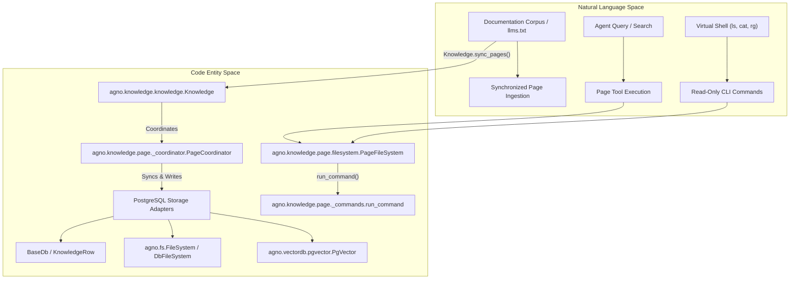
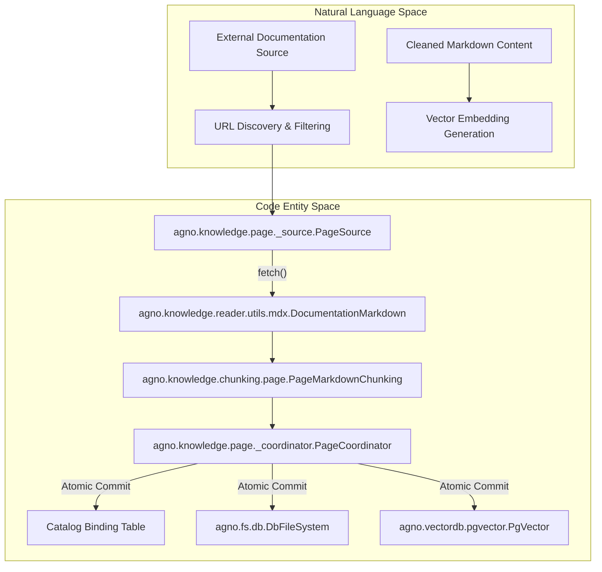

<!-- source: DeepWiki mcp.deepwiki.com · repo agno-agi/agno · extra page Published Pages and Page Filesystem · fetched 2026-11-09 -->

# Published Pages and Page Filesystem

Relevant source files

The following files were used as context for generating this wiki page:

- [cookbook/05_agent_os/27_filesystem/knowledge_fs.py](cookbook/05_agent_os/27_filesystem/knowledge_fs.py)
- [cookbook/05_agent_os/27_public_pages/README.md](cookbook/05_agent_os/27_public_pages/README.md)
- [cookbook/05_agent_os/27_public_pages/TEST_LOG.md](cookbook/05_agent_os/27_public_pages/TEST_LOG.md)
- [cookbook/05_agent_os/27_public_pages/documentation_markdown.py](cookbook/05_agent_os/27_public_pages/documentation_markdown.py)
- [cookbook/05_agent_os/27_public_pages/page_tool_results.py](cookbook/05_agent_os/27_public_pages/page_tool_results.py)
- [libs/agno/agno/knowledge/page/__init__.py](libs/agno/agno/knowledge/page/__init__.py)
- [libs/agno/agno/knowledge/page/_commands.py](libs/agno/agno/knowledge/page/_commands.py)
- [libs/agno/agno/knowledge/page/_coordinator.py](libs/agno/agno/knowledge/page/_coordinator.py)
- [libs/agno/agno/knowledge/page/_source.py](libs/agno/agno/knowledge/page/_source.py)
- [libs/agno/agno/knowledge/page/filesystem.py](libs/agno/agno/knowledge/page/filesystem.py)
- [libs/agno/agno/knowledge/page/tools.py](libs/agno/agno/knowledge/page/tools.py)
- [libs/agno/agno/knowledge/page/types.py](libs/agno/agno/knowledge/page/types.py)
- [libs/agno/agno/knowledge/reader/utils/mdx.py](libs/agno/agno/knowledge/reader/utils/mdx.py)
- [libs/agno/tests/integration/knowledge/test_page_storage.py](libs/agno/tests/integration/knowledge/test_page_storage.py)
- [libs/agno/tests/unit/knowledge/test_page_contract.py](libs/agno/tests/unit/knowledge/test_page_contract.py)
- [libs/agno/tests/unit/knowledge/test_page_source_reliability.py](libs/agno/tests/unit/knowledge/test_page_source_reliability.py)
- [libs/agno/tests/unit/knowledge/test_page_tool_results.py](libs/agno/tests/unit/knowledge/test_page_tool_results.py)
- [libs/agno/tests/unit/reader/test_mdx_normalize.py](libs/agno/tests/unit/reader/test_mdx_normalize.py)

### Purpose and Scope
This document covers the technical architecture and implementation details of Agno's page subsystem (`agno.knowledge.page`). It details the transactional publication mechanism managed by `PageCoordinator` across catalog, database filesystem (`DbFileSystem`), and vector indexes (`PgVector`), the data models and error types defined in `types.py`, shell-like interactive commands via `PageFileSystem`, agent tool integration across chat and Model Context Protocol (MCP) modes, and administrative source migration.

Sources: [libs/agno/agno/knowledge/page/__init__.py:1-60](), [libs/agno/agno/knowledge/knowledge.py:23-32]()

---

### 1. Page Subsystem Overview & Architecture
The page subsystem provides durable, version-coherent storage, chunked vector indexing, and read-only shell access for documentation corpora (such as `llms.txt` indexes and markdown sites). It is integrated directly into the core `Knowledge` class via `page_store` and `page_search` configuration parameters [libs/agno/agno/knowledge/knowledge.py:70-94]().

The subsystem binds three distinct PostgreSQL-backed storage layers under a single transactional coordinator (`PageCoordinator`):
1. **Catalog Table**: Tracks page revisions, digests, and metadata.
2. **FileSystem (`DbFileSystem`)**: Stores complete normalized page bodies and raw document chunks.
3. **Vector Database (`PgVector`)**: Maintains HNSW-indexed vector embeddings for hybrid/vector search over page chunks.

#### Diagram: Natural Language Space to Code Entity Space — Page Subsystem Architecture

Sources: [libs/agno/agno/knowledge/knowledge.py:70-149](), [libs/agno/agno/knowledge/page/_coordinator.py:120-180](), [libs/agno/agno/knowledge/page/filesystem.py:1-10]()

---

### 2. PageCoordinator Transactional Publication
`PageCoordinator` orchestrates the synchronization of a documentation source into the three-layer store [libs/agno/agno/knowledge/page/_coordinator.py:120-180]().

#### Publication Flow and Data Consistency
When `Knowledge.sync_pages()` or `Knowledge.async_sync_pages()` is invoked, `PageCoordinator` executes the following sequence:
1. **Advisory Locking**: Acquires a namespace-scoped PostgreSQL advisory lock (`pg_advisory_xact_lock`) using a hash of the namespace identifier to prevent concurrent publication collisions [libs/agno/agno/knowledge/page/_coordinator.py:166-170]().
2. **Discovery & Fetching**: Parses the entry point (e.g., `llms.txt`), discovers page URLs via `PageSource`, and fetches content with pinned DNS resolution and bounded retries [libs/agno/agno/knowledge/page/_source.py:104-169](). Optional discovery validation callbacks (`validate_discovery`) verify that indexes have not unexpectedly shrunk [cookbook/05_agent_os/27_public_pages/README.md:81-90]().
3. **Normalization & Chunking**: Applies optional markdown transforms (such as `DocumentationMarkdown` via `agno.knowledge.reader.utils.mdx`) and chunks content using `PageMarkdownChunking` [libs/agno/agno/knowledge/page/_coordinator.py:45-47]() [libs/agno/tests/integration/knowledge/test_page_storage.py:120-140]().
4. **Transactional Write**: Commits updates atomically across the catalog, `DbFileSystem`, and `PgVector` table. If any step fails, the transaction rolls back entirely, ensuring readers never observe partial revisions.

#### Diagram: Natural Language Space to Code Entity Space — Publication & Synchronization Pipeline

Sources: [libs/agno/agno/knowledge/knowledge.py:102-149](), [libs/agno/agno/knowledge/page/_coordinator.py:120-180](), [libs/agno/agno/knowledge/page/_source.py:104-169](), [cookbook/05_agent_os/27_public_pages/README.md:81-90]()

---

### 3. Page Types and Error Handling
The subsystem exposes a frozen Pydantic model hierarchy and specialized exception types in `agno.knowledge.page.types` [libs/agno/agno/knowledge/page/types.py:1-224]().

#### Core Data Models
* `Page`: Represents a published page entity containing metadata like `content_id`, `namespace`, `path`, `url`, `title`, `revision`, and `digest` [libs/agno/agno/knowledge/page/types.py:126-138]().
* `SearchResult` & `SearchHit`: Encapsulates vector/hybrid search matches with chunk text, scores, and ranking [libs/agno/agno/knowledge/page/types.py:139-156]().
* `PageRead`: Returns paginated or full text reads for specific documentation paths [libs/agno/agno/knowledge/page/types.py:158-168]().
* `PageCommandResult`: Output wrapper for shell-like commands with support for UTF-8 byte bounding via `bounded(max_bytes)` [libs/agno/agno/knowledge/page/types.py:96-124]().
* `SyncReport`: Summarizes reconciliation outcomes (`discovered`, `updated`, `deleted`, `failed`) [libs/agno/agno/knowledge/page/types.py:203-218]().
* `PageSearchConfig`: Transaction-local PostgreSQL planner options for page search tuning [libs/agno/agno/knowledge/page/types.py:11-28]().

#### Error Hierarchy
All custom errors inherit from `PageError` (default error code: `"page_unavailable"`):
* `PageNotFound` (`"page_not_found"`): Raised when a requested path does not exist [libs/agno/agno/knowledge/page/types.py:38-40]().
* `PageChanged` (`"page_changed"`): Raised when a page revision mismatch is detected [libs/agno/agno/knowledge/page/types.py:42-44]().
* `SearchUnavailable` (`"search_unavailable"`): Raised when vector search infrastructure fails [libs/agno/agno/knowledge/page/types.py:46-48]().
* `SyncFailed` (`"sync_failed"`): Raised on publication failure [libs/agno/agno/knowledge/page/types.py:50-52]().
* `PageSourceBusy` (`"page_source_busy"`): Raised when a source or namespace is locked by another operation [libs/agno/agno/knowledge/page/types.py:92-94]().

Sources: [libs/agno/agno/knowledge/page/types.py:1-224]()

---

### 4. PageFileSystem Shell-like Commands (`ls`/`cat`/`rg`)
`PageFileSystem` provides a read-only shell adapter that allows agents or developers to interact with a knowledge namespace using familiar UNIX command semantics [libs/agno/agno/knowledge/page/filesystem.py:1-10]().

#### Supported Commands
The underlying command runner parses and executes:
* `ls [path]`: Lists pages and directories.
* `tree [path]`: Renders a hierarchical directory tree.
* `cat <path>`: Outputs the full content of a page.
* `head` / `tail`: Inspects content boundaries.
* `wc`: Counts words, lines, and characters.
* `rg` / `grep <pattern>`: Performs regular expression searching across pages using bounded regex matching [libs/agno/agno/knowledge/page/types.py:176-188]().

#### Execution and Bounding
Commands are dispatched within worker pools and bounded by execution timeouts. Output strings are strictly constrained to maximum byte/character limits with automatic truncation safeguards.

Sources: [libs/agno/agno/knowledge/page/types.py:96-124](), [libs/agno/agno/knowledge/page/filesystem.py:1-10]()

---

### 5. Page Search Tools in Chat and MCP Modes
Agents access the page filesystem through toolkits generated by `PageFileSystem.tools()` [libs/agno/agno/knowledge/page/filesystem.py:1-10]().

#### Tool Configuration and Transports
* **Chat Mode (`transport="chat"`)**: Exposes a natural language command tool (default name: `query_pages`) that catches `PageError` exceptions and formats them as human/agent-readable strings using `tool_error()` [libs/agno/agno/knowledge/page/types.py:220-224]().
* **MCP Mode (`transport="mcp"`)**: Exposes typed command metadata, JSON schemas, and structured error boundaries suitable for Model Context Protocol servers.

Sources: [libs/agno/agno/knowledge/page/types.py:220-224](), [libs/agno/agno/knowledge/page/filesystem.py:1-10]()

---

### 6. Source Migration and Version Management
When documentation sources are relocated (e.g., changing an `llms.txt` URL from an old domain to a new domain), Agno provides transactional source binding and migration tooling.

#### Data Structures
* `PageSourceBinding`: Records the exact binding state across namespace, filesystem, catalog, vectors, source URL, and revision number [libs/agno/agno/knowledge/page/types.py:75-82]().
* `PageSourceMigration`: Encapsulates a migration plan (`before`, `after`, `target_source`, `dry_run`, `changed`) [libs/agno/agno/knowledge/page/types.py:84-90]().

#### Migration Workflow
Administrators execute migrations via scripts or CLI commands. A dry run verifies target validity without mutating bindings, while an applied migration updates the stored `PageSourceBinding` atomically in the catalog database [libs/agno/tests/unit/knowledge/test_page_contract.py:88-130]().

Sources: [libs/agno/agno/knowledge/page/types.py:75-90](), [libs/agno/tests/unit/knowledge/test_page_contract.py:88-130]()

---

