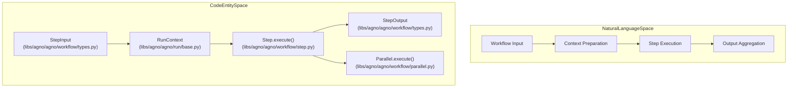
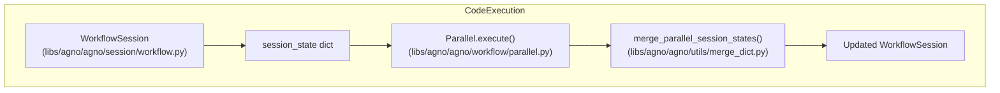

<!-- source: DeepWiki mcp.deepwiki.com · repo agno-agi/agno · extra page Step Execution and Context · fetched 2026-11-09 -->

# Step Execution and Context

Relevant source files

The following files were used as context for generating this wiki page:

- [cookbook/04_workflows/03_loop_execution/loop_iterative_accumulation.py](cookbook/04_workflows/03_loop_execution/loop_iterative_accumulation.py)
- [cookbook/04_workflows/08_human_in_the_loop/condition/02_condition_on_error.py](cookbook/04_workflows/08_human_in_the_loop/condition/02_condition_on_error.py)
- [libs/agno/agno/run/workflow.py](libs/agno/agno/run/workflow.py)
- [libs/agno/agno/workflow/condition.py](libs/agno/agno/workflow/condition.py)
- [libs/agno/agno/workflow/loop.py](libs/agno/agno/workflow/loop.py)
- [libs/agno/agno/workflow/parallel.py](libs/agno/agno/workflow/parallel.py)
- [libs/agno/agno/workflow/router.py](libs/agno/agno/workflow/router.py)
- [libs/agno/agno/workflow/step.py](libs/agno/agno/workflow/step.py)
- [libs/agno/agno/workflow/steps.py](libs/agno/agno/workflow/steps.py)
- [libs/agno/agno/workflow/types.py](libs/agno/agno/workflow/types.py)
- [libs/agno/agno/workflow/workflow.py](libs/agno/agno/workflow/workflow.py)
- [libs/agno/tests/integration/workflows/test_condition_steps.py](libs/agno/tests/integration/workflows/test_condition_steps.py)
- [libs/agno/tests/integration/workflows/test_loop_steps.py](libs/agno/tests/integration/workflows/test_loop_steps.py)
- [libs/agno/tests/integration/workflows/test_parallel_steps.py](libs/agno/tests/integration/workflows/test_parallel_steps.py)
- [libs/agno/tests/integration/workflows/test_router_steps.py](libs/agno/tests/integration/workflows/test_router_steps.py)
- [libs/agno/tests/unit/workflow/test_media_aggregation.py](libs/agno/tests/unit/workflow/test_media_aggregation.py)
- [libs/agno/tests/unit/workflow/test_parallel_run_context_isolation.py](libs/agno/tests/unit/workflow/test_parallel_run_context_isolation.py)
- [libs/agno/tests/unit/workflow/test_previous_content_values.py](libs/agno/tests/unit/workflow/test_previous_content_values.py)
- [libs/agno/tests/unit/workflow/test_step_output_content_roundtrip.py](libs/agno/tests/unit/workflow/test_step_output_content_roundtrip.py)

## Purpose and Scope

This page explains how workflow steps execute and how execution context flows through steps in the Agno framework. It details the key role of the `RunContext` object [libs/agno/agno/run/base.py:36-36]() in carrying execution state such as session variables and output schemas. It covers step input/output chaining via `StepInput` and `StepOutput` [libs/agno/agno/workflow/types.py:85-86](), dependency injection, session state propagation across sequential and parallel steps, Common Expression Language (CEL) evaluation in conditional containers [libs/agno/agno/workflow/condition.py:65-72](), retry and error handling logic, and event enrichment for observability [libs/agno/agno/run/workflow.py:84-101](). For workflow step types and their configuration, see [Workflow Step Types](2.3.1). For Human-in-the-Loop workflow patterns, see [Human-in-the-Loop (HITL) Workflows](2.3.3).

Sources: [libs/agno/agno/run/base.py:36-36](), [libs/agno/agno/run/workflow.py:84-101](), [libs/agno/agno/workflow/condition.py:65-72](), [libs/agno/agno/workflow/types.py:85-86]()

---

## Execution Methods and Flow

All workflow step types (`Step`, `Steps`, `Parallel`, `Condition`, `Loop`, and `Router`) expose four primary execution methods accommodating different runtime semantics:

| Method           | Description                          | Return type                                       |
|------------------|------------------------------------|--------------------------------------------------|
| `execute()`      | Synchronous, non-streaming execution | `StepOutput`                                      |
| `execute_stream()` | Synchronous, streaming execution    | `Iterator[Union[WorkflowRunOutputEvent, StepOutput]]` |
| `aexecute()`     | Asynchronous, non-streaming execution | `Awaitable[StepOutput]`                           |
| `aexecute_stream()`| Asynchronous, streaming execution   | `AsyncIterator[Union[WorkflowRunOutputEvent, StepOutput]]` |

Each method accepts a consistent set of parameters representing the execution environment and workflow context, including `step_input`, `run_context`, `session_state`, and `workflow_run_response`.

Sources: [libs/agno/agno/workflow/step.py:160-172](), [libs/agno/agno/workflow/workflow.py:194-206]()

### Execution and Context Data Flow

The following diagram bridges the natural language concepts of workflow execution to code entities (`Step`, `StepInput`, `StepOutput`, `RunContext`, and `Parallel`), illustrating how inputs are prepared, execution is delegated, and outputs are processed:

Sources: [libs/agno/agno/run/base.py:36-36](), [libs/agno/agno/workflow/parallel.py:47-91](), [libs/agno/agno/workflow/step.py:160-172](), [libs/agno/agno/workflow/types.py:85-86]()

---

## RunContext and Dependency Injection

The `RunContext` class encapsulates the state and identifiers related to a particular run invocation and flows through the entire workflow execution pipeline. It carries session state, output schema expectations, user and workflow identifiers, and dependencies.

### RunContext Structure

- `session_state`: a dictionary storing mutable state shared across steps.
- `output_schema`: a Pydantic model or schema dict defining expected structured output.
- `dependencies`: injected runtime values, such as JWT claim metadata propagated via middleware.
- `run_id`, `session_id`, `user_id`, `workflow_id`, and `workflow_name`: identity scoping attributes.

Sources: [libs/agno/agno/run/base.py:36-36](), [libs/agno/agno/workflow/step.py:36-36]()

### Dependency Injection via Middleware

At the orchestration layer, runtime metadata such as user claims from an authentication token are extracted and injected as `dependencies` into the `RunContext`. This permits workflow steps and agent executors to access user-specific metadata during execution without explicit parameter plumbing.

Sources: [libs/agno/agno/os/middleware/jwt.py:95-124]()

Sources: [libs/agno/agno/os/middleware/jwt.py:95-124](), [libs/agno/agno/run/base.py:36-36](), [libs/agno/agno/workflow/step.py:36-36]()

---

## Step Input, Output, and Type Roundtrip

### StepInput and StepOutput Dataclasses

`StepInput` provides execution context to step executors, holding fields such as `input`, `previous_step_content`, `previous_step_outputs`, and multi-modal attachments (`images`, `videos`, `audio`, `files`). `StepOutput` encapsulates the result of a step, including `content`, `success`, `error`, `metrics`, and nested `steps` for composite containers.

Sources: [libs/agno/agno/workflow/types.py:85-89](), [libs/agno/agno/workflow/workflow.py:139-148]()

### JSON-Native Type Roundtripping

When step outputs are persisted to databases and reloaded (such as during HITL resume operations or multi-run workflows), `StepOutput.to_dict()` and `StepOutput.from_dict()` preserve JSON-native types (`bool`, `int`, `float`, `list`, `dict`, `str`, `NoneType`). This prevents falsey values (like `0` or `False`) from casting to string representations that evaluate incorrectly in subsequent logic checks.

Sources: [libs/agno/tests/unit/workflow/test_step_output_content_roundtrip.py:1-94]()

Sources: [libs/agno/agno/workflow/types.py:85-89](), [libs/agno/agno/workflow/workflow.py:139-148](), [libs/agno/tests/unit/workflow/test_step_output_content_roundtrip.py:1-94]()

---

## Session State Propagation

Session state is a mutable dictionary propagating through workflow execution, allowing steps to share control state and data.

### Sequential vs Parallel State Flow

In sequential step containers (`Steps`, `Condition`, `Router`), session state is merged after each step using dictionary merge utilities. In parallel containers (`Parallel`), execution copies the workflow session state into isolated instances to avoid concurrency conflicts, and then merges them back using conflict-aware merging logic (`merge_parallel_session_states`).

Sources: [libs/agno/agno/session/workflow.py:1-112](), [libs/agno/agno/utils/merge_dict.py:25-25](), [libs/agno/agno/workflow/parallel.py:47-91]()

---

## CEL Expressions in Workflow Containers

Containers such as `Condition`, `Router`, and `Loop` support Common Expression Language (CEL) strings for dynamic evaluations.

### Available CEL Context Variables

CEL expressions evaluate against a predefined execution context containing:
- `input`: The primary workflow input string.
- `previous_step_content`: Content from the immediately preceding step.
- `previous_step_outputs`: Map of step names to content strings from all prior steps.
- `additional_data`: Map of additional data passed to the workflow.
- `session_state`: Map of mutable session state values.
- `step_choices`: Available step names (for `Router`).
- `current_iteration`, `max_iterations`, `all_success` (for `Loop`).

Sources: [libs/agno/agno/workflow/cel.py:1-50](), [libs/agno/agno/workflow/condition.py:65-79](), [libs/agno/agno/workflow/router.py:62-70](), [libs/agno/agno/workflow/loop.py:51-57]()

Sources: [libs/agno/agno/workflow/cel.py:1-50](), [libs/agno/agno/workflow/condition.py:65-79](), [libs/agno/agno/workflow/loop.py:51-57](), [libs/agno/agno/workflow/router.py:62-70]()

---

## Retry Logic, Error Handling, and Event Enrichment

### Retry and Error Handling

Steps support automatic retry loops controlled by `max_retries`. If execution fails repeatedly, the `OnError` policy (`fail`, `skip`, or `pause`) determines whether the workflow fails, skips the step, or triggers a human-in-the-loop pause.

Sources: [libs/agno/agno/workflow/step.py:160-203](), [libs/agno/agno/workflow/types.py:50-62]()

### Event Enrichment

When event streaming is active, events emitted during step execution are enriched with metadata such as `workflow_id`, `workflow_name`, `run_id`, `session_id`, `step_id`, `step_name`, and `nested_depth` to support comprehensive trace observability.

Sources: [libs/agno/agno/run/workflow.py:84-101](), [libs/agno/agno/workflow/step.py:53-58]()

Sources: [libs/agno/agno/run/workflow.py:84-101](), [libs/agno/agno/workflow/step.py:53-58](), [libs/agno/agno/workflow/types.py:50-62]()

---

