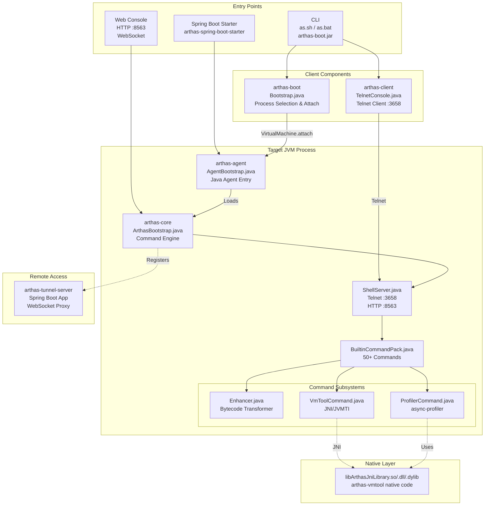

<!-- source: DeepWiki mcp.deepwiki.com · repo alibaba/arthas · page 1 Overview · fetched 2026-10-29 -->

# Overview

<details>
<summary>Relevant source files</summary>

The following files were used as context for generating this wiki page:

- [CONTRIBUTING.md](CONTRIBUTING.md)
- [README.md](README.md)
- [README_CN.md](README_CN.md)
- [USERS.md](USERS.md)
- [agent/pom.xml](agent/pom.xml)
- [arthas-vmtool/README.md](arthas-vmtool/README.md)
- [as-package.sh](as-package.sh)
- [bin/as-service.bat](bin/as-service.bat)
- [bin/as.bat](bin/as.bat)
- [boot/pom.xml](boot/pom.xml)
- [client/pom.xml](client/pom.xml)
- [common/pom.xml](common/pom.xml)
- [core/pom.xml](core/pom.xml)
- [memorycompiler/pom.xml](memorycompiler/pom.xml)
- [packaging/pom.xml](packaging/pom.xml)
- [pom.xml](pom.xml)
- [site/pom.xml](site/pom.xml)
- [spy/pom.xml](spy/pom.xml)
- [static/cider.png](static/cider.png)
- [static/citycloud.jpg](static/citycloud.jpg)
- [static/didiglobal.jpg](static/didiglobal.jpg)
- [static/dms.png](static/dms.png)
- [static/guideir.jpg](static/guideir.jpg)
- [static/hollycrm.png](static/hollycrm.png)
- [static/mingyuanyun.jpg](static/mingyuanyun.jpg)
- [static/ouyeel.png](static/ouyeel.png)
- [static/videt.png](static/videt.png)
- [static/zhaopin.png](static/zhaopin.png)
- [testcase/pom.xml](testcase/pom.xml)
- [tunnel-client/pom.xml](tunnel-client/pom.xml)
- [tunnel-server/pom.xml](tunnel-server/pom.xml)

</details>


Arthas is a Java diagnostic tool that enables developers to troubleshoot production applications without modifying source code or restarting the JVM. The system operates by attaching to a running Java process and injecting a diagnostic agent that provides real-time introspection, bytecode instrumentation, and profiling capabilities.

This page provides an overview of Arthas's architecture, capabilities, and components. For detailed information about specific subsystems, see:
- [Core Architecture](#2) - Agent-based model and component relationships
- [Diagnostic Commands](#3) - Command-line tools for inspection and monitoring
- [Bytecode Instrumentation System](#4) - Method tracing and interception mechanisms
- [Installation and Deployment](#8) - Setup and configuration options

## Purpose and Problem Statement

Arthas addresses diagnostic challenges in production environments where traditional debugging approaches are impractical:

- **No code changes required**: Inspect and diagnose without modifying application source
- **No JVM restart needed**: Attach to running processes without service interruption
- **Non-invasive observation**: Acts as an observer without suspending application threads
- **Production-safe operations**: Designed for live system diagnosis

**Sources**: [README.md:13-27](), [README_CN.md:17-30]()

## Key Capabilities

Arthas provides diagnostic capabilities across several domains:

| Capability Domain | Features |
|------------------|----------|
| **Class Inspection** | Check class loading, decompile classes (`jad`), search classes (`sc`), search methods (`sm`) |
| **Method Observation** | Watch method parameters/returns (`watch`), trace method calls (`trace`), capture stack traces (`stack`) |
| **Performance Profiling** | CPU/memory profiling via async-profiler, flame graph generation |
| **Bytecode Manipulation** | Hot-reload classes (`retransform`), compile in-memory (`mc`), dump class bytecode (`dump`) |
| **JVM Monitoring** | Thread analysis, heap inspection, classloader statistics, system metrics |
| **Dynamic Expression** | Execute OGNL expressions against live objects |

**Sources**: [README.md:29-44](), [README_CN.md:19-30]()

## High-Level System Architecture

The following diagram illustrates Arthas's major architectural layers and component relationships:



**Arthas System Architecture**: Shows the three-layer model with entry points, client components, and in-JVM diagnostic engine. The system uses Java's Instrumentation API to inject the agent, which then provides diagnostic services via telnet/HTTP protocols.

**Sources**: [pom.xml:53-82](), [README.md:1-97](), [agent/pom.xml:1-68](), [core/pom.xml:1-279](), [boot/pom.xml:1-71](), [client/pom.xml:1-66]()

## Module Structure

Arthas uses a multi-module Maven project structure organized by functional concern:

```mermaid
graph TB
    Root["arthas-all<br/>pom.xml"]
    
    Root --> CoreModules["Core Modules"]
    Root --> ClientModules["Client Modules"]
    Root --> IntegrationModules["Integration Modules"]
    Root --> DistributionModules["Distribution Modules"]
    Root --> SupportModules["Support Modules"]
    
    CoreModules --> agent["arthas-agent<br/>Agent entry point"]
    CoreModules --> core["arthas-core<br/>Command engine"]
    CoreModules --> spy["arthas-spy<br/>Hook callbacks"]
    CoreModules --> vmtool["arthas-vmtool<br/>Native JNI/JVMTI"]
    
    ClientModules --> boot["arthas-boot<br/>Bootstrap launcher"]
    ClientModules --> client["arthas-client<br/>Telnet console"]
    
    IntegrationModules --> starter["arthas-spring-boot-starter<br/>Auto-configuration"]
    IntegrationModules --> tunnelserver["arthas-tunnel-server<br/>Remote proxy"]
    IntegrationModules --> tunnelclient["arthas-tunnel-client<br/>Agent tunnel client"]
    IntegrationModules --> mcp["arthas-mcp-server<br/>MCP protocol"]
    
    DistributionModules --> packaging["arthas-packaging<br/>ZIP/DEB/RPM"]
    DistributionModules --> site["arthas-site<br/>VuePress docs"]
    
    SupportModules --> common["arthas-common<br/>Shared utilities"]
    SupportModules --> model["arthas-model<br/>Data models"]
    SupportModules --> memcompiler["arthas-memorycompiler<br/>In-memory compiler"]
```



**Arthas Maven Module Structure**: The parent POM coordinates 20+ modules organized by architectural layer. Core modules run inside the target JVM, client modules provide user interfaces, integration modules enable embedding, and distribution modules handle packaging.

**Sources**: [pom.xml:53-82](), [CONTRIBUTING.md:1-163]()

## Execution Model

Arthas operates through a multi-phase lifecycle:

### 1. Attachment Phase

The `arthas-boot.jar` launcher performs process discovery and agent injection:

```mermaid
sequenceDiagram
    participant User
    participant Bootstrap["Bootstrap.java<br/>(arthas-boot)"]
    participant VirtualMachine["VirtualMachine API<br/>(tools.jar)"]
    participant TargetJVM["Target JVM Process"]
    
    User->>Bootstrap: java -jar arthas-boot.jar
    Bootstrap->>Bootstrap: List Java processes<br/>(jps / VirtualMachine.list())
    Bootstrap->>User: Display process selection
    User->>Bootstrap: Select PID
    Bootstrap->>Bootstrap: Download/verify<br/>arthas-agent.jar
    Bootstrap->>VirtualMachine: attach(pid)
    VirtualMachine->>TargetJVM: Signal attachment
    TargetJVM-->>VirtualMachine: Attachment successful
    Bootstrap->>VirtualMachine: loadAgent(arthas-agent.jar)
    VirtualMachine->>TargetJVM: Load agent JAR
    TargetJVM->>TargetJVM: Call AgentBootstrap.agentmain()
```

**Attachment Sequence**: Shows how the bootstrap process locates the target JVM and injects the agent using the Java Attach API (`com.sun.tools.attach.VirtualMachine`).

**Sources**: [boot/pom.xml:1-71](), [bin/as.bat:1-119]()

### 2. Agent Initialization

Once loaded, `AgentBootstrap` in the `arthas-agent` module initializes the core engine:

1. Create isolated `ArthasClassLoader` to prevent dependency conflicts
2. Load `ArthasBootstrap` from `arthas-core.jar`
3. Initialize `Spy` API into bootstrap classloader for bytecode hooks
4. Enhance application classloaders to support instrumentation

**Sources**: [agent/pom.xml:1-68](), [core/pom.xml:1-279]()

### 3. Service Binding

The `ArthasBootstrap.bind()` method starts diagnostic services:

- **ShellServer**: Binds telnet port (default 3658) and HTTP port (default 8563)
- **BuiltinCommandPack**: Registers 50+ diagnostic commands
- **SessionManager**: Manages concurrent client sessions
- **TunnelClient** (optional): Registers with tunnel server for remote access

**Sources**: [core/pom.xml:1-279](), [bin/as.bat:13-14]()

### 4. Interactive Session

Clients connect via telnet or HTTP/WebSocket to execute commands:

```mermaid
sequenceDiagram
    participant Client["TelnetConsole / Browser"]
    participant ShellServer["ShellServer<br/>(arthas-core)"]
    participant CommandResolver["CommandResolver"]
    participant Command["Command Implementation<br/>(e.g., WatchCommand)"]
    participant Enhancer["Enhancer<br/>(Bytecode Transformer)"]
    participant TargetClass["Application Class"]
    
    Client->>ShellServer: Connect telnet/websocket
    ShellServer->>ShellServer: Create Session
    
    loop Interactive Commands
        Client->>ShellServer: watch com.example.Service method
        ShellServer->>CommandResolver: Parse & resolve command
        CommandResolver->>Command: Create WatchCommand instance
        Command->>Enhancer: Request method transformation
        Enhancer->>Enhancer: Generate bytecode<br/>(inject SpyAPI callbacks)
        Enhancer->>TargetClass: Retransform class
        TargetClass-->>Enhancer: Transformation complete
        Command-->>Client: Waiting for method invocation...
        
        Note over TargetClass: Application invokes method
        TargetClass->>Command: SpyAPI callback
        Command->>Command: Capture params/result
        Command-->>Client: Display captured data
    end
```

**Command Execution Flow**: Demonstrates how user commands trigger bytecode instrumentation and receive callbacks from instrumented methods through the SpyAPI hook mechanism.

**Sources**: [core/pom.xml:1-279](), [client/pom.xml:1-66]()

## Interaction Models

Arthas supports multiple modes of interaction:

### Local Command Line (as.sh / as.bat)

Shell scripts that combine bootstrapping and client connection:

- **as.sh**: Unix/Linux/macOS shell script
- **as.bat**: Windows batch script
- **arthas-boot.jar**: Cross-platform Java launcher

**Sources**: [bin/as.bat:1-119](), [as-package.sh:1-123]()

### Web Console

Browser-based interface served on HTTP port 8563:

- Static assets from `web-ui` module bundled into `arthas-core.jar`
- WebSocket connection for bidirectional command execution
- Rich terminal emulation with syntax highlighting

**Sources**: [core/pom.xml:92-95]()

### Spring Boot Starter

Auto-configuration for embedding Arthas in Spring Boot applications:

- Module: `arthas-spring-boot-starter`
- Automatic agent initialization on application startup
- Configuration via `application.properties` or `application.yml`

**Sources**: [pom.xml:69]()

### Tunnel Server

Remote access proxy for distributed environments:

- Spring Boot application: `arthas-tunnel-server`
- Agents register via WebSocket
- Central dashboard for managing multiple Arthas instances

**Sources**: [tunnel-server/pom.xml:1-227]()

### MCP Protocol

Integration with AI tools and IDEs:

- Module: `arthas-mcp-server`
- Implements Model Context Protocol
- Enables programmatic diagnostic automation

**Sources**: [pom.xml:62](), [README.md:1-463]()

## Distribution and Packaging

Arthas is distributed in multiple formats via the `arthas-packaging` module:

| Format | Description | Use Case |
|--------|-------------|----------|
| **ZIP** | `arthas-bin.zip` | Manual installation, script-based deployment |
| **JAR** | `arthas-boot.jar` | Single-file launcher, most common usage |
| **DEB** | `arthas-<version>.deb` | Debian/Ubuntu package management |
| **RPM** | `arthas-<version>.rpm` | RedHat/CentOS package management |
| **Docker** | `hengyunabc/arthas` | Container-based deployment |
| **Maven Central** | `com.taobao.arthas:*` | Programmatic dependency inclusion |

The packaging process aggregates:
- Core JARs (`arthas-core-shade.jar`, `arthas-agent.jar`, `arthas-client.jar`, `arthas-boot.jar`)
- Native libraries (`libArthasJniLibrary.so/.dll/.dylib`) for each platform
- Shell scripts (`as.sh`, `as.bat`)
- Web UI assets (bundled in core JAR)
- Documentation site (from `arthas-site` module)

**Sources**: [packaging/pom.xml:1-263](), [CONTRIBUTING.md:136-163]()

## Build and Development

The project uses Maven with platform-specific profiles for native compilation:

- **Java compilation**: Target JDK 8 for maximum compatibility
- **Native compilation**: Cross-platform builds via GitHub Actions for Linux (x64/aarch64), Windows, macOS
- **Dependency shading**: `maven-shade-plugin` relocates conflicting dependencies (netty, slf4j, fastjson2) into `com.alibaba.arthas.deps` package
- **Testing**: CI matrix covers JDK 8, 11, 17, 21, 25 on Ubuntu, Windows, macOS

The `as-package.sh` script provides local development workflow:
1. Build all modules with timestamp-based version
2. Install to `~/.arthas/lib/<version>/arthas/`
3. `as.sh` automatically uses latest local version

**Sources**: [pom.xml:84-95](), [pom.xml:224-253](), [core/pom.xml:18-104](), [as-package.sh:1-123](), [CONTRIBUTING.md:19-133]()

## Runtime Requirements

- **JDK Support**: JDK 6+ (Arthas 4.x dropped JDK 6/7 support)
- **Operating Systems**: Linux, macOS, Windows
- **Permissions**: Sufficient privileges to attach to target JVM process
- **Network Ports**: Telnet port (default 3658), HTTP port (default 8563)
- **Native Libraries**: Platform-specific JNI libraries for advanced features (VmTool, profiler)

For JDK 9+, tools.jar is not required as the attach mechanism is built into the JDK.

**Sources**: [README.md:43-44](), [bin/as.bat:77-89](), [CONTRIBUTING.md:21-23]()

---

