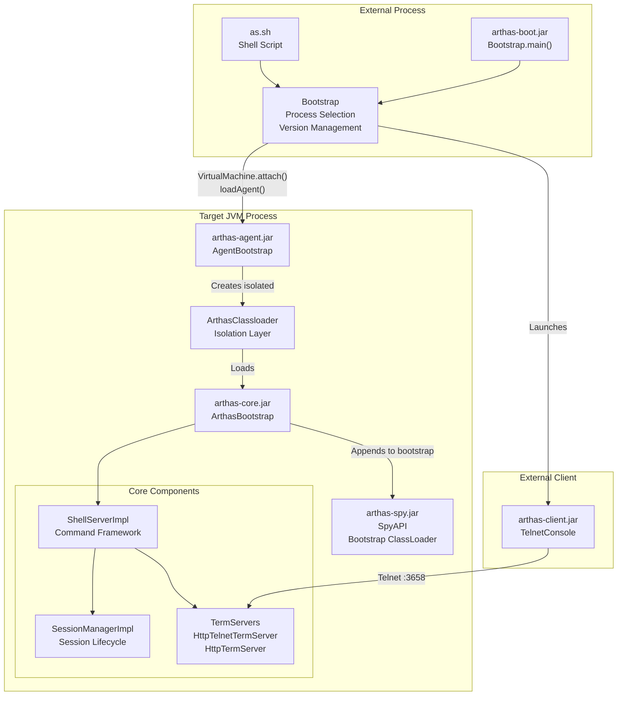
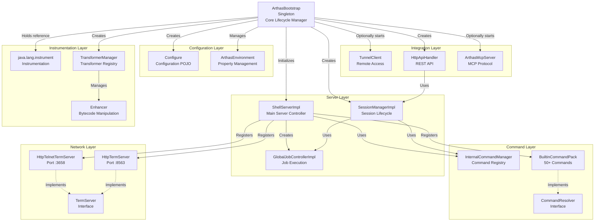
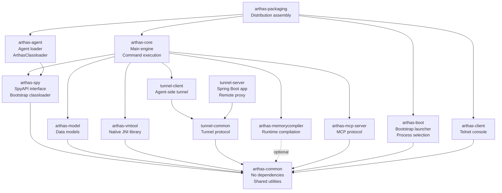
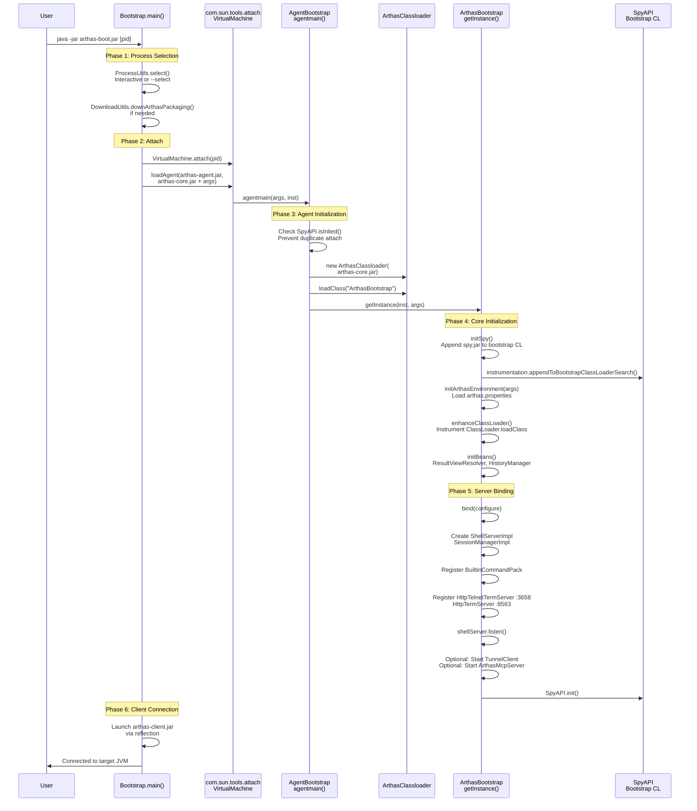
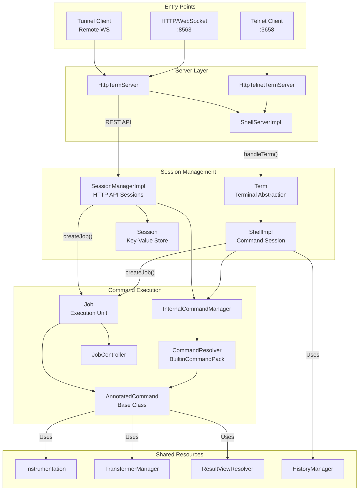
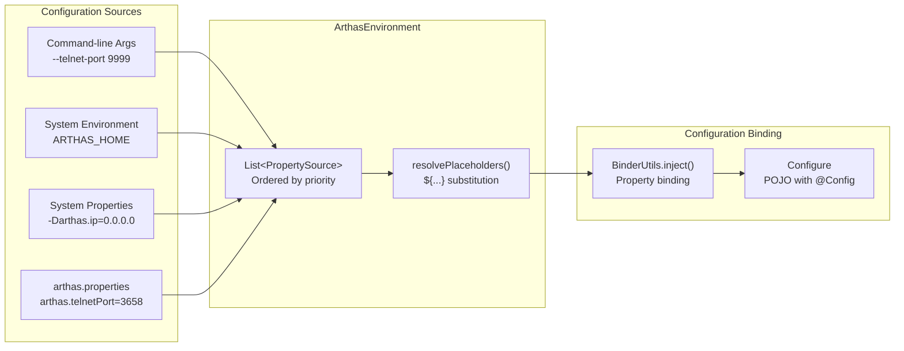
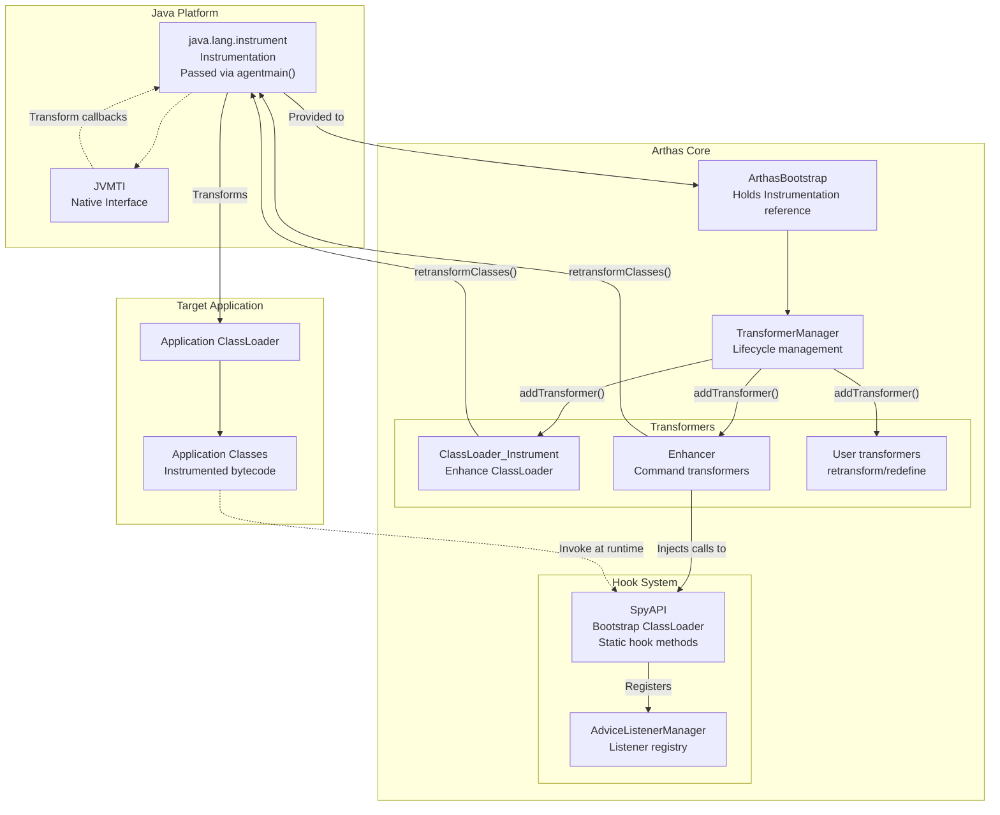
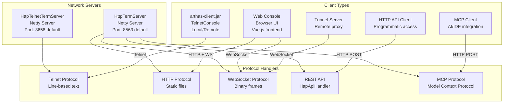
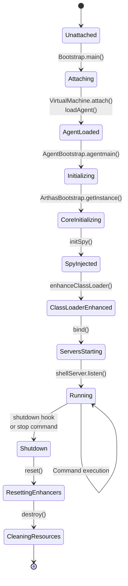

<!-- source: DeepWiki mcp.deepwiki.com · repo alibaba/arthas · page 2 Core Architecture · fetched 2026-10-29 -->

# Core Architecture

<details>
<summary>Relevant source files</summary>

The following files were used as context for generating this wiki page:

- [Dockerfile](Dockerfile)
- [Dockerfile-No-Jdk](Dockerfile-No-Jdk)
- [agent/pom.xml](agent/pom.xml)
- [agent/src/main/java/com/taobao/arthas/agent334/AgentBootstrap.java](agent/src/main/java/com/taobao/arthas/agent334/AgentBootstrap.java)
- [bin/as.sh](bin/as.sh)
- [boot/pom.xml](boot/pom.xml)
- [boot/src/main/java/com/taobao/arthas/boot/Bootstrap.java](boot/src/main/java/com/taobao/arthas/boot/Bootstrap.java)
- [client/pom.xml](client/pom.xml)
- [common/pom.xml](common/pom.xml)
- [core/pom.xml](core/pom.xml)
- [core/src/main/java/arthas.properties](core/src/main/java/arthas.properties)
- [core/src/main/java/com/taobao/arthas/core/Arthas.java](core/src/main/java/com/taobao/arthas/core/Arthas.java)
- [core/src/main/java/com/taobao/arthas/core/config/Configure.java](core/src/main/java/com/taobao/arthas/core/config/Configure.java)
- [core/src/main/java/com/taobao/arthas/core/mcp/ArthasMcpServer.java](core/src/main/java/com/taobao/arthas/core/mcp/ArthasMcpServer.java)
- [core/src/main/java/com/taobao/arthas/core/server/ArthasBootstrap.java](core/src/main/java/com/taobao/arthas/core/server/ArthasBootstrap.java)
- [core/src/main/java/com/taobao/arthas/core/shell/impl/ShellServerImpl.java](core/src/main/java/com/taobao/arthas/core/shell/impl/ShellServerImpl.java)
- [core/src/main/java/com/taobao/arthas/core/shell/session/impl/SessionManagerImpl.java](core/src/main/java/com/taobao/arthas/core/shell/session/impl/SessionManagerImpl.java)
- [core/src/main/java/com/taobao/arthas/core/shell/term/impl/http/api/ApiRequest.java](core/src/main/java/com/taobao/arthas/core/shell/term/impl/http/api/ApiRequest.java)
- [core/src/main/java/com/taobao/arthas/core/shell/term/impl/http/api/HttpApiHandler.java](core/src/main/java/com/taobao/arthas/core/shell/term/impl/http/api/HttpApiHandler.java)
- [core/src/main/java/com/taobao/arthas/core/util/UserStatUtil.java](core/src/main/java/com/taobao/arthas/core/util/UserStatUtil.java)
- [memorycompiler/pom.xml](memorycompiler/pom.xml)
- [packaging/pom.xml](packaging/pom.xml)
- [pom.xml](pom.xml)
- [site/pom.xml](site/pom.xml)
- [spy/pom.xml](spy/pom.xml)
- [testcase/pom.xml](testcase/pom.xml)
- [tunnel-client/pom.xml](tunnel-client/pom.xml)
- [tunnel-server/pom.xml](tunnel-server/pom.xml)
- [tunnel-server/src/main/java/com/alibaba/arthas/tunnel/server/app/web/StatController.java](tunnel-server/src/main/java/com/alibaba/arthas/tunnel/server/app/web/StatController.java)

</details>


## Purpose and Scope

This document describes the overall architectural design of Arthas, including its agent-based deployment model, core component relationships, module organization, and initialization flow. It focuses on the structural elements that enable Arthas to attach to running JVMs and provide diagnostic capabilities without application restart.

For specific subsystems, see:
- Module structure details: [Module Structure](#2.1)
- Bootstrapping and attachment process: [Bootstrapping and Attachment](#2.2)
- Communication protocols: [Client-Server Communication](#2.3)
- Command execution pipeline: [Command Processing Pipeline](#2.4)
- Bytecode instrumentation internals: [Bytecode Instrumentation System](#4)

---

## Agent-Based Deployment Model

Arthas operates as a Java Agent that attaches to a running JVM using the Java Instrumentation API. The architecture follows a clear separation between the external launcher (running in a separate JVM), the agent loader (injected into target JVM), and the core engine (running inside target JVM).

### Deployment Architecture



**Key Design Principles:**

1. **Process Isolation**: Bootstrap runs in a separate JVM to avoid interfering with target application
2. **ClassLoader Isolation**: `ArthasClassloader` prevents dependency conflicts with target application classes
3. **Bootstrap Injection**: `SpyAPI` is injected into bootstrap classloader to be accessible from all classloaders
4. **Non-Invasive Attachment**: Uses standard Java Attach API (`VirtualMachine.attach()`)

Sources: [bin/as.sh:1-1043](), [boot/src/main/java/com/taobao/arthas/boot/Bootstrap.java:1-707](), [agent/src/main/java/com/taobao/arthas/agent334/AgentBootstrap.java:1-200](), [core/src/main/java/com/taobao/arthas/core/server/ArthasBootstrap.java:1-650]()

---

## Core Component Hierarchy

The runtime architecture consists of several layers, each with specific responsibilities. The following diagram shows the class-level relationships between core components:



**Component Responsibilities:**

| Component | Responsibility | Key Methods |
|-----------|---------------|-------------|
| `ArthasBootstrap` | Singleton lifecycle manager, initialization orchestration | `getInstance()`, `bind()`, `destroy()` |
| `Configure` | Configuration POJO with all runtime settings | Property getters/setters |
| `ArthasEnvironment` | Multi-source property resolution (args > env > properties file) | `getProperty()`, `addFirst()`, `addLast()` |
| `ShellServerImpl` | Main server controller, registers term servers and commands | `listen()`, `registerTermServer()`, `registerCommandResolver()` |
| `SessionManagerImpl` | Session creation, eviction, timeout management | `createSession()`, `getSession()`, `removeSession()` |
| `InternalCommandManager` | Command registry and resolution | `getCommand()`, `registerCommand()` |
| `HttpTelnetTermServer` | Telnet protocol handler on port 3658 | `termHandler()`, `listen()` |
| `HttpTermServer` | HTTP/WebSocket handler on port 8563 | `termHandler()`, `listen()` |
| `TransformerManager` | Manages all active `ClassFileTransformer` instances | `addTransformer()`, `removeTransformer()`, `destroy()` |

Sources: [core/src/main/java/com/taobao/arthas/core/server/ArthasBootstrap.java:94-650](), [core/src/main/java/com/taobao/arthas/core/config/Configure.java:1-290](), [core/src/main/java/com/taobao/arthas/core/shell/impl/ShellServerImpl.java:1-200](), [core/src/main/java/com/taobao/arthas/core/shell/session/impl/SessionManagerImpl.java:1-180]()

---

## Module Organization

Arthas is organized as a Maven multi-module project with clear dependency boundaries. The modules are designed to minimize coupling and allow independent development.

### Module Dependency Graph



**Module Descriptions:**

| Module | Artifact | Purpose | Key Classes |
|--------|----------|---------|-------------|
| **common** | arthas-common | Shared utilities, no dependencies | `AnsiLog`, `PidUtils`, `SocketUtils` |
| **spy** | arthas-spy.jar | Hook API injected into bootstrap classloader | `SpyAPI`, `Spy` interface |
| **model** | arthas-model | Data transfer objects for command results | `ResultModel`, `WatchModel`, `TraceModel` |
| **vmtool** | arthas-vmtool + libArthasJniLibrary.so | JNI/JVMTI bridge for heap analysis | `VmTool` native methods |
| **core** | arthas-core-shade.jar | Main engine with shaded dependencies | `ArthasBootstrap`, `ShellServerImpl`, `Enhancer` |
| **agent** | arthas-agent.jar | Agent loader with isolated classloader | `AgentBootstrap`, `ArthasClassloader` |
| **boot** | arthas-boot.jar | Bootstrap launcher, process selection | `Bootstrap`, `ProcessUtils` |
| **client** | arthas-client.jar | Telnet console client | `TelnetConsole` |
| **tunnel-client** | tunnel-client | WebSocket client for tunnel server | `TunnelClient` |
| **tunnel-server** | tunnel-server-fatjar.jar | Spring Boot remote proxy | `TunnelServer`, `AgentClusterStore` |
| **packaging** | arthas-bin.zip | Distribution assembly | ZIP/DEB/RPM packages |

**Build Configuration:**

The core module uses Maven Shade plugin to relocate dependencies and avoid conflicts:

```
Relocations (from core/pom.xml):
- org.slf4j        → com.alibaba.arthas.deps.org.slf4j
- ch.qos.logback   → com.alibaba.arthas.deps.ch.qos.logback
- io.netty         → com.alibaba.arthas.deps.io.netty
- com.alibaba.fastjson2 → com.alibaba.arthas.deps.com.alibaba.fastjson2
```

Sources: [pom.xml:1-494](), [core/pom.xml:1-280](), [agent/pom.xml:1-69](), [boot/pom.xml:1-72](), [client/pom.xml:1-67](), [tunnel-server/pom.xml:1-227](), [packaging/pom.xml:1-264]()

---

## Initialization Sequence

The initialization process follows a precise sequence to ensure proper isolation and setup. The following diagram shows the detailed initialization flow:



**Initialization Phases:**

1. **Process Selection** ([Bootstrap.java:394-408]()): 
   - List Java processes via `jps` or `ps` 
   - Interactive selection or `--select` filter
   - Version management and download if needed

2. **Attach** ([Bootstrap.java:516-594]()): 
   - Use `VirtualMachine.attach(pid)` from tools.jar
   - `loadAgent()` triggers `AgentBootstrap.agentmain()`
   - Agent jar path and configuration passed as string argument

3. **Agent Initialization** ([AgentBootstrap.java:90-173]()):
   - Check `SpyAPI.isInited()` to prevent duplicate attach
   - Create `ArthasClassloader` for dependency isolation
   - Load and invoke `ArthasBootstrap.getInstance()`

4. **Core Initialization** ([ArthasBootstrap.java:138-185]()):
   - `initSpy()`: Inject spy.jar into bootstrap classloader
   - `initArthasEnvironment()`: Load configuration from multiple sources
   - `enhanceClassLoader()`: Instrument `ClassLoader.loadClass` to ensure SpyAPI visibility
   - `initBeans()`: Create service objects

5. **Server Binding** ([ArthasBootstrap.java:355-504]()):
   - Create `ShellServerImpl` with `ShellServerOptions`
   - Register `BuiltinCommandPack` (50+ commands)
   - Register term servers (Telnet :3658, HTTP :8563)
   - Optional: Start `TunnelClient` for remote access
   - Optional: Start `ArthasMcpServer` for MCP protocol
   - Generate random password if listening on 0.0.0.0

6. **Client Connection** ([Bootstrap.java:600-635]()):
   - Launch `arthas-client.jar` via `URLClassLoader` and reflection
   - Connect to telnet port for interactive session

Sources: [boot/src/main/java/com/taobao/arthas/boot/Bootstrap.java:313-635](), [agent/src/main/java/com/taobao/arthas/agent334/AgentBootstrap.java:90-199](), [core/src/main/java/com/taobao/arthas/core/server/ArthasBootstrap.java:138-504]()

---

## Runtime Component Interaction

Once initialized, Arthas operates through several interconnected subsystems. The following diagram illustrates the runtime relationships:



**Interaction Patterns:**

1. **Telnet/Terminal Flow**:
   - `HttpTelnetTermServer` accepts telnet connection on port 3658
   - Creates `Term` abstraction for terminal I/O
   - `ShellServerImpl.handleTerm()` creates `ShellImpl` session
   - `ShellImpl` reads commands, creates `Job`, executes through `JobController`

2. **HTTP API Flow**:
   - `HttpTermServer` accepts HTTP/WebSocket on port 8563
   - `HttpApiHandler` processes REST requests
   - `SessionManagerImpl` manages stateless API sessions
   - Commands executed through same `Job`/`JobController` mechanism

3. **Command Resolution**:
   - `InternalCommandManager` holds registered `CommandResolver` instances
   - `BuiltinCommandPack` provides 50+ built-in commands
   - Each command extends `AnnotatedCommand` with CLI annotations
   - Commands access shared resources: `Instrumentation`, `TransformerManager`, etc.

4. **Session Types**:
   - **ShellImpl**: Interactive terminal session with readline, history, job control
   - **Session** (HTTP API): Stateless session with result distributor for async command execution
   - Both share same `InternalCommandManager` and command implementations

Sources: [core/src/main/java/com/taobao/arthas/core/shell/impl/ShellServerImpl.java:44-200](), [core/src/main/java/com/taobao/arthas/core/shell/session/impl/SessionManagerImpl.java:1-180](), [core/src/main/java/com/taobao/arthas/core/shell/term/impl/http/api/HttpApiHandler.java:1-400]()

---

## Configuration System

Arthas uses a hierarchical configuration system with multiple property sources. The `ArthasEnvironment` class manages configuration resolution with priority ordering.

### Configuration Priority

```
Priority (highest to lowest):
1. Command-line arguments (passed via Bootstrap)
2. System environment variables
3. System properties (-D flags)
4. arthas.properties file
5. Default values

Special: arthas.config.overrideAll=true reverses priority
```

### Configuration Loading



**Key Configuration Properties:**

| Property | Default | Description | Source |
|----------|---------|-------------|--------|
| `arthas.telnetPort` | 3658 | Telnet server port | [arthas.properties:2]() |
| `arthas.httpPort` | 8563 | HTTP server port | [arthas.properties:3]() |
| `arthas.ip` | 127.0.0.1 | Listen IP address | [arthas.properties:4]() |
| `arthas.sessionTimeout` | 1800 | Session timeout (seconds) | [arthas.properties:7]() |
| `arthas.enhanceLoaders` | - | ClassLoaders to enhance | [arthas.properties:9]() |
| `arthas.username` | - | Authentication username | [arthas.properties:12]() |
| `arthas.password` | - | Authentication password | [arthas.properties:13]() |
| `arthas.localConnectionNonAuth` | true | Skip auth for 127.0.0.1 | [arthas.properties:16]() |
| `arthas.tunnelServer` | - | Tunnel server WebSocket URL | [arthas.properties:19]() |
| `arthas.agentId` | - | Agent ID for tunnel | [arthas.properties:20]() |
| `arthas.disabledCommands` | - | Comma-separated disabled commands | [arthas.properties:22]() |
| `arthas.mcpEndpoint` | /mcp | MCP protocol endpoint | [arthas.properties:27]() |
| `arthas.mcpProtocol` | STREAMABLE | MCP protocol mode | [arthas.properties:28]() |

**Configuration Binding Process:**

1. `ArthasBootstrap` constructor calls `initArthasEnvironment(args)` ([ArthasBootstrap.java:146]())
2. Create `MapPropertySource` from command-line args ([ArthasBootstrap.java:265-278]())
3. Load `arthas.properties` if exists ([ArthasBootstrap.java:313-346]())
4. Add property sources to `ArthasEnvironment` in priority order ([ArthasBootstrap.java:278-346]())
5. Use `BinderUtils.inject()` to bind properties to `Configure` POJO ([ArthasBootstrap.java:283]())
6. `Configure` instance used throughout initialization

Sources: [core/src/main/java/com/taobao/arthas/core/server/ArthasBootstrap.java:253-346](), [core/src/main/java/com/taobao/arthas/core/config/Configure.java:1-290](), [core/src/main/java/arthas.properties:1-29]()

---

## Instrumentation Architecture

Arthas's diagnostic capabilities are built on the Java Instrumentation API. The architecture ensures proper isolation and management of class transformations.

### Instrumentation Component Stack



**Instrumentation Flow:**

1. **Instrumentation Acquisition**: `Instrumentation` instance passed via `AgentBootstrap.agentmain()` ([AgentBootstrap.java:67-68]())

2. **SpyAPI Injection**: 
   - `arthas-spy.jar` appended to bootstrap classloader ([ArthasBootstrap.java:198-221]())
   - Makes `SpyAPI` accessible from all classloaders
   - Static methods provide hook points: `atEnter()`, `atExit()`, `atExceptionExit()`

3. **ClassLoader Enhancement**:
   - `enhanceClassLoader()` instruments `ClassLoader.loadClass()` ([ArthasBootstrap.java:223-251]())
   - Ensures SpyAPI is loaded before application classes
   - Solves visibility issues for custom classloaders

4. **Transformer Management**:
   - `TransformerManager` tracks all registered transformers ([ArthasBootstrap.java:183]())
   - Commands register transformers via `Enhancer` class
   - `destroy()` removes all transformers and resets classes ([ArthasBootstrap.java:565-569]())

5. **Bytecode Modification**:
   - Commands like `watch`, `trace`, `tt` use `Enhancer` to transform methods
   - ASM library manipulates bytecode to inject `SpyAPI` calls
   - Bytekit provides higher-level instrumentation API

6. **Runtime Callbacks**:
   - Transformed methods invoke `SpyAPI` static methods
   - `AdviceListenerManager` routes events to registered listeners
   - Listeners process method entry/exit/exception events

Sources: [core/src/main/java/com/taobao/arthas/core/server/ArthasBootstrap.java:109-251](), [agent/src/main/java/com/taobao/arthas/agent334/AgentBootstrap.java:67-199]()

---

## Network Architecture

Arthas supports multiple network protocols for different use cases. Each protocol handler is implemented as a `TermServer`.

### Network Protocol Support



**Protocol Characteristics:**

| Protocol | Port | Handler | Use Case | Features |
|----------|------|---------|----------|----------|
| **Telnet** | 3658 | `HttpTelnetTermServer` | Interactive CLI via `arthas-client.jar` | Line buffering, history, job control |
| **HTTP** | 8563 | `HttpTermServer` | Static file serving | Web console UI files |
| **WebSocket** | 8563 | `HttpTermServer` | Real-time bidirectional | Web console commands, tunnel proxy |
| **REST API** | 8563 | `HttpApiHandler` | Programmatic access | Session-based or one-time execution |
| **MCP** | 8563 | `ArthasMcpServer` | AI/IDE integration | Model Context Protocol for tools |

**Server Configuration:**

```java
// From ArthasBootstrap.bind()
if (configure.getTelnetPort() != null && configure.getTelnetPort() > 0) {
    shellServer.registerTermServer(new HttpTelnetTermServer(
        configure.getIp(), 
        configure.getTelnetPort(),
        options.getConnectionTimeout(), 
        workerGroup, 
        httpSessionManager
    ));
}

if (configure.getHttpPort() != null && configure.getHttpPort() > 0) {
    shellServer.registerTermServer(new HttpTermServer(
        configure.getIp(), 
        configure.getHttpPort(),
        options.getConnectionTimeout(), 
        workerGroup, 
        httpSessionManager
    ));
}
```

**Authentication and Security:**

- `SecurityAuthenticatorImpl` handles username/password authentication ([ArthasBootstrap.java:417]())
- `localConnectionNonAuth=true` skips auth for 127.0.0.1 connections ([arthas.properties:16]())
- Listening on 0.0.0.0 forces password generation if not configured ([ArthasBootstrap.java:404-415]())
- `HttpSessionManager` manages authenticated sessions ([ArthasBootstrap.java:403]())

Sources: [core/src/main/java/com/taobao/arthas/core/server/ArthasBootstrap.java:355-504](), [core/src/main/java/com/taobao/arthas/core/shell/term/impl/http/api/HttpApiHandler.java:1-100](), [core/src/main/java/com/taobao/arthas/core/mcp/ArthasMcpServer.java:1-200]()

---

## Lifecycle Management

Arthas provides proper lifecycle management for clean startup and shutdown.

### Lifecycle State Diagram



**Lifecycle Methods:**

1. **Startup**: 
   - `ArthasBootstrap.getInstance(Instrumentation, String)` - Singleton creation ([ArthasBootstrap.java:589-611]())
   - Constructor performs initialization ([ArthasBootstrap.java:138-185]())
   - `bind(Configure)` starts servers ([ArthasBootstrap.java:355-504]())

2. **Runtime**:
   - `isBind()` checks if servers are running ([ArthasBootstrap.java:518-520]())
   - Commands execute through `Job` and `JobController`
   - Sessions managed by `SessionManager` with timeout eviction

3. **Shutdown**:
   - Shutdown hook registered with JVM ([ArthasBootstrap.java:175-181]())
   - `reset()` removes all bytecode enhancements ([ArthasBootstrap.java:522-524]())
   - `destroy()` releases all resources ([ArthasBootstrap.java:529-585]())

**Shutdown Sequence:**

```java
// From ArthasBootstrap.destroy()
public void destroy() {
    // 1. Stop MCP server
    if (arthasMcpBootstrap != null) {
        arthasMcpBootstrap.shutdown();
    }
    
    // 2. Close shell server
    if (shellServer != null) {
        shellServer.close();
    }
    
    // 3. Close session manager
    if (sessionManager != null) {
        sessionManager.close();
    }
    
    // 4. Stop tunnel client
    if (tunnelClient != null) {
        tunnelClient.stop();
    }
    
    // 5. Shutdown executor
    if (executorService != null) {
        executorService.shutdownNow();
    }
    
    // 6. Destroy transformers
    if (transformerManager != null) {
        transformerManager.destroy();
    }
    
    // 7. Reset classloader instrumentation
    if (classLoaderInstrumentTransformer != null) {
        instrumentation.removeTransformer(classLoaderInstrumentTransformer);
    }
    
    // 8. Reset arthas classloader
    AgentBootstrap.resetArthasClassLoader();
}
```

**Duplicate Attach Prevention:**

```java
// From AgentBootstrap.main()
try {
    Class.forName("java.arthas.SpyAPI");
    if (SpyAPI.isInited()) {
        ps.println("Arthas server already started, skip attach.");
        return;
    }
} catch (Throwable e) {
    // SpyAPI not loaded, proceed with attach
}
```

Sources: [core/src/main/java/com/taobao/arthas/core/server/ArthasBootstrap.java:529-585](), [agent/src/main/java/com/taobao/arthas/agent334/AgentBootstrap.java:90-173]()

---

## Summary

The Arthas core architecture demonstrates several key design principles:

1. **Isolation**: `ArthasClassloader` prevents dependency conflicts with target applications
2. **Non-invasiveness**: Java Attach API allows runtime attachment without restart
3. **Modularity**: Clear module boundaries with minimal coupling
4. **Extensibility**: Command resolver pattern allows custom command registration
5. **Multi-protocol**: Supports Telnet, HTTP, WebSocket, REST API, and MCP for various use cases
6. **Proper Lifecycle**: Clean initialization and shutdown with resource management

The architecture supports the core use case of attaching to production JVMs for diagnostics without application modification or restart, while maintaining stability through proper classloader isolation and resource management.

---

