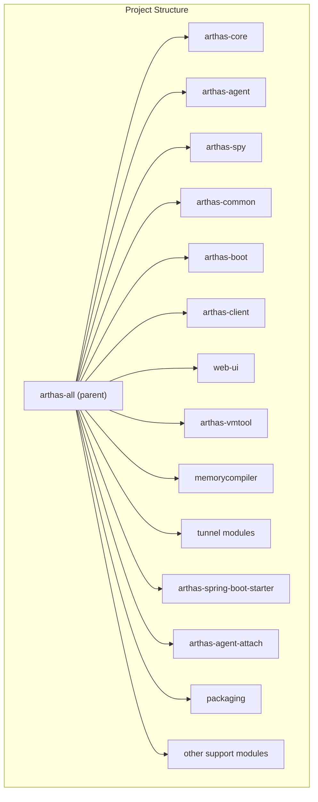
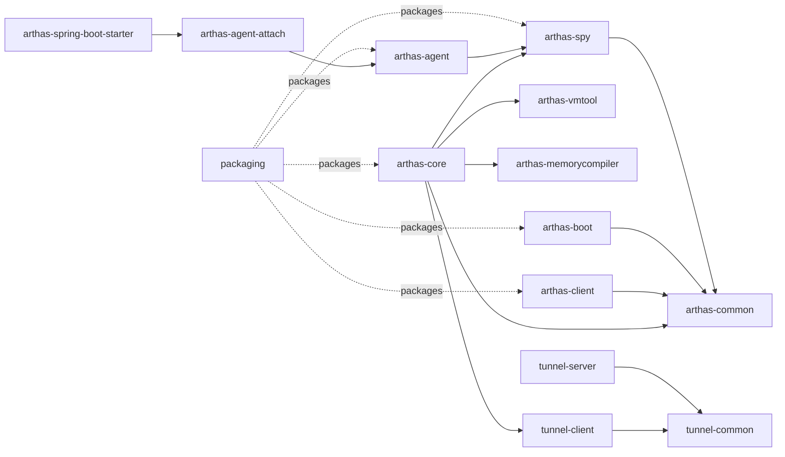
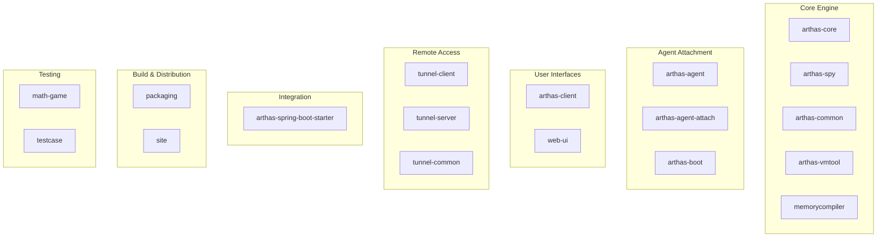
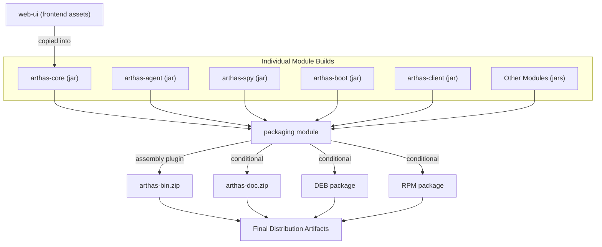

<!-- source: DeepWiki mcp.deepwiki.com · repo alibaba/arthas · page 2.1 Module Structure · fetched 2026-10-29 -->

# Module Structure

Relevant source files

The following files were used as context for generating this wiki page:

- [agent/pom.xml](agent/pom.xml)
- [boot/pom.xml](boot/pom.xml)
- [client/pom.xml](client/pom.xml)
- [common/pom.xml](common/pom.xml)
- [core/pom.xml](core/pom.xml)
- [memorycompiler/pom.xml](memorycompiler/pom.xml)
- [packaging/pom.xml](packaging/pom.xml)
- [pom.xml](pom.xml)
- [site/pom.xml](site/pom.xml)
- [spy/pom.xml](spy/pom.xml)
- [testcase/pom.xml](testcase/pom.xml)
- [tunnel-client/pom.xml](tunnel-client/pom.xml)
- [tunnel-server/pom.xml](tunnel-server/pom.xml)

This page provides a detailed overview of Arthas' Maven module structure, the purpose of each module, and the dependencies between them. Understanding the module organization is essential for developers who want to contribute to Arthas or customize it for their specific needs.

For information about the bootstrapping process, see [Bootstrapping Process](#2.2). For details on the command system, see [Command Processing Pipeline](#2.3).

## Overview of Module Organization

Arthas is structured as a multi-module Maven project. The parent POM `arthas-all` defines the overall project configuration and manages common dependencies across all modules.

Sources: [pom.xml:59-83]()

## Core Modules and Their Functions

Each module in Arthas has a specific role in the system. The following table describes the main modules and their functions:

| Module | Purpose |
|--------|---------|
| arthas-core | The central engine containing command implementations, class enhancement logic, and various diagnostic tools |
| arthas-agent | The Java agent that bootstraps Arthas by attaching to a target JVM |
| arthas-spy | A lightweight library injected into target classes for method event interception |
| arthas-common | Shared utilities and constants used across multiple modules |
| arthas-boot | Command-line tool for starting Arthas and attaching to target JVMs |
| arthas-client | Telnet client for connecting to an Arthas server |
| arthas-vmtool | Native JNI bridge for low-level JVM operations |
| memorycompiler | In-memory Java code compilation utility |
| tunnel-client/server | Components for enabling remote access to Arthas instances |
| arthas-spring-boot-starter | Integration with Spring Boot applications |
| arthas-agent-attach | Utility for programmatically attaching the Arthas agent |
| packaging | Handles final artifact assembly and distribution packaging |

Sources: [pom.xml:59-83](), [core/pom.xml:9-12](), [agent/pom.xml:10-12](), [spy/pom.xml:10-12](), [client/pom.xml:11-13](), [boot/pom.xml:10-12](), [common/pom.xml:10-12](), [memorycompiler/pom.xml:10-12](), [packaging/pom.xml:10-12]()

## Module Dependencies and Relationships

Understanding how modules depend on each other helps visualize the overall architecture of Arthas:

Sources: [core/pom.xml:108-266](), [agent/pom.xml:14-31](), [client/pom.xml:50-64](), [boot/pom.xml:14-33](), [spy/pom.xml:14-22](), [packaging/pom.xml:14-29]()

## Module Structure by Functional Categories

The modules in Arthas can be organized into functional categories that reflect their roles in the system:

Sources: [pom.xml:59-83]()

## Detailed Module Analysis

### Core Engine Modules

#### arthas-core

The central component of Arthas, containing all the command implementations and diagnostic tools. It depends on several other modules and third-party libraries.

Key features:
- Command system implementation
- Class enhancement and transformation logic
- Diagnostic capabilities and tools
- Shell server for handling client connections

The core module uses Maven Shade Plugin to create a self-contained JAR with relocated dependencies to avoid conflicts with the target application.

Sources: [core/pom.xml:9-12](), [core/pom.xml:18-104]()

#### arthas-spy

A lightweight library that gets injected into target application classes. It intercepts method calls and sends events to the core module for processing. It has minimal dependencies to reduce its footprint in the target application.

Sources: [spy/pom.xml:10-12](), [spy/pom.xml:14-22]()

#### arthas-common

Contains common utilities and constants shared across modules. This module intentionally has no dependencies to avoid circular dependencies.

Sources: [common/pom.xml:10-12](), [common/pom.xml:14-17]()

#### arthas-vmtool

Provides native JVM integration through JNI for operations that aren't possible with pure Java.

Sources: [core/pom.xml:122-125]()

### Agent and Bootstrap Modules

#### arthas-agent

The Java agent responsible for loading and bootstrapping Arthas in the target JVM. It contains the `AgentBootstrap` class defined as both `Premain-Class` and `Agent-Class` in its manifest.

Sources: [agent/pom.xml:10-12](), [agent/pom.xml:34-65]()

#### arthas-boot

A command-line tool for launching Arthas and attaching it to running Java processes. It scans for Java processes and handles the attachment process.

Sources: [boot/pom.xml:10-12](), [boot/pom.xml:36-68]()

#### arthas-client

A telnet client for connecting to the Arthas server. It provides a command-line interface for interacting with Arthas.

Sources: [client/pom.xml:11-13](), [client/pom.xml:15-47]()

### Packaging and Distribution

#### packaging

Handles the assembly and creation of the final distribution artifacts. It combines all other modules into a single distributable package.

The packaging module:
- Packages all components into `arthas-bin.zip`
- Optionally creates documentation in `arthas-doc.zip`
- Supports different distribution formats (ZIP, DEB, RPM)

Sources: [packaging/pom.xml:10-12](), [packaging/pom.xml:30-73]()

## Build and Packaging Flow

The following diagram illustrates how individual modules are built and packaged into the final distribution:

Sources: [packaging/pom.xml:30-73](), [packaging/pom.xml:76-234](), [core/pom.xml:18-104]()

## Module Dependencies Management

Arthas uses a central dependency management system in the parent POM to ensure consistent library versions across all modules. Key third-party dependencies include:

- Bytekit for bytecode enhancement
- Termd for terminal functionality
- Netty for networking
- Fastjson for JSON processing
- OGNL for expression evaluation
- SLF4J and Logback for logging (repackaged to avoid conflicts)

Sources: [pom.xml:99-236]()

## Conclusion

Arthas employs a modular architecture that separates concerns into distinct Maven modules. The design allows for:

1. Clear separation between core functionality, agent attachment, and user interfaces
2. Flexibility in how Arthas is started and connected to
3. Minimal dependencies in the spy module that gets injected into target applications
4. Comprehensive packaging for easy distribution

This modular approach makes Arthas maintainable, extensible, and adaptable to different usage scenarios while keeping its core diagnostic capabilities powerful and effective.

---

