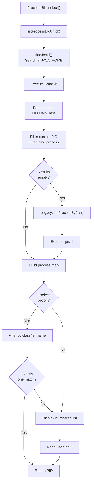
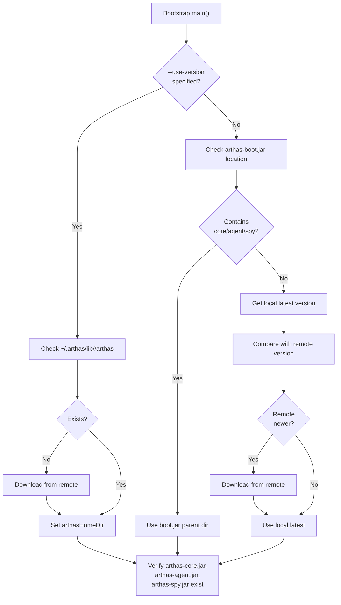
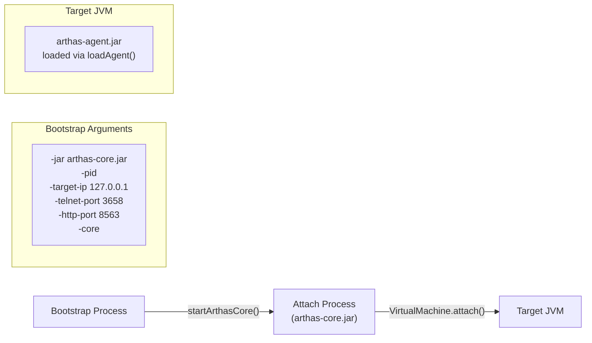
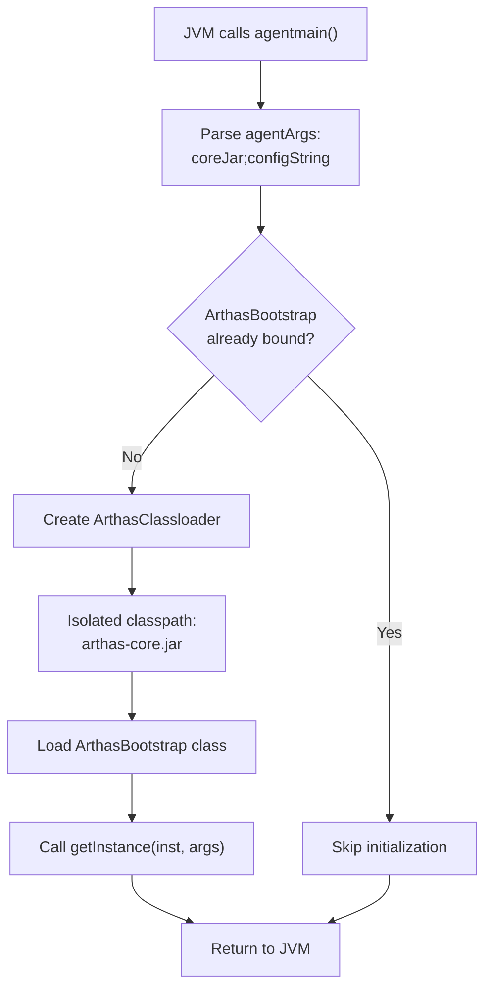
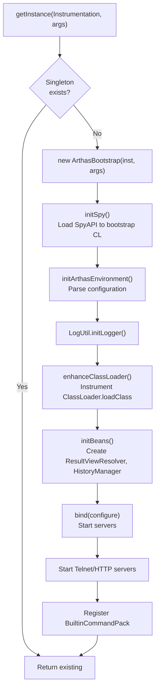
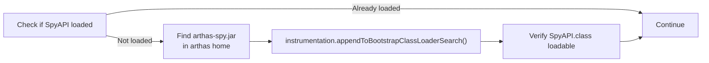

<!-- source: DeepWiki mcp.deepwiki.com · repo alibaba/arthas · page 2.2 Bootstrapping and Attachment · fetched 2026-10-29 -->

# Bootstrapping and Attachment

<details>
<summary>Relevant source files</summary>

The following files were used as context for generating this wiki page:

- [Dockerfile](Dockerfile)
- [Dockerfile-No-Jdk](Dockerfile-No-Jdk)
- [agent/src/main/java/com/taobao/arthas/agent334/AgentBootstrap.java](agent/src/main/java/com/taobao/arthas/agent334/AgentBootstrap.java)
- [bin/as.sh](bin/as.sh)
- [boot/src/main/java/com/taobao/arthas/boot/Bootstrap.java](boot/src/main/java/com/taobao/arthas/boot/Bootstrap.java)
- [boot/src/main/java/com/taobao/arthas/boot/DownloadUtils.java](boot/src/main/java/com/taobao/arthas/boot/DownloadUtils.java)
- [boot/src/main/java/com/taobao/arthas/boot/ProcessUtils.java](boot/src/main/java/com/taobao/arthas/boot/ProcessUtils.java)
- [boot/src/test/java/com/taobao/arthas/boot/DownloadUtilsTest.java](boot/src/test/java/com/taobao/arthas/boot/DownloadUtilsTest.java)
- [client/src/main/java/com/taobao/arthas/client/IOUtil.java](client/src/main/java/com/taobao/arthas/client/IOUtil.java)
- [client/src/main/java/com/taobao/arthas/client/TelnetConsole.java](client/src/main/java/com/taobao/arthas/client/TelnetConsole.java)
- [common/src/main/java/com/taobao/arthas/common/AnsiLog.java](common/src/main/java/com/taobao/arthas/common/AnsiLog.java)
- [common/src/main/java/com/taobao/arthas/common/ExecutingCommand.java](common/src/main/java/com/taobao/arthas/common/ExecutingCommand.java)
- [common/src/main/java/com/taobao/arthas/common/IOUtils.java](common/src/main/java/com/taobao/arthas/common/IOUtils.java)
- [common/src/main/java/com/taobao/arthas/common/PidUtils.java](common/src/main/java/com/taobao/arthas/common/PidUtils.java)
- [common/src/main/java/com/taobao/arthas/common/SocketUtils.java](common/src/main/java/com/taobao/arthas/common/SocketUtils.java)
- [common/src/main/java/com/taobao/arthas/common/UsageRender.java](common/src/main/java/com/taobao/arthas/common/UsageRender.java)
- [core/src/main/java/arthas.properties](core/src/main/java/arthas.properties)
- [core/src/main/java/com/taobao/arthas/core/Arthas.java](core/src/main/java/com/taobao/arthas/core/Arthas.java)
- [core/src/main/java/com/taobao/arthas/core/config/Configure.java](core/src/main/java/com/taobao/arthas/core/config/Configure.java)
- [core/src/main/java/com/taobao/arthas/core/mcp/ArthasMcpServer.java](core/src/main/java/com/taobao/arthas/core/mcp/ArthasMcpServer.java)
- [core/src/main/java/com/taobao/arthas/core/server/ArthasBootstrap.java](core/src/main/java/com/taobao/arthas/core/server/ArthasBootstrap.java)
- [core/src/main/java/com/taobao/arthas/core/shell/command/internal/WordCountHandler.java](core/src/main/java/com/taobao/arthas/core/shell/command/internal/WordCountHandler.java)
- [core/src/main/java/com/taobao/arthas/core/shell/impl/ShellImpl.java](core/src/main/java/com/taobao/arthas/core/shell/impl/ShellImpl.java)
- [core/src/main/java/com/taobao/arthas/core/shell/impl/ShellServerImpl.java](core/src/main/java/com/taobao/arthas/core/shell/impl/ShellServerImpl.java)
- [core/src/main/java/com/taobao/arthas/core/shell/session/impl/SessionManagerImpl.java](core/src/main/java/com/taobao/arthas/core/shell/session/impl/SessionManagerImpl.java)
- [core/src/main/java/com/taobao/arthas/core/shell/term/impl/http/api/ApiRequest.java](core/src/main/java/com/taobao/arthas/core/shell/term/impl/http/api/ApiRequest.java)
- [core/src/main/java/com/taobao/arthas/core/shell/term/impl/http/api/HttpApiHandler.java](core/src/main/java/com/taobao/arthas/core/shell/term/impl/http/api/HttpApiHandler.java)
- [core/src/main/java/com/taobao/arthas/core/util/ArthasBanner.java](core/src/main/java/com/taobao/arthas/core/util/ArthasBanner.java)
- [core/src/main/java/com/taobao/arthas/core/util/UserStatUtil.java](core/src/main/java/com/taobao/arthas/core/util/UserStatUtil.java)
- [tunnel-server/src/main/java/com/alibaba/arthas/tunnel/server/app/web/StatController.java](tunnel-server/src/main/java/com/alibaba/arthas/tunnel/server/app/web/StatController.java)

</details>


## Purpose and Scope

This page documents the bootstrapping and attachment mechanism that allows Arthas to inject itself into a running JVM process. It covers:

1. **Process Discovery** - How Arthas identifies target Java processes
2. **Arthas Distribution** - Locating or downloading Arthas binaries
3. **JVM Attachment** - The Java Agent injection mechanism
4. **Agent Initialization** - Setting up the Arthas runtime in the target JVM

For information about the command processing and execution after attachment, see [Command Processing Pipeline](#2.4). For details on how the client connects to the attached server, see [Client-Server Communication](#2.3).

---

## Architecture Overview

The bootstrapping process involves multiple JVM processes and several key phases:

```mermaid
sequenceDiagram
    participant User
    participant "as.sh / arthas-boot.jar<br/>(Bootstrap Process)" as Bootstrap
    participant "arthas-core.jar<br/>(Attach Process)" as Attach
    participant "Target JVM" as Target
    participant "AgentBootstrap<br/>(in Target JVM)" as Agent
    participant "ArthasBootstrap<br/>(in Target JVM)" as Core

    User->>Bootstrap: Launch with optional PID
    Bootstrap->>Bootstrap: Parse arguments
    
    alt No PID provided
        Bootstrap->>Bootstrap: listProcessByJcmd()
        Bootstrap->>User: Display process list
        User->>Bootstrap: Select process
    end
    
    Bootstrap->>Bootstrap: Locate/download Arthas home
    
    Bootstrap->>Attach: Start new Java process<br/>java -jar arthas-core.jar -pid <PID>
    Attach->>Attach: Parse Configure
    Attach->>Target: VirtualMachine.attach(pid)
    Attach->>Target: loadAgent(arthas-agent.jar, args)
    
    Target->>Agent: JVM calls agentmain()
    Agent->>Agent: Create ArthasClassloader
    Agent->>Core: Load & call getInstance()
    Core->>Core: initSpy()<br/>enhanceClassLoader()<br/>bind()
    Core-->>Bootstrap: Attachment complete
    
    opt Not attach-only mode
        Bootstrap->>Bootstrap: Launch arthas-client.jar
    end
```

**Sources:** [bin/as.sh:828-1103](), [boot/src/main/java/com/taobao/arthas/boot/Bootstrap.java:313-635](), [core/src/main/java/com/taobao/arthas/core/Arthas.java:88-149](), [agent/src/main/java/com/taobao/arthas/agent334/AgentBootstrap.java:1-300]()

---

## Phase 1: Process Discovery and Selection

### Entry Points

Arthas can be launched through three primary entry points:

| Entry Point | Implementation | Use Case |
|-------------|---------------|----------|
| `as.sh` | Shell script | Unix-like systems, production environments |
| `arthas-boot.jar` | Bootstrap.main() | Cross-platform, development |
| Spring Boot Starter | Auto-configuration | Embedded mode (see [Spring Boot Starter](#7.1)) |

### Process Discovery Mechanism

The `ProcessUtils` class provides process discovery using JDK tools:



**Sources:** [boot/src/main/java/com/taobao/arthas/boot/ProcessUtils.java:55-123](), [boot/src/main/java/com/taobao/arthas/boot/ProcessUtils.java:125-164]()

### Process Selection Logic

The selection process prioritizes convenience and safety:

1. **Explicit PID**: If user provides `<pid>` argument, use it directly
2. **Select Filter**: If `--select <pattern>` matches exactly one process, auto-select it
3. **Port Reuse**: If telnet port already bound, prioritize that process in the list
4. **Interactive Mode**: Display numbered list with suggestion (marked with `*`)

**Sources:** [boot/src/main/java/com/taobao/arthas/boot/Bootstrap.java:394-407](), [bin/as.sh:758-826]()

---

## Phase 2: Arthas Distribution Resolution

### Resolution Strategy

The `Bootstrap` class implements a multi-tiered strategy to locate Arthas binaries:



**Sources:** [boot/src/main/java/com/taobao/arthas/boot/Bootstrap.java:420-514]()

### Download Mechanism

When downloading is required, `DownloadUtils` handles remote retrieval:

| Component | Purpose |
|-----------|---------|
| Repository Mirror | Default: `center` (Maven Central), `aliyun` for +0800 timezone |
| Version Check | `GET https://arthas.aliyun.com/api/latest_version` |
| Download URL | `https://arthas.aliyun.com/download/${VERSION}?mirror=${REPO}` |
| Extraction | Unzip to `~/.arthas/lib/${VERSION}/arthas/` |

**Sources:** [boot/src/main/java/com/taobao/arthas/boot/DownloadUtils.java:24-96](), [boot/src/main/java/com/taobao/arthas/boot/Bootstrap.java:358-364]()

---

## Phase 3: JVM Attachment Process

### Starting the Attach Process

Once Arthas home is located, Bootstrap spawns a separate Java process to perform the attachment:



**Sources:** [boot/src/main/java/com/taobao/arthas/boot/ProcessUtils.java:278-358](), [boot/src/main/java/com/taobao/arthas/boot/Bootstrap.java:526-593]()

### Java Attach API Usage

The `Arthas` class (in arthas-core.jar) uses the Java Attach API to inject the agent:

**Key Steps:**

1. **Locate Target VM Descriptor**
   ```
   VirtualMachine.list() → find matching PID
   ```

2. **Attach to Target**
   ```
   VirtualMachine.attach(pid) or attach(descriptor)
   ```

3. **Version Compatibility Check**
   - Compare target Java version with current Java version
   - Warn on mismatch but continue (attachment may still succeed)

4. **Load Agent JAR**
   ```
   vm.loadAgent(arthasAgentPath, args)
   ```
   where `args` = `<arthas-core.jar path>;<Configure.toString()>`

5. **Detach**
   ```
   vm.detach()
   ```

**Sources:** [core/src/main/java/com/taobao/arthas/core/Arthas.java:88-149]()

### Configure Parameter Serialization

The `Configure` class holds all initialization parameters and serializes them for passing to the agent:

| Field | Purpose | Default |
|-------|---------|---------|
| `javaPid` | Target process ID | Required |
| `arthasCore` | Path to arthas-core.jar | Required |
| `arthasAgent` | Path to arthas-agent.jar | Required |
| `ip` | Listen IP address | 127.0.0.1 |
| `telnetPort` | Telnet server port | 3658 |
| `httpPort` | HTTP server port | 8563 |
| `sessionTimeout` | Session timeout seconds | 1800 |
| `username` | Authentication username | null |
| `password` | Authentication password | null |
| `tunnelServer` | Tunnel server URL | null |
| `agentId` | Agent identifier | null |
| `disabledCommands` | Comma-separated disabled commands | null |

**Sources:** [core/src/main/java/com/taobao/arthas/core/config/Configure.java:1-290]()

---

## Phase 4: Agent Initialization in Target JVM

### AgentBootstrap Entry Point

When the JVM loads `arthas-agent.jar`, it invokes the `agentmain()` method:



**Sources:** [agent/src/main/java/com/taobao/arthas/agent334/AgentBootstrap.java:62-200]()

### Classloader Isolation

The `ArthasClassloader` prevents conflicts with application classes:

**Isolation Strategy:**
- Parent: Bootstrap ClassLoader (null)
- Loads from: `arthas-core.jar`, `arthas-spy.jar`
- Protected packages: `java.*`, `javax.*`, `sun.*`
- Delegation: Parent-last for Arthas classes

**Sources:** [agent/src/main/java/com/taobao/arthas/agent334/AgentBootstrap.java:140-170]()

---

## Phase 5: Core Bootstrap Initialization

### ArthasBootstrap Singleton

The `ArthasBootstrap` class is the main entry point in the target JVM:



**Sources:** [core/src/main/java/com/taobao/arthas/core/server/ArthasBootstrap.java:138-185](), [core/src/main/java/com/taobao/arthas/core/server/ArthasBootstrap.java:595-621]()

### Critical Initialization Steps

#### 1. SpyAPI Injection

SpyAPI must be in the bootstrap classloader to be accessible from instrumented classes:



**Sources:** [core/src/main/java/com/taobao/arthas/core/server/ArthasBootstrap.java:198-221]()

#### 2. ClassLoader Enhancement

To handle custom classloaders that cannot load SpyAPI, Arthas instruments `ClassLoader.loadClass()`:

**Mechanism:**
- Uses Bytekit's `InstrumentTransformer`
- Injects bytecode to add bootstrap classpath search
- Configurable via `arthas.enhanceLoaders` property
- Default: `java.lang.ClassLoader`

**Sources:** [core/src/main/java/com/taobao/arthas/core/server/ArthasBootstrap.java:223-251]()

#### 3. Configuration Resolution

Configuration is resolved from multiple sources with this priority order:

1. Command-line arguments (highest priority)
2. System environment variables
3. System properties
4. `arthas.properties` file
5. Defaults (lowest priority)

Unless `arthas.config.overrideAll=true` in `arthas.properties`, which reverses the priority.

**Sources:** [core/src/main/java/com/taobao/arthas/core/server/ArthasBootstrap.java:253-347]()

#### 4. Server Binding

The `bind()` method starts the shell servers:

| Component | Port | Protocol |
|-----------|------|----------|
| TelnetServer | 3658 (default) | Telnet/HTTP hybrid |
| HttpTermServer | 8563 (default) | HTTP/WebSocket |
| TunnelClient | N/A | WebSocket (optional) |

**Random Port Generation:** If port is set to `0`, Arthas generates a random available port via `SocketUtils.findAvailableTcpPort()`.

**Security:** If listening on `0.0.0.0` without a password, Arthas automatically generates a 64-character random password to prevent unauthorized remote access.

**Sources:** [core/src/main/java/com/taobao/arthas/core/server/ArthasBootstrap.java:355-504]()

---

## Bootstrap Command Flow

### Complete Execution Trace

The following table traces key method calls across processes:

| Process | Class | Method | Key Actions |
|---------|-------|--------|-------------|
| **Bootstrap** | Bootstrap | main() | Parse CLI, select process |
| | ProcessUtils | select() | List and select target PID |
| | Bootstrap | findArthasHome() | Locate/download binaries |
| | ProcessUtils | startArthasCore() | Spawn attach process |
| **Attach** | Arthas | main() | Parse arguments |
| | Arthas | parse() | Create Configure object |
| | Arthas | attachAgent() | Use VirtualMachine.attach() |
| | VirtualMachine | loadAgent() | Inject arthas-agent.jar |
| **Target JVM** | AgentBootstrap | agentmain() | Entry point from JVM |
| | AgentBootstrap | (constructor) | Parse args, create classloader |
| | ArthasClassloader | (load) | Load ArthasBootstrap class |
| | ArthasBootstrap | getInstance() | Singleton creation |
| | ArthasBootstrap | (constructor) | Initialize core components |
| | ArthasBootstrap | initSpy() | Inject SpyAPI |
| | ArthasBootstrap | enhanceClassLoader() | Instrument classloaders |
| | ArthasBootstrap | bind() | Start shell servers |
| | ShellServerImpl | listen() | Bind ports |

**Sources:** [boot/src/main/java/com/taobao/arthas/boot/Bootstrap.java:313-635](), [core/src/main/java/com/taobao/arthas/core/Arthas.java:26-149](), [agent/src/main/java/com/taobao/arthas/agent334/AgentBootstrap.java:62-200](), [core/src/main/java/com/taobao/arthas/core/server/ArthasBootstrap.java:138-504]()

---

## Error Handling and Edge Cases

### Java Version Mismatch

When the attach process Java version differs from the target JVM:

**Warning (non-fatal):**
- Different major versions (e.g., Java 8 attaching to Java 11)
- Printed to stderr but attachment continues
- May result in `AgentLoadException` with code "0"

**Sources:** [core/src/main/java/com/taobao/arthas/core/Arthas.java:106-143]()

### Port Conflicts

Before attachment, Bootstrap checks for port conflicts:

1. Use `SocketUtils.findTcpListenProcess()` to detect process using telnet/http ports
2. If port in use by different process than target, exit with error
3. If port already used by target, skip attachment (already attached)

**Conflict Resolution:**
- Use `--telnet-port` and `--http-port` to specify different ports
- Set `--http-port -1` to disable HTTP server
- Set `--telnet-port -1` to disable telnet (not recommended)

**Sources:** [boot/src/main/java/com/taobao/arthas/boot/Bootstrap.java:378-418](), [boot/src/main/java/com/taobao/arthas/boot/Bootstrap.java:637-647]()

### tools.jar Requirement (Java 8 and earlier)

For JDK 8 and earlier, `tools.jar` must be accessible:

**Search Order:**
1. `$JAVA_HOME/lib/tools.jar`
2. `$JAVA_HOME/../lib/tools.jar` (JRE under JDK)
3. Environment variable `JAVA_HOME`

**Bypass:** Java 9+ does not require `tools.jar` (APIs included in JDK).

**Sources:** [boot/src/main/java/com/taobao/arthas/boot/ProcessUtils.java:228-276](), [boot/src/main/java/com/taobao/arthas/boot/ProcessUtils.java:440-460]()

---

## Configuration Properties

### arthas.properties File

Default configuration can be specified in `arthas.properties` located in Arthas home:

```properties
arthas.telnetPort=3658
arthas.httpPort=8563
arthas.ip=127.0.0.1
arthas.sessionTimeout=1800
arthas.username=arthas
arthas.password=arthas
arthas.localConnectionNonAuth=true
arthas.disabledCommands=stop,dump
```

**Override Behavior:**
- By default, command-line args override properties file
- Set `arthas.config.overrideAll=true` to make properties file highest priority

**Sources:** [core/src/main/java/arthas.properties:1-29](), [core/src/main/java/com/taobao/arthas/core/server/ArthasBootstrap.java:312-346]()

---

## Integration with Deployment

### Docker Deployment

The Dockerfile demonstrates automated Arthas installation:

```dockerfile
ARG ARTHAS_VERSION="4.1.5"
ENV MAVEN_HOST=https://repo1.maven.org/maven2

RUN wget -qO /tmp/arthas.zip \
    "${MAVEN_HOST}/com/taobao/arthas/arthas-packaging/${ARTHAS_VERSION}/arthas-packaging-${ARTHAS_VERSION}-bin.zip" && \
    mkdir -p /opt/arthas && \
    unzip /tmp/arthas.zip -d /opt/arthas
```

This pre-installs Arthas, avoiding runtime downloads.

**Sources:** [Dockerfile:1-23](), [Dockerfile-No-Jdk:1-20]()

### Spring Boot Starter

For embedded integration without external attachment, see [Spring Boot Starter](#7.1).

---

## Attach-Only Mode

The `--attach-only` flag allows injecting Arthas without connecting a client:

**Use Cases:**
- Automation scripts that only need to start the server
- Tunnel server scenarios where clients connect remotely
- Web-based monitoring where HTTP API is sufficient

**Behavior:**
```bash
./as.sh --attach-only <pid>
# Exits after successful attachment
# Server keeps running in target JVM
```

**Sources:** [boot/src/main/java/com/taobao/arthas/boot/Bootstrap.java:596-598](), [bin/as.sh:1100-1102]()

---

