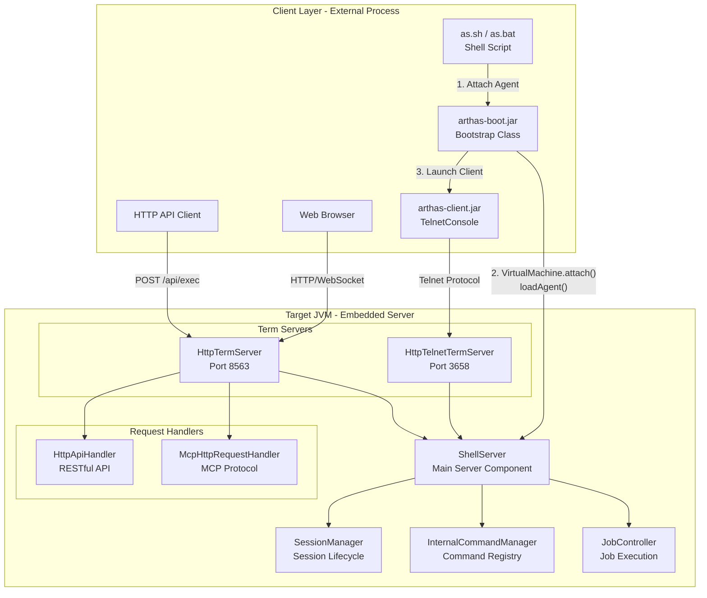
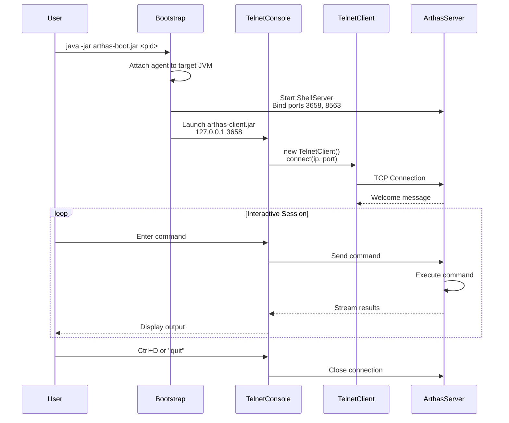
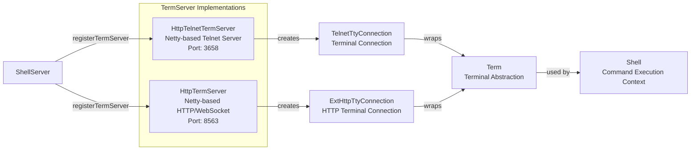
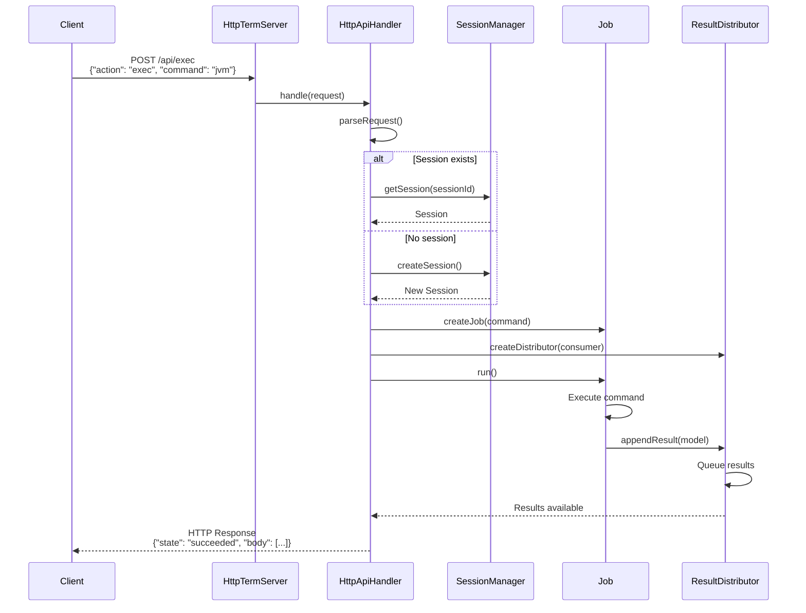
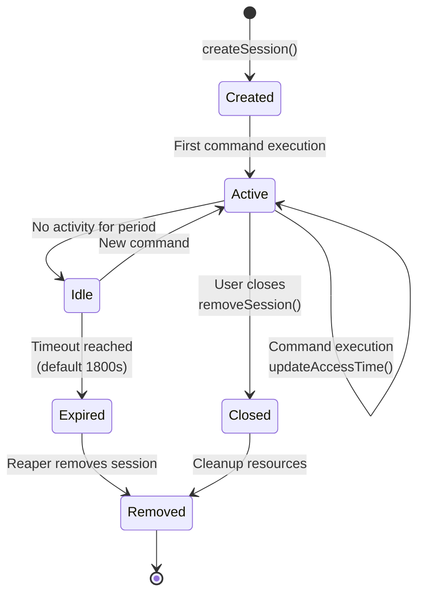
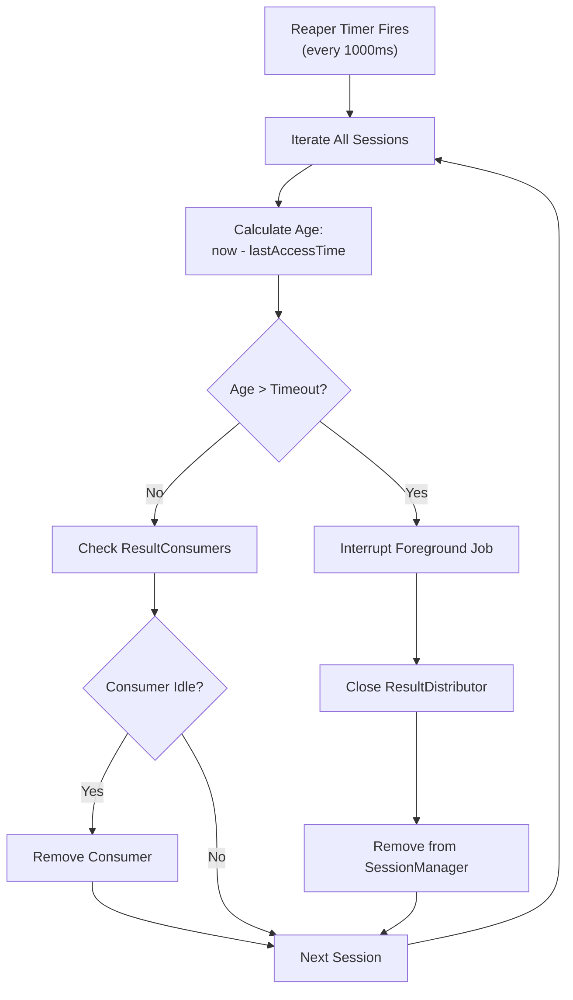
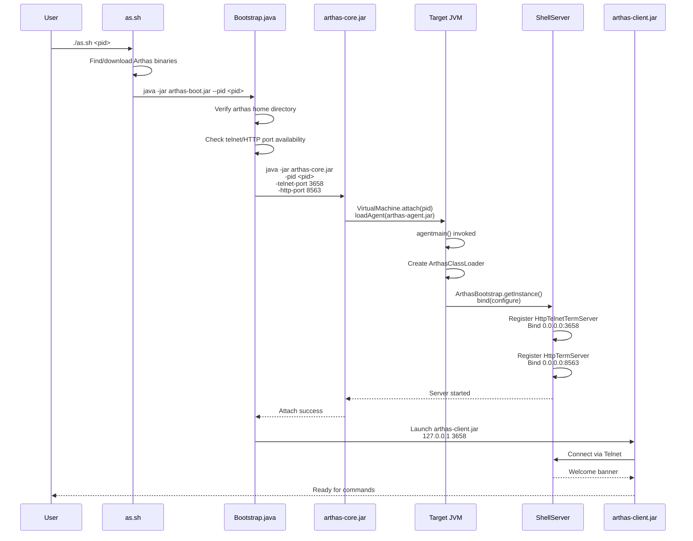
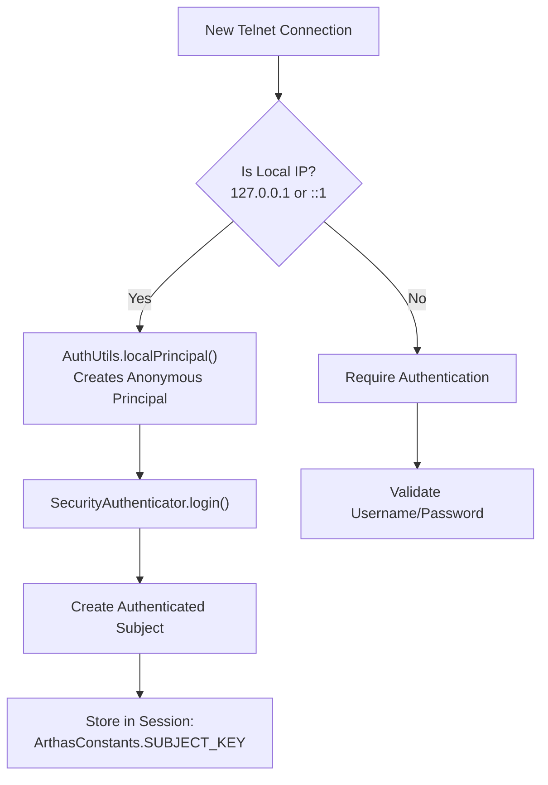
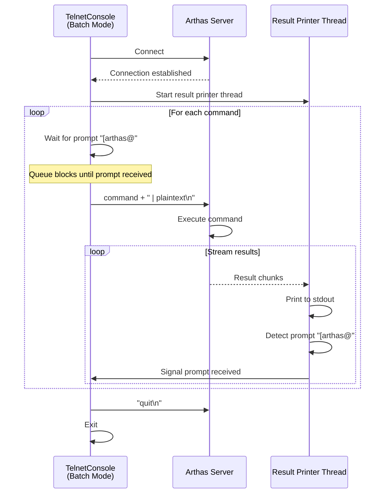

<!-- source: DeepWiki mcp.deepwiki.com · repo alibaba/arthas · page 2.3 Client-Server Communication · fetched 2026-10-29 -->

# Client-Server Communication

<details>
<summary>Relevant source files</summary>

The following files were used as context for generating this wiki page:

- [Dockerfile](Dockerfile)
- [Dockerfile-No-Jdk](Dockerfile-No-Jdk)
- [agent/src/main/java/com/taobao/arthas/agent334/AgentBootstrap.java](agent/src/main/java/com/taobao/arthas/agent334/AgentBootstrap.java)
- [bin/as.sh](bin/as.sh)
- [boot/src/main/java/com/taobao/arthas/boot/Bootstrap.java](boot/src/main/java/com/taobao/arthas/boot/Bootstrap.java)
- [boot/src/main/java/com/taobao/arthas/boot/DownloadUtils.java](boot/src/main/java/com/taobao/arthas/boot/DownloadUtils.java)
- [boot/src/main/java/com/taobao/arthas/boot/ProcessUtils.java](boot/src/main/java/com/taobao/arthas/boot/ProcessUtils.java)
- [boot/src/test/java/com/taobao/arthas/boot/DownloadUtilsTest.java](boot/src/test/java/com/taobao/arthas/boot/DownloadUtilsTest.java)
- [client/src/main/java/com/taobao/arthas/client/IOUtil.java](client/src/main/java/com/taobao/arthas/client/IOUtil.java)
- [client/src/main/java/com/taobao/arthas/client/TelnetConsole.java](client/src/main/java/com/taobao/arthas/client/TelnetConsole.java)
- [common/src/main/java/com/taobao/arthas/common/AnsiLog.java](common/src/main/java/com/taobao/arthas/common/AnsiLog.java)
- [common/src/main/java/com/taobao/arthas/common/ExecutingCommand.java](common/src/main/java/com/taobao/arthas/common/ExecutingCommand.java)
- [common/src/main/java/com/taobao/arthas/common/IOUtils.java](common/src/main/java/com/taobao/arthas/common/IOUtils.java)
- [common/src/main/java/com/taobao/arthas/common/PidUtils.java](common/src/main/java/com/taobao/arthas/common/PidUtils.java)
- [common/src/main/java/com/taobao/arthas/common/SocketUtils.java](common/src/main/java/com/taobao/arthas/common/SocketUtils.java)
- [common/src/main/java/com/taobao/arthas/common/UsageRender.java](common/src/main/java/com/taobao/arthas/common/UsageRender.java)
- [core/src/main/java/arthas.properties](core/src/main/java/arthas.properties)
- [core/src/main/java/com/taobao/arthas/core/Arthas.java](core/src/main/java/com/taobao/arthas/core/Arthas.java)
- [core/src/main/java/com/taobao/arthas/core/config/Configure.java](core/src/main/java/com/taobao/arthas/core/config/Configure.java)
- [core/src/main/java/com/taobao/arthas/core/mcp/ArthasMcpServer.java](core/src/main/java/com/taobao/arthas/core/mcp/ArthasMcpServer.java)
- [core/src/main/java/com/taobao/arthas/core/server/ArthasBootstrap.java](core/src/main/java/com/taobao/arthas/core/server/ArthasBootstrap.java)
- [core/src/main/java/com/taobao/arthas/core/shell/command/internal/WordCountHandler.java](core/src/main/java/com/taobao/arthas/core/shell/command/internal/WordCountHandler.java)
- [core/src/main/java/com/taobao/arthas/core/shell/impl/ShellImpl.java](core/src/main/java/com/taobao/arthas/core/shell/impl/ShellImpl.java)
- [core/src/main/java/com/taobao/arthas/core/shell/impl/ShellServerImpl.java](core/src/main/java/com/taobao/arthas/core/shell/impl/ShellServerImpl.java)
- [core/src/main/java/com/taobao/arthas/core/shell/session/impl/SessionManagerImpl.java](core/src/main/java/com/taobao/arthas/core/shell/session/impl/SessionManagerImpl.java)
- [core/src/main/java/com/taobao/arthas/core/shell/term/impl/http/api/ApiRequest.java](core/src/main/java/com/taobao/arthas/core/shell/term/impl/http/api/ApiRequest.java)
- [core/src/main/java/com/taobao/arthas/core/shell/term/impl/http/api/HttpApiHandler.java](core/src/main/java/com/taobao/arthas/core/shell/term/impl/http/api/HttpApiHandler.java)
- [core/src/main/java/com/taobao/arthas/core/util/ArthasBanner.java](core/src/main/java/com/taobao/arthas/core/util/ArthasBanner.java)
- [core/src/main/java/com/taobao/arthas/core/util/UserStatUtil.java](core/src/main/java/com/taobao/arthas/core/util/UserStatUtil.java)
- [tunnel-server/src/main/java/com/alibaba/arthas/tunnel/server/app/web/StatController.java](tunnel-server/src/main/java/com/alibaba/arthas/tunnel/server/app/web/StatController.java)

</details>


## Purpose and Scope

This document describes how Arthas clients communicate with the Arthas server that runs embedded in the target JVM. It covers the network protocols (Telnet and HTTP/WebSocket), client types, server-side components, connection establishment, session management, and authentication mechanisms.

For information about the tunnel system that enables remote access through a central proxy, see [Tunnel System](#5).

For information about how Arthas bootstraps and attaches to the target JVM, see [Bootstrapping and Attachment](#2.2).

---

## Communication Architecture

Arthas supports multiple communication protocols and client types to interact with the diagnostic server running inside the target JVM.

### Supported Protocols

| Protocol | Default Port | Purpose | Client Type |
|----------|-------------|---------|-------------|
| Telnet | 3658 | Interactive command line interface | `arthas-client.jar`, `telnet` command |
| HTTP | 8563 | Web console and RESTful API | Web browser, HTTP clients |
| WebSocket | 8563 | Real-time bidirectional communication | Web console, tunnel client |

**Configuration Properties:**

Sources: [core/src/main/java/arthas.properties:1-5]()

```properties
arthas.telnetPort=3658
arthas.httpPort=8563
arthas.ip=127.0.0.1
```

### Communication Architecture Diagram



Sources: [core/src/main/java/com/taobao/arthas/core/server/ArthasBootstrap.java:355-504](), [core/src/main/java/com/taobao/arthas/core/shell/impl/ShellServerImpl.java:41-76](), [bin/as.sh:78-1107](), [boot/src/main/java/com/taobao/arthas/boot/Bootstrap.java:1-774]()

---

## Client Types

### 1. Telnet Client (`arthas-client.jar`)

The primary interactive client that connects via Telnet protocol.

**Key Class:** `com.taobao.arthas.client.TelnetConsole`

**Connection Process:**



**Features:**
- **Interactive Mode**: Full readline support with command history
- **Batch Mode**: Execute commands via `-c` or `-f` flags
- **Terminal Size Negotiation**: Uses `WindowSizeOptionHandler` to report terminal dimensions
- **Ctrl+C Handling**: Interrupts running commands without closing connection

Sources: [client/src/main/java/com/taobao/arthas/client/TelnetConsole.java:46-453](), [boot/src/main/java/com/taobao/arthas/boot/Bootstrap.java:600-635]()

**Usage Examples:**

```bash
# Interactive mode
java -jar arthas-client.jar 127.0.0.1 3658

# Batch mode - single command
java -jar arthas-client.jar 127.0.0.1 3658 -c "dashboard -n 1"

# Batch mode - script file
java -jar arthas-client.jar 127.0.0.1 3658 -f batch.as
```

Sources: [client/src/main/java/com/taobao/arthas/client/TelnetConsole.java:203-343]()

### 2. Shell Script Client (`as.sh` / `as.bat`)

Convenience scripts that combine bootstrapping and client connection.

**Process Flow:**
1. Detects or downloads Arthas binaries
2. Attaches agent to target JVM via `arthas-core.jar`
3. Launches `arthas-client.jar` for interactive session

**Key Features:**
- **Auto-attach Mode**: Attaches and connects in one command
- **Attach-only Mode**: `--attach-only` flag skips client connection
- **Native Telnet Fallback**: Uses system `telnet` command if available

Sources: [bin/as.sh:1-1107]()

### 3. HTTP/WebSocket Client

Web-based console and programmatic HTTP API access.

**Access Methods:**

| Method | Endpoint | Purpose |
|--------|----------|---------|
| Web Console | `http://127.0.0.1:8563` | Browser-based interactive UI |
| HTTP API | `POST /api/exec` | RESTful command execution |
| WebSocket | `ws://127.0.0.1:8563/ws` | Real-time bidirectional communication |

**HTTP API Request Format:**

```json
{
  "action": "exec",
  "command": "dashboard -n 1",
  "sessionId": "uuid-string",
  "requestId": "request-uuid"
}
```

**Supported Actions:**
- `INIT_SESSION` - Create new session
- `EXEC` - Synchronous command execution
- `ASYNC_EXEC` - Asynchronous command execution
- `INTERRUPT_JOB` - Cancel running job
- `PULL_RESULTS` - Retrieve command results
- `SESSION_INFO` - Get session metadata
- `JOIN_SESSION` - Attach to existing session
- `CLOSE_SESSION` - Terminate session

Sources: [core/src/main/java/com/taobao/arthas/core/shell/term/impl/http/api/HttpApiHandler.java:46-419](), [core/src/main/java/com/taobao/arthas/core/shell/term/impl/http/api/ApiRequest.java:1-87]()

---

## Server-Side Architecture

### ShellServer

The main server component that orchestrates all communication.

**Key Class:** `com.taobao.arthas.core.shell.impl.ShellServerImpl`

**Responsibilities:**
- Registers and manages `TermServer` instances for different protocols
- Maintains command resolvers and internal command manager
- Coordinates session lifecycle through global job controller
- Implements session timeout and reaper mechanism

Sources: [core/src/main/java/com/taobao/arthas/core/shell/impl/ShellServerImpl.java:44-243]()

### TermServer Implementations



**HttpTelnetTermServer:**
- Implements Telnet protocol using Netty
- Creates `TelnetTtyConnection` for each client
- Handles terminal control sequences
- Default binding: `127.0.0.1:3658`

**HttpTermServer:**
- Implements HTTP and WebSocket protocols
- Creates `ExtHttpTtyConnection` for HTTP clients
- Integrates with `HttpApiHandler` for RESTful API
- Default binding: `127.0.0.1:8563`

Sources: [core/src/main/java/com/taobao/arthas/core/server/ArthasBootstrap.java:436-454]()

### HTTP API Handler

Processes RESTful HTTP requests and manages API sessions.

**Request Processing Flow:**



**Key Methods:**

- `handle(ChannelHandlerContext, FullHttpRequest)` - Main entry point for HTTP requests
- `processRequest(ChannelHandlerContext, ApiRequest)` - Routes requests to action handlers
- `processExecRequest(ApiRequest, Session)` - Synchronous command execution
- `processAsyncExecRequest(ApiRequest, Session)` - Asynchronous command execution
- `processPullResultsRequest(ApiRequest, Session)` - Retrieve queued results

Sources: [core/src/main/java/com/taobao/arthas/core/shell/term/impl/http/api/HttpApiHandler.java:52-419]()

---

## Session Management

### Session Lifecycle

Arthas maintains stateful sessions for both telnet and HTTP clients.

**SessionManager Implementation:**



**Session Properties:**

| Property | Description | Storage Key |
|----------|-------------|-------------|
| Session ID | Unique identifier (UUID) | `Session.ID` |
| Command Manager | Command registry | `Session.COMMAND_MANAGER` |
| Instrumentation | JVM instrumentation API | `Session.INSTRUMENTATION` |
| PID | Target process ID | `Session.PID` |
| TTY | Terminal connection | `Session.TTY` |
| User ID | Authenticated user identifier | Custom key |
| Subject | Security authentication subject | `ArthasConstants.SUBJECT_KEY` |

Sources: [core/src/main/java/com/taobao/arthas/core/shell/session/impl/SessionManagerImpl.java:19-167]()

### Session Timeout and Reaper

**Configuration:**

```properties
# Default: 1800 seconds (30 minutes)
arthas.sessionTimeout=1800
```

**Reaper Mechanism:**
- Scheduled task runs at fixed intervals (default: 1000ms)
- Checks each session's last access time
- Removes expired sessions and closes associated resources
- Also removes idle result consumers (timeout: 5 minutes)

Sources: [core/src/main/java/com/taobao/arthas/core/shell/session/impl/SessionManagerImpl.java:119-167](), [core/src/main/java/arthas.properties:6-7]()

**Reaper Logic:**



Sources: [core/src/main/java/com/taobao/arthas/core/shell/session/impl/SessionManagerImpl.java:119-167]()

---

## Connection Establishment

### Bootstrap and Attach Flow



Sources: [bin/as.sh:828-1103](), [boot/src/main/java/com/taobao/arthas/boot/Bootstrap.java:313-635](), [core/src/main/java/com/taobao/arthas/core/Arthas.java:21-169](), [core/src/main/java/com/taobao/arthas/core/server/ArthasBootstrap.java:355-504]()

### Port Binding and Configuration

**Default Port Assignments:**

| Component | Default | Can Disable |
|-----------|---------|-------------|
| Telnet Port | 3658 | Yes (set to -1) |
| HTTP Port | 8563 | Yes (set to -1) |
| Random Port | 0 | Auto-assign available port |

**Port Conflict Detection:**

The bootstrap process checks if ports are already in use and validates they're being used by the correct process:

```java
// Check if telnet port is already in use
telnetPortPid = SocketUtils.findTcpListenProcess(telnetPort);
if (telnetPortPid > 0 && targetPid != telnetPortPid) {
    // Error: port used by different process
    exit(1);
}
```

Sources: [boot/src/main/java/com/taobao/arthas/boot/Bootstrap.java:378-418](), [common/src/main/java/com/taobao/arthas/common/SocketUtils.java:40-170]()

**Configuration Override Priority:**

1. Command-line arguments (`--telnet-port`, `--http-port`)
2. System environment variables
3. System properties
4. `arthas.properties` file
5. Built-in defaults

Sources: [core/src/main/java/com/taobao/arthas/core/server/ArthasBootstrap.java:253-284]()

---

## Authentication and Security

### Local Connection Authentication

By default, local connections (from `127.0.0.1`) are not authenticated to simplify local debugging:

```properties
# arthas.properties
arthas.localConnectionNonAuth=true
```

**Local Connection Detection:**

The server identifies local connections and automatically creates a `Principal` for authentication bypass:



Sources: [core/src/main/java/com/taobao/arthas/core/shell/impl/ShellImpl.java:67-90](), [core/src/main/java/com/taobao/arthas/core/config/Configure.java:72-76]()

### Password-Based Authentication

When listening on non-local addresses (`0.0.0.0`), Arthas enforces authentication:

**Automatic Password Generation:**

```java
if (IPUtils.isAllZeroIP(configure.getIp()) && StringUtils.isBlank(configure.getPassword())) {
    // Force generate password when listening on 0.0.0.0
    configure.setPassword(StringUtils.randomString(64));
    logger.error("Generated arthas password: " + configure.getPassword());
}
```

**Manual Configuration:**

```properties
# arthas.properties
arthas.username=arthas
arthas.password=your-secure-password
```

Sources: [core/src/main/java/com/taobao/arthas/core/server/ArthasBootstrap.java:404-417](), [core/src/main/java/arthas.properties:11-13]()

### HTTP Session Authentication

HTTP clients pass authentication credentials via session cookies or request headers:

```java
// Authentication stored in HttpSession
HttpSession httpSession = HttpSessionManager.getHttpSessionFromContext(ctx);
Object subject = httpSession.getAttribute(ArthasConstants.SUBJECT_KEY);
if (subject != null) {
    session.put(ArthasConstants.SUBJECT_KEY, subject);
}
```

Sources: [core/src/main/java/com/taobao/arthas/core/shell/term/impl/http/api/HttpApiHandler.java:157-170]()

---

## Batch Mode and Command Execution

### Telnet Batch Mode

Execute commands non-interactively:

**Single Command:**
```bash
arthas-client.jar 127.0.0.1 3658 -c "dashboard -n 1"
```

**Batch File:**
```bash
arthas-client.jar 127.0.0.1 3658 -f commands.as
```

**Execution Flow:**



**Timeout Handling:**

Batch mode supports execution timeout to prevent hanging:

```java
// Configuration
--execution-timeout 30000  // 30 seconds

// Implementation
if (executionTimeout > 0) {
    if (now - startTime > executionTimeout) {
        return STATUS_EXEC_TIMEOUT; // Exit code 100
    }
}
```

Sources: [client/src/main/java/com/taobao/arthas/client/TelnetConsole.java:345-411]()

### HTTP API Batch Execution

**Synchronous Execution:**

Blocks until command completes, returns all results:

```json
{
  "action": "exec",
  "command": "dashboard -n 1",
  "execTimeout": 30000
}
```

**Asynchronous Execution:**

Starts command in background, returns immediately:

```json
{
  "action": "async_exec",
  "command": "trace com.example.Service method",
  "sessionId": "session-uuid"
}
```

**Result Retrieval:**

Pull results from asynchronous execution:

```json
{
  "action": "pull_results",
  "sessionId": "session-uuid",
  "consumerId": "consumer-uuid"
}
```

Sources: [core/src/main/java/com/taobao/arthas/core/shell/term/impl/http/api/HttpApiHandler.java:194-335]()

---

## Communication Protocol Details

### Telnet Protocol Specifics

**Terminal Size Negotiation:**

Arthas uses the Telnet Window Size Option (RFC 1073) to adapt output to terminal dimensions:

```java
// WindowSizeOptionHandler initialization
TelnetOptionHandler sizeOpt = new WindowSizeOptionHandler(
    width,   // Terminal width
    height,  // Terminal height
    true,    // Initial DO
    true,    // Initial WILL
    false,   // Accept DO
    false    // Accept WILL
);
telnet.addOptionHandler(sizeOpt);
```

**Control Character Handling:**

| Key | Code | Behavior |
|-----|------|----------|
| Ctrl+C | 0x03 | Send interrupt signal to current job |
| Ctrl+D | 0x04 | End of transmission (disconnect) |
| Ctrl+Z | 0x1A | Suspend current job (not implemented) |

Sources: [client/src/main/java/com/taobao/arthas/client/TelnetConsole.java:276-303]()

### WebSocket Protocol

The HTTP server upgrades HTTP connections to WebSocket for real-time communication:

**Upgrade Sequence:**
1. Client sends HTTP GET with `Upgrade: websocket` header
2. Server responds with `101 Switching Protocols`
3. Connection becomes full-duplex WebSocket
4. Messages exchanged as JSON-RPC style frames

**Message Format:**

```json
{
  "action": "read",
  "data": "dashboard\n"
}
```

Sources: [core/src/main/java/com/taobao/arthas/core/shell/term/impl/http/api/HttpApiHandler.java:1-419]()

---

## Error Handling and Status Codes

### Exit Status Codes

Clients return standardized exit codes:

| Code | Constant | Meaning |
|------|----------|---------|
| 0 | `STATUS_OK` | Success |
| 1 | `STATUS_ERROR` | Generic error |
| 100 | `STATUS_EXEC_TIMEOUT` | Command execution timeout |
| 101 | `STATUS_EXEC_ERROR` | Command execution error |

Sources: [client/src/main/java/com/taobao/arthas/client/TelnetConsole.java:58-73](), [boot/src/main/java/com/taobao/arthas/boot/ProcessUtils.java:36-52]()

### HTTP API Response States

```json
{
  "state": "succeeded",  // or "failed", "refused"
  "message": "Success message",
  "body": { /* result data */ },
  "requestId": "uuid"
}
```

**States:**
- `SUCCEEDED` - Command executed successfully
- `FAILED` - Command execution failed
- `REFUSED` - Request was rejected (invalid action, authentication failure, etc.)

Sources: [core/src/main/java/com/taobao/arthas/core/shell/term/impl/http/api/HttpApiHandler.java:72-192]()

---

## Summary

Arthas provides multiple communication channels to suit different use cases:

1. **Telnet Protocol** (port 3658) - Primary interactive interface using `arthas-client.jar`
2. **HTTP/WebSocket** (port 8563) - Web console and programmatic API access
3. **Tunnel Server** - Remote access through centralized proxy (see [Tunnel System](#5))

The server architecture uses Netty-based `TermServer` implementations registered with a central `ShellServer`. Sessions are managed by `SessionManager` with configurable timeout and automatic cleanup. Authentication supports both local non-auth mode for `localhost` connections and password-based authentication for remote access.

All communication protocols ultimately create a `Shell` instance that executes commands through the `CommandManager` and `JobController`, with results streamed back to clients through protocol-specific channels.

---

