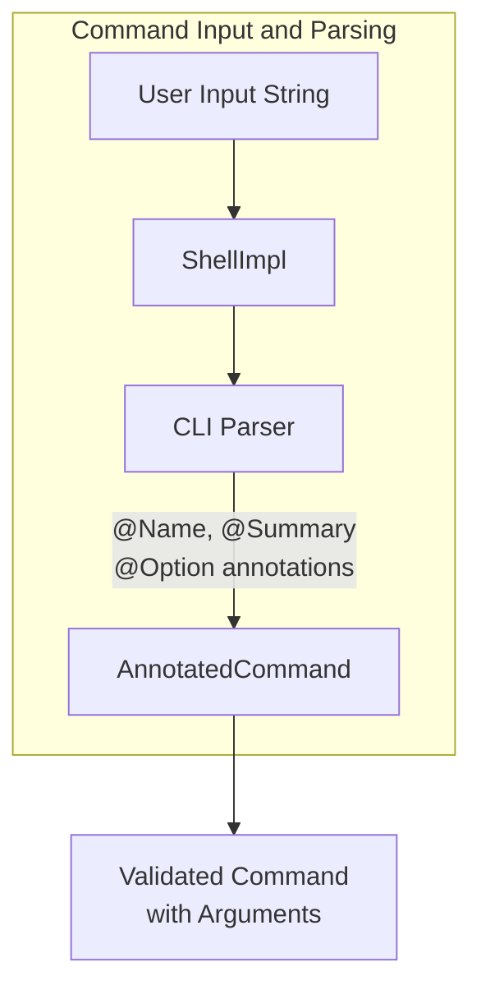
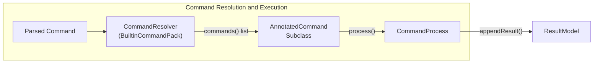
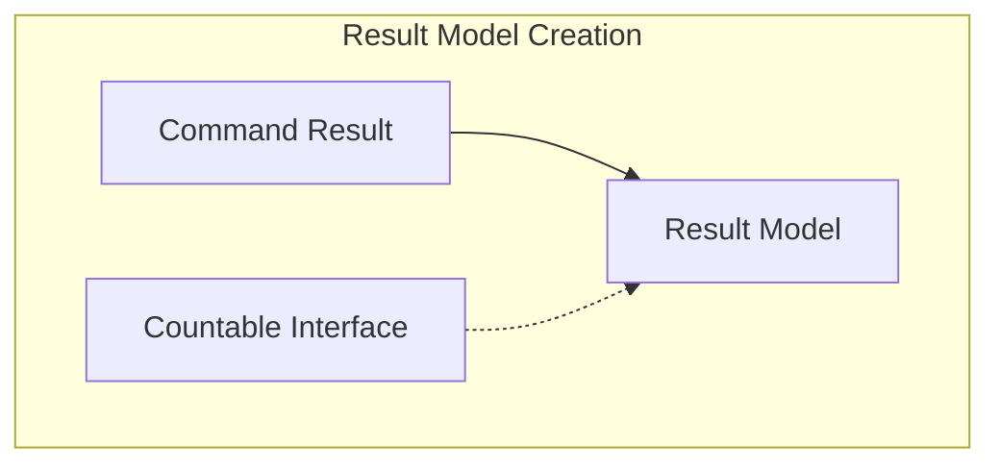
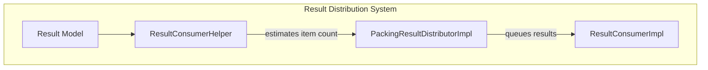
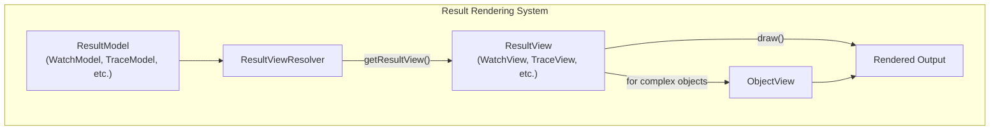
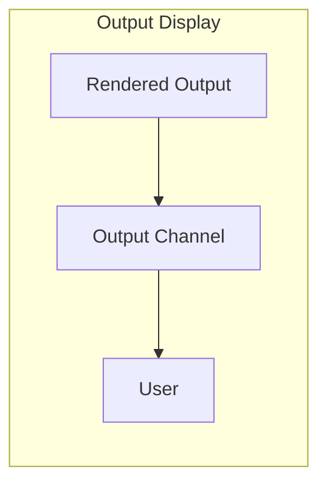
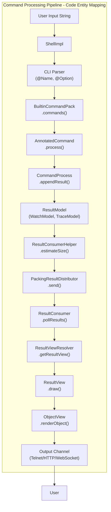

<!-- source: DeepWiki mcp.deepwiki.com · repo alibaba/arthas · page 2.4 Command Processing Pipeline · fetched 2026-10-29 -->

# Command Processing Pipeline

<details>
<summary>Relevant source files</summary>

The following files were used as context for generating this wiki page:

- [core/src/main/java/com/taobao/arthas/core/command/BuiltinCommandPack.java](core/src/main/java/com/taobao/arthas/core/command/BuiltinCommandPack.java)
- [core/src/main/java/com/taobao/arthas/core/command/basic1000/StopCommand.java](core/src/main/java/com/taobao/arthas/core/command/basic1000/StopCommand.java)
- [core/src/main/java/com/taobao/arthas/core/command/model/VmToolModel.java](core/src/main/java/com/taobao/arthas/core/command/model/VmToolModel.java)
- [core/src/main/java/com/taobao/arthas/core/command/view/ResultViewResolver.java](core/src/main/java/com/taobao/arthas/core/command/view/ResultViewResolver.java)
- [core/src/main/java/com/taobao/arthas/core/command/view/VmToolView.java](core/src/main/java/com/taobao/arthas/core/command/view/VmToolView.java)
- [core/src/main/java/com/taobao/arthas/core/mcp/util/McpObjectVOFilter.java](core/src/main/java/com/taobao/arthas/core/mcp/util/McpObjectVOFilter.java)
- [core/src/main/java/com/taobao/arthas/core/util/NetUtils.java](core/src/main/java/com/taobao/arthas/core/util/NetUtils.java)
- [core/src/main/java/com/taobao/arthas/core/util/StringUtils.java](core/src/main/java/com/taobao/arthas/core/util/StringUtils.java)
- [core/src/main/java/com/taobao/arthas/core/util/metrics/RateCounter.java](core/src/main/java/com/taobao/arthas/core/util/metrics/RateCounter.java)
- [core/src/main/java/com/taobao/arthas/core/view/ObjectView.java](core/src/main/java/com/taobao/arthas/core/view/ObjectView.java)
- [core/src/test/java/com/taobao/arthas/core/advisor/SpyImplTest.java](core/src/test/java/com/taobao/arthas/core/advisor/SpyImplTest.java)
- [core/src/test/java/com/taobao/arthas/core/view/ObjectViewTest.java](core/src/test/java/com/taobao/arthas/core/view/ObjectViewTest.java)

</details>


## Purpose and Scope

This document explains the architecture and components involved in processing commands in Arthas, from the moment a user inputs a command until results are rendered and displayed. Understanding this pipeline is crucial for developers who want to extend Arthas with new commands or modify existing command behavior. For information about specific diagnostic commands, see [Diagnostic Commands](#3).

## High-Level Pipeline Overview

The command processing pipeline in Arthas follows a well-defined flow that transforms user input into structured results through several processing stages.

```mermaid
flowchart LR
    subgraph "Input Phase"
        UserInput["User Input"]
        CommandParsing["Command Parsing"]
    end
    
    subgraph "Processing Phase"
        CommandResolution["Command Resolution"]
        CommandExecution["Command Execution"]
        ResultModelCreation["Result Model Creation"]
    end
    
    subgraph "Output Phase"
        ResultDistribution["Result Distribution"]
        ResultRendering["Result Rendering"]
        OutputDisplay["Output Display"]
    end
    
    UserInput --> CommandParsing
    CommandParsing --> CommandResolution
    CommandResolution --> CommandExecution
    CommandExecution --> ResultModelCreation
    ResultModelCreation --> ResultDistribution
    ResultDistribution --> ResultRendering
    ResultRendering --> OutputDisplay
```



Sources: High-level architecture diagram provided in the introduction

## Command Input and Parsing

When a user enters a command through any interface (CLI, web console, or API), the input is tokenized and parsed into structured command arguments using the middleware CLI framework.



Commands are defined as classes extending `AnnotatedCommand` and use annotations from the `com.taobao.middleware.cli.annotations` package to declare their names, options, and arguments. The CLI parser automatically extracts and validates arguments based on these annotations.

Sources: [core/src/main/java/com/taobao/arthas/core/shell/command/AnnotatedCommand.java], [core/src/main/java/com/taobao/arthas/core/command/basic1000/StopCommand.java:1-43]()

## Command Resolution and Execution

After parsing, Arthas resolves the command to the appropriate handler based on the command name using the `CommandResolver` interface. The primary implementation is `BuiltinCommandPack`, which registers 50+ built-in commands during initialization.



**Command Registration**: The `BuiltinCommandPack` class registers all built-in commands in its constructor:

| Command Category | Example Commands | Line References |
|------------------|------------------|-----------------|
| Basic (basic1000) | `help`, `version`, `cls`, `stop` | [core/src/main/java/com/taobao/arthas/core/command/BuiltinCommandPack.java:61-108]() |
| Class Inspection (klass100) | `jad`, `dump`, `sc`, `sm` | [core/src/main/java/com/taobao/arthas/core/command/BuiltinCommandPack.java:64-68]() |
| Enhancement (monitor200) | `watch`, `trace`, `tt`, `monitor`, `stack` | [core/src/main/java/com/taobao/arthas/core/command/BuiltinCommandPack.java:69-75]() |
| JVM Introspection | `thread`, `jvm`, `dashboard`, `memory` | [core/src/main/java/com/taobao/arthas/core/command/BuiltinCommandPack.java:71-77]() |

**Command Execution**: Each command implements the `process(CommandProcess process)` method, which receives a `CommandProcess` object for appending results and managing execution lifecycle.

Sources: [core/src/main/java/com/taobao/arthas/core/command/BuiltinCommandPack.java:1-127](), [core/src/main/java/com/taobao/arthas/core/command/basic1000/StopCommand.java:22-41]()

## Result Model Creation

Command execution produces standardized `ResultModel` objects that encapsulate the command output in a structured way. These models provide a consistent interface for the distribution and rendering phases.



Some result models implement the `Countable` interface, which helps estimate the size of results for efficient distribution:

```java
public interface Countable {
    /**
     * Get item size of this result model, the value of size is greater than or equal to 1
     * @return item size of this result model
     */
    int size();
}
```

Sources: [core/src/main/java/com/taobao/arthas/core/command/model/Countable.java:1-15]()

## Result Distribution

After a result model is created, it enters the distribution phase, where it is queued and distributed to various consumers (CLI, web interface, API clients, etc.).



The distribution system consists of these key components:

1. **ResultConsumerHelper**: Estimates the size of result models to facilitate efficient distribution
2. **PackingResultDistributorImpl**: Queues result models and handles overflow conditions
3. **ResultConsumerImpl**: Consumes and processes command results for specific output channels

The distribution system manages result flow using a queue system with configurable limits:

```java
// From PackingResultDistributorImpl
private BlockingQueue<ResultModel> resultQueue = new ArrayBlockingQueue<ResultModel>(500);

// From ResultConsumerImpl
public boolean appendResult(ResultModel result) {
    //可能某些Consumer已经断开，不会再读取，这里不能堵塞！
    boolean discard = false;
    while (!resultQueue.offer(result)) {
        ResultModel discardResult = resultQueue.poll();
        discard = true;
    }
    return !discard;
}
```

The distribution system also supports batch processing and long polling to optimize network communication:

```java
// From ResultConsumerImpl - polling with batching support
public List<ResultModel> pollResults() {
    // ... (locking and timing logic)
    List<ResultModel> sendingResults = new ArrayList<ResultModel>(resultBatchSizeLimit);
    
    // Poll results with timing constraints
    while (!closed && sendingResults.size() < resultBatchSizeLimit
            && sendingDelay < 100 && waitingTime < pollTimeLimit) {
        ResultModel aResult = resultQueue.poll(100, TimeUnit.MILLISECONDS);
        if (aResult != null) {
            sendingResults.add(aResult);
            // ... (flush logic)
        }
    }
    return sendingResults;
}
```

Sources: 
- [core/src/main/java/com/taobao/arthas/core/distribution/ResultConsumerHelper.java:22-93]()
- [core/src/main/java/com/taobao/arthas/core/distribution/impl/PackingResultDistributorImpl.java:1-43]()
- [core/src/main/java/com/taobao/arthas/core/distribution/impl/ResultConsumerImpl.java:22-167]()

## Result Rendering

The rendering phase transforms structured `ResultModel` objects into formats appropriate for display through a view resolution and rendering system.



**View Resolution**: The `ResultViewResolver` class maintains a registry mapping `ResultModel` classes to their corresponding `ResultView` implementations. During initialization, it registers 40+ view mappings:

```java
// From ResultViewResolver - view registration
private void initResultViews() {
    // Basic commands
    registerView(VersionView.class);
    registerView(HelpView.class);
    
    // Class inspection
    registerView(JadView.class);
    registerView(SearchClassView.class);
    
    // Enhancement commands
    registerView(WatchView.class);
    registerView(TraceView.class);
    registerView(MonitorView.class);
    // ... 30+ more views
}
```

The resolver uses reflection to automatically extract the model class from each view's `draw()` method signature at [core/src/main/java/com/taobao/arthas/core/command/view/ResultViewResolver.java:122-139]().

**Object Rendering**: The `ObjectView` class provides sophisticated rendering of Java objects with these capabilities:

- **Format Selection**: JSON format (via fastjson2) or custom text format based on `GlobalOptions.isUsingJson`
- **Depth Control**: Configurable expansion depth (default max 4 levels) to prevent excessive output
- **Type-Specific Rendering**: Special handling for primitives, strings, collections, arrays, maps, throwables, dates, and enums
- **Size Limits**: Throws `ObjectTooLargeException` when output exceeds configured limit

```java
// From ObjectView - rendering with depth control
public ObjectView(Object object, int deep, int maxObjectLength) {
    this.object = object;
    this.deep = deep > MAX_DEEP ? MAX_DEEP : deep;
    this.maxObjectLength = maxObjectLength;
}
```

Sources: 
- [core/src/main/java/com/taobao/arthas/core/command/view/ResultViewResolver.java:1-141]()
- [core/src/main/java/com/taobao/arthas/core/view/ObjectView.java:1-704]()
- [core/src/test/java/com/taobao/arthas/core/view/ObjectViewTest.java:19-284]()

## Output Display

The final phase involves displaying the rendered output to the user through the appropriate channel (CLI, web interface, API response, etc.).



Different output channels handle the final display logic, including:
- Telnet terminal for CLI users
- HTTP responses for web console users 
- Tunnel system for remote clients

## Complete Pipeline Architecture

The full command processing pipeline integrates all components into a cohesive flow:



**Key Integration Points**:

1. **ShellImpl** manages the command execution context and job lifecycle
2. **BuiltinCommandPack** acts as the central registry for all 50+ commands
3. **CommandProcess** provides the bridge between command execution and result distribution
4. **ResultConsumerHelper** estimates result sizes for efficient batching
5. **ResultViewResolver** performs model-to-view mapping via reflection
6. **ObjectView** handles complex object rendering with depth control

This architecture enables Arthas to process commands efficiently across different interfaces while managing resources and handling potentially large result sets.

Sources: 
- [core/src/main/java/com/taobao/arthas/core/command/BuiltinCommandPack.java:1-127]()
- [core/src/main/java/com/taobao/arthas/core/command/view/ResultViewResolver.java:1-141]()
- [core/src/main/java/com/taobao/arthas/core/view/ObjectView.java:1-704]()

## Pipeline Flow Example

To illustrate how the pipeline works in practice, let's trace how a sample command flows through the system:

| Phase | Component | Action |
|-------|-----------|--------|
| Input | User | Enters `thread` command to view thread information |
| Parsing | Command Parser | Tokenizes and parses command arguments |
| Resolution | Command Resolver | Resolves to the ThreadCommand handler |
| Execution | ThreadCommand | Executes thread analysis logic |
| Result Creation | ThreadCommand | Creates ThreadModel with thread data |
| Distribution | PackingResultDistributor | Queues the ThreadModel for distribution |
| Distribution | ResultConsumer | Consumes the ThreadModel from the queue |
| Rendering | ObjectView | Renders thread information in readable format |
| Output | CLI/Web Console | Displays the rendered thread information |

This example demonstrates how a single command travels through each phase of the pipeline, from user input to displayed output.

The command processing pipeline enables Arthas's extensible and flexible diagnostic capabilities. Its modular design allows for efficient command handling and result presentation across different interfaces, making it a powerful tool for Java application diagnostics.

---

