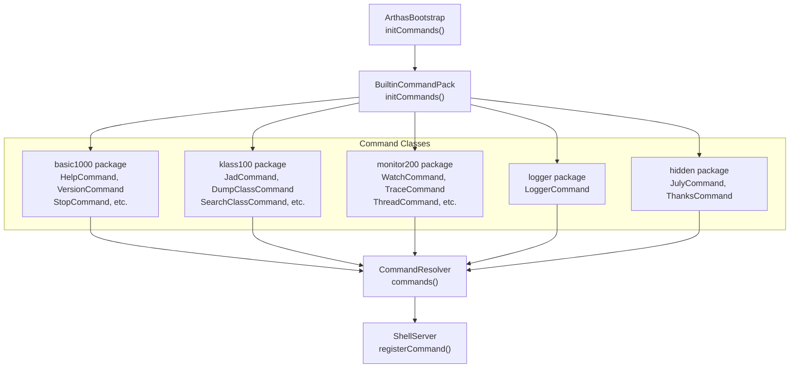
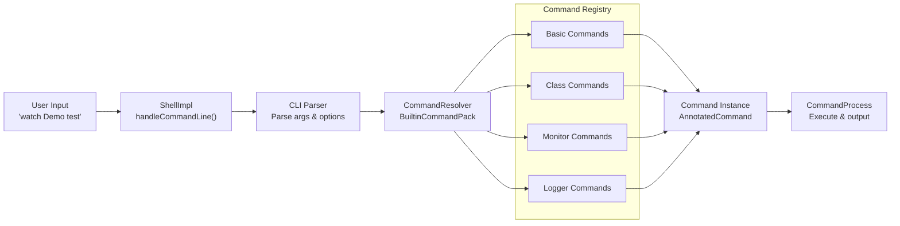
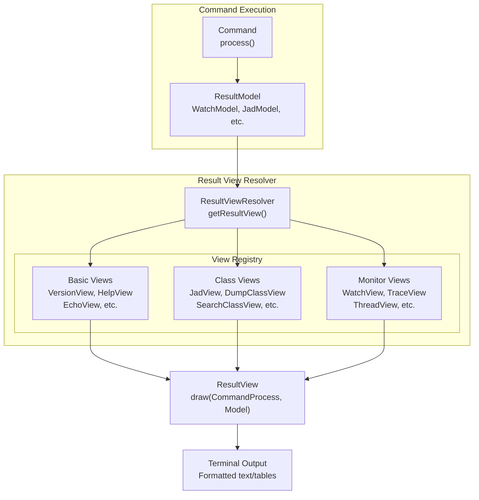
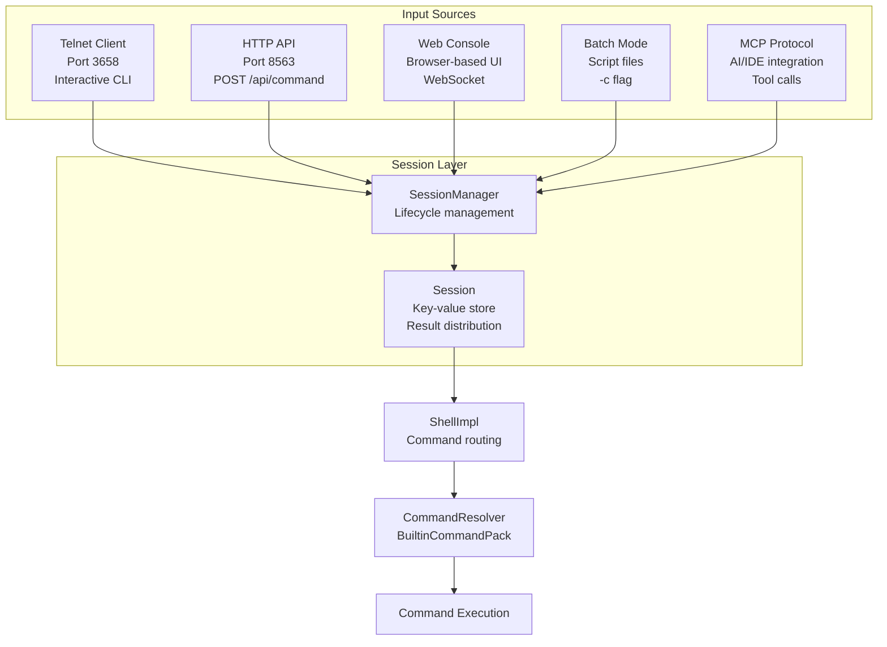

<!-- source: DeepWiki mcp.deepwiki.com · repo alibaba/arthas · page 3 Diagnostic Commands · fetched 2026-10-29 -->

# Diagnostic Commands

<details>
<summary>Relevant source files</summary>

The following files were used as context for generating this wiki page:

- [CONTRIBUTING.md](CONTRIBUTING.md)
- [README.md](README.md)
- [README_CN.md](README_CN.md)
- [USERS.md](USERS.md)
- [arthas-vmtool/README.md](arthas-vmtool/README.md)
- [as-package.sh](as-package.sh)
- [bin/as-service.bat](bin/as-service.bat)
- [bin/as.bat](bin/as.bat)
- [core/src/main/java/com/taobao/arthas/core/command/BuiltinCommandPack.java](core/src/main/java/com/taobao/arthas/core/command/BuiltinCommandPack.java)
- [core/src/main/java/com/taobao/arthas/core/command/basic1000/StopCommand.java](core/src/main/java/com/taobao/arthas/core/command/basic1000/StopCommand.java)
- [core/src/main/java/com/taobao/arthas/core/command/model/VmToolModel.java](core/src/main/java/com/taobao/arthas/core/command/model/VmToolModel.java)
- [core/src/main/java/com/taobao/arthas/core/command/view/ResultViewResolver.java](core/src/main/java/com/taobao/arthas/core/command/view/ResultViewResolver.java)
- [core/src/main/java/com/taobao/arthas/core/command/view/VmToolView.java](core/src/main/java/com/taobao/arthas/core/command/view/VmToolView.java)
- [static/cider.png](static/cider.png)
- [static/citycloud.jpg](static/citycloud.jpg)
- [static/didiglobal.jpg](static/didiglobal.jpg)
- [static/dms.png](static/dms.png)
- [static/guideir.jpg](static/guideir.jpg)
- [static/hollycrm.png](static/hollycrm.png)
- [static/mingyuanyun.jpg](static/mingyuanyun.jpg)
- [static/ouyeel.png](static/ouyeel.png)
- [static/videt.png](static/videt.png)
- [static/zhaopin.png](static/zhaopin.png)

</details>


## Purpose and Scope

Arthas provides over 50 built-in diagnostic commands that allow developers to inspect, monitor, and modify running Java applications without code changes or restarts. Commands are organized into categories based on their diagnostic capabilities: basic utilities, class inspection, bytecode enhancement, expression evaluation, and JVM/thread monitoring.

This page provides an overview of all available diagnostic commands and their registration mechanism. For detailed information on specific command categories, see:
- Profiling commands: [3.1](#3.1)
- Class inspection commands: [3.2](#3.2)
- Bytecode enhancement commands: [3.3](#3.3)
- Expression evaluation: [3.4](#3.4)
- Thread and JVM commands: [3.5](#3.5)

For information on how commands are processed and executed, see [Command Processing Pipeline](#2.4).

## Command Categories and Registration

All built-in commands are registered through the `BuiltinCommandPack` class, which implements the `CommandResolver` interface. Commands are instantiated using the `Command.create()` factory method, which wraps `AnnotatedCommand` subclasses with CLI argument parsing capabilities.

**Command Registration Flow:**



Sources: [core/src/main/java/com/taobao/arthas/core/command/BuiltinCommandPack.java:1-127]()

### Command Package Structure

Commands are organized into Java packages that correspond to their functional categories:

| Package | Purpose | Example Commands |
|---------|---------|-----------------|
| `com.taobao.arthas.core.command.basic1000` | Basic utilities and system commands | help, version, stop, cls, options |
| `com.taobao.arthas.core.command.klass100` | Class inspection and manipulation | jad, dump, sc, sm, classloader, ognl |
| `com.taobao.arthas.core.command.monitor200` | Monitoring and bytecode enhancement | watch, trace, monitor, thread, dashboard |
| `com.taobao.arthas.core.command.logger` | Logger configuration | logger |
| `com.taobao.arthas.core.command.hidden` | Easter egg commands | july, thanks |

## Complete Command Reference

### Basic and Utility Commands

These commands provide essential utilities for interacting with Arthas and managing sessions.

| Command | Class | Description |
|---------|-------|-------------|
| `help` | `HelpCommand` | Display help information for commands |
| `version` | `VersionCommand` | Display Arthas version |
| `stop` | `StopCommand` | Shutdown Arthas server and exit |
| `cls` | `ClsCommand` | Clear the terminal screen |
| `session` | `SessionCommand` | Display current session information |
| `reset` | `ResetCommand` | Reset all enhanced classes |
| `history` | `HistoryCommand` | Display command history |
| `auth` | `AuthCommand` | Authenticate user |
| `keymap` | `KeymapCommand` | Display keyboard shortcuts |
| `options` | `OptionsCommand` | View or modify Arthas options |
| `sysprop` | `SystemPropertyCommand` | View or modify system properties |
| `sysenv` | `SystemEnvCommand` | View system environment variables |
| `vmoption` | `VMOptionCommand` | View or modify VM diagnostic options |
| `cat` | `CatCommand` | Concatenate and print files |
| `echo` | `EchoCommand` | Echo text to output |
| `pwd` | `PwdCommand` | Print working directory |
| `grep` | `GrepCommand` | Search for patterns (used as pipe command) |
| `tee` | `TeeCommand` | Redirect output to file and console |
| `base64` | `Base64Command` | Base64 encode/decode |

Sources: [core/src/main/java/com/taobao/arthas/core/command/BuiltinCommandPack.java:61-108](), [core/src/main/java/com/taobao/arthas/core/command/basic1000/StopCommand.java:1-43]()

### Class Inspection Commands

These commands allow inspection of classes, methods, and bytecode without modifying the application. See [3.2](#3.2) for detailed documentation.

| Command | Class | Description |
|---------|-------|-------------|
| `sc` | `SearchClassCommand` | Search loaded classes by pattern |
| `sm` | `SearchMethodCommand` | Search methods in loaded classes |
| `jad` | `JadCommand` | Decompile class to Java source code |
| `dump` | `DumpClassCommand` | Dump bytecode of loaded classes to files |
| `classloader` | `ClassLoaderCommand` | View classloader hierarchy and statistics |
| `getstatic` | `GetStaticCommand` | View static field values |
| `mc` | `MemoryCompilerCommand` | Memory compiler - compile .java to .class in memory |
| `redefine` | `RedefineCommand` | Redefine classes in JVM |
| `retransform` | `RetransformCommand` | Retransform classes using loaded .class files |
| `ognl` | `OgnlCommand` | Execute OGNL expressions |

Sources: [core/src/main/java/com/taobao/arthas/core/command/BuiltinCommandPack.java:64-84](), [README.md:140-238]()

### Monitoring and Enhancement Commands

These commands use bytecode instrumentation to monitor method execution and capture runtime data. See [3.3](#3.3) for bytecode enhancement details and [3.5](#3.5) for thread/JVM commands.

| Command | Class | Description | Enhancement |
|---------|-------|-------------|------------|
| `watch` | `WatchCommand` | Observe method input/output/exception | Yes |
| `trace` | `TraceCommand` | Trace method call tree with timing | Yes |
| `monitor` | `MonitorCommand` | Monitor method call statistics | Yes |
| `tt` | `TimeTunnelCommand` | Time tunnel - record and replay method calls | Yes |
| `stack` | `StackCommand` | Display method call stack | Yes |
| `thread` | `ThreadCommand` | Display thread information and stack traces | No |
| `dashboard` | `DashboardCommand` | Real-time system dashboard (threads, memory, GC) | No |
| `jvm` | `JvmCommand` | Display JVM information | No |
| `memory` | `MemoryCommand` | Display memory usage | No |
| `perfcounter` | `PerfCounterCommand` | Display JVM performance counters | No |
| `heapdump` | `HeapDumpCommand` | Generate heap dump file | No |
| `mbean` | `MBeanCommand` | View or invoke MBean attributes and operations | No |

Sources: [core/src/main/java/com/taobao/arthas/core/command/BuiltinCommandPack.java:69-85](), [README.md:99-344]()

### Advanced Diagnostic Commands

| Command | Class | Description |
|---------|-------|-------------|
| `profiler` | `ProfilerCommand` | Async-profiler integration for CPU/memory profiling |
| `vmtool` | `VmToolCommand` | JNI-based tools for heap instance retrieval and analysis |
| `logger` | `LoggerCommand` | View or modify logger levels at runtime |
| `jfr` | `JFRCommand` | Java Flight Recorder commands (JDK 11+) |

Sources: [core/src/main/java/com/taobao/arthas/core/command/BuiltinCommandPack.java:96-114](), [README.md:240-260](), [README.md:395-412]()

## Command Resolution and Execution

**Command Resolution Architecture:**



When a command is executed:

1. **Input Parsing**: The shell receives the command line and splits it into command name and arguments
2. **Command Resolution**: `BuiltinCommandPack` searches its registered commands by matching the `@Name` annotation value
3. **Argument Binding**: CLI parser binds command-line arguments to command fields using reflection and annotations
4. **Execution**: The command's `process(CommandProcess)` method is invoked
5. **Result Generation**: Command generates a `ResultModel` (e.g., `WatchModel`, `JadModel`)
6. **View Rendering**: `ResultViewResolver` maps the model to appropriate `ResultView` for terminal output

Sources: [core/src/main/java/com/taobao/arthas/core/command/BuiltinCommandPack.java:54-57](), [core/src/main/java/com/taobao/arthas/core/command/view/ResultViewResolver.java:17-140]()

## Result Model and View Mapping

Arthas uses a Model-View pattern for command output. Each command produces a `ResultModel` that is then rendered by a corresponding `ResultView`.

**Model-View Registration in ResultViewResolver:**



**Example View Registrations:**

| Model Class | View Class | Command(s) |
|-------------|-----------|-----------|
| `WatchModel` | `WatchView` | watch |
| `TraceModel` | `TraceView` | trace |
| `JadModel` | `JadView` | jad |
| `ThreadModel` | `ThreadView` | thread |
| `DashboardModel` | `DashboardView` | dashboard |
| `VmToolModel` | `VmToolView` | vmtool |
| `ProfilerModel` | `ProfilerView` | profiler |
| `TimeTunnelModel` | `TimeTunnelView` | tt |

Sources: [core/src/main/java/com/taobao/arthas/core/command/view/ResultViewResolver.java:30-87]()

## Disabled Commands

The `BuiltinCommandPack` constructor accepts a list of disabled command names, allowing specific commands to be excluded from the command registry. This is useful for security or compliance requirements.

```java
// Example from BuiltinCommandPack.java lines 116-123
for (Class<? extends AnnotatedCommand> clazz : commandClassList) {
    Name name = clazz.getAnnotation(Name.class);
    if (name != null && name.value() != null) {
        if (disabledCommands.contains(name.value())) {
            continue;  // Skip disabled commands
        }
    }
    commands.add(Command.create(clazz));
}
```

Sources: [core/src/main/java/com/taobao/arthas/core/command/BuiltinCommandPack.java:50-52](), [core/src/main/java/com/taobao/arthas/core/command/BuiltinCommandPack.java:116-125]()

## Command Input Sources

Diagnostic commands can be invoked through multiple interfaces, all converging on the same command processing pipeline:



Sources: [README.md:39-40](), [README.md:88-92]()

## Command Examples

The README files provide extensive examples of command usage. Here are representative examples for each category:

**Class Inspection (jad):**
```bash
$ jad javax.servlet.Servlet
# Decompiles the class and shows ClassLoader hierarchy
```

**Bytecode Enhancement (watch):**
```bash
$ watch test.arthas.TestWatch doGet {params[0], throwExp} -e
# Watches method parameters and exceptions when exception occurs
```

**Monitoring (thread):**
```bash
$ thread -n 3
# Shows top 3 threads by CPU usage with stack traces
```

**Profiling (profiler):**
```bash
$ profiler start
$ profiler stop
# Generates CPU flame graph to arthas-output directory
```

**Heap Analysis (vmtool):**
```bash
$ vmtool --action getInstances --className java.lang.String --limit 10
# Retrieves String instances from heap using JNI
```

Sources: [README.md:140-412](), [README_CN.md:129-399]()

---

