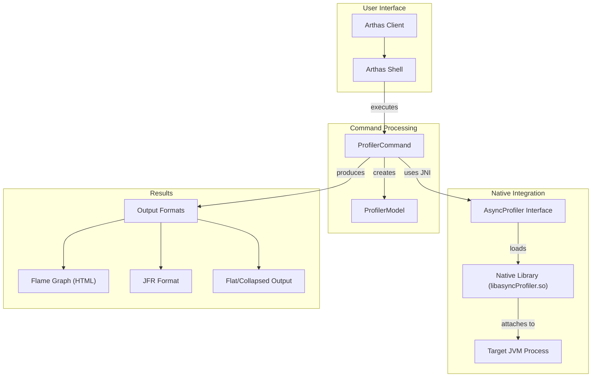
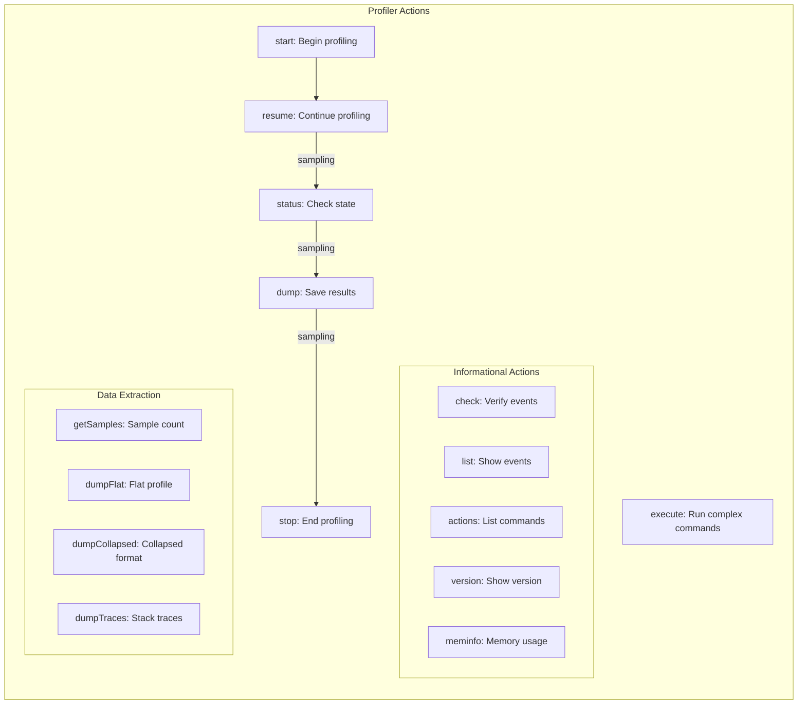
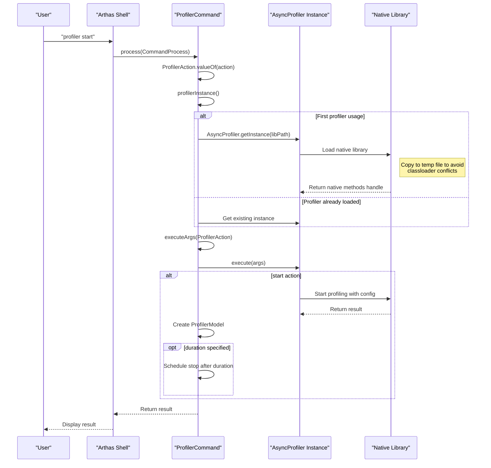
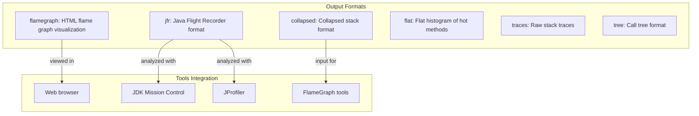

<!-- source: DeepWiki mcp.deepwiki.com · repo alibaba/arthas · page 3.1 Profiling Commands · fetched 2026-10-29 -->

# Profiling Commands

<details>
<summary>Relevant source files</summary>

The following files were used as context for generating this wiki page:

- [core/src/main/java/com/taobao/arthas/core/command/model/ProfilerModel.java](core/src/main/java/com/taobao/arthas/core/command/model/ProfilerModel.java)
- [core/src/main/java/com/taobao/arthas/core/command/monitor200/ProfilerCommand.java](core/src/main/java/com/taobao/arthas/core/command/monitor200/ProfilerCommand.java)
- [core/src/main/java/com/taobao/arthas/core/command/monitor200/ProfilerMarkdown.java](core/src/main/java/com/taobao/arthas/core/command/monitor200/ProfilerMarkdown.java)
- [core/src/main/java/com/taobao/arthas/core/command/view/ProfilerView.java](core/src/main/java/com/taobao/arthas/core/command/view/ProfilerView.java)
- [core/src/main/java/com/taobao/arthas/core/mcp/tool/function/monitor200/ProfilerTool.java](core/src/main/java/com/taobao/arthas/core/mcp/tool/function/monitor200/ProfilerTool.java)
- [core/src/test/java/com/taobao/arthas/core/command/monitor200/ProfilerMarkdownTest.java](core/src/test/java/com/taobao/arthas/core/command/monitor200/ProfilerMarkdownTest.java)
- [site/docs/doc/profiler.md](site/docs/doc/profiler.md)
- [site/docs/en/doc/profiler.md](site/docs/en/doc/profiler.md)

</details>


The Profiling Commands in Arthas provide powerful CPU, memory, and lock profiling capabilities through integration with [async-profiler](https://github.com/jvm-profiling-tools/async-profiler). These commands allow users to generate flame graphs and other visualizations to analyze performance bottlenecks in Java applications without requiring application restarts or code modifications.

## Command Overview

The profiler command follows the basic structure `profiler action [actionArg]` and supports various sampling events including CPU, allocation, lock contention, and more. The primary implementation is in the `ProfilerCommand` class which manages the interaction with the native async-profiler library.

### Profiler Command Architecture



Sources: [core/src/main/java/com/taobao/arthas/core/command/monitor200/ProfilerCommand.java:40-81](), [core/src/main/java/com/taobao/arthas/core/command/monitor200/ProfilerCommand.java:583-596]()

## Supported Actions

The profiler command supports multiple actions to control the profiling lifecycle:



Sources: [core/src/main/java/com/taobao/arthas/core/command/monitor200/ProfilerCommand.java:586-596](), [core/src/main/java/com/taobao/arthas/core/command/monitor200/ProfilerCommand.java:731-865]()

## Command Implementation

The `ProfilerCommand` class is the central component that processes user inputs, configures the profiler, and manages the sampling process.

### Initialization Process

When a user invokes the profiler command, the following initialization process occurs:



Sources: [core/src/main/java/com/taobao/arthas/core/command/monitor200/ProfilerCommand.java:542-582](), [core/src/main/java/com/taobao/arthas/core/command/monitor200/ProfilerCommand.java:731-866]()

### Configuration Options

The profiler command supports numerous configuration options. The most important ones include:

| Option | Description | Default |
|--------|-------------|---------|
| `--event` | Event to trace (cpu, alloc, lock, etc.) | cpu |
| `--interval` | Sampling interval in nanoseconds | 10,000,000 (10ms) |
| `--duration` | Run profiling for specified seconds | - |
| `--file` | Output file path | Auto-generated |
| `--format` | Output format (flamegraph, jfr, collapsed, etc.) | flamegraph |
| `--threads` | Profile different threads separately | false |
| `--include` | Include stack traces with pattern | - |
| `--exclude` | Exclude stack traces with pattern | - |
| `--alloc` | Allocation profiling interval | - |
| `--lock` | Lock profiling threshold | - |
| `--jstackdepth` | Maximum Java stack depth | 2048 |

Sources: [core/src/main/java/com/taobao/arthas/core/command/monitor200/ProfilerCommand.java:80-538]()

## Profiling Workflow

### Starting a Profiling Session

The start action begins collecting profiling data based on the specified event:

```java
profiler start                    // Start CPU profiling (default)
profiler start --event alloc      // Start memory allocation profiling
profiler start --event lock       // Start lock contention profiling
profiler start --duration 30      // Profile for 30 seconds then stop
```

The implementation logic in [core/src/main/java/com/taobao/arthas/core/command/monitor200/ProfilerCommand.java:751-806]() handles:
1. Determining if a file was specified or should be auto-generated
2. Building execution arguments
3. Executing the profiling command
4. Optionally scheduling a delayed stop if duration was specified

### Checking Profiling Status

The status action shows if profiling is active and for how long:

```java
profiler status                   // Shows active profiling status
```

### Stopping and Generating Results

The stop action ends profiling and generates output based on the specified format:

```java
profiler stop                     // Stop and generate flame graph (default)
profiler stop --format jfr        // Stop and generate JFR file
profiler stop --include 'java/*'  // Stop and filter for java package frames only
```

The implementation in [core/src/main/java/com/taobao/arthas/core/command/monitor200/ProfilerCommand.java:809-810]() and [core/src/main/java/com/taobao/arthas/core/command/monitor200/ProfilerCommand.java:867-905]() handles:
1. Processing the stop action
2. Determining the output file format
3. Generating the final profiling output

## Profiling Events

The profiler command supports different events depending on the operating system platform.

### Basic Events (All Platforms)

| Event | Description |
|-------|-------------|
| cpu | CPU samples (default) |
| alloc | Heap allocations |
| lock | Lock contention |
| wall | Wall clock time |
| itimer | Interval timer |
| ctimer | CPU timer |

### Additional Linux-Specific Events

Linux-specific events include processor events like:
- page-faults
- context-switches
- cycles
- instructions
- cache-misses
- branch-instructions
- L1-dcache-load-misses
- and more

Sources: [site/docs/doc/profiler.md:92-139]()

## Output Formats

The profiler command can generate various output formats:



Sources: [site/docs/doc/profiler.md:66-86](), [site/docs/doc/profiler.md:251-254]()

## Advanced Features

### Continuous Profiling

The profiler supports running in a loop for continuous profiling with the `--loop` option:

```java
profiler start --loop 1h -f /var/log/profile-%t.jfr
```

This command generates periodic JFR files, useful for long-term application performance monitoring.

### Time-to-Safepoint Profiling

The profiler can analyze JVM safepoint pauses using `--ttsp` option:

```java
profiler start --ttsp --format jfr
```

This measures the time it takes for threads to reach a safepoint when one is requested.

Sources: [site/docs/doc/profiler.md:378-386](), [site/docs/doc/profiler.md:319-345]()

### JFR Synchronization

The profiler can start Java Flight Recording alongside profiling with `--jfrsync`:

```java
profiler start -e cpu --jfrsync profile -f combined.jfr
```

This allows correlation between profiling data and JFR events.

Sources: [site/docs/doc/profiler.md:346-376]()

## Implementation Details

### Native Library Loading

The profiler command loads the appropriate platform-specific native library during initialization:

```java
static {
    String profilerSoPath = null;
    if (OSUtils.isMac()) {
        // FAT_BINARY support both x86_64/arm64
        profilerSoPath = "async-profiler/libasyncProfiler-mac.dylib";
    }
    if (OSUtils.isLinux()) {
        if (OSUtils.isX86_64()) {
            profilerSoPath = "async-profiler/libasyncProfiler-linux-x64.so";
        } else if (OSUtils.isArm64()) {
            profilerSoPath = "async-profiler/libasyncProfiler-linux-arm64.so";
        }
    }
    // ... library initialization logic ...
}
```

Sources: [core/src/main/java/com/taobao/arthas/core/command/monitor200/ProfilerCommand.java:266-295]()

### Command Argument Processing

The `executeArgs` method builds the command string for the native profiler based on user-specified options:

```java
private String executeArgs(ProfilerAction action) {
    StringBuilder sb = new StringBuilder();
    final char COMMA = ',';

    // action (start, resume, stop, etc.)
    sb.append(action).append(COMMA);

    // Add event type
    if (this.event != null) {
        sb.append("event=").append(this.event).append(COMMA);
    }
    
    // Add other options (interval, file, format, etc.)
    // ...
}
```

Sources: [core/src/main/java/com/taobao/arthas/core/command/monitor200/ProfilerCommand.java:597-718]()

## Related Documentation

For information about other monitoring commands, see:
- [Thread Analysis Commands](#3.2) for monitoring thread states and system metrics
- [Class and Method Monitoring](#3.3) for analyzing method execution

## Conclusion

The profiler command provides comprehensive JVM profiling capabilities to Arthas users. Built on the robust async-profiler library, it enables detailed performance analysis for CPU usage, memory allocations, lock contention, and more, with minimal overhead to the target application.

---

