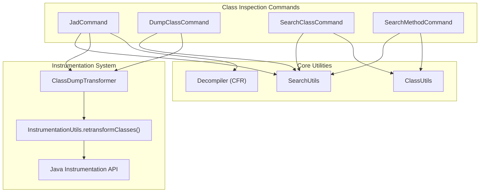
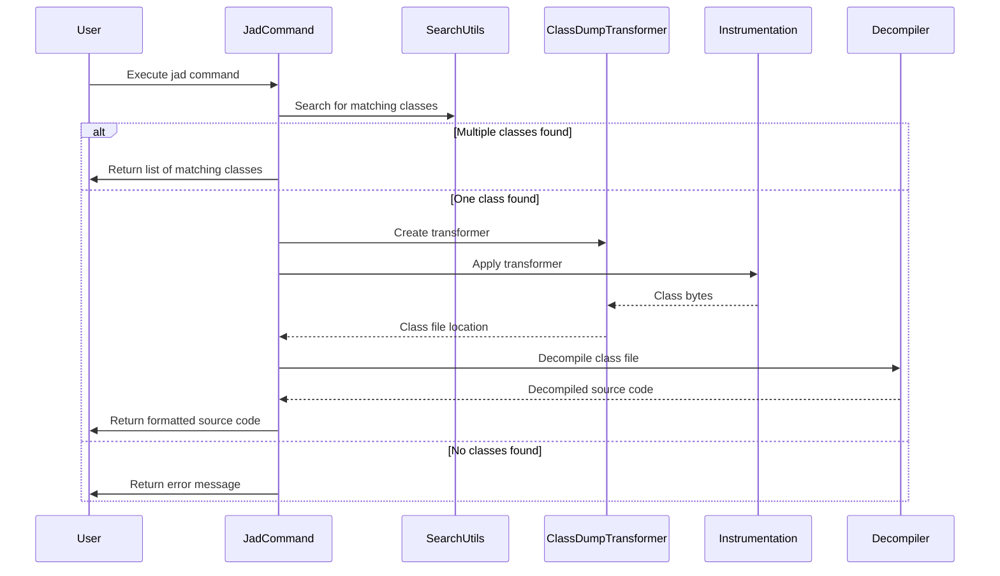
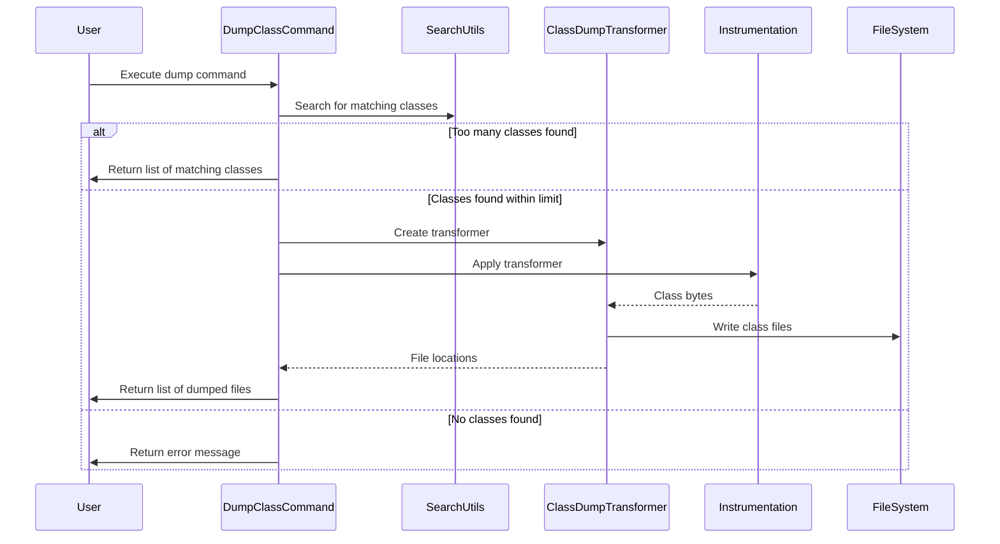
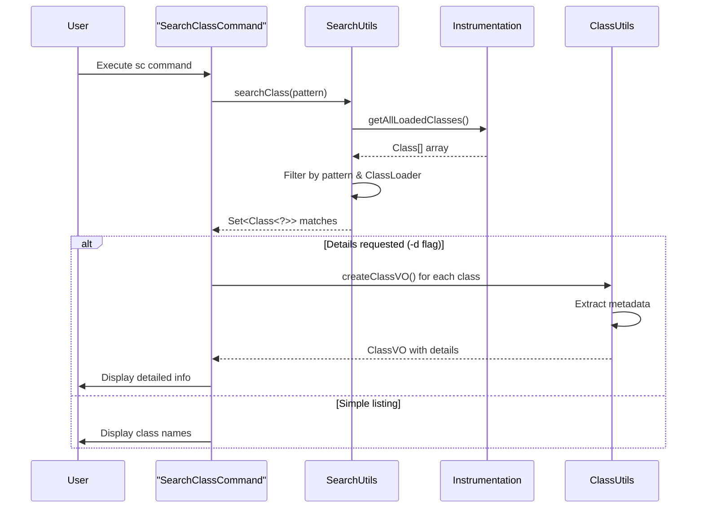
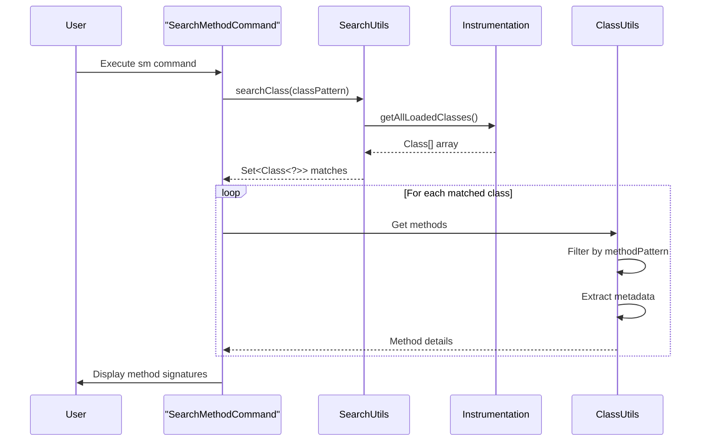
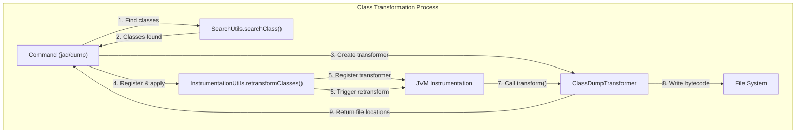
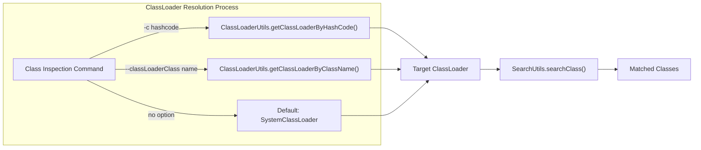

<!-- source: DeepWiki mcp.deepwiki.com · repo alibaba/arthas · page 3.2 Class Inspection Commands · fetched 2026-10-29 -->

# Class Inspection Commands

<details>
<summary>Relevant source files</summary>

The following files were used as context for generating this wiki page:

- [CONTRIBUTING.md](CONTRIBUTING.md)
- [README.md](README.md)
- [README_CN.md](README_CN.md)
- [USERS.md](USERS.md)
- [arthas-vmtool/README.md](arthas-vmtool/README.md)
- [as-package.sh](as-package.sh)
- [bin/as-service.bat](bin/as-service.bat)
- [bin/as.bat](bin/as.bat)
- [common/src/main/java/com/taobao/arthas/common/Pair.java](common/src/main/java/com/taobao/arthas/common/Pair.java)
- [core/src/main/java/com/taobao/arthas/core/command/klass100/DumpClassCommand.java](core/src/main/java/com/taobao/arthas/core/command/klass100/DumpClassCommand.java)
- [core/src/main/java/com/taobao/arthas/core/command/klass100/JadCommand.java](core/src/main/java/com/taobao/arthas/core/command/klass100/JadCommand.java)
- [core/src/main/java/com/taobao/arthas/core/command/model/DumpClassModel.java](core/src/main/java/com/taobao/arthas/core/command/model/DumpClassModel.java)
- [core/src/main/java/com/taobao/arthas/core/command/model/JadModel.java](core/src/main/java/com/taobao/arthas/core/command/model/JadModel.java)
- [core/src/main/java/com/taobao/arthas/core/command/model/MemoryCompilerModel.java](core/src/main/java/com/taobao/arthas/core/command/model/MemoryCompilerModel.java)
- [core/src/main/java/com/taobao/arthas/core/command/model/RedefineModel.java](core/src/main/java/com/taobao/arthas/core/command/model/RedefineModel.java)
- [core/src/main/java/com/taobao/arthas/core/command/monitor200/DashboardInterruptHandler.java](core/src/main/java/com/taobao/arthas/core/command/monitor200/DashboardInterruptHandler.java)
- [core/src/main/java/com/taobao/arthas/core/command/view/DumpClassView.java](core/src/main/java/com/taobao/arthas/core/command/view/DumpClassView.java)
- [core/src/main/java/com/taobao/arthas/core/util/Decompiler.java](core/src/main/java/com/taobao/arthas/core/util/Decompiler.java)
- [core/src/main/java/com/taobao/arthas/core/util/InstrumentationUtils.java](core/src/main/java/com/taobao/arthas/core/util/InstrumentationUtils.java)
- [core/src/test/java/com/taobao/arthas/core/util/DecompilerTest.java](core/src/test/java/com/taobao/arthas/core/util/DecompilerTest.java)
- [static/cider.png](static/cider.png)
- [static/citycloud.jpg](static/citycloud.jpg)
- [static/didiglobal.jpg](static/didiglobal.jpg)
- [static/dms.png](static/dms.png)
- [static/guideir.jpg](static/guideir.jpg)
- [static/hollycrm.png](static/hollycrm.png)
- [static/mingyuanyun.jpg](static/mingyuanyun.jpg)
- [static/ouyeel.png](static/ouyeel.png)
- [static/videt.png](static/videt.png)
- [static/zhaopin.png](static/zhaopin.png)

</details>


This page documents the commands in Arthas for inspecting Java classes at runtime. These commands enable powerful capabilities for examining the actual code of classes loaded in the JVM, searching for classes and methods, saving class bytecode to disk, and decompiling classes to readable source code.

## Overview

Arthas provides four main commands for class inspection:

| Command | Purpose | Key Features |
|---------|---------|-------------|
| `jad` | Decompile class bytecode | Shows Java source code for classes loaded in the JVM |
| `dump` | Extract class bytecode to file | Saves class files to disk for further analysis |
| `sc` | Search class | Finds loaded classes and displays detailed class information |
| `sm` | Search method | Finds methods in classes and displays method signatures |

These commands are particularly useful for troubleshooting and debugging applications in production environments where you may not have access to the original source code or need to verify which classes are actually loaded.

## Command Architecture

The class inspection commands use Arthas's core capabilities to interact with loaded classes in the JVM.



**Architecture Overview**: Class inspection commands follow a common pattern: they use `SearchUtils` to find classes matching user-specified patterns, then perform specific operations. The `jad` and `dump` commands additionally use `ClassDumpTransformer` to extract bytecode through the Java Instrumentation API's retransformation mechanism. All commands support flexible class matching patterns and ClassLoader specification.

Sources: [core/src/main/java/com/taobao/arthas/core/command/klass100/JadCommand.java](), [core/src/main/java/com/taobao/arthas/core/command/klass100/DumpClassCommand.java](), [core/src/main/java/com/taobao/arthas/core/util/SearchUtils.java](), [core/src/main/java/com/taobao/arthas/core/util/InstrumentationUtils.java]()

## Jad Command

The `jad` command decompiles specified classes loaded in the JVM and presents the equivalent Java source code. This helps users understand the actual code being executed, which may differ from the original source due to bytecode enhancement or different versions.

### Command Details

The `jad` command is defined in [core/src/main/java/com/taobao/arthas/core/command/klass100/JadCommand.java]() with the following features:

1. **Name**: `jad`
2. **Summary**: Decompile class
3. **Usage Examples**:
   - `jad java.lang.String` - Decompile entire class
   - `jad java.lang.String toString` - Decompile specific method
   - `jad java.lang.String -d /tmp/jad/dump` - Specify output directory
   - `jad --source-only java.lang.String` - Show source code only
   - `jad -c 39eb305e org/apache/log4j/Logger` - Use specific ClassLoader

### Options

| Option | Description |
|--------|-------------|
| `class-pattern` | Class name pattern using either '.' or '/' as separator |
| `method-name` | (Optional) Method name to decompile a specific method |
| `-c, --code <hashcode>` | Specify the hash code of the class's ClassLoader |
| `--classLoaderClass` | Specify class name of the ClassLoader |
| `-E, --regex` | Enable regular expression matching (default is wildcard) |
| `--hideUnicode` | Hide unicode characters in output |
| `--source-only` | Output source code only (no class/loader info) |
| `--lineNumber` | Show line numbers (default is true) |
| `-d, --directory` | Set destination directory for dumped class files |

### How It Works



Sources: [core/src/main/java/com/taobao/arthas/core/command/klass100/JadCommand.java:125-175](), [core/src/main/java/com/taobao/arthas/core/util/Decompiler.java]()

The workflow for decompiling a class involves:

1. Searching for the requested class(es) using `SearchUtils`
2. Dumping the class bytecode to a temporary file using `ClassDumpTransformer`
3. Decompiling the bytecode using the CFR decompiler
4. Formatting and returning the source code to the user

The `jad` command uses the [CFR decompiler](https://www.benf.org/other/cfr/) (embedded in Arthas) to convert bytecode back to readable Java source code.

Sources: [core/src/main/java/com/taobao/arthas/core/util/Decompiler.java:26-102]()

## Dump Command

The `dump` command extracts the bytecode of specified classes from the JVM and saves them to disk. This is useful for offline analysis or when you need to inspect the actual bytecode.

### Command Details

The `dump` command is defined in [core/src/main/java/com/taobao/arthas/core/command/klass100/DumpClassCommand.java]() with the following features:

1. **Name**: `dump`
2. **Summary**: Dump class byte array from JVM
3. **Usage Examples**:
   - `dump java.lang.String` - Dump class to default directory
   - `dump -d /tmp/output java.lang.String` - Specify output directory
   - `dump *StringUtils` - Use wildcard pattern
   - `dump -E org\.apache\.commons\.lang\.StringUtils` - Use regex pattern

### Options

| Option | Description |
|--------|-------------|
| `class-pattern` | Class name pattern using either '.' or '/' as separator |
| `-c, --code <hashcode>` | Specify the hash code of the class's ClassLoader |
| `--classLoaderClass` | Specify class name of the ClassLoader |
| `-E, --regex` | Enable regular expression matching (default is wildcard) |
| `-d, --directory` | Set destination directory for dumped class files |
| `-l, --limit` | Maximum number of classes to dump (default is 50) |

### How It Works



Sources: [core/src/main/java/com/taobao/arthas/core/command/klass100/DumpClassCommand.java:98-137](), [core/src/main/java/com/taobao/arthas/core/command/klass100/ClassDumpTransformer.java]()

The `dump` command uses the same `ClassDumpTransformer` as the `jad` command but focuses on saving the class bytes to disk rather than decompiling. The file path of dumped classes typically follows this pattern:

```
<dump-dir>/<classloader-class>-<hashcode>/<package-path>/<class-name>.class
```

For classes loaded by the bootstrap classloader, the classloader prefix is omitted.

Sources: [core/src/main/java/com/taobao/arthas/core/command/klass100/ClassDumpTransformer.java:66-94]()

## SC Command (Search Class)

The `sc` command searches for classes loaded in the JVM and displays detailed information about them. This is essential for understanding which classes are loaded, from which JAR files, and by which ClassLoaders.

### Command Details

The `sc` command provides the following features:

1. **Name**: `sc` (Search Class)
2. **Summary**: Search any loaded class with detailed information
3. **Usage Examples**:
   - `sc demo.*` - Search all classes in demo package
   - `sc -d demo.MathGame` - View detailed information about a class
   - `sc -d -f demo.MathGame` - View class info with field details

### Options

| Option | Description |
|--------|-------------|
| `class-pattern` | Class name pattern, use either '.' or '/' as separator |
| `-d, --details` | Display detailed information about the class |
| `-f, --field` | Display fields of the class |
| `-E, --regex` | Enable regular expression matching (default is wildcard) |
| `-c, --classLoader <hashcode>` | Specify the hash code of the class's ClassLoader |
| `--classLoaderClass` | Specify class name of the ClassLoader |
| `-n, --limits <value>` | Maximum number of matching classes with details (default 100) |

### Output Information

When using the `-d` option, `sc` displays comprehensive class metadata:

- **class-info**: Fully qualified class name
- **code-source**: Location of the JAR/directory containing the class
- **name**: Class name
- **isInterface**: Whether the class is an interface
- **isAnnotation**: Whether the class is an annotation
- **isEnum**: Whether the class is an enum
- **isAnonymousClass**: Whether the class is anonymous
- **isArray**: Whether the class is an array
- **isLocalClass**: Whether the class is a local class
- **isMemberClass**: Whether the class is a member class
- **isPrimitive**: Whether the class is a primitive type
- **isSynthetic**: Whether the class is synthetic
- **simple-name**: Simple class name without package
- **modifier**: Class modifiers (public, abstract, final, etc.)
- **annotation**: Annotations on the class
- **interfaces**: Interfaces implemented by the class
- **super-class**: Superclass hierarchy
- **class-loader**: ClassLoader hierarchy
- **classLoaderHash**: Hash code of the ClassLoader

### Example Output

From [README.md:208-237]():

```
$ sc -d org.springframework.web.context.support.XmlWebApplicationContext
 class-info        org.springframework.web.context.support.XmlWebApplicationContext
 code-source       /Users/xxx/work/test/WEB-INF/lib/spring-web-3.2.11.RELEASE.jar
 name              org.springframework.web.context.support.XmlWebApplicationContext
 isInterface       false
 isAnnotation      false
 isEnum            false
 isAnonymousClass  false
 isArray           false
 isLocalClass      false
 isMemberClass     false
 isPrimitive       false
 isSynthetic       false
 simple-name       XmlWebApplicationContext
 modifier          public
 annotation
 interfaces
 super-class       +-org.springframework.web.context.support.AbstractRefreshableWebApplicationContext
                     +-org.springframework.context.support.AbstractRefreshableConfigApplicationContext
                       +-org.springframework.context.support.AbstractRefreshableApplicationContext
                         +-org.springframework.context.support.AbstractApplicationContext
                           +-org.springframework.core.io.DefaultResourceLoader
                             +-java.lang.Object
 class-loader      +-org.apache.catalina.loader.ParallelWebappClassLoader
                     +-java.net.URLClassLoader@6108b2d7
                       +-sun.misc.Launcher$AppClassLoader@18b4aac2
                         +-sun.misc.Launcher$ExtClassLoader@1ddf84b8
 classLoaderHash   25131501
```

### How It Works



**Search Process**: The `sc` command uses `SearchUtils.searchClass()` to find all loaded classes matching the pattern. It retrieves all loaded classes from the Instrumentation API, applies pattern matching (wildcard or regex), filters by ClassLoader if specified, and formats the results. With the `-d` flag, it extracts comprehensive metadata for each matching class.

Sources: [README.md:201-237](), [core/src/main/java/com/taobao/arthas/core/util/SearchUtils.java](), [core/src/main/java/com/taobao/arthas/core/util/ClassUtils.java]()

## SM Command (Search Method)

The `sm` command searches for methods in loaded classes and displays method signatures, modifiers, annotations, and other metadata. This is useful for understanding the API surface of a class or finding specific methods.

### Command Details

The `sm` command provides the following features:

1. **Name**: `sm` (Search Method)
2. **Summary**: Search method from loaded classes
3. **Usage Examples**:
   - `sm java.lang.String` - View all methods in String class
   - `sm -d java.lang.String toString` - View detailed info for toString method
   - `sm java.lang.String *Value` - Search methods ending with "Value"

### Options

| Option | Description |
|--------|-------------|
| `class-pattern` | Class name pattern |
| `method-pattern` | Method name pattern |
| `-d, --details` | Display detailed information |
| `-E, --regex` | Enable regular expression matching |
| `-c, --classLoader <hashcode>` | Specify ClassLoader hash code |
| `--classLoaderClass` | Specify ClassLoader class name |
| `-n, --limits <value>` | Maximum number of matching classes (default 100) |

### Output Information

The `sm` command displays method information including:

- Method signature (return type, name, parameters)
- Declaring class
- Method modifiers (public, static, final, etc.)
- Whether the method is constructor
- Annotations on the method
- Exceptions thrown
- ClassLoader information

### How It Works



**Method Search Process**: The `sm` command first finds classes matching the class pattern, then retrieves all methods (including inherited methods if specified) from each class. It filters methods by the method pattern, extracts metadata like modifiers and annotations, and formats the output. The command can search across multiple ClassLoaders and handle method overloading.

Sources: [core/src/main/java/com/taobao/arthas/core/util/SearchUtils.java](), [core/src/main/java/com/taobao/arthas/core/util/ClassUtils.java]()

## Class Transformation Mechanism

Behind all these commands is Arthas's class transformation mechanism, which leverages Java's Instrumentation API.



Sources: [core/src/main/java/com/taobao/arthas/core/command/klass100/ClassDumpTransformer.java](), [core/src/main/java/com/taobao/arthas/core/util/InstrumentationUtils.java:19-41]()

The key components in this mechanism:

1. `SearchUtils` - Finds loaded classes matching the specified pattern
2. `ClassDumpTransformer` - A `ClassFileTransformer` that dumps class bytes to files
3. `InstrumentationUtils` - Utility for applying transformers and triggering retransformation
4. Java Instrumentation API - The JVM facility that enables bytecode inspection and modification

This transformation mechanism is non-invasive—it doesn't modify the actual behavior of classes but extracts their bytecode for analysis purposes.

## Common Features and Patterns

These class manipulation commands share several common features:

### Class Matching

All commands support flexible class matching:

- Simple class name matching with wildcards (`*`)
- Regex pattern matching with the `-E` option
- Package path notation using either `.` or `/` separators

### ClassLoader Specification

All class inspection commands allow specifying which ClassLoader to use:

- `-c <hashcode>` - Specify the ClassLoader by its hash code
- `--classLoaderClass <name>` - Specify the ClassLoader by its class name

This is particularly useful when multiple ClassLoaders have loaded the same class, which is common in application servers, plugin systems, and OSGi environments.



**ClassLoader Filtering**: When a ClassLoader is specified, `SearchUtils` filters the search results to only include classes loaded by that specific ClassLoader or its child ClassLoaders. If no ClassLoader is specified, the search includes classes from all ClassLoaders. The `--classLoaderClass` option is particularly useful when you know the ClassLoader type but not its hash code.

Sources: [core/src/main/java/com/taobao/arthas/core/command/klass100/JadCommand.java:132-148](), [core/src/main/java/com/taobao/arthas/core/command/klass100/DumpClassCommand.java:105-121](), [core/src/main/java/com/taobao/arthas/core/util/ClassLoaderUtils.java]()

### Output Directory Specification

Both `jad` and `dump` commands allow specifying a custom output directory:

- `-d, --directory <path>` - Specify where to save the extracted class files

## Use Cases and Examples

### Finding Classes

Use `sc` to locate classes when you're unsure of the exact package or class name:

```sh
# Find all classes related to String utilities
sc *StringUtils

# Find classes in a specific package with details
sc -d com.example.service.*

# Search using regex for precise matching
sc -E org\.apache\.commons\.lang3\..*Utils
```

### Inspecting Class Metadata

Use `sc -d` to understand class structure and origin:

```sh
# See where a class is loaded from (useful for JAR conflicts)
sc -d org.springframework.web.context.support.XmlWebApplicationContext

# View class hierarchy and interfaces
sc -d -f com.example.MyClass
```

### Finding Methods

Use `sm` to explore class APIs or find specific methods:

```sh
# List all methods in a class
sm java.lang.String

# Find methods with specific names
sm java.lang.String *Value

# Get detailed method signatures
sm -d java.lang.String toString
```

### Troubleshooting Modified Classes

When frameworks like Spring modify classes at runtime:

```sh
# See what the actual runtime class looks like
jad com.example.UserService

# Check specific methods that might be proxied
jad com.example.UserService getUserById

# Verify which version of a class is loaded
sc -d com.example.UserService
```

### Comparing With Source Code

To verify deployed code matches the expected source:

```sh
# Dump just the source for comparison
jad --source-only com.example.CriticalComponent > runtime.java

# Now compare with your source repository version
diff -u runtime.java ~/project/src/main/java/com/example/CriticalComponent.java
```

### Exploring Third-Party Libraries

When documentation is insufficient:

```sh
# First find the class
sc org.apache.commons.lang3.*StringUtils

# Examine the methods available
sm org.apache.commons.lang3.StringUtils

# Examine how a library class works internally
jad org.apache.commons.lang3.StringUtils
```

### Extracting Classes From Running Applications

To recover source code from running applications:

```sh
# First identify what classes are loaded
sc com.example.*

# Dump all classes in a package
dump com.example.*

# Extract to a specific directory
dump -d /tmp/recovered com.example.*
```

### Resolving ClassLoader Issues

When dealing with multiple ClassLoaders:

```sh
# Find which ClassLoaders loaded a class
sc -d com.example.MyClass

# Use the specific ClassLoader hash
jad -c 3d4eac69 com.example.MyClass

# Or specify by ClassLoader class name
dump --classLoaderClass org.springframework.boot.loader.LaunchedURLClassLoader com.example.*
```

## Summary

The class manipulation commands in Arthas provide powerful tools for runtime diagnostics and troubleshooting Java applications. By allowing you to inspect and extract class bytecode and execute expressions against the runtime environment, these commands enable deep insights into application behavior without modifying the application itself or requiring a restart.

For more information on bytecode enhancement in Arthas, see the [Class Enhancement System](#4).

---

