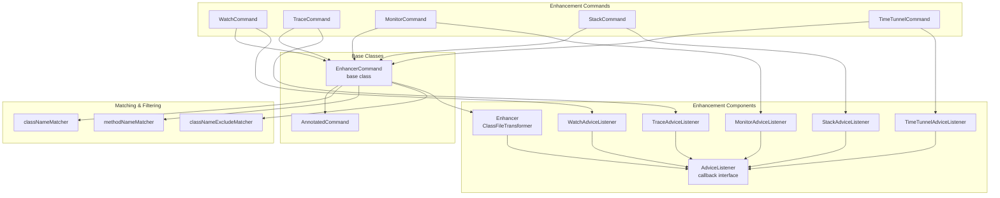
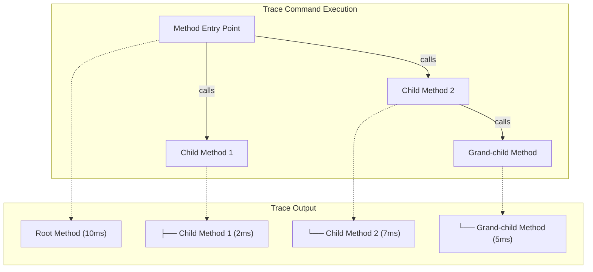
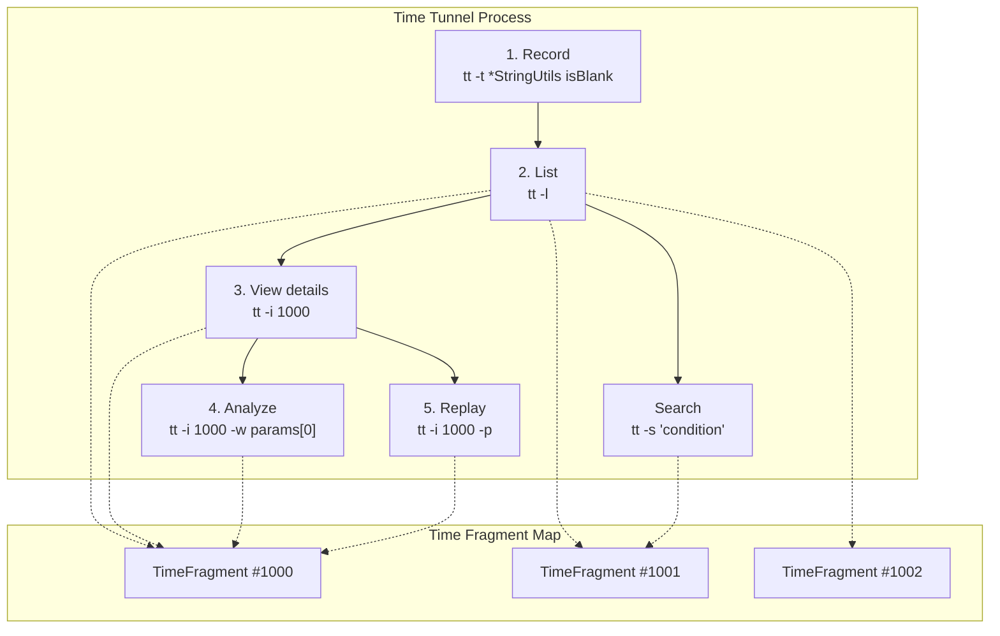
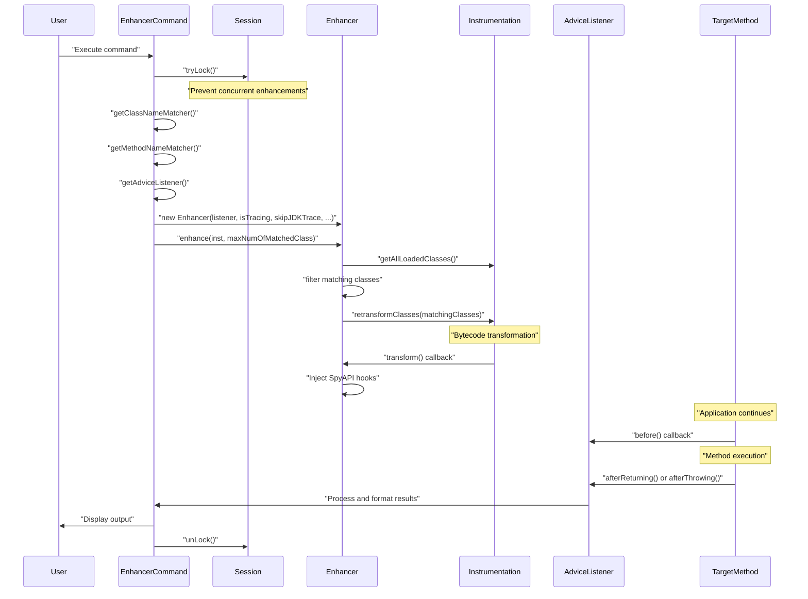

<!-- source: DeepWiki mcp.deepwiki.com · repo alibaba/arthas · page 3.3 Bytecode Enhancement Commands · fetched 2026-10-29 -->

# Bytecode Enhancement Commands

<details>
<summary>Relevant source files</summary>

The following files were used as context for generating this wiki page:

- [CONTRIBUTING.md](CONTRIBUTING.md)
- [README.md](README.md)
- [README_CN.md](README_CN.md)
- [USERS.md](USERS.md)
- [arthas-vmtool/README.md](arthas-vmtool/README.md)
- [as-package.sh](as-package.sh)
- [bin/as-service.bat](bin/as-service.bat)
- [bin/as.bat](bin/as.bat)
- [core/src/main/java/com/taobao/arthas/core/advisor/Enhancer.java](core/src/main/java/com/taobao/arthas/core/advisor/Enhancer.java)
- [core/src/main/java/com/taobao/arthas/core/command/monitor200/EnhancerCommand.java](core/src/main/java/com/taobao/arthas/core/command/monitor200/EnhancerCommand.java)
- [core/src/main/java/com/taobao/arthas/core/command/monitor200/MonitorCommand.java](core/src/main/java/com/taobao/arthas/core/command/monitor200/MonitorCommand.java)
- [core/src/main/java/com/taobao/arthas/core/command/monitor200/StackCommand.java](core/src/main/java/com/taobao/arthas/core/command/monitor200/StackCommand.java)
- [core/src/main/java/com/taobao/arthas/core/command/monitor200/TimeTunnelCommand.java](core/src/main/java/com/taobao/arthas/core/command/monitor200/TimeTunnelCommand.java)
- [core/src/main/java/com/taobao/arthas/core/command/monitor200/TraceCommand.java](core/src/main/java/com/taobao/arthas/core/command/monitor200/TraceCommand.java)
- [core/src/main/java/com/taobao/arthas/core/command/monitor200/WatchCommand.java](core/src/main/java/com/taobao/arthas/core/command/monitor200/WatchCommand.java)
- [core/src/main/java/com/taobao/arthas/core/util/SearchUtils.java](core/src/main/java/com/taobao/arthas/core/util/SearchUtils.java)
- [core/src/main/java/com/taobao/arthas/core/util/affect/EnhancerAffect.java](core/src/main/java/com/taobao/arthas/core/util/affect/EnhancerAffect.java)
- [core/src/test/java/com/taobao/arthas/core/advisor/EnhancerTest.java](core/src/test/java/com/taobao/arthas/core/advisor/EnhancerTest.java)
- [static/cider.png](static/cider.png)
- [static/citycloud.jpg](static/citycloud.jpg)
- [static/didiglobal.jpg](static/didiglobal.jpg)
- [static/dms.png](static/dms.png)
- [static/guideir.jpg](static/guideir.jpg)
- [static/hollycrm.png](static/hollycrm.png)
- [static/mingyuanyun.jpg](static/mingyuanyun.jpg)
- [static/ouyeel.png](static/ouyeel.png)
- [static/videt.png](static/videt.png)
- [static/zhaopin.png](static/zhaopin.png)

</details>


This page documents Arthas's bytecode enhancement commands, which use runtime bytecode instrumentation to monitor and analyze method execution in running Java applications. These commands work by injecting monitoring code into target methods without requiring application restart or source code modification.

The bytecode enhancement mechanism is explained in detail in [Bytecode Instrumentation System](#4). For profiling capabilities, see [Profiling Commands](#3.1). For class inspection without enhancement, see [Class Inspection Commands](#3.2).

## Overview of Enhancement Commands

Arthas provides five specialized commands that use bytecode enhancement to monitor method execution at runtime:

| Command | Purpose | Key Features | Enhancement Type |
|---------|---------|-------------|------------------|
| watch | Display method input/output parameters, return values, and exceptions | Can observe before/after method execution | Method entry/exit hooks |
| trace | Track method execution time, including nested method calls | Creates execution tree with timing information | Method invocation tracing |
| monitor | Collect method execution statistics | Tracks success/failure counts and response time | Method entry/exit counting |
| stack | Show method call stack | Displays full stack trace when methods are invoked | Stack capture on method entry |
| tt (Time Tunnel) | Record and replay method calls | Can store and later analyze or replay invocations | Complete advice recording |

All these commands extend the `EnhancerCommand` base class and use Arthas's bytecode instrumentation system (see [Bytecode Instrumentation System](#4)) to inject monitoring hooks into target methods.

**Enhancement Command Architecture**



Sources: [core/src/main/java/com/taobao/arthas/core/command/monitor200/EnhancerCommand.java:38-155](), [core/src/main/java/com/taobao/arthas/core/command/monitor200/WatchCommand.java:35](), [core/src/main/java/com/taobao/arthas/core/command/monitor200/TraceCommand.java:46](), [core/src/main/java/com/taobao/arthas/core/command/monitor200/MonitorCommand.java:31](), [core/src/main/java/com/taobao/arthas/core/command/monitor200/StackCommand.java:31](), [core/src/main/java/com/taobao/arthas/core/command/monitor200/TimeTunnelCommand.java:52]()

## EnhancerCommand Base Class

All bytecode enhancement commands inherit from `EnhancerCommand`, which provides common functionality for class/method matching, bytecode enhancement, and command lifecycle management.

**Key responsibilities of EnhancerCommand:**

1. **Pattern Matching**: Defines abstract methods for class and method matchers
2. **Enhancement Process**: Manages the enhancement workflow via the `enhance()` method
3. **Listener Creation**: Creates appropriate `AdviceListener` implementations for each command
4. **Session Locking**: Ensures only one enhancement operation runs at a time
5. **Timeout Management**: Supports automatic command termination via the `--timeout` option
6. **Lazy Enhancement**: Supports the `--lazy` option for enhancing classes when they load

**Common options available to all enhancement commands:**

| Option | Description | Default |
|--------|-------------|---------|
| `-E, --regex` | Enable regular expression matching | wildcard matching |
| `-c, --classloader` | Hash code of target classloader | all classloaders |
| `--exclude-class-pattern` | Exclude classes from matching | none |
| `-m, --maxMatch` | Maximum matched classes | 50 |
| `-v, --verbose` | Enable verbose information | false |
| `-n, --limits` | Execution count threshold | 100 |
| `--timeout` | Timeout in seconds for auto-exit | none |
| `-L, --lazy` | Enable lazy mode for unloaded classes | false |

Sources: [core/src/main/java/com/taobao/arthas/core/command/monitor200/EnhancerCommand.java:38-155](), [core/src/main/java/com/taobao/arthas/core/command/monitor200/EnhancerCommand.java:188-286]()

## Common Parameters and Expressions

All monitoring commands share some common parameters and expression capabilities:

### Class and Method Pattern Matching

* `class-pattern`: Specifies target classes using wildcard or regex patterns
* `method-pattern`: Identifies methods to monitor using wildcard or regex patterns
* `-E/--regex`: Enable regular expression matching (default is wildcard matching)
* `--exclude-class-pattern`: Exclude specific classes from matching

### Condition Expressions

All commands support conditional expressions in OGNL syntax to filter when monitoring is triggered:

```
Conditional expression examples:
  TRUE  : 1==1
  TRUE  : true
  FALSE : false
  TRUE  : 'params.length>=0'
  FALSE : 1==2
  '#cost>100'
```

### Built-in Variables for Expressions

When writing expressions for monitoring commands, you can access these variables:

* `target`: The target object instance
* `clazz`: The target class
* `method`: The constructor or method being invoked
* `params`: Array of method parameters
* `params[0..n]`: Individual method parameters
* `returnObj`: The returned object (after method execution)
* `throwExp`: Any thrown exception
* `isReturn`: Whether method ended by returning
* `isThrow`: Whether method ended by throwing
* `#cost`: Execution time in milliseconds

Sources: [core/src/main/java/com/taobao/arthas/core/command/Constants.java:12-22](), [core/src/main/java/com/taobao/arthas/core/command/Constants.java:41-47]()

## Watch Command

The `watch` command observes method input parameters, return values, and exceptions during method execution.

### Syntax

```
watch [class-pattern] [method-pattern] [expression] [condition-expression]
```

### Options

* `-b, --before`: Watch before method invocation
* `-f, --finish`: Watch after method invocation (default)
* `-e, --exception`: Watch after method throws exception
* `-s, --success`: Watch after successful method invocation
* `-x, --expand <level>`: Expand level of object display (default 1)
* `-M, --sizeLimit <limit>`: Upper size limit in bytes for result (default 10 MB)
* `-n, --limits <num>`: Threshold of execution times

### Examples

```
# Watch the parameters and return value of StringUtils.isBlank
watch org.apache.commons.lang.StringUtils isBlank

# Watch with custom expression showing params, target and return value
watch org.apache.commons.lang.StringUtils isBlank '{params, target, returnObj}' -x 2

# Watch first parameter of isBlank where parameter length is 1
watch *StringUtils isBlank params[0] params[0].length==1

# Watch methods that take longer than 100ms
watch *StringUtils isBlank params '#cost>100'
```

Sources: [core/src/main/java/com/taobao/arthas/core/command/monitor200/WatchCommand.java:22-33]()

## Trace Command

The `trace` command tracks method execution time, including nested method calls, creating a method invocation tree with timing information.

### Syntax

```
trace [class-pattern] [method-pattern] [condition-expression]
```

### Options

* `-E, --regex`: Enable regular expression to match
* `-n, --limits <num>`: Threshold of execution times
* `-p, --path <path-patterns>`: Path tracing pattern
* `--skipJDKMethod <true/false>`: Skip JDK method trace (default true)

### Examples

```
# Trace execution of StringUtils.isBlank
trace org.apache.commons.lang.StringUtils isBlank

# Trace using wildcard pattern matching
trace *StringUtils isBlank

# Trace with condition on the first parameter
trace *StringUtils isBlank params[0].length==1

# Trace methods that take longer than 100ms
trace *StringUtils isBlank '#cost>100'

# Trace with regular expression pattern
trace -E org\.apache\.commons\.lang\.StringUtils isBlank

# Trace multiple classes and methods
trace -E com.test.ClassA|org.test.ClassB method1|method2|method3

# Limit to 5 traces
trace demo.MathGame run -n 5

# Include JDK methods in the trace
trace demo.MathGame run --skipJDKMethod false
```



Sources: [core/src/main/java/com/taobao/arthas/core/command/monitor200/TraceCommand.java:29-43]()

## Monitor Command

The `monitor` command collects method execution statistics, including total invocations, success rate, and average response time.

### Syntax

```
monitor [class-pattern] [method-pattern] [condition-expression]
```

### Options

* `-c, --cycle <seconds>`: Monitoring interval in seconds (default 60)
* `-E, --regex`: Enable regular expression matching
* `-n, --limits <num>`: Threshold of execution times
* `-b, --before`: Evaluate condition expression before method invocation

### Examples

```
# Monitor StringUtils.isBlank method
monitor org.apache.commons.lang.StringUtils isBlank

# Monitor with 5-second intervals
monitor org.apache.commons.lang.StringUtils isBlank -c 5

# Monitor with a condition on the first parameter
monitor org.apache.commons.lang.StringUtils isBlank params[0]!=null

# Monitor evaluating condition before method execution
monitor -b org.apache.commons.lang.StringUtils isBlank params[0]!=null
```

### Output Format

The monitor command displays results in a table with these columns:

| timestamp | class | method | total | success | fail | avg-rt(ms) | fail-rate |
|-----------|-------|--------|-------|---------|------|------------|-----------|
| 2023-01-01 12:00:00 | StringUtils | isBlank | 10 | 10 | 0 | 0.35 | 0.00% |

Sources: [core/src/main/java/com/taobao/arthas/core/command/monitor200/MonitorCommand.java:21-29](), [core/src/main/java/com/taobao/arthas/core/command/view/MonitorView.java:22-43]()

## Stack Command

The `stack` command shows the full stack trace for method invocations, helping to understand the call path leading to a method.

### Syntax

```
stack [class-pattern] [method-pattern] [condition-expression]
```

### Options

* `-E, --regex`: Enable regular expression matching
* `-n, --limits <num>`: Threshold of execution times

### Examples

```
# Display stack traces for StringUtils.isBlank calls
stack org.apache.commons.lang.StringUtils isBlank

# Using wildcard matching
stack *StringUtils isBlank

# Show stack trace only when parameter length is 1
stack *StringUtils isBlank params[0].length==1

# Show stack trace for methods taking longer than 100ms
stack *StringUtils isBlank '#cost>100'
```

Sources: [core/src/main/java/com/taobao/arthas/core/command/monitor200/StackCommand.java:22-30]()

## Time Tunnel (tt) Command

The `tt` command creates a "time tunnel" for recording method calls and allowing later inspection or replay.

### Syntax

```
tt [option] [class-pattern] [method-pattern] [condition-expression]
```

### Primary Options

* `-t, --time-tunnel`: Record method invocations
* `-l, --list`: List all recorded time fragments
* `-i, --index <index>`: Display details of specified time fragment
* `-p, --play`: Replay the method invocation specified by index
* `-w, --watch-express <expr>`: Watch time fragment with the specified expression
* `-s, --search-express <expr>`: Search time fragments with the specified expression
* `-d, --delete`: Delete the specified time fragment
* `--delete-all`: Delete all time fragments

### Additional Options

* `-x, --expand <level>`: Expand level for object display (default 1)
* `-M, --sizeLimit <limit>`: Size limit for results (default 10 MB)
* `-E, --regex`: Enable regular expression matching
* `-n, --limits <num>`: Execution count threshold (default 100)
* `--replay-times <num>`: Number of replay executions (default 1)
* `--replay-interval <ms>`: Interval between replays in milliseconds (default 1000)

### Examples

```
# Record method invocations
tt -t *StringUtils isEmpty

# Record with condition
tt -t *StringUtils isEmpty params[0].length==1

# List recorded invocations
tt -l

# View details of a specific record
tt -i 1000

# View specific data from a record
tt -i 1000 -w params[0]

# Replay a recorded invocation
tt -i 1000 -p

# Replay multiple times with interval
tt -i 1000 -p --replay-times 3 --replay-interval 3000

# Search records by condition and watch parameters
tt -s '{params[0] > 1}' -w '{params}'

# Delete all records
tt --delete-all
```



Sources: [core/src/main/java/com/taobao/arthas/core/command/monitor200/TimeTunnelCommand.java:39-51](), [core/src/main/java/com/taobao/arthas/core/command/monitor200/TimeTunnelTable.java:25-48]()

## Enhancement Execution Flow

The bytecode enhancement process follows a well-defined sequence:

**Enhancement Process Flow**



Sources: [core/src/main/java/com/taobao/arthas/core/command/monitor200/EnhancerCommand.java:188-286](), [core/src/main/java/com/taobao/arthas/core/advisor/Enhancer.java:472-538](), [core/src/main/java/com/taobao/arthas/core/advisor/Enhancer.java:139-328]()

## Use Cases and Best Practices

### When To Use Each Command

* **watch**: For inspecting method parameters, return values, and exceptions
* **trace**: For analyzing performance bottlenecks and seeing method call hierarchies
* **monitor**: For ongoing monitoring of method execution statistics
* **stack**: For understanding the call path to a method
* **tt**: For detailed analysis and replay of specific method invocations

### Performance Considerations

1. **Be specific with class/method patterns**: Overly broad patterns can impact application performance
2. **Use condition expressions**: Filter invocations to reduce overhead
3. **Limit execution count**: Use the `-n` option to control the number of intercepted methods
4. **Use appropriate expand levels**: Higher expand levels (`-x`) consume more resources
5. **Watch time tunnel usage**: Recorded invocations consume memory until deleted

### Combining Commands for Troubleshooting

A typical troubleshooting workflow might combine multiple commands:

1. Use `monitor` to identify problematic methods with high failure rates or long execution times
2. Use `trace` to see the detailed execution path and timings for the problematic method
3. Use `watch` to inspect specific parameters and return values
4. Use `stack` to understand the call path to the method
5. Use `tt` to record and replay problematic invocations for deeper analysis

Sources: [core/src/main/java/com/taobao/arthas/core/command/monitor200/WatchCommand.java:23-33](), [core/src/main/java/com/taobao/arthas/core/command/monitor200/TraceCommand.java:32-43](), [core/src/main/java/com/taobao/arthas/core/command/monitor200/MonitorCommand.java:23-29](), [core/src/main/java/com/taobao/arthas/core/command/monitor200/StackCommand.java:24-30](), [core/src/main/java/com/taobao/arthas/core/command/monitor200/TimeTunnelCommand.java:42-51]()

---

