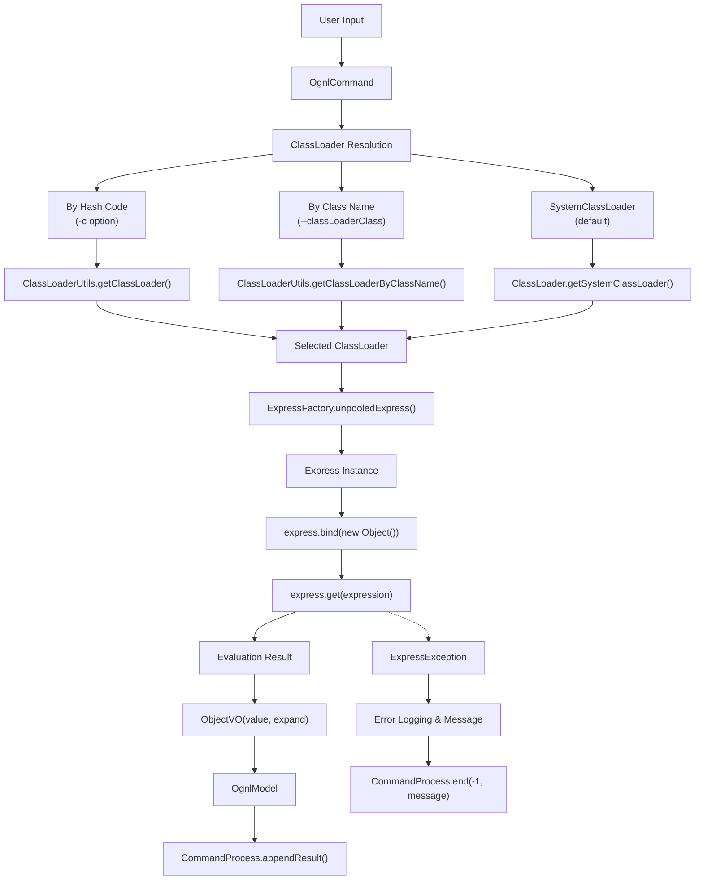
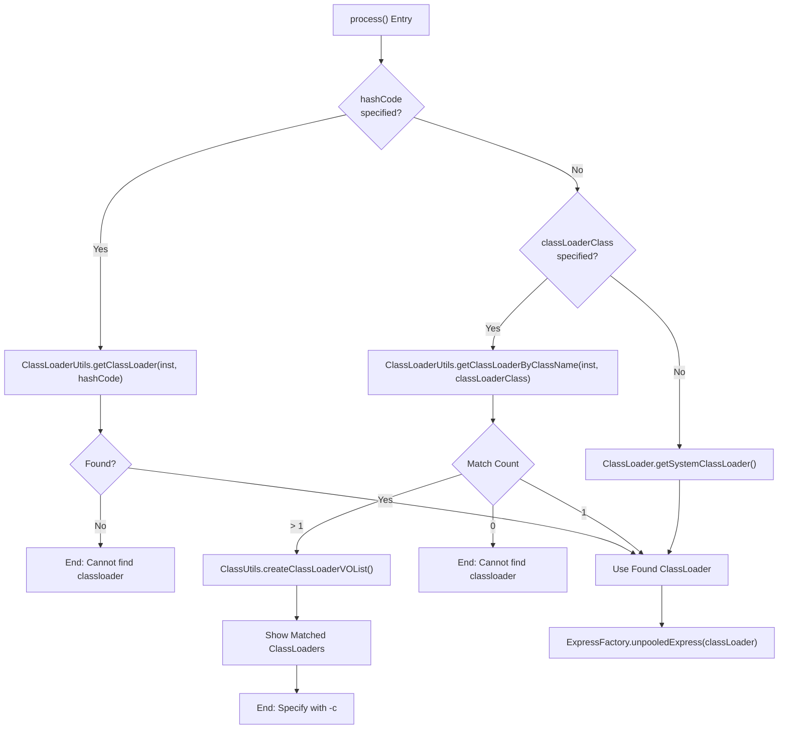
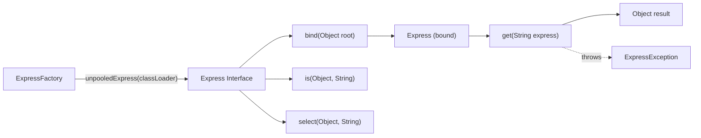
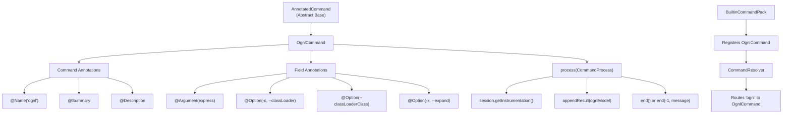

<!-- source: DeepWiki mcp.deepwiki.com · repo alibaba/arthas · page 3.4 Expression Evaluation · fetched 2026-10-29 -->

# Expression Evaluation

<details>
<summary>Relevant source files</summary>

The following files were used as context for generating this wiki page:

- [core/src/main/java/com/taobao/arthas/core/command/klass100/OgnlCommand.java](core/src/main/java/com/taobao/arthas/core/command/klass100/OgnlCommand.java)

</details>


## Purpose and Scope

This document describes the OGNL (Object-Graph Navigation Language) expression evaluation system in Arthas, which allows users to dynamically evaluate Java expressions in the context of a running JVM. The `ognl` command provides programmatic access to static fields, methods, and objects without requiring code changes or application restart.

For information about other diagnostic capabilities, see [Class Inspection Commands](#3.2) for viewing class structure, and [Bytecode Enhancement Commands](#3.3) for method observation capabilities.

## Overview

Arthas integrates OGNL to enable dynamic expression evaluation in the target JVM. This provides powerful capabilities for:

- Accessing and modifying static fields
- Invoking static methods
- Calling methods on singleton instances
- Evaluating complex expressions with multiple statements
- Inspecting system properties and environment variables

The expression evaluation system is implemented through the `ognl` command, which uses the Apache Commons OGNL library (relocated to avoid dependency conflicts) to parse and execute expressions within the context of the target application's classloader hierarchy.

**Sources:** [core/src/main/java/com/taobao/arthas/core/command/klass100/OgnlCommand.java:1-118]()

## Command Structure

The `ognl` command is implemented as an `AnnotatedCommand` and accepts the following parameters:

| Parameter | Short | Long | Required | Description |
|-----------|-------|------|----------|-------------|
| express | - | - | Yes | The OGNL expression to evaluate |
| classLoader | `-c` | `--classLoader` | No | Hash code of the target classloader (defaults to SystemClassLoader) |
| classLoaderClass | - | `--classLoaderClass` | No | Class name to identify the classloader |
| expand | `-x` | `--expand` | No | Object expansion depth for result display (default: 1) |

The command class is defined at [core/src/main/java/com/taobao/arthas/core/command/klass100/OgnlCommand.java:31-41]() with annotations specifying the command metadata.

**Sources:** [core/src/main/java/com/taobao/arthas/core/command/klass100/OgnlCommand.java:41-71]()

## Expression Evaluation Architecture



**Diagram: OGNL Command Execution Pipeline**

The evaluation process follows these steps:
1. User provides OGNL expression and optional classloader specification
2. Command resolves the target classloader using `ClassLoaderUtils`
3. `ExpressFactory` creates an unpooled `Express` instance with the selected classloader
4. Expression is bound to a root object and evaluated via `express.get()`
5. Result is wrapped in `ObjectVO` with specified expansion depth
6. `OgnlModel` is created and appended to the command process

**Sources:** [core/src/main/java/com/taobao/arthas/core/command/klass100/OgnlCommand.java:74-116]()

## ClassLoader Resolution Logic



**Diagram: ClassLoader Selection Decision Tree**

The classloader resolution follows a priority order:

1. **Hash Code (`-c` option)**: Directly retrieves a classloader by its identity hash code [core/src/main/java/com/taobao/arthas/core/command/klass100/OgnlCommand.java:77-82]()
2. **Class Name (`--classLoaderClass` option)**: Searches for classloaders that loaded a specific class, requiring unique match [core/src/main/java/com/taobao/arthas/core/command/klass100/OgnlCommand.java:83-98]()
3. **System ClassLoader (default)**: Falls back to the system classloader when no option is specified [core/src/main/java/com/taobao/arthas/core/command/klass100/OgnlCommand.java:100]()

When multiple classloaders match a class name, the command returns a list of candidates as `ClassLoaderVO` objects and requires the user to specify one using the `-c` option with the hash code.

**Sources:** [core/src/main/java/com/taobao/arthas/core/command/klass100/OgnlCommand.java:75-101]()

## Express Interface and Factory



**Diagram: Express API Surface**

The `ExpressFactory` class provides factory methods to create `Express` instances. The `unpooledExpress()` method creates a new instance for each invocation, ensuring isolation between evaluations [core/src/main/java/com/taobao/arthas/core/command/klass100/OgnlCommand.java:103]().

The `Express` interface provides methods for:
- **`bind(Object root)`**: Binds the expression evaluator to a root object context
- **`get(String express)`**: Evaluates an expression and returns the result
- **`is(Object, String)`**: Tests if an expression evaluates to true
- **`select(Object, String)`**: Selects objects matching an expression

The OGNL command uses the bind-then-get pattern, binding to a new `Object()` instance before evaluating the user's expression [core/src/main/java/com/taobao/arthas/core/command/klass100/OgnlCommand.java:106]().

**Sources:** [core/src/main/java/com/taobao/arthas/core/command/klass100/OgnlCommand.java:103-110]()

## Result Processing

The evaluation result flows through two main data structures:

### ObjectVO Construction

The result value is wrapped in an `ObjectVO` (Value Object) with the specified expansion depth:

```java
new ObjectVO(value, expand)
```

The `expand` parameter controls how deeply nested object properties are serialized for display. A value of 1 (default) shows only the top-level properties, while higher values recursively expand nested objects.

### OgnlModel Assembly

The `ObjectVO` is encapsulated in an `OgnlModel` which serves as the result model for the command:

| Field | Type | Description |
|-------|------|-------------|
| `value` | `ObjectVO` | The wrapped evaluation result |
| `classLoaderClass` | `String` | Set when ambiguous classloader matches occur |
| `matchedClassLoaders` | `Collection<ClassLoaderVO>` | List of matching classloaders for user selection |

The `OgnlModel` is appended to the command process via `process.appendResult()` [core/src/main/java/com/taobao/arthas/core/command/klass100/OgnlCommand.java:107-110](), where it enters the result rendering pipeline (see [Command Processing Pipeline](#2.4)).

**Sources:** [core/src/main/java/com/taobao/arthas/core/command/klass100/OgnlCommand.java:107-110](), [core/src/main/java/com/taobao/arthas/core/command/klass100/OgnlCommand.java:89-92]()

## Error Handling

The expression evaluation implements two primary error scenarios:

### Expression Evaluation Failure

When `express.get()` throws an `ExpressException`, the command:
1. Logs the full exception with stack trace at WARN level [core/src/main/java/com/taobao/arthas/core/command/klass100/OgnlCommand.java:112]()
2. Returns an error message with exit code -1 [core/src/main/java/com/taobao/arthas/core/command/klass100/OgnlCommand.java:113-114]()
3. Directs users to check `$HOME/logs/arthas/arthas.log` for details

### ClassLoader Resolution Failure

Three classloader-related error conditions are handled:
- Hash code not found: Returns specific error message with the hash code [core/src/main/java/com/taobao/arthas/core/command/klass100/OgnlCommand.java:80-81]()
- Class name not found: Returns error with the class name [core/src/main/java/com/taobao/arthas/core/command/klass100/OgnlCommand.java:96-97]()
- Multiple matches: Returns list of candidates and prompts for specific selection [core/src/main/java/com/taobao/arthas/core/command/klass100/OgnlCommand.java:93-94]()

**Sources:** [core/src/main/java/com/taobao/arthas/core/command/klass100/OgnlCommand.java:111-115](), [core/src/main/java/com/taobao/arthas/core/command/klass100/OgnlCommand.java:80-97]()

## OGNL Expression Syntax

The command documentation provides examples of common OGNL patterns:

### Static Field Access
```
ognl '@Demo@staticField'
```
Accesses the static field `staticField` of class `Demo`.

### Static Method Invocation
```
ognl '@java.lang.System@out.println("hello \u4e2d\u6587")'
```
Invokes `System.out.println()` with Unicode support for internationalization.

### Singleton Pattern Access
```
ognl -x 2 '@Singleton@getInstance()'
```
Calls the `getInstance()` method and expands the result to depth 2.

### Multiple Expressions
```
ognl '#value1=@System@getProperty("java.home"), #value2=@System@getProperty("java.runtime.name"), {#value1, #value2}'
```
Evaluates multiple expressions and returns them as an array. Variables are defined with `#` prefix.

### ClassLoader-Specific Evaluation
```
ognl -c 5d113a51 '@com.taobao.arthas.core.GlobalOptions@isDump'
```
Evaluates the expression using the classloader with hash code `5d113a51`.

These examples are documented in the command's help text at [core/src/main/java/com/taobao/arthas/core/command/klass100/OgnlCommand.java:33-40]().

**Sources:** [core/src/main/java/com/taobao/arthas/core/command/klass100/OgnlCommand.java:33-40]()

## Integration with Command Framework



**Diagram: OgnlCommand Integration in Command Framework**

The `OgnlCommand` class extends `AnnotatedCommand` and integrates with Arthas's command registration system:

1. **Annotation-based Configuration**: Command metadata (`@Name`, `@Summary`, `@Description`) and parameter definitions (`@Argument`, `@Option`) are declared declaratively [core/src/main/java/com/taobao/arthas/core/command/klass100/OgnlCommand.java:31-71]()

2. **Registration**: The command is registered in `BuiltinCommandPack` which makes it available through the command resolver

3. **Execution**: When invoked, the `process()` method receives a `CommandProcess` object that provides:
   - Access to `Instrumentation` via the session [core/src/main/java/com/taobao/arthas/core/command/klass100/OgnlCommand.java:75]()
   - Result output via `appendResult()` [core/src/main/java/com/taobao/arthas/core/command/klass100/OgnlCommand.java:92](), [core/src/main/java/com/taobao/arthas/core/command/klass100/OgnlCommand.java:109]()
   - Process lifecycle control via `end()` [core/src/main/java/com/taobao/arthas/core/command/klass100/OgnlCommand.java:110]()

**Sources:** [core/src/main/java/com/taobao/arthas/core/command/klass100/OgnlCommand.java:31-116]()

## Security Considerations

The OGNL command executes arbitrary code in the target JVM with full privileges of the application. Key security implications:

1. **Full JVM Access**: OGNL expressions can access any class, method, or field visible to the specified classloader
2. **Side Effects**: Expressions can modify state, invoke methods with side effects, or even crash the JVM
3. **ClassLoader Isolation**: The classloader parameter provides some isolation but does not enforce security boundaries
4. **Local Access Model**: Arthas's authentication model (see [Authentication and Security](#5.3)) controls who can execute OGNL commands

Users should treat the `ognl` command as equivalent to running arbitrary Java code within the target application.

**Sources:** [core/src/main/java/com/taobao/arthas/core/command/klass100/OgnlCommand.java:1-118]()

## Related Components

The expression evaluation system depends on several core components:

| Component | Module | Purpose |
|-----------|--------|---------|
| `Express` | arthas-core | Interface for expression evaluation operations |
| `ExpressFactory` | arthas-core | Factory for creating `Express` instances |
| `ExpressException` | arthas-core | Exception thrown during expression evaluation failures |
| `ClassLoaderUtils` | arthas-core | Utilities for classloader discovery and resolution |
| `ObjectVO` | arthas-core | Value object for serializing evaluation results |
| `OgnlModel` | arthas-core | Result model for OGNL command output |

These components are referenced at [core/src/main/java/com/taobao/arthas/core/command/klass100/OgnlCommand.java:10-15]().

The underlying OGNL library is relocated during the build process (see [Build System and CI/CD](#9.1)) to the `com.alibaba.arthas.deps.ognl` package to prevent conflicts with application dependencies.

**Sources:** [core/src/main/java/com/taobao/arthas/core/command/klass100/OgnlCommand.java:1-18]()

---

