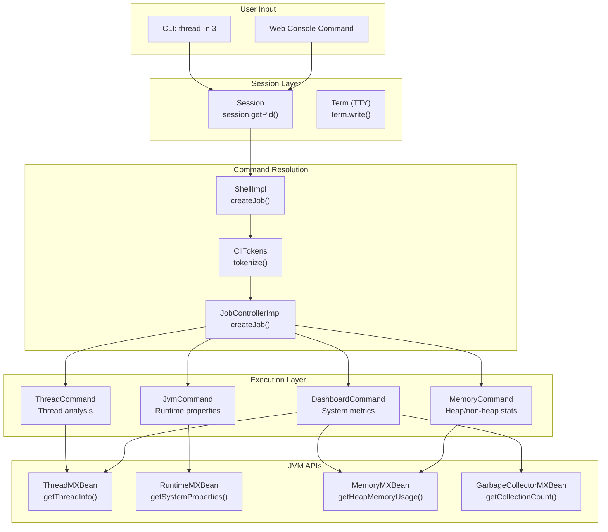
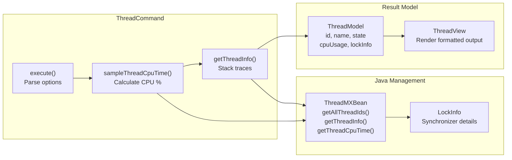
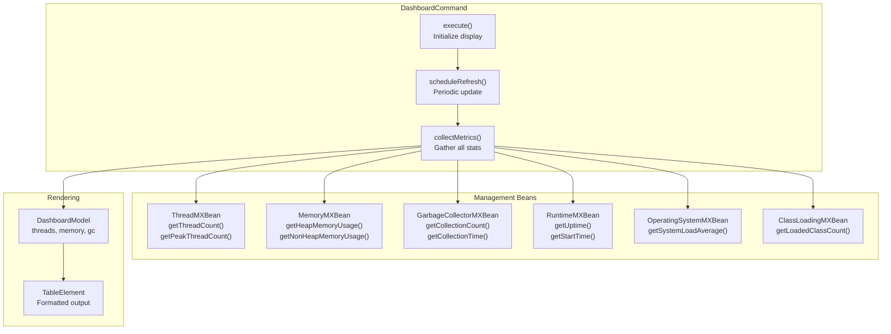
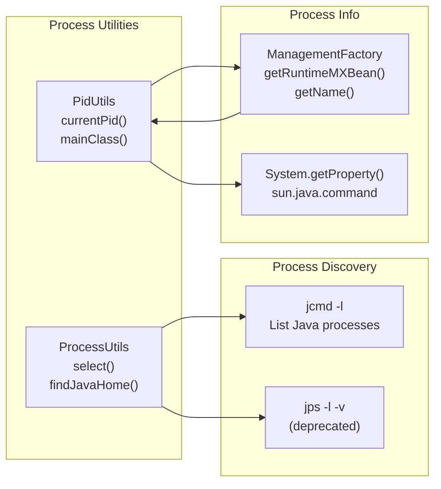
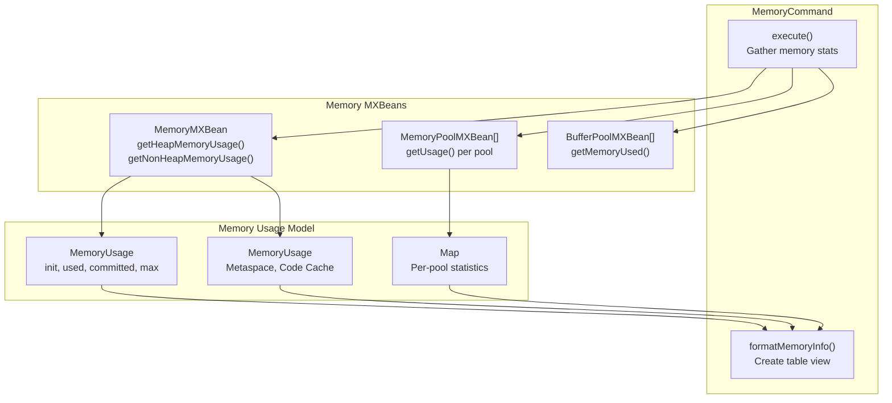
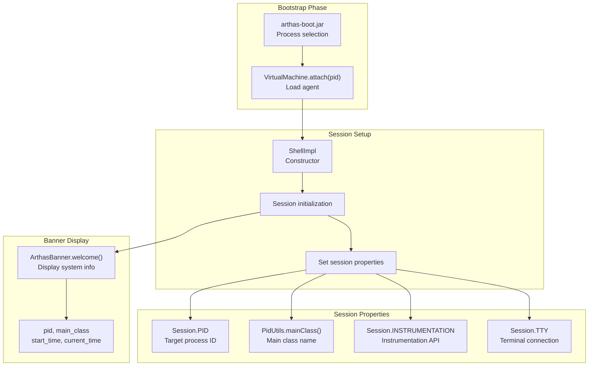
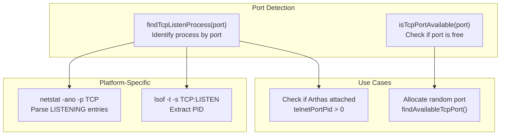
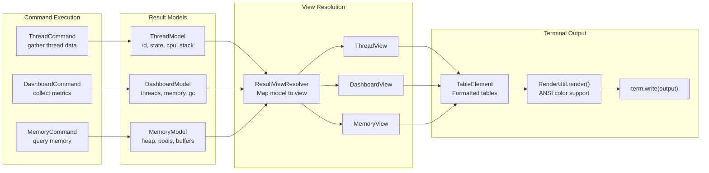
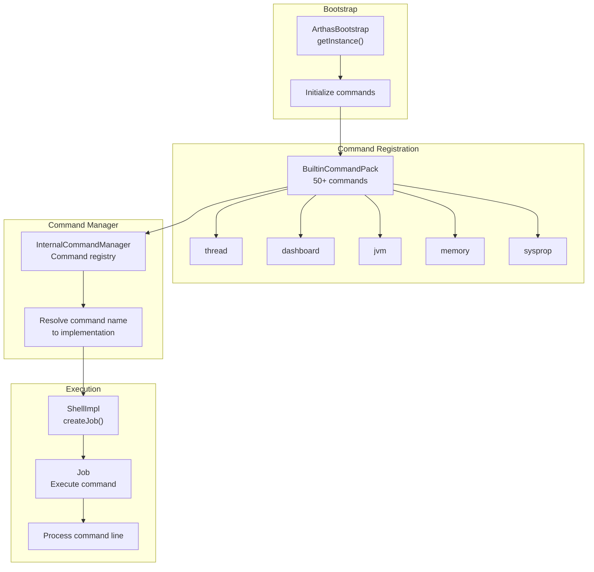

<!-- source: DeepWiki mcp.deepwiki.com · repo alibaba/arthas · page 3.5 Thread and JVM Commands · fetched 2026-10-29 -->

# Thread and JVM Commands

<details>
<summary>Relevant source files</summary>

The following files were used as context for generating this wiki page:

- [CONTRIBUTING.md](CONTRIBUTING.md)
- [README.md](README.md)
- [README_CN.md](README_CN.md)
- [USERS.md](USERS.md)
- [arthas-vmtool/README.md](arthas-vmtool/README.md)
- [as-package.sh](as-package.sh)
- [bin/as-service.bat](bin/as-service.bat)
- [bin/as.bat](bin/as.bat)
- [boot/src/main/java/com/taobao/arthas/boot/DownloadUtils.java](boot/src/main/java/com/taobao/arthas/boot/DownloadUtils.java)
- [boot/src/main/java/com/taobao/arthas/boot/ProcessUtils.java](boot/src/main/java/com/taobao/arthas/boot/ProcessUtils.java)
- [boot/src/test/java/com/taobao/arthas/boot/DownloadUtilsTest.java](boot/src/test/java/com/taobao/arthas/boot/DownloadUtilsTest.java)
- [client/src/main/java/com/taobao/arthas/client/IOUtil.java](client/src/main/java/com/taobao/arthas/client/IOUtil.java)
- [client/src/main/java/com/taobao/arthas/client/TelnetConsole.java](client/src/main/java/com/taobao/arthas/client/TelnetConsole.java)
- [common/src/main/java/com/taobao/arthas/common/AnsiLog.java](common/src/main/java/com/taobao/arthas/common/AnsiLog.java)
- [common/src/main/java/com/taobao/arthas/common/ExecutingCommand.java](common/src/main/java/com/taobao/arthas/common/ExecutingCommand.java)
- [common/src/main/java/com/taobao/arthas/common/IOUtils.java](common/src/main/java/com/taobao/arthas/common/IOUtils.java)
- [common/src/main/java/com/taobao/arthas/common/PidUtils.java](common/src/main/java/com/taobao/arthas/common/PidUtils.java)
- [common/src/main/java/com/taobao/arthas/common/SocketUtils.java](common/src/main/java/com/taobao/arthas/common/SocketUtils.java)
- [common/src/main/java/com/taobao/arthas/common/UsageRender.java](common/src/main/java/com/taobao/arthas/common/UsageRender.java)
- [core/src/main/java/com/taobao/arthas/core/shell/command/internal/WordCountHandler.java](core/src/main/java/com/taobao/arthas/core/shell/command/internal/WordCountHandler.java)
- [core/src/main/java/com/taobao/arthas/core/shell/impl/ShellImpl.java](core/src/main/java/com/taobao/arthas/core/shell/impl/ShellImpl.java)
- [core/src/main/java/com/taobao/arthas/core/util/ArthasBanner.java](core/src/main/java/com/taobao/arthas/core/util/ArthasBanner.java)
- [static/cider.png](static/cider.png)
- [static/citycloud.jpg](static/citycloud.jpg)
- [static/didiglobal.jpg](static/didiglobal.jpg)
- [static/dms.png](static/dms.png)
- [static/guideir.jpg](static/guideir.jpg)
- [static/hollycrm.png](static/hollycrm.png)
- [static/mingyuanyun.jpg](static/mingyuanyun.jpg)
- [static/ouyeel.png](static/ouyeel.png)
- [static/videt.png](static/videt.png)
- [static/zhaopin.png](static/zhaopin.png)

</details>


This document covers Arthas commands for introspecting JVM runtime state, including thread analysis, system dashboard, JVM properties, and memory statistics. These commands provide read-only diagnostics without modifying application behavior.

For bytecode instrumentation commands that monitor method execution (watch, trace, tt, monitor, stack), see [Bytecode Enhancement Commands](#3.3). For class inspection and decompilation (jad, dump, sc, sm), see [Class Inspection Commands](#3.2).

## Overview

Thread and JVM commands enable real-time observation of the target JVM's internal state. These commands query the JVM through management APIs and instrumentation interfaces to provide snapshots of running threads, memory usage, garbage collection statistics, and system properties.

### Command Categories

| Command | Purpose | Primary Use Case |
|---------|---------|------------------|
| `thread` | Thread inspection and analysis | Identify high CPU threads, deadlocks, thread states |
| `dashboard` | Real-time system overview | Monitor overall JVM health at a glance |
| `jvm` | JVM information display | View runtime configuration and properties |
| `memory` | Memory statistics | Analyze heap, non-heap, and buffer pool usage |
| `sysprop` | System properties | View and modify system properties |
| `sysenv` | Environment variables | Display system environment |
| `vmoption` | VM diagnostic options | View and modify VM diagnostic flags |
| `getstatic` | Static field value | Retrieve static field values |

Sources: [README.md:29-45](), [README_CN.md:96-127]()

## Command Processing Architecture



Sources: [core/src/main/java/com/taobao/arthas/core/shell/impl/ShellImpl.java:129-137](), [README.md:107-138]()

## Thread Command

The `thread` command displays Java thread information including stack traces, CPU usage, and thread states. It leverages `ThreadMXBean` from the Java Management API to retrieve detailed thread metrics.

### Basic Thread Information

The command identifies threads by their unique ID and provides comprehensive state information:

```bash
# Show all threads
thread

# Show thread by ID
thread 1

# Show top N threads by CPU usage
thread -n 3

# Show threads in BLOCKED state
thread -b

# Find threads with specific name pattern
thread | grep "pool-"
```

### Thread States and CPU Usage

Example output showing CPU-intensive threads:

```
"as-command-execute-daemon" Id=29 cpuUsage=75% RUNNABLE
    at sun.management.ThreadImpl.dumpThreads0(Native Method)
    at sun.management.ThreadImpl.getThreadInfo(ThreadImpl.java:440)
    at com.taobao.arthas.core.command.monitor200.ThreadCommand$1.action(ThreadCommand.java:58)
    ...
    Number of locked synchronizers = 1
    - java.util.concurrent.ThreadPoolExecutor$Worker@6cd0b6f8
```

The CPU usage percentage represents the proportion of CPU time consumed by each thread, calculated by sampling thread CPU time through `ThreadMXBean.getThreadCpuTime()`.

### Thread Blocking and Deadlock Detection

The `-b` option identifies threads blocked on synchronizers or waiting for locks:

```bash
thread -b
```

This is particularly useful for diagnosing contention issues where multiple threads compete for the same resources.

### Implementation Architecture



Sources: [README.md:107-138](), [README_CN.md:96-127](), [common/src/main/java/com/taobao/arthas/common/PidUtils.java:1-52]()

## Dashboard Command

The `dashboard` command provides a comprehensive real-time view of the JVM's health status, refreshing at regular intervals to display thread counts, memory usage, garbage collection statistics, and runtime information.

### Dashboard Components

The dashboard displays five primary data sections:

1. **Thread Statistics**: Total threads, peak threads, started threads, daemon threads
2. **Memory Usage**: Heap and non-heap memory utilization with percentages
3. **Runtime Information**: Uptime, loaded classes, OS information
4. **GC Statistics**: Collection counts and cumulative time for each GC algorithm
5. **Operating System**: CPU usage, load average, available processors

### Display Format

```
ID   NAME                          GROUP           PRIORITY  STATE    %CPU     TIME      INTERRUPTED DAEMON
-1   C2 CompilerThread0            -               -1        -        0.0      0:0.156   false       true
7    Finalizer                     system          8         WAITING  0.0      0:0.000   false       true

Memory                    used     total    max      usage    GC
heap                      24M      241M     3641M    0.67%    gc.ps_scavenge.count    2
ps_eden_space             14M      93M      1352M    1.07%    gc.ps_scavenge.time(ms) 4
ps_survivor_space         10M      15M      15M      69.01%   gc.ps_marksweep.count   0
ps_old_gen                0M       132M     2731M    0.01%    gc.ps_marksweep.time    0
```

### Update Frequency

By default, the dashboard refreshes every 5 seconds. The interval can be configured:

```bash
# Refresh every 1 second
dashboard -i 1000

# Display once without continuous refresh
dashboard -n 1
```

### Data Sources



Sources: [README.md:101-105](), [core/src/main/java/com/taobao/arthas/core/util/ArthasBanner.java:122-137]()

## JVM Command

The `jvm` command displays comprehensive JVM runtime information including process details, JVM version, input arguments, class loading statistics, and thread counts.

### Information Categories

| Category | Information Provided |
|----------|---------------------|
| **Process** | PID, main class, Java home path |
| **JVM** | JVM version, vendor, specification version |
| **Input Arguments** | VM arguments, system properties passed at startup |
| **Class Loading** | Loaded class count, unloaded class count, total loaded |
| **Threading** | Current thread count, peak thread count, daemon threads |
| **Memory Pools** | Names and types of all memory pools |
| **GC Collectors** | Names of garbage collectors in use |

### Usage Examples

```bash
# Display all JVM information
jvm

# Display specific sections
jvm | grep "SYSTEM-PROPERTIES"
jvm | grep "MEMORY-MANAGERS"
```

### Process Identification

The JVM command relies on process identification utilities to determine the target process:



The `PidUtils` class extracts the process ID from the JVM name format `pid@hostname`:

[common/src/main/java/com/taobao/arthas/common/PidUtils.java:16-28]()

Sources: [common/src/main/java/com/taobao/arthas/common/PidUtils.java:1-52](), [boot/src/main/java/com/taobao/arthas/boot/ProcessUtils.java:125-164]()

## Memory Command

The `memory` command provides detailed memory statistics for heap, non-heap, buffer pools, and individual memory pool segments.

### Memory Regions

The JVM memory is divided into several regions:

**Heap Memory:**
- Eden Space: Where new objects are allocated
- Survivor Space: For objects that survived minor GC
- Old Generation: Long-lived objects after multiple GC cycles

**Non-Heap Memory:**
- Metaspace (Java 8+): Class metadata
- Code Cache: JIT-compiled native code
- Compressed Class Space: Class metadata compression

**Direct Memory:**
- Direct buffers allocated via `ByteBuffer.allocateDirect()`

### Display Format

Each memory region shows:
- `used`: Currently used memory
- `total`: Currently allocated memory
- `max`: Maximum allocatable memory
- `usage`: Percentage of max memory used

### Memory Monitoring

```bash
# Display all memory information
memory

# Monitor specific memory pool
memory | grep eden
```

The memory statistics are retrieved through `MemoryMXBean` and `MemoryPoolMXBean` interfaces:



Sources: [README.md:101-105](), [core/src/main/java/com/taobao/arthas/core/util/ArthasBanner.java:122-137]()

## System Configuration Commands

### System Properties (sysprop)

The `sysprop` command views and modifies JVM system properties at runtime:

```bash
# List all system properties
sysprop

# Get specific property
sysprop java.version

# Set property value
sysprop user.country CN
```

### System Environment (sysenv)

The `sysenv` command displays operating system environment variables:

```bash
# List all environment variables
sysenv

# Get specific variable
sysenv PATH
```

### VM Options (vmoption)

The `vmoption` command views and modifies VM diagnostic options:

```bash
# List all VM options
vmoption

# Get specific option
vmoption PrintGCDetails

# Enable GC logging
vmoption PrintGC true
```

### Static Field Access (getstatic)

The `getstatic` command retrieves static field values from loaded classes:

```bash
# Get static field value
getstatic demo.MathGame random
```

This command uses the instrumentation API to access class static fields without requiring source code or reflection setup.

Sources: [README.md:29-45]()

## Session and Process Context

All thread and JVM commands execute within the context of an established Arthas session. The session maintains references to the target process and provides access to management interfaces.

### Session Initialization

When Arthas attaches to a target JVM, it initializes a session with key identifiers:



The session stores the target process ID and main class for display in the command prompt:

[core/src/main/java/com/taobao/arthas/core/shell/impl/ShellImpl.java:101-106]()

The prompt format includes the process ID:

[core/src/main/java/com/taobao/arthas/core/shell/impl/ShellImpl.java:160-164]()

Sources: [core/src/main/java/com/taobao/arthas/core/shell/impl/ShellImpl.java:53-118](), [core/src/main/java/com/taobao/arthas/core/util/ArthasBanner.java:109-139](), [common/src/main/java/com/taobao/arthas/common/PidUtils.java:10-52]()

## Port Management and Process Detection

Arthas uses configurable ports for telnet and HTTP communication. The system can detect if a process is already attached by checking for listening ports.

### Default Ports

| Protocol | Default Port | Purpose |
|----------|--------------|---------|
| Telnet | 3658 | Command-line interface |
| HTTP/WebSocket | 8563 | Web console and API access |

### Port Detection

The `SocketUtils` class provides utilities to find available ports and detect processes listening on specific ports:



The port detection logic helps prevent multiple Arthas instances from attaching to the same process:

[common/src/main/java/com/taobao/arthas/common/SocketUtils.java:40-78]()

Sources: [common/src/main/java/com/taobao/arthas/common/SocketUtils.java:21-195](), [boot/src/main/java/com/taobao/arthas/boot/ProcessUtils.java:55-73]()

## Command Result Processing

All thread and JVM commands follow a standard result processing pipeline that transforms raw data into formatted terminal output.

### Result Model Pattern

Each command produces a result model containing structured data:



The rendering system supports ANSI color codes when running in terminal environments that support colors, detected through console availability checks:

[common/src/main/java/com/taobao/arthas/common/AnsiLog.java:61-77]()

Sources: [common/src/main/java/com/taobao/arthas/common/AnsiLog.java:23-323](), [common/src/main/java/com/taobao/arthas/common/UsageRender.java:9-33](), [core/src/main/java/com/taobao/arthas/core/util/ArthasBanner.java:72-79]()

## Integration with Arthas Architecture

Thread and JVM commands are part of the built-in command pack registered during Arthas initialization:



The `ShellImpl` class manages command execution within job contexts, allowing multiple commands to run concurrently:

[core/src/main/java/com/taobao/arthas/core/shell/impl/ShellImpl.java:129-137]()

Sources: [core/src/main/java/com/taobao/arthas/core/shell/impl/ShellImpl.java:53-278](), [README.md:39-44]()

## Use Cases and Best Practices

### Performance Troubleshooting

**Identifying High CPU Threads:**
```bash
# Find top 3 CPU-consuming threads
thread -n 3

# Get full stack trace of specific thread
thread [thread-id]
```

**Memory Leak Investigation:**
```bash
# Monitor heap usage over time with dashboard
dashboard -i 1000

# Check specific memory pools
memory | grep eden
```

### Production Monitoring

**Continuous Health Checks:**
```bash
# Monitor system in real-time
dashboard

# Track GC frequency and duration
dashboard -i 5000 | grep gc
```

**Thread Deadlock Detection:**
```bash
# Find blocked threads
thread -b

# Analyze waiting threads
thread | grep WAITING
```

### Configuration Verification

**Validate Runtime Settings:**
```bash
# Check JVM arguments
jvm | grep "INPUT-ARGUMENTS"

# Verify system properties
sysprop | grep java.version

# Inspect environment
sysenv | grep JAVA_HOME
```

### Safety Considerations

Thread and JVM commands are read-only operations that do not modify application state:
- No bytecode transformation occurs
- No thread interruption
- No garbage collection triggered
- Minimal performance impact from sampling

The exception is `sysprop` and `vmoption` commands which can modify runtime properties. Use these with caution in production environments.

Sources: [README.md:19-27](), [README_CN.md:19-28]()

---

