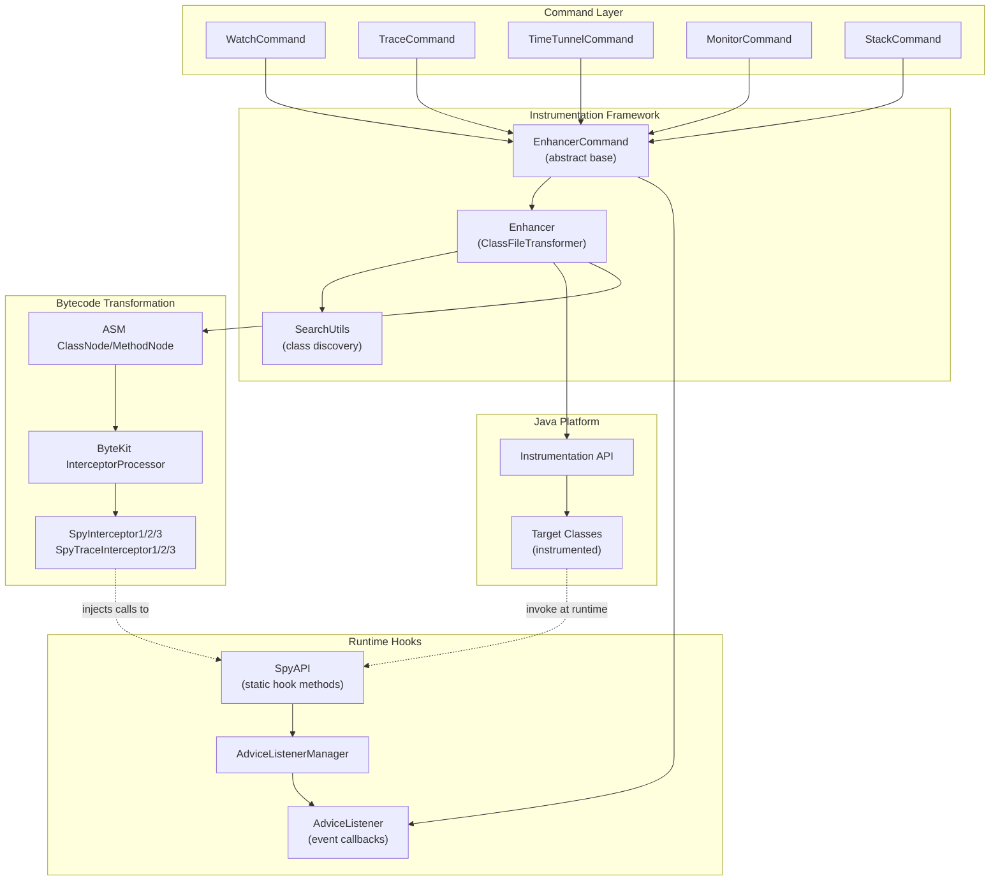
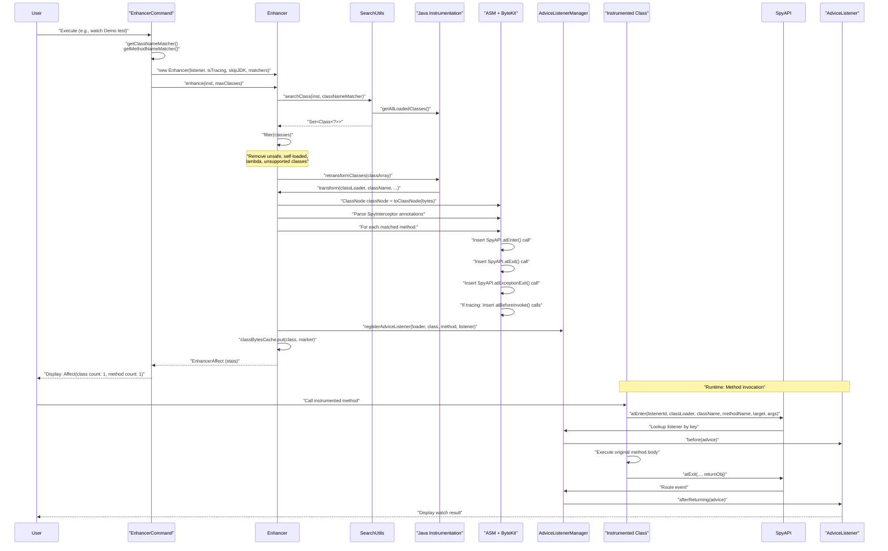
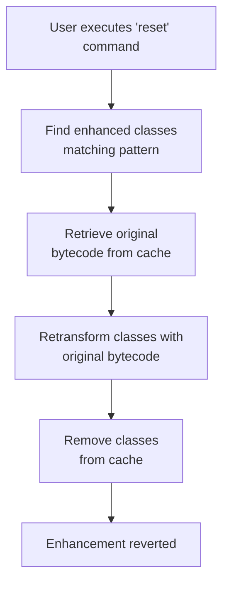
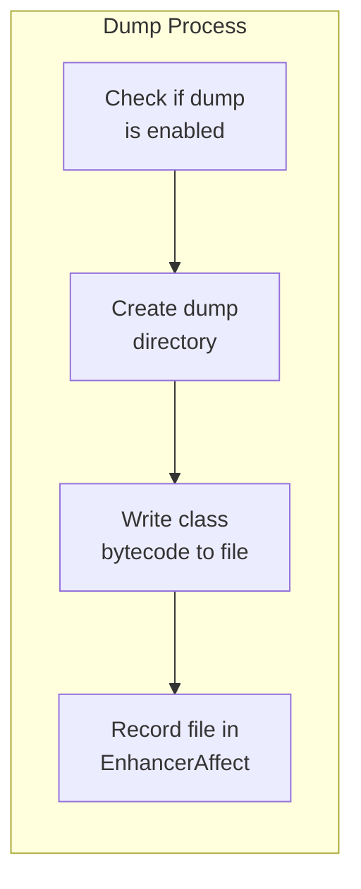
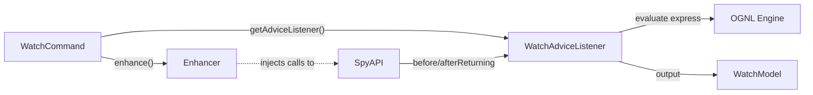
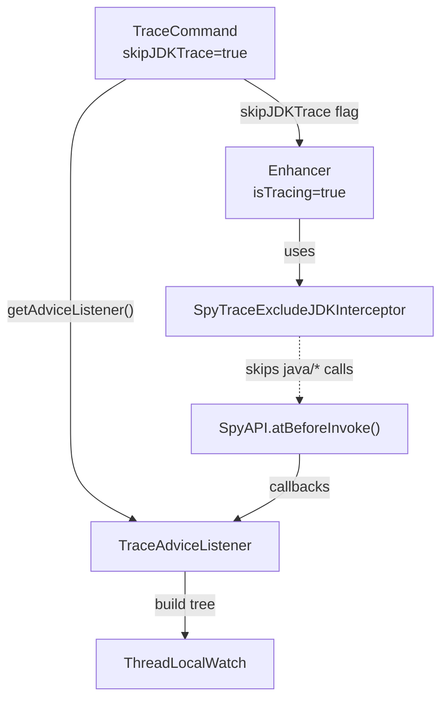

<!-- source: DeepWiki mcp.deepwiki.com · repo alibaba/arthas · page 4 Bytecode Instrumentation System · fetched 2026-10-29 -->

# Bytecode Instrumentation System

<details>
<summary>Relevant source files</summary>

The following files were used as context for generating this wiki page:

- [core/src/main/java/com/taobao/arthas/core/advisor/Enhancer.java](core/src/main/java/com/taobao/arthas/core/advisor/Enhancer.java)
- [core/src/main/java/com/taobao/arthas/core/command/monitor200/EnhancerCommand.java](core/src/main/java/com/taobao/arthas/core/command/monitor200/EnhancerCommand.java)
- [core/src/main/java/com/taobao/arthas/core/command/monitor200/MonitorCommand.java](core/src/main/java/com/taobao/arthas/core/command/monitor200/MonitorCommand.java)
- [core/src/main/java/com/taobao/arthas/core/command/monitor200/StackCommand.java](core/src/main/java/com/taobao/arthas/core/command/monitor200/StackCommand.java)
- [core/src/main/java/com/taobao/arthas/core/command/monitor200/TimeTunnelCommand.java](core/src/main/java/com/taobao/arthas/core/command/monitor200/TimeTunnelCommand.java)
- [core/src/main/java/com/taobao/arthas/core/command/monitor200/TraceCommand.java](core/src/main/java/com/taobao/arthas/core/command/monitor200/TraceCommand.java)
- [core/src/main/java/com/taobao/arthas/core/command/monitor200/WatchCommand.java](core/src/main/java/com/taobao/arthas/core/command/monitor200/WatchCommand.java)
- [core/src/main/java/com/taobao/arthas/core/util/SearchUtils.java](core/src/main/java/com/taobao/arthas/core/util/SearchUtils.java)
- [core/src/main/java/com/taobao/arthas/core/util/affect/EnhancerAffect.java](core/src/main/java/com/taobao/arthas/core/util/affect/EnhancerAffect.java)
- [core/src/test/java/com/taobao/arthas/core/advisor/EnhancerTest.java](core/src/test/java/com/taobao/arthas/core/advisor/EnhancerTest.java)

</details>


The Bytecode Instrumentation System is Arthas's core mechanism for runtime method interception. It transforms Java bytecode to inject monitoring hooks, enabling diagnostic commands (`watch`, `trace`, `tt`, `monitor`, `stack`) to observe method execution without source code modification or application restart. The system leverages Java's Instrumentation API and ASM bytecode manipulation library to retransform loaded classes.

## Architecture Overview

Title: Bytecode Instrumentation System Architecture



Sources: [core/src/main/java/com/taobao/arthas/core/advisor/Enhancer.java:1-593](), [core/src/main/java/com/taobao/arthas/core/command/monitor200/EnhancerCommand.java:38-325](), [core/src/main/java/com/taobao/arthas/core/advisor/SpyInterceptors.java:1-300]()

## Key Components

### Enhancer

`Enhancer` implements `ClassFileTransformer` and is the central bytecode transformation engine. It coordinates class discovery, bytecode manipulation, and listener registration.

Key responsibilities:
- **Class Discovery**: Uses `SearchUtils` to find classes matching `Matcher<String>` patterns ([core/src/main/java/com/taobao/arthas/core/advisor/Enhancer.java:472-476]())
- **Class Filtering**: Excludes unsafe classes, self-loaded classes, lambdas, and unsupported types ([core/src/main/java/com/taobao/arthas/core/advisor/Enhancer.java:379-462]())
- **Bytecode Transformation**: Injects `SpyAPI` method calls using ASM and ByteKit ([core/src/main/java/com/taobao/arthas/core/advisor/Enhancer.java:187-310]())
- **Listener Registration**: Registers `AdviceListener` instances with `AdviceListenerManager` ([core/src/main/java/com/taobao/arthas/core/advisor/Enhancer.java:299-301]())
- **Bytecode Caching**: Maintains `classBytesCache` for reset operations ([core/src/main/java/com/taobao/arthas/core/advisor/Enhancer.java:88-313]())

The `transform()` method is invoked by the JVM during class retransformation and performs the actual bytecode rewriting.

Sources: [core/src/main/java/com/taobao/arthas/core/advisor/Enhancer.java:68-593]()

### EnhancerCommand

`EnhancerCommand` is the abstract base class for all bytecode instrumentation commands. Each diagnostic command (`WatchCommand`, `TraceCommand`, `TimeTunnelCommand`, `MonitorCommand`, `StackCommand`) extends this class.

Provides:
- **Pattern Matching**: Exposes abstract methods `getClassNameMatcher()`, `getClassNameExcludeMatcher()`, `getMethodNameMatcher()` for subclasses to define targets ([core/src/main/java/com/taobao/arthas/core/command/monitor200/EnhancerCommand.java:125-137]())
- **Listener Factory**: `getAdviceListener()` creates command-specific callback handlers ([core/src/main/java/com/taobao/arthas/core/command/monitor200/EnhancerCommand.java:144]())
- **Enhancement Orchestration**: `enhance()` method coordinates the full enhancement lifecycle ([core/src/main/java/com/taobao/arthas/core/command/monitor200/EnhancerCommand.java:188-286]())
- **Options**: Common flags like `-n` (limit), `-E` (regex), `--classloader`, `--exclude-class-pattern`, `-L` (lazy mode) ([core/src/main/java/com/taobao/arthas/core/command/monitor200/EnhancerCommand.java:65-118]())
- **Session Locking**: Ensures only one enhancement operation runs at a time ([core/src/main/java/com/taobao/arthas/core/command/monitor200/EnhancerCommand.java:190-195]())

Sources: [core/src/main/java/com/taobao/arthas/core/command/monitor200/EnhancerCommand.java:38-325](), [core/src/main/java/com/taobao/arthas/core/command/monitor200/WatchCommand.java:35-211](), [core/src/main/java/com/taobao/arthas/core/command/monitor200/TraceCommand.java:46-199]()

### EnhancerAffect

The `EnhancerAffect` class tracks statistics about the enhancement operation, including:
- Number of affected classes
- Number of affected methods
- Time taken for enhancement
- Details of dumped class files (if enabled)
- Any errors that occurred during enhancement

Sources: [core/src/main/java/com/taobao/arthas/core/util/affect/EnhancerAffect.java:21-162]()

### SpyAPI and SpyInterceptors

**SpyAPI** provides static hook methods injected into instrumented bytecode. These methods are called at specific execution points and forward events to registered listeners.

Hook points ([spy/src/main/java/java/arthas/SpyAPI.java:1-100]()):
- `atEnter()` - Method entry
- `atExit()` - Method normal return
- `atExceptionExit()` - Method exception throw
- `atBeforeInvoke()` - Before sub-method call (trace mode)
- `atInvokeException()` - Sub-method exception (trace mode)

**SpyInterceptors** are ByteKit annotation-based classes that define where to inject `SpyAPI` calls:
- `SpyInterceptor1`, `SpyInterceptor2`, `SpyInterceptor3` - Basic method entry/exit/exception hooks ([core/src/main/java/com/taobao/arthas/core/advisor/SpyInterceptors.java:197-199]())
- `SpyTraceInterceptor1/2/3` - Add `atBeforeInvoke` for all method calls ([core/src/main/java/com/taobao/arthas/core/advisor/SpyInterceptors.java:203-205]())
- `SpyTraceExcludeJDKInterceptor1/2/3` - Skip JDK methods in traces ([core/src/main/java/com/taobao/arthas/core/advisor/SpyInterceptors.java:207-209]())

ByteKit's `InterceptorProcessor` parses these annotated classes and generates ASM instructions to inject the hook calls ([core/src/main/java/com/taobao/arthas/core/advisor/Enhancer.java:193-211]()).

Sources: [spy/src/main/java/java/arthas/SpyAPI.java:1-100](), [core/src/main/java/com/taobao/arthas/core/advisor/SpyInterceptors.java:1-300](), [core/src/main/java/com/taobao/arthas/core/advisor/Enhancer.java:193-211]()

## Bytecode Transformation Process

Title: Complete Instrumentation Lifecycle



Sources: [core/src/main/java/com/taobao/arthas/core/advisor/Enhancer.java:472-538](), [core/src/main/java/com/taobao/arthas/core/advisor/Enhancer.java:140-328](), [core/src/main/java/com/taobao/arthas/core/util/SearchUtils.java:28-49](), [core/src/main/java/com/taobao/arthas/core/advisor/AdviceListenerManager.java:1-200]()

## Detailed Transformation Steps

### Step 1: Class Discovery

`Enhancer.enhance()` uses `SearchUtils` to find matching classes:

```java
this.matchingClasses = GlobalOptions.isDisableSubClass
    ? SearchUtils.searchClass(inst, classNameMatcher)
    : SearchUtils.searchSubClass(inst, SearchUtils.searchClass(inst, classNameMatcher));
```

`SearchUtils.searchClass()` iterates through `inst.getAllLoadedClasses()` and applies `classNameMatcher.matching(clazz.getName())` ([core/src/main/java/com/taobao/arthas/core/util/SearchUtils.java:28-49]()).

### Step 2: Class Filtering

`Enhancer.filter()` removes ineligible classes ([core/src/main/java/com/taobao/arthas/core/advisor/Enhancer.java:379-411]()):

| Filter | Condition | Reason |
|--------|-----------|--------|
| Self-loaded | `clazz.getClassLoader() == Enhancer.class.getClassLoader()` | Avoid instrumenting Arthas itself |
| Unsafe | `clazz.getClassLoader() == null && !GlobalOptions.isUnsafe` | Bootstrap classes can destabilize JVM |
| Excluded pattern | `classNameExcludeMatcher.matching(clazz.getName())` | User-specified exclusions |
| Lambda | `ClassUtils.isLambdaClass(clazz)` | Lambdas cannot be enhanced |
| Special types | `clazz.equals(Integer.class/Class.class/Method.class)` or `clazz.isArray()` | Cause transformation errors |
| Interface | `clazz.isInterface() && !GlobalOptions.isSupportDefaultMethod` | Unless default methods supported |

### Step 3: Bytecode Transformation

The `transform()` method performs ASM-based bytecode rewriting ([core/src/main/java/com/taobao/arthas/core/advisor/Enhancer.java:140-328]()):

1. **Parse class**: `ClassNode classNode = AsmUtils.toClassNode(classfileBuffer)` ([core/src/main/java/com/taobao/arthas/core/advisor/Enhancer.java:187-190]())

2. **Match methods**: Filter methods using `methodNameMatcher` and exclude abstract methods, `<clinit>` ([core/src/main/java/com/taobao/arthas/core/advisor/Enhancer.java:213-227]())

3. **Parse SpyInterceptors**: `DefaultInterceptorClassParser` extracts ByteKit annotations from `SpyInterceptor1/2/3` classes ([core/src/main/java/com/taobao/arthas/core/advisor/Enhancer.java:193-211]())

4. **Inject hooks**: `MethodProcessor` applies `InterceptorProcessor` to insert `SpyAPI` calls:
   - `InvokeContainLocationFilter` prevents duplicate injection ([core/src/main/java/com/taobao/arthas/core/advisor/Enhancer.java:230-251]())
   - For tracing, also injects `atBeforeInvoke()` before each method call inside ([core/src/main/java/com/taobao/arthas/core/advisor/Enhancer.java:279-296]())

5. **Fix version**: Ensure class version >= 49 (Java 5) for compatibility ([core/src/main/java/com/taobao/arthas/core/advisor/Enhancer.java:305-308]())

6. **Generate bytes**: `AsmUtils.toBytes(classNode, classLoader, classReader)` ([core/src/main/java/com/taobao/arthas/core/advisor/Enhancer.java:310]())

### Step 4: Listener Registration

For each instrumented method, register the `AdviceListener`:

```java
AdviceListenerManager.registerAdviceListener(
    inClassLoader, className, methodNode.name, methodNode.desc, listener);
```

The key format is `classLoaderHash|className#methodName|methodDesc`, used to route runtime events ([core/src/main/java/com/taobao/arthas/core/advisor/AdviceListenerManager.java:50-100]()).

### Step 5: Bytecode Caching

Store a marker in `classBytesCache` to track enhanced classes for later reset:

```java
classBytesCache.put(classBeingRedefined, new Object());
```

Sources: [core/src/main/java/com/taobao/arthas/core/advisor/Enhancer.java:472-538](), [core/src/main/java/com/taobao/arthas/core/advisor/Enhancer.java:140-328](), [core/src/main/java/com/taobao/arthas/core/util/SearchUtils.java:18-144]()

## Class Reset Mechanism

The enhancement system includes functionality to revert enhanced classes to their original state:



Sources: [core/src/main/java/com/taobao/arthas/core/advisor/Enhancer.java:483-517](), [core/src/main/java/com/taobao/arthas/core/command/basic1000/ResetCommand.java:1-61]()

## Configuration Options

The Class Enhancement System behavior can be customized through several global options:

| Option | Default | Description |
|--------|---------|-------------|
| `unsafe` | `false` | Whether to allow enhancement of system classes (bootstrap loader) |
| `dump` | `false` | Whether to dump enhanced classes to files for inspection |
| `batch-re-transform` | `true` | Whether to retransform classes in batch mode |
| `disable-sub-class` | `false` | Whether to disable inclusion of subclasses when matching |
| `support-default-method` | Depends on Java version | Whether to support default methods in interfaces |

These options can be modified using the `options` command:

```
options unsafe true
options dump true
```

Sources: [core/src/main/java/com/taobao/arthas/core/GlobalOptions.java:24-89](), [core/src/main/java/com/taobao/arthas/core/command/basic1000/OptionsCommand.java:1-237]()

## Enhanced Class Dump

When the `dump` option is enabled, the enhancement system saves the enhanced class bytecode to files, allowing for inspection and debugging:



The dumped files are saved to `./arthas-class-dump/` directory with the fully qualified class name as the file path.

Sources: [core/src/main/java/com/taobao/arthas/core/advisor/Enhancer.java:294-318]()

## Command Integration Examples

Each diagnostic command extends `EnhancerCommand` and provides a custom `AdviceListener` implementation.

### WatchCommand

Title: WatchCommand Instrumentation Flow



`WatchCommand` observes method parameters, return values, and exceptions:
- User specifies OGNL expression like `{params, returnObj, throwExp}` ([core/src/main/java/com/taobao/arthas/core/command/monitor200/WatchCommand.java:62-67]())
- `WatchAdviceListener` evaluates the expression using `ExpressFactory.unpooledExpress()` ([core/src/main/java/com/taobao/arthas/core/command/monitor200/WatchAdviceListener.java:1-150]())
- Results are wrapped in `WatchModel` for rendering

### TraceCommand

Title: TraceCommand with Method Call Tracking



`TraceCommand` builds a method call tree:
- Sets `isTracing=true` to enable `atBeforeInvoke()` injection ([core/src/main/java/com/taobao/arthas/core/command/monitor200/EnhancerCommand.java:213]())
- `skipJDKTrace` determines whether to use `SpyTraceExcludeJDKInterceptor` ([core/src/main/java/com/taobao/arthas/core/command/monitor200/TraceCommand.java:92-97]())
- `TraceAdviceListener` uses `ThreadLocalWatch` to track nested call depth and timing ([core/src/main/java/com/taobao/arthas/core/command/monitor200/TraceAdviceListener.java:1-200]())

### TimeTunnelCommand

`TimeTunnelCommand` (`tt`) records method invocations in a `timeFragmentMap` for replay:
- Stores `Advice` objects with parameters, return value, and exception ([core/src/main/java/com/taobao/arthas/core/command/monitor200/TimeTunnelCommand.java:55-270]())
- Can replay invocation using `method.invoke(target, params)` ([core/src/main/java/com/taobao/arthas/core/command/monitor200/TimeTunnelCommand.java:490-551]())
- Supports OGNL-based searching through recorded fragments ([core/src/main/java/com/taobao/arthas/core/command/monitor200/TimeTunnelCommand.java:386-428]())

Sources: [core/src/main/java/com/taobao/arthas/core/command/monitor200/WatchCommand.java:35-211](), [core/src/main/java/com/taobao/arthas/core/command/monitor200/TraceCommand.java:46-199](), [core/src/main/java/com/taobao/arthas/core/command/monitor200/TimeTunnelCommand.java:39-552](), [core/src/main/java/com/taobao/arthas/core/command/monitor200/EnhancerCommand.java:188-286]()

## Lazy Mode and ClassLoader Considerations

### Lazy Mode (`-L` flag)

By default, `Enhancer` only instruments classes already loaded by the JVM. The lazy mode enables instrumentation of classes at load time ([core/src/main/java/com/taobao/arthas/core/command/monitor200/EnhancerCommand.java:110-118]()):

```java
if (isLazy) {
    ArthasBootstrap.getInstance().getTransformerManager().addLazyTransformer(this);
    logger.info("Lazy mode enabled, transformer added to lazy transformer list");
}
```

When lazy mode is active:
- The `Enhancer` remains registered even if no classes initially match ([core/src/main/java/com/taobao/arthas/core/advisor/Enhancer.java:498-503]())
- When a new class loads, `transform()` checks if it matches patterns ([core/src/main/java/com/taobao/arthas/core/advisor/Enhancer.java:158-183]())
- Useful for instrumenting classes not yet loaded: `watch -L com.example.LazyClass method`

### ClassLoader Filtering

The `--classloader` option targets specific ClassLoaders using hash codes:

```java
private boolean isTargetClassLoader(ClassLoader inClassLoader) {
    if (targetClassLoaderHash == null || targetClassLoaderHash.isEmpty()) {
        return true;
    }
    return Integer.toHexString(inClassLoader.hashCode()).equalsIgnoreCase(targetClassLoaderHash);
}
```

This prevents instrumenting the same class name from different ClassLoaders ([core/src/main/java/com/taobao/arthas/core/advisor/Enhancer.java:540-548]()).

Sources: [core/src/main/java/com/taobao/arthas/core/advisor/Enhancer.java:498-503](), [core/src/main/java/com/taobao/arthas/core/advisor/Enhancer.java:158-183](), [core/src/main/java/com/taobao/arthas/core/advisor/Enhancer.java:540-548](), [core/src/test/java/com/taobao/arthas/core/advisor/EnhancerTest.java:98-135]()

## Limitations and Constraints

| Limitation | Reason | Workaround |
|------------|--------|------------|
| **Lambda classes** | Dynamically generated, no stable name | Use method reference instead ([core/src/main/java/com/taobao/arthas/core/advisor/Enhancer.java:438-440]()) |
| **Bootstrap classes** | Can destabilize JVM | Enable with `options unsafe true` ([core/src/main/java/com/taobao/arthas/core/advisor/Enhancer.java:430-432]()) |
| **Large methods** | Bytecode size limit (64KB) | Use `reset ClassName` and retry ([core/src/main/java/com/taobao/arthas/core/command/monitor200/EnhancerCommand.java:249-258]()) |
| **Integer/Class/Method** | Special JVM classes | Cannot enhance ([core/src/main/java/com/taobao/arthas/core/advisor/Enhancer.java:446-457]()) |
| **Abstract methods** | No bytecode to instrument | Automatically skipped ([core/src/main/java/com/taobao/arthas/core/advisor/Enhancer.java:340-343]()) |
| **Performance overhead** | Extra method calls per invocation | Monitor with `monitor` command, use sparingly in production |
| **Memory overhead** | `classBytesCache` stores class markers | Use `reset` command to clean up ([core/src/main/java/com/taobao/arthas/core/advisor/Enhancer.java:558-581]()) |

**Concurrency**: `EnhancerCommand.enhance()` uses session locking to prevent concurrent transformations ([core/src/main/java/com/taobao/arthas/core/command/monitor200/EnhancerCommand.java:190-195]()).

**CGLIB Compatibility**: Special handling for CGLIB-generated constructors to fix exception tables ([core/src/main/java/com/taobao/arthas/core/advisor/Enhancer.java:220-227]()).

Sources: [core/src/main/java/com/taobao/arthas/core/advisor/Enhancer.java:379-462](), [core/src/main/java/com/taobao/arthas/core/command/monitor200/EnhancerCommand.java:188-286]()

## Integration with Java Instrumentation API

The Class Enhancement System relies heavily on the Java Instrumentation API, particularly:

1. `Instrumentation.retransformClasses()`: Used to trigger bytecode transformation of already loaded classes
2. `ClassFileTransformer.transform()`: Implemented by `Enhancer` to perform the actual bytecode transformation
3. `Instrumentation.getAllLoadedClasses()`: Used to find classes matching specified patterns

Sources: [core/src/main/java/com/taobao/arthas/core/advisor/Enhancer.java:112-274](), [core/src/main/java/com/taobao/arthas/core/advisor/Enhancer.java:441-466]()

## Related Systems

- For details on the bytecode instrumentation mechanism, see [Instrumentation Mechanism](#4.1)
- For information on the advice system that processes intercepted method events, see [Advice System](#4.2)
- For the complete command system that utilizes the enhancement capabilities, see [Command Processing Pipeline](#2.3)

---

