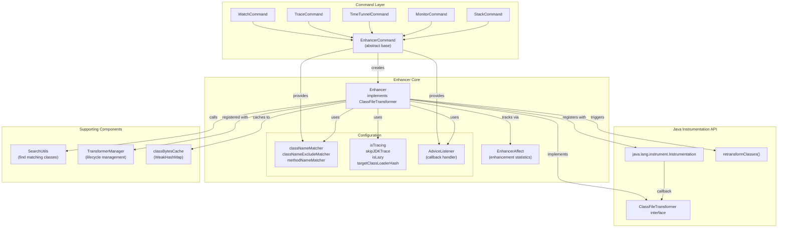
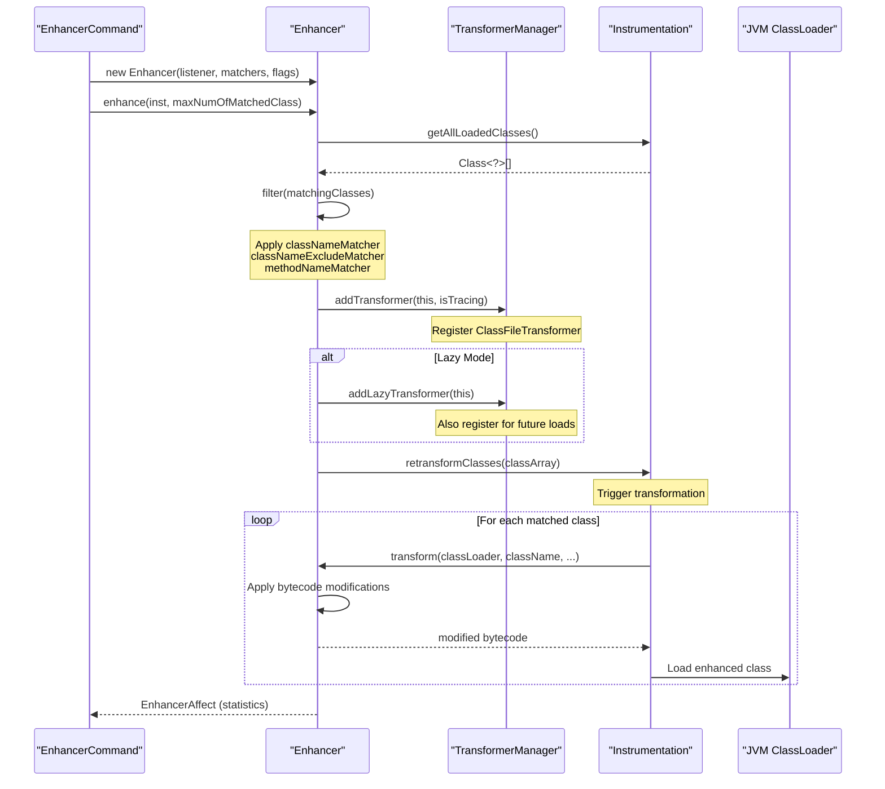
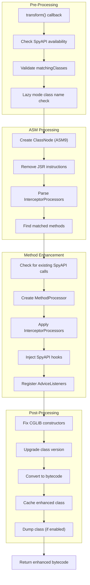
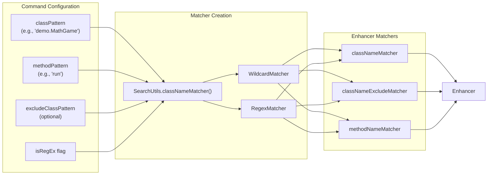
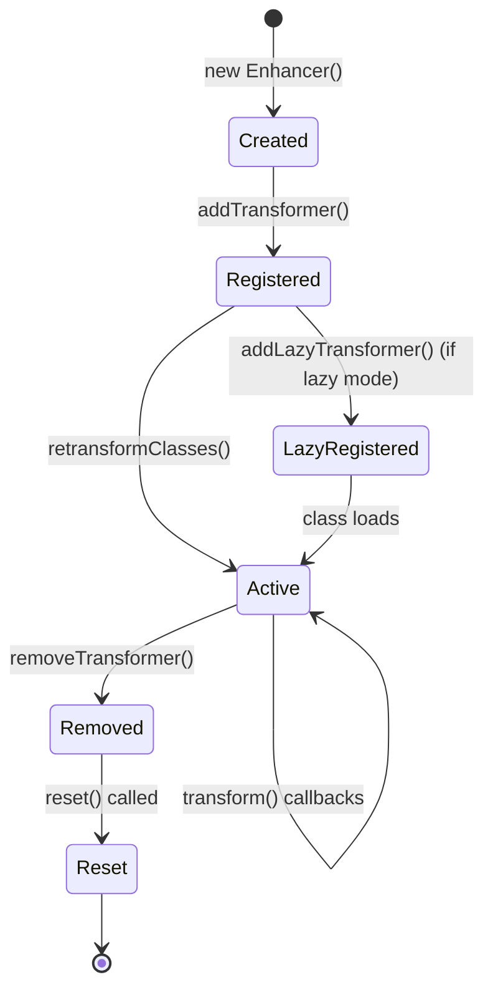
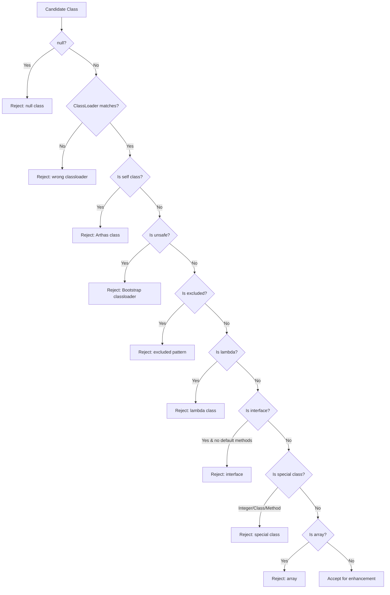

<!-- source: DeepWiki mcp.deepwiki.com · repo alibaba/arthas · page 4.1 Enhancer and Instrumentation API · fetched 2026-10-29 -->

# Enhancer and Instrumentation API

<details>
<summary>Relevant source files</summary>

The following files were used as context for generating this wiki page:

- [core/src/main/java/com/taobao/arthas/core/advisor/Enhancer.java](core/src/main/java/com/taobao/arthas/core/advisor/Enhancer.java)
- [core/src/main/java/com/taobao/arthas/core/command/monitor200/EnhancerCommand.java](core/src/main/java/com/taobao/arthas/core/command/monitor200/EnhancerCommand.java)
- [core/src/main/java/com/taobao/arthas/core/command/monitor200/MonitorCommand.java](core/src/main/java/com/taobao/arthas/core/command/monitor200/MonitorCommand.java)
- [core/src/main/java/com/taobao/arthas/core/command/monitor200/StackCommand.java](core/src/main/java/com/taobao/arthas/core/command/monitor200/StackCommand.java)
- [core/src/main/java/com/taobao/arthas/core/command/monitor200/TimeTunnelCommand.java](core/src/main/java/com/taobao/arthas/core/command/monitor200/TimeTunnelCommand.java)
- [core/src/main/java/com/taobao/arthas/core/command/monitor200/TraceCommand.java](core/src/main/java/com/taobao/arthas/core/command/monitor200/TraceCommand.java)
- [core/src/main/java/com/taobao/arthas/core/command/monitor200/WatchCommand.java](core/src/main/java/com/taobao/arthas/core/command/monitor200/WatchCommand.java)
- [core/src/main/java/com/taobao/arthas/core/util/SearchUtils.java](core/src/main/java/com/taobao/arthas/core/util/SearchUtils.java)
- [core/src/main/java/com/taobao/arthas/core/util/affect/EnhancerAffect.java](core/src/main/java/com/taobao/arthas/core/util/affect/EnhancerAffect.java)
- [core/src/test/java/com/taobao/arthas/core/advisor/EnhancerTest.java](core/src/test/java/com/taobao/arthas/core/advisor/EnhancerTest.java)

</details>


## Purpose and Scope

This document details the `Enhancer` class and its integration with the Java Instrumentation API. The `Enhancer` is the core component responsible for bytecode transformation in Arthas, implementing the `ClassFileTransformer` interface to modify class bytecode at runtime. It orchestrates the process of finding target classes, matching methods, and injecting instrumentation code using ASM and Bytekit libraries.

For information about the callback mechanism and SpyAPI hook injection, see [Advice Listeners and SpyAPI](#4.2). For details on specific diagnostic commands that use the Enhancer, see [Bytecode Enhancement Commands](#3.3).

---

## Enhancer Class Architecture

The `Enhancer` class serves as the bridge between Arthas commands and the JVM's bytecode transformation capabilities. It implements `ClassFileTransformer` and coordinates multiple subsystems to achieve runtime bytecode modification.



**Key Components:**

| Component | Type | Purpose |
|-----------|------|---------|
| `Enhancer` | ClassFileTransformer | Core transformation engine that modifies bytecode |
| `EnhancerCommand` | Abstract base class | Template for commands requiring bytecode enhancement |
| `Instrumentation` | Java API | JVM interface for class transformation |
| `EnhancerAffect` | Statistics tracker | Records classes/methods affected by enhancement |
| Matchers | Matcher objects | Pattern matching for class and method names |
| `AdviceListener` | Callback interface | Receives method execution events |

**Sources:** [core/src/main/java/com/taobao/arthas/core/advisor/Enhancer.java:68-137](), [core/src/main/java/com/taobao/arthas/core/command/monitor200/EnhancerCommand.java:38-154]()

---

## Java Instrumentation API Integration

The `Enhancer` integrates with the Java Instrumentation API through a well-defined lifecycle that involves registration, transformation, and cleanup.

### Instrumentation API Usage Flow



**Sources:** [core/src/main/java/com/taobao/arthas/core/advisor/Enhancer.java:472-538](), [core/src/main/java/com/taobao/arthas/core/command/monitor200/EnhancerCommand.java:188-286]()

### Enhancement Entry Point

The `enhance()` method is the main entry point that orchestrates the entire enhancement process:

```java
public synchronized EnhancerAffect enhance(final Instrumentation inst, int maxNumOfMatchedClass)
```

**Process Steps:**

1. **Class Discovery**: Uses `SearchUtils` to find classes matching the `classNameMatcher`
2. **Subclass Search**: Optionally includes subclasses (controlled by `GlobalOptions.isDisableSubClass`)
3. **Filtering**: Removes classes that cannot be enhanced (see Class Filtering section)
4. **Limit Check**: Validates that matched classes don't exceed `maxNumOfMatchedClass`
5. **Registration**: Registers the `Enhancer` as a `ClassFileTransformer` with `TransformerManager`
6. **Lazy Mode Setup**: If enabled, also registers as a lazy transformer for future class loads
7. **Retransformation**: Calls `Instrumentation.retransformClasses()` to trigger bytecode modification

**Sources:** [core/src/main/java/com/taobao/arthas/core/advisor/Enhancer.java:472-538]()

---

## Class Transformation Process

The `transform()` method is the core callback invoked by the JVM for each class being loaded or retransformed. This is where the actual bytecode modification occurs.

### Transformation Pipeline



**Sources:** [core/src/main/java/com/taobao/arthas/core/advisor/Enhancer.java:139-328]()

### Bytecode Transformation Details

The transformation process involves multiple stages of bytecode manipulation:

#### 1. SpyAPI Availability Check

```java
// Check if classloader can load SpyAPI
if (inClassLoader != null) {
    inClassLoader.loadClass(SpyAPI.class.getName());
}
```

This check ensures the target classloader has access to the `SpyAPI` class, which is essential for hooking. Classes in isolated classloaders may fail this check.

**Sources:** [core/src/main/java/com/taobao/arthas/core/advisor/Enhancer.java:143-152]()

#### 2. ASM Class Parsing

```java
ClassNode classNode = new ClassNode(Opcodes.ASM9);
ClassReader classReader = AsmUtils.toClassNode(classfileBuffer, classNode);
classNode = AsmUtils.removeJSRInstructions(classNode);
```

The bytecode is parsed into an ASM `ClassNode` structure, and legacy JSR (Jump Subroutine) instructions are removed for compatibility.

**Sources:** [core/src/main/java/com/taobao/arthas/core/advisor/Enhancer.java:187-190]()

#### 3. Interceptor Setup

Three types of interceptors are added based on configuration:

| Interceptor Type | Condition | Purpose |
|------------------|-----------|---------|
| `SpyInterceptor1/2/3` | Always | Basic method entry/exit/exception hooks |
| `SpyTraceInterceptor1/2/3` | `isTracing && !skipJDKTrace` | Trace all method invocations including JDK |
| `SpyTraceExcludeJDKInterceptor1/2/3` | `isTracing && skipJDKTrace` | Trace method invocations excluding JDK |

**Sources:** [core/src/main/java/com/taobao/arthas/core/advisor/Enhancer.java:196-211]()

#### 4. Method Matching and Enhancement

For each method in the class, the Enhancer checks if it should be instrumented:

```java
for (MethodNode methodNode : classNode.methods) {
    if (!isIgnore(methodNode, methodNameMatcher)) {
        matchedMethods.add(methodNode);
    }
}
```

Methods are ignored if they are:
- Abstract
- Named `<clinit>` (static initializers)
- Don't match the `methodNameMatcher`

**Sources:** [core/src/main/java/com/taobao/arthas/core/advisor/Enhancer.java:213-218](), [core/src/main/java/com/taobao/arthas/core/advisor/Enhancer.java:340-343]()

#### 5. Duplicate Detection

The Enhancer checks if a method already contains `SpyAPI` calls to avoid double-instrumentation:

```java
if(AsmUtils.containsMethodInsnNode(methodNode, Type.getInternalName(SpyAPI.class), "atBeforeInvoke")) {
    // Already enhanced - just register listeners
    // ...
} else {
    // Apply full instrumentation
    // ...
}
```

**Sources:** [core/src/main/java/com/taobao/arthas/core/advisor/Enhancer.java:260-297]()

#### 6. AdviceListener Registration

For each instrumented method, the Enhancer registers the `AdviceListener` with the `AdviceListenerManager`:

```java
AdviceListenerManager.registerAdviceListener(inClassLoader, className, methodNode.name, methodNode.desc, listener);
```

This allows the listener to receive callbacks when the method executes.

**Sources:** [core/src/main/java/com/taobao/arthas/core/advisor/Enhancer.java:300-302]()

#### 7. CGLIB Constructor Fix

Special handling for CGLIB-enhanced classes:

```java
if (AsmUtils.isEnhancerByCGLIB(className)) {
    for (MethodNode methodNode : matchedMethods) {
        if (AsmUtils.isConstructor(methodNode)) {
            AsmUtils.fixConstructorExceptionTable(methodNode);
        }
    }
}
```

**Sources:** [core/src/main/java/com/taobao/arthas/core/advisor/Enhancer.java:221-227]()

#### 8. Class Version Upgrade

Arthas requires at least Java 5 bytecode format (version 49):

```java
if (AsmUtils.getMajorVersion(classNode.version) < 49) {
    classNode.version = AsmUtils.setMajorVersion(classNode.version, 49);
}
```

**Sources:** [core/src/main/java/com/taobao/arthas/core/advisor/Enhancer.java:305-308]()

---

## Class and Method Matching

The `Enhancer` uses `Matcher` objects to identify target classes and methods for instrumentation. These matchers support both wildcard and regex patterns.

### Matcher Configuration



**Sources:** [core/src/main/java/com/taobao/arthas/core/util/SearchUtils.java:93-101](), [core/src/main/java/com/taobao/arthas/core/command/monitor200/EnhancerCommand.java:125-137]()

### Class Search Process

The `SearchUtils.searchClass()` method performs class discovery:

```java
public static Set<Class<?>> searchClass(Instrumentation inst, Matcher<String> classNameMatcher) {
    final Set<Class<?>> matches = new HashSet<Class<?>>();
    for (Class<?> clazz : inst.getAllLoadedClasses()) {
        if (clazz != null && classNameMatcher.matching(clazz.getName())) {
            matches.add(clazz);
        }
    }
    return matches;
}
```

**Search Options:**

| Method | Behavior |
|--------|----------|
| `searchClass()` | Finds classes matching pattern, optionally includes subclasses |
| `searchClassOnly()` | Finds only exact matches (no subclasses) |
| `searchSubClass()` | Recursively finds all subclasses of given classes |
| `searchInnerClass()` | Finds inner classes of a target class |

**Sources:** [core/src/main/java/com/taobao/arthas/core/util/SearchUtils.java:28-49](), [core/src/main/java/com/taobao/arthas/core/util/SearchUtils.java:110-124]()

### Pattern Matching Examples

Examples from command implementations:

```java
// WatchCommand - normalize className to use dots
this.classPattern = StringUtils.normalizeClassName(classPattern);

// TraceCommand - path tracing uses GroupMatcher
List<Matcher<String>> matcherList = new ArrayList<Matcher<String>>();
matcherList.add(SearchUtils.classNameMatcher(getClassPattern(), isRegEx()));
for (String pathPattern : getPathPatterns()) {
    matcherList.add(isRegEx() ? new RegexMatcher(pathPattern) : new WildcardMatcher(pathPattern));
}
return new GroupMatcher.Or<String>(matcherList);
```

**Sources:** [core/src/main/java/com/taobao/arthas/core/command/monitor200/WatchCommand.java:52-54](), [core/src/main/java/com/taobao/arthas/core/command/monitor200/TraceCommand.java:178-194]()

---

## Enhancement Lifecycle

The enhancement lifecycle includes creation, registration, execution, and cleanup phases.

### Lifecycle States



**Sources:** [core/src/main/java/com/taobao/arthas/core/advisor/Enhancer.java:472-538]()

### TransformerManager Registration

The `Enhancer` registers itself with the `TransformerManager` which manages the lifecycle:

```java
ArthasBootstrap.getInstance().getTransformerManager().addTransformer(this, isTracing);

if (isLazy) {
    ArthasBootstrap.getInstance().getTransformerManager().addLazyTransformer(this);
}
```

The `isTracing` flag indicates whether the transformer requires tracing capabilities, which affects how it's managed.

**Sources:** [core/src/main/java/com/taobao/arthas/core/advisor/Enhancer.java:496-503]()

### Batch vs. Individual Retransformation

The `Enhancer` supports two retransformation modes:

```java
if (GlobalOptions.isBatchReTransform) {
    // Batch mode - retransform all classes at once
    final Class<?>[] classArray = matchingClasses.toArray(new Class<?>[size]);
    if (classArray.length > 0) {
        inst.retransformClasses(classArray);
    }
} else {
    // Individual mode - retransform one by one
    for (Class<?> clazz : matchingClasses) {
        inst.retransformClasses(clazz);
    }
}
```

Batch mode is more efficient but may fail if any single class cannot be retransformed. Individual mode provides better error isolation.

**Sources:** [core/src/main/java/com/taobao/arthas/core/advisor/Enhancer.java:506-531]()

### Reset Mechanism

The `reset()` static method removes enhancements from classes:

```java
public static synchronized EnhancerAffect reset(final Instrumentation inst, final Matcher classNameMatcher) {
    final Set<Class<?>> enhanceClassSet = new HashSet<Class<?>>();
    
    // Find all enhanced classes matching the pattern
    for (Class<?> classInCache : classBytesCache.keySet()) {
        if (classNameMatcher.matching(classInCache.getName())) {
            enhanceClassSet.add(classInCache);
        }
    }
    
    // Retransform to remove enhancements
    enhance(inst, enhanceClassSet);
    
    // Remove from cache
    for (Class<?> resetClass : enhanceClassSet) {
        classBytesCache.remove(resetClass);
    }
}
```

**Sources:** [core/src/main/java/com/taobao/arthas/core/advisor/Enhancer.java:558-581]()

---

## Lazy Loading Mode

Lazy loading mode allows the `Enhancer` to instrument classes that are not yet loaded when the command is executed. This is particularly useful for classes that load on-demand.

### Lazy Mode Behavior

```mermaid
graph TB
    subgraph "Normal Mode"
        N1["enhance() called"]
        N2["Search loaded classes"]
        N3["Filter matches"]
        N4["Retransform matches"]
        N5["Complete if no matches"]
        
        N1 --> N2
        N2 --> N3
        N3 --> N4
        N4 --> N5
    end
    
    subgraph "Lazy Mode"
        L1["enhance() called with --lazy"]
        L2["Search loaded classes"]
        L3["Filter matches"]
        L4["Retransform matches (if any)"]
        L5["Register as lazy transformer"]
        L6["Wait for class loads"]
        L7["transform() for new class"]
        L8["Check class name match"]
        L9["Instrument new class"]
        
        L1 --> L2
        L2 --> L3
        L3 --> L4
        L4 --> L5
        L5 --> L6
        L6 --> L7
        L7 --> L8
        L8 --> L9
        L9 --> L6
    end
```



**Sources:** [core/src/main/java/com/taobao/arthas/core/advisor/Enhancer.java:498-503](), [core/src/main/java/com/taobao/arthas/core/command/monitor200/EnhancerCommand.java:234-259]()

### Lazy Mode Class Matching

When a new class loads in lazy mode, the `transform()` method performs additional checks:

```java
if (isLazy && classBeingRedefined == null && className != null) {
    // Convert internal name to binary name
    String classNameDot = className.replace('/', '.');
    
    if (!classNameMatcher.matching(classNameDot)) {
        return null;
    }
    
    if (classNameExcludeMatcher != null && classNameExcludeMatcher.matching(classNameDot)) {
        return null;
    }
    
    if (!isTargetClassLoader(inClassLoader)) {
        return null;
    }
    
    // Check if it's Arthas's own class
    if (inClassLoader != null && isEquals(inClassLoader, selfClassLoader)) {
        return null;
    }
    
    // Check unsafe classes
    if (!GlobalOptions.isUnsafe && inClassLoader == null) {
        return null;
    }
    
    logger.info("Lazy mode: enhancing newly loaded class: {}", classNameDot);
}
```

**Sources:** [core/src/main/java/com/taobao/arthas/core/advisor/Enhancer.java:157-181]()

### Lazy Mode Command Configuration

Commands enable lazy mode via the `-L` or `--lazy` flag:

```java
@Option(shortName = "L", longName = "lazy", flag = true)
@Description("Enable lazy mode to enhance classes when they are loaded. Useful when the class is not loaded yet.")
public void setLazy(boolean lazy) {
    this.lazy = lazy;
}
```

When no classes match in lazy mode, the command displays a waiting message instead of terminating:

```java
if (this.lazy) {
    String lazyMsg = "Lazy mode is enabled, waiting for class to be loaded. Press Q or Ctrl+C to abort.\n"
            + "When the target class is loaded, it will be automatically enhanced.";
    process.write(lazyMsg + "\n");
}
```

**Sources:** [core/src/main/java/com/taobao/arthas/core/command/monitor200/EnhancerCommand.java:110-114](), [core/src/main/java/com/taobao/arthas/core/command/monitor200/EnhancerCommand.java:235-238]()

---

## Class Filtering and Validation

The `Enhancer` applies multiple filters to ensure only safe and appropriate classes are instrumented.

### Filter Pipeline



**Sources:** [core/src/main/java/com/taobao/arthas/core/advisor/Enhancer.java:379-462]()

### Filter Implementation

The `filter()` method processes the candidate class set:

```java
private List<Pair<Class<?>, String>> filter(Set<Class<?>> classes) {
    List<Pair<Class<?>, String>> filteredClasses = new ArrayList<Pair<Class<?>, String>>();
    final Iterator<Class<?>> it = classes.iterator();
    
    while (it.hasNext()) {
        final Class<?> clazz = it.next();
        boolean removeFlag = false;
        
        if (null == clazz) {
            removeFlag = true;
        } else if (!isTargetClassLoader(clazz.getClassLoader())) {
            filteredClasses.add(new Pair<Class<?>, String>(clazz, "classloader is not matched"));
            removeFlag = true;
        } else if (isSelf(clazz)) {
            filteredClasses.add(new Pair<Class<?>, String>(clazz, "class loaded by arthas itself"));
            removeFlag = true;
        } else if (isUnsafeClass(clazz)) {
            filteredClasses.add(new Pair<Class<?>, String>(clazz, "class loaded by Bootstrap Classloader, try to execute `options unsafe true`"));
            removeFlag = true;
        } else if (isExclude(clazz)) {
            filteredClasses.add(new Pair<Class<?>, String>(clazz, "class is excluded"));
            removeFlag = true;
        } else {
            Pair<Boolean, String> unsupportedResult = isUnsupportedClass(clazz);
            if (unsupportedResult.getFirst()) {
                filteredClasses.add(new Pair<Class<?>, String>(clazz, unsupportedResult.getSecond()));
                removeFlag = true;
            }
        }
        
        if (removeFlag) {
            it.remove();
        }
    }
    return filteredClasses;
}
```

**Sources:** [core/src/main/java/com/taobao/arthas/core/advisor/Enhancer.java:379-411]()

### ClassLoader Hash Filtering

The `targetClassLoaderHash` parameter allows precise targeting of classes from a specific classloader:

```java
private boolean isTargetClassLoader(ClassLoader inClassLoader) {
    if (targetClassLoaderHash == null || targetClassLoaderHash.isEmpty()) {
        return true;
    }
    if (inClassLoader == null) {
        return false;
    }
    return Integer.toHexString(inClassLoader.hashCode()).equalsIgnoreCase(targetClassLoaderHash);
}
```

This is essential when multiple classloaders load classes with the same name, and you want to instrument only one version.

**Sources:** [core/src/main/java/com/taobao/arthas/core/advisor/Enhancer.java:540-548](), [core/src/test/java/com/taobao/arthas/core/advisor/EnhancerTest.java:99-135]()

### Unsafe Class Handling

Classes loaded by the Bootstrap ClassLoader (null classloader) are considered "unsafe" by default:

```java
private static boolean isUnsafeClass(Class<?> clazz) {
    return !GlobalOptions.isUnsafe && clazz.getClassLoader() == null;
}
```

Users must explicitly enable unsafe enhancement with `options unsafe true` to instrument JDK classes.

**Sources:** [core/src/main/java/com/taobao/arthas/core/advisor/Enhancer.java:430-432]()

### Unsupported Class Detection

Several class types cannot be enhanced:

```java
private static Pair<Boolean, String> isUnsupportedClass(Class<?> clazz) {
    if (ClassUtils.isLambdaClass(clazz)) {
        return new Pair<Boolean, String>(Boolean.TRUE, "class is lambda");
    }
    
    if (clazz.isInterface() && !GlobalOptions.isSupportDefaultMethod) {
        return new Pair<Boolean, String>(Boolean.TRUE, "class is interface");
    }
    
    if (clazz.equals(Integer.class)) {
        return new Pair<Boolean, String>(Boolean.TRUE, "class is java.lang.Integer");
    }
    
    if (clazz.equals(Class.class)) {
        return new Pair<Boolean, String>(Boolean.TRUE, "class is java.lang.Class");
    }
    
    if (clazz.equals(Method.class)) {
        return new Pair<Boolean, String>(Boolean.TRUE, "class is java.lang.Method");
    }
    
    if (clazz.isArray()) {
        return new Pair<Boolean, String>(Boolean.TRUE, "class is array");
    }
    
    return new Pair<Boolean, String>(Boolean.FALSE, "");
}
```

**Sources:** [core/src/main/java/com/taobao/arthas/core/advisor/Enhancer.java:437-462]()

---

## Enhancement Statistics and Tracking

The `EnhancerAffect` class tracks the impact of enhancement operations and provides detailed statistics.

### EnhancerAffect Structure

| Field | Type | Purpose |
|-------|------|---------|
| `cCnt` | AtomicInteger | Count of affected classes |
| `mCnt` | AtomicInteger | Count of affected methods |
| `transformer` | ClassFileTransformer | Reference to the transformer |
| `listenerId` | long | Unique identifier for the listener |
| `methods` | List<String> | Detailed list of enhanced methods |
| `classDumpFiles` | Collection<File> | Files where enhanced classes were dumped |
| `throwable` | Throwable | Any error that occurred during enhancement |
| `overLimitMsg` | String | Message if class limit was exceeded |

**Sources:** [core/src/main/java/com/taobao/arthas/core/util/affect/EnhancerAffect.java:21-38]()

### Method Tracking Format

Each enhanced method is recorded with the following format:

```
<classloader-hash>|<class-name>#<method-name>|<method-descriptor>
```

For example:
```
3f0ee7cb|demo.MathGame#run|(I)V
```

The method is recorded via:

```java
public int addMethodAndCount(ClassLoader classLoader, String clazz, String method, String methodDesc) {
    this.methods.add(ClassLoaderUtils.classLoaderHash(classLoader) + "|" 
                     + clazz.replace('/', '.') + "#" + method + "|" + methodDesc);
    return mCnt.addAndGet(1);
}
```

**Sources:** [core/src/main/java/com/taobao/arthas/core/util/affect/EnhancerAffect.java:67-70](), [core/src/main/java/com/taobao/arthas/core/advisor/Enhancer.java:302]()

### Class Dump Tracking

When `GlobalOptions.isDump` is enabled, enhanced classes are written to disk:

```java
private static void dumpClassIfNecessary(String className, byte[] data, EnhancerAffect affect) {
    if (!GlobalOptions.isDump) {
        return;
    }
    final File dumpClassFile = new File("./arthas-class-dump/" + className + ".class");
    final File classPath = new File(dumpClassFile.getParent());
    
    if (!classPath.mkdirs() && !classPath.exists()) {
        logger.warn("create dump classpath:{} failed.", classPath);
        return;
    }
    
    try {
        FileUtils.writeByteArrayToFile(dumpClassFile, data);
        affect.addClassDumpFile(dumpClassFile);
        if (GlobalOptions.verbose) {
            logger.info("dump enhanced class: {}, path: {}", className, dumpClassFile);
        }
    } catch (IOException e) {
        logger.warn("dump class:{} to file {} failed.", className, dumpClassFile, e);
    }
}
```

**Sources:** [core/src/main/java/com/taobao/arthas/core/advisor/Enhancer.java:348-372]()

---

## Class Bytes Cache

The `Enhancer` maintains a `WeakHashMap` to track which classes have been enhanced:

```java
private final static Map<Class<?>/* Class */, Object> classBytesCache = new WeakHashMap<Class<?>, Object>();
```

### Cache Usage

**During Enhancement:**
```java
// Record enhanced class
classBytesCache.put(classBeingRedefined, new Object());
```

**During Reset:**
```java
// Find classes to reset
for (Class<?> classInCache : classBytesCache.keySet()) {
    if (classNameMatcher.matching(classInCache.getName())) {
        enhanceClassSet.add(classInCache);
    }
}

// Clean up after reset
for (Class<?> resetClass : enhanceClassSet) {
    classBytesCache.remove(resetClass);
}
```

The `WeakHashMap` ensures that the cache doesn't prevent class unloading - if a class is no longer referenced elsewhere, it can be garbage collected even if it's in the cache.

**Sources:** [core/src/main/java/com/taobao/arthas/core/advisor/Enhancer.java:88](), [core/src/main/java/com/taobao/arthas/core/advisor/Enhancer.java:313](), [core/src/main/java/com/taobao/arthas/core/advisor/Enhancer.java:564-577]()

---

## Summary

The `Enhancer` class is the cornerstone of Arthas's bytecode instrumentation system. It provides:

- **ClassFileTransformer Implementation**: Integrates with Java Instrumentation API to modify bytecode at runtime
- **Flexible Matching**: Supports wildcard and regex patterns for class and method selection
- **Lazy Loading**: Can instrument classes before they are loaded into the JVM
- **Comprehensive Filtering**: Multiple safety checks prevent invalid or dangerous enhancements
- **Statistics Tracking**: Detailed reporting of affected classes, methods, and any errors
- **Batch Operations**: Efficient handling of multiple class transformations
- **Reset Capability**: Clean removal of enhancements to restore original class behavior

The `Enhancer` works in conjunction with the `AdviceListener` callback system (see [Advice Listeners and SpyAPI](#4.2)) to provide the complete instrumentation pipeline used by diagnostic commands like `watch`, `trace`, `tt`, `monitor`, and `stack`.

**Sources:** [core/src/main/java/com/taobao/arthas/core/advisor/Enhancer.java:68-593](), [core/src/main/java/com/taobao/arthas/core/command/monitor200/EnhancerCommand.java:38-325]()

---

