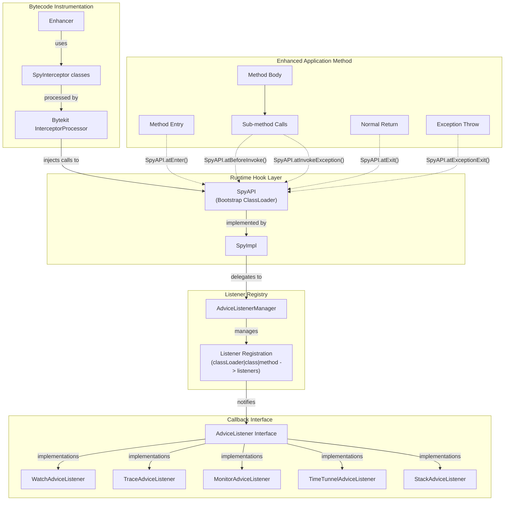
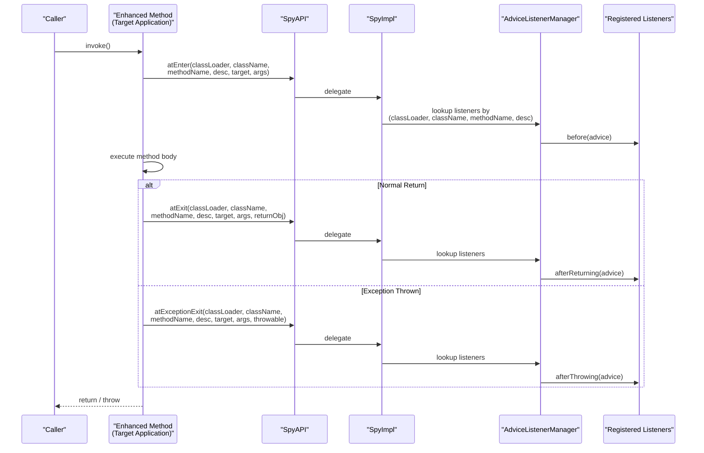
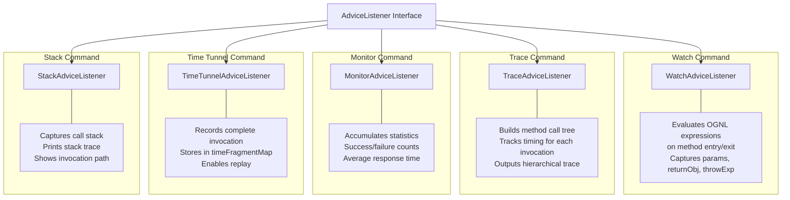
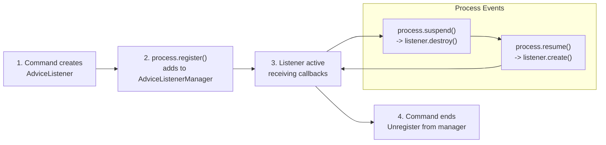
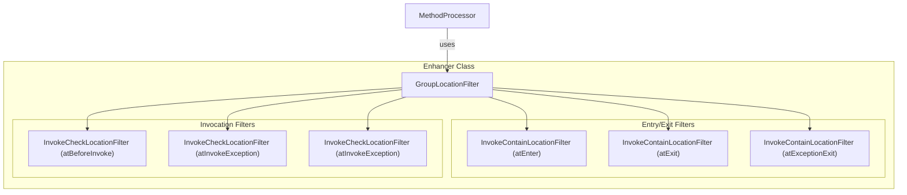
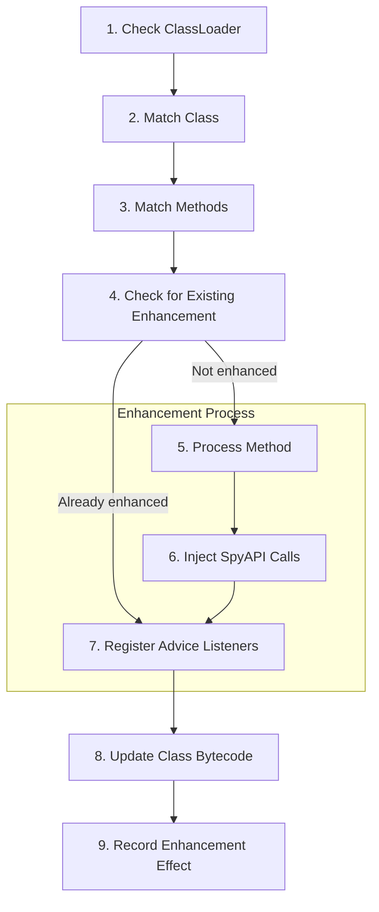
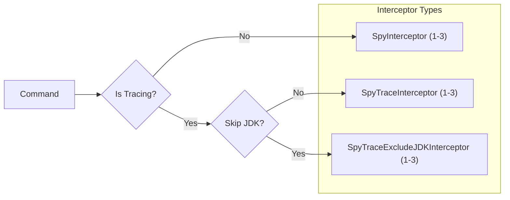
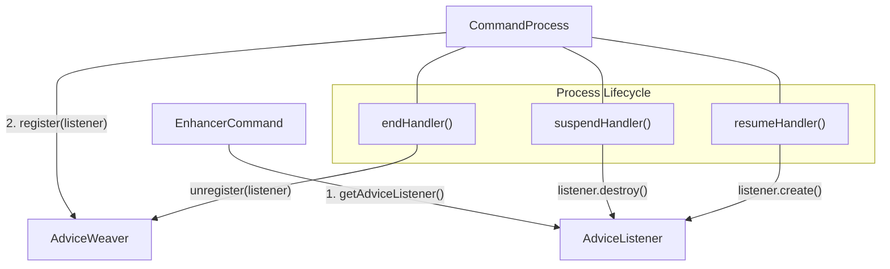

<!-- source: DeepWiki mcp.deepwiki.com · repo alibaba/arthas · page 4.2 Advice Listeners and SpyAPI · fetched 2026-10-29 -->

# Advice Listeners and SpyAPI

<details>
<summary>Relevant source files</summary>

The following files were used as context for generating this wiki page:

- [core/src/main/java/com/taobao/arthas/core/advisor/Enhancer.java](core/src/main/java/com/taobao/arthas/core/advisor/Enhancer.java)
- [core/src/main/java/com/taobao/arthas/core/command/monitor200/EnhancerCommand.java](core/src/main/java/com/taobao/arthas/core/command/monitor200/EnhancerCommand.java)
- [core/src/main/java/com/taobao/arthas/core/command/monitor200/MonitorCommand.java](core/src/main/java/com/taobao/arthas/core/command/monitor200/MonitorCommand.java)
- [core/src/main/java/com/taobao/arthas/core/command/monitor200/StackCommand.java](core/src/main/java/com/taobao/arthas/core/command/monitor200/StackCommand.java)
- [core/src/main/java/com/taobao/arthas/core/command/monitor200/TimeTunnelCommand.java](core/src/main/java/com/taobao/arthas/core/command/monitor200/TimeTunnelCommand.java)
- [core/src/main/java/com/taobao/arthas/core/command/monitor200/TraceCommand.java](core/src/main/java/com/taobao/arthas/core/command/monitor200/TraceCommand.java)
- [core/src/main/java/com/taobao/arthas/core/command/monitor200/WatchCommand.java](core/src/main/java/com/taobao/arthas/core/command/monitor200/WatchCommand.java)
- [core/src/main/java/com/taobao/arthas/core/util/SearchUtils.java](core/src/main/java/com/taobao/arthas/core/util/SearchUtils.java)
- [core/src/main/java/com/taobao/arthas/core/util/affect/EnhancerAffect.java](core/src/main/java/com/taobao/arthas/core/util/affect/EnhancerAffect.java)
- [core/src/test/java/com/taobao/arthas/core/advisor/EnhancerTest.java](core/src/test/java/com/taobao/arthas/core/advisor/EnhancerTest.java)

</details>


The Advice Listener and SpyAPI mechanism is the core callback system that enables Arthas to intercept and observe method execution in target applications. This two-part system consists of:

1. **SpyAPI**: Static hook points injected into enhanced method bytecode that get invoked at method entry, exit, and exception points
2. **AdviceListener**: Callback interface implementations that receive notifications from SpyAPI and process the captured runtime information

Together, these components allow commands like `watch`, `trace`, `monitor`, and `tt` to transparently observe method behavior without modifying application source code.

## System Architecture



Sources: [core/src/main/java/com/taobao/arthas/core/advisor/Enhancer.java:68-93](), [core/src/main/java/com/taobao/arthas/core/advisor/Enhancer.java:196-211]()
</thinking>

## SpyAPI Hook Injection Mechanism

### SpyAPI Overview

`SpyAPI` is a static hook interface that is loaded into the bootstrap classloader, making it accessible from any classloader context within the target JVM. The `Enhancer` injects calls to SpyAPI static methods at specific points in enhanced method bytecode.

**SpyAPI Hook Points:**

| SpyAPI Method | Location | Purpose |
|---------------|----------|---------|
| `atEnter()` | Method entry | Captures method entry with target object and parameters |
| `atExit()` | Normal method return | Captures return value and exit state |
| `atExceptionExit()` | Exception throw | Captures thrown exception |
| `atBeforeInvoke()` | Before sub-method call | Tracks sub-method invocation for tracing |
| `atInvokeException()` | Sub-method exception | Tracks sub-method exception for tracing |

The `SpyAPI` interface is implemented by `SpyImpl`, which is initialized in the `Enhancer` static block and delegates all calls to `AdviceListenerManager`.

Sources: [core/src/main/java/com/taobao/arthas/core/advisor/Enhancer.java:89-93](), [core/src/test/java/com/taobao/arthas/core/advisor/EnhancerTest.java:70-91]()
</str>
<new_str>
# Advice Listeners and SpyAPI

This page explains the two-part callback mechanism that enables Arthas to intercept and observe method execution:

1. **SpyAPI Hook Injection**: Static hook points injected into enhanced bytecode
2. **AdviceListener Callbacks**: Interface implementations that process intercepted method events

## SpyAPI Hook Injection Mechanism

### SpyAPI Overview and ClassLoader Placement

`SpyAPI` is a static hook interface that must be loaded into the bootstrap classloader to be accessible from any classloader context in the target JVM. The `Enhancer` class initializes the SpyAPI implementation through a static block:

```java
private static SpyImpl spyImpl = new SpyImpl();

static {
    SpyAPI.setSpy(spyImpl);
}
```

This ensures that when enhanced methods call SpyAPI static methods, they route to `SpyImpl`, which then delegates to the `AdviceListenerManager` to notify registered listeners.

Sources: [core/src/main/java/com/taobao/arthas/core/advisor/Enhancer.java:89-93]()

### SpyAPI Hook Points

SpyAPI provides five static hook methods that are injected at different locations in method bytecode:

| SpyAPI Method | Injection Location | Parameters | Purpose |
|---------------|-------------------|------------|---------|
| `atEnter()` | Method entry (LocationType.ENTER) | classLoader, className, methodName, methodDesc, target, args | Capture method entry with target instance and arguments |
| `atExit()` | Normal return (LocationType.EXIT) | classLoader, className, methodName, methodDesc, target, args, returnObj | Capture normal method exit with return value |
| `atExceptionExit()` | Exception exit (LocationType.EXCEPTION_EXIT) | classLoader, className, methodName, methodDesc, target, args, throwable | Capture exception thrown from method |
| `atBeforeInvoke()` | Before sub-method invocation (LocationType.INVOKE) | classLoader, invokeClassName, invokeMethodName, invokeMethodDesc | Track sub-method calls for tracing |
| `atInvokeException()` | Sub-method exception (LocationType.INVOKE_EXCEPTION_EXIT) | classLoader, invokeClassName, invokeMethodName, invokeMethodDesc | Track exceptions from sub-method calls |

The first three hooks (`atEnter`, `atExit`, `atExceptionExit`) are injected into every enhanced method. The last two hooks (`atBeforeInvoke`, `atInvokeException`) are only injected when tracing is enabled.

Sources: [core/src/main/java/com/taobao/arthas/core/advisor/Enhancer.java:232-251](), [core/src/test/java/com/taobao/arthas/core/advisor/EnhancerTest.java:70-91]()

### Interceptor-Based Hook Injection

The `Enhancer.transform()` method uses Bytekit's `InterceptorProcessor` to inject SpyAPI calls. Different interceptor classes are used based on whether tracing is enabled and whether JDK methods should be traced:

**Basic Method Interception (Always Applied):**
```
SpyInterceptor1, SpyInterceptor2, SpyInterceptor3
```

**Standard Tracing (Includes JDK Methods):**
```
SpyTraceInterceptor1, SpyTraceInterceptor2, SpyTraceInterceptor3
```

**JDK-Excluding Tracing:**
```
SpyTraceExcludeJDKInterceptor1, SpyTraceExcludeJDKInterceptor2, SpyTraceExcludeJDKInterceptor3
```

The transform method parses these interceptor classes and processes each matched method:

```java
// From Enhancer.transform()
List<InterceptorProcessor> interceptorProcessors = new ArrayList<InterceptorProcessor>();

interceptorProcessors.addAll(defaultInterceptorClassParser.parse(SpyInterceptor1.class));
interceptorProcessors.addAll(defaultInterceptorClassParser.parse(SpyInterceptor2.class));
interceptorProcessors.addAll(defaultInterceptorClassParser.parse(SpyInterceptor3.class));

if (this.isTracing) {
    if (!this.skipJDKTrace) {
        interceptorProcessors.addAll(defaultInterceptorClassParser.parse(SpyTraceInterceptor1.class));
        // ... SpyTraceInterceptor2, SpyTraceInterceptor3
    } else {
        interceptorProcessors.addAll(defaultInterceptorClassParser.parse(SpyTraceExcludeJDKInterceptor1.class));
        // ... SpyTraceExcludeJDKInterceptor2, SpyTraceExcludeJDKInterceptor3
    }
}
```

Sources: [core/src/main/java/com/taobao/arthas/core/advisor/Enhancer.java:196-211]()

### Location Filters for Idempotent Enhancement

To prevent duplicate SpyAPI injection when a class is retransformed multiple times, the `Enhancer` uses `LocationFilter` instances to check if SpyAPI calls already exist in the bytecode:

```java
GroupLocationFilter groupLocationFilter = new GroupLocationFilter();

LocationFilter enterFilter = new InvokeContainLocationFilter(
    Type.getInternalName(SpyAPI.class), "atEnter", LocationType.ENTER);
LocationFilter existFilter = new InvokeContainLocationFilter(
    Type.getInternalName(SpyAPI.class), "atExit", LocationType.EXIT);
LocationFilter exceptionFilter = new InvokeContainLocationFilter(
    Type.getInternalName(SpyAPI.class), "atExceptionExit", LocationType.EXCEPTION_EXIT);

groupLocationFilter.addFilter(enterFilter);
groupLocationFilter.addFilter(existFilter);
groupLocationFilter.addFilter(exceptionFilter);
```

These filters are passed to `MethodProcessor`, which skips locations where SpyAPI calls are already present. This ensures that multiple calls to `Enhancer.enhance()` on the same class do not result in duplicate instrumentation.

Sources: [core/src/main/java/com/taobao/arthas/core/advisor/Enhancer.java:229-251]()

### Enhanced Method Execution Flow

Diagram: **SpyAPI Call Flow in Enhanced Method**



Sources: [core/src/main/java/com/taobao/arthas/core/advisor/Enhancer.java:140-184]()

### Handling Already-Enhanced Methods

When a method is already enhanced (contains SpyAPI calls), the `Enhancer` takes a different approach. Instead of re-injecting SpyAPI calls, it scans the existing bytecode for invocation instructions and registers trace listeners for those invocations:

```java
// Check if method already contains atBeforeInvoke (indicates tracing already injected)
if(AsmUtils.containsMethodInsnNode(methodNode, Type.getInternalName(SpyAPI.class), "atBeforeInvoke")) {
    // Scan existing method instructions
    for (AbstractInsnNode insnNode = methodNode.instructions.getFirst(); 
         insnNode != null; 
         insnNode = insnNode.getNext()) {
        if (insnNode instanceof MethodInsnNode) {
            final MethodInsnNode methodInsnNode = (MethodInsnNode) insnNode;
            
            // Skip JDK methods if configured
            if(this.skipJDKTrace && methodInsnNode.owner.startsWith("java/")) {
                continue;
            }
            
            // Register trace listener for this invocation
            AdviceListenerManager.registerTraceAdviceListener(
                inClassLoader, className,
                methodInsnNode.owner, methodInsnNode.name, methodInsnNode.desc, listener);
        }
    }
}
```

This optimization avoids redundant bytecode transformation while still allowing new listeners to observe already-enhanced methods.

Sources: [core/src/main/java/com/taobao/arthas/core/advisor/Enhancer.java:259-277]()

## AdviceListener Callback System

### AdviceListener Interface

`AdviceListener` defines the callback interface that receives notifications when SpyAPI hooks are triggered. Each diagnostic command implements its own listener to process method events according to its specific requirements.

**Core Callback Methods:**

| Method | Invoked When | Parameters |
|--------|--------------|------------|
| `before()` | Method entry (atEnter) | `Advice` object containing target, args, class, method |
| `afterReturning()` | Normal method return (atExit) | `Advice` object with returnObj populated |
| `afterThrowing()` | Exception thrown (atExceptionExit) | `Advice` object with throwExp populated |

**Lifecycle Methods:**

| Method | Purpose |
|--------|---------|
| `create()` | Initialize listener resources when registered |
| `destroy()` | Clean up listener resources when unregistered |
| `id()` | Return unique listener identifier |

Sources: [core/src/main/java/com/taobao/arthas/core/command/monitor200/WatchCommand.java:203-205](), [core/src/main/java/com/taobao/arthas/core/command/monitor200/TraceCommand.java:167-173]()

### Advice Context Object

The `Advice` object carries the complete execution context for a method invocation. It is constructed by `SpyImpl` when SpyAPI hooks are triggered and passed to registered listeners:

**Advice Object Structure:**

| Field | Type | Description |
|-------|------|-------------|
| `loader` | ClassLoader | ClassLoader that loaded the target class |
| `clazz` | Class<?> | The target class |
| `method` | ArthasMethod | The intercepted method |
| `target` | Object | The target instance (null for static methods) |
| `params` | Object[] | Method parameters |
| `returnObj` | Object | Return value (populated in afterReturning) |
| `throwExp` | Throwable | Thrown exception (populated in afterThrowing) |
| `isBefore` | boolean | True if in before() callback |
| `isAfterReturning` | boolean | True if in afterReturning() callback |
| `isAfterThrowing` | boolean | True if in afterThrowing() callback |

This context object allows listeners to access all relevant information about the method invocation and make decisions based on the execution state.

Sources: [core/src/main/java/com/taobao/arthas/core/command/monitor200/TimeTunnelCommand.java:467-484]()

### AdviceListenerManager Registration

`AdviceListenerManager` maintains a registry mapping (classLoader, className, methodName, methodDesc) to a list of `AdviceListener` instances. When SpyAPI hooks are triggered, `SpyImpl` queries this registry to find all listeners interested in the specific method.

**Registration Methods:**

```java
// Register for method entry/exit/exception
AdviceListenerManager.registerAdviceListener(
    inClassLoader, className, methodNode.name, methodNode.desc, listener);

// Register for method invocation tracing
AdviceListenerManager.registerTraceAdviceListener(
    inClassLoader, className, 
    methodInsnNode.owner, methodInsnNode.name, methodInsnNode.desc, listener);
```

The registration happens during the `Enhancer.transform()` phase after bytecode is successfully enhanced. Multiple listeners can be registered for the same method, allowing commands like `watch` and `trace` to simultaneously observe the same method.

Sources: [core/src/main/java/com/taobao/arthas/core/advisor/Enhancer.java:274-302]()

### Command-Specific AdviceListener Implementations

Each diagnostic command provides its own `AdviceListener` implementation tailored to its specific observation requirements:

**Diagram: AdviceListener Implementations by Command**



Sources: [core/src/main/java/com/taobao/arthas/core/command/monitor200/WatchCommand.java:203-205](), [core/src/main/java/com/taobao/arthas/core/command/monitor200/TraceCommand.java:167-173](), [core/src/main/java/com/taobao/arthas/core/command/monitor200/MonitorCommand.java:136-153](), [core/src/main/java/com/taobao/arthas/core/command/monitor200/TimeTunnelCommand.java:328-330](), [core/src/main/java/com/taobao/arthas/core/command/monitor200/StackCommand.java:120-122]()

### InvokeTraceable Interface

For commands that need to trace sub-method invocations (primarily the `trace` command), the `InvokeTraceable` interface marks a listener as needing trace-level hooks:

```java
public interface InvokeTraceable {
    // Marker interface - no methods
}
```

When creating an `Enhancer`, the constructor checks if the listener implements `InvokeTraceable`:

```java
Enhancer enhancer = new Enhancer(
    listener, 
    listener instanceof InvokeTraceable,  // isTracing flag
    skipJDKTrace,
    getClassNameMatcher(), 
    getClassNameExcludeMatcher(), 
    getMethodNameMatcher()
);
```

If the listener implements `InvokeTraceable`, the enhancer injects additional SpyAPI hooks (`atBeforeInvoke`, `atInvokeException`) to track sub-method calls and build the invocation tree.

Sources: [core/src/main/java/com/taobao/arthas/core/command/monitor200/EnhancerCommand.java:208-214]()

### Listener Lifecycle Management

Listeners have a defined lifecycle managed by the `CommandProcess`:

**Lifecycle Flow:**



This lifecycle allows listeners to allocate resources (timers, data structures) when active and clean them up when suspended or ended. For example, `MonitorAdviceListener` starts a periodic timer in `create()` and stops it in `destroy()`.

Sources: [core/src/main/java/com/taobao/arthas/core/command/monitor200/MonitorCommand.java:136-153](), [core/src/main/java/com/taobao/arthas/core/command/monitor200/EnhancerCommand.java:146-154]()

### Listener Reuse with listenerId

Arthas supports reusing existing listeners through the `listenerId` mechanism. When a command specifies a `--listenerId`, instead of creating a new listener, it retrieves the existing listener from `AdviceWeaver`:

```java
AdviceListener getAdviceListenerWithId(CommandProcess process) {
    if (listenerId != 0) {
        AdviceListener listener = AdviceWeaver.listener(listenerId);
        if (listener != null) {
            return listener;
        }
    }
    return getAdviceListener(process);
}
```

This allows multiple command invocations to share the same listener instance, enabling scenarios like:
- Extending the observation period without resetting statistics
- Adding additional methods to an existing monitoring session
- Sharing trace data across multiple command invocations

Each listener has a unique ID returned by the `id()` method, which is typically generated using `InvokerUtils.genInvokerId()`.

Sources: [core/src/main/java/com/taobao/arthas/core/command/monitor200/EnhancerCommand.java:146-154]()

## Method Interception Mechanism

The Advice System uses bytecode instrumentation to intercept method execution at three key points:

1. **Method Entry** - Before the method body is executed
2. **Method Exit** - When the method returns normally
3. **Method Exception Exit** - When the method throws an exception

This is achieved by injecting calls to SpyAPI at these points in the method's bytecode.

### Location Filters

The Enhancer uses different location filters to identify where to inject SpyAPI calls in the method bytecode:

- `InvokeContainLocationFilter` - Checks if SpyAPI calls are already present
- `InvokeCheckLocationFilter` - Validates invocation points for SpyAPI injection



Sources: [core/src/main/java/com/taobao/arthas/core/advisor/Enhancer.java:175-197]()

### Bytecode Enhancement Process

When enhancing a class, the Enhancer follows these steps:

1. Check if the class loader can load SpyAPI
2. Filter classes based on matching criteria
3. Parse and process each method that matches the method pattern
4. Inject SpyAPI calls at the appropriate locations
5. Register advice listeners for both method entry/exit and method invocations
6. Apply the transformed bytecode



Sources: [core/src/main/java/com/taobao/arthas/core/advisor/Enhancer.java:111-274]()

## Advice Types

Arthas provides different types of advice to support various monitoring scenarios:

### Basic Method Interception

Used by commands like `watch` and `tt` to collect information at method entry, exit, and exception points.

### Tracing Method Invocations

Used by the `trace` command to collect timing and invocation tree information:

- **Standard Tracing**: Captures all method invocations, including those in JDK classes
- **JDK-Excluding Tracing**: Skips tracing JDK method invocations for better performance



Sources: [core/src/main/java/com/taobao/arthas/core/advisor/Enhancer.java:143-156]()

## Integration with Commands

Various Arthas commands leverage the Advice System to implement their functionality:

### Watch Command

The `watch` command uses the Advice System to observe method inputs, outputs, and exceptions. It can capture:
- Method parameters
- Return values
- Thrown exceptions
- Target objects
- Execution time

Sources: [core/src/main/java/com/taobao/arthas/core/command/monitor200/WatchCommand.java:194-196]()

### Trace Command

The `trace` command uses the Advice System to trace method execution and collect timing information, building an invocation tree with execution time statistics.

Sources: [core/src/main/java/com/taobao/arthas/core/command/monitor200/TraceCommand.java:158-164]()

### Monitor Command

The `monitor` command uses the Advice System to collect method execution statistics such as success/failure counts, average response time, and failure rates.

Sources: [core/src/main/java/com/taobao/arthas/core/command/monitor200/MonitorCommand.java:135-153]()

### Time Tunnel (tt) Command

The `tt` command uses the Advice System to record method invocations for later replay and analysis. It captures the complete execution context, including parameters, target object, and return values or exceptions.

Sources: [core/src/main/java/com/taobao/arthas/core/command/monitor200/TimeTunnelCommand.java:319-323]()

## Command Process Integration

The Advice System is tightly integrated with Arthas's command process flow. When a command is executed:

1. The command creates an appropriate `AdviceListener`
2. The listener is registered with the `CommandProcess`
3. The process manages the listener's lifecycle, handling suspend/resume/interrupt operations
4. When the command ends, the process unregisters the listener



Sources: [core/src/main/java/com/taobao/arthas/core/shell/system/impl/ProcessImpl.java:549-577]()

## Configuration Options

The Advice System's behavior can be customized through Arthas's global options:

| Option | Description | Default |
|--------|-------------|---------|
| `unsafe` | Whether to support enhancing system classes | `false` |
| `dump` | Whether to dump enhanced classes for inspection | `false` |
| `batch-re-transform` | Whether to transform classes in batch | `true` |
| `disable-sub-class` | Whether to disable sub-class matching | `false` |
| `support-default-method` | Whether to support default methods in interfaces | Based on JVM version |

These options can be viewed and changed using the `options` command.

Sources: [core/src/main/java/com/taobao/arthas/core/GlobalOptions.java:23-90](), [core/src/main/java/com/taobao/arthas/core/command/basic1000/OptionsCommand.java:136-160]()

## Limitations and Considerations

When using the Advice System, there are some limitations to be aware of:

1. **Safe Filtering**: The system automatically excludes certain classes that might cause stability issues:
   - Classes loaded by the Arthas classloader
   - System classes (unless `unsafe` option is enabled)
   - Lambda classes
   - Interfaces (unless they have default methods and the option is enabled)
   - Arrays and specific JDK classes

2. **Performance Impact**: Heavy instrumentation can impact the performance of the target application, especially when tracing is enabled.

3. **Class Transformation Limits**: Some classes may not be transformable due to JVM restrictions or large method sizes.

Sources: [core/src/main/java/com/taobao/arthas/core/advisor/Enhancer.java:325-405]()

## Reset Mechanism

The Advice System provides a way to reset enhanced classes to their original state using the `reset` command. This command:

1. Identifies classes that were enhanced
2. Removes the instrumentation by retransforming them
3. Clears the class bytecode cache

This ensures that the target application can return to its original state after diagnostics are complete.

Sources: [core/src/main/java/com/taobao/arthas/core/advisor/Enhancer.java:475-517](), [core/src/main/java/com/taobao/arthas/core/command/basic1000/ResetCommand.java:41-59]()

---

