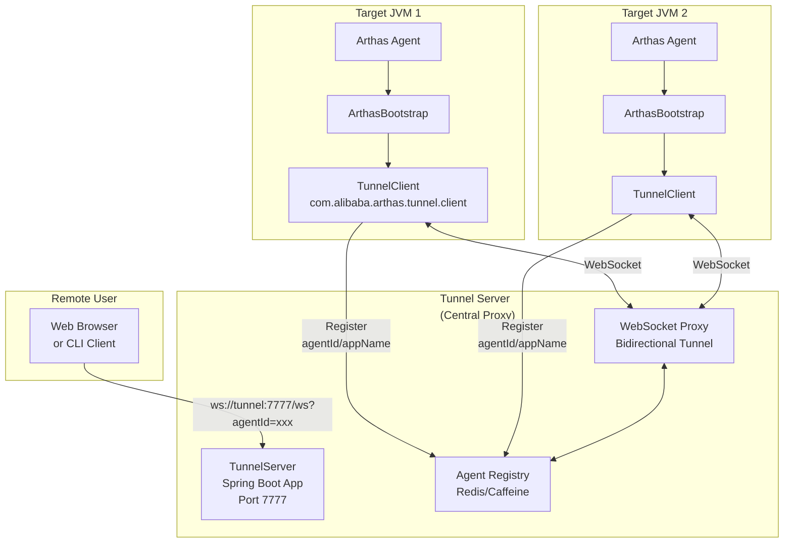
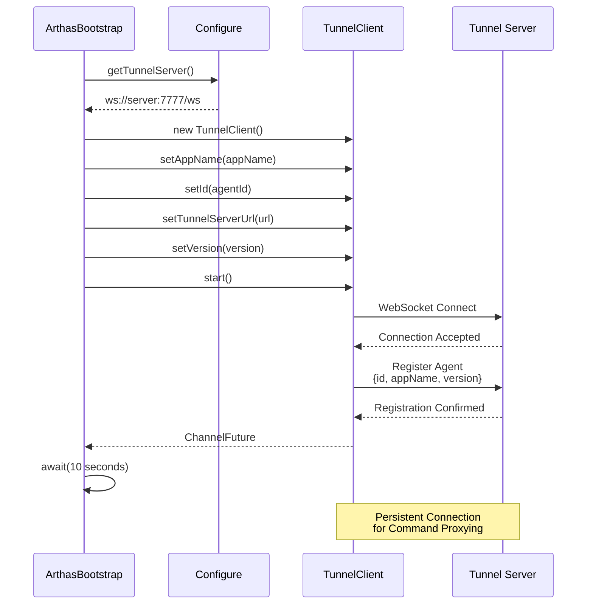
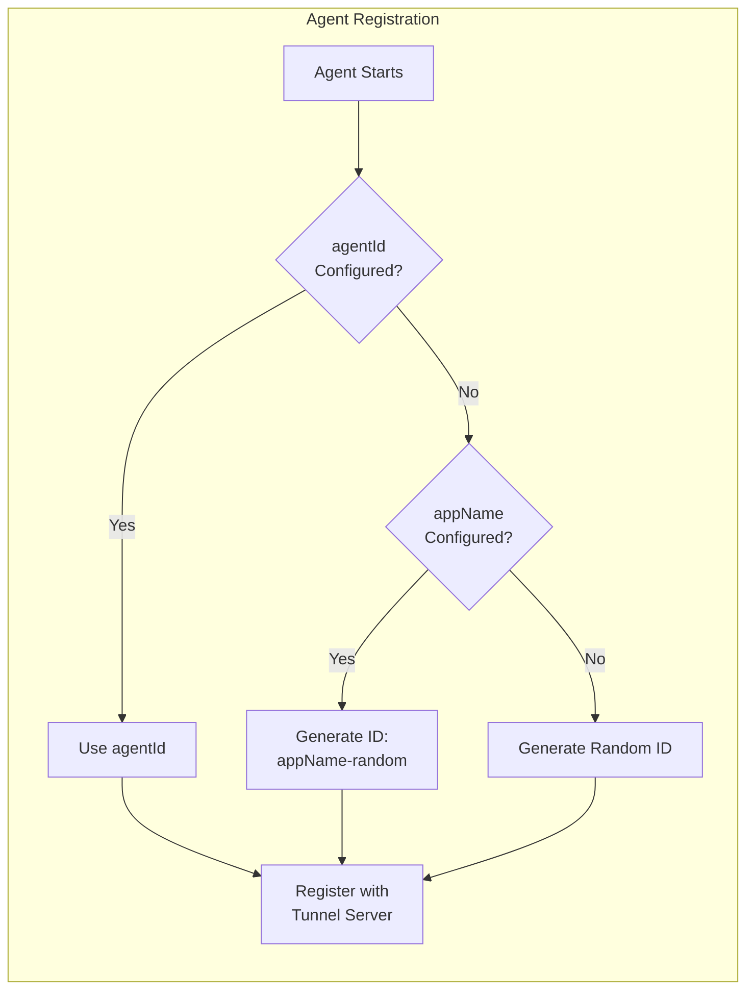
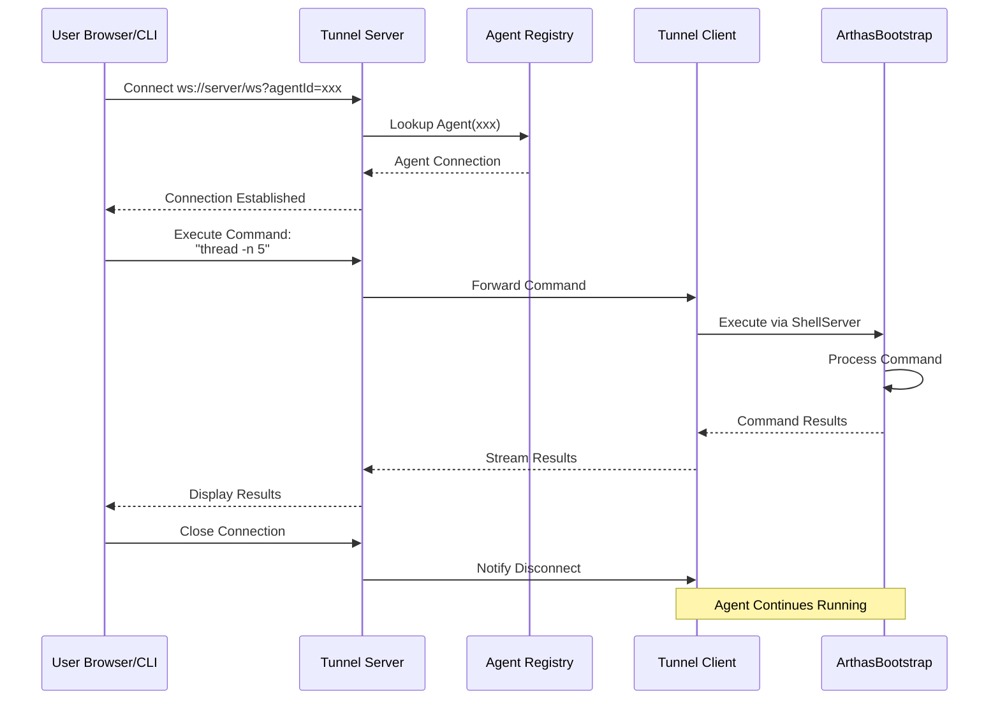
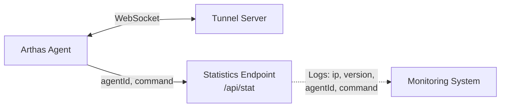
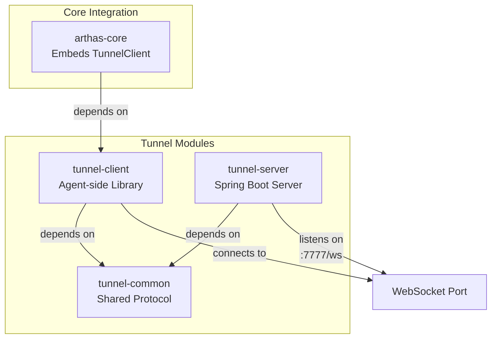

<!-- source: DeepWiki mcp.deepwiki.com · repo alibaba/arthas · page 5 Tunnel System · fetched 2026-10-29 -->

# Tunnel System

<details>
<summary>Relevant source files</summary>

The following files were used as context for generating this wiki page:

- [Dockerfile](Dockerfile)
- [Dockerfile-No-Jdk](Dockerfile-No-Jdk)
- [agent/pom.xml](agent/pom.xml)
- [agent/src/main/java/com/taobao/arthas/agent334/AgentBootstrap.java](agent/src/main/java/com/taobao/arthas/agent334/AgentBootstrap.java)
- [bin/as.sh](bin/as.sh)
- [boot/pom.xml](boot/pom.xml)
- [boot/src/main/java/com/taobao/arthas/boot/Bootstrap.java](boot/src/main/java/com/taobao/arthas/boot/Bootstrap.java)
- [client/pom.xml](client/pom.xml)
- [common/pom.xml](common/pom.xml)
- [core/pom.xml](core/pom.xml)
- [core/src/main/java/arthas.properties](core/src/main/java/arthas.properties)
- [core/src/main/java/com/taobao/arthas/core/Arthas.java](core/src/main/java/com/taobao/arthas/core/Arthas.java)
- [core/src/main/java/com/taobao/arthas/core/config/Configure.java](core/src/main/java/com/taobao/arthas/core/config/Configure.java)
- [core/src/main/java/com/taobao/arthas/core/mcp/ArthasMcpServer.java](core/src/main/java/com/taobao/arthas/core/mcp/ArthasMcpServer.java)
- [core/src/main/java/com/taobao/arthas/core/server/ArthasBootstrap.java](core/src/main/java/com/taobao/arthas/core/server/ArthasBootstrap.java)
- [core/src/main/java/com/taobao/arthas/core/shell/impl/ShellServerImpl.java](core/src/main/java/com/taobao/arthas/core/shell/impl/ShellServerImpl.java)
- [core/src/main/java/com/taobao/arthas/core/shell/session/impl/SessionManagerImpl.java](core/src/main/java/com/taobao/arthas/core/shell/session/impl/SessionManagerImpl.java)
- [core/src/main/java/com/taobao/arthas/core/shell/term/impl/http/api/ApiRequest.java](core/src/main/java/com/taobao/arthas/core/shell/term/impl/http/api/ApiRequest.java)
- [core/src/main/java/com/taobao/arthas/core/shell/term/impl/http/api/HttpApiHandler.java](core/src/main/java/com/taobao/arthas/core/shell/term/impl/http/api/HttpApiHandler.java)
- [core/src/main/java/com/taobao/arthas/core/util/UserStatUtil.java](core/src/main/java/com/taobao/arthas/core/util/UserStatUtil.java)
- [memorycompiler/pom.xml](memorycompiler/pom.xml)
- [packaging/pom.xml](packaging/pom.xml)
- [pom.xml](pom.xml)
- [site/pom.xml](site/pom.xml)
- [spy/pom.xml](spy/pom.xml)
- [testcase/pom.xml](testcase/pom.xml)
- [tunnel-client/pom.xml](tunnel-client/pom.xml)
- [tunnel-server/pom.xml](tunnel-server/pom.xml)
- [tunnel-server/src/main/java/com/alibaba/arthas/tunnel/server/app/web/StatController.java](tunnel-server/src/main/java/com/alibaba/arthas/tunnel/server/app/web/StatController.java)

</details>


The Tunnel System provides remote access to Arthas agents running in production environments. It enables users to connect to Arthas instances through a central tunnel server without requiring direct network access to the target JVM. This is particularly useful in cloud deployments, containerized environments, and scenarios where agents are behind firewalls or NAT.

For details on the Spring Boot-based tunnel server implementation, see [Tunnel Server Architecture](#5.1). For information on how Arthas agents integrate with the tunnel server, see [Tunnel Client Integration](#5.2). For authentication mechanisms, see [Authentication and Security](#5.3).

## Architecture Overview

The tunnel system consists of three main components: the tunnel server, tunnel clients embedded in Arthas agents, and user clients that connect through the tunnel server to access agents.



**Sources:** [tunnel-server/pom.xml:1-227](), [core/src/main/java/com/taobao/arthas/core/server/ArthasBootstrap.java:380-392](), [pom.xml:60-61,70]()

## Tunnel Client Initialization

When an Arthas agent starts, it checks for tunnel server configuration and initializes the `TunnelClient` if configured. The client maintains a persistent WebSocket connection to the tunnel server for the lifetime of the agent.



**Sources:** [core/src/main/java/com/taobao/arthas/core/server/ArthasBootstrap.java:380-392](), [core/src/main/java/com/taobao/arthas/core/config/Configure.java:32-33,143-157]()

## Configuration Options

The tunnel system supports multiple configuration methods with the following priority: command-line arguments > environment variables > System properties > arthas.properties file.

### Command-Line Configuration

| Option | Description | Example |
|--------|-------------|---------|
| `--tunnel-server` | WebSocket URL of tunnel server | `ws://192.168.10.11:7777/ws` |
| `--agent-id` | Unique identifier for this agent | `bvDOe8XbTM2pQWjF4cfw` |
| `--app-name` | Application name (used if agent-id not set) | `demoapp` |

### Properties File Configuration

```properties
# Tunnel server WebSocket endpoint
arthas.tunnelServer=ws://127.0.0.1:7777/ws

# Unique agent identifier
arthas.agentId=mmmmmmyiddddd

# Application name (alternative to agentId)
arthas.appName=demoapp
```

**Sources:** [core/src/main/java/arthas.properties:18-20](), [bin/as.sh:141-144,474-475](), [boot/src/main/java/com/taobao/arthas/boot/Bootstrap.java:266-282,570-581]()

## Agent Identification

Agents are identified by either an explicit `agentId` or an auto-generated ID based on `appName`. When multiple agents use the same `appName`, users can select which specific instance to connect to through the tunnel server's web interface.



**Sources:** [core/src/main/java/com/taobao/arthas/core/config/Configure.java:48-56](), [boot/src/main/java/com/taobao/arthas/boot/Bootstrap.java:272-276,556-577]()

## Connection Flow

The tunnel system establishes bidirectional communication between users and agents through WebSocket connections. The tunnel server acts as a proxy, routing messages based on agent IDs.

### User-to-Agent Command Flow



**Sources:** [tunnel-server/pom.xml:53-60](), [core/src/main/java/com/taobao/arthas/core/server/ArthasBootstrap.java:380-392]()

## Tunnel Server Dependencies

The tunnel server is implemented as a standalone Spring Boot application with the following core dependencies:

| Dependency | Purpose |
|------------|---------|
| `spring-boot-starter-webflux` | Reactive WebSocket support for agent connections |
| `spring-boot-starter-web` | HTTP endpoints for web UI and API |
| `spring-boot-starter-data-redis` | Agent registry storage (production) |
| `caffeine` | In-memory cache for agent registry (development) |
| `spring-boot-starter-security` | Authentication and authorization |
| `spring-boot-starter-actuator` | Health checks and metrics |

**Sources:** [tunnel-server/pom.xml:53-78]()

## Usage Statistics Integration

When agents connect through the tunnel server, they can report usage statistics to a configurable endpoint. This is useful for monitoring Arthas adoption and command usage in production environments.



The stat URL is configured via `--stat-url` or `arthas.statUrl` property. The endpoint receives agent information and executed commands for telemetry purposes.

**Sources:** [tunnel-server/src/main/java/com/alibaba/arthas/tunnel/server/app/web/StatController.java:1-39](), [core/src/main/java/com/taobao/arthas/core/util/UserStatUtil.java:36-73](), [core/src/main/java/com/taobao/arthas/core/config/Configure.java:55-59,159-165]()

## Module Structure

The tunnel system is organized into three Maven modules:



**Sources:** [pom.xml:60-61,70](), [tunnel-client/pom.xml:1-62](), [tunnel-server/pom.xml:1-227](), [core/pom.xml:149-152]()

## Error Handling

When the tunnel client fails to connect to the tunnel server, the agent continues to function normally with local-only access. The connection failure is logged but does not prevent Arthas from starting.

```java
// From ArthasBootstrap.java:380-392
try {
    if (configure.getTunnelServer() != null) {
        tunnelClient = new TunnelClient();
        // ... configuration ...
        ChannelFuture channelFuture = tunnelClient.start();
        channelFuture.await(10, TimeUnit.SECONDS);
    }
} catch (Throwable t) {
    logger().error("start tunnel client error", t);
}
// Arthas continues to initialize
```

This design ensures that tunnel connectivity issues do not impact the core diagnostic capabilities of Arthas agents.

**Sources:** [core/src/main/java/com/taobao/arthas/core/server/ArthasBootstrap.java:380-392]()

---

