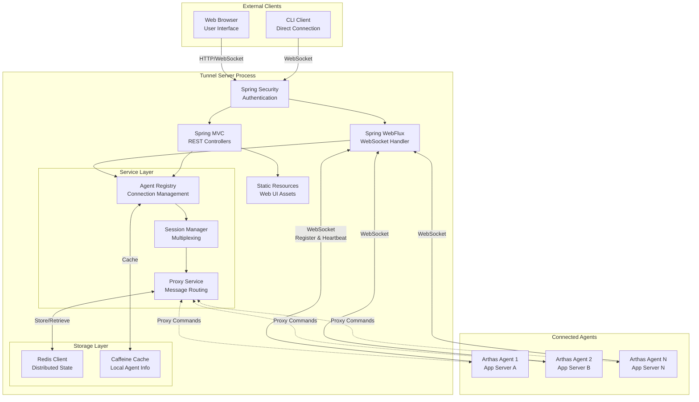
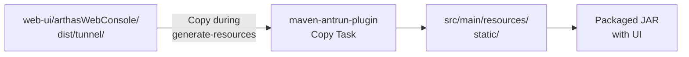
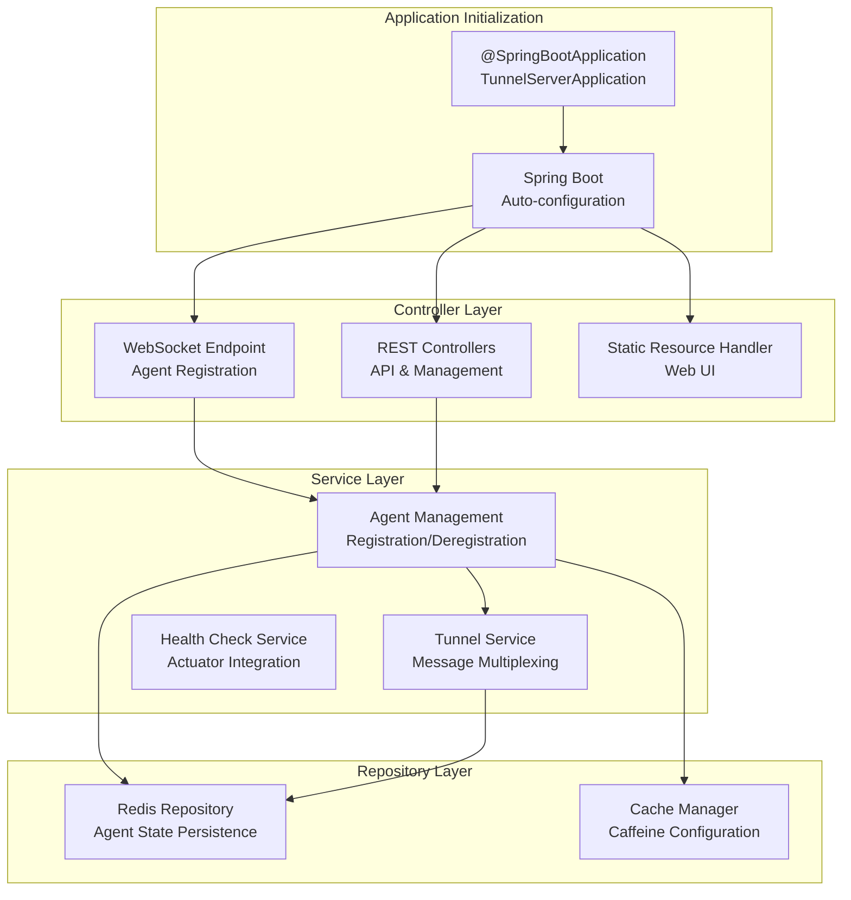
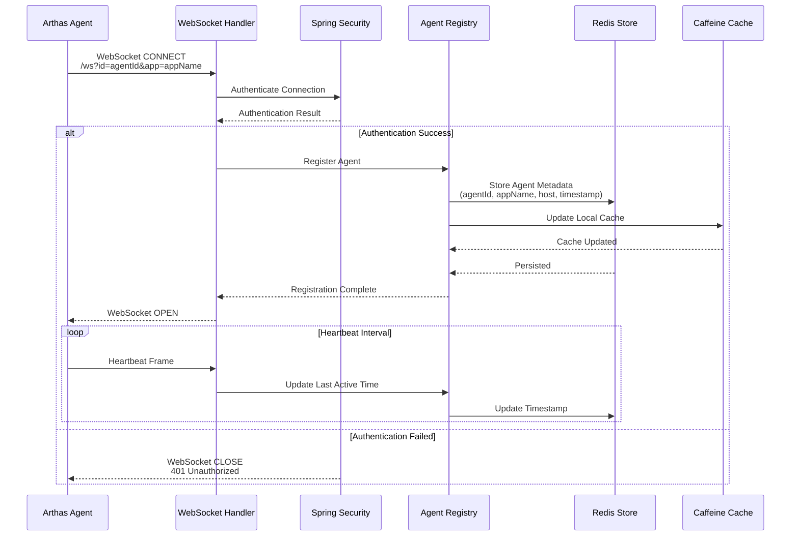
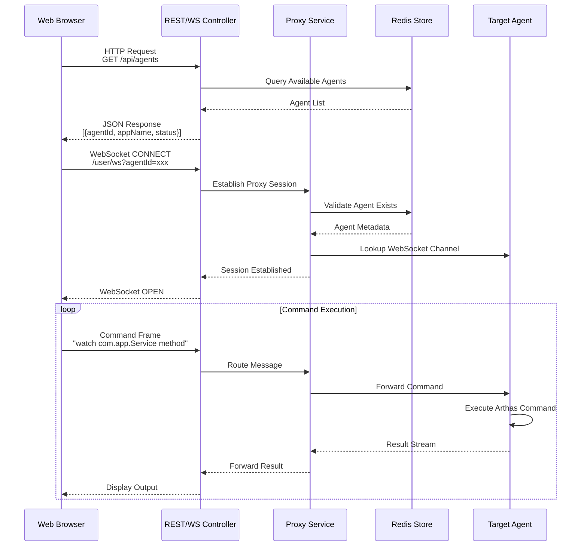
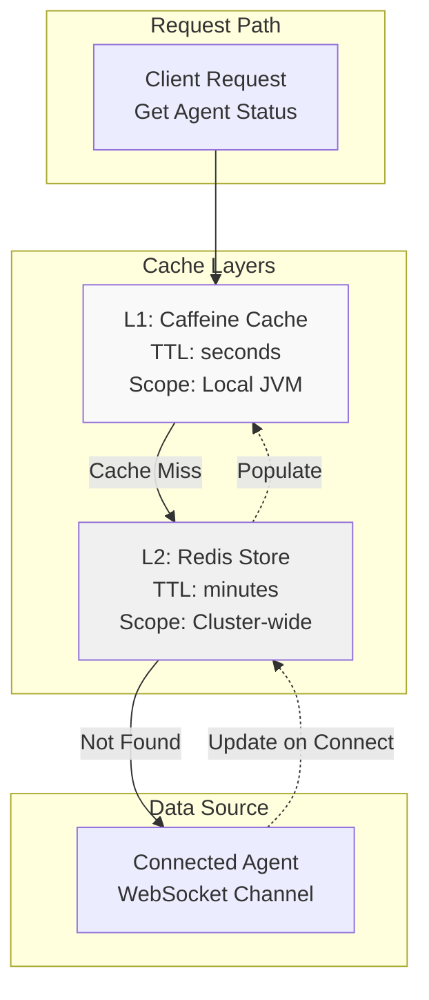
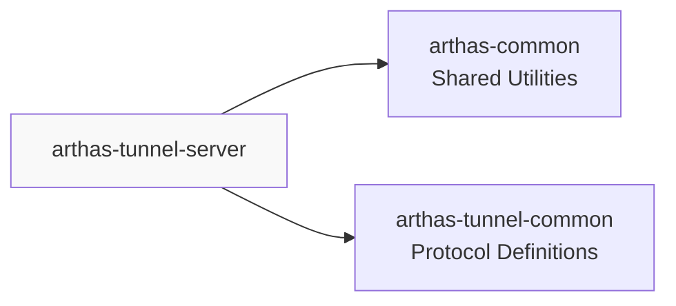
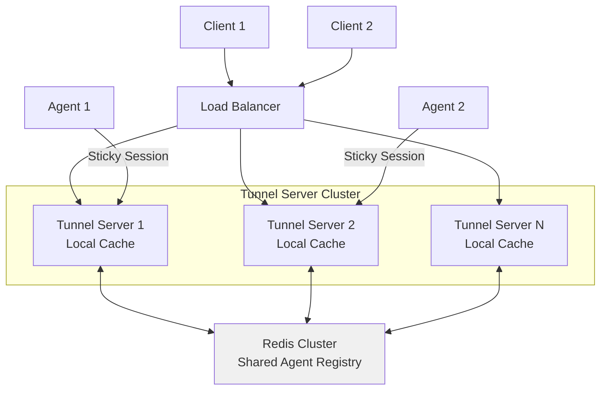

<!-- source: DeepWiki mcp.deepwiki.com · repo alibaba/arthas · page 5.1 Tunnel Server Architecture · fetched 2026-10-29 -->

# Tunnel Server Architecture

<details>
<summary>Relevant source files</summary>

The following files were used as context for generating this wiki page:

- [agent/pom.xml](agent/pom.xml)
- [boot/pom.xml](boot/pom.xml)
- [client/pom.xml](client/pom.xml)
- [common/pom.xml](common/pom.xml)
- [core/pom.xml](core/pom.xml)
- [memorycompiler/pom.xml](memorycompiler/pom.xml)
- [packaging/pom.xml](packaging/pom.xml)
- [pom.xml](pom.xml)
- [site/pom.xml](site/pom.xml)
- [spy/pom.xml](spy/pom.xml)
- [testcase/pom.xml](testcase/pom.xml)
- [tunnel-client/pom.xml](tunnel-client/pom.xml)
- [tunnel-server/pom.xml](tunnel-server/pom.xml)

</details>


The Tunnel Server is a centralized Spring Boot application that acts as a WebSocket proxy and registry for remote Arthas agent access. It enables users to connect to Arthas agents running in distributed environments without direct network access to target JVMs.

**Scope**: This document covers the architecture, components, and communication patterns of the tunnel server itself. For information about how Arthas agents connect to the tunnel server, see [Tunnel Client Integration](#5.2). For authentication mechanisms, see [Authentication and Security](#5.3).

---

## Purpose and Design Goals

The Tunnel Server solves the problem of accessing Arthas agents in production environments where:
- Target JVMs are behind firewalls or NAT
- Direct Telnet/HTTP access to Arthas ports (3658/8563) is not feasible
- Multiple agents across distributed systems need centralized management
- Web-based access is preferred over command-line tools

The server acts as a stateful intermediary, maintaining WebSocket connections to registered agents and proxying user commands through these persistent connections.

**Sources**: [tunnel-server/pom.xml:1-227](), high-level architecture diagrams

---

## Technology Stack

The Tunnel Server is built on Spring Boot 2.7.18 with the following key technologies:

| Technology | Purpose | Configuration |
|------------|---------|---------------|
| **Spring Boot WebFlux** | Reactive WebSocket handling | [tunnel-server/pom.xml:55-56]() |
| **Spring Boot Web (MVC)** | REST API endpoints | [tunnel-server/pom.xml:58-60]() |
| **Spring Data Redis** | Distributed state storage | [tunnel-server/pom.xml:67-69]() |
| **Caffeine Cache** | Local in-memory caching | [tunnel-server/pom.xml:70-73]() |
| **Spring Security** | Authentication/authorization | [tunnel-server/pom.xml:76-78]() |
| **Netty** | Low-level WebSocket transport | [tunnel-server/pom.xml:25-30]() (via BOM) |
| **Spring Actuator** | Health checks and metrics | [tunnel-server/pom.xml:62-64]() |

The server runs on Java 8+ (compile target 1.8) and supports embedded Redis for development via `embedded-redis` dependency [tunnel-server/pom.xml:85-95]().

**Sources**: [tunnel-server/pom.xml:14-135](), [pom.xml:89]()

---

## Architectural Overview



**Sources**: [tunnel-server/pom.xml:1-227](), high-level architecture diagrams

---

## Module Structure and Build Configuration

The Tunnel Server is defined as the `arthas-tunnel-server` Maven module with artifact ID `com.taobao.arthas:arthas-tunnel-server`.

### Build Artifacts

The build produces two JAR files via the Spring Boot Maven Plugin:

1. **arthas-tunnel-server.jar** - Standard library JAR with classes only
2. **arthas-tunnel-server-fatjar.jar** - Executable fat JAR with embedded dependencies

The fat JAR is created with the `repackage` goal and marked as executable [tunnel-server/pom.xml:195-213]().

### Web UI Integration

The build process integrates the web console UI through Maven Antrun Plugin:



The Antrun plugin copies pre-built Vue.js assets from the `web-ui` module into `src/main/resources/static/` during the `generate-resources` phase [tunnel-server/pom.xml:148-178](). This ensures the web console is served as static resources by Spring Boot.

**Sources**: [tunnel-server/pom.xml:137-224](), [tunnel-server/pom.xml:195-213]()

---

## Core Components

### Spring Boot Application Structure



The application follows standard Spring Boot layered architecture with controllers handling HTTP/WebSocket requests, services containing business logic, and repositories managing state persistence.

**Sources**: [tunnel-server/pom.xml:54-78]()

---

## Communication Flow

### Agent Registration Flow



Agents establish persistent WebSocket connections and provide their unique ID and application name as query parameters. The tunnel server authenticates the connection, stores agent metadata in Redis for cluster-wide visibility, and caches it locally in Caffeine for fast lookups.

**Sources**: [tunnel-server/pom.xml:55-56](), [tunnel-server/pom.xml:67-73]()

### Client Command Proxying Flow



User clients connect to a separate WebSocket endpoint, specifying the target agent ID. The proxy service looks up the agent's WebSocket channel and establishes a bidirectional message tunnel between the user and agent.

**Sources**: [tunnel-server/pom.xml:55-60]()

---

## State Management Architecture

The Tunnel Server uses a two-tier caching strategy to balance performance and consistency:

### Redis - Distributed State Store

**Purpose**: Persistent, cluster-wide agent registry

**Stored Data**:
- Agent connection metadata (ID, application name, hostname, connection time)
- Agent status (online/offline)
- Last heartbeat timestamp
- Active session mappings

**Configuration**: Spring Boot Redis autoconfiguration via `spring-boot-starter-data-redis` [tunnel-server/pom.xml:67-69]()

### Caffeine - Local In-Memory Cache

**Purpose**: Fast lookups for frequently accessed agent information

**Cached Data**:
- Active agent connection references
- WebSocket channel mappings
- Recent agent status

**Configuration**: Caffeine dependency for high-performance local caching [tunnel-server/pom.xml:70-73]()

### Caching Strategy Diagram



This architecture ensures:
- **Low latency**: Most requests served from Caffeine cache (microseconds)
- **High availability**: Redis provides shared state for multiple tunnel server instances
- **Consistency**: Cache invalidation on agent disconnect/timeout

**Sources**: [tunnel-server/pom.xml:67-73]()

---

## Security and Authentication

The Tunnel Server integrates Spring Security for access control [tunnel-server/pom.xml:76-78](). Authentication mechanisms include:

1. **HTTP Basic Authentication**: For REST API access
2. **WebSocket Connection Authentication**: Validates agent and client connections
3. **Local Connection Bypass**: Allows localhost connections without authentication (configurable)

Detailed authentication flows and configuration options are documented in [Authentication and Security](#5.3).

**Sources**: [tunnel-server/pom.xml:76-78]()

---

## Monitoring and Health Checks

Spring Boot Actuator provides production-ready features [tunnel-server/pom.xml:62-64]():

| Endpoint | Purpose | Exposed Data |
|----------|---------|--------------|
| `/actuator/health` | Service health status | Application status, Redis connectivity, agent count |
| `/actuator/info` | Application metadata | Version, build info |
| `/actuator/metrics` | Runtime metrics | JVM stats, connection counts, request rates |

These endpoints enable:
- Load balancer health checks
- Monitoring system integration (Prometheus, Grafana)
- Operational visibility into tunnel server performance

**Sources**: [tunnel-server/pom.xml:62-64]()

---

## Deployment Configuration

### Packaging

The Tunnel Server is packaged using the Spring Boot Maven Plugin with the `repackage` goal [tunnel-server/pom.xml:203-211]():

```xml
<execution>
    <id>repackage</id>
    <goals>
        <goal>repackage</goal>
    </goals>
    <configuration>
        <classifier>fatjar</classifier>
    </configuration>
</execution>
```

The resulting fat JAR (`arthas-tunnel-server-fatjar.jar`) is marked as executable [tunnel-server/pom.xml:199-201](), enabling direct execution:

```bash
java -jar arthas-tunnel-server-fatjar.jar
```

### Embedded Redis for Development

For local development and testing, the server includes `embedded-redis` [tunnel-server/pom.xml:85-95](), which automatically starts an in-memory Redis instance. Production deployments should configure external Redis via Spring Boot properties.

### Build-Time Web UI Integration

The Maven build integrates the web console UI through a two-phase process:

1. **Generate Phase**: Antrun plugin copies Vue.js assets from `../web-ui/arthasWebConsole/dist/tunnel/` to `src/main/resources/static/` [tunnel-server/pom.xml:148-163]()
2. **Package Phase**: Spring Boot plugin includes these static resources in the fat JAR

The clean phase removes these copied resources to ensure fresh builds [tunnel-server/pom.xml:164-176]().

**Sources**: [tunnel-server/pom.xml:137-224](), [tunnel-server/pom.xml:148-178]()

---

## Module Dependencies

The Tunnel Server depends on the following Arthas modules:



- **arthas-common**: Core utility classes and shared code [tunnel-server/pom.xml:44-47]()
- **arthas-tunnel-common**: Protocol message definitions and WebSocket frame structures shared between tunnel-server and tunnel-client [tunnel-server/pom.xml:49-52]()

These dependencies establish the communication contract between agents (using tunnel-client) and the tunnel server.

**Sources**: [tunnel-server/pom.xml:43-52](), [pom.xml:60-61]()

---

## Runtime Characteristics

### Concurrent Connection Handling

The server uses Spring WebFlux's reactive programming model for handling concurrent WebSocket connections [tunnel-server/pom.xml:55-56](). This enables:

- **Non-blocking I/O**: Thousands of concurrent agent connections on a single server instance
- **Backpressure handling**: Flow control for command result streaming
- **Event-driven processing**: Efficient handling of intermittent agent heartbeats

### Clustering Support

Multiple tunnel server instances can run in active-active mode by sharing state through Redis:



**Key Requirements for Clustering**:
- WebSocket connections must use sticky sessions (agent connections persist to one server)
- Redis must be configured for high availability (Redis Sentinel/Cluster)
- Load balancer must support WebSocket upgrades

**Sources**: [tunnel-server/pom.xml:67-69]()

---

## Configuration Properties

The Tunnel Server is configured via Spring Boot's standard `application.properties` or `application.yml`:

| Property Category | Purpose | Example Properties |
|------------------|---------|-------------------|
| `server.*` | HTTP/WebSocket server configuration | `server.port`, `server.address` |
| `spring.redis.*` | Redis connection settings | `spring.redis.host`, `spring.redis.port` |
| `spring.security.*` | Authentication configuration | `spring.security.user.name`, `spring.security.user.password` |
| `arthas.tunnel.*` | Tunnel-specific settings (custom) | Agent timeout, session limits |

Detailed configuration options are covered in [Configuration Options](#8.3).

**Sources**: [tunnel-server/pom.xml:54-78]()

---

## Central Publishing Exclusion

The Tunnel Server module is excluded from Maven Central publishing via plugin configuration [tunnel-server/pom.xml:216-222]():

```xml
<plugin>
    <groupId>org.sonatype.central</groupId>
    <artifactId>central-publishing-maven-plugin</artifactId>
    <configuration>
        <skipPublishing>true</skipPublishing>
    </configuration>
</plugin>
```

This is because the tunnel server is a deployable application rather than a reusable library. Users deploy the pre-built fat JAR from GitHub Releases rather than depending on it as a Maven artifact.

**Sources**: [tunnel-server/pom.xml:216-222]()

---

