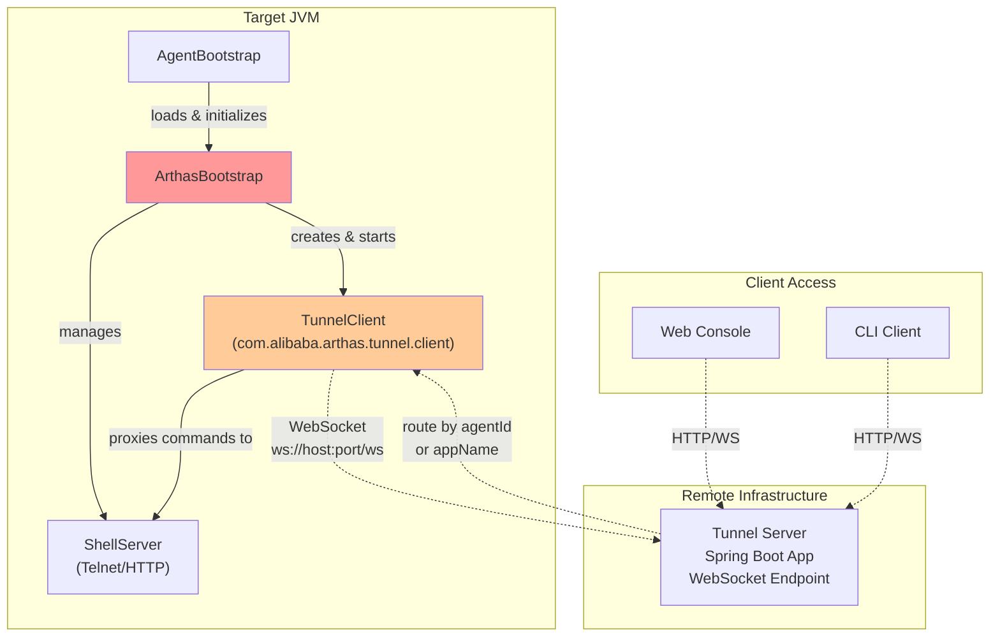
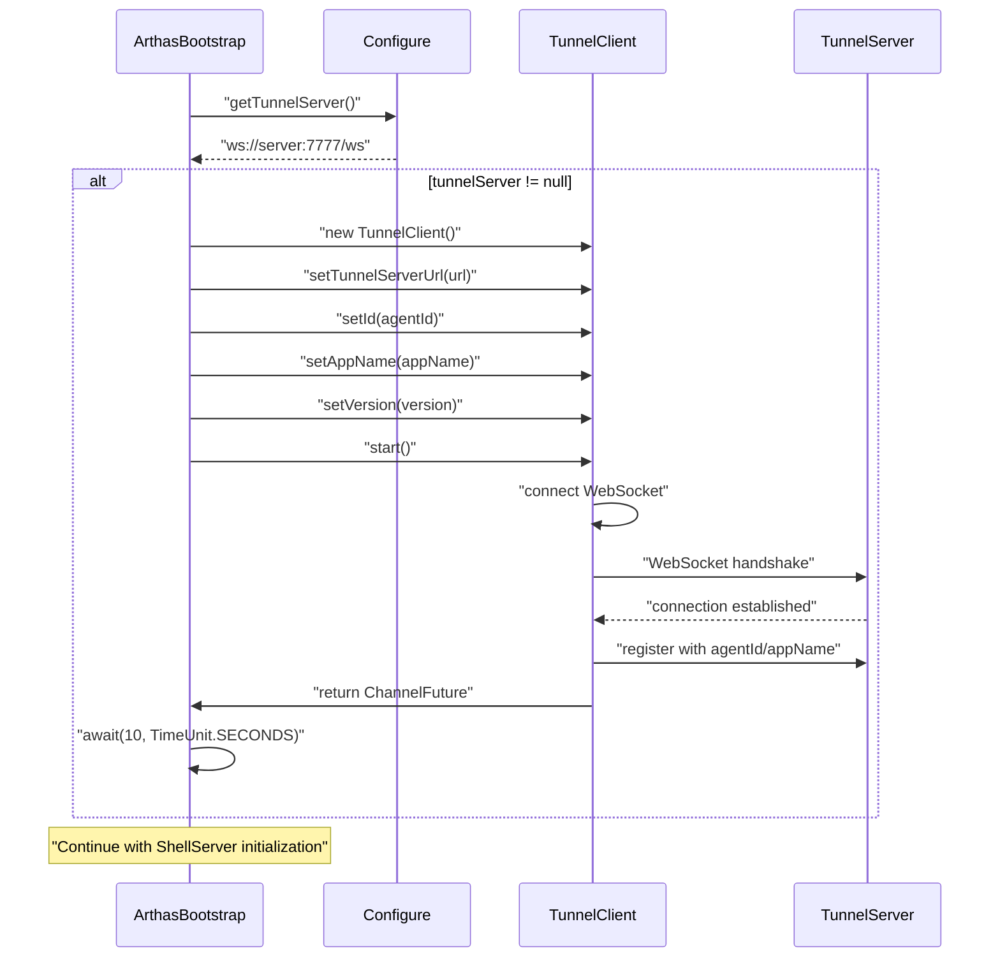
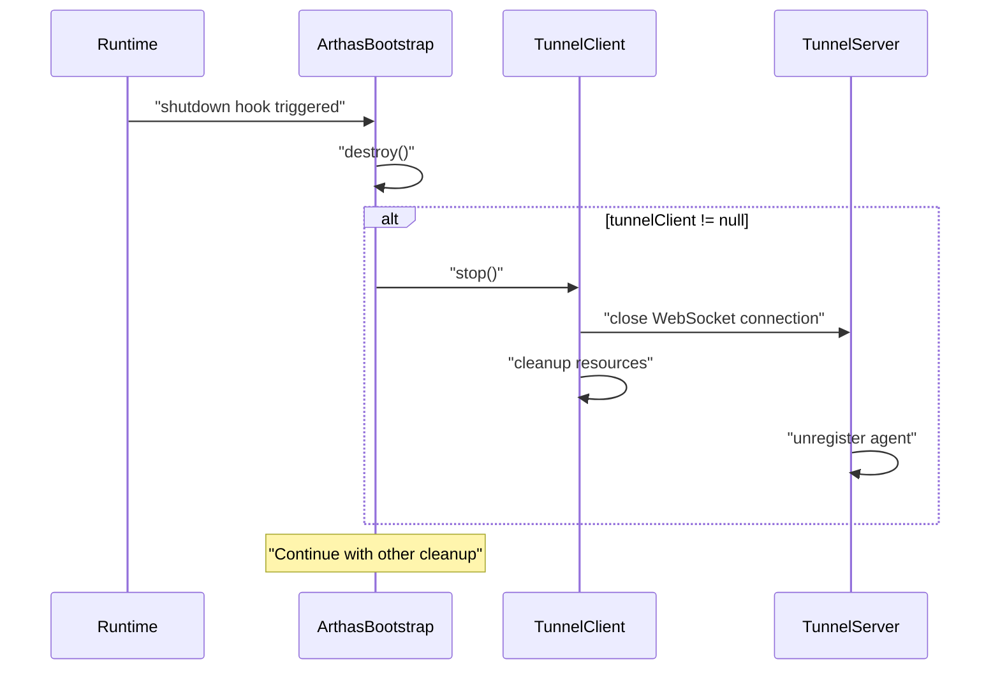
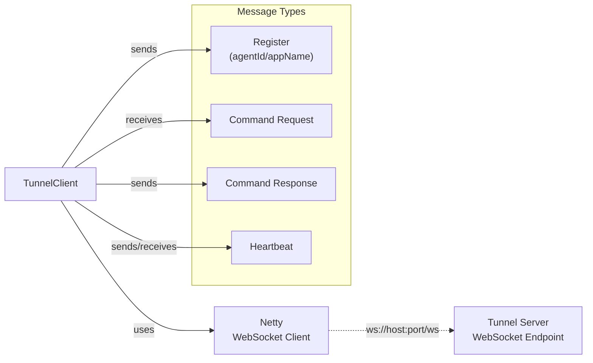
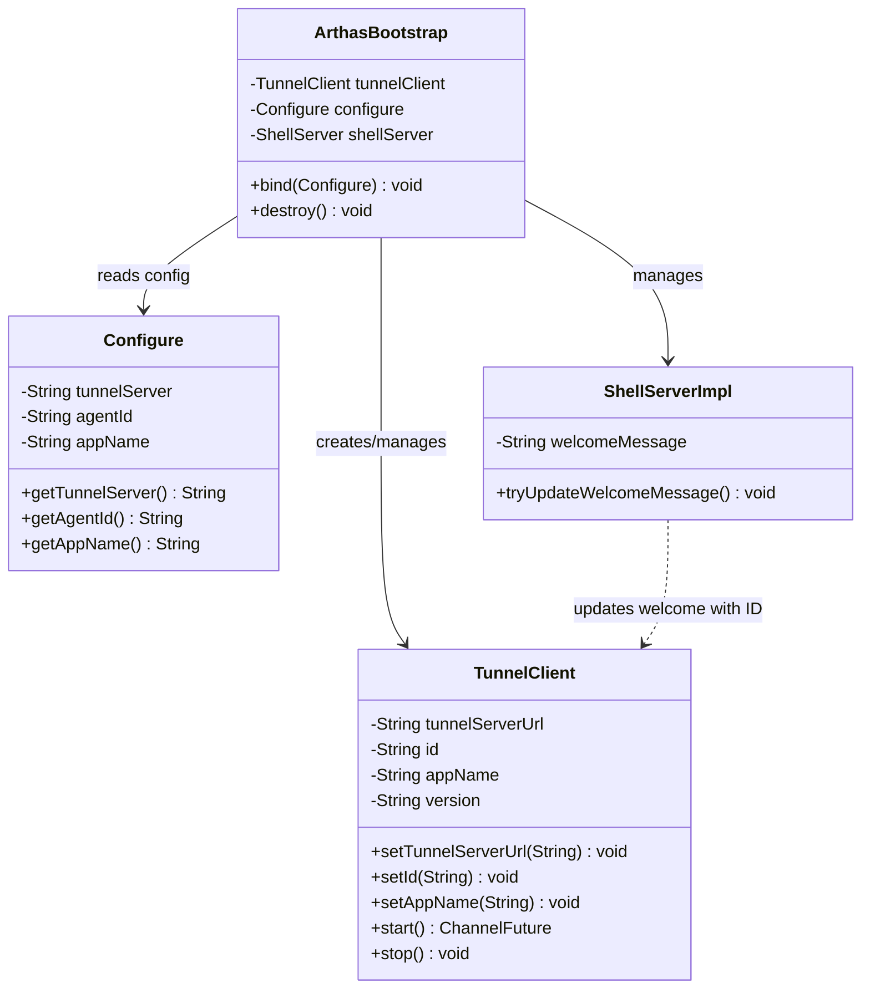

<!-- source: DeepWiki mcp.deepwiki.com · repo alibaba/arthas · page 5.2 Tunnel Client Integration · fetched 2026-10-29 -->

# Tunnel Client Integration

<details>
<summary>Relevant source files</summary>

The following files were used as context for generating this wiki page:

- [Dockerfile](Dockerfile)
- [Dockerfile-No-Jdk](Dockerfile-No-Jdk)
- [agent/pom.xml](agent/pom.xml)
- [agent/src/main/java/com/taobao/arthas/agent334/AgentBootstrap.java](agent/src/main/java/com/taobao/arthas/agent334/AgentBootstrap.java)
- [bin/as.sh](bin/as.sh)
- [boot/pom.xml](boot/pom.xml)
- [boot/src/main/java/com/taobao/arthas/boot/Bootstrap.java](boot/src/main/java/com/taobao/arthas/boot/Bootstrap.java)
- [client/pom.xml](client/pom.xml)
- [common/pom.xml](common/pom.xml)
- [core/pom.xml](core/pom.xml)
- [core/src/main/java/arthas.properties](core/src/main/java/arthas.properties)
- [core/src/main/java/com/taobao/arthas/core/Arthas.java](core/src/main/java/com/taobao/arthas/core/Arthas.java)
- [core/src/main/java/com/taobao/arthas/core/config/Configure.java](core/src/main/java/com/taobao/arthas/core/config/Configure.java)
- [core/src/main/java/com/taobao/arthas/core/mcp/ArthasMcpServer.java](core/src/main/java/com/taobao/arthas/core/mcp/ArthasMcpServer.java)
- [core/src/main/java/com/taobao/arthas/core/server/ArthasBootstrap.java](core/src/main/java/com/taobao/arthas/core/server/ArthasBootstrap.java)
- [core/src/main/java/com/taobao/arthas/core/shell/impl/ShellServerImpl.java](core/src/main/java/com/taobao/arthas/core/shell/impl/ShellServerImpl.java)
- [core/src/main/java/com/taobao/arthas/core/shell/session/impl/SessionManagerImpl.java](core/src/main/java/com/taobao/arthas/core/shell/session/impl/SessionManagerImpl.java)
- [core/src/main/java/com/taobao/arthas/core/shell/term/impl/http/api/ApiRequest.java](core/src/main/java/com/taobao/arthas/core/shell/term/impl/http/api/ApiRequest.java)
- [core/src/main/java/com/taobao/arthas/core/shell/term/impl/http/api/HttpApiHandler.java](core/src/main/java/com/taobao/arthas/core/shell/term/impl/http/api/HttpApiHandler.java)
- [core/src/main/java/com/taobao/arthas/core/util/UserStatUtil.java](core/src/main/java/com/taobao/arthas/core/util/UserStatUtil.java)
- [memorycompiler/pom.xml](memorycompiler/pom.xml)
- [packaging/pom.xml](packaging/pom.xml)
- [pom.xml](pom.xml)
- [site/pom.xml](site/pom.xml)
- [spy/pom.xml](spy/pom.xml)
- [testcase/pom.xml](testcase/pom.xml)
- [tunnel-client/pom.xml](tunnel-client/pom.xml)
- [tunnel-server/pom.xml](tunnel-server/pom.xml)
- [tunnel-server/src/main/java/com/alibaba/arthas/tunnel/server/app/web/StatController.java](tunnel-server/src/main/java/com/alibaba/arthas/tunnel/server/app/web/StatController.java)

</details>


## Purpose and Scope

This document explains how Arthas agents integrate with the tunnel server via the `TunnelClient` component, enabling remote access to Arthas instances through a centralized proxy. This includes the client-side registration, WebSocket communication, and lifecycle management within the agent.

For information about the tunnel server implementation and architecture, see [5.1](#5.1). For authentication and security mechanisms, see [5.3](#5.3).

---

## Overview

The tunnel client is an embedded component within `arthas-core` that enables agents to register with a remote tunnel server. Once registered, clients can connect to the agent through the tunnel server without requiring direct network access to the target JVM. This is particularly useful in containerized or firewalled environments.

**Key Responsibilities:**
- Establish and maintain WebSocket connection to tunnel server
- Register agent with unique identifier or application name
- Proxy bidirectional communication between tunnel server and local Arthas server
- Handle reconnection and heartbeat logic

---

## Architecture and Integration Points



**Diagram: Tunnel Client Integration in Agent Architecture**

Sources: [core/src/main/java/com/taobao/arthas/core/server/ArthasBootstrap.java:30-31](), [core/src/main/java/com/taobao/arthas/core/server/ArthasBootstrap.java:381-392]()

---

## Configuration

The tunnel client is configured through command-line arguments or the `arthas.properties` file. Configuration is processed during agent attachment.

### Configuration Parameters

| Parameter | Type | Description | Default |
|-----------|------|-------------|---------|
| `tunnelServer` | String | WebSocket URL of tunnel server (e.g., `ws://192.168.10.11:7777/ws`) | null (disabled) |
| `agentId` | String | Unique identifier for this agent instance | Auto-generated UUID |
| `appName` | String | Application name for agent grouping | From system properties |

### Configuration Sources (Priority Order)

1. **Command-line arguments** to `arthas-boot.jar` or `as.sh`
2. **System environment variables** 
3. **System properties**
4. **arthas.properties** file

```properties
# Example arthas.properties configuration
arthas.appName=demoapp
arthas.tunnelServer=ws://127.0.0.1:7777/ws
arthas.agentId=mmmmmmyiddddd
```

Sources: [core/src/main/java/arthas.properties:18-20](), [core/src/main/java/com/taobao/arthas/core/config/Configure.java:32-33]()

### Configuration Flow

```mermaid
sequenceDiagram
    participant User
    participant Bootstrap["Bootstrap<br/>(arthas-boot)"]
    participant Arthas["Arthas<br/>(arthas-core)"]
    participant ArthasBootstrap
    participant Configure
    
    User->>Bootstrap: "java -jar arthas-boot.jar<br/>--tunnel-server ws://server/ws<br/>--agent-id myid"
    Bootstrap->>Bootstrap: "parse arguments"
    Bootstrap->>Arthas: "attach with args:<br/>tunnelServer, agentId"
    Arthas->>ArthasBootstrap: "configure = Configure.toConfigure(args)"
    ArthasBootstrap->>Configure: "getTunnelServer(), getAgentId()"
    Configure-->>ArthasBootstrap: "configuration values"
```

**Diagram: Configuration Parameter Flow**

Sources: [boot/src/main/java/com/taobao/arthas/boot/Bootstrap.java:121-122](), [boot/src/main/java/com/taobao/arthas/boot/Bootstrap.java:570-580](), [core/src/main/java/com/taobao/arthas/core/Arthas.java:45-46]()

---

## Initialization and Lifecycle

### Startup Sequence

The `TunnelClient` is initialized during `ArthasBootstrap.bind()` if `tunnelServer` is configured:



**Diagram: Tunnel Client Initialization**

Sources: [core/src/main/java/com/taobao/arthas/core/server/ArthasBootstrap.java:381-392]()

### Code Reference: Initialization in ArthasBootstrap

The tunnel client is created and started in the `bind()` method:

[core/src/main/java/com/taobao/arthas/core/server/ArthasBootstrap.java:380-392]()

Key steps:
1. Check if `tunnelServer` is configured (line 381)
2. Create `TunnelClient` instance (line 382)
3. Set application metadata (lines 383-386)
4. Start connection with 10-second timeout (lines 387-388)
5. Log errors but continue if connection fails (lines 390-392)

### Shutdown and Cleanup

During Arthas shutdown, the tunnel client is properly closed:

[core/src/main/java/com/taobao/arthas/core/server/ArthasBootstrap.java:555-560]()



**Diagram: Tunnel Client Shutdown**

Sources: [core/src/main/java/com/taobao/arthas/core/server/ArthasBootstrap.java:555-560]()

---

## Agent Registration

Agents register with the tunnel server using either an explicit `agentId` or derived from `appName`:

### Registration Strategies

| Strategy | When Used | Identifier |
|----------|-----------|------------|
| Explicit Agent ID | User provides `--agent-id` parameter | User-specified ID (e.g., `bvDOe8XbTM2pQWjF4cfw`) |
| Application Name | User provides `--app-name` parameter | Generated ID prefixed with app name |
| Auto-generated | No agent ID or app name provided | UUID-based identifier |

### Agent ID Resolution

The agent ID is resolved with the following priority:

[core/src/main/java/com/taobao/arthas/core/server/ArthasBootstrap.java:383-386]()

1. **Explicit agentId**: Set via `configure.getAgentId()`
2. **Application name**: Set via `configure.getAppName()`, which checks:
   - `project.name` system property
   - `spring.application.name` system property
   
Sources: [core/src/main/java/com/taobao/arthas/core/server/ArthasBootstrap.java:374-378]()

---

## Communication Protocol

The tunnel client uses WebSocket for bidirectional communication with the tunnel server.

### WebSocket Connection



**Diagram: WebSocket Communication**

### Dependencies

The tunnel client module depends on Netty for WebSocket implementation:

[tunnel-client/pom.xml:43-58]()

Key dependencies:
- `netty-buffer` - ByteBuf operations
- `netty-handler` - WebSocket handlers
- `netty-transport` - Network transport
- `netty-codec-http` - HTTP/WebSocket codec

Sources: [tunnel-client/pom.xml:14-24](), [tunnel-client/pom.xml:43-58]()

---

## Command-Line Usage Examples

### Basic Tunnel Connection

```bash
# Connect to tunnel server with auto-generated agent ID
./as.sh --tunnel-server 'ws://192.168.10.11:7777/ws' <pid>
```

### With Application Name

```bash
# Register as part of application group
./as.sh --tunnel-server 'ws://192.168.10.11:7777/ws' \
        --app-name demoapp \
        <pid>
```

### With Explicit Agent ID

```bash
# Use specific agent identifier
./as.sh --tunnel-server 'ws://192.168.10.11:7777/ws' \
        --agent-id bvDOe8XbTM2pQWjF4cfw \
        <pid>
```

Sources: [bin/as.sh:474-475](), [boot/src/main/java/com/taobao/arthas/boot/Bootstrap.java:52-53]()

---

## Integration with ArthasBootstrap

### Class Relationships



**Diagram: Tunnel Client Class Integration**

Sources: [core/src/main/java/com/taobao/arthas/core/server/ArthasBootstrap.java:103-115](), [core/src/main/java/com/taobao/arthas/core/config/Configure.java:32-33]()

### Welcome Message Update

When the tunnel client successfully connects and receives its agent ID, the welcome message is updated to display it:

[core/src/main/java/com/taobao/arthas/core/shell/impl/ShellServerImpl.java:107-117]()

This allows users connecting via telnet or HTTP to see the agent ID immediately after connection.

Sources: [core/src/main/java/com/taobao/arthas/core/shell/impl/ShellServerImpl.java:107-117]()

---

## Error Handling

### Connection Failures

If the tunnel client fails to connect, Arthas logs an error but continues startup:

[core/src/main/java/com/taobao/arthas/core/server/ArthasBootstrap.java:390-392]()

This ensures that:
- Local access (telnet/HTTP) remains available even if tunnel server is unreachable
- The agent can still function in standalone mode
- Operators can diagnose issues without requiring remote access

### Timeout Configuration

The tunnel client connection has a 10-second timeout:

[core/src/main/java/com/taobao/arthas/core/server/ArthasBootstrap.java:388]()

If the connection does not establish within this period, the agent continues initialization without tunnel connectivity.

---

## Module Dependencies

The tunnel client is integrated as a Maven dependency in `arthas-core`:

[core/pom.xml:149-152]()

This dependency structure ensures:
- Clean separation between tunnel client and core functionality
- Shared common utilities via `tunnel-common` module
- Reusable WebSocket client implementation

The dependency chain:
```
arthas-core
  └── arthas-tunnel-client
        ├── arthas-tunnel-common
        ├── arthas-common
        └── netty-* (WebSocket support)
```

Sources: [pom.xml:60-61](), [core/pom.xml:149-152](), [tunnel-client/pom.xml:15-24]()

---

## Summary

The tunnel client integration enables remote Arthas access through a centralized proxy server:

**Key Integration Points:**
- `TunnelClient` class from `arthas-tunnel-client` module
- Initialization in `ArthasBootstrap.bind()` when `tunnelServer` is configured
- Configuration via command-line arguments or `arthas.properties`
- WebSocket-based communication using Netty
- Graceful degradation if tunnel server is unavailable

**Configuration Parameters:**
- `tunnelServer` - WebSocket URL of tunnel server
- `agentId` - Explicit agent identifier
- `appName` - Application name for grouping

The tunnel client operates independently from local access methods (telnet/HTTP), allowing hybrid access modes where both local and remote connections are supported simultaneously.

---

