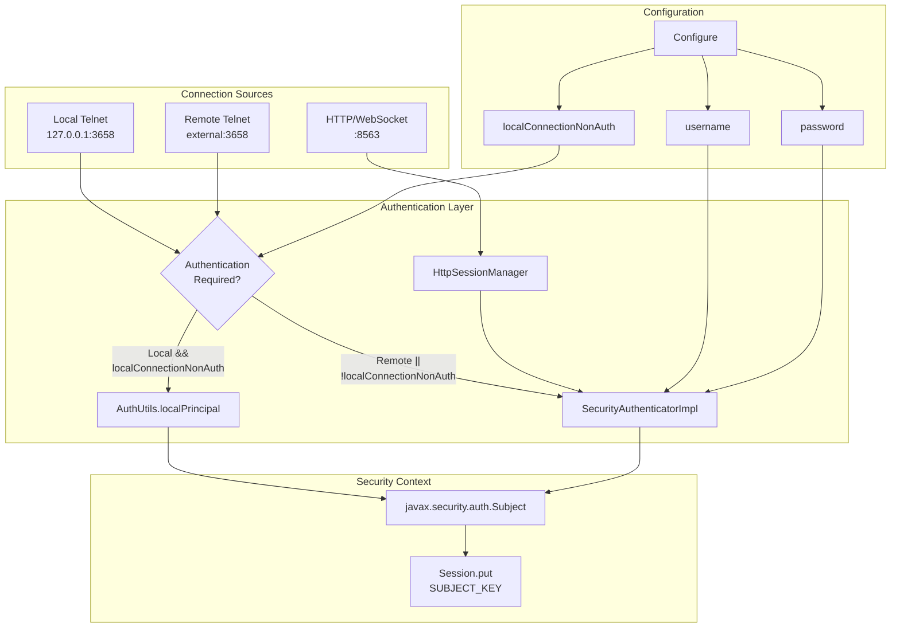
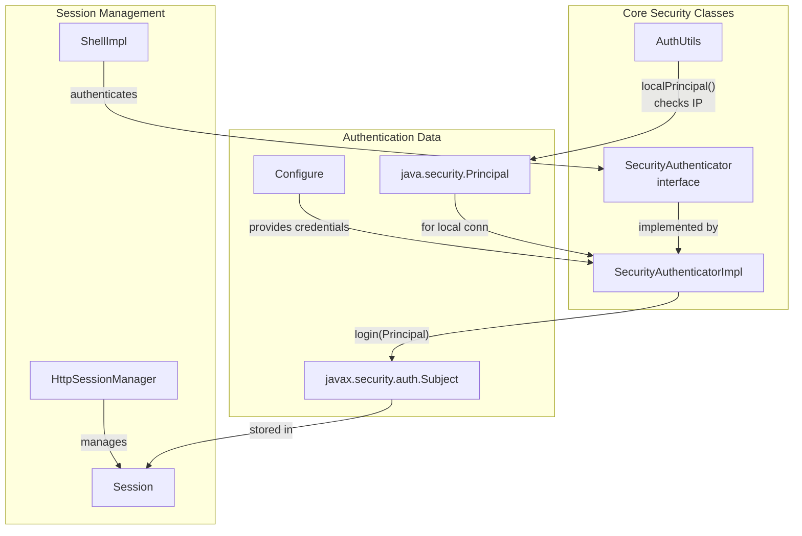
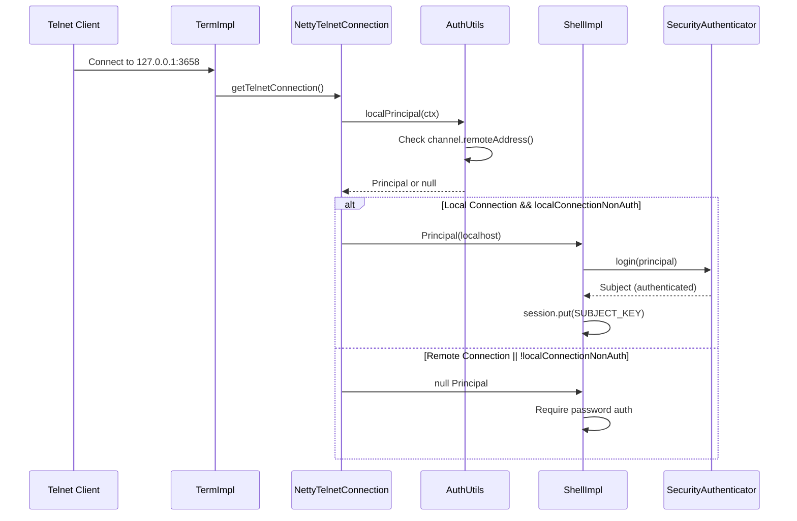
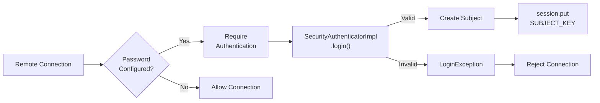
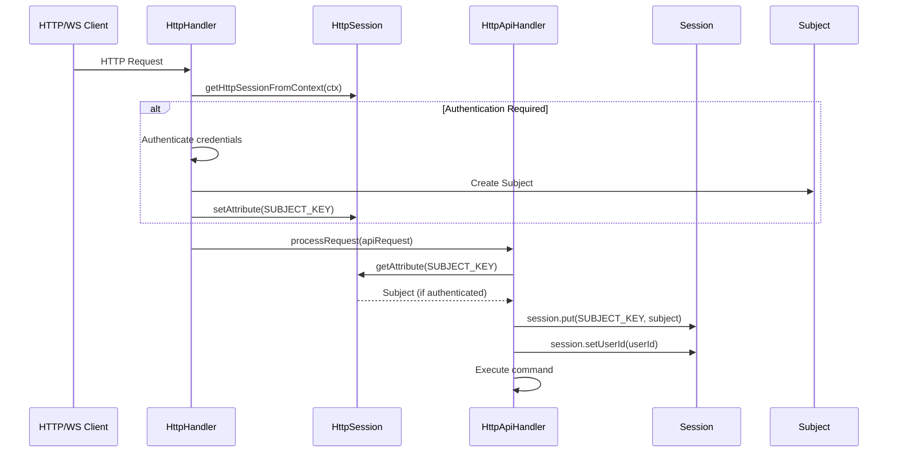
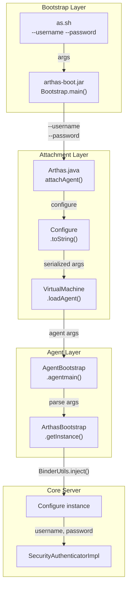
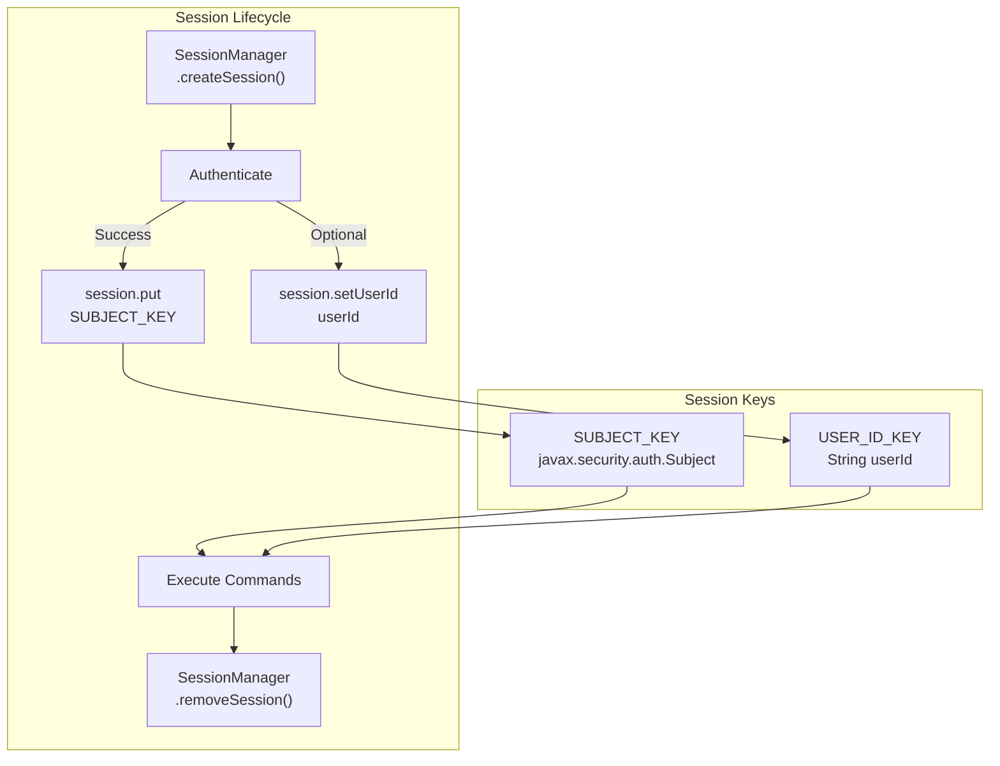

<!-- source: DeepWiki mcp.deepwiki.com · repo alibaba/arthas · page 5.3 Authentication and Security · fetched 2026-10-29 -->

# Authentication and Security

<details>
<summary>Relevant source files</summary>

The following files were used as context for generating this wiki page:

- [Dockerfile](Dockerfile)
- [Dockerfile-No-Jdk](Dockerfile-No-Jdk)
- [agent/src/main/java/com/taobao/arthas/agent334/AgentBootstrap.java](agent/src/main/java/com/taobao/arthas/agent334/AgentBootstrap.java)
- [bin/as.sh](bin/as.sh)
- [boot/src/main/java/com/taobao/arthas/boot/Bootstrap.java](boot/src/main/java/com/taobao/arthas/boot/Bootstrap.java)
- [boot/src/main/java/com/taobao/arthas/boot/DownloadUtils.java](boot/src/main/java/com/taobao/arthas/boot/DownloadUtils.java)
- [boot/src/main/java/com/taobao/arthas/boot/ProcessUtils.java](boot/src/main/java/com/taobao/arthas/boot/ProcessUtils.java)
- [boot/src/test/java/com/taobao/arthas/boot/DownloadUtilsTest.java](boot/src/test/java/com/taobao/arthas/boot/DownloadUtilsTest.java)
- [client/src/main/java/com/taobao/arthas/client/IOUtil.java](client/src/main/java/com/taobao/arthas/client/IOUtil.java)
- [client/src/main/java/com/taobao/arthas/client/TelnetConsole.java](client/src/main/java/com/taobao/arthas/client/TelnetConsole.java)
- [common/src/main/java/com/taobao/arthas/common/AnsiLog.java](common/src/main/java/com/taobao/arthas/common/AnsiLog.java)
- [common/src/main/java/com/taobao/arthas/common/ExecutingCommand.java](common/src/main/java/com/taobao/arthas/common/ExecutingCommand.java)
- [common/src/main/java/com/taobao/arthas/common/IOUtils.java](common/src/main/java/com/taobao/arthas/common/IOUtils.java)
- [common/src/main/java/com/taobao/arthas/common/PidUtils.java](common/src/main/java/com/taobao/arthas/common/PidUtils.java)
- [common/src/main/java/com/taobao/arthas/common/SocketUtils.java](common/src/main/java/com/taobao/arthas/common/SocketUtils.java)
- [common/src/main/java/com/taobao/arthas/common/UsageRender.java](common/src/main/java/com/taobao/arthas/common/UsageRender.java)
- [core/src/main/java/arthas.properties](core/src/main/java/arthas.properties)
- [core/src/main/java/com/taobao/arthas/core/Arthas.java](core/src/main/java/com/taobao/arthas/core/Arthas.java)
- [core/src/main/java/com/taobao/arthas/core/config/Configure.java](core/src/main/java/com/taobao/arthas/core/config/Configure.java)
- [core/src/main/java/com/taobao/arthas/core/mcp/ArthasMcpServer.java](core/src/main/java/com/taobao/arthas/core/mcp/ArthasMcpServer.java)
- [core/src/main/java/com/taobao/arthas/core/server/ArthasBootstrap.java](core/src/main/java/com/taobao/arthas/core/server/ArthasBootstrap.java)
- [core/src/main/java/com/taobao/arthas/core/shell/command/internal/WordCountHandler.java](core/src/main/java/com/taobao/arthas/core/shell/command/internal/WordCountHandler.java)
- [core/src/main/java/com/taobao/arthas/core/shell/impl/ShellImpl.java](core/src/main/java/com/taobao/arthas/core/shell/impl/ShellImpl.java)
- [core/src/main/java/com/taobao/arthas/core/shell/impl/ShellServerImpl.java](core/src/main/java/com/taobao/arthas/core/shell/impl/ShellServerImpl.java)
- [core/src/main/java/com/taobao/arthas/core/shell/session/impl/SessionManagerImpl.java](core/src/main/java/com/taobao/arthas/core/shell/session/impl/SessionManagerImpl.java)
- [core/src/main/java/com/taobao/arthas/core/shell/term/impl/http/api/ApiRequest.java](core/src/main/java/com/taobao/arthas/core/shell/term/impl/http/api/ApiRequest.java)
- [core/src/main/java/com/taobao/arthas/core/shell/term/impl/http/api/HttpApiHandler.java](core/src/main/java/com/taobao/arthas/core/shell/term/impl/http/api/HttpApiHandler.java)
- [core/src/main/java/com/taobao/arthas/core/util/ArthasBanner.java](core/src/main/java/com/taobao/arthas/core/util/ArthasBanner.java)
- [core/src/main/java/com/taobao/arthas/core/util/UserStatUtil.java](core/src/main/java/com/taobao/arthas/core/util/UserStatUtil.java)
- [tunnel-server/src/main/java/com/alibaba/arthas/tunnel/server/app/web/StatController.java](tunnel-server/src/main/java/com/alibaba/arthas/tunnel/server/app/web/StatController.java)

</details>


## Purpose and Scope

This document describes the authentication and security mechanisms in Arthas that protect diagnostic access to target JVMs. It covers credential configuration, local vs. remote connection security policies, automatic password generation, and how authentication integrates with different access protocols (Telnet, HTTP, WebSocket).

For information about the tunnel server's agent registration and routing, see [Tunnel Server Architecture](#5.1). For HTTP API access patterns, see [Web Console and HTTP API](#7.2).

## Overview

Arthas implements a security model that distinguishes between local connections (from `127.0.0.1`) and remote connections. The system supports username/password authentication and can enforce different policies based on connection origin.

### Authentication Flow Architecture



**Sources:** [core/src/main/java/com/taobao/arthas/core/shell/impl/ShellImpl.java:55-89](), [core/src/main/java/com/taobao/arthas/core/server/ArthasBootstrap.java:404-417]()

## Configuration Options

Authentication is configured through command-line arguments, environment variables, or the `arthas.properties` file.

### Configuration Properties

| Property | Type | Default | Description |
|----------|------|---------|-------------|
| `arthas.username` | String | null | Username for authentication |
| `arthas.password` | String | null | Password for authentication |
| `arthas.localConnectionNonAuth` | Boolean | true | Skip authentication for local connections |

### Command-Line Configuration

```bash
# Start Arthas with authentication
./as.sh --username admin --password <password> <pid>

# Or via arthas-boot.jar
java -jar arthas-boot.jar --username admin --password <password> <pid>
```

**Sources:** [bin/as.sh:152-156,458-459,649-658](), [boot/src/main/java/com/taobao/arthas/boot/Bootstrap.java:126-127,284-293](), [core/src/main/java/arthas.properties:11-16]()

### Properties File Configuration

In `arthas.properties`:

```properties
# Enable authentication
arthas.username=arthas
arthas.password=arthas

# Local connection non-authentication (default: true)
arthas.localConnectionNonAuth=true
```

**Sources:** [core/src/main/java/arthas.properties:11-16](), [core/src/main/java/com/taobao/arthas/core/config/Configure.java:35-36,73-75]()

## Security Architecture Components



**Sources:** [core/src/main/java/com/taobao/arthas/core/security/SecurityAuthenticator.java](), [core/src/main/java/com/taobao/arthas/core/security/SecurityAuthenticatorImpl.java](), [core/src/main/java/com/taobao/arthas/core/security/AuthUtils.java]()

### SecurityAuthenticatorImpl

The `SecurityAuthenticatorImpl` class handles credential verification and Subject creation:

- **Location:** [core/src/main/java/com/taobao/arthas/core/security/SecurityAuthenticatorImpl.java]()
- **Constructor:** Accepts `username` and `password` from `Configure`
- **Method:** `login(Principal)` - Creates authenticated `Subject` for valid credentials
- **Storage:** Authenticated `Subject` stored in `Session` with key `ArthasConstants.SUBJECT_KEY`

**Sources:** [core/src/main/java/com/taobao/arthas/core/server/ArthasBootstrap.java:136,417](), [core/src/main/java/com/taobao/arthas/core/shell/impl/ShellImpl.java:55,81-84]()

## Local Connection Security

Arthas implements special security handling for local connections to balance security with usability for local debugging scenarios.

### Local Connection Detection



**Sources:** [core/src/main/java/com/taobao/arthas/core/shell/impl/ShellImpl.java:69-89](), [core/src/main/java/com/taobao/arthas/core/security/AuthUtils.java]()

### Local Principal Creation

The `AuthUtils.localPrincipal()` method determines if a connection is local:

1. Extracts `ChannelHandlerContext` from Netty channel
2. Checks if `channel.remoteAddress()` is a loopback address
3. Returns a `Principal` if local, `null` if remote

**Configuration Impact:**
- When `arthas.localConnectionNonAuth=true` (default): Local connections skip password authentication
- When `arthas.localConnectionNonAuth=false`: Local connections require password authentication

**Sources:** [core/src/main/java/com/taobao/arthas/core/security/AuthUtils.java](), [core/src/main/java/arthas.properties:15-16](), [core/src/main/java/com/taobao/arthas/core/config/Configure.java:73-75,215-221]()

## Remote Connection Authentication

Remote connections (non-localhost) require username/password authentication when credentials are configured.

### Authentication Enforcement



**Sources:** [core/src/main/java/com/taobao/arthas/core/shell/impl/ShellImpl.java:81-86](), [core/src/main/java/com/taobao/arthas/core/security/SecurityAuthenticatorImpl.java]()

## Automatic Password Generation

When Arthas binds to `0.0.0.0` (all network interfaces) without a configured password, it automatically generates a random password to prevent unauthorized remote access.

### Password Generation Logic

[core/src/main/java/com/taobao/arthas/core/server/ArthasBootstrap.java:404-415]()

```java
if (IPUtils.isAllZeroIP(configure.getIp()) && StringUtils.isBlank(configure.getPassword())) {
    // When listening on 0.0.0.0, force password generation
    String errorMsg = "Listening on 0.0.0.0 is very dangerous! External users can connect to your machine! "
            + "No password is currently configured. " + "Therefore, a default password is generated, "
            + "and clients need to use the password to connect!";
    AnsiLog.error(errorMsg);
    configure.setPassword(StringUtils.randomString(64));
    AnsiLog.error("Generated arthas password: " + configure.getPassword());
    
    logger().error(errorMsg);
    logger().info("Generated arthas password: " + configure.getPassword());
}
```

**Behavior:**
- **Trigger:** Binding to `0.0.0.0` without explicit password
- **Action:** Generate 64-character random password
- **Output:** Password logged to console and log file
- **Purpose:** Prevent accidental exposure of diagnostic interface

**Sources:** [core/src/main/java/com/taobao/arthas/core/server/ArthasBootstrap.java:404-415](), [core/src/main/java/com/taobao/arthas/core/util/IPUtils.java](), [core/src/main/java/com/taobao/arthas/core/util/StringUtils.java]()

## HTTP Session Security

For HTTP and WebSocket connections, authentication is managed through HTTP sessions and passed to Arthas sessions.

### HTTP Authentication Flow



**Sources:** [core/src/main/java/com/taobao/arthas/core/shell/term/impl/http/api/HttpApiHandler.java:156-176](), [core/src/main/java/com/taobao/arthas/core/shell/term/impl/http/session/HttpSessionManager.java]()

### Subject Propagation

The authentication `Subject` is propagated through multiple layers:

1. **HTTP Layer:** `HttpSession.setAttribute(ArthasConstants.SUBJECT_KEY, subject)`
2. **API Layer:** Retrieved from `HttpSession` in `HttpApiHandler.processRequest()`
3. **Session Layer:** Stored in Arthas `Session` via `session.put(ArthasConstants.SUBJECT_KEY, subject)`
4. **User ID:** Optional `userId` tracked separately via `session.setUserId()`

**Key Constants:**
- `ArthasConstants.SUBJECT_KEY` - Session key for authenticated Subject
- `ArthasConstants.USER_ID_KEY` - Session key for user identifier

**Sources:** [core/src/main/java/com/taobao/arthas/core/shell/term/impl/http/api/HttpApiHandler.java:156-176](), [core/src/main/java/com/taobao/arthas/common/ArthasConstants.java]()

## Command-Line Argument Propagation

Authentication credentials flow from bootstrap through agent attachment to the core server.

### Credential Propagation Path



**Sources:** [bin/as.sh:152-156,649-658,863-871](), [boot/src/main/java/com/taobao/arthas/boot/Bootstrap.java:284-293,561-568](), [core/src/main/java/com/taobao/arthas/core/Arthas.java:42-43,77-78,122-123](), [core/src/main/java/com/taobao/arthas/core/server/ArthasBootstrap.java:253-284,417]()

### Serialization Format

Credentials are serialized using `FeatureCodec`:

1. **Bootstrap:** Collects `--username` and `--password` arguments
2. **Configure:** Stores in `Configure` object
3. **Serialize:** `Configure.toString()` serializes to key-value string
4. **Attach:** Passed as agent arguments to `VirtualMachine.loadAgent()`
5. **Deserialize:** `FeatureCodec.DEFAULT_COMMANDLINE_CODEC.toMap()` parses arguments
6. **Inject:** `BinderUtils.inject()` populates `Configure` fields from parsed map

**Sources:** [core/src/main/java/com/taobao/arthas/core/config/Configure.java:244-268,276-287](), [core/src/main/java/com/taobao/arthas/core/config/FeatureCodec.java]()

## Security Considerations

### Default Security Posture

| Scenario | Authentication Required | Rationale |
|----------|------------------------|-----------|
| Local connection to 127.0.0.1 | No (by default) | Convenient for local debugging |
| Remote connection | Yes (if password set) | Protect against unauthorized access |
| Binding to 0.0.0.0 without password | Auto-generate password | Prevent accidental exposure |

### Best Practices

1. **Production Deployments:** Always configure username and password
2. **Network Binding:** Avoid binding to `0.0.0.0` unless necessary
3. **Local Development:** Use default settings for convenience
4. **Tunnel Server:** Use tunnel server for secure remote access instead of direct exposure
5. **Credential Rotation:** Change passwords periodically in long-running deployments

**Sources:** [core/src/main/java/com/taobao/arthas/core/server/ArthasBootstrap.java:404-415](), [core/src/main/java/arthas.properties:11-16]()

## Integration with Session Management

Authentication state is maintained throughout the session lifecycle.

### Session Security Context



**Sources:** [core/src/main/java/com/taobao/arthas/core/shell/session/impl/SessionManagerImpl.java:52-65](), [core/src/main/java/com/taobao/arthas/core/shell/session/impl/SessionImpl.java](), [core/src/main/java/com/taobao/arthas/common/ArthasConstants.java]()

### User Tracking for Statistics

The `userId` field enables command usage tracking:

- **Source:** Can come from HTTP session or API request
- **Storage:** `Session.setUserId(String userId)`
- **Usage:** Reported to stat URL via `UserStatUtil.arthasUsageSuccess(cmd, args, userId)`

**Sources:** [core/src/main/java/com/taobao/arthas/core/shell/term/impl/http/api/HttpApiHandler.java:165-175](), [core/src/main/java/com/taobao/arthas/core/util/UserStatUtil.java:98-113]()

## Configuration Precedence

Configuration sources are evaluated in priority order:

1. **Command-line arguments** - Highest priority
2. **System environment variables**
3. **System properties**
4. **arthas.properties file** - Lowest priority

Exception: If `arthas.config.overrideAll=true` is set in `arthas.properties`, the properties file takes highest priority.

**Sources:** [core/src/main/java/com/taobao/arthas/core/server/ArthasBootstrap.java:253-346](), [core/src/main/java/arthas.properties:1](), [core/src/main/java/com/taobao/arthas/core/env/ArthasEnvironment.java]()

---

