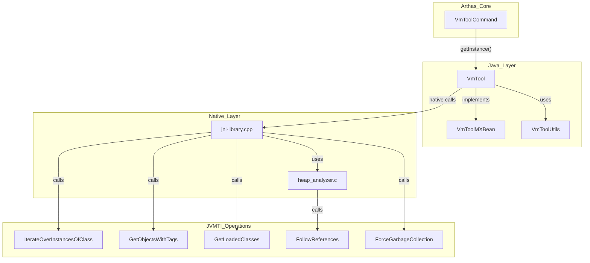
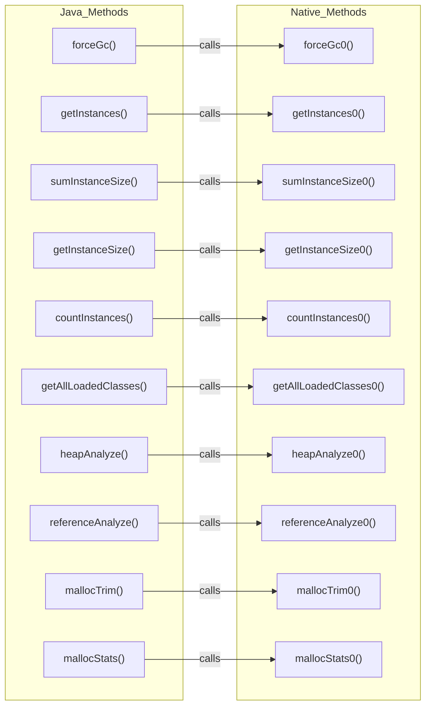
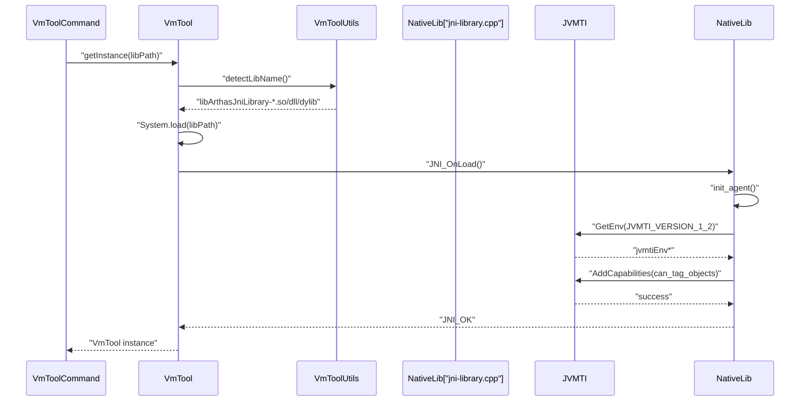
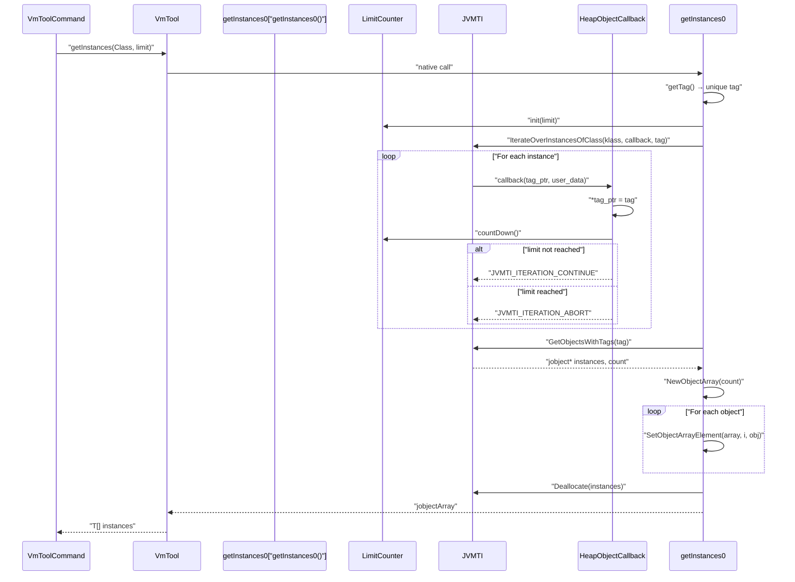
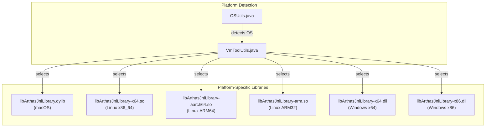
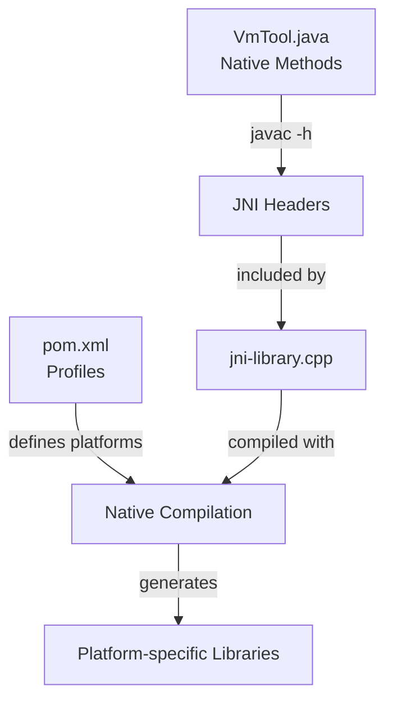
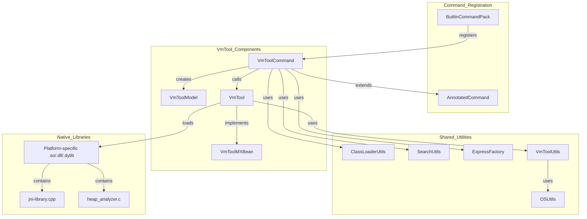

<!-- source: DeepWiki mcp.deepwiki.com · repo alibaba/arthas · page 6 VmTool Native Integration · fetched 2026-10-29 -->

# VmTool Native Integration

Relevant source files

The following files were used as context for generating this wiki page:

- [arthas-vmtool/pom.xml](arthas-vmtool/pom.xml)
- [arthas-vmtool/src/main/java/arthas/VmTool.java](arthas-vmtool/src/main/java/arthas/VmTool.java)
- [arthas-vmtool/src/main/java/arthas/VmToolMXBean.java](arthas-vmtool/src/main/java/arthas/VmToolMXBean.java)
- [arthas-vmtool/src/main/java/arthas/package-info.java](arthas-vmtool/src/main/java/arthas/package-info.java)
- [arthas-vmtool/src/main/native/src/heap_analyzer.c](arthas-vmtool/src/main/native/src/heap_analyzer.c)
- [arthas-vmtool/src/main/native/src/heap_analyzer.h](arthas-vmtool/src/main/native/src/heap_analyzer.h)
- [arthas-vmtool/src/main/native/src/jni-library.cpp](arthas-vmtool/src/main/native/src/jni-library.cpp)
- [arthas-vmtool/src/test/java/arthas/VmToolTest.java](arthas-vmtool/src/test/java/arthas/VmToolTest.java)
- [bin/install-local.sh](bin/install-local.sh)
- [common/src/main/java/com/taobao/arthas/common/OSUtils.java](common/src/main/java/com/taobao/arthas/common/OSUtils.java)
- [common/src/main/java/com/taobao/arthas/common/VmToolUtils.java](common/src/main/java/com/taobao/arthas/common/VmToolUtils.java)
- [core/src/main/java/com/taobao/arthas/core/command/monitor200/VmToolCommand.java](core/src/main/java/com/taobao/arthas/core/command/monitor200/VmToolCommand.java)
- [packaging/src/main/assembly/assembly-doc.xml](packaging/src/main/assembly/assembly-doc.xml)
- [packaging/src/main/assembly/assembly.xml](packaging/src/main/assembly/assembly.xml)
- [site/docs/doc/vmtool.md](site/docs/doc/vmtool.md)
- [site/docs/en/doc/vmtool.md](site/docs/en/doc/vmtool.md)

VmTool is a component of Arthas that provides low-level diagnostic capabilities through native integration with the Java Virtual Machine (JVM). This page explains the architecture, implementation, and usage of VmTool, which enables powerful runtime diagnostics that aren't possible with pure Java code alone.

## Purpose and Overview

VmTool bridges the gap between Arthas's high-level diagnostics and the underlying JVM by using Java Native Interface (JNI) to access the JVM Tool Interface (JVMTI). This integration enables advanced capabilities such as:

- Retrieving all instances of a specific class from memory
- Counting the number of instances of a class
- Measuring memory consumption of objects
- Forcing garbage collection
- Getting all loaded classes in the JVM
- Interrupting specific threads
- Analyzing heap memory usage and identifying top consumers
- Tracing object reference chains from objects back to GC roots
- Native memory management operations (malloc_trim, malloc_stats on Linux)

By connecting to native JVM functionality, VmTool extends Arthas's capabilities beyond what's possible with standard Java APIs.

Sources: [arthas-vmtool/src/main/java/arthas/VmTool.java](), [arthas-vmtool/src/main/java/arthas/VmToolMXBean.java](), [arthas-vmtool/src/main/native/src/heap_analyzer.h]()

## Architecture Overview

VmTool consists of both Java components and platform-specific native libraries that work together to provide JVM introspection capabilities.

**VmTool Component Architecture**

The key components in this architecture are:

1. **VmToolCommand**: Command processor at [core/src/main/java/com/taobao/arthas/core/command/monitor200/VmToolCommand.java]() that handles user requests
2. **VmTool**: Java API class at [arthas-vmtool/src/main/java/arthas/VmTool.java]() declaring native methods
3. **VmToolMXBean**: Interface at [arthas-vmtool/src/main/java/arthas/VmToolMXBean.java]() defining the public API contract
4. **VmToolUtils**: Platform detection utility at [common/src/main/java/com/taobao/arthas/common/VmToolUtils.java]()
5. **jni-library.cpp**: Native implementation at [arthas-vmtool/src/main/native/src/jni-library.cpp]() bridging Java and JVMTI
6. **heap_analyzer.c**: Advanced heap analysis at [arthas-vmtool/src/main/native/src/heap_analyzer.c]() for memory diagnostics
7. **JVMTI Operations**: Low-level JVM Tool Interface functions for heap inspection and manipulation

Sources: [arthas-vmtool/src/main/java/arthas/VmTool.java](), [arthas-vmtool/src/main/native/src/jni-library.cpp](), [arthas-vmtool/src/main/native/src/heap_analyzer.c](), [arthas-vmtool/src/main/native/src/heap_analyzer.h](), [common/src/main/java/com/taobao/arthas/common/VmToolUtils.java]()

## Technical Implementation

### Java Native Interface Layer

The `VmTool` class at [arthas-vmtool/src/main/java/arthas/VmTool.java]() declares native methods that are implemented in C/C++:

**Native Method Declarations**

Key native methods declared at [arthas-vmtool/src/main/java/arthas/VmTool.java:41-78]():

| Native Method | Purpose | Implementation |
|--------------|---------|----------------|
| `forceGc0()` | Force garbage collection | [jni-library.cpp:79-81]() |
| `getInstances0()` | Get class instances | [jni-library.cpp:104-129]() |
| `sumInstanceSize0()` | Sum instance memory | [jni-library.cpp:133-159]() |
| `getInstanceSize0()` | Get object size | [jni-library.cpp:162-170]() |
| `countInstances0()` | Count instances | [jni-library.cpp:174-191]() |
| `getAllLoadedClasses0()` | Get all classes | [jni-library.cpp:194-212]() |
| `heapAnalyze0()` | Analyze heap usage | [jni-library.cpp:235-245]() |
| `referenceAnalyze0()` | Analyze references | [jni-library.cpp:248-258]() |
| `mallocTrim0()` | Trim malloc memory | [jni-library.cpp:215-221]() |
| `mallocStats0()` | Print malloc stats | [jni-library.cpp:224-232]() |

These native methods are the bridge between Java and the native code. The public methods in the `VmTool` class wrap these native methods to provide validation and a clean API for users.

Sources: [arthas-vmtool/src/main/java/arthas/VmTool.java:41-150](), [arthas-vmtool/src/main/native/src/jni-library.cpp]()

### Native Library Implementation

The native implementation in [arthas-vmtool/src/main/native/src/jni-library.cpp]() uses JVMTI to interact with the JVM. A key component is the initialization process:

**VmTool Initialization Sequence**

The native library initialization at [arthas-vmtool/src/main/native/src/jni-library.cpp:41-75]() handles three entry points:
- `Agent_OnLoad()` - When loaded as a JVMTI agent
- `Agent_OnAttach()` - When attached to a running JVM
- `JNI_OnLoad()` - Standard JNI library loading

The native library implements key functionality using JVMTI:

1. **Object Tagging**: Uses JVMTI's tagging capability at [jni-library.cpp:14]() to track objects uniquely
2. **Heap Iteration**: Uses `IterateOverInstancesOfClass` at [jni-library.cpp:107]() with a callback at [jni-library.cpp:89-100]()
3. **Memory Measurement**: Uses `GetObjectSize` at [jni-library.cpp:154]() to measure object memory usage
4. **Class Access**: Uses `GetLoadedClasses` at [jni-library.cpp:199]() to enumerate all loaded classes
5. **Heap Analysis**: Delegates to `arthas_vmtool_heap_analyze()` at [heap_analyzer.c:1023-1073]() for deep heap inspection
6. **Reference Analysis**: Delegates to `arthas_vmtool_reference_analyze()` at [heap_analyzer.c:1075-1117]() for tracing object references

Sources: [arthas-vmtool/src/main/native/src/jni-library.cpp:41-75](), [arthas-vmtool/src/main/native/src/jni-library.cpp:89-100](), [arthas-vmtool/src/main/native/src/heap_analyzer.c]()

### Instance Retrieval Process

The core functionality of retrieving instances of a class demonstrates how VmTool integrates Java and native code through JVMTI tagging:

**getInstances() Execution Flow**

This process at [jni-library.cpp:104-129]() involves:

1. **Tag Generation**: `getTag()` at [jni-library.cpp:84-86]() generates a unique tag using `tagCounter`
2. **Limit Initialization**: `LimitCounter` at [jni-library.cpp:16-35]() tracks iteration limit
3. **Heap Iteration**: JVMTI iterates instances, invoking `HeapObjectCallback` at [jni-library.cpp:89-100]()
4. **Object Tagging**: Callback tags each instance with the generated tag
5. **Retrieval**: `GetObjectsWithTags()` retrieves all objects with the specific tag
6. **Array Conversion**: Creates a Java array and populates it with the tagged objects

Sources: [arthas-vmtool/src/main/native/src/jni-library.cpp:104-129](), [arthas-vmtool/src/main/native/src/jni-library.cpp:84-86](), [arthas-vmtool/src/main/native/src/jni-library.cpp:16-35](), [arthas-vmtool/src/main/native/src/jni-library.cpp:89-100]()

## Cross-Platform Support

VmTool supports multiple platforms with platform-specific native libraries:

The platform detection and library selection process:

1. `OSUtils` detects the operating system and architecture
2. `VmToolUtils.detectLibName()` determines the appropriate library name
3. `VmTool.getInstance()` loads the selected library with `System.load()`
4. The native library initializes the JVMTI environment

This approach ensures VmTool works across different environments without requiring manual library selection.

Sources: [common/src/main/java/com/taobao/arthas/common/OSUtils.java](), [common/src/main/java/com/taobao/arthas/common/VmToolUtils.java](), [arthas-vmtool/pom.xml]()

## Building Native Libraries

The native libraries are built using the `native-maven-plugin` with platform-specific configurations defined in the `pom.xml` file:

The build process at [arthas-vmtool/pom.xml]() includes:

1. **Header Generation**: `javac -h` at [pom.xml:193-196]() generates JNI headers from native method declarations
2. **Source Compilation**: Compiles `jni-library.cpp` and `heap_analyzer.c` at [pom.xml:217-224]() with platform-specific flags
3. **Linking**: Links object files into platform-specific libraries (.so/.dll/.dylib)
4. **Packaging**: Assembly at [packaging/src/main/assembly/assembly.xml:67-69]() includes libraries in the `lib/` directory

Platform-specific profiles in [arthas-vmtool/pom.xml:16-183]() define:
- macOS: Universal binary with `-arch x86_64 -arch arm64` at [pom.xml:28]()
- Linux x64: `-m64` flag at [pom.xml:44]()
- Linux aarch64: `-march=armv8-a` flag at [pom.xml:58]()
- Windows x64: `-m64` with `-static-libstdc++` at [pom.xml:113,161]()

Sources: [arthas-vmtool/pom.xml:16-264](), [packaging/src/main/assembly/assembly.xml:67-69]()

## VmTool Command Usage

VmTool functionality is exposed through the `vmtool` command in the Arthas CLI. Here's a table of common usage scenarios:

The `vmtool` command at [core/src/main/java/com/taobao/arthas/core/command/monitor200/VmToolCommand.java]() exposes VmTool functionality through the `VmToolAction` enum at [VmToolCommand.java:196-198]():

| Action | Command Example | Description | Implementation |
|--------|----------------|-------------|----------------|
| `getInstances` | `vmtool --action getInstances --className demo.MathGame` | Returns all instances of the specified class | [VmToolCommand.java:251-267]() |
| `getInstances` (limited) | `vmtool --action getInstances --className java.lang.String --limit 10` | Returns up to 10 instances | [VmToolCommand.java:252]() with limit parameter |
| `getInstances` (OGNL) | `vmtool --action getInstances --className demo.MathGame --express 'instances[0]'` | Returns the first instance using OGNL | [VmToolCommand.java:254-263]() |
| `getInstances` (expanded) | `vmtool --action getInstances --className demo.MathGame -x 2` | Shows instances with expanded object details | [VmToolCommand.java:265]() with expand parameter |
| `forceGc` | `vmtool --action forceGc` | Triggers a full garbage collection | [VmToolCommand.java:274-278]() |
| `heapAnalyze` | `vmtool --action heapAnalyze --classNum 20 --objectNum 20` | Analyzes heap usage, showing top classes and objects | [VmToolCommand.java:279-283]() |
| `referenceAnalyze` | `vmtool --action referenceAnalyze --className java.lang.String --objectNum 20 --backtraceNum 2` | Analyzes object reference chains | [VmToolCommand.java:269-272]() |
| `interruptThread` | `vmtool --action interruptThread -t 1` | Interrupts the thread with ID 1 | [VmToolCommand.java:284-288]() |
| `mallocTrim` | `vmtool --action mallocTrim` | Releases free memory to OS (Linux glibc only) | [VmToolCommand.java:290-295]() |
| `mallocStats` | `vmtool --action mallocStats` | Prints malloc statistics to stderr (Linux glibc only) | [VmToolCommand.java:296-301]() |

The command supports classloader selection via:
- `--classloader` / `-c`: Specify classloader by hash code at [VmToolCommand.java:211-216]()
- `--classLoaderClass`: Specify classloader by class name at [VmToolCommand.java:217-236]()

Sources: [core/src/main/java/com/taobao/arthas/core/command/monitor200/VmToolCommand.java:196-309]()

## Integration with Arthas

VmTool integrates with the broader Arthas ecosystem through the command system and shared utilities:

**VmTool Integration with Arthas Core**

Key integration points:

1. **Command Registration**: `VmToolCommand` extends `AnnotatedCommand` at [VmToolCommand.java:65]() and is registered with the command system
2. **Result Model**: Returns `VmToolModel` at [VmToolCommand.java:265]() for consistent result formatting
3. **ClassLoader Integration**: Uses `ClassLoaderUtils` at [VmToolCommand.java:212,218]() to resolve classloaders, integrating with Arthas's classloader tracking
4. **Class Search**: Uses `SearchUtils.searchClassOnly()` at [VmToolCommand.java:242]() to find target classes
5. **Expression Evaluation**: Integrates with `ExpressFactory` at [VmToolCommand.java:255]() for OGNL expression evaluation on retrieved instances
6. **Platform Detection**: Uses shared `OSUtils` and `VmToolUtils` for cross-platform library loading

The VmTool integration complements other Arthas features by providing deep insights into memory usage and object lifecycles that other commands cannot provide, particularly for diagnosing memory leaks and understanding object relationships through heap analysis and reference tracing.

Sources: [core/src/main/java/com/taobao/arthas/core/command/monitor200/VmToolCommand.java](), [common/src/main/java/com/taobao/arthas/common/VmToolUtils.java](), [common/src/main/java/com/taobao/arthas/common/OSUtils.java]()

## Conclusion

VmTool Native Integration significantly extends Arthas's diagnostic capabilities by bridging Java and native JVM functionality. Through the combination of JNI, JVMTI, and platform-specific libraries, VmTool provides insights into JVM internals that are otherwise inaccessible.

This integration is particularly valuable for diagnosing memory issues, understanding object relationships, and analyzing class loading behavior in Java applications. The cross-platform support ensures that these capabilities are available across a wide range of environments.

---

