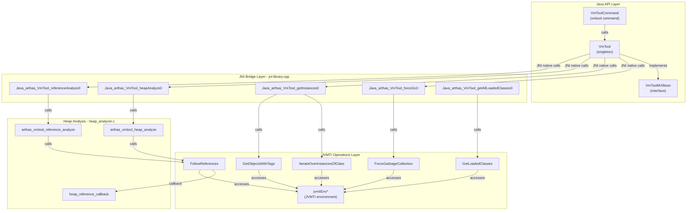
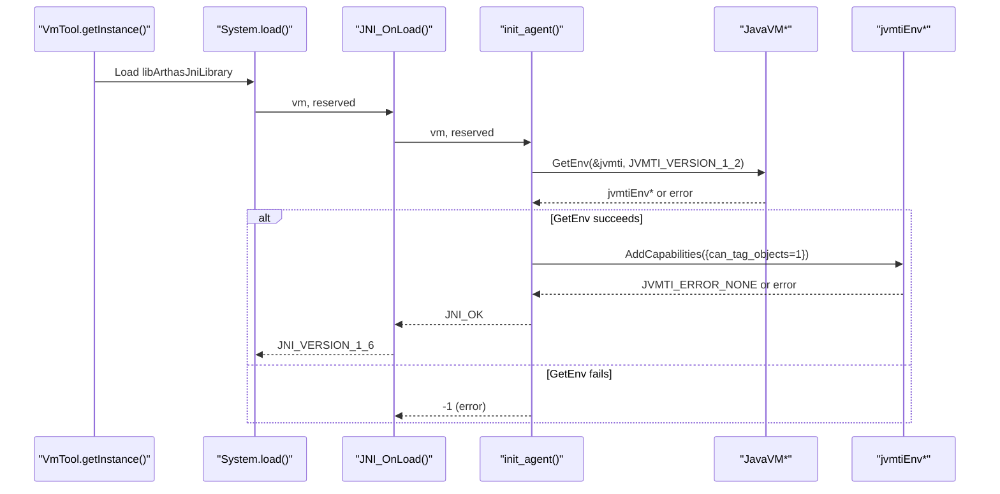
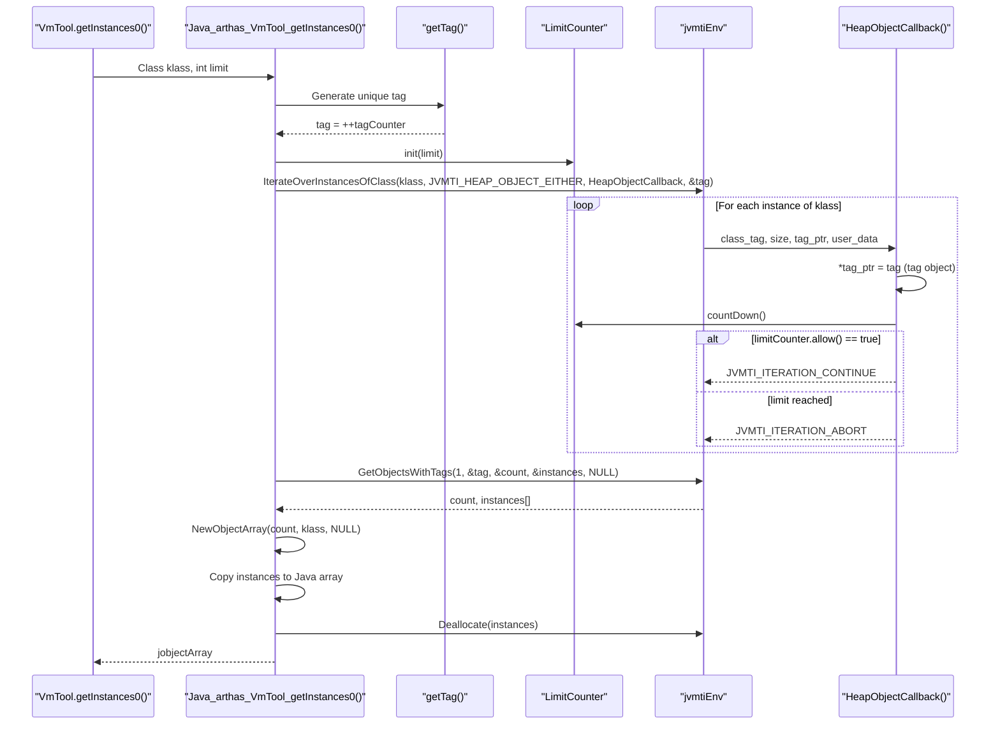
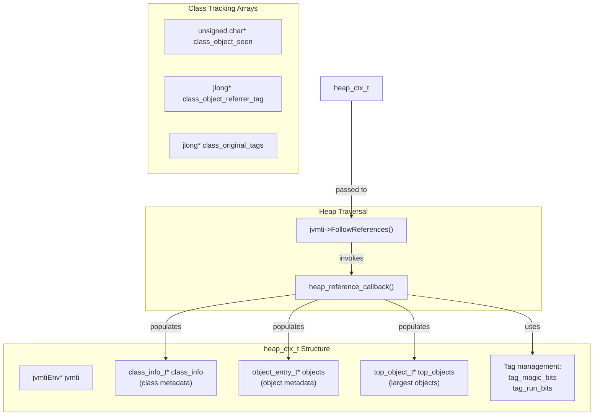

<!-- source: DeepWiki mcp.deepwiki.com · repo alibaba/arthas · page 6.1 JNI/JVMTI Bridge Implementation · fetched 2026-10-29 -->

# JNI/JVMTI Bridge Implementation

<details>
<summary>Relevant source files</summary>

The following files were used as context for generating this wiki page:

- [arthas-vmtool/pom.xml](arthas-vmtool/pom.xml)
- [arthas-vmtool/src/main/java/arthas/VmTool.java](arthas-vmtool/src/main/java/arthas/VmTool.java)
- [arthas-vmtool/src/main/java/arthas/VmToolMXBean.java](arthas-vmtool/src/main/java/arthas/VmToolMXBean.java)
- [arthas-vmtool/src/main/java/arthas/package-info.java](arthas-vmtool/src/main/java/arthas/package-info.java)
- [arthas-vmtool/src/main/native/src/heap_analyzer.c](arthas-vmtool/src/main/native/src/heap_analyzer.c)
- [arthas-vmtool/src/main/native/src/heap_analyzer.h](arthas-vmtool/src/main/native/src/heap_analyzer.h)
- [arthas-vmtool/src/main/native/src/jni-library.cpp](arthas-vmtool/src/main/native/src/jni-library.cpp)
- [arthas-vmtool/src/test/java/arthas/VmToolTest.java](arthas-vmtool/src/test/java/arthas/VmToolTest.java)
- [bin/install-local.sh](bin/install-local.sh)
- [common/src/main/java/com/taobao/arthas/common/OSUtils.java](common/src/main/java/com/taobao/arthas/common/OSUtils.java)
- [common/src/main/java/com/taobao/arthas/common/VmToolUtils.java](common/src/main/java/com/taobao/arthas/common/VmToolUtils.java)
- [core/src/main/java/com/taobao/arthas/core/command/monitor200/VmToolCommand.java](core/src/main/java/com/taobao/arthas/core/command/monitor200/VmToolCommand.java)
- [packaging/src/main/assembly/assembly-doc.xml](packaging/src/main/assembly/assembly-doc.xml)
- [packaging/src/main/assembly/assembly.xml](packaging/src/main/assembly/assembly.xml)
- [site/docs/doc/vmtool.md](site/docs/doc/vmtool.md)
- [site/docs/en/doc/vmtool.md](site/docs/en/doc/vmtool.md)

</details>


This document details the JNI/JVMTI bridge implementation in Arthas's `arthas-vmtool` module. The bridge combines Java Native Interface (JNI) for Java-to-native method calls with JVM Tool Interface (JVMTI) for low-level JVM introspection. This enables advanced runtime operations including heap analysis, object instance retrieval, memory measurement, and garbage collection control.

For information about heap analysis operations exposed through the bridge, see [Heap Analysis and Native Operations](#6.2).

## Overview

The JNI/JVMTI bridge consists of three layers:

1. **Java API Layer**: `VmTool` class and `VmToolMXBean` interface providing type-safe methods
2. **JNI Bridge Layer**: C++ implementation in `jni-library.cpp` exposing native methods
3. **JVMTI Operations Layer**: Direct JVMTI API calls and heap iteration callbacks

This architecture separates concerns while maintaining performance for low-level JVM operations.

### Architecture Diagram



Sources: [arthas-vmtool/src/main/java/arthas/VmTool.java](), [arthas-vmtool/src/main/native/src/jni-library.cpp](), [arthas-vmtool/src/main/native/src/heap_analyzer.c](), [core/src/main/java/com/taobao/arthas/core/command/monitor200/VmToolCommand.java]()

## Key Components

### VmToolMXBean Interface

The `VmToolMXBean` interface at [arthas-vmtool/src/main/java/arthas/VmToolMXBean.java]() defines the complete API for JVM operations:

| Method | Description | JVMTI Functions Used |
|--------|-------------|---------------------|
| `forceGc()` | Triggers garbage collection | `ForceGarbageCollection` |
| `getInstances(Class, int)` | Retrieves live instances of a class | `IterateOverInstancesOfClass`, `GetObjectsWithTags` |
| `sumInstanceSize(Class)` | Calculates total memory usage | `IterateOverInstancesOfClass`, `GetObjectSize` |
| `countInstances(Class)` | Counts live instances | `IterateOverInstancesOfClass` |
| `getAllLoadedClasses()` | Returns all loaded classes | `GetLoadedClasses` |
| `heapAnalyze(int, int)` | Analyzes heap usage from GC roots | `FollowReferences` |
| `referenceAnalyze(Class, int, int)` | Traces object reference chains | `FollowReferences` |
| `mallocTrim()` | Releases glibc memory (Linux) | glibc `malloc_trim` |
| `mallocStats()` | Prints glibc memory stats | glibc `malloc_stats` |

Sources: [arthas-vmtool/src/main/java/arthas/VmToolMXBean.java:16-89]()

### VmTool Singleton Class

The `VmTool` class at [arthas-vmtool/src/main/java/arthas/VmTool.java]() implements `VmToolMXBean` and manages native library loading:

**Key Responsibilities:**
- Singleton pattern for thread-safe native library management
- Native method declarations (all `static synchronized native`)
- Library loading via `System.loadLibrary()` or `System.load()`
- Wrapper methods that validate inputs and call native methods

**Native Method Declarations:**

```java
// Declared in VmTool.java, implemented in jni-library.cpp
private static synchronized native void forceGc0();
private static synchronized native <T> T[] getInstances0(Class<T> klass, int limit);
private static synchronized native long sumInstanceSize0(Class<?> klass);
private static native long getInstanceSize0(Object instance);
private static synchronized native long countInstances0(Class<?> klass);
private static synchronized native Class<?>[] getAllLoadedClasses0(Class<?> klass);
private static synchronized native String heapAnalyze0(int classNum, int objectNum);
private static synchronized native String referenceAnalyze0(Class<?> klass, int objectNum, int backtraceNum);
private static synchronized native int mallocTrim0();
private static synchronized native boolean mallocStats0();
```

The `synchronized` modifier ensures thread safety during JVMTI operations.

Sources: [arthas-vmtool/src/main/java/arthas/VmTool.java:10-151]()

### JNI Bridge Layer (jni-library.cpp)

The C++ implementation at [arthas-vmtool/src/main/native/src/jni-library.cpp]() provides JNI method implementations:

**Agent Entry Points:**
- `Agent_OnLoad()` - Called when loaded as JVMTI agent at JVM startup
- `Agent_OnAttach()` - Called when attached to running JVM
- `JNI_OnLoad()` - Called when loaded as regular shared library

All three call `init_agent()` to initialize the JVMTI environment.

**Key Global State:**
- `static jvmtiEnv *jvmti` - JVMTI environment pointer (lines 13)
- `static jlong tagCounter` - Monotonic counter for object tagging (line 14)
- `static LimitCounter limitCounter` - Controls iteration limits (line 38)

**Core JVMTI Operations:**

| Native Method | JVMTI Function Called | Line Reference |
|---------------|----------------------|----------------|
| `Java_arthas_VmTool_forceGc0` | `jvmti->ForceGarbageCollection()` | [arthas-vmtool/src/main/native/src/jni-library.cpp:79-81]() |
| `Java_arthas_VmTool_getInstances0` | `jvmti->IterateOverInstancesOfClass()`<br/>`jvmti->GetObjectsWithTags()` | [arthas-vmtool/src/main/native/src/jni-library.cpp:104-129]() |
| `Java_arthas_VmTool_sumInstanceSize0` | `jvmti->IterateOverInstancesOfClass()`<br/>`jvmti->GetObjectSize()` | [arthas-vmtool/src/main/native/src/jni-library.cpp:132-159]() |
| `Java_arthas_VmTool_countInstances0` | `jvmti->IterateOverInstancesOfClass()`<br/>`jvmti->GetObjectsWithTags()` | [arthas-vmtool/src/main/native/src/jni-library.cpp:173-191]() |
| `Java_arthas_VmTool_getAllLoadedClasses0` | `jvmti->GetLoadedClasses()` | [arthas-vmtool/src/main/native/src/jni-library.cpp:194-212]() |

Sources: [arthas-vmtool/src/main/native/src/jni-library.cpp:1-259]()

## JVMTI Initialization and Capabilities

### Initialization Sequence



Sources: [arthas-vmtool/src/main/native/src/jni-library.cpp:40-75]()

### JVMTI Capabilities

The `init_agent()` function requests the `can_tag_objects` capability, which enables:

- **Object Tagging**: Attach arbitrary `jlong` values to heap objects
- **Tag-based Retrieval**: Query objects by tag via `GetObjectsWithTags()`
- **Heap Iteration**: Track visited objects during heap traversal

Without this capability, `IterateOverInstancesOfClass()` and `FollowReferences()` cannot tag objects, making duplicate detection impossible.

```c++
jvmtiCapabilities capabilities = {0};
capabilities.can_tag_objects = 1;
jvmtiError error = jvmti->AddCapabilities(&capabilities);
```

Sources: [arthas-vmtool/src/main/native/src/jni-library.cpp:50-56]()

## JVMTI Object Tagging and Retrieval

### Tagging Mechanism

JVMTI's object tagging associates a `jlong` value with each heap object. Arthas uses this to:
1. **Mark objects during iteration** - Assign unique tags to matching instances
2. **Retrieve tagged objects** - Collect all objects with a specific tag
3. **Prevent duplicates** - Skip already-tagged objects

The `tagCounter` global variable generates unique tags:

```c++
static jlong tagCounter = 0;

extern "C" jlong getTag() {
    return ++tagCounter;
}
```

Sources: [arthas-vmtool/src/main/native/src/jni-library.cpp:14,84-86]()

### Object Retrieval Flow

Diagram: **getInstances0() Implementation**



Sources: [arthas-vmtool/src/main/native/src/jni-library.cpp:104-129]()

### Iteration Callback Implementation

The `HeapObjectCallback()` function is invoked for each matching object:

```c++
jvmtiIterationControl JNICALL HeapObjectCallback(
    jlong class_tag,
    jlong size, 
    jlong *tag_ptr,
    void *user_data)
{
    jlong *data = static_cast<jlong *>(user_data);
    *tag_ptr = *data;  // Tag the object
    
    limitCounter.countDown();
    if (limitCounter.allow()) {
        return JVMTI_ITERATION_CONTINUE;
    } else {
        return JVMTI_ITERATION_ABORT;  // Stop after limit
    }
}
```

Sources: [arthas-vmtool/src/main/native/src/jni-library.cpp:89-100]()

## Heap Analysis with FollowReferences

The most sophisticated JVMTI operation in Arthas is heap analysis via `FollowReferences()`, implemented in [arthas-vmtool/src/main/native/src/heap_analyzer.c]().

### Purpose

- **heapAnalyze**: Starting from GC roots, traverse all reachable objects and report top classes/objects by memory usage
- **referenceAnalyze**: For a specific class, find largest instances and trace their reference chains back to GC roots

Both operations use JVMTI's `FollowReferences()` API, which walks the object graph from GC roots.

### Heap Analysis Architecture

Diagram: **heap_analyzer.c Data Structures**



Sources: [arthas-vmtool/src/main/native/src/heap_analyzer.c:42-97]()

### Tag Structure for Heap Analysis

To avoid conflicts with tags used by `getInstances()` and handle multiple concurrent heap analysis runs, `heap_analyzer.c` uses a structured tag encoding:

```
+--------+--------+------+----------+
| Magic  | Run ID | Type | Object ID|
| 16 bits| 16 bits|2 bits| 30 bits  |
+--------+--------+------+----------+
```

- **Magic (0xA7A5)**: Identifies Arthas-managed tags
- **Run ID**: Distinguishes concurrent analysis runs
- **Type**: 0=Class object, 1=Regular object  
- **Object ID**: Index into `class_info[]` or `objects[]` array

This allows the callback to determine whether a tag is from the current run and what it represents.

Sources: [arthas-vmtool/src/main/native/src/heap_analyzer.c:19-31]()

### Heap Reference Callback

The `heap_reference_callback()` function is invoked for each reachable object during `FollowReferences()`:

```c++
static jint JNICALL heap_reference_callback(
    jvmtiHeapReferenceKind reference_kind,
    const jvmtiHeapReferenceInfo *reference_info,
    jlong class_tag,
    jlong referrer_class_tag,
    jlong size,
    jlong *tag_ptr,
    jlong *referrer_tag_ptr,
    jint length,
    void *user_data)
{
    heap_ctx_t *ctx = (heap_ctx_t *)user_data;
    
    // Decode class_tag to get class ID
    jint obj_class_id = decode_class_id(ctx, class_tag);
    
    // Handle Class objects separately (preserve their tags)
    if (is_class_object(tag_ptr)) {
        // Track Class object metadata without overwriting tag
    }
    
    // Regular objects: assign new tag and record metadata
    if (!already_tagged(tag_ptr)) {
        jint object_id = ctx->object_tag_count + 1;
        *tag_ptr = make_tag(ctx, HEAP_TAG_TYPE_OBJECT, object_id);
        record_object_metadata(ctx, object_id, size, class_id, referrer_tag);
        return JVMTI_VISIT_OBJECTS;  // Continue traversing
    }
    
    return 0;  // Already visited
}
```

The callback:
1. Tags each object with a unique ID
2. Records size, class, and referrer for each object
3. Accumulates statistics per class
4. Identifies the largest objects
5. Builds reference chains for backtrace analysis

Sources: [arthas-vmtool/src/main/native/src/heap_analyzer.c:404-507]()

### Restoring Original Tags

After heap analysis completes, all tags must be restored to avoid interfering with application code or subsequent JVMTI operations:

```c++
static void restore_tags(heap_ctx_t *ctx) {
    jvmtiHeapCallbacks callbacks;
    memset(&callbacks, 0, sizeof(callbacks));
    callbacks.heap_iteration_callback = restore_tag_callback;
    
    jvmtiError err = JVMTI_CALL(ctx->jvmti, IterateThroughHeap, 
                                JVMTI_HEAP_FILTER_TAGGED, NULL,
                                &callbacks, (void *)ctx);
}
```

The `restore_tag_callback()` function identifies Arthas tags and replaces them with the original values stored in `class_original_tags[]` or `objects[].original_tag`.

Sources: [arthas-vmtool/src/main/native/src/heap_analyzer.c:689-698,509-548]()

## VmToolCommand Integration

The `VmToolCommand` class at [core/src/main/java/com/taobao/arthas/core/command/monitor200/VmToolCommand.java]() integrates the JNI/JVMTI bridge into Arthas's command system.

### Actions and Native Methods

| Action | Native Method | JVMTI Operation |
|--------|---------------|-----------------|
| `getInstances` | `VmTool.getInstances0()` | `IterateOverInstancesOfClass` |
| `forceGc` | `VmTool.forceGc0()` | `ForceGarbageCollection` |
| `heapAnalyze` | `VmTool.heapAnalyze0()` | `FollowReferences` (via heap_analyzer.c) |
| `referenceAnalyze` | `VmTool.referenceAnalyze0()` | `FollowReferences` (via heap_analyzer.c) |
| `interruptThread` | Java-side (no native call) | `Thread.interrupt()` |
| `mallocTrim` | `VmTool.mallocTrim0()` | glibc `malloc_trim()` |
| `mallocStats` | `VmTool.mallocStats0()` | glibc `malloc_stats()` |

Sources: [core/src/main/java/com/taobao/arthas/core/command/monitor200/VmToolCommand.java:196-198]()

### Library Loading Strategy

To avoid "native library already loaded" errors when attaching multiple times, `VmToolCommand` copies the library to a temporary file:

```java
// Copy library to temporary file
File tmpLibFile = File.createTempFile(VmTool.JNI_LIBRARY_NAME, null);
tmpLibOutputStream = new FileOutputStream(tmpLibFile);
libInputStream = new FileInputStream(libPath);
IOUtils.copy(libInputStream, tmpLibOutputStream);

// Load from temporary file
vmTool = VmTool.getInstance(tmpLibFile.getAbsolutePath());
```

This allows each attach operation to load a separate copy of the library without ClassLoader conflicts.

Sources: [core/src/main/java/com/taobao/arthas/core/command/monitor200/VmToolCommand.java:327-356]()

## Cross-Platform Library Detection

The `VmToolUtils` class at [common/src/main/java/com/taobao/arthas/common/VmToolUtils.java]() determines the correct native library name for the current platform:

### Library Naming Convention

| Platform | Architecture | Library Name |
|----------|-------------|--------------|
| Linux | x86_64 | `libArthasJniLibrary-x64.so` |
| Linux | aarch64 | `libArthasJniLibrary-aarch64.so` |
| Linux | arm32 | `libArthasJniLibrary-arm.so` |
| macOS | Universal | `libArthasJniLibrary.dylib` |
| Windows | x86_64 | `libArthasJniLibrary-x64.dll` |
| Windows | x86 | `libArthasJniLibrary-x86.dll` |

The static initializer block detects the OS and architecture using `OSUtils`:

```java
if (OSUtils.isMac()) {
    libName = "libArthasJniLibrary.dylib";
}
if (OSUtils.isLinux()) {
    if (OSUtils.isArm32()) {
        libName = "libArthasJniLibrary-arm.so";
    } else if (OSUtils.isArm64()) {
        libName = "libArthasJniLibrary-aarch64.so";
    } else if (OSUtils.isX86_64()) {
        libName = "libArthasJniLibrary-x64.so";
    }
}
```

Sources: [common/src/main/java/com/taobao/arthas/common/VmToolUtils.java:8-36]()

## Error Handling

### Native Layer Error Handling

The C++ code checks JVMTI function return values:

```c++
// Initialization error handling
jint rc = vm->GetEnv((void **)&jvmti, JVMTI_VERSION_1_2);
if (rc != JNI_OK) {
    fprintf(stderr, "ERROR: arthas vmtool Unable to create jvmtiEnv, GetEnv failed, error=%d\n", rc);
    return -1;
}

jvmtiError error = jvmti->AddCapabilities(&capabilities);
if (error) {
    fprintf(stderr, "ERROR: arthas vmtool JVMTI AddCapabilities failed!%u\n", error);
    return JNI_FALSE;
}
```

JVMTI operation errors are logged to stderr:

```c++
jvmtiError error = jvmti->IterateOverInstancesOfClass(klass, JVMTI_HEAP_OBJECT_EITHER,
                                           HeapObjectCallback, &tag);
if (error) {
    printf("ERROR: JVMTI IterateOverInstancesOfClass failed!%u\n", error);
    return NULL;
}
```

Sources: [arthas-vmtool/src/main/native/src/jni-library.cpp:44-56,107-112]()

### Java Layer Error Handling

`VmToolCommand` validates inputs and handles errors:

```java
if (className == null) {
    process.end(-1, "The className option cannot be empty!");
    return;
}

if (classLoader == null) {
    process.end(-1, "Can not find classloader with hashCode: " + hashCode + ".");
    return;
}

if (matchedClassSize == 0) {
    process.end(-1, "Can not find class by class name: " + className + ".");
    return;
}
```

Sources: [core/src/main/java/com/taobao/arthas/core/command/monitor200/VmToolCommand.java:206-249]()

### Heap Analyzer Error Recovery

`heap_analyzer.c` includes Out-Of-Memory handling. If native memory allocation fails during heap traversal, the callback sets `ctx->callback_error = 1` and returns `JVMTI_VISIT_ABORT` to stop iteration. The caller checks this flag and returns an error message to Java.

Sources: [arthas-vmtool/src/main/native/src/heap_analyzer.c:477-483,1061-1068]()

## Build System Integration

### Maven Native Plugin Configuration

The [arthas-vmtool/pom.xml]() uses `native-maven-plugin` to compile C/C++ code during the build:

```xml
<plugin>
    <groupId>org.codehaus.mojo</groupId>
    <artifactId>native-maven-plugin</artifactId>
    <configuration>
        <sources>
            <source>
                <directory>src/main/native/src</directory>
                <fileNames>
                    <fileName>jni-library.cpp</fileName>
                    <fileName>heap_analyzer.c</fileName>
                </fileNames>
            </source>
        </sources>
        <compilerExecutable>g++</compilerExecutable>
        <compilerStartOptions>
            <compilerStartOption>-I${JAVA_HOME}/include</compilerStartOption>
            <compilerStartOption>-I${JAVA_HOME}/include/${os_name}</compilerStartOption>
            <compilerStartOption>${os_arch_option}</compilerStartOption>
            <compilerStartOption>-fpic</compilerStartOption>
            <compilerStartOption>-shared</compilerStartOption>
        </compilerStartOptions>
    </configuration>
</plugin>
```

The plugin generates JNI headers from `VmTool.java` using `javac -h`, then compiles `jni-library.cpp` and `heap_analyzer.c` with platform-specific flags.

Sources: [arthas-vmtool/pom.xml:16-264]()

### Platform Profiles

Maven profiles in `pom.xml` configure platform-specific build settings:

| Profile | OS Detection | `os_name` | `os_arch_option` | Output Library |
|---------|-------------|-----------|-----------------|----------------|
| `macos-amd64` | `<family>mac</family>` | `darwin` | `-arch x86_64 -arch arm64` | `libArthasJniLibrary.dylib` |
| `linux-amd64` | `<name>linux</name><arch>amd64</arch>` | `linux` | `-m64` | `libArthasJniLibrary-x64.so` |
| `linux-aarch64` | `<name>linux</name><arch>aarch64</arch>` | `linux` | `-march=armv8-a` | `libArthasJniLibrary-aarch64.so` |
| `windows-amd64` | `<family>windows</family><arch>amd64</arch>` | `win32` | `-m64` | `libArthasJniLibrary-x64.dll` |

The macOS profile produces a universal binary supporting both x86_64 and arm64.

Sources: [arthas-vmtool/pom.xml:18-183]()

### Header Generation

The Maven compiler plugin generates JNI headers from `VmTool.java`:

```xml
<plugin>
    <groupId>org.apache.maven.plugins</groupId>
    <artifactId>maven-compiler-plugin</artifactId>
    <configuration>
        <compilerArgs>
            <arg>-h</arg>
            <arg>${project.build.directory}/native/include</arg>
        </compilerArgs>
    </configuration>
</plugin>
```

This creates `arthas_VmTool.h` with function signatures matching the native method declarations in `VmTool.java`.

Sources: [arthas-vmtool/pom.xml:188-198]()

## Testing

The [arthas-vmtool/src/test/java/arthas/VmToolTest.java]() includes comprehensive tests for the JNI/JVMTI bridge:

### Functional Tests

| Test Method | Purpose | Operations Tested |
|-------------|---------|------------------|
| `testIsSnapshot()` | Verifies object retrieval reflects current heap state | `getAllLoadedClasses()`, `getInstances()`, `getInstanceSize()`, `countInstances()`, `sumInstanceSize()`, `forceGc()` |
| `test_getInstances_lmiit()` | Tests limit parameter behavior | `getInstances(class, 5)`, `getInstances(class, -1)`, `getInstances(class, 1)` |
| `test_getInstances_interface()` | Verifies retrieval of interface implementations | `getInstances(Interface.class)` |
| `test_interrupt_thread()` | Tests thread interruption | `interruptSpecialThread(threadId)` |
| `testMallocTrim()` | Tests glibc memory release | `mallocTrim()` |
| `testMallocStats()` | Tests glibc memory statistics | `mallocStats()` |
| `testHeapAnalyze()` | Tests heap analysis | `heapAnalyze(5, 3)` |
| `testReferenceAnalyze()` | Tests reference chain tracing | `referenceAnalyze(class, 2, -1)` |

### Memory Leak Tests

Four methods repeatedly call JVMTI operations and invoke `forceGc()` to verify that native memory is properly released:

- `testGetInstancesMemoryLeak()` - Calls `getInstances()` in a loop
- `testSumInstancesMemoryLeak()` - Calls `sumInstanceSize()` in a loop
- `testCountInstancesMemoryLeak()` - Calls `countInstances()` in a loop
- `testGetAllLoadedClassesMemoryLeak()` - Calls `getAllLoadedClasses()` in a loop

Each test measures average execution time and ensures objects are properly deallocated.

Sources: [arthas-vmtool/src/test/java/arthas/VmToolTest.java:18-254]()

## Summary

The JNI Bridge implementation in Arthas provides direct access to JVM internals through a combination of JNI and JVMTI. This enables powerful diagnostic capabilities that would otherwise be unavailable, such as retrieving instances of specific classes from the heap, measuring memory usage, and forcing garbage collection. The bridge is designed with cross-platform support, proper error handling, and performance considerations like result limiting.

Sources: [arthas-vmtool/src/main/java/arthas/VmTool.java](). [arthas-vmtool/src/main/native/src/jni-library.cpp](). [core/src/main/java/com/taobao/arthas/core/command/monitor200/VmToolCommand.java]()

---

