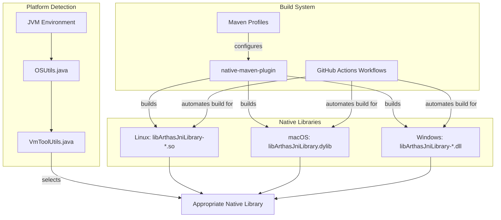
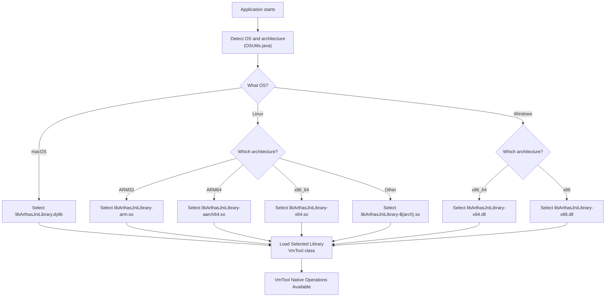
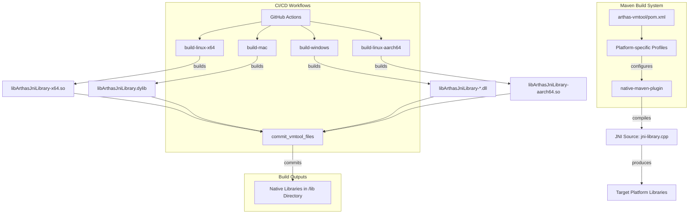

<!-- source: DeepWiki mcp.deepwiki.com · repo alibaba/arthas · page 6.2 Heap Analysis and Native Operations · fetched 2026-10-29 -->

# Cross-Platform Native Library

Relevant source files

The following files were used as context for generating this wiki page:

- [.github/workflows/auto-prettier.yaml](.github/workflows/auto-prettier.yaml)
- [.github/workflows/build-vmtool.yaml](.github/workflows/build-vmtool.yaml)
- [.github/workflows/release.yaml](.github/workflows/release.yaml)
- [.github/workflows/test.yaml](.github/workflows/test.yaml)
- [.gitignore](.gitignore)
- [arthas-vmtool/pom.xml](arthas-vmtool/pom.xml)
- [arthas-vmtool/src/main/java/arthas/VmTool.java](arthas-vmtool/src/main/java/arthas/VmTool.java)
- [arthas-vmtool/src/main/java/arthas/VmToolMXBean.java](arthas-vmtool/src/main/java/arthas/VmToolMXBean.java)
- [arthas-vmtool/src/main/java/arthas/package-info.java](arthas-vmtool/src/main/java/arthas/package-info.java)
- [arthas-vmtool/src/main/native/src/heap_analyzer.c](arthas-vmtool/src/main/native/src/heap_analyzer.c)
- [arthas-vmtool/src/main/native/src/heap_analyzer.h](arthas-vmtool/src/main/native/src/heap_analyzer.h)
- [arthas-vmtool/src/main/native/src/jni-library.cpp](arthas-vmtool/src/main/native/src/jni-library.cpp)
- [arthas-vmtool/src/test/java/arthas/VmToolTest.java](arthas-vmtool/src/test/java/arthas/VmToolTest.java)
- [bin/install-local.sh](bin/install-local.sh)
- [common/src/main/java/com/taobao/arthas/common/OSUtils.java](common/src/main/java/com/taobao/arthas/common/OSUtils.java)
- [common/src/main/java/com/taobao/arthas/common/VmToolUtils.java](common/src/main/java/com/taobao/arthas/common/VmToolUtils.java)
- [core/src/main/java/com/taobao/arthas/core/command/monitor200/VmToolCommand.java](core/src/main/java/com/taobao/arthas/core/command/monitor200/VmToolCommand.java)
- [integration-test/telnet-stop-leak/README.md](integration-test/telnet-stop-leak/README.md)
- [integration-test/telnet-stop-leak/arthas_telnet.exp](integration-test/telnet-stop-leak/arthas_telnet.exp)
- [integration-test/telnet-stop-leak/commands.txt](integration-test/telnet-stop-leak/commands.txt)
- [integration-test/telnet-stop-leak/run_telnet_stop_leak_test.py](integration-test/telnet-stop-leak/run_telnet_stop_leak_test.py)
- [packaging/src/main/assembly/assembly-doc.xml](packaging/src/main/assembly/assembly-doc.xml)
- [packaging/src/main/assembly/assembly.xml](packaging/src/main/assembly/assembly.xml)
- [site/docs/doc/vmtool.md](site/docs/doc/vmtool.md)
- [site/docs/en/doc/vmtool.md](site/docs/en/doc/vmtool.md)

This document describes Arthas's native library system that enables low-level JVM interactions through JNI (Java Native Interface) across multiple operating systems and CPU architectures. These native libraries are critical for the VmTool component which provides enhanced diagnostics capabilities that cannot be achieved through pure Java code. For information about the JNI bridge implementation itself, see [JNI Bridge Implementation](#6.1).

## Architecture Overview

The cross-platform native library system in Arthas is designed to provide consistent functionality across diverse environments while accommodating platform-specific requirements.

Sources: [arthas-vmtool/pom.xml:1-286](), [common/src/main/java/com/taobao/arthas/common/OSUtils.java:1-155](), [common/src/main/java/com/taobao/arthas/common/VmToolUtils.java:1-37]()

## Supported Platforms and Libraries

Arthas provides native libraries for all major operating systems and CPU architectures to ensure wide compatibility.

| Operating System | Architecture | Library Name | Maven Profile | Compiler Options |
|------------------|--------------|--------------|---------------|------------------|
| macOS (Darwin)   | x86_64/ARM64 | libArthasJniLibrary.dylib | macos-amd64 | -arch x86_64 -arch arm64 |
| Linux            | x86_64 (AMD64) | libArthasJniLibrary-x64.so | linux-amd64 | -m64 |
| Linux            | ARM64 (AArch64) | libArthasJniLibrary-aarch64.so | linux-aarch64 | -march=armv8-a |
| Linux            | ARM32         | libArthasJniLibrary-arm.so | linux-${os.arch} | Platform-specific |
| Linux            | Other architectures | libArthasJniLibrary-${os.arch}.so | linux-${os.arch} | Platform-specific |
| Windows          | x86_64 (AMD64) | libArthasJniLibrary-x64.dll | windows-amd64 | -m64 |
| Windows          | x86 (32-bit)  | libArthasJniLibrary-x86.dll | windows-32 | -m32 |

Sources: [arthas-vmtool/pom.xml:16-181](), [common/src/main/java/com/taobao/arthas/common/VmToolUtils.java:8-31]()

## Platform Detection and Library Loading

Arthas dynamically determines the appropriate native library to load based on the runtime environment.

Sources: [common/src/main/java/com/taobao/arthas/common/OSUtils.java:11-155](), [common/src/main/java/com/taobao/arthas/common/VmToolUtils.java:8-35]()

The platform detection process involves:

1. The `OSUtils` class identifies the operating system and architecture by examining system properties
2. It normalizes architecture names to a consistent format (e.g., converting various x86_64 representations to a standard form)
3. `VmToolUtils` uses this information to determine the correct library name for the current platform
4. The VmTool loads the appropriate native library using this name

## Native Library Build System

Arthas uses Maven profiles and the `native-maven-plugin` to manage cross-platform builds for native libraries.

Sources: [arthas-vmtool/pom.xml:184-262](), [.github/workflows/build-vmtool.yaml:1-109](), [.github/workflows/test.yaml:1-55]()

### Build Configuration Details

The build process for native libraries involves:

1. **Maven Profiles**: The `arthas-vmtool/pom.xml` file defines profiles for each target platform, configuring:
   - Operating system name for JNI headers
   - Architecture-specific compiler flags
   - Output library naming patterns

2. **Native Code Compilation**: The `native-maven-plugin` handles:
   - Generating JNI headers from Java code
   - Compiling C++ source files using platform-specific options
   - Linking the final libraries with appropriate flags

3. **CI/CD Automation**: GitHub Actions workflows automate building for all supported platforms:
   - Separate jobs for Linux (x64, ARM64), macOS, and Windows
   - Artifacts from each build are collected
   - Built libraries are committed to the repository's `/lib` directory

The build system ensures that appropriate compiler options are used for each platform. For example:
- macOS builds use `-arch x86_64 -arch arm64` to create universal binaries
- Linux and Windows 64-bit builds use `-m64`
- Windows builds use static linking (via `-static-libstdc++ -static`) to avoid runtime dependencies

### CI/CD Pipeline for Native Libraries

The `.github/workflows/build-vmtool.yaml` file defines a dedicated workflow for building native libraries across platforms. This workflow is triggered manually and:

1. Runs separate build jobs for each platform
2. Uses different runner environments for each platform (Ubuntu for Linux, macOS for Apple, Windows for Microsoft)
3. For ARM64 Linux, uses `run-on-arch-action` to create an ARM64 environment
4. Collects all built libraries and commits them to the repository

This ensures that all native libraries are regularly built and tested without requiring developers to have access to all target platforms.

Sources: [.github/workflows/build-vmtool.yaml:7-106]()

## Packaging and Distribution

The built native libraries are included in the Arthas distribution package, making them immediately available when Arthas is deployed.

The packaging process:
1. Native libraries are committed to the `/lib` directory in the repository
2. The `packaging/src/main/assembly/assembly.xml` file includes this directory in the final distribution
3. When Arthas is deployed, it uses `VmToolUtils` to select the appropriate library from the bundled libraries

Sources: [packaging/src/main/assembly/assembly.xml:63-70]()

## Testing Across Platforms

Arthas ensures quality across platforms through extensive CI/CD testing:

1. The `.github/workflows/test.yaml` file defines test jobs for:
   - Ubuntu Linux with Java 8, 11, 17, and 19
   - Windows with Java 8 and 11
   - macOS (Intel and Apple Silicon) with Java 8 and 11

2. Each job builds the entire Arthas project with `-P full` profile, which includes the native components

This comprehensive testing ensures that the native libraries function correctly across all supported platforms and with different Java versions.

Sources: [.github/workflows/test.yaml:1-55]()

## Conclusion

The cross-platform native library system in Arthas provides consistent low-level JVM access capabilities across diverse operating systems and architectures. Through carefully designed platform detection, build configurations, and CI/CD automation, Arthas ensures that users have access to powerful diagnostic capabilities regardless of their deployment environment.

---

