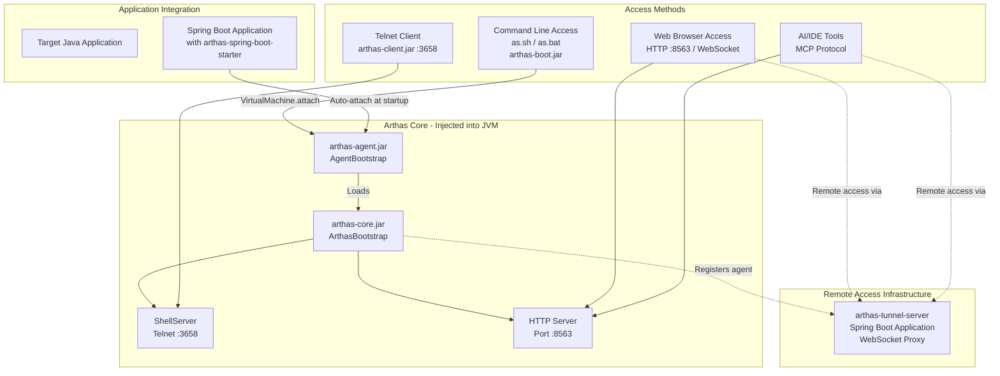
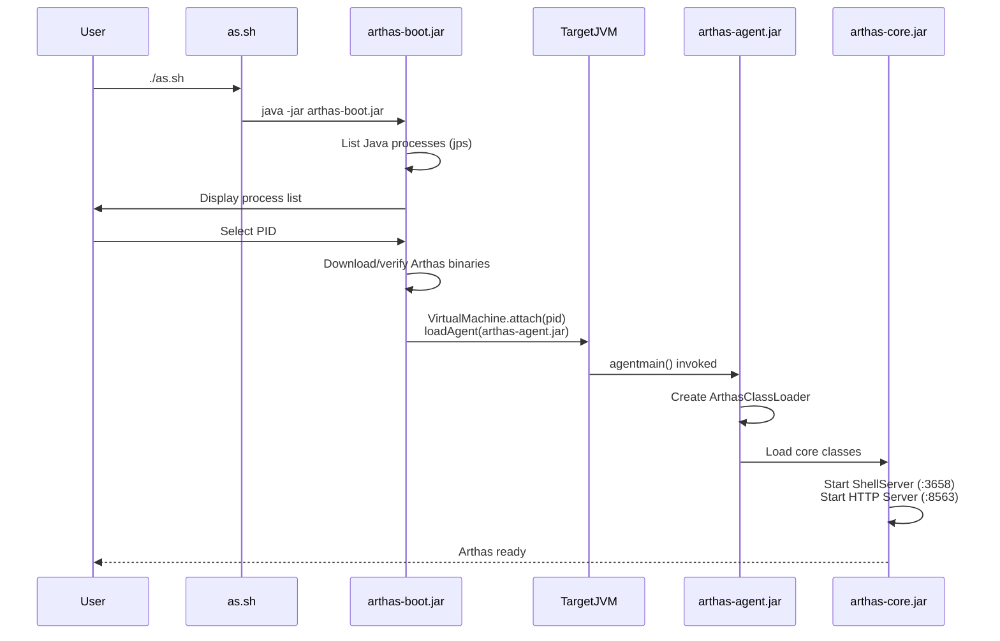
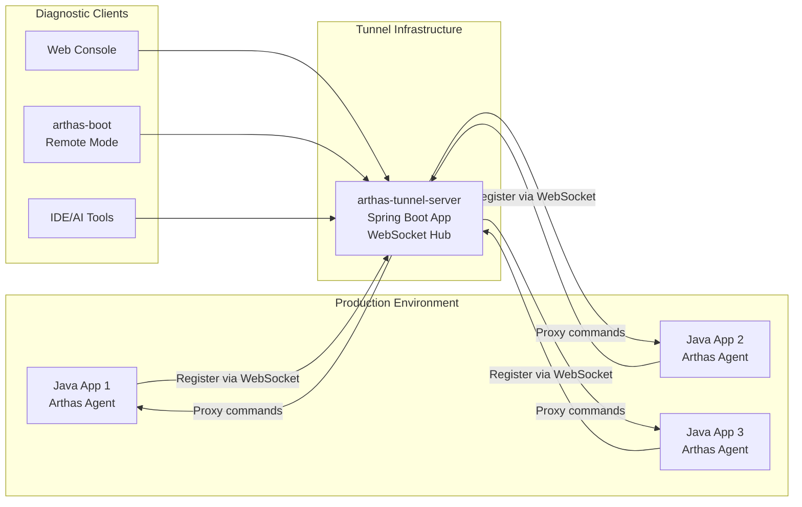
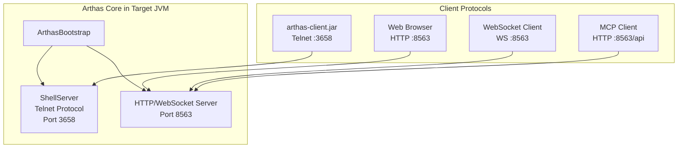
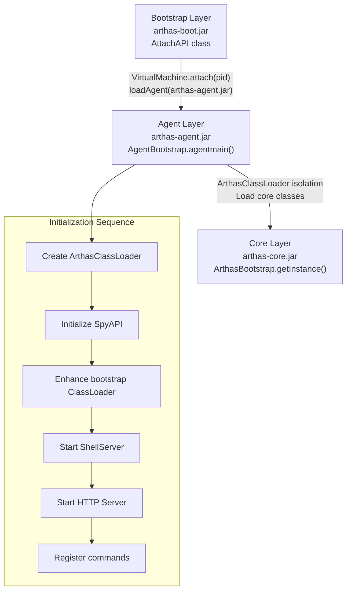
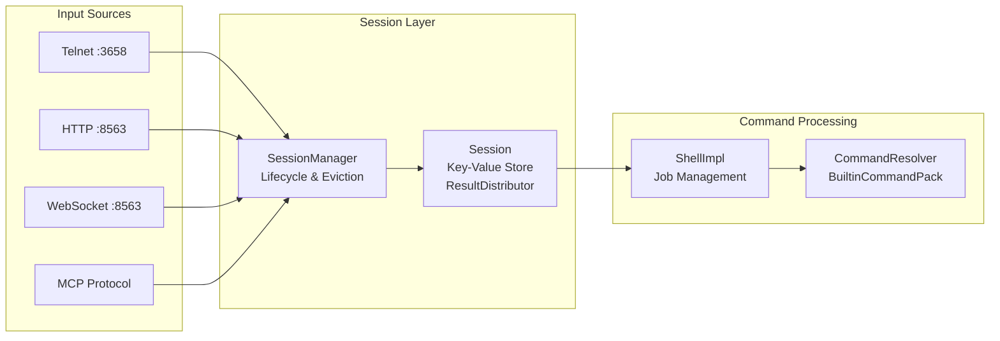

<!-- source: DeepWiki mcp.deepwiki.com · repo alibaba/arthas · page 7 Integration Options · fetched 2026-10-29 -->

# Integration Options

<details>
<summary>Relevant source files</summary>

The following files were used as context for generating this wiki page:

- [CONTRIBUTING.md](CONTRIBUTING.md)
- [README.md](README.md)
- [README_CN.md](README_CN.md)
- [USERS.md](USERS.md)
- [arthas-agent-attach/pom.xml](arthas-agent-attach/pom.xml)
- [arthas-spring-boot-starter/pom.xml](arthas-spring-boot-starter/pom.xml)
- [arthas-vmtool/README.md](arthas-vmtool/README.md)
- [as-package.sh](as-package.sh)
- [bin/as-service.bat](bin/as-service.bat)
- [bin/as.bat](bin/as.bat)
- [static/cider.png](static/cider.png)
- [static/citycloud.jpg](static/citycloud.jpg)
- [static/didiglobal.jpg](static/didiglobal.jpg)
- [static/dms.png](static/dms.png)
- [static/guideir.jpg](static/guideir.jpg)
- [static/hollycrm.png](static/hollycrm.png)
- [static/mingyuanyun.jpg](static/mingyuanyun.jpg)
- [static/ouyeel.png](static/ouyeel.png)
- [static/videt.png](static/videt.png)
- [static/zhaopin.png](static/zhaopin.png)

</details>


## Purpose and Scope

This page provides an overview of the different methods available for integrating Arthas into Java applications and diagnostic workflows. It covers the architecture and entry points for each integration approach, helping you choose the most appropriate method for your use case.

For detailed configuration of each method, see the subsections:
- Spring Boot auto-configuration details: [7.1](#7.1)
- Web console UI and HTTP API specifics: [7.2](#7.2)  
- AI/IDE tool integration via MCP: [7.3](#7.3)

For information on deploying and configuring Arthas after integration, see [8](#8).

## Integration Architecture Overview

Arthas supports multiple integration patterns to accommodate different deployment scenarios and user workflows:



**Sources:** [README.md:1-97](), [README_CN.md:1-86](), High-level system diagrams

## Integration Methods

### Manual Attachment (as.sh / as.bat)

The most common integration method is manual attachment to a running JVM process. This approach requires no application code changes and can be used on-demand for troubleshooting.

**Key Components:**
- `as.sh` (Linux/Mac) or `as.bat` (Windows) - Shell scripts for process selection and attachment
- `arthas-boot.jar` - Bootstrap JAR that implements the attachment logic
- `arthas-agent.jar` - Agent JAR loaded into target JVM via `VirtualMachine.attach()`
- `arthas-core.jar` - Core diagnostic engine and command processor

**Workflow:**



**Usage:**
```bash
# Download and run
curl -O https://arthas.aliyun.com/arthas-boot.jar
java -jar arthas-boot.jar

# Or use installation script
curl -L https://arthas.aliyun.com/install.sh | sh
./as.sh
```

**Sources:** [README.md:52-78](), [README_CN.md:38-68](), [bin/as.bat:1-120]()

### Embedded Integration (Spring Boot Starter)

For Spring Boot applications, the `arthas-spring-boot-starter` provides automatic attachment during application startup. This enables continuous monitoring without manual intervention.

**Key Components:**
- `arthas-spring-boot-starter` - Maven/Gradle dependency with auto-configuration
- `arthas-agent-attach` - Programmatic attachment API
- `arthas-packaging` - Contains bundled Arthas binaries

**Maven Dependency:**
```xml
<dependency>
    <groupId>com.taobao.arthas</groupId>
    <artifactId>arthas-spring-boot-starter</artifactId>
    <version>${arthas.version}</version>
</dependency>
```

The starter automatically configures and attaches Arthas to the application JVM when Spring Boot starts. Configuration is managed through `application.properties` or `application.yml`.

For detailed configuration options and usage, see [7.1](#7.1).

**Sources:** [arthas-spring-boot-starter/pom.xml:1-114](), [README.md:92,414-416](), [README_CN.md:81,401-403]()

### Web-Based Access

Arthas exposes both a web console UI and HTTP REST API for browser-based and programmatic access.

**Key Endpoints:**
- HTTP Server: Port `8563` (default)
- WebSocket: Port `8563` (same as HTTP)
- Web Console UI: `http://127.0.0.1:8563/`

The HTTP API supports:
- Command execution via POST requests
- Real-time output via WebSocket
- Session management
- Result retrieval in JSON format

For API specifications and web console features, see [7.2](#7.2).

**Sources:** [README.md:90,388-392](), [README_CN.md:79,376-380](), High-level system diagrams

### AI/IDE Integration (MCP Protocol)

The Model Context Protocol (MCP) integration enables AI assistants and IDEs to programmatically interact with Arthas diagnostics.

**Protocol Support:**
- MCP server implementation
- Structured command/response format
- Integration with AI coding assistants
- IDE plugin support

For MCP protocol details and integration examples, see [7.3](#7.3).

**Sources:** High-level system diagrams (Command Execution Pipeline)

### Remote Access (Tunnel Server)

For production environments where direct network access is restricted, the `arthas-tunnel-server` provides a WebSocket-based proxy for remote access.

**Architecture:**



The tunnel server:
- Accepts WebSocket connections from Arthas agents
- Maintains agent registry with metadata (app name, agent ID, host)
- Proxies diagnostic commands from clients to agents
- Supports authentication and access control

For tunnel deployment and configuration, see [5](#5).

**Sources:** High-level system diagrams, [README.md:40](), [README_CN.md:30]()

## Integration Method Comparison

| Integration Method | Use Case | Deployment Impact | Network Requirements | Typical Scenario |
|-------------------|----------|-------------------|---------------------|------------------|
| **Manual Attachment** (`as.sh`/`as.bat`) | Ad-hoc troubleshooting | None - attaches to running process | Local or SSH access to server | Developer debugging on dev/test servers |
| **Spring Boot Starter** | Continuous monitoring | Startup dependency added | Local ports open (3658, 8563) | Production monitoring with embedded agent |
| **Web Console** | Browser-based diagnostics | Uses running Arthas agent | HTTP access to port 8563 | Operations team using web UI |
| **Telnet Client** | Interactive CLI session | Uses running Arthas agent | Telnet access to port 3658 | Power users preferring terminal |
| **HTTP API** | Programmatic integration | Uses running Arthas agent | HTTP access to port 8563 | Automation scripts, monitoring systems |
| **MCP Protocol** | AI/IDE integration | Uses running Arthas agent | HTTP access to port 8563 | AI assistants, IDE diagnostics plugins |
| **Tunnel Server** | Remote production access | Agents connect to central tunnel | Outbound WebSocket to tunnel server | Multi-environment production diagnostics |

## Connection Ports and Protocols

Arthas uses standardized ports for different protocols:



**Default Ports:**
- **3658** - Telnet protocol for `arthas-client.jar` CLI
- **8563** - HTTP/WebSocket for web console, HTTP API, and MCP

Both ports can be customized via command-line arguments:
```bash
./as.sh <pid> --telnet-port 9999 --http-port 9998
```

**Sources:** [bin/as.bat:13-14,69-74](), [bin/as-service.bat:11-12,47-48]()

## Bootstrap and Attachment Process

Regardless of integration method, Arthas follows a consistent attachment pattern using Java's Instrumentation API:



**Key Classes:**
- `AgentBootstrap` - Entry point when agent JAR is loaded via `VirtualMachine.attach()`
- `ArthasBootstrap` - Core initialization and lifecycle management
- `ArthasClassLoader` - Isolated classloader to prevent conflicts with application classes
- `ShellServer` - Manages telnet connections and session lifecycle
- HTTP server implementation - Handles web console and API requests

The attachment mechanism uses the standard Java Attach API (`com.sun.tools.attach.VirtualMachine`) available in JDK 6+ to load the agent into a running JVM without restart.

**Sources:** High-level system diagrams (Runtime Execution Flow), [CONTRIBUTING.md:20-23](), [as-package.sh:1-123]()

## Session Management Across Integrations

All integration methods converge on a common session management layer:



Each connection (whether telnet, HTTP, WebSocket, or MCP) receives a dedicated `Session` instance that:
- Maintains command execution state
- Stores session-scoped data (current working directory, last results, etc.)
- Manages job lifecycle for long-running commands
- Distributes results to multiple output consumers

This unified session model ensures consistent behavior across all integration methods.

**Sources:** High-level system diagrams (Command Execution Pipeline)

## Distribution and Deployment

Integration artifacts are distributed through multiple channels:

| Artifact | Distribution Method | Use Case |
|----------|-------------------|----------|
| `arthas-boot.jar` | Direct download, Maven Central | Manual attachment bootstrap |
| `arthas-spring-boot-starter` | Maven Central, Gradle Plugin Portal | Spring Boot dependency |
| `arthas-bin.zip` | GitHub Releases, Aliyun mirror | Complete binary package |
| `arthas-packaging` (deb/rpm) | Package repositories | System-level installation |
| Docker image `hengyunabc/arthas` | Docker Hub | Container environments |

The `as.sh` script automatically downloads the latest version from Aliyun CDN or Maven Central on first run, storing it in `~/.arthas/`.

**Sources:** [README.md:55-78,86](), [as-package.sh:82,117-118](), High-level system diagrams (Build & Deployment Pipeline)

---

