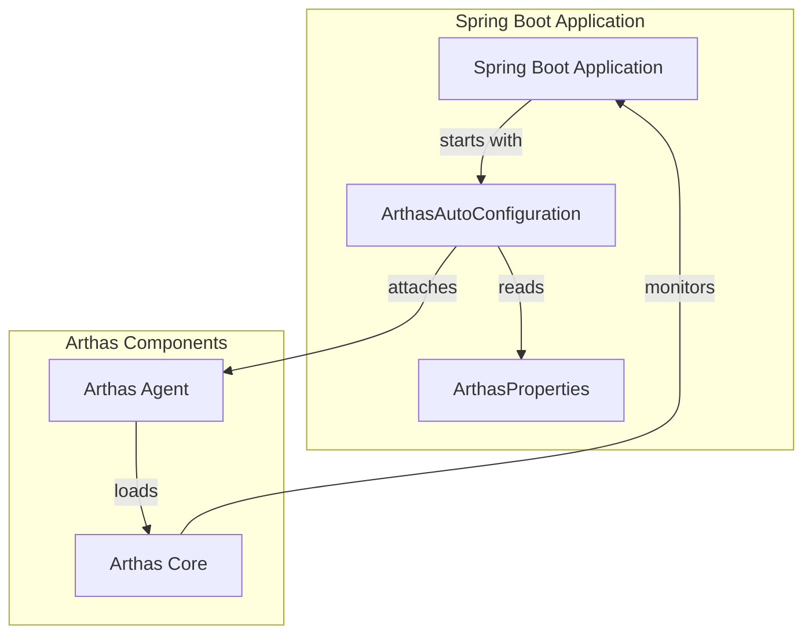
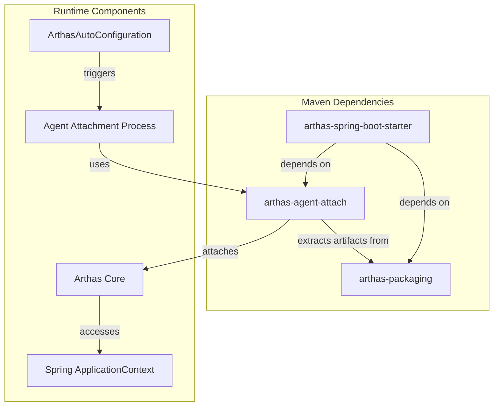

<!-- source: DeepWiki mcp.deepwiki.com · repo alibaba/arthas · page 7.1 Spring Boot Starter · fetched 2026-10-29 -->

# Spring Boot Integration

<details>
<summary>Relevant source files</summary>

The following files were used as context for generating this wiki page:

- [arthas-agent-attach/pom.xml](arthas-agent-attach/pom.xml)
- [arthas-spring-boot-starter/pom.xml](arthas-spring-boot-starter/pom.xml)

</details>


This document details how to integrate Arthas with Spring Boot applications using the arthas-spring-boot-starter module. This allows for embedded Arthas capabilities directly in Spring Boot applications without requiring a separate agent attachment process. For information about other integration options, see [Integration Options](#7).

## Overview

The Arthas Spring Boot Starter provides an automated way to attach the Arthas agent to your Spring Boot application during startup. This integration enables seamless diagnostics capabilities with minimal configuration while leveraging Spring Boot's auto-configuration mechanism.



Sources: [arthas-spring-boot-starter/pom.xml:34-68]()

## Installation

### Maven Dependency

To integrate Arthas with a Spring Boot application, add the following dependency to your project:

```xml
<dependency>
    <groupId>com.taobao.arthas</groupId>
    <artifactId>arthas-spring-boot-starter</artifactId>
    <version>${arthas.version}</version>
</dependency>
```

### Compatibility

The starter is compatible with:
- Spring Boot 2.x and 3.x
- Java 8 and later versions (with conditional support for specific features in Java 17+)

Sources: [arthas-spring-boot-starter/pom.xml:22-32](), [arthas-spring-boot-starter/pom.xml:71-81]()

## Integration Architecture

The Arthas Spring Boot integration works through multiple layers of components:



Sources: [arthas-spring-boot-starter/pom.xml:34-45](), [arthas-agent-attach/pom.xml:14-29]()

## Key Components

### 1. arthas-spring-boot-starter

The main module that provides Spring Boot auto-configuration for Arthas. It:
- Registers necessary beans for Arthas agent attachment
- Provides configuration properties for customizing Arthas behavior
- Integrates with Spring Boot's lifecycle to attach the agent at the right time

### 2. arthas-agent-attach

A utility module that handles the actual attachment of the Arthas agent to the running JVM:
- Uses ByteBuddy Agent for Java instrumentation
- Manages the unpacking and preparation of Arthas artifacts
- Handles the JVM attachment process

### 3. arthas-packaging

Contains the bundled Arthas core components that get attached to the JVM.

Sources: [arthas-spring-boot-starter/pom.xml:34-45](), [arthas-agent-attach/pom.xml:14-29]()

## Configuration Options

The starter provides numerous configuration options through Spring Boot properties, typically defined in `application.properties` or `application.yml`:

```yaml
arthas:
  enabled: true                 # Enable/disable Arthas, default is true
  agent-id: myApp               # Unique identifier for this agent instance
  telnet-port: 3658             # Port for telnet server, default is 3658
  http-port: 8563              # Port for HTTP server, default is 8563
  tunnel-server: ws://localhost:7777/ws  # WebSocket address for tunnel server
  session-timeout: 1800         # Session timeout in seconds, default is 1800
  home: ${user.home}/arthas     # Arthas home directory
  ip: 127.0.0.1                # Bind to specified IP
  disabled-commands: jvm,sysprop # Commands to disable, comma-separated
```

Configuration changes can also be made programmatically by customizing the `ArthasProperties` bean.

## Integration with Spring Boot Actuator

When Spring Boot Actuator is present in the classpath, the Arthas starter automatically integrates with it to provide:

1. Health indicators for Arthas agent status
2. Management endpoints for Arthas operations
3. Metrics collection integration

Sources: [arthas-spring-boot-starter/pom.xml:47-52]()

## Web Console Integration

The starter also integrates with Spring Boot's web capabilities when `spring-boot-starter-web` is present:

1. Provides web endpoints for accessing Arthas features
2. Registers controllers for web console access
3. Serves static assets for the web UI

Sources: [arthas-spring-boot-starter/pom.xml:53-58]()

## Implementation Details

### Agent Attachment Process

When a Spring Boot application with the Arthas starter initializes:

1. Spring Boot's auto-configuration mechanism detects the Arthas starter
2. The starter registers necessary beans based on configuration properties
3. During application startup, the agent attachment process is triggered
4. The agent-attach module:
   - Extracts Arthas core artifacts if needed
   - Uses ByteBuddy's Agent API to attach to the current JVM
   - Initializes the Arthas core with configured properties
5. Arthas becomes available through configured channels (telnet, HTTP, tunnel)

```mermaid
sequenceDiagram
    participant App as "Spring Boot Application"
    participant Config as "ArthasAutoConfiguration"
    participant Properties as "ArthasProperties"
    participant Attach as "AgentAttachProcessor"
    participant ByteBuddy as "ByteBuddy Agent"
    participant Core as "Arthas Core"
    
    App->>Config: Initialize auto-configuration
    Config->>Properties: Read configuration
    Config->>Attach: Create attachment processor
    Attach->>ByteBuddy: Request JVM attachment
    ByteBuddy->>Core: Load and initialize Arthas
    Core->>App: Start monitoring
    Core->>App: Open communication channels
```

### ByteBuddy Integration

The `arthas-agent-attach` module leverages ByteBuddy for agent attachment:

Sources: [arthas-agent-attach/pom.xml:22-25]()

### ZIP Handling

The integration uses the zt-zip library to extract and manage Arthas artifacts:

Sources: [arthas-agent-attach/pom.xml:26-29]()

## Best Practices

1. **Production Usage**:
   - Consider setting `arthas.enabled=false` in production by default
   - Enable conditionally through Spring profiles or configuration switches
   - Use secure tunnel server for remote access

2. **Security Considerations**:
   - Restrict access to Arthas ports in network configurations
   - Use authentication when available
   - Consider disabling sensitive commands in production environments

3. **Memory Optimization**:
   - Configure appropriate timeouts to ensure resources are released
   - Use the tunnel feature for distributed environments instead of opening multiple ports

## Troubleshooting

Common issues and solutions:

| Issue | Possible Cause | Solution |
|-------|----------------|----------|
| Agent attachment fails | Insufficient permissions | Run with appropriate JVM permissions |
| Port conflicts | Another process using Arthas ports | Configure alternative ports |
| ClassLoader issues | Complex application class loading | Configure appropriate tunnel options |
| High memory usage | Long-running sessions | Configure appropriate session timeouts |

## Example Use Cases

1. **Developer Environments**:
   - Include the starter in local development for easy debugging
   - Configure with default settings for quick access

2. **Testing Environments**:
   - Include conditionally for automated test environments
   - Integrate with CI/CD for on-demand diagnostics

3. **Production Monitoring**:
   - Configure with tunnel server for centralized access
   - Enable with restricted commands for safety
   - Integrate with production monitoring systems

---

