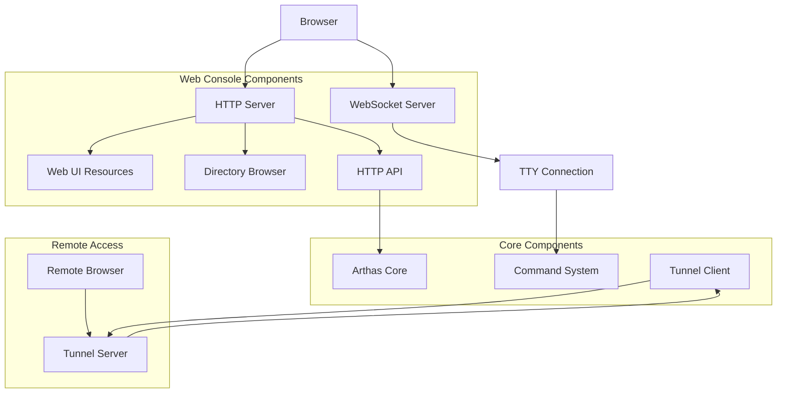
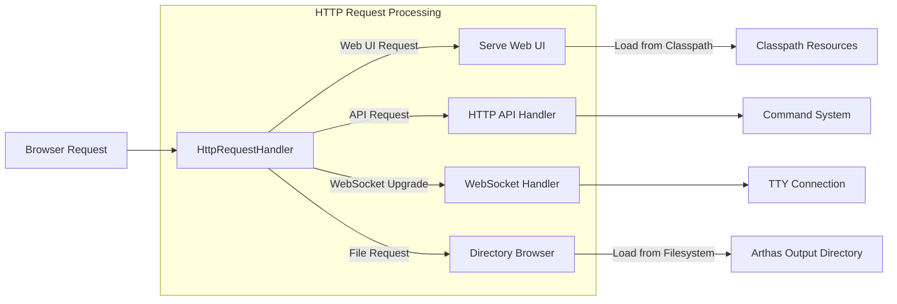
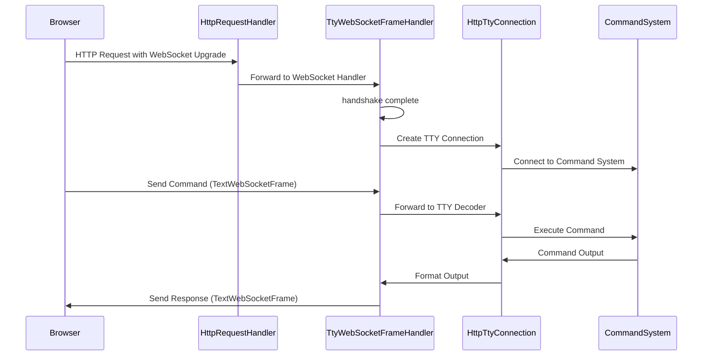
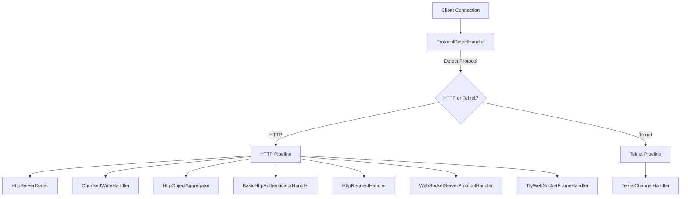
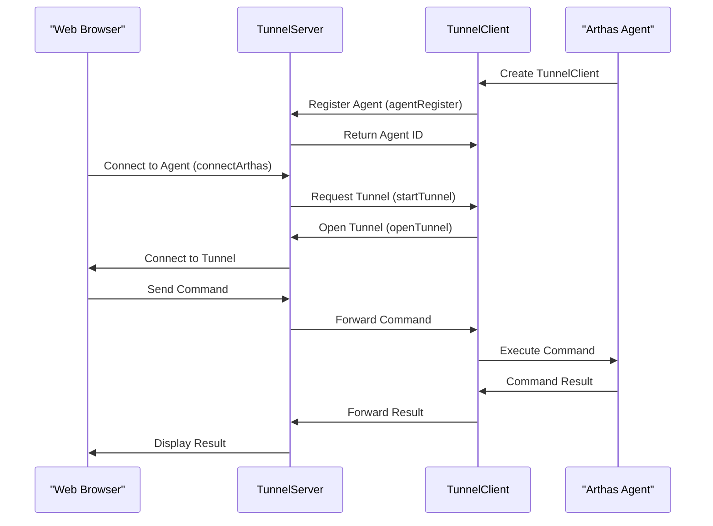
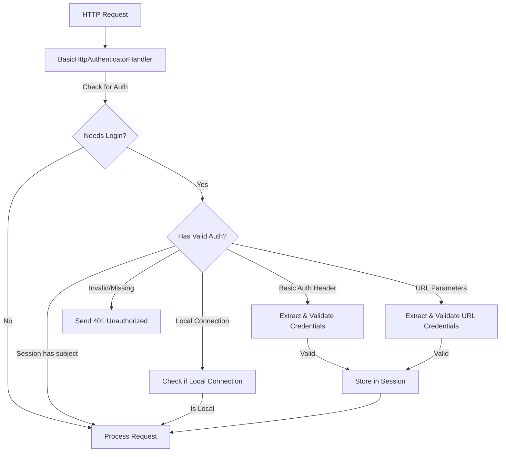
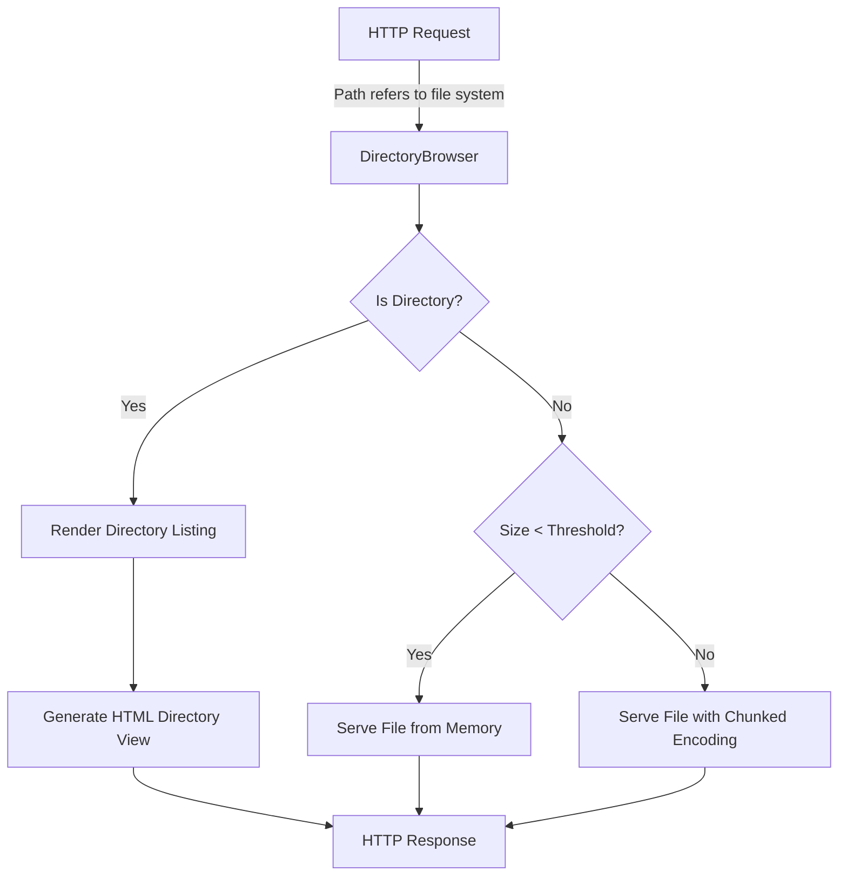

<!-- source: DeepWiki mcp.deepwiki.com · repo alibaba/arthas · page 7.2 Web Console and HTTP API · fetched 2026-10-29 -->

# Web Console Integration

Relevant source files

The following files were used as context for generating this wiki page:

- [CONTRIBUTING.md](CONTRIBUTING.md)
- [Dockerfile](Dockerfile)
- [Dockerfile-No-Jdk](Dockerfile-No-Jdk)
- [README.md](README.md)
- [README_CN.md](README_CN.md)
- [USERS.md](USERS.md)
- [agent/src/main/java/com/taobao/arthas/agent334/AgentBootstrap.java](agent/src/main/java/com/taobao/arthas/agent334/AgentBootstrap.java)
- [arthas-vmtool/README.md](arthas-vmtool/README.md)
- [as-package.sh](as-package.sh)
- [bin/as-service.bat](bin/as-service.bat)
- [bin/as.bat](bin/as.bat)
- [bin/as.sh](bin/as.sh)
- [boot/src/main/java/com/taobao/arthas/boot/Bootstrap.java](boot/src/main/java/com/taobao/arthas/boot/Bootstrap.java)
- [boot/src/main/java/com/taobao/arthas/boot/DownloadUtils.java](boot/src/main/java/com/taobao/arthas/boot/DownloadUtils.java)
- [boot/src/main/java/com/taobao/arthas/boot/ProcessUtils.java](boot/src/main/java/com/taobao/arthas/boot/ProcessUtils.java)
- [boot/src/test/java/com/taobao/arthas/boot/DownloadUtilsTest.java](boot/src/test/java/com/taobao/arthas/boot/DownloadUtilsTest.java)
- [client/src/main/java/com/taobao/arthas/client/IOUtil.java](client/src/main/java/com/taobao/arthas/client/IOUtil.java)
- [client/src/main/java/com/taobao/arthas/client/TelnetConsole.java](client/src/main/java/com/taobao/arthas/client/TelnetConsole.java)
- [common/src/main/java/com/taobao/arthas/common/AnsiLog.java](common/src/main/java/com/taobao/arthas/common/AnsiLog.java)
- [common/src/main/java/com/taobao/arthas/common/ExecutingCommand.java](common/src/main/java/com/taobao/arthas/common/ExecutingCommand.java)
- [common/src/main/java/com/taobao/arthas/common/IOUtils.java](common/src/main/java/com/taobao/arthas/common/IOUtils.java)
- [common/src/main/java/com/taobao/arthas/common/PidUtils.java](common/src/main/java/com/taobao/arthas/common/PidUtils.java)
- [common/src/main/java/com/taobao/arthas/common/SocketUtils.java](common/src/main/java/com/taobao/arthas/common/SocketUtils.java)
- [common/src/main/java/com/taobao/arthas/common/UsageRender.java](common/src/main/java/com/taobao/arthas/common/UsageRender.java)
- [core/src/main/java/arthas.properties](core/src/main/java/arthas.properties)
- [core/src/main/java/com/taobao/arthas/core/Arthas.java](core/src/main/java/com/taobao/arthas/core/Arthas.java)
- [core/src/main/java/com/taobao/arthas/core/config/Configure.java](core/src/main/java/com/taobao/arthas/core/config/Configure.java)
- [core/src/main/java/com/taobao/arthas/core/mcp/ArthasMcpServer.java](core/src/main/java/com/taobao/arthas/core/mcp/ArthasMcpServer.java)
- [core/src/main/java/com/taobao/arthas/core/server/ArthasBootstrap.java](core/src/main/java/com/taobao/arthas/core/server/ArthasBootstrap.java)
- [core/src/main/java/com/taobao/arthas/core/shell/command/internal/WordCountHandler.java](core/src/main/java/com/taobao/arthas/core/shell/command/internal/WordCountHandler.java)
- [core/src/main/java/com/taobao/arthas/core/shell/impl/ShellImpl.java](core/src/main/java/com/taobao/arthas/core/shell/impl/ShellImpl.java)
- [core/src/main/java/com/taobao/arthas/core/shell/impl/ShellServerImpl.java](core/src/main/java/com/taobao/arthas/core/shell/impl/ShellServerImpl.java)
- [core/src/main/java/com/taobao/arthas/core/shell/session/impl/SessionManagerImpl.java](core/src/main/java/com/taobao/arthas/core/shell/session/impl/SessionManagerImpl.java)
- [core/src/main/java/com/taobao/arthas/core/shell/term/impl/http/api/ApiRequest.java](core/src/main/java/com/taobao/arthas/core/shell/term/impl/http/api/ApiRequest.java)
- [core/src/main/java/com/taobao/arthas/core/shell/term/impl/http/api/HttpApiHandler.java](core/src/main/java/com/taobao/arthas/core/shell/term/impl/http/api/HttpApiHandler.java)
- [core/src/main/java/com/taobao/arthas/core/util/ArthasBanner.java](core/src/main/java/com/taobao/arthas/core/util/ArthasBanner.java)
- [core/src/main/java/com/taobao/arthas/core/util/UserStatUtil.java](core/src/main/java/com/taobao/arthas/core/util/UserStatUtil.java)
- [static/cider.png](static/cider.png)
- [static/citycloud.jpg](static/citycloud.jpg)
- [static/didiglobal.jpg](static/didiglobal.jpg)
- [static/dms.png](static/dms.png)
- [static/guideir.jpg](static/guideir.jpg)
- [static/hollycrm.png](static/hollycrm.png)
- [static/mingyuanyun.jpg](static/mingyuanyun.jpg)
- [static/ouyeel.png](static/ouyeel.png)
- [static/videt.png](static/videt.png)
- [static/zhaopin.png](static/zhaopin.png)
- [tunnel-server/src/main/java/com/alibaba/arthas/tunnel/server/app/web/StatController.java](tunnel-server/src/main/java/com/alibaba/arthas/tunnel/server/app/web/StatController.java)

This page documents the web-based console interface for Arthas, which allows users to access and interact with the diagnostic tool through a browser. The web console provides a more accessible alternative to the command-line interface, making Arthas more user-friendly while offering the same functionality. For information about command-line access, see [Command Processing Pipeline](#2.3), and for remote access through the tunnel system, see [Tunnel System](#5).

## 1. Web Console Architecture

The Arthas Web Console is built on a Netty-based HTTP and WebSocket server that provides both static resource serving and interactive terminal functionality. The console architecture integrates with the core Arthas components and supports both local and remote access patterns.

Sources:
- [core/src/main/java/com/taobao/arthas/core/shell/term/impl/http/HttpRequestHandler.java:31-174]()
- [core/src/main/java/com/taobao/arthas/core/shell/term/impl/http/NettyWebsocketTtyBootstrap.java:32-138]()
- [core/src/main/java/com/taobao/arthas/core/shell/term/impl/http/TtyServerInitializer.java:23-50]()

## 2. HTTP Server and Static Resource Handling

The HTTP server component handles browser requests for the web UI resources, API calls, and WebSocket upgrades. It serves static resources from both the classpath and the file system.

The HTTP server handles the following request types:

1. **Web UI requests** - Serves the web console HTML, JavaScript, and CSS files
2. **API requests** - Processes HTTP API calls to control Arthas
3. **WebSocket upgrades** - Upgrades to WebSocket for terminal interaction
4. **Directory browsing** - Allows browsing and downloading files from the Arthas output directory

Sources:
- [core/src/main/java/com/taobao/arthas/core/shell/term/impl/http/HttpRequestHandler.java:52-110]()
- [core/src/main/java/com/taobao/arthas/core/shell/term/impl/http/DirectoryBrowser.java:47-292]()

## 3. WebSocket Terminal Integration

The WebSocket implementation provides an interactive terminal experience through the browser, connecting browser clients to the Arthas command system.

The WebSocket terminal connection:

1. Handles the WebSocket protocol handshake
2. Creates a TTY connection bridging the WebSocket to the Arthas command system
3. Processes incoming text frames as terminal input
4. Sends command output back to the browser as text frames

Sources:
- [core/src/main/java/com/taobao/arthas/core/shell/term/impl/http/TtyWebSocketFrameHandler.java:34-84]()
- [core/src/main/java/com/taobao/arthas/core/shell/term/impl/httptelnet/ProtocolDetectHandler.java:35-106]()

## 4. Protocol Detection

The Arthas server supports both HTTP (for web console) and Telnet (for command-line) protocols on the same port using a protocol detection mechanism.

The protocol detection works by:

1. Examining the first bytes of the incoming connection
2. For HTTP (starting with "GET"), configuring an HTTP processing pipeline
3. For Telnet, configuring a Telnet processing pipeline
4. Setting an appropriate idle timeout to handle inactive connections

Sources:
- [core/src/main/java/com/taobao/arthas/core/shell/term/impl/httptelnet/ProtocolDetectHandler.java:54-104]()
- [core/src/main/java/com/taobao/arthas/core/shell/term/impl/httptelnet/NettyHttpTelnetBootstrap.java:62-81]()

## 5. Tunnel System Integration

The tunnel system enables remote access to the Arthas web console, allowing users to connect to Arthas instances running in environments where direct access is not possible, such as in containerized deployments.

The tunnel system works as follows:

1. **Agent Registration**: The Arthas agent registers with the tunnel server
2. **Client Connection**: A browser connects to the tunnel server requesting a specific agent
3. **Tunnel Establishment**: The tunnel server coordinates establishing a bidirectional tunnel
4. **Command Execution**: Commands are relayed through the tunnel to the agent and responses back to the browser
5. **HTTP Proxy**: The tunnel system includes a proxy mechanism for accessing HTTP resources from the agent

Sources:
- [tunnel-client/src/main/java/com/alibaba/arthas/tunnel/client/TunnelClient.java:42-205]()
- [tunnel-client/src/main/java/com/alibaba/arthas/tunnel/client/TunnelClientSocketClientHandler.java:36-180]()
- [tunnel-server/src/main/java/com/alibaba/arthas/tunnel/server/TunnelSocketFrameHandler.java:49-314]()

## 6. Web Console Authentication

The web console supports HTTP Basic Authentication to secure access to the Arthas diagnostic capabilities.

The authentication system supports:

1. HTTP Basic Authentication headers
2. Username/password parameters in URLs
3. Session-based authentication with cookies
4. Automatic authentication for local connections (configurable)

Sources:
- [core/src/main/java/com/taobao/arthas/core/shell/term/impl/http/BasicHttpAuthenticatorHandler.java:41-184]()
- [core/src/main/java/com/taobao/arthas/core/security/SecurityAuthenticatorImpl.java:19-93]()
- [common/src/main/java/com/taobao/arthas/common/ArthasConstants.java:33-41]()

## 7. HTTP API Support

The web console provides an HTTP API for programmatic interaction with Arthas, enabling integration with other tools or custom web interfaces.

| API Endpoint | Description                                           |
|--------------|-------------------------------------------------------|
| `/api`       | Main API endpoint for executing Arthas commands       |

The API supports:

1. Executing Arthas diagnostic commands via HTTP
2. Retrieving command results in structured formats
3. Session management for consistent command context

Sources:
- [core/src/main/java/com/taobao/arthas/core/shell/term/impl/http/HttpRequestHandler.java:70-71]()

## 8. File Browser Integration

The web console includes a file browser component that allows users to navigate and download files from the Arthas output directory, such as heap dumps, thread dumps, or profiling results.

The directory browser provides:

1. HTML-based directory listings
2. File downloads for various Arthas output files
3. Memory-efficient handling of large files using chunked transfer encoding
4. Security checks to prevent directory traversal attacks

Sources:
- [core/src/main/java/com/taobao/arthas/core/shell/term/impl/http/DirectoryBrowser.java:82-254]()
- [core/src/main/java/com/taobao/arthas/core/shell/term/impl/http/HttpRequestHandler.java:88-90]()

## 9. Integration with Arthas Commands

The web console provides full access to Arthas commands, including advanced features like OGNL expression evaluation and base64 encoding/decoding.

| Command Type | Examples                        | Description                           |
|--------------|--------------------------------|---------------------------------------|
| Basic        | help, version, quit            | Core commands for Arthas operation    |
| JVM          | dashboard, thread, jvm         | Monitor JVM metrics and threads       |
| Class        | sc, sm, jad                    | Class-related analysis and operations |
| Method       | watch, trace, stack, tt        | Method monitoring and analysis        |
| Enhanced     | ognl, vmtool                   | Advanced JVM operations               |
| System       | sysprop, sysenv, base64        | System properties and utilities       |

The web console supports all command features available in the CLI, with some commands having special handling for web-based display formats.

Sources:
- [core/src/main/java/com/taobao/arthas/core/command/klass100/OgnlCommand.java:41-116]()
- [core/src/main/java/com/taobao/arthas/core/command/basic1000/Base64Command.java:35-178]()

## 10. Security Considerations

When deploying the Arthas web console, several security aspects should be considered:

1. **Authentication**: Enable username/password authentication for web console access
2. **Local-only access**: Consider restricting access to localhost if remote access is not needed
3. **Tunnel security**: When using the tunnel for remote access, secure the tunnel server
4. **Command restrictions**: Be aware that powerful commands like OGNL provide extensive system access
5. **Output limitations**: The web console restricts certain operations for non-TTY sessions to prevent abuse

Sources:
- [core/src/main/java/com/taobao/arthas/core/security/SecurityAuthenticatorImpl.java:26-34]()
- [core/src/main/java/com/taobao/arthas/core/command/basic1000/Base64Command.java:161-167]()

---

